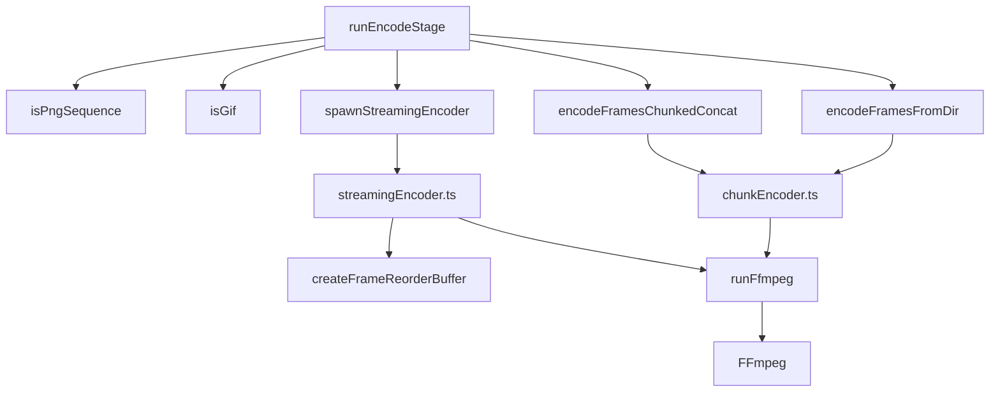
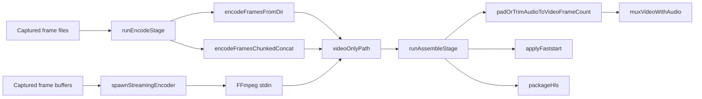
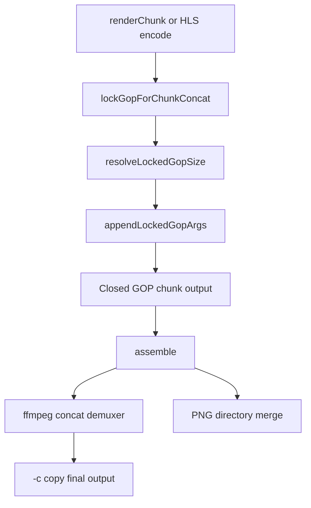
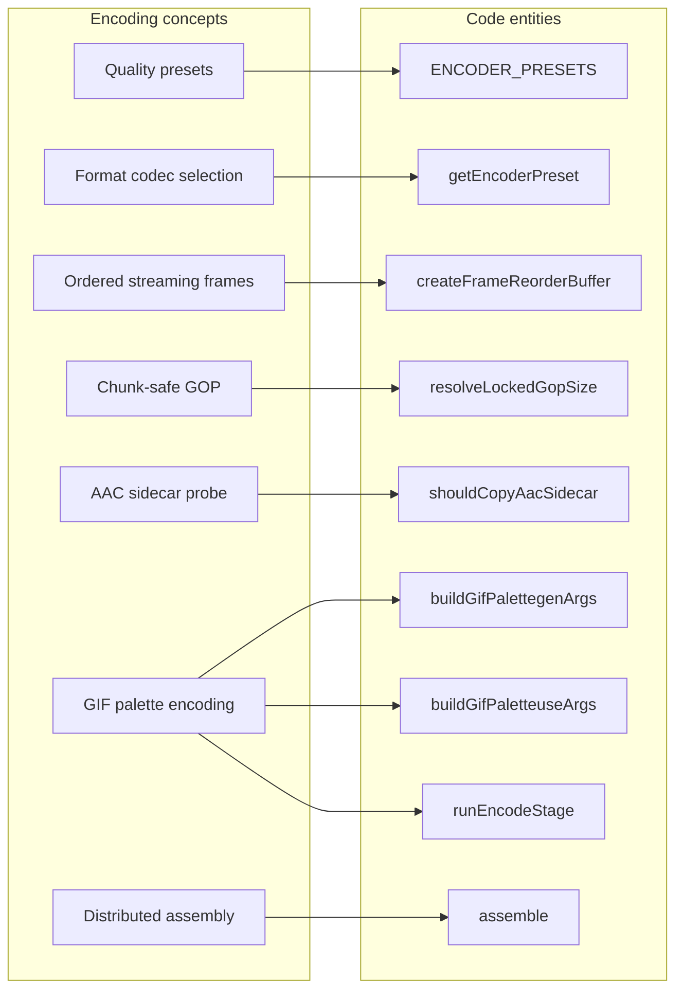
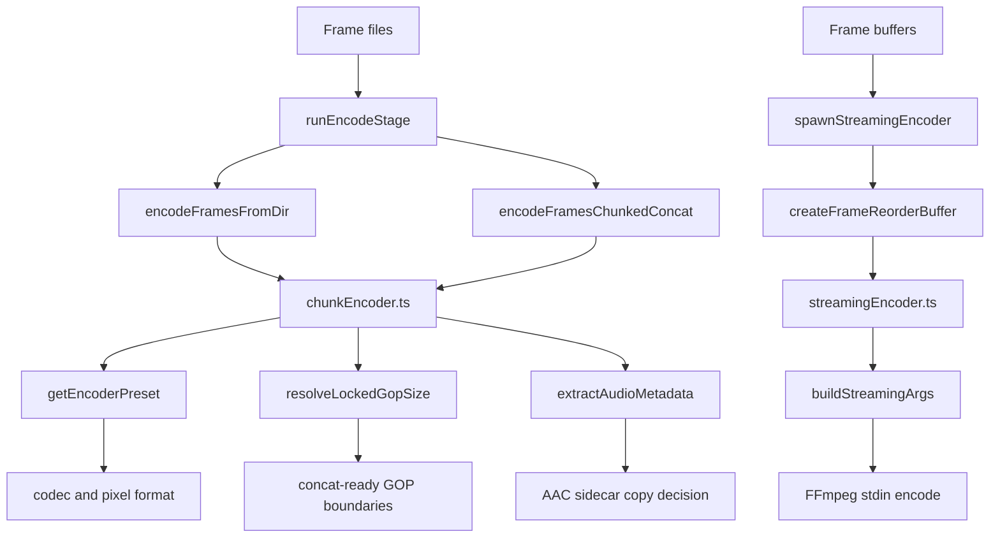

<!-- source: DeepWiki mcp.deepwiki.com · repo heygen-com/hyperframes · page 5.3 Encoding Pipeline · fetched 2026-11-02 -->

# Encoding Pipeline

<details>
<summary>Relevant source files</summary>

The following files were used as context for generating this wiki page:

- [packages/cli/src/capture/assetCataloger.test.ts](packages/cli/src/capture/assetCataloger.test.ts)
- [packages/cli/src/capture/assetCataloger.ts](packages/cli/src/capture/assetCataloger.ts)
- [packages/cli/src/capture/tokenExtractor.ts](packages/cli/src/capture/tokenExtractor.ts)
- [packages/core/src/media/gif.test.ts](packages/core/src/media/gif.test.ts)
- [packages/core/src/media/gif.ts](packages/core/src/media/gif.ts)
- [packages/engine/src/services/chunkEncoder.percentDir.test.ts](packages/engine/src/services/chunkEncoder.percentDir.test.ts)
- [packages/engine/src/services/chunkEncoder.test.ts](packages/engine/src/services/chunkEncoder.test.ts)
- [packages/engine/src/services/chunkEncoder.ts](packages/engine/src/services/chunkEncoder.ts)
- [packages/engine/src/services/extractedFrameIndex.ts](packages/engine/src/services/extractedFrameIndex.ts)
- [packages/engine/src/services/streamingEncoder.test.ts](packages/engine/src/services/streamingEncoder.test.ts)
- [packages/engine/src/services/streamingEncoder.ts](packages/engine/src/services/streamingEncoder.ts)
- [packages/engine/src/utils/gpuEncoder.test.ts](packages/engine/src/utils/gpuEncoder.test.ts)
- [packages/engine/src/utils/gpuEncoder.ts](packages/engine/src/utils/gpuEncoder.ts)
- [packages/engine/src/utils/hdr.test.ts](packages/engine/src/utils/hdr.test.ts)
- [packages/engine/src/utils/hdr.ts](packages/engine/src/utils/hdr.ts)
- [packages/engine/src/utils/runFfmpeg.test.ts](packages/engine/src/utils/runFfmpeg.test.ts)
- [packages/engine/src/utils/runFfmpeg.ts](packages/engine/src/utils/runFfmpeg.ts)
- [packages/engine/src/utils/sdrCaptureColor.ts](packages/engine/src/utils/sdrCaptureColor.ts)
- [packages/producer/src/services/animatedGifPrep.test.ts](packages/producer/src/services/animatedGifPrep.test.ts)
- [packages/producer/src/services/animatedGifPrep.ts](packages/producer/src/services/animatedGifPrep.ts)
- [packages/producer/src/services/distributed/assemble.test.ts](packages/producer/src/services/distributed/assemble.test.ts)
- [packages/producer/src/services/distributed/assemble.ts](packages/producer/src/services/distributed/assemble.ts)
- [packages/producer/src/services/render/audioPadTrim.integration.test.ts](packages/producer/src/services/render/audioPadTrim.integration.test.ts)
- [packages/producer/src/services/render/audioPadTrim.test.ts](packages/producer/src/services/render/audioPadTrim.test.ts)
- [packages/producer/src/services/render/audioPadTrim.ts](packages/producer/src/services/render/audioPadTrim.ts)
- [packages/producer/src/services/render/stages/assembleStage.test.ts](packages/producer/src/services/render/stages/assembleStage.test.ts)
- [packages/producer/src/services/render/stages/assembleStage.ts](packages/producer/src/services/render/stages/assembleStage.ts)
- [packages/producer/src/services/render/stages/encodeStage.test.ts](packages/producer/src/services/render/stages/encodeStage.test.ts)
- [packages/producer/src/services/render/stages/encodeStage.ts](packages/producer/src/services/render/stages/encodeStage.ts)
- [packages/producer/src/services/render/stages/gifEncodeArgs.test.ts](packages/producer/src/services/render/stages/gifEncodeArgs.test.ts)
- [packages/producer/src/services/render/stages/gifEncodeArgs.ts](packages/producer/src/services/render/stages/gifEncodeArgs.ts)

</details>


## Purpose and scope

The encoding pipeline converts captured frame images or frame buffers into video outputs. It covers disk-based and streaming encoders, codec and quality selection, chunk concatenation, frame ordering, GPU encoder utilities, FFprobe use, GIF palette encoding, and audio synchronization during assembly. The main engine services are `chunkEncoder.ts` and `streamingEncoder.ts`; Producer’s encode and assemble stages select and connect those services. [packages/engine/src/services/chunkEncoder.ts:1-7](), [packages/engine/src/services/streamingEncoder.ts:1-14](), [packages/producer/src/services/render/stages/encodeStage.ts:1-32]()

Sources: [packages/engine/src/services/chunkEncoder.ts:1-7](), [packages/engine/src/services/streamingEncoder.ts:1-14](), [packages/producer/src/services/render/stages/encodeStage.ts:1-32]()

---

## Overview

`chunkEncoder.ts` encodes numbered frame files from a directory. It exposes `getEncoderPreset`, `resolveLockedGopSize`, and encoder entry points used by Producer; its imports show shared dependencies for GPU encoding, FFmpeg process management, HDR/SDR color handling, FFprobe audio metadata, and render provenance. [packages/engine/src/services/chunkEncoder.ts:9-53](), [packages/engine/src/services/chunkEncoder.ts:55-67](), [packages/engine/src/services/chunkEncoder.ts:137-169]()

`streamingEncoder.ts` provides the alternative path: screenshot buffers are piped to FFmpeg through `image2pipe` instead of being written to disk and read in a separate encoding pass. It also exports `createFrameReorderBuffer`, which coordinates sequential writes when capture workers finish frames out of order. [packages/engine/src/services/streamingEncoder.ts:3-14](), [packages/engine/src/services/streamingEncoder.ts:62-90]()

Producer’s `runEncodeStage` selects among PNG-sequence output, GIF encoding, and encoded video. Video uses `encodeFramesFromDir` or `encodeFramesChunkedConcat`; the stage can be skipped when streaming capture has already produced the video-only output. [packages/producer/src/services/render/stages/encodeStage.ts:1-15](), [packages/producer/src/services/render/stages/encodeStage.ts:47-75]()

### Pipeline relationships: names to code entities

**Diagram: Producer encode paths and Engine encoder entities**



Producer’s encode stage imports the disk-based and streaming encoder entry points and the GIF argument builders; the engine services implement the disk-based and streaming paths and share FFmpeg process utilities. [packages/producer/src/services/render/stages/encodeStage.ts:47-75](), [packages/engine/src/services/chunkEncoder.ts:39-46](), [packages/engine/src/services/streamingEncoder.ts:16-50]()

Sources: [packages/producer/src/services/render/stages/encodeStage.ts:47-75](), [packages/engine/src/services/chunkEncoder.ts:39-46](), [packages/engine/src/services/streamingEncoder.ts:16-50]()

### Render data flow: from captured frames to assembled output

**Diagram: encode and assemble handoff**



The stage contract identifies `videoOnlyPath` as the encoded video output and describes the later mux/faststart work in `assembleStage.ts`. The assemble stage normalizes audio to the video frame count before muxing or HLS packaging; with no audio, non-HLS output goes through faststart. [packages/producer/src/services/render/stages/encodeStage.ts:7-15](), [packages/producer/src/services/render/stages/assembleStage.ts:1-14](), [packages/producer/src/services/render/stages/assembleStage.ts:110-163]()

Sources: [packages/producer/src/services/render/stages/encodeStage.ts:7-15](), [packages/producer/src/services/render/stages/assembleStage.ts:1-14](), [packages/producer/src/services/render/stages/assembleStage.ts:110-163]()

---

## Codec selection and quality presets

`ENCODER_PRESETS` defines three H.264-oriented quality levels. The `quality` field is the value passed through as encoder quality/CRF by the encoding argument builders; larger values represent lower quality in the tested draft/standard/high ordering. [packages/engine/src/services/chunkEncoder.ts:55-59](), [packages/engine/src/services/chunkEncoder.test.ts:120-143]()

| Quality | Preset value | Quality value | Base codec |
|---|---:|---:|---|
| `draft` | `ultrafast` | 28 | `h264` |
| `standard` | `medium` | 18 | `h264` |
| `high` | `slow` | 15 | `h264` |

The format-aware `getEncoderPreset(quality, format, hdr)` maps those base settings to the output encoding configuration:

| Format/condition | Codec in returned preset | Preset mapping | Pixel format |
|---|---|---|---|
| WebM | `vp9` | `ultrafast` becomes `realtime`; other base presets become `good` | `yuva420p` |
| MOV | `prores` | `4444` | `yuva444p10le` |
| MP4 with HDR | `h265` | `ultrafast` becomes `fast`; otherwise base preset | `yuv420p10le` |
| MP4 without HDR | base H.264 preset | Base preset | `yuv420p` |

These are preset descriptors, not a claim that every returned codec string is the FFmpeg encoder name. Encoder argument construction and GPU mapping determine the actual FFmpeg encoder selection. [packages/engine/src/services/chunkEncoder.ts:61-67](), [packages/engine/src/services/chunkEncoder.ts:132-169]()

Producer’s distributed assembler also derives rate-control arguments from the locked render configuration. When a bitrate is supplied and CRF is absent, it emits bitrate mode with the selected preset; otherwise it emits a CRF, falling back to the preset’s quality value. [packages/producer/src/services/distributed/assemble.ts:90-103]()

Sources: [packages/engine/src/services/chunkEncoder.ts:55-67](), [packages/engine/src/services/chunkEncoder.ts:132-169](), [packages/producer/src/services/distributed/assemble.ts:90-103]()

---

## Chunked encoding and concatenation

The encode stage selects `encodeFramesChunkedConcat` when `enableChunkedEncode` is true; otherwise it selects `encodeFramesFromDir`. It passes the same frame-directory context and encoding inputs through the chosen path. [packages/producer/src/services/render/stages/encodeStage.ts:24-28](), [packages/producer/src/services/render/stages/encodeStage.ts:77-123]()

Chunk concatenation requires compatible chunk boundaries. `resolveLockedGopSize` returns `null` when GOP locking is not requested; when enabled, it rejects missing, non-finite, or non-positive `gopSize` values and returns the floored size. The encoder defines shared locked-GOP options, and its comments describe closed-GOP/keyframe arguments for libx264/libx265 to support stream-copy concatenation or HLS cutting. [packages/engine/src/services/chunkEncoder.ts:174-197](), [packages/engine/src/services/chunkEncoder.ts:199-202]()

The Producer encode-stage contract documents two callers for GOP locking: distributed chunk rendering, where chunks are joined with `-c copy`, and HLS rendering, where segment boundaries need keyframes. Other renders omit the option. [packages/producer/src/services/render/stages/encodeStage.ts:125-141]()

Distributed `assemble` handles MP4, MOV, and WebM chunks through FFmpeg’s concat demuxer with stream copy, and handles PNG-sequence chunks by merging frame directories and globally renumbering frames. The documented concat contract depends on independently decodable chunk starts; VP9 chunk encoding also disables alt-ref frames to keep seams independently decodable. [packages/producer/src/services/distributed/assemble.ts:1-16]()

**Diagram: GOP contract and distributed assembly**



The encoder exposes the locked-GOP option and resolver; the Producer stage documents its use for distributed chunks and HLS; distributed assembly documents stream-copy concatenation and the separate PNG-sequence merge path. [packages/engine/src/services/chunkEncoder.ts:174-202](), [packages/producer/src/services/render/stages/encodeStage.ts:125-141](), [packages/producer/src/services/distributed/assemble.ts:1-16](), [packages/producer/src/services/distributed/assemble.ts:144-165]()

Sources: [packages/engine/src/services/chunkEncoder.ts:174-202](), [packages/producer/src/services/render/stages/encodeStage.ts:125-141](), [packages/producer/src/services/distributed/assemble.ts:1-16](), [packages/producer/src/services/distributed/assemble.ts:144-165]()

---

## Frame reorder buffer for streaming encoding

Parallel workers can produce frames out of order, but FFmpeg’s input stream must be sequential. `FrameReorderBuffer` exposes four operations: `waitForFrame(frame)`, `advanceTo(frame)`, `waitForAllDone()`, and `abort(err)`. [packages/engine/src/services/streamingEncoder.ts:62-86]()

`createFrameReorderBuffer(startFrame, endFrame)` tracks a cursor and a `pending` map keyed by frame number. Multiple waiters can be stored for a frame. A waiter resolves immediately when its frame equals the cursor; otherwise it is queued. `advanceTo` updates the cursor and resolves waiters at that index. `waitForAllDone` resolves when the cursor reaches the end frame, or waits on the end-frame key. `abort` records the error and rejects pending waiters; later waiters reject with the same error. [packages/engine/src/services/streamingEncoder.ts:88-149]()

The abort path prevents peers from remaining blocked if a worker fails before writing its assigned frame. [packages/engine/src/services/streamingEncoder.ts:79-85](), [packages/engine/src/services/streamingEncoder.ts:140-147]()

**Diagram: frame-order barrier**

```mermaid
sequenceDiagram
    participant W1 as "Worker frame 1"
    participant W0 as "Worker frame 0"
    participant R as "createFrameReorderBuffer"
    participant S as "Streaming encoder"
    W1->>R: "waitForFrame(1)"
    Note right of R: "cursor is 0; frame 1 waits"
    W0->>R: "waitForFrame(0)"
    R-->>W0: "frame 0 resolves"
    W0->>S: "writeFrame(buffer0)"
    W0->>R: "advanceTo(1)"
    R-->>W1: "frame 1 resolves"
    W1->>S: "writeFrame(buffer1)"
    W1->>R: "advanceTo(2)"
    R-->>R: "waitForAllDone can resolve"
```

The sequence follows the buffer’s cursor, waiter, and advance behavior. `StreamingEncoderOptions` and the service description establish that the ordered frames are supplied to the streaming FFmpeg encoder. [packages/engine/src/services/streamingEncoder.ts:3-14](), [packages/engine/src/services/streamingEncoder.ts:88-149]()

Sources: [packages/engine/src/services/streamingEncoder.ts:3-14](), [packages/engine/src/services/streamingEncoder.ts:88-149]()

---

## Streaming encoder

`StreamingEncoderOptions` includes rational frame rate, dimensions, optional codec and rate-control settings, pixel format, GPU selection, image format, HDR metadata, and raw input format. `rawInputFormat: "rgb48le"` selects raw video input, documented for HDR PQ frames; otherwise the service’s stated input mode is `image2pipe`. [packages/engine/src/services/streamingEncoder.ts:3-14](), [packages/engine/src/services/streamingEncoder.ts:156-185]()

The streaming service imports the shared GPU mapping helpers, FFmpeg statistics/error utilities, HDR and SDR color helpers, VP9 options, software-thread options, and render provenance support. It also imports locked-GOP helpers from `chunkEncoder.ts`, keeping the GOP option shared across encoder entry points. [packages/engine/src/services/streamingEncoder.ts:27-57]()

H.265 output is tagged `hvc1` by the streaming argument builder, including GPU encoder variants; tests also assert that H.264 and VP9 do not receive that tag. HDR tests cover transfer metadata and H.265 parameters for PQ and HLG paths. [packages/engine/src/services/streamingEncoder.test.ts:76-137](), [packages/engine/src/services/streamingEncoder.test.ts:139-182](), [packages/engine/src/services/streamingEncoder.test.ts:184-187]()

`runFfmpeg` centralizes managed FFmpeg process execution. Its options support abort signals, inactivity timeouts, and stderr callbacks; results include exit information, stderr, duration, and termination reason. `ffmpegStatsReader` parses complete FFmpeg stats lines and reports frame and time progress. [packages/engine/src/utils/runFfmpeg.ts:18-34](), [packages/engine/src/utils/runFfmpeg.ts:54-79]()

Sources: [packages/engine/src/services/streamingEncoder.ts:27-57](), [packages/engine/src/services/streamingEncoder.ts:156-185](), [packages/engine/src/services/streamingEncoder.test.ts:76-137](), [packages/engine/src/services/streamingEncoder.test.ts:139-187](), [packages/engine/src/utils/runFfmpeg.ts:18-34](), [packages/engine/src/utils/runFfmpeg.ts:54-79]()

---

## Transparency via WebM and MOV

The format preset maps WebM to VP9 with `yuva420p`, and MOV to ProRes with `yuva444p10le`. These pixel formats are selected by `getEncoderPreset` for those output formats. [packages/engine/src/services/chunkEncoder.ts:132-157]()

The Producer encode stage carries a `needsAlpha` flag and selects the frame extension based on the captured image format. Its input contract explicitly distinguishes alpha requirements from capture format: motion blur may require PNG capture even when the final output is opaque. [packages/producer/src/services/render/stages/encodeStage.ts:89-97](), [packages/producer/src/services/render/stages/encodeStage.ts:182-211]()

Sources: [packages/engine/src/services/chunkEncoder.ts:132-157](), [packages/producer/src/services/render/stages/encodeStage.ts:89-97](), [packages/producer/src/services/render/stages/encodeStage.ts:182-211]()

---

## FFprobe utilities and audio muxing

`chunkEncoder.ts` imports `extractAudioMetadata` from `ffprobe.ts`. When deciding whether an audio sidecar can be copied as AAC, `shouldCopyAacSidecar` accepts an explicit AAC codec declaration or an `.aac` extension immediately, rejects known non-AAC extensions, and probes otherwise. A probe failure falls back to transcoding so FFmpeg can report the mux error. [packages/engine/src/services/chunkEncoder.ts:46-46](), [packages/engine/src/services/chunkEncoder.ts:78-90](), [packages/engine/src/services/chunkEncoder.ts:92-130]()

The shared FFmpeg runner parses progress from stderr and formats failures with the tail of stderr, helping callers distinguish encoder-option errors and process failures. It also identifies external FFmpeg interruptions separately from managed termination. [packages/engine/src/utils/runFfmpeg.ts:36-52](), [packages/engine/src/utils/runFfmpeg.ts:54-79](), [packages/engine/src/utils/runFfmpeg.ts:110-159]()

For final assembly with audio, `runAssembleStage` probes the video frame information and audio duration through `padOrTrimAudioToVideoFrameCount`, then muxes the normalized audio as AAC. Distributed assembly likewise documents correcting audio to the assembled video’s exact `frameCount / fps` duration. [packages/producer/src/services/render/stages/assembleStage.ts:110-147](), [packages/producer/src/services/render/audioPadTrim.ts:1-20](), [packages/producer/src/services/distributed/assemble.ts:13-16]()

Sources: [packages/engine/src/services/chunkEncoder.ts:46-46](), [packages/engine/src/services/chunkEncoder.ts:78-130](), [packages/engine/src/utils/runFfmpeg.ts:36-79](), [packages/engine/src/utils/runFfmpeg.ts:110-159](), [packages/producer/src/services/render/stages/assembleStage.ts:110-147](), [packages/producer/src/services/render/audioPadTrim.ts:1-20](), [packages/producer/src/services/distributed/assemble.ts:13-16]()

---

## GIF encoding arguments and process

GIF output is handled directly in Producer’s `encodeStage`; it does not use the ordinary video encode-plus-mux path. The stage imports `buildGifPalettegenArgs` and `buildGifPaletteuseArgs`, and GIF output writes directly to `outputPath`. [packages/producer/src/services/render/stages/encodeStage.ts:7-11](), [packages/producer/src/services/render/stages/encodeStage.ts:60-75]()

The palette-generation pass applies the requested frame rate and uses `palettegen=stats_mode=diff`. The palette-use pass applies the same frame rate and uses Sierra dithering. When preserving alpha from PNG frames, palette generation reserves a transparent palette entry and palette use applies `alpha_threshold=128`. The GIF loop count defaults to zero and is validated as an integer from 0 through 65,535. [packages/producer/src/services/render/stages/encodeStage.test.ts:119-179](), [packages/producer/src/services/render/stages/encodeStage.ts:149-155]()

GIF has no audio mux/faststart stage in the documented encode-stage branching. [packages/producer/src/services/render/stages/encodeStage.ts:1-15]()

Sources: [packages/producer/src/services/render/stages/encodeStage.ts:1-15](), [packages/producer/src/services/render/stages/encodeStage.ts:149-155](), [packages/producer/src/services/render/stages/encodeStage.test.ts:119-179]()

---

## Key code entities

| Concern | Code entity | Role |
|---|---|---|
| Quality and format selection | `ENCODER_PRESETS`, `getEncoderPreset` | Base quality mapping and format/HDR-specific codec and pixel-format selection. [packages/engine/src/services/chunkEncoder.ts:55-67](), [packages/engine/src/services/chunkEncoder.ts:132-169]() |
| GOP validation | `resolveLockedGopSize` | Validates the requested GOP size when chunk-concat locking is enabled. [packages/engine/src/services/chunkEncoder.ts:174-197]() |
| Disk-based encoding | `encodeFramesFromDir` | Encodes frame files through the disk-based path selected by Producer. [packages/producer/src/services/render/stages/encodeStage.ts:24-28](), [packages/producer/src/services/render/stages/encodeStage.ts:47-59]() |
| Chunked disk encoding | `encodeFramesChunkedConcat` | Alternative selected by `enableChunkedEncode`. [packages/producer/src/services/render/stages/encodeStage.ts:24-28](), [packages/producer/src/services/render/stages/encodeStage.ts:47-59]() |
| Streaming frame ordering | `createFrameReorderBuffer` | Orders concurrent worker frames before sequential encoder input. [packages/engine/src/services/streamingEncoder.ts:62-90]() |
| Streaming encoder configuration | `StreamingEncoderOptions` | Defines frame rate, dimensions, codec, pixel format, GPU, HDR, and input-format options. [packages/engine/src/services/streamingEncoder.ts:156-185]() |
| FFmpeg process execution | `runFfmpeg` | Shared managed process runner with timeout, abort, stderr, and progress support. [packages/engine/src/utils/runFfmpeg.ts:18-34](), [packages/engine/src/utils/runFfmpeg.ts:162-178]() |
| Audio codec probe | `extractAudioMetadata` | Used by the sidecar codec-copy decision when extension/declared codec is inconclusive. [packages/engine/src/services/chunkEncoder.ts:46-46](), [packages/engine/src/services/chunkEncoder.ts:113-130]() |
| GIF arguments | `buildGifPalettegenArgs`, `buildGifPaletteuseArgs` | Build the two FFmpeg palette passes, including transparency options. [packages/producer/src/services/render/stages/encodeStage.ts:69-75](), [packages/producer/src/services/render/stages/encodeStage.test.ts:119-179]() |
| Distributed assembly | `assemble` | Joins encoded chunks or merges PNG frame directories and normalizes audio where applicable. [packages/producer/src/services/distributed/assemble.ts:105-165]() |

Sources: [packages/engine/src/services/chunkEncoder.ts:46-67](), [packages/engine/src/services/chunkEncoder.ts:113-197](), [packages/engine/src/services/streamingEncoder.ts:62-90](), [packages/engine/src/services/streamingEncoder.ts:156-185](), [packages/engine/src/utils/runFfmpeg.ts:18-34](), [packages/engine/src/utils/runFfmpeg.ts:162-178](), [packages/producer/src/services/render/stages/encodeStage.ts:24-28](), [packages/producer/src/services/render/stages/encodeStage.ts:47-75](), [packages/producer/src/services/render/stages/encodeStage.test.ts:119-179](), [packages/producer/src/services/distributed/assemble.ts:105-165]()

---

## Natural-language concepts mapped to code entities

**Diagram: encoding concepts to searchable symbols**



The diagram maps the public concepts described on this page to their implementation symbols: preset selection and GOP validation in `chunkEncoder.ts`, frame ordering in `streamingEncoder.ts`, audio codec probing in `chunkEncoder.ts`, GIF argument builders in Producer, and chunk joining in distributed `assemble.ts`. [packages/engine/src/services/chunkEncoder.ts:55-67](), [packages/engine/src/services/chunkEncoder.ts:113-130](), [packages/engine/src/services/chunkEncoder.ts:174-197](), [packages/engine/src/services/streamingEncoder.ts:62-90](), [packages/producer/src/services/render/stages/encodeStage.ts:69-75](), [packages/producer/src/services/distributed/assemble.ts:105-165]()

Sources: [packages/engine/src/services/chunkEncoder.ts:55-67](), [packages/engine/src/services/chunkEncoder.ts:113-130](), [packages/engine/src/services/chunkEncoder.ts:174-197](), [packages/engine/src/services/streamingEncoder.ts:62-90](), [packages/producer/src/services/render/stages/encodeStage.ts:69-75](), [packages/producer/src/services/distributed/assemble.ts:105-165]()

**Diagram: subsystem vocabulary to implementation path**



Producer selects the encode path; engine entities apply preset/GOP/audio decisions for disk encoding or build and order streaming input. [packages/producer/src/services/render/stages/encodeStage.ts:1-15](), [packages/producer/src/services/render/stages/encodeStage.ts:47-59](), [packages/engine/src/services/chunkEncoder.ts:55-67](), [packages/engine/src/services/chunkEncoder.ts:113-130](), [packages/engine/src/services/chunkEncoder.ts:174-197](), [packages/engine/src/services/streamingEncoder.ts:62-90](), [packages/engine/src/services/streamingEncoder.ts:152-185]()

Sources: [packages/producer/src/services/render/stages/encodeStage.ts:1-15](), [packages/producer/src/services/render/stages/encodeStage.ts:47-59](), [packages/engine/src/services/chunkEncoder.ts:55-67](), [packages/engine/src/services/chunkEncoder.ts:113-130](), [packages/engine/src/services/chunkEncoder.ts:174-197](), [packages/engine/src/services/streamingEncoder.ts:62-90](), [packages/engine/src/services/streamingEncoder.ts:152-185]()

---

