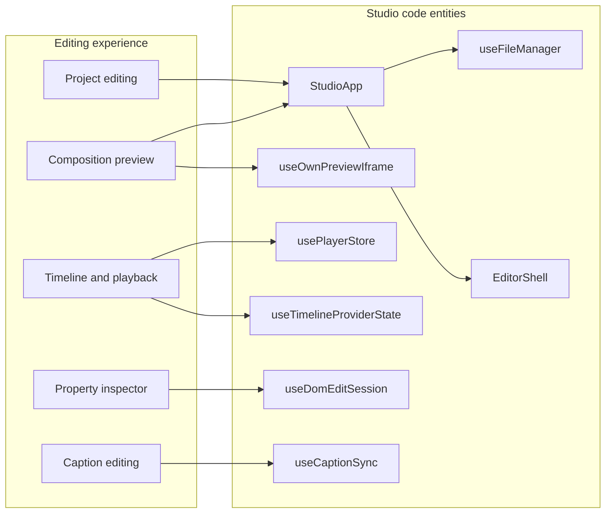
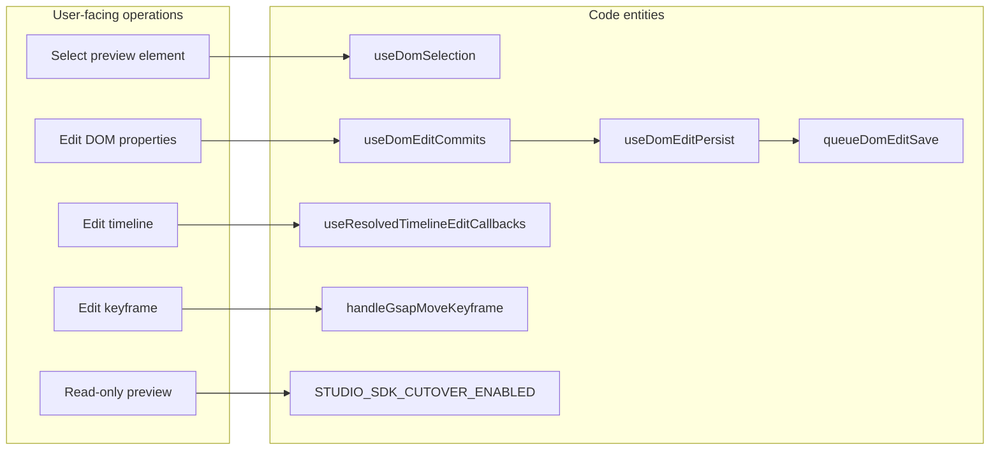

<!-- source: DeepWiki mcp.deepwiki.com · repo heygen-com/hyperframes · page 6 Studio Package · fetched 2026-11-02 -->

# Studio Package

Relevant source files

The following files were used as context for generating this wiki page:

- [packages/studio/src/App.tsx](packages/studio/src/App.tsx)
- [packages/studio/src/components/EditorShell.tsx](packages/studio/src/components/EditorShell.tsx)
- [packages/studio/src/components/editor/MotionPathOverlay.tsx](packages/studio/src/components/editor/MotionPathOverlay.tsx)
- [packages/studio/src/components/editor/manualEditingAvailability.test.ts](packages/studio/src/components/editor/manualEditingAvailability.test.ts)
- [packages/studio/src/components/editor/manualEditingAvailability.ts](packages/studio/src/components/editor/manualEditingAvailability.ts)
- [packages/studio/src/components/editor/propertyPanelTypes.ts](packages/studio/src/components/editor/propertyPanelTypes.ts)
- [packages/studio/src/components/nle/TimelinePane.tsx](packages/studio/src/components/nle/TimelinePane.tsx)
- [packages/studio/src/contexts/DomEditContext.tsx](packages/studio/src/contexts/DomEditContext.tsx)
- [packages/studio/src/hooks/useDomEditAttributeCommits.ts](packages/studio/src/hooks/useDomEditAttributeCommits.ts)
- [packages/studio/src/hooks/useDomEditCommits.ts](packages/studio/src/hooks/useDomEditCommits.ts)
- [packages/studio/src/hooks/useDomEditSession.ts](packages/studio/src/hooks/useDomEditSession.ts)
- [packages/studio/src/hooks/useDomEditTextCommits.test.tsx](packages/studio/src/hooks/useDomEditTextCommits.test.tsx)
- [packages/studio/src/hooks/useDomEditTextCommits.ts](packages/studio/src/hooks/useDomEditTextCommits.ts)
- [packages/studio/src/index.ts](packages/studio/src/index.ts)
- [packages/studio/src/player/components/ClipContextMenu.test.tsx](packages/studio/src/player/components/ClipContextMenu.test.tsx)
- [packages/studio/src/player/components/ClipContextMenu.tsx](packages/studio/src/player/components/ClipContextMenu.tsx)
- [packages/studio/src/player/components/KeyframeDiamondContextMenu.test.tsx](packages/studio/src/player/components/KeyframeDiamondContextMenu.test.tsx)
- [packages/studio/src/player/components/KeyframeDiamondContextMenu.tsx](packages/studio/src/player/components/KeyframeDiamondContextMenu.tsx)
- [packages/studio/src/player/components/Timeline.readOnly.test.tsx](packages/studio/src/player/components/Timeline.readOnly.test.tsx)
- [packages/studio/src/player/components/Timeline.rulerSeek.test.tsx](packages/studio/src/player/components/Timeline.rulerSeek.test.tsx)
- [packages/studio/src/player/components/Timeline.showKeyframes.test.tsx](packages/studio/src/player/components/Timeline.showKeyframes.test.tsx)
- [packages/studio/src/player/components/TimelineOverlays.test.ts](packages/studio/src/player/components/TimelineOverlays.test.ts)
- [packages/studio/src/player/components/TimelineOverlays.tsx](packages/studio/src/player/components/TimelineOverlays.tsx)
- [packages/studio/src/player/components/TimelineProvider.tsx](packages/studio/src/player/components/TimelineProvider.tsx)
- [packages/studio/src/player/components/TimelineTypes.ts](packages/studio/src/player/components/TimelineTypes.ts)
- [packages/studio/src/player/components/timelineClipGestureHandlers.ts](packages/studio/src/player/components/timelineClipGestureHandlers.ts)
- [packages/studio/src/player/components/timelineProviderStateBuilders.test.ts](packages/studio/src/player/components/timelineProviderStateBuilders.test.ts)
- [packages/studio/src/player/components/timelineProviderStateBuilders.ts](packages/studio/src/player/components/timelineProviderStateBuilders.ts)
- [packages/studio/src/player/components/useTimelineKeyframeData.ts](packages/studio/src/player/components/useTimelineKeyframeData.ts)
- [packages/studio/src/player/components/useTimelineProviderState.tsx](packages/studio/src/player/components/useTimelineProviderState.tsx)
- [packages/studio/src/player/index.ts](packages/studio/src/player/index.ts)
- [packages/studio/src/styles/iconTokens.ts](packages/studio/src/styles/iconTokens.ts)
- [packages/studio/src/styles/palette-reset.css](packages/studio/src/styles/palette-reset.css)
- [packages/studio/src/styles/tailwind-preset.shared.js](packages/studio/src/styles/tailwind-preset.shared.js)
- [packages/studio/src/utils/studioHelpers.test.ts](packages/studio/src/utils/studioHelpers.test.ts)
- [packages/studio/src/utils/studioHelpers.ts](packages/studio/src/utils/studioHelpers.ts)

## Purpose and Scope

`@hyperframes/studio` is a React browser IDE for editing and previewing HyperFrames compositions. Its `StudioApp` coordinates project and preview state, timeline and caption workflows, DOM editing, and the editor shell; the package also exports reusable UI, player, timeline, and editing components. This page is a high-level map: detailed subsystem behavior belongs on the linked child pages. [packages/studio/src/App.tsx:1-65]()[packages/studio/src/App.tsx:76-104]()[packages/studio/src/index.ts:1-35]()

Sources: [packages/studio/src/App.tsx:1-65](), [packages/studio/src/App.tsx:76-104](), [packages/studio/src/index.ts:1-35]()

---

## System Architecture Overview

`StudioApp` brings together the preview iframe, player state, captions, file management, edit history, panel layout, and timeline editing hooks. It also composes the shell and editor-facing components, including `EditorShell` and `TimelineToolbar`. [packages/studio/src/App.tsx:7-65]()

The package’s public exports show the main reusable areas: `EditorShell`, `NLEPreview`, `Player`, `Timeline`, `PropertyPanel`, `FileTree`, and `StudioApp`. The timeline provider and DOM-edit context connect interactive editing components to state and edit actions. [packages/studio/src/index.ts:4-35]()[packages/studio/src/index.ts:114-120]()[packages/studio/src/player/components/useTimelineProviderState.tsx:52-83]()[packages/studio/src/contexts/DomEditContext.tsx:117-156]()

### Diagram: Studio application concepts mapped to code entities

Sources: [packages/studio/src/App.tsx:7-65](), [packages/studio/src/App.tsx:76-104](), [packages/studio/src/hooks/useDomEditSession.ts:66-142](), [packages/studio/src/player/components/useTimelineProviderState.tsx:52-83]()

### Diagram: Editing concepts mapped to persistence and public APIs

Sources: [packages/studio/src/hooks/useDomEditSession.ts:11-27]()[packages/studio/src/hooks/useDomEditCommits.ts:122-165]()[packages/studio/src/player/components/useTimelineProviderState.tsx:84-115]()[packages/studio/src/components/editor/manualEditingAvailability.ts:41-79]()

---

## Core Subsystems in `@hyperframes/studio`

### 1. Studio Shell, File Management, and Assets

The shell layer organizes project state and the editor layout. `StudioApp` uses project connection, file-manager, panel-layout, and preview hooks, then includes `EditorShell` in its component composition. The package also exports `FileTree` and dock-related APIs for reusable shell integrations. [packages/studio/src/App.tsx:17-20]()[packages/studio/src/App.tsx:49-60]()[packages/studio/src/index.ts:14-20]()[packages/studio/src/index.ts:114-120]()

For details, see [Studio Shell, File Management and Assets](#6.1).

Sources: [packages/studio/src/App.tsx:17-20](), [packages/studio/src/App.tsx:49-60](), [packages/studio/src/index.ts:14-20](), [packages/studio/src/index.ts:114-120]()

### 2. NLE Timeline and Player

The timeline and player provide the temporal editing surface. The package exports `Player`, `Timeline`, `usePlayerStore`, `useTimelinePlayer`, and `NLEPreview`; timeline state and callbacks are assembled by `useTimelineProviderState`. [packages/studio/src/index.ts:4-8]()[packages/studio/src/index.ts:22-35]()[packages/studio/src/player/components/useTimelineProviderState.tsx:52-83]()

For details, see [NLE Timeline and Player](#6.2).

Sources: [packages/studio/src/index.ts:4-8](), [packages/studio/src/index.ts:22-35](), [packages/studio/src/player/components/useTimelineProviderState.tsx:52-83]()

### 3. Property Inspector and DOM Editing

The inspector and canvas-editing path connect a selected preview element to edits that can be persisted. `useDomEditSession` coordinates selection and editing hooks; `useDomEditCommits` queues saves, validates patch values, and coordinates file mutations. The package exports `PropertyPanel` for host applications. [packages/studio/src/hooks/useDomEditSession.ts:11-27]()[packages/studio/src/hooks/useDomEditCommits.ts:122-165]()[packages/studio/src/index.ts:114-118]()

For details, see [Property Inspector and DOM Editing](#6.3).

Sources: [packages/studio/src/hooks/useDomEditSession.ts:11-27](), [packages/studio/src/hooks/useDomEditCommits.ts:122-165](), [packages/studio/src/index.ts:114-118]()

### 4. GSAP Animation Editing and SDK Cutover

Animation editing is integrated with DOM-edit actions and timeline keyframe interactions. The DOM-edit context exposes GSAP-related actions, while `manualEditingAvailability.ts` defines the SDK cutover and resolver-shadow feature flags. [packages/studio/src/contexts/DomEditContext.tsx:54-86]()[packages/studio/src/components/editor/manualEditingAvailability.ts:41-68]()

For details, see [GSAP Animation Editing and SDK Cutover](#6.4).

Sources: [packages/studio/src/contexts/DomEditContext.tsx:54-86](), [packages/studio/src/components/editor/manualEditingAvailability.ts:41-68]()

### 5. Caption System

Caption state and synchronization are part of the `StudioApp` integration: it reads caption edit and selection state and calls `useCaptionSync` with the active project ID. [packages/studio/src/App.tsx:14-15]()[packages/studio/src/App.tsx:87-90]()

For details, see [Caption System](#6.5).

Sources: [packages/studio/src/App.tsx:14-15](), [packages/studio/src/App.tsx:87-90]()

### 6. Studio Testing and Edit Accuracy Harness

Studio testing and edit-accuracy tooling are covered separately from this package overview. The files cited here establish the editing and timeline entry points, but do not describe the test harness; see the child page for that coverage.

For details, see [Studio Testing and Edit Accuracy Harness](#6.6).

Sources: [packages/studio/src/index.ts:22-35](), [packages/studio/src/player/components/useTimelineProviderState.tsx:52-83]()

---

## Child Pages

| Section | Description |
| :------ | :---------- |
| [Studio Shell, File Management and Assets](#6.1) | `App.tsx` project resolution and global state, file-change coordination, editor layout, file tree, sidebar tabs, block installer, and theming. |
| [NLE Timeline and Player](#6.2) | Timeline and preview subsystem, player state, toolbar, and hotkeys. |
| [Property Inspector and DOM Editing](#6.3) | Inspector sections and canvas editing, including selection, snapping, crop handles, and layers. |
| [GSAP Animation Editing and SDK Cutover](#6.4) | GSAP editing, keyframes, motion paths, and SDK cutover persistence. |
| [Caption System](#6.5) | Caption generation and synchronization, editing panels, and embedded-captions integration. |
| [Studio Testing and Edit Accuracy Harness](#6.6) | Studio tests, edit-accuracy harness, runtime smoke scripts, and quality gates. |

Sources: [packages/studio/src/App.tsx:14-15](), [packages/studio/src/App.tsx:17-28](), [packages/studio/src/index.ts:4-35](), [packages/studio/src/index.ts:114-120]()

---

This overview maps the Studio’s user-facing areas to their principal code entry points. Follow the child pages for subsystem details and implementation flows. [packages/studio/src/App.tsx:1-65]()[packages/studio/src/index.ts:1-35]()

Sources: [packages/studio/src/App.tsx:1-65](), [packages/studio/src/index.ts:1-35]()

---

