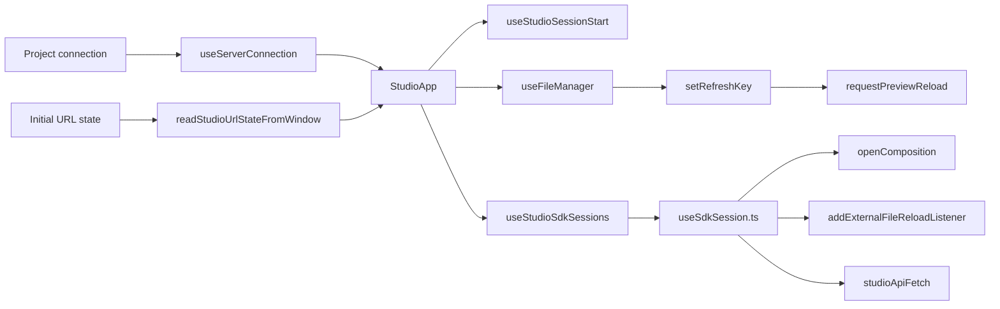
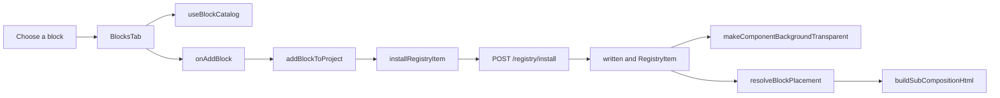
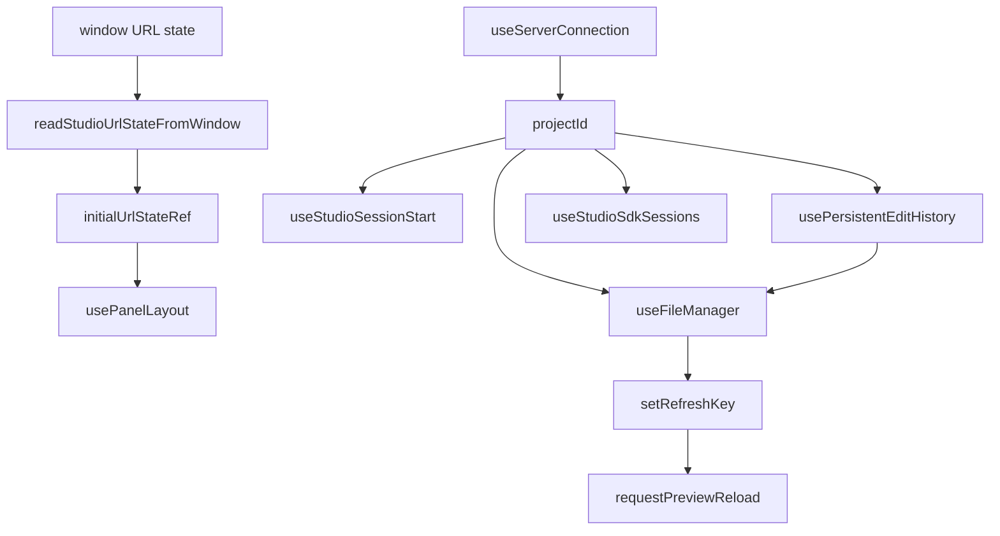
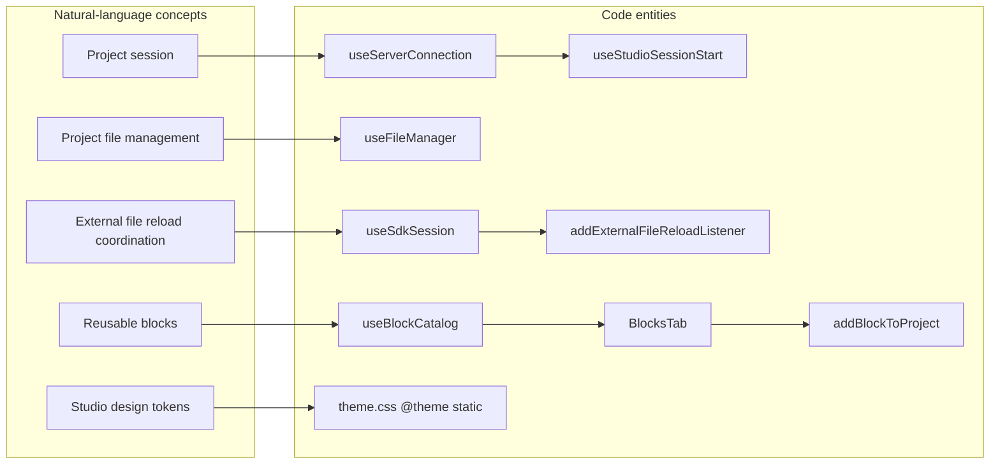

<!-- source: DeepWiki mcp.deepwiki.com · repo heygen-com/hyperframes · page 6.1 Studio Shell, File Management and Assets · fetched 2026-11-02 -->

# Studio Shell, File Management and Assets

Relevant source files

The following files were used as context for generating this wiki page:

- [packages/cli/src/server/desktopRoutes.test.ts](packages/cli/src/server/desktopRoutes.test.ts)
- [packages/cli/src/server/desktopRoutes.ts](packages/cli/src/server/desktopRoutes.ts)
- [packages/cli/src/utils/desktopApp.test.ts](packages/cli/src/utils/desktopApp.test.ts)
- [packages/cli/src/utils/desktopApp.ts](packages/cli/src/utils/desktopApp.ts)
- [packages/studio/src/App.tsx](packages/studio/src/App.tsx)
- [packages/studio/src/components/CompositionMissingBanner.test.tsx](packages/studio/src/components/CompositionMissingBanner.test.tsx)
- [packages/studio/src/components/CompositionMissingBanner.tsx](packages/studio/src/components/CompositionMissingBanner.tsx)
- [packages/studio/src/components/DesktopGuideCard.tsx](packages/studio/src/components/DesktopGuideCard.tsx)
- [packages/studio/src/components/FrameyGlyph.tsx](packages/studio/src/components/FrameyGlyph.tsx)
- [packages/studio/src/components/OpenInDesktopButton.dom.test.tsx](packages/studio/src/components/OpenInDesktopButton.dom.test.tsx)
- [packages/studio/src/components/OpenInDesktopButton.tsx](packages/studio/src/components/OpenInDesktopButton.tsx)
- [packages/studio/src/components/editor/SourceEditor.tsx](packages/studio/src/components/editor/SourceEditor.tsx)
- [packages/studio/src/components/editor/elementPositionOffset.ts](packages/studio/src/components/editor/elementPositionOffset.ts)
- [packages/studio/src/components/editor/manualEditingAvailability.test.ts](packages/studio/src/components/editor/manualEditingAvailability.test.ts)
- [packages/studio/src/components/editor/manualEditingAvailability.ts](packages/studio/src/components/editor/manualEditingAvailability.ts)
- [packages/studio/src/components/editor/manualEdits.test.ts](packages/studio/src/components/editor/manualEdits.test.ts)
- [packages/studio/src/components/editor/manualEdits.ts](packages/studio/src/components/editor/manualEdits.ts)
- [packages/studio/src/components/editor/manualEditsParsing.ts](packages/studio/src/components/editor/manualEditsParsing.ts)
- [packages/studio/src/components/editor/propertyPanelTypes.ts](packages/studio/src/components/editor/propertyPanelTypes.ts)
- [packages/studio/src/components/editor/studioCodeTheme.test.ts](packages/studio/src/components/editor/studioCodeTheme.test.ts)
- [packages/studio/src/components/editor/studioCodeTheme.ts](packages/studio/src/components/editor/studioCodeTheme.ts)
- [packages/studio/src/components/sidebar/BlocksTab.tsx](packages/studio/src/components/sidebar/BlocksTab.tsx)
- [packages/studio/src/contexts/DomEditContext.tsx](packages/studio/src/contexts/DomEditContext.tsx)
- [packages/studio/src/hooks/draggedGsapPosition.ts](packages/studio/src/hooks/draggedGsapPosition.ts)
- [packages/studio/src/hooks/externalFileChangeOwnership.test.ts](packages/studio/src/hooks/externalFileChangeOwnership.test.ts)
- [packages/studio/src/hooks/useBlockHandlers.ts](packages/studio/src/hooks/useBlockHandlers.ts)
- [packages/studio/src/hooks/useDomEditAttributeCommits.ts](packages/studio/src/hooks/useDomEditAttributeCommits.ts)
- [packages/studio/src/hooks/useDomEditCommits.ts](packages/studio/src/hooks/useDomEditCommits.ts)
- [packages/studio/src/hooks/useDomEditSession.ts](packages/studio/src/hooks/useDomEditSession.ts)
- [packages/studio/src/hooks/useDomEditTextCommits.test.tsx](packages/studio/src/hooks/useDomEditTextCommits.test.tsx)
- [packages/studio/src/hooks/useDomEditTextCommits.ts](packages/studio/src/hooks/useDomEditTextCommits.ts)
- [packages/studio/src/hooks/useExternalFileChangeCoordinator.test.tsx](packages/studio/src/hooks/useExternalFileChangeCoordinator.test.tsx)
- [packages/studio/src/hooks/useExternalFileChangeCoordinator.ts](packages/studio/src/hooks/useExternalFileChangeCoordinator.ts)
- [packages/studio/src/hooks/useSdkSession.lifecycle.test.tsx](packages/studio/src/hooks/useSdkSession.lifecycle.test.tsx)
- [packages/studio/src/hooks/useSdkSession.ts](packages/studio/src/hooks/useSdkSession.ts)
- [packages/studio/src/hooks/useStudioExternalFileChanges.ts](packages/studio/src/hooks/useStudioExternalFileChanges.ts)
- [packages/studio/src/hooks/useStudioSdkSessions.ts](packages/studio/src/hooks/useStudioSdkSessions.ts)
- [packages/studio/src/hooks/useTimelineAssetDropOps.test.tsx](packages/studio/src/hooks/useTimelineAssetDropOps.test.tsx)
- [packages/studio/src/hooks/useTimelineAssetDropOps.ts](packages/studio/src/hooks/useTimelineAssetDropOps.ts)
- [packages/studio/src/player/components/AudibleVideoClipContent.test.tsx](packages/studio/src/player/components/AudibleVideoClipContent.test.tsx)
- [packages/studio/src/player/components/AudibleVideoClipContent.tsx](packages/studio/src/player/components/AudibleVideoClipContent.tsx)
- [packages/studio/src/player/components/ClipPeakMarks.test.tsx](packages/studio/src/player/components/ClipPeakMarks.test.tsx)
- [packages/studio/src/player/components/ClipPeakMarks.tsx](packages/studio/src/player/components/ClipPeakMarks.tsx)
- [packages/studio/src/player/components/ClipPeakTooltip.tsx](packages/studio/src/player/components/ClipPeakTooltip.tsx)
- [packages/studio/src/player/components/TimelineClip.filmstrip.test.tsx](packages/studio/src/player/components/TimelineClip.filmstrip.test.tsx)
- [packages/studio/src/player/components/TimelineClip.test.tsx](packages/studio/src/player/components/TimelineClip.test.tsx)
- [packages/studio/src/player/components/VolumeControl.styles.test.ts](packages/studio/src/player/components/VolumeControl.styles.test.ts)
- [packages/studio/src/player/components/clipPeakRuns.test.ts](packages/studio/src/player/components/clipPeakRuns.test.ts)
- [packages/studio/src/player/components/clipPeakRuns.ts](packages/studio/src/player/components/clipPeakRuns.ts)
- [packages/studio/src/player/components/timelineDragDrop.test.tsx](packages/studio/src/player/components/timelineDragDrop.test.tsx)
- [packages/studio/src/player/components/timelineDragDrop.ts](packages/studio/src/player/components/timelineDragDrop.ts)
- [packages/studio/src/player/components/timelineMotionStyles.test.ts](packages/studio/src/player/components/timelineMotionStyles.test.ts)
- [packages/studio/src/player/components/timelineTheme.test.ts](packages/studio/src/player/components/timelineTheme.test.ts)
- [packages/studio/src/player/components/timelineTheme.ts](packages/studio/src/player/components/timelineTheme.ts)
- [packages/studio/src/player/lib/playbackAdapter.test.ts](packages/studio/src/player/lib/playbackAdapter.test.ts)
- [packages/studio/src/player/lib/playbackAdapter.ts](packages/studio/src/player/lib/playbackAdapter.ts)
- [packages/studio/src/styles/componentStyles.test.ts](packages/studio/src/styles/componentStyles.test.ts)
- [packages/studio/src/styles/components.css](packages/studio/src/styles/components.css)
- [packages/studio/src/styles/hex-baseline.json](packages/studio/src/styles/hex-baseline.json)
- [packages/studio/src/styles/iconTokens.ts](packages/studio/src/styles/iconTokens.ts)
- [packages/studio/src/styles/palette-reset.css](packages/studio/src/styles/palette-reset.css)
- [packages/studio/src/styles/studio.css](packages/studio/src/styles/studio.css)
- [packages/studio/src/styles/tailwind-preset.shared.js](packages/studio/src/styles/tailwind-preset.shared.js)
- [packages/studio/src/styles/theme.css](packages/studio/src/styles/theme.css)
- [packages/studio/src/styles/tokenGate.test.ts](packages/studio/src/styles/tokenGate.test.ts)
- [packages/studio/src/utils/blockInstaller.test.ts](packages/studio/src/utils/blockInstaller.test.ts)
- [packages/studio/src/utils/blockInstaller.ts](packages/studio/src/utils/blockInstaller.ts)
- [packages/studio/src/utils/studioHelpers.test.ts](packages/studio/src/utils/studioHelpers.test.ts)
- [packages/studio/src/utils/studioHelpers.ts](packages/studio/src/utils/studioHelpers.ts)
- [packages/studio/src/utils/timelineAssetDrop.test.ts](packages/studio/src/utils/timelineAssetDrop.test.ts)
- [packages/studio/src/utils/timelineAssetDrop.ts](packages/studio/src/utils/timelineAssetDrop.ts)
- [packages/studio/src/utils/timelineCompositionInsert.ts](packages/studio/src/utils/timelineCompositionInsert.ts)
- [packages/studio/src/utils/timelineDropTrackInsert.test.ts](packages/studio/src/utils/timelineDropTrackInsert.test.ts)
- [packages/studio/src/utils/timelineDropTrackInsert.ts](packages/studio/src/utils/timelineDropTrackInsert.ts)
- [packages/studio/tsup.config.ts](packages/studio/tsup.config.ts)
- [scripts/contrast-baseline.json](scripts/contrast-baseline.json)
- [scripts/contrast-pairs.json](scripts/contrast-pairs.json)
- [scripts/studio-runtime-smoke.mjs](scripts/studio-runtime-smoke.mjs)
- [scripts/studio-runtime-smoke.test.mjs](scripts/studio-runtime-smoke.test.mjs)

## Purpose and scope

This page describes the Studio shell’s project/session entry points, the state and hooks visible in `StudioApp`, external-file and SDK-session coordination, block catalog and installation flow, and the styling tokens that define the Studio’s visual system. The supplied source excerpts do not include the implementations of `EditorShell`, `FileTree`, the Compositions and Assets tabs, or the external-change hook; those components are therefore identified only where the available code references them, without inferring their internal behavior. [packages/studio/src/App.tsx:1-65](), [packages/studio/src/hooks/useSdkSession.ts:1-10](), [packages/studio/src/components/sidebar/BlocksTab.tsx:1-25](), [packages/studio/src/utils/blockInstaller.ts:1-15](), [packages/studio/src/styles/theme.css:1-10]()

Sources: `packages/studio/src/App.tsx:1-65`, `packages/studio/src/hooks/useSdkSession.ts:1-10`, `packages/studio/src/components/sidebar/BlocksTab.tsx:1-25`, `packages/studio/src/utils/blockInstaller.ts:1-15`, `packages/studio/src/styles/theme.css:1-10`

---

## 1. `StudioApp`: project resolution and global state

`StudioApp` is the root application component exported from `packages/studio/src/App.tsx`. It accepts `readOnlyPreview` and `readOnlyPreviewReason` props; read-only preview is described as allowing selection/reporting while preventing movement, editing, and deletion. [packages/studio/src/App.tsx:68-76]()

At the start of the component, `useServerConnection()` supplies `projectId`, `resolving`, and `waitingForServer`. The component captures URL state once in `initialUrlStateRef`, starts the Studio session with `useStudioSessionStart(projectId, resolving, waitingForServer)`, and initializes composition-to-source mapping, composition-loading state, refresh state, preview-document version state, and block-preview state. [packages/studio/src/App.tsx:76-86]()

`usePanelLayout()` receives the initial right-panel collapse state and tab from the captured URL state. Persistent edit history is initialized through `usePersistentEditHistory({ projectId })` and wrapped with `useStableHandlers`. `useFileManager()` receives the active `projectId`, toast callback, edit-history recorder, and preview refresh setter; its result is also stabilized with `useStableHandlers`. [packages/studio/src/App.tsx:99-119]()

The component also reads timeline and caption state from stores: caption edit mode and selection come from `useCaptionStore`, while elements, selection setters, duration, and playback status come from `usePlayerStore`. It derives an effective timeline duration from the store duration and element list. [packages/studio/src/App.tsx:87-98]()

### 1.1 Preview refresh and project-bound file management

The `setRefreshKey` callback first calls `requestPreviewReload()` and then updates the React refresh key. `reloadPreview` increments that key, making it the shared refresh entry point visible in this excerpt. The file manager receives this callback, so file-manager operations can request preview refresh through the same mechanism. [packages/studio/src/App.tsx:108-118]()

`StudioApp` maintains both `previewIframe` and a mutable `previewIframeRef`, alongside `previewDocumentVersion` and its refresh callback. The excerpt establishes these as shell-level preview coordination state, but does not show the later rendering or iframe synchronization logic. [packages/studio/src/App.tsx:80-86]()

Sources: `packages/studio/src/App.tsx:68-119`

### 1.2 External file changes and SDK-session coordination

`App.tsx` imports `useStudioExternalFileChanges` and `useStudioSdkSessions`, and it imports providers for file management, panel layout, DOM editing, playback, and the Studio shell. These imports establish the integration points used by the application, but the excerpt ends before their invocation and provider composition; exact event handling and rendered tree behavior cannot be determined from the supplied lines. [packages/studio/src/App.tsx:25-29](), [packages/studio/src/App.tsx:52-60]()

The visible `useSdkSession.ts` excerpt shows that SDK-session management depends on `openComposition`, `isSelfWriteEcho`, `addExternalFileReloadListener`, `whenPreviewBooted`, and `studioApiFetch`. These dependencies connect composition opening and preview lifecycle to external-file reload coordination and project API access. The shown excerpt does not include the hook’s effect or read implementation, so it does not establish the exact SSE event payload, filtering, or reload sequence. [packages/studio/src/hooks/useSdkSession.ts:1-10]()

The SDK session’s read-failure model distinguishes unsafe paths, HTTP errors, missing content, absent or empty files, invalid JSON, and network failures. `reportReadFailure()` records `sdk_session_unavailable` telemetry with the read stage and reason; it returns a project ID only for an HTTP 404, which is the only listed failure treated as identifying an unreachable project. [packages/studio/src/hooks/useSdkSession.ts:61-71](), [packages/studio/src/hooks/useSdkSession.ts:98-120]()

Sources: `packages/studio/src/App.tsx:25-29`, `packages/studio/src/App.tsx:52-60`, `packages/studio/src/hooks/useSdkSession.ts:1-10`, `packages/studio/src/hooks/useSdkSession.ts:61-71`, `packages/studio/src/hooks/useSdkSession.ts:98-120`

### Project/session coordination: natural-language concepts mapped to code

This diagram maps project connection, URL restoration, file management, preview refresh, and SDK session concepts to the identifiers present in the supplied code. It does not imply hidden call relationships beyond those shown in the source excerpts. [packages/studio/src/App.tsx:76-119](), [packages/studio/src/hooks/useSdkSession.ts:1-10]()

Sources: `packages/studio/src/App.tsx:63-65`, `packages/studio/src/App.tsx:76-119`, `packages/studio/src/hooks/useSdkSession.ts:1-10`

---

## 2. Editor shell, providers, and layout

`App.tsx` imports `EditorShell`, `StudioHeader`, and `TimelineToolbar`, as well as `StudioPlaybackProvider`, `StudioShellProvider`, `PanelLayoutProvider`, `FileManagerProvider`, and `DomEditProvider`. These names identify the shell’s major UI and context boundaries. The supplied `App.tsx` excerpt does not include the JSX return, so it does not show the precise component nesting or dockview configuration. [packages/studio/src/App.tsx:49-60]()

The panel-layout hook is initialized from URL-derived values for `rightCollapsed` and `rightPanelTab`. The right-panel tab type is defined in `studioHelpers.ts` and includes `layers`, `design`, `renders`, `block-params`, `slideshow`, `variables`, and `motionBlur`. [packages/studio/src/App.tsx:99-103](), [packages/studio/src/utils/studioHelpers.ts:20-27]()

The Studio stylesheet constrains the application viewport: `body` has zero margin and padding, uses the background and body-text tokens, and hides overflow; `#root` is full viewport width and uses `100dvh` with a `100vh` fallback. The stylesheet also applies `overflow: clip` to the root to prevent hidden dock overlays from making the document programmatically scrollable. [packages/studio/src/styles/studio.css:25-57]()

Sources: `packages/studio/src/App.tsx:49-60`, `packages/studio/src/App.tsx:99-103`, `packages/studio/src/utils/studioHelpers.ts:20-27`, `packages/studio/src/styles/studio.css:25-57`

---

## 3. File management and asset paths

`useFileManager()` is created in `StudioApp` with the active project ID, toast handling, edit-history recording, and preview-refresh setter. The shown `App.tsx` lines establish this wiring, but do not expose the file-tree data shape or the hook’s read, write, rename, and delete implementations. [packages/studio/src/App.tsx:113-119]()

The shared `EditingFile` type represents an editing target as a `path` and nullable `content`. The right-panel tab type is also declared in `studioHelpers.ts`, which gives the shell a shared vocabulary for panel intent. [packages/studio/src/utils/studioHelpers.ts:10-27]()

The asset-path helpers in `studioHelpers.ts` normalize URL or file paths by trimming, extracting URL paths when applicable, decoding URI components, normalizing separators, and removing a leading relative marker. `toRelativeProjectAssetPath()` compares source and target path segments and constructs a relative path. `toProjectAbsolutePath()` preserves already-absolute paths, otherwise combines a normalized project root with the source path; if either the source is blank or no project root is available, it returns `undefined`. [packages/studio/src/utils/studioHelpers.ts:37-77]()

`useDomEditCommits` resolves an imported font by first checking the in-memory imported-font list, then searching the file tree for a matching font extension and family name. If it finds a project asset and has a project ID, it constructs a preview URL with `buildProjectApiPath()` and `encodeUrlPath()`. [packages/studio/src/hooks/useDomEditCommits.ts:99-120]()

Sources: `packages/studio/src/App.tsx:113-119`, `packages/studio/src/utils/studioHelpers.ts:10-27`, `packages/studio/src/utils/studioHelpers.ts:37-77`, `packages/studio/src/hooks/useDomEditCommits.ts:99-120`

---

## 4. Sidebar tabs: Compositions, Assets, and Blocks

The available source excerpt defines `BlocksTab`, while the names and implementations of the Compositions and Assets tabs are not included. `App.tsx` imports the `BlockPreviewInfo` type from `BlocksTab`, and the tab accepts optional `onAddBlock` and `onPreviewBlock` callbacks. [packages/studio/src/App.tsx:23-25](), [packages/studio/src/components/sidebar/BlocksTab.tsx:16-25]()

### 4.1 Compositions and Assets

The supplied excerpts do not include `CompositionsTab`, `AssetsTab`, or `FileTree` source. Their specific rendering, filtering, drag/drop, and file-operation behavior cannot be verified here. The available shell excerpt does show that file-management state is obtained through `useFileManager()` and passed the project ID, edit-history recorder, toast callback, and preview-refresh callback. [packages/studio/src/App.tsx:113-119]()

Sources: `packages/studio/src/App.tsx:113-119`

### 4.2 Blocks

`BlocksTab` obtains catalog state from `useBlockCatalog()`: loading and error status, search text and setter, selected category and setter, and the filtered block list. It renders loading and error states before the catalog view. [packages/studio/src/components/sidebar/BlocksTab.tsx:27-47]()

The catalog view includes a search input, category pills from `BLOCK_CATEGORIES`, and a grid of cards generated from `filteredBlocks`. Each card receives its name, title, description, type, duration, category, tags, and preview poster/video fields. Add actions are exposed for blocks in the `vfx`, `social`, and `scenes` categories; preview and prompt callbacks are also passed to cards. [packages/studio/src/components/sidebar/BlocksTab.tsx:49-75](), [packages/studio/src/components/sidebar/BlocksTab.tsx:91-120]()

When a prompt is selected, `PromptPreviewModal` is rendered through a portal attached to `document.body`. The tab also defines a composition-context shape containing playback time, active composition path, timeline elements, and optional dimensions; `formatCompositionContext()` formats the active composition and elements visible at the current time. [packages/studio/src/components/sidebar/BlocksTab.tsx:124-135](), [packages/studio/src/components/sidebar/BlocksTab.tsx:167-203]()

Sources: `packages/studio/src/components/sidebar/BlocksTab.tsx:27-47`, `packages/studio/src/components/sidebar/BlocksTab.tsx:49-75`, `packages/studio/src/components/sidebar/BlocksTab.tsx:91-135`, `packages/studio/src/components/sidebar/BlocksTab.tsx:167-203`

---

## 5. Block installation and composition insertion

`addBlockToProject()` is the installation entry point exposed by `utils/blockInstaller.ts`. It first calls the internal `installRegistryItem()` helper, which sends a `POST` request to the project-scoped `/registry/install` endpoint with `{ blockName }`. A failed response is converted to a toast message; a successful response supplies `written` paths and a `RegistryItem`, from which the installer selects an HTML file if available, or falls back to the first written file. [packages/studio/src/utils/blockInstaller.ts:61-89](), [packages/studio/src/utils/blockInstaller.ts:178-207]()

For `hyperframes:component` items, `makeComponentBackgroundTransparent()` serializes a mutation of the installed composition file, reads its content, replaces recognized solid background declarations with `background: transparent;`, and writes the file only if the content changed. Other registry item types bypass this transformation. [packages/studio/src/utils/blockInstaller.ts:91-106]()

Placement resolution distinguishes `hyperframes:block` from other item types. Start time defaults to the current time; duration is chosen from explicit placement, block metadata, or the maximum timeline end with a minimum baseline of 10; and the default track is 0 for a block or one track beyond the maximum existing track for other items. [packages/studio/src/utils/blockInstaller.ts:108-137]()

The installer can construct a sub-composition host element with a generated `data-hf-id`, composition ID and source, timing and track attributes, dimensions, absolute positioning, and z-index. The available excerpt shows the host markup builder and the start of `addBlockToProject()`, but not the remainder of the insertion, history, file-tree refresh, or preview-refresh sequence; those later steps are not described here. [packages/studio/src/utils/blockInstaller.ts:139-176](), [packages/studio/src/utils/blockInstaller.ts:178-207]()

Sources: `packages/studio/src/utils/blockInstaller.ts:61-89`, `packages/studio/src/utils/blockInstaller.ts:91-106`, `packages/studio/src/utils/blockInstaller.ts:108-137`, `packages/studio/src/utils/blockInstaller.ts:139-207`

### Block catalog-to-installer bridge

This diagram maps the user-facing block catalog flow to the available code entities. The callback boundary is explicit in `BlocksTab`; the installation endpoint and registry response handling are explicit in `blockInstaller.ts`. [packages/studio/src/components/sidebar/BlocksTab.tsx:22-25](), [packages/studio/src/components/sidebar/BlocksTab.tsx:91-120](), [packages/studio/src/utils/blockInstaller.ts:61-89]()

Sources: `packages/studio/src/components/sidebar/BlocksTab.tsx:22-25`, `packages/studio/src/components/sidebar/BlocksTab.tsx:27-30`, `packages/studio/src/components/sidebar/BlocksTab.tsx:91-120`, `packages/studio/src/utils/blockInstaller.ts:61-89`, `packages/studio/src/utils/blockInstaller.ts:91-106`, `packages/studio/src/utils/blockInstaller.ts:108-176`

---

## 6. Theming tokens and stylesheet behavior

`theme.css` is described as the single place where Studio design values are decided. Its `@theme static` block keeps tokens available as CSS custom properties even when a utility is not emitted, allowing plain CSS and canvas code to read them. [packages/studio/src/styles/theme.css:1-5]()

The palette uses paired `light-dark()` values for the main surfaces, text, accents, selection, and several timeline roles. The file describes Studio as dark by default, `data-theme="paper"` as the light theme, and the player as dark in both cases. It defines semantic roles including background and surface levels, hover/press states, borders, text hierarchy, accent and selection, and timeline-specific shell, row, ruler, clip, and audio tokens. [packages/studio/src/styles/theme.css:8-18](), [packages/studio/src/styles/theme.css:22-78](), [packages/studio/src/styles/theme.css:95-129]()

`studio.css` imports Tailwind, `palette-reset.css`, `theme.css`, and `components.css`. It restricts Tailwind source scanning to Studio TypeScript/TSX and the Studio shell HTML, rather than scanning the repository root. It also sets pointer cursors on enabled buttons and role-buttons, configures view-transition behavior, and applies the viewport and overflow rules to `body` and `#root`. [packages/studio/src/styles/studio.css:1-17](), [packages/studio/src/styles/studio.css:19-57]()

Sources: `packages/studio/src/styles/theme.css:1-5`, `packages/studio/src/styles/theme.css:8-18`, `packages/studio/src/styles/theme.css:22-78`, `packages/studio/src/styles/theme.css:95-129`, `packages/studio/src/styles/studio.css:1-17`, `packages/studio/src/styles/studio.css:19-57`

---

## 7. Studio shell data-flow diagrams

### 7.1 Shell state and file-management entry points

The diagram connects project resolution and URL-derived layout state to the hooks and state initialized in `StudioApp`. It shows only relationships supported by the supplied excerpt: `useFileManager` receives the refresh setter, and that setter requests a preview reload. [packages/studio/src/App.tsx:63-65](), [packages/studio/src/App.tsx:76-119]()

Sources: `packages/studio/src/App.tsx:63-65`, `packages/studio/src/App.tsx:76-119`

### 7.2 Natural-language concepts mapped to shell code entities

This bridge maps the concepts “project session,” “editing files,” “external file reload,” “block catalog,” and “theme tokens” to identifiers present in the code. The external reload bus is shown as a dependency of `useSdkSession`, not as a claim about unshown event handling. [packages/studio/src/App.tsx:25-29](), [packages/studio/src/App.tsx:113-119](), [packages/studio/src/hooks/useSdkSession.ts:1-10](), [packages/studio/src/components/sidebar/BlocksTab.tsx:27-30](), [packages/studio/src/styles/theme.css:1-5]()

Sources: `packages/studio/src/App.tsx:25-29`, `packages/studio/src/App.tsx:76-119`, `packages/studio/src/hooks/useSdkSession.ts:1-10`, `packages/studio/src/components/sidebar/BlocksTab.tsx:27-30`, `packages/studio/src/utils/blockInstaller.ts:178-207`, `packages/studio/src/styles/theme.css:1-5`

---

## 8. Implementation boundaries in the supplied source

The available `App.tsx` excerpt ends at line 120, so it does not show the render tree, the later composition-path resolution, or how imported hooks are invoked after `useFileManager`. Details about dockview panel registration, FileTree operations, Compositions and Assets tab behavior, and the exact SSE coordinator flow require source beyond the excerpts supplied for this page. [packages/studio/src/App.tsx:1-120]()

The available `blockInstaller.ts` excerpt ends at line 207 of the 261-line file. It supports documenting installation request handling, component background adjustment, placement resolution, and host markup construction, but not the full completion path of `addBlockToProject()`. [packages/studio/src/utils/blockInstaller.ts:178-207]()

Sources: `packages/studio/src/App.tsx:1-120`, `packages/studio/src/utils/blockInstaller.ts:178-207`

---

