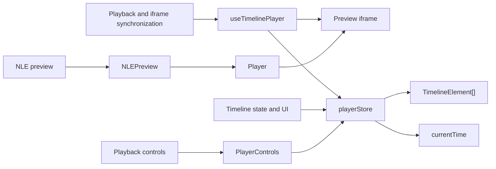
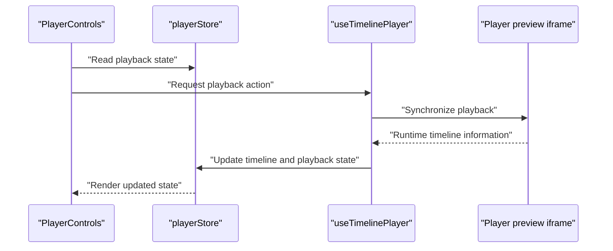

<!-- source: DeepWiki mcp.deepwiki.com · repo heygen-com/hyperframes · page 6.2 NLE Timeline and Player · fetched 2026-11-02 -->

# NLE Timeline and Player

Relevant source files

The following files were used as context for generating this wiki page:

- [packages/player/src/iframe-dom.ts](packages/player/src/iframe-dom.ts)
- [packages/studio/src/components/StudioRightPanels.tsx](packages/studio/src/components/StudioRightPanels.tsx)
- [packages/studio/src/components/TimelineToolbar.test.tsx](packages/studio/src/components/TimelineToolbar.test.tsx)
- [packages/studio/src/components/TimelineToolbar.tsx](packages/studio/src/components/TimelineToolbar.tsx)
- [packages/studio/src/components/nle/NLEContext.tsx](packages/studio/src/components/nle/NLEContext.tsx)
- [packages/studio/src/components/nle/NLEPreview.test.ts](packages/studio/src/components/nle/NLEPreview.test.ts)
- [packages/studio/src/components/nle/NLEPreview.tsx](packages/studio/src/components/nle/NLEPreview.tsx)
- [packages/studio/src/components/nle/PreviewZoomOverlay.tsx](packages/studio/src/components/nle/PreviewZoomOverlay.tsx)
- [packages/studio/src/components/nle/previewZoom.test.ts](packages/studio/src/components/nle/previewZoom.test.ts)
- [packages/studio/src/components/nle/previewZoom.ts](packages/studio/src/components/nle/previewZoom.ts)
- [packages/studio/src/contexts/DomEditContext.test.tsx](packages/studio/src/contexts/DomEditContext.test.tsx)
- [packages/studio/src/contexts/PanelLayoutContext.tsx](packages/studio/src/contexts/PanelLayoutContext.tsx)
- [packages/studio/src/hooks/appHotkeysDispatch.ts](packages/studio/src/hooks/appHotkeysDispatch.ts)
- [packages/studio/src/hooks/useAppHotkeys.previewForwarding.test.tsx](packages/studio/src/hooks/useAppHotkeys.previewForwarding.test.tsx)
- [packages/studio/src/hooks/useAppHotkeys.test.ts](packages/studio/src/hooks/useAppHotkeys.test.ts)
- [packages/studio/src/hooks/useAppHotkeys.ts](packages/studio/src/hooks/useAppHotkeys.ts)
- [packages/studio/src/hooks/usePanelLayout.test.ts](packages/studio/src/hooks/usePanelLayout.test.ts)
- [packages/studio/src/hooks/usePanelLayout.ts](packages/studio/src/hooks/usePanelLayout.ts)
- [packages/studio/src/player/components/Player.test.ts](packages/studio/src/player/components/Player.test.ts)
- [packages/studio/src/player/components/Player.tsx](packages/studio/src/player/components/Player.tsx)
- [packages/studio/src/player/components/PlayerControls.tsx](packages/studio/src/player/components/PlayerControls.tsx)
- [packages/studio/src/player/components/studioShortcuts.ts](packages/studio/src/player/components/studioShortcuts.ts)
- [packages/studio/src/player/components/timelineZoom.test.ts](packages/studio/src/player/components/timelineZoom.test.ts)
- [packages/studio/src/player/components/timelineZoom.ts](packages/studio/src/player/components/timelineZoom.ts)
- [packages/studio/src/player/components/timelineZoomInput.test.ts](packages/studio/src/player/components/timelineZoomInput.test.ts)
- [packages/studio/src/player/components/timelineZoomInput.ts](packages/studio/src/player/components/timelineZoomInput.ts)
- [packages/studio/src/player/components/useTimelinePlayhead.test.tsx](packages/studio/src/player/components/useTimelinePlayhead.test.tsx)
- [packages/studio/src/player/components/useTimelinePlayhead.ts](packages/studio/src/player/components/useTimelinePlayhead.ts)
- [packages/studio/src/player/components/useTimelineZoom.ts](packages/studio/src/player/components/useTimelineZoom.ts)
- [packages/studio/src/player/hooks/playbackAdapterResolution.ts](packages/studio/src/player/hooks/playbackAdapterResolution.ts)
- [packages/studio/src/player/hooks/timelinePlayerTestHarness.ts](packages/studio/src/player/hooks/timelinePlayerTestHarness.ts)
- [packages/studio/src/player/hooks/usePlaybackKeyboard.test.ts](packages/studio/src/player/hooks/usePlaybackKeyboard.test.ts)
- [packages/studio/src/player/hooks/usePlaybackKeyboard.ts](packages/studio/src/player/hooks/usePlaybackKeyboard.ts)
- [packages/studio/src/player/hooks/useTimelinePlayer.seek.test.ts](packages/studio/src/player/hooks/useTimelinePlayer.seek.test.ts)
- [packages/studio/src/player/hooks/useTimelinePlayer.test.ts](packages/studio/src/player/hooks/useTimelinePlayer.test.ts)
- [packages/studio/src/player/hooks/useTimelinePlayer.ts](packages/studio/src/player/hooks/useTimelinePlayer.ts)
- [packages/studio/src/player/hooks/useTimelineSyncCallbacks.ts](packages/studio/src/player/hooks/useTimelineSyncCallbacks.ts)
- [packages/studio/src/player/lib/playbackShortcuts.ts](packages/studio/src/player/lib/playbackShortcuts.ts)
- [packages/studio/src/player/lib/time.test.ts](packages/studio/src/player/lib/time.test.ts)
- [packages/studio/src/player/lib/time.ts](packages/studio/src/player/lib/time.ts)
- [packages/studio/src/player/store/liveTime.ts](packages/studio/src/player/store/liveTime.ts)
- [packages/studio/src/player/store/playerStore.test.ts](packages/studio/src/player/store/playerStore.test.ts)
- [packages/studio/src/player/store/playerStore.ts](packages/studio/src/player/store/playerStore.ts)
- [packages/studio/src/utils/studioUiPreferences.test.ts](packages/studio/src/utils/studioUiPreferences.test.ts)
- [packages/studio/src/utils/studioUiPreferences.ts](packages/studio/src/utils/studioUiPreferences.ts)
- [packages/studio/src/utils/typingTarget.ts](packages/studio/src/utils/typingTarget.ts)

## Purpose and scope

The Studio timeline and preview subsystem connects timeline state and playback controls to a composition preview. This page outlines the main code areas and how they relate; detailed coverage of timeline rendering and editing is in the child pages [Timeline Rendering and Lanes](#6.2.1) and [Timeline Editing and Playback Sync](#6.2.2). [packages/studio/src/player/store/playerStore.ts:62-80]()

Sources: [packages/studio/src/player/store/playerStore.ts:62-80]()

## Subsystem overview

`playerStore` holds shared playback and timeline state, including the current time, duration, playback status, and timeline elements. `useTimelinePlayer` connects that state to the preview iframe, while `Player` and `NLEPreview` provide the preview UI. `PlayerControls` and `TimelineToolbar` expose playback and timeline actions to users. [packages/studio/src/player/store/playerStore.ts:69-80](), [packages/studio/src/player/hooks/useTimelinePlayer.ts:60-78](), [packages/studio/src/player/components/Player.tsx:137-145](), [packages/studio/src/components/nle/NLEPreview.tsx:115-133](), [packages/studio/src/player/components/PlayerControls.tsx:159-185](), [packages/studio/src/components/TimelineToolbar.tsx:154-174]()

**Diagram: Studio concepts mapped to code entities**

Sources: [packages/studio/src/components/nle/NLEPreview.tsx:115-133](), [packages/studio/src/player/components/Player.tsx:137-145](), [packages/studio/src/player/components/PlayerControls.tsx:159-185](), [packages/studio/src/player/store/playerStore.ts:69-80](), [packages/studio/src/player/hooks/useTimelinePlayer.ts:60-78]()

## Preview and playback

`NLEPreview` hosts the `Player` and manages the preview stage, including fitting it to the available viewport. `Player` wraps the `<hyperframes-player>` web component and bridges its inner iframe to a ref so timeline playback logic can inspect and synchronize with the preview. [packages/studio/src/components/nle/NLEPreview.tsx:115-133](), [packages/studio/src/player/components/Player.tsx:137-145]()

`useTimelinePlayer` is the synchronization boundary between the iframe and `playerStore`. The related `useTimelineSyncCallbacks` hook describes responsibilities including processing runtime timeline messages and initializing playback synchronization after iframe load. [packages/studio/src/player/hooks/useTimelinePlayer.ts:60-78](), [packages/studio/src/player/hooks/useTimelineSyncCallbacks.ts:1-9]()

**Diagram: Playback state and preview synchronization**

Sources: [packages/studio/src/player/components/PlayerControls.tsx:159-185](), [packages/studio/src/player/store/playerStore.ts:69-80](), [packages/studio/src/player/hooks/useTimelinePlayer.ts:60-78](), [packages/studio/src/player/hooks/useTimelineSyncCallbacks.ts:1-9]()

## Shared state and controls

The Zustand `playerStore` includes playback state, timeline elements, selection, zoom, and editing settings. `PlayerControls` provides transport actions such as play/pause and loop toggling; `TimelineToolbar` exposes timeline tools and options such as snapping and ripple editing. Some UI preferences, including playback rate, thumbnail mode, and timeline zoom, have corresponding persisted preference fields. [packages/studio/src/player/store/playerStore.ts:69-89](), [packages/studio/src/player/store/playerStore.ts:101-149](), [packages/studio/src/player/components/PlayerControls.tsx:161-185](), [packages/studio/src/components/TimelineToolbar.tsx:154-174](), [packages/studio/src/utils/studioUiPreferences.ts:8-36]()

Sources: [packages/studio/src/player/store/playerStore.ts:69-89](), [packages/studio/src/player/store/playerStore.ts:101-149](), [packages/studio/src/player/components/PlayerControls.tsx:161-185](), [packages/studio/src/components/TimelineToolbar.tsx:154-174](), [packages/studio/src/utils/studioUiPreferences.ts:8-36]()

## Toolbar and hotkeys

`TimelineToolbar` is the timeline-facing control surface. Studio-wide keyboard handling is provided by `useAppHotkeys`, which accepts callbacks for operations such as deleting or splitting timeline elements, clipboard actions, keyframe actions, and grouping selections. See [Timeline Rendering and Lanes](#6.2.1) for the toolbar’s timeline context and [Timeline Editing and Playback Sync](#6.2.2) for editing and synchronization behavior. [packages/studio/src/components/TimelineToolbar.tsx:54-65](), [packages/studio/src/hooks/useAppHotkeys.ts:74-115]()

Sources: [packages/studio/src/components/TimelineToolbar.tsx:54-65](), [packages/studio/src/hooks/useAppHotkeys.ts:74-115]()

## Child pages

- [Timeline Rendering and Lanes](#6.2.1) — Timeline components, lanes, track headers, clip and automation views, zoom, thumbnails, and waveforms.
- [Timeline Editing and Playback Sync](#6.2.2) — Playback synchronization, seeking, timeline edits, asset drop, clipboard operations, and edit callbacks.

Sources: [packages/studio/src/player/hooks/useTimelinePlayer.ts:1-10](), [packages/studio/src/player/store/playerStore.ts:62-80]()

---

