<!-- source: DeepWiki mcp.deepwiki.com · repo heygen-com/hyperframes · page 6.3 Property Inspector and DOM Editing · fetched 2026-11-02 -->

# 6.3 Property Inspector and DOM Editing

Relevant source files

The following files were used as context for generating this wiki page:

- [packages/studio/src/components/editor/DomEditOverlay.test.ts](packages/studio/src/components/editor/DomEditOverlay.test.ts)
- [packages/studio/src/components/editor/DomEditOverlay.tsx](packages/studio/src/components/editor/DomEditOverlay.tsx)
- [packages/studio/src/components/editor/PropertyPanel.test.tsx](packages/studio/src/components/editor/PropertyPanel.test.tsx)
- [packages/studio/src/components/editor/PropertyPanel.tsx](packages/studio/src/components/editor/PropertyPanel.tsx)
- [packages/studio/src/components/editor/PropertyPanelEmptyState.test.tsx](packages/studio/src/components/editor/PropertyPanelEmptyState.test.tsx)
- [packages/studio/src/components/editor/PropertyPanelEmptyState.tsx](packages/studio/src/components/editor/PropertyPanelEmptyState.tsx)
- [packages/studio/src/components/editor/PropertyPanelFlat.tsx](packages/studio/src/components/editor/PropertyPanelFlat.tsx)
- [packages/studio/src/components/editor/PropertyPanelFlatFooter.test.tsx](packages/studio/src/components/editor/PropertyPanelFlatFooter.test.tsx)
- [packages/studio/src/components/editor/PropertyPanelFlatFooter.tsx](packages/studio/src/components/editor/PropertyPanelFlatFooter.tsx)
- [packages/studio/src/components/editor/PropertyPanelFlatHeader.test.tsx](packages/studio/src/components/editor/PropertyPanelFlatHeader.test.tsx)
- [packages/studio/src/components/editor/PropertyPanelFlatHeader.tsx](packages/studio/src/components/editor/PropertyPanelFlatHeader.tsx)
- [packages/studio/src/components/editor/domEditOverlayGestures.ts](packages/studio/src/components/editor/domEditOverlayGestures.ts)
- [packages/studio/src/components/editor/domEditOverlayStartGesture.test.ts](packages/studio/src/components/editor/domEditOverlayStartGesture.test.ts)
- [packages/studio/src/components/editor/domEditOverlayStartGesture.ts](packages/studio/src/components/editor/domEditOverlayStartGesture.ts)
- [packages/studio/src/components/editor/manualOffsetDrag.test.ts](packages/studio/src/components/editor/manualOffsetDrag.test.ts)
- [packages/studio/src/components/editor/manualOffsetDrag.ts](packages/studio/src/components/editor/manualOffsetDrag.ts)
- [packages/studio/src/components/editor/plainTranslate.ts](packages/studio/src/components/editor/plainTranslate.ts)
- [packages/studio/src/components/editor/propertyPanelCommitField.tsx](packages/studio/src/components/editor/propertyPanelCommitField.tsx)
- [packages/studio/src/components/editor/propertyPanelFlatColorGradingSection.test.tsx](packages/studio/src/components/editor/propertyPanelFlatColorGradingSection.test.tsx)
- [packages/studio/src/components/editor/propertyPanelFlatColorGradingSection.tsx](packages/studio/src/components/editor/propertyPanelFlatColorGradingSection.tsx)
- [packages/studio/src/components/editor/propertyPanelFlatMotionSection.test.tsx](packages/studio/src/components/editor/propertyPanelFlatMotionSection.test.tsx)
- [packages/studio/src/components/editor/propertyPanelFlatMotionSection.tsx](packages/studio/src/components/editor/propertyPanelFlatMotionSection.tsx)
- [packages/studio/src/components/editor/propertyPanelFlatPrimitives.test.tsx](packages/studio/src/components/editor/propertyPanelFlatPrimitives.test.tsx)
- [packages/studio/src/components/editor/propertyPanelFlatPrimitives.tsx](packages/studio/src/components/editor/propertyPanelFlatPrimitives.tsx)
- [packages/studio/src/components/editor/propertyPanelFlatSelectRow.tsx](packages/studio/src/components/editor/propertyPanelFlatSelectRow.tsx)
- [packages/studio/src/components/editor/propertyPanelFlatTextSection.test.tsx](packages/studio/src/components/editor/propertyPanelFlatTextSection.test.tsx)
- [packages/studio/src/components/editor/propertyPanelFlatTextSection.tsx](packages/studio/src/components/editor/propertyPanelFlatTextSection.tsx)
- [packages/studio/src/components/editor/propertyPanelInputCoverage.test.tsx](packages/studio/src/components/editor/propertyPanelInputCoverage.test.tsx)
- [packages/studio/src/components/editor/propertyPanelPrimitives.tsx](packages/studio/src/components/editor/propertyPanelPrimitives.tsx)
- [packages/studio/src/components/editor/propertyPanelSections.test.tsx](packages/studio/src/components/editor/propertyPanelSections.test.tsx)
- [packages/studio/src/components/editor/propertyPanelSections.tsx](packages/studio/src/components/editor/propertyPanelSections.tsx)
- [packages/studio/src/components/editor/propertyPanelTimingSection.tsx](packages/studio/src/components/editor/propertyPanelTimingSection.tsx)
- [packages/studio/src/components/editor/propertyPanelTransformCommit.test.ts](packages/studio/src/components/editor/propertyPanelTransformCommit.test.ts)
- [packages/studio/src/components/editor/propertyPanelTransformCommit.ts](packages/studio/src/components/editor/propertyPanelTransformCommit.ts)
- [packages/studio/src/components/editor/useColorGradingController.test.ts](packages/studio/src/components/editor/useColorGradingController.test.ts)
- [packages/studio/src/components/editor/useColorGradingController.ts](packages/studio/src/components/editor/useColorGradingController.ts)
- [packages/studio/src/components/editor/useDomEditNudge.test.tsx](packages/studio/src/components/editor/useDomEditNudge.test.tsx)
- [packages/studio/src/components/editor/useDomEditNudge.ts](packages/studio/src/components/editor/useDomEditNudge.ts)
- [packages/studio/src/components/editor/useDomEditOverlayGestures.ts](packages/studio/src/components/editor/useDomEditOverlayGestures.ts)
- [packages/studio/src/components/editor/useInspectorGestureTransaction.test.tsx](packages/studio/src/components/editor/useInspectorGestureTransaction.test.tsx)
- [packages/studio/src/components/editor/useInspectorGestureTransaction.ts](packages/studio/src/components/editor/useInspectorGestureTransaction.ts)
- [packages/studio/src/components/editor/usePanelHiddenToggle.ts](packages/studio/src/components/editor/usePanelHiddenToggle.ts)
- [packages/studio/src/hooks/elementOffsetStager.ts](packages/studio/src/hooks/elementOffsetStager.ts)
- [packages/studio/src/hooks/gsapRuntimeKeyframes.ts](packages/studio/src/hooks/gsapRuntimeKeyframes.ts)
- [packages/studio/src/hooks/useDomGeometryCommit.test.tsx](packages/studio/src/hooks/useDomGeometryCommit.test.tsx)
- [packages/studio/src/hooks/useDomGeometryCommit.ts](packages/studio/src/hooks/useDomGeometryCommit.ts)
- [packages/studio/src/hooks/useDomGeometryCommits.test.tsx](packages/studio/src/hooks/useDomGeometryCommits.test.tsx)
- [packages/studio/src/hooks/useDomGeometryCommits.ts](packages/studio/src/hooks/useDomGeometryCommits.ts)
- [packages/studio/src/hooks/useGsapAwareEditing.test.tsx](packages/studio/src/hooks/useGsapAwareEditing.test.tsx)
- [packages/studio/src/hooks/useGsapAwareEditing.ts](packages/studio/src/hooks/useGsapAwareEditing.ts)
- [packages/studio/tests/e2e/design-panel.mjs](packages/studio/tests/e2e/design-panel.mjs)

This section provides a high-level overview of the Property Inspector and DOM Editing subsystem in HyperFrames Studio. It introduces the core concepts and components that enable users to inspect and manipulate element properties and interact with the DOM directly on the canvas. This includes the PropertyPanel sections (with the newer flat-style architecture), the DOM Edit Overlay for on-canvas gestures and editing, element selection and snapping mechanics, crop handles for resize, and the Layers panel for managing stacking order. For detailed technical specifics, see the linked child pages.

---

## Overview and Purpose

The Property Inspector and DOM Editing system provides the graphical and interaction backbone for visual editing of HTML elements within HyperFrames compositions. Its goals include:

- Presenting element properties (style, text, media, and animation) in an organized, easily navigable inspector
- Allowing direct DOM editing via overlays with draggable, resizable, and selectable controls on the canvas preview
- Supporting snapping guides, crop handles, off-canvas indicators, and keyboard/mouse gestures for precise layout adjustments
- Offering a layered Layers panel to reorder elements by Z-index or group/ungroup elements
- Integrating closely with GSAP animation editing, color grading controls, and the SDK cutover persistence model for robust change management

This integrated framework balances detailed property editing on the side panel with direct manipulation on the preview canvas, providing users a comprehensive editing experience.

---

## Property Panel Structure and Sections

The Property Inspector UI exists in two main architectures:

### 1. Traditional Grouped Inspector (`PropertyPanel.tsx`)

The `PropertyPanel` component [packages/studio/src/components/editor/PropertyPanel.tsx:58-113]() serves as the entry point for the inspector. It implements a grouped section interface with collapsible headers. This panel displays detailed property controls across text, motion, media, style, color grading, timing, and 3D transform sections. It uses specialized components for each section, such as `TextSection`, `MediaSection`, `ColorGradingSection`, `TimingSection`, and `PropertyPanel3dTransform` [packages/studio/src/components/editor/PropertyPanel.tsx:23-28](). It supports live preview of GSAP animation values synchronized to the timeline playhead [packages/studio/src/components/editor/PropertyPanel.tsx:137-152](), integrates multi-select controls, visibility toggles, clipboard copy feedback, and nested grouping functions.

### 2. Flat Accordion-style Inspector (`PropertyPanelFlat.tsx`)

The `PropertyPanelFlat` component [packages/studio/src/components/editor/PropertyPanelFlat.tsx:52-132]() represents a newer flat, single-column inspector design, enabled by the `STUDIO_FLAT_INSPECTOR_ENABLED` flag [packages/studio/src/components/editor/PropertyPanel.tsx:30](). It uses accordion groups like Text, Style, Layout, Motion, Grade, Media for logical property partitions. This flat panel utilizes UI primitives such as `FlatRow`, `FlatSegmentedRow`, and `FlatGroupHeader` [packages/studio/src/components/editor/propertyPanelFlatPrimitives.tsx:18-181]() for consistent, lightweight layout. It supports live commits, value previews, and throttled persistence calls. It also handles focused ease editing by auto-expanding the Motion group when relevant keyframes are in focus [packages/studio/src/components/editor/PropertyPanelFlat.tsx:167-173](). This design aims for better performance and clarity on mobile and wider screen contexts.

The property panels consume detailed `element` data objects encompassing computed/inline styles, text fields, attributes, and GSAP animation metadata. They connect with the player store and live playhead time for dynamic, up-to-date presentation of animated properties during timeline scrubbing.

For details, see [Property Panel Sections](#6.3.1).

Sources:
- `packages/studio/src/components/editor/PropertyPanel.tsx:23-28`
- `packages/studio/src/components/editor/PropertyPanel.tsx:30`
- `packages/studio/src/components/editor/PropertyPanel.tsx:58-113`
- `packages/studio/src/components/editor/PropertyPanel.tsx:137-152`
- `packages/studio/src/components/editor/PropertyPanelFlat.tsx:52-132`
- `packages/studio/src/components/editor/PropertyPanelFlat.tsx:167-173`
- `packages/studio/src/components/editor/propertyPanelFlatPrimitives.tsx:18-181`

---

## DOM Edit Overlay and Canvas Editing

The `DomEditOverlay` component [packages/studio/src/components/editor/DomEditOverlay.tsx:132-157]() is a transparent interactive layer rendered above the composition preview iframe. It enables:

- **Selection**: Users can select elements individually or in groups, with marquee selection for multiple elements [packages/studio/src/components/editor/DomEditOverlay.tsx:6-7]().
- **Visual Feedback**: Provides visual feedback for hovered and selected elements with bounding box outlines and handles [packages/studio/src/components/editor/DomEditOverlay.tsx:28-29]().
- **Drag Gestures**: Allows repositioning elements via drag gestures, supporting snapping to guides or other elements for alignment precision [packages/studio/src/components/editor/useDomEditOverlayGestures.ts:177-184]().
- **Crop Handles**: Offers crop handles to resize or crop visual media (images, videos) inline [packages/studio/src/components/editor/DomEditOverlay.tsx:30-31]().
- **Z-index Manipulation**: Supports Z-index manipulation via the canvas context menu, affecting stacking order [packages/studio/src/components/editor/DomEditOverlay.tsx:115-128]().
- **Off-canvas Indicators**: Displays indicators for elements partially outside viewport bounds [packages/studio/src/components/editor/DomEditOverlay.tsx:23]().
- **Inline Text Editing**: Facilitates inline text editing for editable text elements directly on canvas [packages/studio/src/components/editor/DomEditOverlay.tsx:34]().

The overlay integrates with a comprehensive snap engine that calculates snapping distances and priorities to assist user alignment operations [packages/studio/src/components/editor/useDomEditOverlayGestures.ts:50-53](). Gesture handling and element lifecycle operations (creation, update, deletion) are managed within this overlay and tied to commit lifecycle hooks.

For details, see [DOM Edit Overlay and Selection](#6.3.2).

Sources:
- `packages/studio/src/components/editor/DomEditOverlay.tsx:6-7`
- `packages/studio/src/components/editor/DomEditOverlay.tsx:23`
- `packages/studio/src/components/editor/DomEditOverlay.tsx:28-29`
- `packages/studio/src/components/editor/DomEditOverlay.tsx:30-31`
- `packages/studio/src/components/editor/DomEditOverlay.tsx:34`
- `packages/studio/src/components/editor/DomEditOverlay.tsx:115-128`
- `packages/studio/src/components/editor/DomEditOverlay.tsx:132-157`
- `packages/studio/src/components/editor/useDomEditOverlayGestures.ts:50-53`
- `packages/studio/src/components/editor/useDomEditOverlayGestures.ts:177-184`

---

## Element Selection and Layers Panel

Element selection supports both simple single selection and complex group or nested selections. State is managed via React contexts and hooks, allowing other components to react accordingly.

The Layers panel displays the current composition’s DOM elements in Z-order, using concise tags and labels for quick identification. It supports:

- Collapsing or expanding hierarchical groups
- Drag-and-drop reorder operations to change stacking order
- Visibility toggles and selection sync with the canvas overlay
- Leveraging throttle and debouncing techniques to keep the list performant with large documents and frequent updates

This panel links tightly with both the DOM Edit Overlay and Property Inspector to enable coordinated editing workflows.

---

## Relationship Between Property Panel, DOM Overlay, and Layers Panel

The system operates as a coordinated triad:

- The **Property Panel** reflects the properties of the currently selected element(s) and allows detailed numeric or styled edits.
- The **DOM Edit Overlay** lets users directly manipulate elements visually on the canvas, updating selection and geometric properties.
- The **Layers Panel** provides hierarchy and order context, allowing reordering and visibility toggling that immediately update the overlay and inspector.

Changes in one component propagate to others, mediated by shared React state (including stores and contexts) and hooks managing commits and persistence.

### Studio Editing Components Interaction

```mermaid
graph TD
    subgraph "Studio UI"
        PropertyPanelFlat["PropertyPanelFlat (packages/studio/src/components/editor/PropertyPanelFlat.tsx)"]
        DomEditOverlay["DomEditOverlay (packages/studio/src/components/editor/DomEditOverlay.tsx)"]
        LayersPanel["LayersPanel (packages/studio/src/components/editor/LayersPanel.tsx)"]
    end

    subgraph "Core Logic & State"
        usePlayerStore["usePlayerStore (packages/studio/src/player/store/playerStore.ts)"]
        useDomEditSession["useDomEditSession (packages/studio/src/hooks/useDomEditSession.ts)"]
        useDomGeometryCommits["useDomGeometryCommits (packages/studio/src/hooks/useDomGeometryCommits.ts)"]
        useGsapAwareEditing["useGsapAwareEditing (packages/studio/src/hooks/useGsapAwareEditing.ts)"]
        useColorGradingController["useColorGradingController (packages/studio/src/components/editor/useColorGradingController.ts)"]
        SnapEngine["SnapEngine (packages/studio/src/components/editor/snapEngine.ts)"]
        ManualOffsetDrag["ManualOffsetDrag (packages/studio/src/components/editor/manualOffsetDrag.ts)"]
        PropertyPanelTransformCommit["PropertyPanelTransformCommit (packages/studio/src/components/editor/propertyPanelTransformCommit.ts)"]
    end

    DomEditOverlay -- "Updates selection, geometry" --> useDomEditSession
    PropertyPanelFlat -- "Updates element properties" --> useDomEditSession
    LayersPanel -- "Updates Z-order, visibility" --> useDomEditSession

    useDomEditSession -- "Commits changes" --> useDomGeometryCommits
    useDomEditSession -- "Commits GSAP changes" --> useGsapAwareEditing
    useDomEditSession -- "Commits color grading" --> useColorGradingController

    DomEditOverlay -- "Uses for drag/resize" --> SnapEngine
    DomEditOverlay -- "Handles element movement" --> ManualOffsetDrag
    PropertyPanelFlat -- "Handles transform commits" --> PropertyPanelTransformCommit

    usePlayerStore -- "Provides element data" --> PropertyPanelFlat
    usePlayerStore -- "Provides element data" --> DomEditOverlay
    usePlayerStore -- "Provides element data" --> LayersPanel

    PropertyPanelFlat -- "Uses primitives" --> PropertyPanelFlatPrimitives["propertyPanelFlatPrimitives.tsx"]
    PropertyPanelFlat -- "Text editing" --> FlatTextSection["propertyPanelFlatTextSection.tsx"]
    PropertyPanelFlat -- "Motion editing" --> FlatMotionSection["propertyPanelFlatMotionSection.tsx"]
    PropertyPanelFlat -- "Color grading" --> FlatColorGradingSection["propertyPanelFlatColorGradingSection.tsx"]
```

This diagram illustrates the key components and their interactions within the Studio's editing environment. The `PropertyPanelFlat`, `DomEditOverlay`, and `LayersPanel` are the primary UI components that interact with the `useDomEditSession` hook to manage the state of selected elements. Changes are then committed through `useDomGeometryCommits`, `useGsapAwareEditing`, and `useColorGradingController`. The `DomEditOverlay` leverages `SnapEngine` and `ManualOffsetDrag` for interactive canvas manipulations, while the `PropertyPanelFlat` uses `PropertyPanelTransformCommit` for property updates. The `usePlayerStore` provides the central element data to all these components.

Sources:
- `packages/studio/src/components/editor/PropertyPanelFlat.tsx`
- `packages/studio/src/components/editor/DomEditOverlay.tsx`
- `packages/studio/src/components/editor/LayersPanel.tsx`
- `packages/studio/src/hooks/useDomEditSession.ts`
- `packages/studio/src/hooks/useDomGeometryCommits.ts`
- `packages/studio/src/hooks/useGsapAwareEditing.ts`
- `packages/studio/src/components/editor/useColorGradingController.ts`
- `packages/studio/src/components/editor/snapEngine.ts` (implied by usage in `useDomEditOverlayGestures.ts`)
- `packages/studio/src/components/editor/manualOffsetDrag.ts`
- `packages/studio/src/components/editor/propertyPanelTransformCommit.ts`
- `packages/studio/src/player/store/playerStore.ts`
- `packages/studio/src/components/editor/propertyPanelFlatPrimitives.tsx`
- `packages/studio/src/components/editor/propertyPanelFlatTextSection.tsx`
- `packages/studio/src/components/editor/propertyPanelFlatMotionSection.tsx`
- `packages/studio/src/components/editor/propertyPanelFlatColorGradingSection.tsx`

---

## Summary

HyperFrames Studio's Property Inspector and DOM Editing are built upon a modular React component and hooks architecture designed for seamless editing of HTML-based video compositions. The `PropertyPanel` family presents a comprehensive interface for property manipulation, supported by the `DomEditOverlay` visual editing layer for direct canvas manipulation. The `LayersPanel` maintains clear hierarchy and order control.

Together they provide a robust, interactive editing experience with snapping, cropping, animation, and color grading integration. Persistence leverages a commit system that can route changes to either legacy server APIs or the new SDK cutover model, ensuring flexibility and data integrity.

For detailed implementations and usage, explore the child pages:

- [Property Panel Sections](#6.3.1) — Flat property panel architecture details, including text, motion, media, style, color grading, 3D transform, timing, and volume automation.
- [DOM Edit Overlay and Selection](#6.3.2) — Canvas gestures, geometry, selection chrome, marquee, snapping mechanics, crop handles, off-canvas indicators, layers panel, and commit lifecycle.

---

## Sources

- `packages/studio/src/components/editor/PropertyPanel.tsx:1-166`
- `packages/studio/src/components/editor/PropertyPanelFlat.tsx:1-175`
- `packages/studio/src/components/editor/propertyPanelFlatPrimitives.tsx:1-190`
- `packages/studio/src/components/editor/DomEditOverlay.tsx:1-163`
- `packages/studio/src/components/editor/propertyPanelFlatTextSection.tsx:1-180`
- `packages/studio/src/components/editor/propertyPanelFlatColorGradingSection.tsx:1-190`
- `packages/studio/src/components/editor/useColorGradingController.ts:1-194`
- `packages/studio/src/components/editor/manualOffsetDrag.ts:1-196`
- `packages/studio/src/components/editor/useDomEditOverlayGestures.ts:1-184`

---

