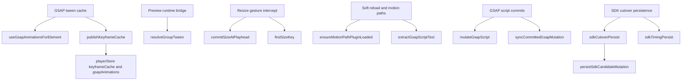
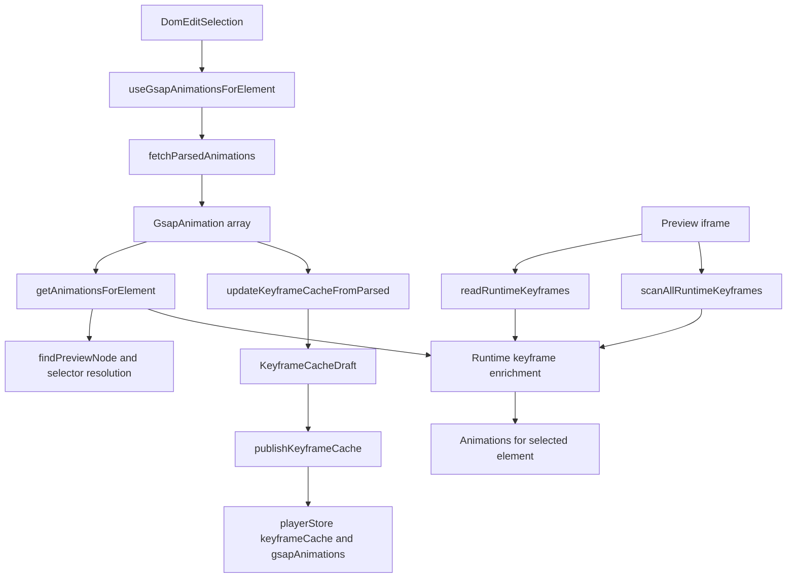
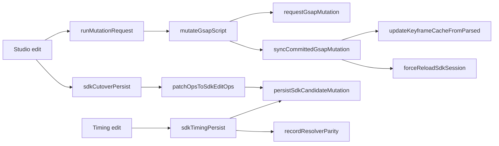

<!-- source: DeepWiki mcp.deepwiki.com · repo heygen-com/hyperframes · page 6.4 GSAP Animation Editing and SDK Cutover · fetched 2026-11-02 -->

# GSAP Animation Editing and SDK Cutover

Relevant source files

The following files were used as context for generating this wiki page:

- [docs/packages/studio-server.mdx](docs/packages/studio-server.mdx)
- [packages/core/src/gsapCdn.test.ts](packages/core/src/gsapCdn.test.ts)
- [packages/core/src/gsapCdn.ts](packages/core/src/gsapCdn.ts)
- [packages/core/src/studio-api/helpers/manualEditsRenderScript.test.ts](packages/core/src/studio-api/helpers/manualEditsRenderScript.test.ts)
- [packages/core/src/studio-api/helpers/manualEditsRenderScript.ts](packages/core/src/studio-api/helpers/manualEditsRenderScript.ts)
- [packages/parsers/src/clipTweens.ts](packages/parsers/src/clipTweens.ts)
- [packages/studio/src/components/editor/dragUndoPaint.test.ts](packages/studio/src/components/editor/dragUndoPaint.test.ts)
- [packages/studio/src/components/editor/gestureUndoRevert.ts](packages/studio/src/components/editor/gestureUndoRevert.ts)
- [packages/studio/src/components/editor/manualEditsDom.ts](packages/studio/src/components/editor/manualEditsDom.ts)
- [packages/studio/src/components/editor/manualEditsDomPatches.test.ts](packages/studio/src/components/editor/manualEditsDomPatches.test.ts)
- [packages/studio/src/components/editor/manualEditsDomPatches.ts](packages/studio/src/components/editor/manualEditsDomPatches.ts)
- [packages/studio/src/components/editor/manualEditsSnapshot.ts](packages/studio/src/components/editor/manualEditsSnapshot.ts)
- [packages/studio/src/components/editor/manualEditsTypes.ts](packages/studio/src/components/editor/manualEditsTypes.ts)
- [packages/studio/src/components/editor/motionPathSelection.test.ts](packages/studio/src/components/editor/motionPathSelection.test.ts)
- [packages/studio/src/components/editor/motionPathSelection.ts](packages/studio/src/components/editor/motionPathSelection.ts)
- [packages/studio/src/components/ui/cn.ts](packages/studio/src/components/ui/cn.ts)
- [packages/studio/src/hooks/domEditTextFieldCommitOps.test.ts](packages/studio/src/hooks/domEditTextFieldCommitOps.test.ts)
- [packages/studio/src/hooks/domEditTextFieldCommitOps.ts](packages/studio/src/hooks/domEditTextFieldCommitOps.ts)
- [packages/studio/src/hooks/gsapDragCommit.ts](packages/studio/src/hooks/gsapDragCommit.ts)
- [packages/studio/src/hooks/gsapDragPositionCommit.ts](packages/studio/src/hooks/gsapDragPositionCommit.ts)
- [packages/studio/src/hooks/gsapEditOutcome.ts](packages/studio/src/hooks/gsapEditOutcome.ts)
- [packages/studio/src/hooks/gsapKeyframeCacheHelpers.test.ts](packages/studio/src/hooks/gsapKeyframeCacheHelpers.test.ts)
- [packages/studio/src/hooks/gsapKeyframeCacheHelpers.ts](packages/studio/src/hooks/gsapKeyframeCacheHelpers.ts)
- [packages/studio/src/hooks/gsapKeyframeCommit.ts](packages/studio/src/hooks/gsapKeyframeCommit.ts)
- [packages/studio/src/hooks/gsapResizeDropPoint.test.ts](packages/studio/src/hooks/gsapResizeDropPoint.test.ts)
- [packages/studio/src/hooks/gsapResizeGeometrySweep.test.ts](packages/studio/src/hooks/gsapResizeGeometrySweep.test.ts)
- [packages/studio/src/hooks/gsapResizeIntercept.test.ts](packages/studio/src/hooks/gsapResizeIntercept.test.ts)
- [packages/studio/src/hooks/gsapResizeIntercept.ts](packages/studio/src/hooks/gsapResizeIntercept.ts)
- [packages/studio/src/hooks/gsapResizeMixedTween.test.ts](packages/studio/src/hooks/gsapResizeMixedTween.test.ts)
- [packages/studio/src/hooks/gsapResizeSweep.test.ts](packages/studio/src/hooks/gsapResizeSweep.test.ts)
- [packages/studio/src/hooks/gsapRuntimeBridge.test.ts](packages/studio/src/hooks/gsapRuntimeBridge.test.ts)
- [packages/studio/src/hooks/gsapRuntimeBridge.ts](packages/studio/src/hooks/gsapRuntimeBridge.ts)
- [packages/studio/src/hooks/gsapRuntimePatch.test.ts](packages/studio/src/hooks/gsapRuntimePatch.test.ts)
- [packages/studio/src/hooks/gsapRuntimePatch.ts](packages/studio/src/hooks/gsapRuntimePatch.ts)
- [packages/studio/src/hooks/gsapScriptCommitTypes.ts](packages/studio/src/hooks/gsapScriptCommitTypes.ts)
- [packages/studio/src/hooks/gsapShared.test.ts](packages/studio/src/hooks/gsapShared.test.ts)
- [packages/studio/src/hooks/gsapShared.ts](packages/studio/src/hooks/gsapShared.ts)
- [packages/studio/src/hooks/gsapShared.writeTarget.test.ts](packages/studio/src/hooks/gsapShared.writeTarget.test.ts)
- [packages/studio/src/hooks/keyframeCacheAstLoad.ts](packages/studio/src/hooks/keyframeCacheAstLoad.ts)
- [packages/studio/src/hooks/timelineTimingSync.test.ts](packages/studio/src/hooks/timelineTimingSync.test.ts)
- [packages/studio/src/hooks/timelineTimingSync.ts](packages/studio/src/hooks/timelineTimingSync.ts)
- [packages/studio/src/hooks/useAnimatedPropertyCommit.test.tsx](packages/studio/src/hooks/useAnimatedPropertyCommit.test.tsx)
- [packages/studio/src/hooks/useAnimatedPropertyCommit.ts](packages/studio/src/hooks/useAnimatedPropertyCommit.ts)
- [packages/studio/src/hooks/useEditHistoryActions.paint.test.tsx](packages/studio/src/hooks/useEditHistoryActions.paint.test.tsx)
- [packages/studio/src/hooks/useEditHistoryActions.test.tsx](packages/studio/src/hooks/useEditHistoryActions.test.tsx)
- [packages/studio/src/hooks/useEditHistoryActions.ts](packages/studio/src/hooks/useEditHistoryActions.ts)
- [packages/studio/src/hooks/useEnableKeyframes.test.ts](packages/studio/src/hooks/useEnableKeyframes.test.ts)
- [packages/studio/src/hooks/useEnableKeyframes.ts](packages/studio/src/hooks/useEnableKeyframes.ts)
- [packages/studio/src/hooks/useGestureCommit.ts](packages/studio/src/hooks/useGestureCommit.ts)
- [packages/studio/src/hooks/useGsapAnimationOps.ts](packages/studio/src/hooks/useGsapAnimationOps.ts)
- [packages/studio/src/hooks/useGsapKeyframeOps.ts](packages/studio/src/hooks/useGsapKeyframeOps.ts)
- [packages/studio/src/hooks/useGsapPropertyDebounce.ts](packages/studio/src/hooks/useGsapPropertyDebounce.ts)
- [packages/studio/src/hooks/useGsapScriptCommits.test.tsx](packages/studio/src/hooks/useGsapScriptCommits.test.tsx)
- [packages/studio/src/hooks/useGsapScriptCommits.ts](packages/studio/src/hooks/useGsapScriptCommits.ts)
- [packages/studio/src/hooks/useGsapTweenCache.test.ts](packages/studio/src/hooks/useGsapTweenCache.test.ts)
- [packages/studio/src/hooks/useGsapTweenCache.ts](packages/studio/src/hooks/useGsapTweenCache.ts)
- [packages/studio/src/hooks/usePersistentEditHistory.test.ts](packages/studio/src/hooks/usePersistentEditHistory.test.ts)
- [packages/studio/src/hooks/usePersistentEditHistory.ts](packages/studio/src/hooks/usePersistentEditHistory.ts)
- [packages/studio/src/hooks/usePopulateKeyframeCacheForFile.test.tsx](packages/studio/src/hooks/usePopulateKeyframeCacheForFile.test.tsx)
- [packages/studio/src/hooks/usePreviewPersistence.history.test.tsx](packages/studio/src/hooks/usePreviewPersistence.history.test.tsx)
- [packages/studio/src/hooks/usePreviewPersistence.ts](packages/studio/src/hooks/usePreviewPersistence.ts)
- [packages/studio/src/player/components/useAutoExpandKeyframedClips.ts](packages/studio/src/player/components/useAutoExpandKeyframedClips.ts)
- [packages/studio/src/utils/authoredOpacity.ts](packages/studio/src/utils/authoredOpacity.ts)
- [packages/studio/src/utils/elementGsap.ts](packages/studio/src/utils/elementGsap.ts)
- [packages/studio/src/utils/gsapSoftReload.test.ts](packages/studio/src/utils/gsapSoftReload.test.ts)
- [packages/studio/src/utils/gsapSoftReload.ts](packages/studio/src/utils/gsapSoftReload.ts)
- [packages/studio/src/utils/gsapUndoRestore.test.ts](packages/studio/src/utils/gsapUndoRestore.test.ts)
- [packages/studio/src/utils/gsapUndoRestore.ts](packages/studio/src/utils/gsapUndoRestore.ts)
- [packages/studio/src/utils/sdkCutover.familyGate.test.ts](packages/studio/src/utils/sdkCutover.familyGate.test.ts)
- [packages/studio/src/utils/sdkCutover.gate.test.ts](packages/studio/src/utils/sdkCutover.gate.test.ts)
- [packages/studio/src/utils/sdkCutover.test.ts](packages/studio/src/utils/sdkCutover.test.ts)
- [packages/studio/src/utils/sdkCutover.ts](packages/studio/src/utils/sdkCutover.ts)
- [packages/studio/src/utils/sdkCutoverEligibility.test.ts](packages/studio/src/utils/sdkCutoverEligibility.test.ts)
- [packages/studio/src/utils/sdkCutoverEligibility.ts](packages/studio/src/utils/sdkCutoverEligibility.ts)
- [packages/studio/src/utils/sdkCutoverPolicy.report.ts](packages/studio/src/utils/sdkCutoverPolicy.report.ts)
- [packages/studio/src/utils/sdkCutoverPolicy.test.ts](packages/studio/src/utils/sdkCutoverPolicy.test.ts)
- [packages/studio/src/utils/sdkCutoverPolicy.ts](packages/studio/src/utils/sdkCutoverPolicy.ts)
- [packages/studio/src/utils/sdkEditTransaction.decline.test.ts](packages/studio/src/utils/sdkEditTransaction.decline.test.ts)
- [packages/studio/src/utils/sdkEditTransaction.ts](packages/studio/src/utils/sdkEditTransaction.ts)
- [packages/studio/src/utils/sdkOpMapping.ts](packages/studio/src/utils/sdkOpMapping.ts)
- [packages/studio/src/utils/sdkResolverAttempts.ts](packages/studio/src/utils/sdkResolverAttempts.ts)
- [packages/studio/src/utils/sdkResolverShadow.test.ts](packages/studio/src/utils/sdkResolverShadow.test.ts)
- [packages/studio/src/utils/sdkResolverShadow.ts](packages/studio/src/utils/sdkResolverShadow.ts)
- [packages/studio/src/utils/softReloadTargets.ts](packages/studio/src/utils/softReloadTargets.ts)
- [packages/studio/src/utils/studioFileHistory.test.ts](packages/studio/src/utils/studioFileHistory.test.ts)
- [packages/studio/src/utils/studioFileHistory.ts](packages/studio/src/utils/studioFileHistory.ts)
- [packages/studio/src/utils/studioPendingEdits.test.ts](packages/studio/src/utils/studioPendingEdits.test.ts)
- [packages/studio/src/utils/studioPendingEdits.ts](packages/studio/src/utils/studioPendingEdits.ts)

## Purpose and scope

This page describes Studio’s GSAP editing path: how parsed and runtime animation data reaches the keyframe cache, how preview-runtime values inform drag and resize edits, how script mutations synchronize with the preview, and how eligible edits can be persisted through the SDK cutover. The available source excerpts cover the cache hook and helpers, runtime and resize intercepts, soft-reload support, mutation coordination, and cutover entry points. [packages/studio/src/hooks/useGsapTweenCache.ts:1-168]() [packages/studio/src/hooks/gsapKeyframeCacheHelpers.ts:1-164]() [packages/studio/src/hooks/gsapRuntimeBridge.ts:1-152]() [packages/studio/src/hooks/gsapResizeIntercept.ts:1-165]() [packages/studio/src/hooks/useGsapScriptCommits.ts:1-190]() [packages/studio/src/utils/sdkCutover.ts:1-178]()

Sources: [packages/studio/src/hooks/useGsapTweenCache.ts:1-168]() [packages/studio/src/hooks/gsapKeyframeCacheHelpers.ts:1-164]() [packages/studio/src/hooks/gsapRuntimeBridge.ts:1-152]() [packages/studio/src/hooks/gsapResizeIntercept.ts:1-165]() [packages/studio/src/hooks/useGsapScriptCommits.ts:1-190]() [packages/studio/src/utils/sdkCutover.ts:1-178]()

## 1. GSAP Tween Cache and AST Keyframe Editing

Studio combines parsed GSAP animations with runtime-derived information to supply animation data for the selected element. The cache helpers publish keyframe and animation maps together, while the hook resolves animations for a selection and can enrich unresolved parsed keyframes from the preview iframe. [packages/studio/src/hooks/useGsapTweenCache.ts:29-39]() [packages/studio/src/hooks/useGsapTweenCache.ts:50-82]() [packages/studio/src/hooks/useGsapTweenCache.ts:84-162]() [packages/studio/src/hooks/gsapKeyframeCacheHelpers.ts:16-65]()

Sources: [packages/studio/src/hooks/useGsapTweenCache.ts:29-39]() [packages/studio/src/hooks/useGsapTweenCache.ts:50-82]() [packages/studio/src/hooks/useGsapTweenCache.ts:84-162]() [packages/studio/src/hooks/gsapKeyframeCacheHelpers.ts:16-65]()

### 1.1 Cache loading and element selection

`useGsapAnimationsForElement` fetches parsed animations for the project and source file, keyed by project, file, version, and selection target. It records parser-reported `multipleTimelines` and `unsupportedTimelinePattern` state, then resolves the relevant animations against the selected element and its live preview node. [packages/studio/src/hooks/useGsapTweenCache.ts:29-39]() [packages/studio/src/hooks/useGsapTweenCache.ts:43-82]() [packages/studio/src/hooks/useGsapTweenCache.ts:84-99]()

When parsed animations have unresolved keyframes, the hook attempts to read corresponding runtime keyframes from the iframe. If the parser cannot resolve a selector and no animation was matched to the selected element, it can scan runtime keyframes and associate a runtime entry with an unresolved parsed animation. [packages/studio/src/hooks/useGsapTweenCache.ts:102-162]()

Sources: [packages/studio/src/hooks/useGsapTweenCache.ts:29-39]() [packages/studio/src/hooks/useGsapTweenCache.ts:43-82]() [packages/studio/src/hooks/useGsapTweenCache.ts:84-99]() [packages/studio/src/hooks/useGsapTweenCache.ts:102-162]()

### 1.2 Cache contents and publication

The cache helpers maintain a `KeyframeCacheDraft` containing `keyframeCache` and `gsapAnimations` maps. `publishKeyframeCache` clones both maps, applies the caller’s edits to the drafts, preserves existing object identities for entries with equal data, and publishes both maps in one store update only when their entries changed. This avoids exposing a partially refreshed pair of maps to subscribers. [packages/studio/src/hooks/gsapKeyframeCacheHelpers.ts:16-65]()

`updateKeyframeCacheFromParsed` builds per-element entries from parsed keyframes or synthesized flat-tween keyframes. It resolves selectors against the provided document, converts tween-relative keyframes into clip-relative positions using the resolved timing basis, and merges entries with `deduplicateKeyframes`. The resulting entries and their source animations are written through the single-publication helper. [packages/studio/src/hooks/gsapKeyframeCacheHelpers.ts:67-136]()

Selector attribution is important for class and descendant tweens: the cache helper resolves a selector to the elements it actually matches in the preview DOM, rather than assuming a leading ID in the selector is the tween target. [packages/studio/src/hooks/gsapKeyframeCacheHelpers.ts:83-109]() [packages/studio/src/hooks/gsapShared.ts:121-142]()

Sources: [packages/studio/src/hooks/gsapKeyframeCacheHelpers.ts:16-65]() [packages/studio/src/hooks/gsapKeyframeCacheHelpers.ts:67-136]() [packages/studio/src/hooks/gsapShared.ts:121-142]()

### 1.3 Timing and keyframe interpretation

`gsapShared.ts` centralizes shared animation semantics. `isInstantHold` treats a `set()` as a hold and also treats `to()` or `fromTo()` animations with resolved duration zero as holds. `keyframeEases` distinguishes flat-tween easing from keyframe easing when representing a tween as keyframes. The same module defines a shared tolerance for deciding whether a playhead is near an existing keyframe, and provides ID-selector conversion helpers for safe selector construction and reading. [packages/studio/src/hooks/gsapShared.ts:20-48]() [packages/studio/src/hooks/gsapShared.ts:74-118]()

The cache uses `resolveClipTimingBasis` and `toClipKeyframes` to place tween keyframes in the clip’s timing frame. This keeps cache writes aligned with the AST-load path for both the tween’s own time frame and the sub-composition host fallback. [packages/studio/src/hooks/gsapKeyframeCacheHelpers.ts:99-109]()

Sources: [packages/studio/src/hooks/gsapShared.ts:20-48]() [packages/studio/src/hooks/gsapShared.ts:74-118]() [packages/studio/src/hooks/gsapKeyframeCacheHelpers.ts:99-109]()

## 2. Runtime Bridge and Resize Gesture Intercept

### 2.1 Runtime bridge

The preview iframe is a source of live GSAP state. `gsapRuntimeBridge.ts` describes using the iframe’s GSAP `getProperty` method to read interpolated property values at the current seek time, so drag commits can calculate positions from what the user sees rather than relying only on authored tween endpoints. [packages/studio/src/hooks/gsapRuntimeBridge.ts:1-17]()

`resolveGroupTween` selects a tween for a property group. It prefers animations tagged with that group; if none are tagged, it looks for legacy mixed-property tweens that write properties in the group. It chooses the closest candidate to the playhead and can retry against freshly fetched animations when a fallback fetch is provided. [packages/studio/src/hooks/gsapRuntimeBridge.ts:58-85]()

The bridge also assesses whether a drag is directly editable, whether a shared tween is the only source of an element’s position, and whether live position exists without a corresponding parsed position tween. These checks feed the edit outcome before a position write is attempted. [packages/studio/src/hooks/gsapRuntimeBridge.ts:91-152]()

Sources: [packages/studio/src/hooks/gsapRuntimeBridge.ts:1-17]() [packages/studio/src/hooks/gsapRuntimeBridge.ts:58-85]() [packages/studio/src/hooks/gsapRuntimeBridge.ts:91-152]()

### 2.2 Resize gesture intercept

`gsapResizeIntercept.ts` routes manual resize edits according to the animation property group and the element’s authored animation state. Its `commitSizeAtPlayhead` path can combine a resize with an anchor-position adjustment when the same animation writes position, avoiding two writes against potentially stale animation identifiers in one gesture. It also supplies backfill values and restores the drag offset before reload when needed. [packages/studio/src/hooks/gsapResizeIntercept.ts:84-120]()

A resize can also hand the draft size back to GSAP after a successful keyed write: the implementation clears Studio’s temporary box size and applies the committed size through the GSAP size helper. Under auto-keyframing, `firstSizeKey` creates a first size key only when the resize group is `size`, auto-keyframing is enabled, and the element already has a relevant keyframed animation. [packages/studio/src/hooks/gsapResizeIntercept.ts:123-153]()

The resize implementation distinguishes scale shorthand from `scaleX`/`scaleY` longhands because writing both forms in a tween allows the longhands to run alongside the shorthand. The provided tests also exercise resize cases such as updating a zero-duration size hold in place and blocking a helper-authored resize that requires an explicit unroll. [packages/studio/src/hooks/gsapResizeIntercept.ts:155-165]() [packages/studio/src/hooks/gsapResizeIntercept.test.ts:90-135]() [packages/studio/src/hooks/gsapResizeIntercept.test.ts:137-164]()

Sources: [packages/studio/src/hooks/gsapResizeIntercept.ts:84-120]() [packages/studio/src/hooks/gsapResizeIntercept.ts:123-165]() [packages/studio/src/hooks/gsapResizeIntercept.test.ts:90-135]() [packages/studio/src/hooks/gsapResizeIntercept.test.ts:137-164]()

## 3. Soft Reload and Undo Restore

### 3.1 Soft reload support

`gsapSoftReload.ts` provides helpers for working with the preview iframe’s GSAP runtime. `findGsapScriptElements` identifies inline script elements whose text resembles GSAP timeline code, and `extractGsapScriptText` returns the script text only when exactly one such script is found. The single-script check avoids treating an ambiguous serialized document as though it identified which script should be rewritten. [packages/studio/src/utils/gsapSoftReload.ts:113-143]()

The module also verifies that a soft reload repopulated the expected timeline keys in `window.__timelines`, rather than treating any non-empty global timeline map as proof that the target script ran. [packages/studio/src/utils/gsapSoftReload.ts:145-160]()

Sources: [packages/studio/src/utils/gsapSoftReload.ts:113-143]() [packages/studio/src/utils/gsapSoftReload.ts:145-160]()

### 3.2 MotionPathPlugin availability

`ensureMotionPathPluginLoaded` prepares `MotionPathPlugin` in the preview iframe. It registers a plugin that is already present, waits for the preview runtime’s ready message when GSAP is not yet available, and avoids scheduling duplicate script loads for the same iframe. On script load or error, it clears the in-flight marker and registers the plugin if it is available. [packages/studio/src/utils/gsapSoftReload.ts:34-48]() [packages/studio/src/utils/gsapSoftReload.ts:60-111]()

This eager setup is intended to make edits that add a motion path avoid the asynchronous plugin-load path during soft reload; if the plugin cannot be loaded, the source comments note that the soft-reload fallback still covers the failure case. [packages/studio/src/utils/gsapSoftReload.ts:34-48]() [packages/studio/src/utils/gsapSoftReload.ts:90-110]()

Sources: [packages/studio/src/utils/gsapSoftReload.ts:34-48]() [packages/studio/src/utils/gsapSoftReload.ts:60-111]()

### 3.3 Undo/redo preview synchronization

`usePreviewPersistence` connects preview persistence to Studio’s edit and history infrastructure. Its parameters include the preview iframe, active composition path, preview reload callback, and project-file/history operations. The hook also creates a DOM edit save queue and exposes helpers to drain pending field edits before waiting for the DOM queue to become idle. [packages/studio/src/hooks/usePreviewPersistence.ts:31-54]() [packages/studio/src/hooks/usePreviewPersistence.ts:81-88]() [packages/studio/src/hooks/usePreviewPersistence.ts:110-168]()

The hook imports `applyUndoRestoreToPreview`, `readUndoNestedFiles`, and `showRestoreInPlace` for history-driven preview restoration. The provided excerpt shows these dependencies and the history restore payload shape, but does not show the later restore call sites; detailed undo/redo execution behavior is therefore outside the line range available here. [packages/studio/src/hooks/usePreviewPersistence.ts:20-35]()

Sources: [packages/studio/src/hooks/usePreviewPersistence.ts:31-54]() [packages/studio/src/hooks/usePreviewPersistence.ts:81-88]() [packages/studio/src/hooks/usePreviewPersistence.ts:110-168]() [packages/studio/src/hooks/usePreviewPersistence.ts:20-35]()

## 4. Animated Property Commits and Motion Paths

### 4.1 Mutation request and validation

`useGsapScriptCommits.ts` defines `mutateGsapScript`, which sends a request through `requestGsapMutation`, raises a `GsapMutationHttpError` for a non-success HTTP response, and rejects a result whose `ok` field is false. Before sending a mutation request, `runMutationRequest` checks mutation values with `findUnsafeMutationValues`; unsafe values produce user feedback and either stop a skip-reload operation or raise a marked save error. [packages/studio/src/hooks/useGsapScriptCommits.ts:50-61]() [packages/studio/src/hooks/useGsapScriptCommits.ts:76-103]()

When a mutation reports no change, the commit path can provide specific feedback for a `move-keyframe` request. Preview synchronization is also guarded: unchanged mutations may redraw when there are pending preview patches, and changed mutations can redraw unless the pending edit was undone. [packages/studio/src/hooks/useGsapScriptCommits.ts:65-74]() [packages/studio/src/hooks/useGsapScriptCommits.ts:106-142]()

Sources: [packages/studio/src/hooks/useGsapScriptCommits.ts:50-61]() [packages/studio/src/hooks/useGsapScriptCommits.ts:65-74]() [packages/studio/src/hooks/useGsapScriptCommits.ts:76-103]() [packages/studio/src/hooks/useGsapScriptCommits.ts:106-142]()

### 4.2 File, session, and cache synchronization

`syncCommittedGsapMutation` first reports returned file content through `onFileContentChanged`. It then calls `forceReloadSdkSession` because a server-written file makes the in-memory SDK document stale; without resynchronization, a later SDK-routed edit could serialize the older document and revert the write. If `skipReload` is set, it stops before preview work. When the mutation result includes parsed animations, it updates the keyframe cache from those parsed animations. [packages/studio/src/hooks/useGsapScriptCommits.ts:153-190]()

The commit hook imports animation-operation, keyframe-operation, arc-path-operation, debounce, and safe-mutation hooks, and it serializes file mutations. These imports identify the functional modules participating in commits; the available excerpt does not show the later hook wiring or the complete per-operation behavior. [packages/studio/src/hooks/useGsapScriptCommits.ts:15-48]()

Sources: [packages/studio/src/hooks/useGsapScriptCommits.ts:153-190]() [packages/studio/src/hooks/useGsapScriptCommits.ts:15-48]()

### 4.3 Motion-path editing and manual preview edits

The soft-reload utility loads `MotionPathPlugin` into the preview iframe and makes the load idempotent, providing the runtime prerequisite for motion-path behavior in the preview. [packages/studio/src/utils/gsapSoftReload.ts:34-48]() [packages/studio/src/utils/gsapSoftReload.ts:60-111]()

Studio’s manual-edit DOM utilities track gesture tokens and edit moments on elements, dispatch a gesture-ended event, and allow callers to wait until the last live gesture ends. They also count preview changes across a manual edit save’s start and settlement. [packages/studio/src/components/editor/manualEditsDom.ts:42-92]() [packages/studio/src/components/editor/manualEditsDom.ts:94-112]()

The preview persistence hook installs manual-edit reapplication around iframe loading and seek events, and imports motion-path and scene-staleness helpers. The supplied excerpt does not include the later motion-path persistence or undo-restore call sites, so those behaviors are not specified further here. [packages/studio/src/hooks/usePreviewPersistence.ts:1-29]() [packages/studio/src/hooks/usePreviewPersistence.ts:56-79]() [packages/studio/src/hooks/usePreviewPersistence.ts:185-189]()

Sources: [packages/studio/src/utils/gsapSoftReload.ts:34-48]() [packages/studio/src/utils/gsapSoftReload.ts:60-111]() [packages/studio/src/components/editor/manualEditsDom.ts:42-112]() [packages/studio/src/hooks/usePreviewPersistence.ts:1-29]() [packages/studio/src/hooks/usePreviewPersistence.ts:56-79]() [packages/studio/src/hooks/usePreviewPersistence.ts:185-189]()

## 5. SDK Cutover Persistence Model

The SDK cutover provides a persistence path for selected Studio edit families. `sdkCutoverPersist` is the DOM-edit entry point shown here; it checks the operation-family gate, session availability, target addressability, target presence, text-target eligibility, and whether the file being edited matches the composition modeled by the session. If eligible, it maps patch operations to SDK edit operations and dispatches them inside `persistSdkCandidateMutation`. [packages/studio/src/utils/sdkCutover.ts:74-121]()

The cutover is family-gated through `sdkFamilyEnabled`, which reads the Studio availability settings and delegates the decision to `isSdkFamilyEnabled`. Successful commits emit an `sdk_cutover_success` event; failed results go through `failedCutover`. Ineligible attempts return a declined result with a reason such as `feature_disabled`, `session_unavailable`, `target_not_found`, or `wrong_composition_file`. [packages/studio/src/utils/sdkCutover.ts:35-54]() [packages/studio/src/utils/sdkCutover.ts:83-119]()

### 5.1 DOM and timing persistence

For DOM edits, the target is identified by the selection’s `hfId`. The code resolves that target from the SDK session, rejects unsupported text targets or a mismatched composition file, and passes target metadata—including optional DOM ID, selector, and selector index—to the candidate persistence operation. [packages/studio/src/utils/sdkCutover.ts:87-118]()

`sdkTimingPersist` records resolver parity independently of the cutover gate, then checks the timing-family gate, session, element, and target file. For an eligible timing edit, it serializes the session before mutation, calls `session.setTiming`, and passes the prior serialization to `persistSdkCandidateMutation`. Errors are converted into a failed cutover result. [packages/studio/src/utils/sdkCutover.ts:123-166]()

The excerpt begins `sdkTimingBatchPersist` and shows that it accepts a list of element IDs and timing updates, but it does not include the complete batch implementation. [packages/studio/src/utils/sdkCutover.ts:167-178]()

Sources: [packages/studio/src/utils/sdkCutover.ts:35-54]() [packages/studio/src/utils/sdkCutover.ts:74-121]() [packages/studio/src/utils/sdkCutover.ts:87-118]() [packages/studio/src/utils/sdkCutover.ts:123-166]() [packages/studio/src/utils/sdkCutover.ts:167-178]()

### 5.2 Resolver parity and cutover eligibility

`sdkResolverShadow.ts` describes a telemetry-only resolver-parity tripwire. Its purpose is to compare SDK resolution with the server patch path and optionally verify values after an in-memory dispatch; the module comments state that this check does not write to disk or affect the user-visible edit. [packages/studio/src/utils/sdkResolverShadow.ts:1-23]()

For its snapshot resolution, `resolveSnapshot` prefers an exact scoped-path match, then a canonical bare-ID match, then the first bare-ID match. This is intended to reflect dispatch resolution more closely than `Composition.getElement` for a bare ID in an inlined sub-composition. [packages/studio/src/utils/sdkResolverShadow.ts:74-114]()

The cutover’s timing path calls `recordResolverParity` before checking whether timing cutover is enabled. The DOM path also distinguishes target resolution and eligibility failures before attempting persistence. Together, these paths separate diagnostic parity measurement from the feature gate that controls whether an edit is persisted through the SDK. [packages/studio/src/utils/sdkCutover.ts:74-97]() [packages/studio/src/utils/sdkCutover.ts:131-149]() [packages/studio/src/utils/sdkResolverShadow.ts:1-23]()

Sources: [packages/studio/src/utils/sdkResolverShadow.ts:1-23]() [packages/studio/src/utils/sdkResolverShadow.ts:74-114]() [packages/studio/src/utils/sdkCutover.ts:74-97]() [packages/studio/src/utils/sdkCutover.ts:131-149]()

## 6. Illustrative Diagrams

### 6.1 Natural-language concepts mapped to Studio code entities

This diagram maps the page’s subsystem names to the Studio modules and functions that implement them. The identifiers are code search terms; the edges show the documented relationships in the supplied excerpts. [packages/studio/src/hooks/useGsapTweenCache.ts:29-39]() [packages/studio/src/hooks/gsapKeyframeCacheHelpers.ts:47-65]() [packages/studio/src/hooks/gsapRuntimeBridge.ts:58-85]() [packages/studio/src/hooks/gsapResizeIntercept.ts:84-153]() [packages/studio/src/utils/gsapSoftReload.ts:60-111]() [packages/studio/src/hooks/useGsapScriptCommits.ts:50-61]() [packages/studio/src/utils/sdkCutover.ts:74-121]()

Sources: [packages/studio/src/hooks/useGsapTweenCache.ts:29-39]() [packages/studio/src/hooks/gsapKeyframeCacheHelpers.ts:47-65]() [packages/studio/src/hooks/gsapRuntimeBridge.ts:58-85]() [packages/studio/src/hooks/gsapResizeIntercept.ts:84-153]() [packages/studio/src/utils/gsapSoftReload.ts:60-111]() [packages/studio/src/hooks/useGsapScriptCommits.ts:50-61]() [packages/studio/src/hooks/useGsapScriptCommits.ts:153-190]() [packages/studio/src/utils/sdkCutover.ts:74-121]() [packages/studio/src/utils/sdkCutover.ts:123-166]()

### 6.2 Cache data flow: parsed animations and runtime enrichment

This diagram shows how the selected-element hook combines parsed animations with runtime keyframe data, while the cache helper converts and publishes per-element cache entries. [packages/studio/src/hooks/useGsapTweenCache.ts:50-82]() [packages/studio/src/hooks/useGsapTweenCache.ts:84-162]() [packages/studio/src/hooks/gsapKeyframeCacheHelpers.ts:67-136]()

Sources: [packages/studio/src/hooks/useGsapTweenCache.ts:50-82]() [packages/studio/src/hooks/useGsapTweenCache.ts:84-162]() [packages/studio/src/hooks/gsapKeyframeCacheHelpers.ts:67-136]()

### 6.3 Natural-language persistence concepts mapped to code entities

This diagram connects the user-facing idea of an edit being committed to the corresponding mutation, preview synchronization, SDK session, and resolver-parity entities. It distinguishes the server GSAP mutation path from the SDK candidate persistence path. [packages/studio/src/hooks/useGsapScriptCommits.ts:50-61]() [packages/studio/src/hooks/useGsapScriptCommits.ts:76-103]() [packages/studio/src/hooks/useGsapScriptCommits.ts:153-190]() [packages/studio/src/utils/sdkCutover.ts:74-121]() [packages/studio/src/utils/sdkCutover.ts:123-166]() [packages/studio/src/utils/sdkResolverShadow.ts:1-23]()

Sources: [packages/studio/src/hooks/useGsapScriptCommits.ts:50-61]() [packages/studio/src/hooks/useGsapScriptCommits.ts:76-103]() [packages/studio/src/hooks/useGsapScriptCommits.ts:153-190]() [packages/studio/src/utils/sdkCutover.ts:74-121]() [packages/studio/src/utils/sdkCutover.ts:123-166]() [packages/studio/src/utils/sdkResolverShadow.ts:1-23]()

## 7. Summary

Studio’s GSAP editing path combines parsed animation data, per-element cache publication, and runtime reads from the preview iframe. Drag and resize editing use property-group-aware resolution and can commit values at the playhead; resize logic also handles size keys and position changes tied to the same animation. [packages/studio/src/hooks/useGsapTweenCache.ts:84-162]() [packages/studio/src/hooks/gsapKeyframeCacheHelpers.ts:47-65]() [packages/studio/src/hooks/gsapRuntimeBridge.ts:58-85]() [packages/studio/src/hooks/gsapResizeIntercept.ts:84-153]()

Script mutations validate values, synchronize returned file content and SDK session state, and refresh parsed keyframe data. Separately, SDK cutover entry points apply eligibility checks before using candidate persistence, while resolver-parity checks provide diagnostic telemetry for potential target-resolution divergence. [packages/studio/src/hooks/useGsapScriptCommits.ts:76-103]() [packages/studio/src/hooks/useGsapScriptCommits.ts:153-190]() [packages/studio/src/utils/sdkCutover.ts:74-121]() [packages/studio/src/utils/sdkCutover.ts:123-166]() [packages/studio/src/utils/sdkResolverShadow.ts:1-23]()

Sources: [packages/studio/src/hooks/useGsapTweenCache.ts:84-162]() [packages/studio/src/hooks/gsapKeyframeCacheHelpers.ts:47-65]() [packages/studio/src/hooks/gsapRuntimeBridge.ts:58-85]() [packages/studio/src/hooks/gsapResizeIntercept.ts:84-153]() [packages/studio/src/hooks/useGsapScriptCommits.ts:76-103]() [packages/studio/src/hooks/useGsapScriptCommits.ts:153-190]() [packages/studio/src/utils/sdkCutover.ts:74-121]() [packages/studio/src/utils/sdkCutover.ts:123-166]() [packages/studio/src/utils/sdkResolverShadow.ts:1-23]()

---

