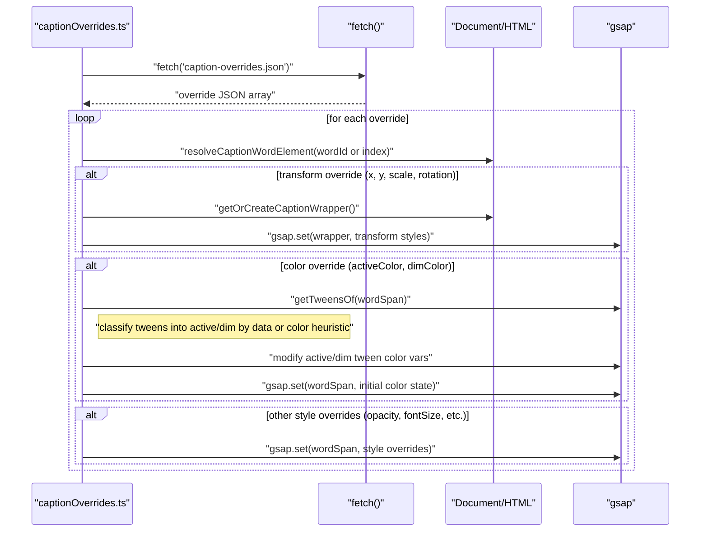

<!-- source: DeepWiki mcp.deepwiki.com · repo heygen-com/hyperframes · page 6.5 Caption System · fetched 2026-11-02 -->

# Caption System

<details>
<summary>Relevant source files</summary>

The following files were used as context for generating this wiki page:

- [packages/aws-lambda/build.mjs](packages/aws-lambda/build.mjs)
- [packages/cli/src/api.test.ts](packages/cli/src/api.test.ts)
- [packages/cli/src/api/transcribe.ts](packages/cli/src/api/transcribe.ts)
- [packages/cli/src/commands/transcribe.test.ts](packages/cli/src/commands/transcribe.test.ts)
- [packages/cli/src/commands/transcribe.ts](packages/cli/src/commands/transcribe.ts)
- [packages/cli/src/utils/download.test.ts](packages/cli/src/utils/download.test.ts)
- [packages/cli/src/utils/download.ts](packages/cli/src/utils/download.ts)
- [packages/cli/src/whisper/manager.install.test.ts](packages/cli/src/whisper/manager.install.test.ts)
- [packages/cli/src/whisper/manager.model.test.ts](packages/cli/src/whisper/manager.model.test.ts)
- [packages/cli/src/whisper/manager.ts](packages/cli/src/whisper/manager.ts)
- [packages/cli/src/whisper/modelFile.ts](packages/cli/src/whisper/modelFile.ts)
- [packages/cli/src/whisper/normalize.test.ts](packages/cli/src/whisper/normalize.test.ts)
- [packages/cli/src/whisper/normalize.ts](packages/cli/src/whisper/normalize.ts)
- [packages/cli/src/whisper/parakeet.ts](packages/cli/src/whisper/parakeet.ts)
- [packages/cli/src/whisper/progress.test.ts](packages/cli/src/whisper/progress.test.ts)
- [packages/cli/src/whisper/progress.ts](packages/cli/src/whisper/progress.ts)
- [packages/cli/src/whisper/sherpa.test.ts](packages/cli/src/whisper/sherpa.test.ts)
- [packages/cli/src/whisper/sherpa.ts](packages/cli/src/whisper/sherpa.ts)
- [packages/cli/src/whisper/sherpaWorker.test.ts](packages/cli/src/whisper/sherpaWorker.test.ts)
- [packages/cli/src/whisper/sherpaWorker.ts](packages/cli/src/whisper/sherpaWorker.ts)
- [packages/cli/src/whisper/transcribe.metadata.test.ts](packages/cli/src/whisper/transcribe.metadata.test.ts)
- [packages/cli/src/whisper/transcribe.test.ts](packages/cli/src/whisper/transcribe.test.ts)
- [packages/cli/src/whisper/transcribe.ts](packages/cli/src/whisper/transcribe.ts)
- [packages/gcp-cloud-run/build.mjs](packages/gcp-cloud-run/build.mjs)
- [registry/components/caption-clip-wipe/caption-clip-wipe.html](registry/components/caption-clip-wipe/caption-clip-wipe.html)
- [registry/components/caption-editorial-emphasis/caption-editorial-emphasis.html](registry/components/caption-editorial-emphasis/caption-editorial-emphasis.html)
- [registry/components/caption-emoji-pop/caption-emoji-pop.html](registry/components/caption-emoji-pop/caption-emoji-pop.html)
- [registry/components/caption-glitch-rgb/caption-glitch-rgb.html](registry/components/caption-glitch-rgb/caption-glitch-rgb.html)
- [registry/components/caption-gradient-fill/caption-gradient-fill.html](registry/components/caption-gradient-fill/caption-gradient-fill.html)
- [registry/components/caption-highlight/caption-highlight.html](registry/components/caption-highlight/caption-highlight.html)
- [registry/components/caption-kinetic-slam/caption-kinetic-slam.html](registry/components/caption-kinetic-slam/caption-kinetic-slam.html)
- [registry/components/caption-matrix-decode/caption-matrix-decode.html](registry/components/caption-matrix-decode/caption-matrix-decode.html)
- [registry/components/caption-neon-accent/caption-neon-accent.html](registry/components/caption-neon-accent/caption-neon-accent.html)
- [registry/components/caption-neon-glow/caption-neon-glow.html](registry/components/caption-neon-glow/caption-neon-glow.html)
- [registry/components/caption-parallax-layers/caption-parallax-layers.html](registry/components/caption-parallax-layers/caption-parallax-layers.html)
- [registry/components/caption-particle-burst/caption-particle-burst.html](registry/components/caption-particle-burst/caption-particle-burst.html)
- [registry/components/caption-pill-karaoke/caption-pill-karaoke.html](registry/components/caption-pill-karaoke/caption-pill-karaoke.html)
- [registry/components/caption-weight-shift/caption-weight-shift.html](registry/components/caption-weight-shift/caption-weight-shift.html)
- [scripts/verify-packed-manifests.mjs](scripts/verify-packed-manifests.mjs)
- [scripts/verify-packed-manifests.test.mjs](scripts/verify-packed-manifests.test.mjs)

</details>


The Caption System provides a comprehensive framework inside the HyperFrames Studio for generating, editing, synchronizing, and rendering rich, word-level animated captions. It supports end-to-end workflows starting from transcript ingestion to animated HTML caption rendering with per-word style and animation control, enabling precise authoring and runtime synchronization.

---

## System Overview

The caption subsystem orchestrates the flow from raw transcript data through studio editing interfaces to deterministic runtime rendering and animation synchronization. It integrates core parsing, generation, editing UI, synchronization hooks, runtime style overrides, and registry caption components.

### Key Components and Subsystems:
- **Caption Parsing and Model Building**: Extracts and normalizes transcript data and live DOM caption state into a structured `CaptionModel`.
- **HTML Caption Generation**: Serializes the `CaptionModel` into fully formed HTML with embedded GSAP animations.
- **Studio React Components**: Interactive overlays and property/animation panels for authoring caption style and animations.
- **Styling Synchronization Hook**: Saves and loads per-word style override JSON files (`caption-overrides.json`).
- **Runtime Style Overrides**: Applies live per-word transform, color, and font style overrides non-destructively on top of GSAP entrance/exit effects.
- **Embedded Caption Registry Components**: A collection of reusable caption designs with animation panels and overlays.
- **Keyboard Nudging**: Supports keyboard arrow key nudging of caption overlays for precision alignment.
- **Transcript Normalization**: Handles various transcript formats (SRT, VTT, Whisper JSON) and normalizes them into a consistent word-level structure.

---

### Caption Data Flow Diagram

```mermaid
graph TD
  subgraph "Transcript Input & CLI Pipeline"
    A[Media (MP4, MP3)] -->|hyperframes transcribe| B[Raw Transcript (JSON, SRT, VTT)]
    B --> C{whisper/normalize.ts: loadTranscript()}
    C --> D[Normalized Word Array (Word[])]
  end

  subgraph "Studio Caption Model Layer"
    D --> E[parser.ts: buildCaptionModel()]
    E --> F[CaptionModel (Structured State)]
    F --> G[generator.ts: generateCaptionHtml()]
    G --> H[captions.html file]
  end

  subgraph "Studio Editing & Runtime"
    F --> I[useCaptionSync.ts (style JSON persistence)]
    H --> J[CaptionOverlay Component (interactive UI)]
    J --> K[CaptionPropertyPanel]
    J --> L[CaptionAnimationPanel]
    I --> M[captionOverrides.ts: applyCaptionOverrides()]
  end

  style B fill:#f9f,stroke:#333,stroke-width:2px
  style C fill:#bbf,stroke:#333,stroke-width:2px
  style D fill:#f9f,stroke:#333,stroke-width:2px
  style E fill:#bbf,stroke:#333,stroke-width:2px
  style F fill:#f9f,stroke:#333,stroke-width:2px
  style G fill:#bbf,stroke:#333,stroke-width:2px
  style H fill:#f9f,stroke:#333,stroke-width:2px
  style I fill:#bbf,stroke:#333,stroke-width:2px
  style J fill:#bbf,stroke:#333,stroke-width:2px
  style K fill:#bbf,stroke:#333,stroke-width:2px
  style L fill:#bbf,stroke:#333,stroke-width:2px
  style M fill:#bbf,stroke:#333,stroke-width:2px
```

**Legend:**

- The CLI processing (outside Studio) generates timing text data from media/transcripts.
- Studio parses captions into the `CaptionModel`, which drives bidirectional generation and editing.
- User edits in Studio interact with overlay and property panels, syncing style overrides.
- Runtime overrides apply nuanced styling and color tweaks by modifying DOM and tween states.

Sources:  
`[packages/cli/src/whisper/normalize.ts:39-63]()`  
`[packages/cli/src/whisper/normalize.ts:87-117]()`  
`[packages/studio/src/captions/parser.ts:15-97]()`  
`[packages/studio/src/captions/generator.ts:30-50]()`  
`[packages/studio/src/captions/hooks/useCaptionSync.ts:5-180]()`  
`[packages/core/src/runtime/captionOverrides.ts:1-180]()`  
`[packages/studio/src/captions/components/CaptionOverlay.tsx:30-139]()`  
`[packages/studio/src/captions/components/CaptionPropertyPanel.tsx:55-163]()`  
`[packages/studio/src/captions/components/CaptionAnimationPanel.tsx:9-62]()`

---

## Caption Data Model

The subsystem uses a structured, normalized data model residing primarily in the `CaptionModel`, which includes:

| Entity                | Description                                               | Key Properties                               |
|-----------------------|-----------------------------------------------------------|----------------------------------------------|
| **TranscriptWord**    | Represents raw word-level transcript data with timing     | `id`, `text`, `start`, `end`                 |
| **CaptionSegment**    | Single caption word instance with style and animation info| `wordId`, `style`, `animation`                |
| **CaptionGroup**      | Logical groupings (lines, phrases) of caption segments    | `segmentIds`, `style`, `containerStyle`      |
| **CaptionModel**      | Entire caption composition state and ordering             | Maps of groups and segments, and `groupOrder`|

This normalization supports efficient editing, style overrides, and syncing.

Sources:  
`[packages/cli/src/whisper/normalize.ts:6-14]()`  
`[packages/studio/src/captions/parser.ts:10-40]()`  
`[packages/studio/src/captions/types.ts:4-30]()`  
`[packages/studio/src/captions/parser.ts:37-97]()`

---

## Transcript Normalization and CLI Integration

The `hyperframes transcribe` CLI command is central to ingesting and normalizing transcript data. It supports various input formats and outputs a standardized word-level JSON.

### `hyperframes transcribe` Command

The `transcribe` command [packages/cli/src/commands/transcribe.ts:33-111]() handles:
- **Input**: Audio/video files for transcription, or existing transcript files (`.json`, `.srt`, `.vtt`).
- **Engines**: Supports `whisper` (via `whisper.cpp`) and `parakeet` (via `sherpa-onnx`) for ASR [packages/cli/src/commands/transcribe.ts:51-56]().
- **Model Selection**: Allows specifying Whisper models (e.g., `tiny.en`, `medium.en`, `large-v3`) [packages/cli/src/commands/transcribe.ts:58-61]().
- **Language**: Filters non-target speech [packages/cli/src/commands/transcribe.ts:63-65]().
- **Output**: Can export to SRT or VTT sidecar files [packages/cli/src/commands/transcribe.ts:75-78]().
- **Cue Preservation**: `--preserve-cues` flag [packages/cli/src/commands/transcribe.ts:84-87]() prevents word-level regrouping for already-cued transcripts.
- **Runtime Installation**: `--runtime-install` manages `whisper.cpp` binary installation [packages/cli/src/commands/transcribe.ts:89-92]().
- **Optional Transcriptions**: `--optional` flag [packages/cli/src/commands/transcribe.ts:96-99]() allows pipelines to continue if transcription fails.
- **Timeout Management**: `--timeout` argument [packages/cli/src/commands/transcribe.ts:101-110]() overrides the auto-scaled timeout for Whisper.

### `whisper/normalize.ts`

This module [packages/cli/src/whisper/normalize.ts:1-596]() is responsible for:
- **Format Detection**: `detectFormat()` [packages/cli/src/whisper/normalize.ts:39-44]() identifies input as `whisper-cpp`, `openai`, `srt`, `vtt`, or `words-json`.
- **Transcript Loading**: `loadTranscript()` [packages/cli/src/whisper/normalize.ts:87-117]() reads and parses various formats into a `Word[]` array.
- **Punctuation Merging**: `parseWhisperCpp()` [packages/cli/src/whisper/normalize.ts:150-184]() merges punctuation tokens with their preceding words.
- **Zero-Duration Interpolation**: `interpolateZeroDuration()` [packages/cli/src/whisper/normalize.ts:103-128]() distributes timestamps for words with identical start/end times.
- **Output Formatting**: `formatSrt()` [packages/cli/src/whisper/normalize.ts:400-420]() and `formatVtt()` [packages/cli/src/whisper/normalize.ts:422-442]() convert `Word[]` to SRT/VTT.
- **HTML Patching**: `patchCaptionHtml()` [packages/cli/src/whisper/normalize.ts:444-480]() injects the normalized `Word[]` into a `<script>` tag within an HTML file.

### Whisper Timeout Resolution

The `whisper/transcribe.ts` module [packages/cli/src/whisper/transcribe.ts:1-784]() includes logic for dynamically resolving transcription timeouts:
- `resolveWhisperTimeoutMs()` [packages/cli/src/whisper/transcribe.ts:99-131]() calculates a timeout based on audio duration and a model-specific slowdown factor [packages/cli/src/whisper/transcribe.ts:52-65]().
- `WHISPER_MODEL_SLOWDOWN_FACTORS` [packages/cli/src/whisper/transcribe.ts:52-65]() accounts for varying processing times of different Whisper models.
- `resolveAudioPreparationTimeoutMs()` [packages/cli/src/whisper/transcribe.ts:138-150]() sets a separate timeout for FFmpeg audio preparation.

Sources:  
`[packages/cli/src/commands/transcribe.ts:33-111]()`  
`[packages/cli/src/commands/transcribe.ts:51-56]()`  
`[packages/cli/src/commands/transcribe.ts:58-61]()`  
`[packages/cli/src/commands/transcribe.ts:63-65]()`  
`[packages/cli/src/commands/transcribe.ts:75-78]()`  
`[packages/cli/src/commands/transcribe.ts:84-87]()`  
`[packages/cli/src/commands/transcribe.ts:89-92]()`  
`[packages/cli/src/commands/transcribe.ts:96-99]()`  
`[packages/cli/src/commands/transcribe.ts:101-110]()`  
`[packages/cli/src/whisper/normalize.ts:1-596]()`  
`[packages/cli/src/whisper/normalize.ts:39-44]()`  
`[packages/cli/src/whisper/normalize.ts:87-117]()`  
`[packages/cli/src/whisper/normalize.ts:150-184]()`  
`[packages/cli/src/whisper/normalize.ts:103-128]()`  
`[packages/cli/src/whisper/normalize.ts:400-420]()`  
`[packages/cli/src/whisper/normalize.ts:422-442]()`  
`[packages/cli/src/whisper/normalize.ts:444-480]()`  
`[packages/cli/src/whisper/transcribe.ts:1-784]()`  
`[packages/cli/src/whisper/transcribe.ts:99-131]()`  
`[packages/cli/src/whisper/transcribe.ts:52-65]()`  
`[packages/cli/src/whisper/transcribe.ts:138-150]()`

---

## Studio Subsystem Components

### Parser and Generator

- **parser.ts**
  - Parses embedded transcripts and live iframe DOM caption content.
  - Builds the normalized `CaptionModel`.
  - Extracts word timings, groups, and current style/animation data.

- **generator.ts**
  - Takes a `CaptionModel` and outputs fully-formed HTML caption compositions.
  - Embeds GSAP timelines controlling entrance, karaoke highlight, and exit animations.
  - Ensures word-level timing and style flows into the output HTML.

These work together to provide a full round-trip capability: parse → edit → regenerate.

Sources:  
`[packages/studio/src/captions/parser.ts:100-150]()`  
`[packages/studio/src/captions/generator.ts:31-50]()`

---

### `useCaptionSync` Hook

The hook at `[packages/studio/src/captions/hooks/useCaptionSync.ts]` implements:

- Automatic saving/loading of per-word style overrides to/from `caption-overrides.json` over the Studio backend filesystem.
- Debounced saving (typically 800ms) to avoid excessive disk writes.
- Supports suppression of auto-save when loading to avoid loops.
- Stores overrides as succinct JSON objects keyed by word ID or index, holding style transforms, color values, opacity, font attributes, etc.
- Updates Studio global store to reflect override merges.

This hook keeps live style modifications persistent and synchronized between authoring sessions.

Sources:  
`[packages/studio/src/captions/hooks/useCaptionSync.ts:60-180]()`

---

### Studio React UI Components

- **CaptionOverlay**
  - Interactive overlay within Studio preview iframe.
  - Supports drag, scale, rotate per caption word or group.
  - Keyboard support for arrow key nudging.
  - Reflects current style overrides and updates store on interactions.

- **CaptionPropertyPanel**
  - UI panel to edit typography, colors, transform values on selected caption words/groups.
  - Applies changes instantly using GSAP style overrides in preview iframe.
  - Supports font size, weight, font family, opacity, rotation, scaling.

- **CaptionAnimationPanel**
  - UI to configure entrance, karaoke highlight, and exit animation presets.
  - Adjusts easing and timing for word animations.
  - Works with stored model animation metadata for each caption segment.

These components provide a rich WYSIWYG editing experience for professional caption animation.

Sources:  
`[packages/studio/src/captions/components/CaptionOverlay.tsx:30-139]()`  
`[packages/studio/src/captions/components/CaptionPropertyPanel.tsx:55-163]()`  
`[packages/studio/src/captions/components/CaptionAnimationPanel.tsx:9-62]()`

---

## Runtime Style Override Application (`captionOverrides.ts`)

At runtime in Studio preview or production rendering, the file `[packages/core/src/runtime/captionOverrides.ts]` provides `applyCaptionOverrides()` to apply style overrides read from `caption-overrides.json`. Key technical points:

- **Override Resolution**:
  - Attempts to find each word element by `wordId` via `document.getElementById`.
  - Falling back to indexed matching of `.caption-group > span` in DOM order.

- **Non-Destructive Transform Wrapping**:
  - To preserve GSAP entrance/exit tweens, many transforms (x, y, scale, rotation) apply to an inline-block wrapper `<span data-caption-wrapper="true">` around each word span.
  - This isolates transforms without killing or altering existing word tween animations.

- **Style Overrides**:
  - Directly applied to the inner word span for properties like `opacity`, `fontSize`, `fontWeight`, `fontFamily`.

- **Color Overrides on Karaoke Highlights**:
  - The runtime distinguishes "active" and "dim" karaoke color tweens using either explicit caption state metadata or fallback heuristics comparing tween colors to defaults.
  - The override colors (`activeColor`, `dimColor`) dynamically update these tweens and set the initial tint smoothly.
  - No killing or recreation of tweens occur, preserving smooth highlight transitions.

- **Robustness**:
  - Handles cases where word elements or wrappers may be missing.
  - Applies style overrides gracefully without disrupting animation timelines.

### Runtime Override Application Sequence Diagram



Sources:  
`[packages/core/src/runtime/captionOverrides.ts:3-180]()`

---

## Registry Caption Components

HyperFrames provides a suite of reusable caption block components in the registry with specialized overlay and animation panels, such as:

- `caption-weight-shift` (Weight Shift styling and animations) [registry/components/caption-weight-shift/caption-weight-shift.html:1-210]()
- `caption-editorial-emphasis` (Emphasis with italic and large text) [registry/components/caption-editorial-emphasis/caption-editorial-emphasis.html:1-242]()
- `caption-emoji-pop` (Pop-style animated emoji overlays) [registry/components/caption-emoji-pop/caption-emoji-pop.html:1-242]()
- `caption-pill-karaoke` (Pill-shaped karaoke caption style) [registry/components/caption-pill-karaoke/caption-pill-karaoke.html:1-218]()
- (Others: gradient fill, particle bursts, neon glow… each with distinct styling and animation)

These components contain their own HTML, CSS, GSAP animations, and embedded transcript scripts. They serve as blueprints or reusable blocks for caption system authoring workflows.

Sources:  
`[registry/components/caption-weight-shift/caption-weight-shift.html:1-210]()`  
`[registry/components/caption-editorial-emphasis/caption-editorial-emphasis.html:1-242]()`  
`[registry/components/caption-emoji-pop/caption-emoji-pop.html:1-242]()`  
`[registry/components/caption-pill-karaoke/caption-pill-karaoke.html:1-218]()`

---

## Keyboard Nudging Support

The Studio caption overlay supports precise arrow-key nudging of caption elements:

| Key Combination    | Effect                           |
|--------------------|---------------------------------|
| Arrow Keys         | Move selected caption word 1px  |
| Shift + Arrow Keys | Move selected caption word 10px |

This control respects modifier keys to only react on pure arrow keys, preventing interference with other shortcuts.

It is implemented in `[packages/studio/src/captions/keyboard.ts]` and integrated inside the `CaptionOverlay` interaction handlers.

Sources:  
`[packages/studio/src/captions/keyboard.ts:1-10]()`  
`[packages/studio/src/captions/components/CaptionOverlay.tsx:102-132]()`

---

## Summary Table of Key Caption System Code Entities

| Natural Language Concept          | Code Entity / File                                     | Role / Responsibility                                    |
|----------------------------------|-------------------------------------------------------|----------------------------------------------------------|
| Transcript-to-Model Parsing       | `parser.ts` - `buildCaptionModel()`                   | Parses raw transcript JSON and DOM into `CaptionModel`   |
| Model-to-HTML Generation          | `generator.ts` - `generateCaptionHtml()`              | Serializes `CaptionModel` to HyperFrames HTML + GSAP     |
| Style Override Persistence        | `hooks/useCaptionSync.ts` - `useCaptionSync()`        | Hook saving/loading per-word style overrides JSON        |
| Caption Rendering Interaction     | `components/CaptionOverlay.tsx`                        | Interactive caption editing overlay UI                    |
| Style & Animation UI              | `components/CaptionPropertyPanel.tsx`                  | Style editing panel (typography/colors/transforms)       |
| Animation Preset UI               | `components/CaptionAnimationPanel.tsx`                 | Animation configuration UI (entrance/karaoke/exits)      |
| Runtime Style Overrides           | `captionOverrides.ts` - `applyCaptionOverrides()`     | Runtime application of per-word transform/color styles   |
| Keyboard Nudging Utility          | `keyboard.ts` - `shouldHandleCaptionNudgeKey()`       | Interactive keyboard arrow key nudging filter logic      |
| CLI Transcription Command         | `cli/src/commands/transcribe.ts`                      | Orchestrates ASR, format conversion, and output          |
| Transcript Normalization          | `cli/src/whisper/normalize.ts`                        | Handles various transcript formats, merges, interpolates |
| Whisper Timeout Logic             | `cli/src/whisper/transcribe.ts`                       | Calculates dynamic timeouts for Whisper transcription    |

---

## Conclusion

The HyperFrames Studio Caption System merges transcript-to-HTML transformation, precise reactive editing, advanced per-word style control, and dynamic karaoke animation synchronization into one integrated package. Through a normalized caption model, bidirectional parsing and generation, persistent JSON overrides, reusable registry components, an interactive overlay UI, and robust runtime style application, the system supports professional captions with meticulous timing, typography, and animation control running smoothly across preview and production render workflows.

---

Sources:  
- `[packages/core/src/runtime/captionOverrides.ts:1-180]()`  
- `[packages/studio/src/captions/parser.ts:1-150]()`  
- `[packages/studio/src/captions/generator.ts:30-50]()`  
- `[packages/studio/src/captions/hooks/useCaptionSync.ts:1-180]()`  
- `[packages/studio/src/captions/components/CaptionOverlay.tsx:30-139]()`  
- `[packages/studio/src/captions/components/CaptionPropertyPanel.tsx:55-163]()`  
- `[packages/studio/src/captions/components/CaptionAnimationPanel.tsx:9-62]()`  
- `[packages/studio/src/captions/keyboard.ts:1-10]()`  
- `[registry/components/caption-weight-shift/caption-weight-shift.html:1-210]()`  
- `[registry/components/caption-editorial-emphasis/caption-editorial-emphasis.html:1-242]()`  
- `[registry/components/caption-emoji-pop/caption-emoji-pop.html:1-242]()`  
- `[registry/components/caption-pill-karaoke/caption-pill-karaoke.html:1-218]()`  
- `[packages/cli/src/commands/transcribe.ts:1-145]()`  
- `[packages/cli/src/whisper/normalize.ts:1-596]()`  
- `[packages/cli/src/whisper/transcribe.ts:1-176]()`

---

