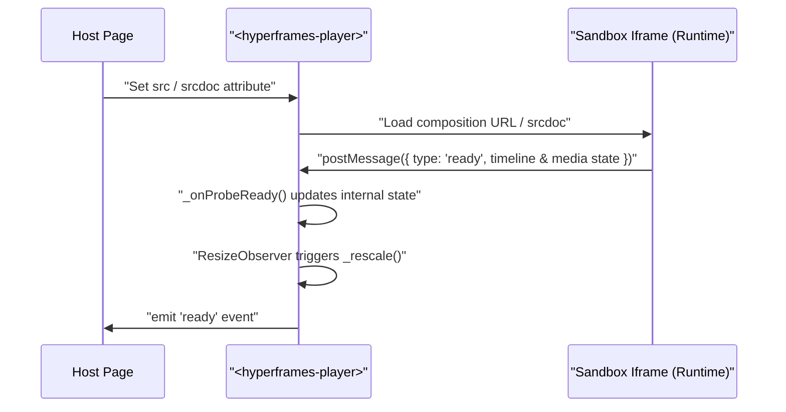
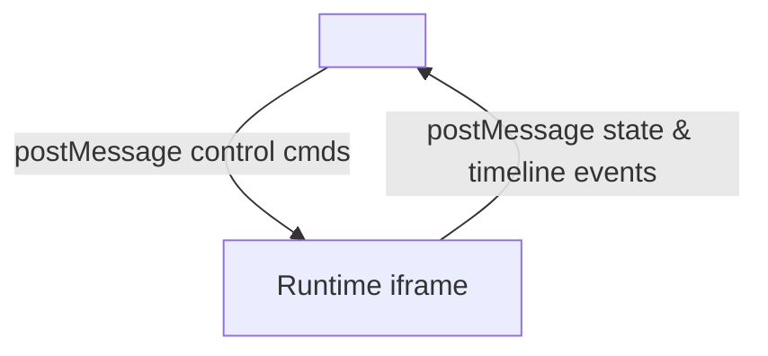
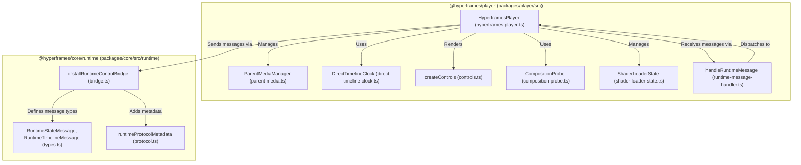

<!-- source: DeepWiki mcp.deepwiki.com · repo heygen-com/hyperframes · page 7 Player Package · fetched 2026-11-02 -->

# Player Package

Relevant source files

The following files were used as context for generating this wiki page:

- [docs/packages/player.mdx](docs/packages/player.mdx)
- [packages/core/src/runtime/bridge.test.ts](packages/core/src/runtime/bridge.test.ts)
- [packages/core/src/runtime/bridge.ts](packages/core/src/runtime/bridge.ts)
- [packages/core/src/runtime/clock-stall.test.ts](packages/core/src/runtime/clock-stall.test.ts)
- [packages/core/src/runtime/clock.test.ts](packages/core/src/runtime/clock.test.ts)
- [packages/core/src/runtime/clock.ts](packages/core/src/runtime/clock.ts)
- [packages/core/src/runtime/mediaSteer.ts](packages/core/src/runtime/mediaSteer.ts)
- [packages/core/src/runtime/state.ts](packages/core/src/runtime/state.ts)
- [packages/core/src/runtime/transportPark.test.ts](packages/core/src/runtime/transportPark.test.ts)
- [packages/core/src/runtime/types.ts](packages/core/src/runtime/types.ts)
- [packages/core/tsconfig.json](packages/core/tsconfig.json)
- [packages/player/README.md](packages/player/README.md)
- [packages/player/src/controls.test.ts](packages/player/src/controls.test.ts)
- [packages/player/src/controls.ts](packages/player/src/controls.ts)
- [packages/player/src/direct-timeline-clock.ts](packages/player/src/direct-timeline-clock.ts)
- [packages/player/src/hyperframes-player.test.ts](packages/player/src/hyperframes-player.test.ts)
- [packages/player/src/hyperframes-player.ts](packages/player/src/hyperframes-player.ts)
- [packages/player/src/parent-media.test.ts](packages/player/src/parent-media.test.ts)
- [packages/player/src/parent-media.ts](packages/player/src/parent-media.ts)
- [packages/player/src/playback-state.ts](packages/player/src/playback-state.ts)
- [packages/player/src/range-playback.test.ts](packages/player/src/range-playback.test.ts)
- [packages/player/src/runtime-message-handler.test.ts](packages/player/src/runtime-message-handler.test.ts)
- [packages/player/src/runtime-message-handler.ts](packages/player/src/runtime-message-handler.ts)
- [packages/player/src/styles.test.ts](packages/player/src/styles.test.ts)
- [packages/player/src/styles.ts](packages/player/src/styles.ts)
- [packages/player/src/video-source.ts](packages/player/src/video-source.ts)

The `@hyperframes/player` package provides a foundational web component, the `<hyperframes-player>`, that enables embedding HyperFrames compositions into web pages as a slideshow or media player element. It encapsulates the complexity of sandboxing, runtime communication, media synchronization, and UI controls into a single, reusable custom element.

This package addresses key challenges such as:

- Hosting the HyperFrames runtime inside a secure iframe sandbox  
- Bridging timeline and media playback state between the parent and runtime via structured `postMessage` events  
- Responsive scaling of the composition rendering based on native composition dimensions  
- Workaround for mobile browser autoplay restrictions by promoting audio/video elements to the parent frame  
- A Shadow DOM controls UI supporting play, pause, seek scrubber, volume, and playback speed adjustments  

---

## Core Architecture Overview

At runtime, `<hyperframes-player>` hosts an isolated `<iframe>` element that loads the HyperFrames composition runtime. This iframe runs the timeline-driven rendering model inside a secure boundary. The parent player component probes the iframe for composition readiness and metadata with the help of a `CompositionProbe` utility [packages/player/src/hyperframes-player.ts:1]().

Playback and timeline state is synchronized using a bidirectional `postMessage` bridge derived from the core runtime communication protocol [packages/player/src/runtime-message-handler.ts:1-10](). Control commands (`play`, `pause`, `seek`, `set-volume`, etc.) flow from the parent to the runtime iframe, while timeline updates (`state` and `timeline` messages) flow back [packages/core/src/runtime/types.ts:36-119]().

This architecture clearly separates concerns:

- The runtime iframe manages deterministic content rendering and timeline playback  
- The player component maintains UI state, scaling, and media synchronization at the embedding page level  

**Sequence diagram of initialization and message flow:**

Sources: packages/player/src/hyperframes-player.ts:1-185

---

## Public API and Observed Attributes

The `<hyperframes-player>` exposes a rich attribute and method API resembling native media elements, managing playback state, timeline position, and media properties [packages/player/README.md:48-92]().

| Attribute          | Type                | Default   | Description                                                       |
|--------------------|---------------------|-----------|-------------------------------------------------------------------|
| `src`              | `string`            | —         | URL of the HTML composition to load into the iframe              |
| `srcdoc`           | `string`            | —         | Inline HTML composition content as a string                      |
| `width`            | `number`            | 1920      | Native composition width for aspect ratio and scaling            |
| `height`           | `number`            | 1080      | Native composition height for aspect ratio and scaling           |
| `controls`         | `boolean`           | `false`   | Show Shadow DOM playback controls UI                              |
| `muted`            | `boolean`           | `false`   | Mute all audio output                                             |
| `audio-src`        | `string`            | —         | URL of proxied audio source to play in parent frame on mobile   |
| `playback-rate`    | `number` (0.1–5)    | 1         | Playback speed multiplier                                         |
| `poster`           | `string`            | —         | Poster image shown before playback                                |
| `audio-locked`     | `boolean`           | `false`   | Disable user volume controls, used for forced silent playback    |
| `range-start`      | `number`            | —         | Film second where playback starts, loops back to and parks when paused |
| `range-end`        | `number`            | —         | Film second the range ends before: it stops or loops on the frame before it |

The player implements core media methods:

- `play()` — starts playback and synchronizes runtime iframe and parent media proxies  
- `pause()` — pauses playback and media in the runtime and proxies  
- `seek(timeSeconds: number)` — moves the playhead to the specified timeline time  

Internal state tracks current time, duration, paused/play state, volume, and whether scrubbing is active [packages/player/src/hyperframes-player.ts:131-166]().

Sources: packages/player/src/hyperframes-player.ts:90-118, packages/player/src/hyperframes-player.test.ts:183-211, packages/player/README.md:48-92

---

## PostMessage Bridge and Timeline Synchronization

Communication between the `<hyperframes-player>` and the runtime iframe uses a structured `postMessage` protocol derived from the core runtime bridge system [packages/core/src/runtime/bridge.ts:1-10]().

- The runtime posts messages such as:
  - `"ready"` — signals runtime control bridge installation completed [packages/core/src/runtime/types.ts:188-192]()
  - `"state"` — current playback position, playing/paused status, muted, etc. [packages/core/src/runtime/types.ts:58-67]()
  - `"timeline"` — detailed timeline clip info, scenes, composition size [packages/core/src/runtime/types.ts:105-119]()
  - `"media-autoplay-blocked"` — signals mobile autoplay prohibition [packages/core/src/runtime/types.ts:175-178]()
- The player sends `"control"` action messages to command play, pause, seek, volume/mute changes, playback rate adjustments, etc. [packages/core/src/runtime/types.ts:36-56]()

Internally, the player uses a `DirectTimelineClock` abstraction as a ticking clock for consistent timing callbacks and events, ensuring synchronization between media proxies and runtime timeline [packages/player/src/direct-timeline-clock.ts:1-10]().

**High-level communication overview:**

This bridge ensures correct and deterministic coordination of timeline state and media playback across iframe boundaries.

Sources: packages/player/src/hyperframes-player.ts:7-40, packages/core/src/runtime/bridge.ts:20-40, packages/core/src/runtime/types.ts:36-119

---

## Scaling and Resize Handling

The player uses a `ResizeObserver` on its own container to detect layout size changes [packages/player/src/hyperframes-player.ts:127](). It calculates a scale factor to fit the native composition resolution (`width` and `height` attributes) into the actual rendered size [packages/player/src/iframe-dom.ts:3-4]().

The iframe is scaled with CSS transforms (rather than width/height attributes) to preserve aspect ratio and rendering crispness.

Key behaviors:

- Rescales on player container resize  
- Debounces scaling and warns if excessive CSS zoom is encountered  
- Adjusts shader capture scale and loading UI accordingly  

This scaling logic allows compositions to embed responsively and look correct regardless of viewport or container size.

Sources: packages/player/src/hyperframes-player.ts:140-165, packages/player/src/hyperframes-player.ts:400-440

---

## Mobile Autoplay Workaround: Parent-Frame Media Proxy

Mobile browsers restrict autoplay inside iframes, blocking audio playback if the user gesture occurred outside the iframe.

To mitigate this, the player optionally proxies media to the parent frame using `audio-src`, orchestrated by the `ParentMediaManager` [packages/player/src/parent-media.ts:1-10]():

- By default, the runtime iframe controls playback and audio output [packages/player/src/parent-media.ts:98]()
- Upon detecting a `media-autoplay-blocked` message from runtime [packages/core/src/runtime/types.ts:175-178](), the player switches ownership to the parent proxy audio element [packages/player/src/parent-media.ts:98]()
- The iframe is muted or silenced to avoid doubling audio  
- Parent proxy audio element manages playback in the top-level frame context, circumventing mobile restrictions  

This approach ensures audio is audible on mobile without requiring user interaction inside the iframe.

Sources: packages/player/src/hyperframes-player.ts:110-160, packages/player/src/parent-media.ts:10-70, packages/core/src/runtime/types.ts:175-178

---

## Shadow DOM Controls UI

When the `controls` attribute is set, the player renders a custom controls interface within its Shadow DOM [packages/player/src/controls.ts:53-56](). Features include:

- Play/pause toggle button with accessible semantics [packages/player/src/controls.ts:77-84]()
- Time scrubber with drag support and preview time display [packages/player/src/controls.ts:86-91]()
- Current time and duration labels [packages/player/src/controls.ts:93-95]()
- Mute/unmute toggle and volume slider (hidden if `audio-locked` is true) [packages/player/src/controls.ts:126-155]()
- Playback speed selector with logarithmic speed presets [packages/player/src/controls.ts:23-23]()

The controls UI hooks into player methods to update runtime playback state, seek position, volume, and playback rate consistently [packages/player/src/controls.ts:10-19]().

It is implemented with minimal dependencies and designed for responsiveness and accessibility.

Sources: packages/player/src/controls.ts:23-23, packages/player/src/controls.ts:10-19, packages/player/src/controls.ts:53-56, packages/player/src/controls.ts:77-84, packages/player/src/controls.ts:86-91, packages/player/src/controls.ts:93-95, packages/player/src/controls.ts:126-155

---

## Player Package Entities Diagram

This diagram illustrates how the web component integrates specialized subsystems—media proxy, timeline clock, UI controls, composition probe, runtime shader loader—and links to the core runtime messaging protocol infrastructure.

---

## Child Pages for Details

This page provides a high-level overview of the Player package. Detailed internal mechanics and implementations are documented in the following child pages:

- **[HyperframesPlayer Web Component](#7.1)**  
  Detailed analysis of `hyperframes-player.ts`, including observed attributes, lifecycle callbacks, public methods, event handling, iframe sandboxing, postMessage bridge integration, direct timeline clock logic, and ResizeObserver-based scaling.

- **[Mobile Media and Controls UI](#7.2)**  
  In-depth coverage of the mobile media workaround, parent-frame media proxies, media extraction challenges on mobile browsers, thumbnail and media proxy internals, Shadow DOM controls UI creation, scrubber event handling, playback speed presets, and controls UI auto-hide timing logic.

---

**Sources:**

- packages/player/src/hyperframes-player.ts:1-260  
- packages/player/src/hyperframes-player.test.ts:183-211  
- packages/player/src/controls.ts:10-19  
- packages/player/src/controls.ts:23-23  
- packages/player/src/controls.ts:53-56  
- packages/player/src/controls.ts:77-84  
- packages/player/src/controls.ts:86-91  
- packages/player/src/controls.ts:93-95  
- packages/player/src/controls.ts:126-155  
- packages/player/src/parent-media.ts:1-10  
- packages/player/src/parent-media.ts:10-70  
- packages/player/src/parent-media.ts:98  
- packages/player/src/runtime-message-handler.ts:1-10  
- packages/player/src/direct-timeline-clock.ts:1-10  
- packages/player/src/iframe-dom.ts:3-4  
- packages/player/README.md:48-92  
- packages/core/src/runtime/bridge.ts:1-10  
- packages/core/src/runtime/bridge.ts:20-40  
- packages/core/src/runtime/types.ts:36-56  
- packages/core/src/runtime/types.ts:58-67  
- packages/core/src/runtime/types.ts:105-119  
- packages/core/src/runtime/types.ts:175-178  
- packages/core/src/runtime/types.ts:188-192

---

