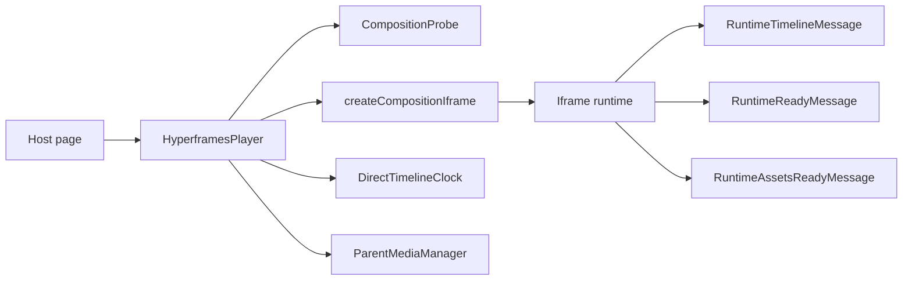
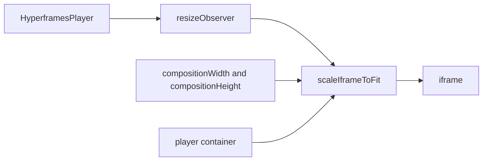
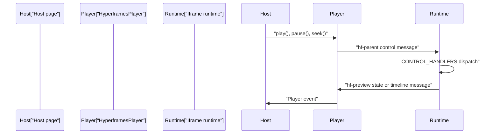
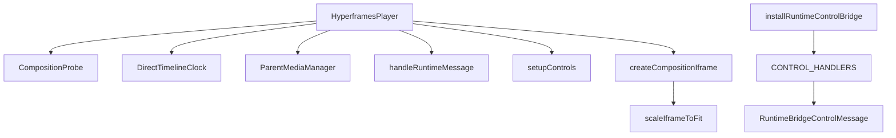

<!-- source: DeepWiki mcp.deepwiki.com · repo heygen-com/hyperframes · page 7.1 HyperframesPlayer Web Component · fetched 2026-11-02 -->

# HyperframesPlayer Web Component

Relevant source files

The following files were used as context for generating this wiki page:

- [docs/packages/player.mdx](docs/packages/player.mdx)
- [packages/core/src/runtime/bridge.test.ts](packages/core/src/runtime/bridge.test.ts)
- [packages/core/src/runtime/bridge.ts](packages/core/src/runtime/bridge.ts)
- [packages/core/src/runtime/clock-stall.test.ts](packages/core/src/runtime/clock-stall.test.ts)
- [packages/core/src/runtime/clock.test.ts](packages/core/src/runtime/clock.test.ts)
- [packages/core/src/runtime/clock.ts](packages/core/src/runtime/clock.ts)
- [packages/core/src/runtime/mediaSteer.ts](packages/core/src/runtime/mediaSteer.ts)
- [packages/core/src/runtime/state.ts](packages/core/src/runtime/state.ts)
- [packages/core/src/runtime/transportPark.test.ts](packages/core/src/runtime/transportPark.test.ts)
- [packages/core/src/runtime/types.ts](packages/core/src/runtime/types.ts)
- [packages/core/tsconfig.json](packages/core/tsconfig.json)
- [packages/player/README.md](packages/player/README.md)
- [packages/player/src/controls.test.ts](packages/player/src/controls.test.ts)
- [packages/player/src/controls.ts](packages/player/src/controls.ts)
- [packages/player/src/direct-timeline-clock.ts](packages/player/src/direct-timeline-clock.ts)
- [packages/player/src/hyperframes-player.test.ts](packages/player/src/hyperframes-player.test.ts)
- [packages/player/src/hyperframes-player.ts](packages/player/src/hyperframes-player.ts)
- [packages/player/src/parent-media.test.ts](packages/player/src/parent-media.test.ts)
- [packages/player/src/parent-media.ts](packages/player/src/parent-media.ts)
- [packages/player/src/playback-state.ts](packages/player/src/playback-state.ts)
- [packages/player/src/range-playback.test.ts](packages/player/src/range-playback.test.ts)
- [packages/player/src/runtime-message-handler.test.ts](packages/player/src/runtime-message-handler.test.ts)
- [packages/player/src/runtime-message-handler.ts](packages/player/src/runtime-message-handler.ts)
- [packages/player/src/styles.test.ts](packages/player/src/styles.test.ts)
- [packages/player/src/styles.ts](packages/player/src/styles.ts)
- [packages/player/src/video-source.ts](packages/player/src/video-source.ts)

## Purpose and scope

`<hyperframes-player>` is the embeddable custom element provided by `@hyperframes/player`. It plays HyperFrames compositions in a sandboxed iframe and exposes media-style controls, properties, and events to host pages. This page focuses on the component’s observed attributes, public API, initialization and messaging concepts, playback state, timeline clock, and responsive scaling. [packages/player/README.md:1-3]() [packages/player/README.md:23-31]() [docs/packages/player.mdx:13-15]()

Sources: [packages/player/README.md:1-3](), [packages/player/README.md:23-31](), [docs/packages/player.mdx:13-15]()

## 1. Observed attributes

The `HyperframesPlayer` class extends `HTMLElement`. Its `observedAttributes` getter declares the attributes that trigger the custom element’s attribute-change handling. This list is the implementation boundary for observed attributes; some documented player attributes, such as `autoplay` and `loop`, are not in the shown list. [packages/player/src/hyperframes-player.ts:95-119]() [packages/player/README.md:68-93]()

| Observed attribute | Purpose |
|---|---|
| `src` | Composition URL, or video URL when used with a video `type`. |
| `srcdoc` | Inline document content for the iframe. |
| `width`, `height` | Composition dimensions used for its aspect ratio. |
| `controls` | Show or hide playback controls. |
| `muted`, `volume`, `audio-locked` | Audio state and volume-control behavior. |
| `poster` | Poster image. |
| `playback-rate` | Playback speed. |
| `audio-src` | Parent-frame audio source. |
| `type` | Selects video playback when set to a video MIME type. |
| `sandbox-origin` | Sandbox-origin configuration attribute. |
| `runtime-src` | Runtime source configuration attribute. |
| `shader-capture-scale`, `shader-loading` | Shader-preview configuration. |
| `assets-loading-ui` | Loading-assets UI configuration. |
| `low-power-idle` | Paused-player idle behavior configuration. |
| `range-start`, `range-end` | Playback range bounds. |

The implementation also defines internal constants for `disable-click-to-play`, `assets-loading`, and timing limits, but those names are not included in the displayed `observedAttributes` list. The README documents `disable-click-to-play` and `no-load-timeout` as player attributes, so they should not be mistaken for entries in the shown observed list. [packages/player/src/hyperframes-player.ts:44-62]() [packages/player/src/hyperframes-player.ts:95-119]() [packages/player/README.md:68-93]()

Sources: [packages/player/src/hyperframes-player.ts:44-62](), [packages/player/src/hyperframes-player.ts:95-119](), [packages/player/README.md:68-93]()

## 2. Public methods and properties

The player’s public interface follows familiar media-player conventions. The documented API includes `play()`, `pause()`, and `seek(timeInSeconds)`, plus readable playback state and composition dimensions. It also documents writable `currentTime`, `playbackRate`, and `muted` properties. [docs/packages/player.mdx:84-101]()

| API | Behavior |
|---|---|
| `play()` | Starts playback. |
| `pause()` | Pauses playback. |
| `seek(timeInSeconds)` | Seeks to a time in seconds. |
| `currentTime` | Read or set the current playback position. |
| `duration` | Read the duration. |
| `paused` | Read whether playback is paused. |
| `ready` | Read whether the player is ready. |
| `playbackRate` | Read or set playback speed. |
| `muted` | Read or set mute state. |
| `compositionWidth`, `compositionHeight` | Read composition dimensions. |

The README additionally documents video-source behavior: when `type` is a video MIME type, `src` is played in a `<video playsinline>` while retaining the documented core playback methods and events. It identifies composition-only APIs such as `scenes`, `setRuntimeData()`, `setColorGrading()`, `iframeElement`, and `stopMedia()`. [packages/player/README.md:43-45]()

Sources: [docs/packages/player.mdx:84-101](), [packages/player/README.md:43-45]()

## 3. Events

The package documentation lists lifecycle and playback events for host integrations. `ready` includes duration and composition dimensions; `timeupdate` includes the current time. Other documented events include `durationchange`, `resize`, `play`, `pause`, `ended`, `rangeclamped`, `ratechange`, `volumechange`, and `scenes`. [docs/packages/player.mdx:103-129]()

| Event | Documented detail or meaning |
|---|---|
| `ready` | `{ duration, compositionWidth, compositionHeight }`; composition loaded and timeline discovered. |
| `durationchange` | `{ duration }`; duration changed after `ready`. |
| `resize` | `{ compositionWidth, compositionHeight }`; composition size changed. |
| `timeupdate` | `{ currentTime }`; playback position changed. |
| `play`, `pause`, `ended` | Playback started, paused, or reached the end. |
| `rangeclamped` | `{ rangeStart, rangeEnd, duration }`; a requested range was adjusted or ignored. |
| `ratechange` | Playback rate changed. |
| `volumechange` | Volume or mute state changed. |
| `scenes` | `{ scenes }`; runtime reported its scene list. |

For video sources, the README also documents `error` for load failures and `playbackerror` when the browser blocks `play()`. [packages/player/README.md:43-45]() The runtime protocol types distinguish state messages, timeline messages, readiness messages, and asset-readiness messages sent from the iframe runtime. These are protocol messages; the public event table above describes the host-facing player events. [packages/core/src/runtime/types.ts:58-67]() [packages/core/src/runtime/types.ts:105-119]() [packages/core/src/runtime/types.ts:180-201]()

Sources: [docs/packages/player.mdx:103-129](), [packages/player/README.md:43-45](), [packages/core/src/runtime/types.ts:58-67](), [packages/core/src/runtime/types.ts:105-119](), [packages/core/src/runtime/types.ts:180-201]()

## 4. Probe-and-inject initialization lifecycle

The component imports `CompositionProbe`, iframe DOM helpers, the direct timeline clock, parent-frame media management, and runtime message handling. Its constructor creates an open shadow root, adopts player styles, creates the composition iframe and container, and appends the iframe structure and shader-loader elements. The shown excerpt establishes these collaborators and initial DOM setup; it does not show the later probe callback or injection implementation. [packages/player/src/hyperframes-player.ts:1-7]() [packages/player/src/hyperframes-player.ts:25-29]() [packages/player/src/hyperframes-player.ts:95-130]() [packages/player/src/hyperframes-player.ts:167-178]()

The README describes the externally visible loading behavior: the player loads a composition in a sandboxed iframe, detects its dimensions and duration, and scales it to fit its container. [packages/player/README.md:23-31]() The runtime protocol includes `ready`, `timeline`, and `assets-ready` messages. The `ready` type is described as a signal that the runtime control bridge is listening; `timeline` carries duration, composition size, scene and clip data, and optionally asset readiness; `assets-ready` reports whether asset settling timed out. [packages/core/src/runtime/types.ts:105-119]() [packages/core/src/runtime/types.ts:180-201]()

### Lifecycle relationship: names in the code

Sources: [packages/player/src/hyperframes-player.ts:1-7](), [packages/player/src/hyperframes-player.ts:95-130](), [packages/player/src/hyperframes-player.ts:167-178](), [packages/core/src/runtime/types.ts:105-119](), [packages/core/src/runtime/types.ts:180-201]()

## 5. ResizeObserver-based scaling

The component declares a `ResizeObserver` field and imports `scaleIframeToFit` from `iframe-dom.ts`. It also maintains composition dimensions initialized to 1920 × 1080 and a warning flag associated with rescaling. The README describes the resulting behavior: composition dimensions are detected, then the content is responsively scaled to fit the container. The available source excerpt does not show the observer callback or the precise scaling calculation, so those details are not specified here. [packages/player/src/hyperframes-player.ts:3-3]() [packages/player/src/hyperframes-player.ts:121-129]() [packages/player/src/hyperframes-player.ts:145-150]() [packages/player/README.md:23-31]()

### Scaling relationship: names in the code

Sources: [packages/player/src/hyperframes-player.ts:3-3](), [packages/player/src/hyperframes-player.ts:121-129](), [packages/player/src/hyperframes-player.ts:145-150](), [packages/player/README.md:23-31]()

## 6. Data flow and message coordination

The iframe runtime protocol uses `source: "hf-preview"` for outbound messages, including playback state, timeline metadata, readiness, and asset readiness. The runtime control bridge accepts parent controls with `source: "hf-parent"` and `type: "control"`. It checks that the sender is the parent or the runtime window, rejects unsupported protocol versions, and dispatches recognized actions through a lookup table. [packages/core/src/runtime/types.ts:36-67]() [packages/core/src/runtime/types.ts:105-119]() [packages/core/src/runtime/bridge.ts:143-153]()

The bridge’s control actions include play, pause, seek, tick, mute, volume, playback rate, play range, and runtime-data updates. Seek resolution prefers explicit seconds when provided; otherwise it converts a frame number using the message FPS or the canonical FPS supplied by the runtime. [packages/core/src/runtime/bridge.ts:63-105]() [packages/core/src/runtime/bridge.ts:108-114]()

The player imports `handleRuntimeMessage`, `DirectTimelineClock`, and `ParentMediaManager`, and tracks playback-related state such as current time, duration, paused status, volume, scrubbing, runtime bridge readiness, scenes, and runtime FPS. These fields identify the player-side state domains; the excerpt does not show the methods that connect each field to message handling. [packages/player/src/hyperframes-player.ts:4-7]() [packages/player/src/hyperframes-player.ts:131-165]()

### Parent/runtime message flow

Sources: [docs/packages/player.mdx:84-101](), [packages/player/src/hyperframes-player.ts:4-7](), [packages/player/src/hyperframes-player.ts:131-165](), [packages/core/src/runtime/bridge.ts:63-105](), [packages/core/src/runtime/bridge.ts:143-153](), [packages/core/src/runtime/types.ts:58-67]()

## 7. Playback state and direct timeline clock

The component declares a `DirectTimelineClock` instance and internal playback fields including `_currentTime`, `_duration`, `_paused`, `_scrubbing`, `_lastUpdateMs`, `_volume`, `_runtimeFps`, and `_parentTickRaf`. This state supports playback position, duration, pause state, scrubbing, volume, and runtime timing. The provided excerpt shows the state declarations, not the clock’s tick algorithm or the player’s methods that invoke it. [packages/player/src/hyperframes-player.ts:4-4]() [packages/player/src/hyperframes-player.ts:131-155]()

Playback rates are clamped to the range 0.1–5. Non-finite or non-positive input falls back to 1; other values are bounded to the supported range. The file comments explain that this aligns with runtime limits and avoids extreme native media playback rates. [packages/player/src/hyperframes-player.ts:37-45]() [packages/player/src/hyperframes-player.ts:90-93]()

The runtime state message carries `frame`, `currentTime`, `ended`, `isPlaying`, `muted`, and `playbackRate`. The runtime bridge can also accept `tick` and `seek` controls, with seek mode `drag` or `commit`. [packages/core/src/runtime/types.ts:58-67]() [packages/core/src/runtime/types.ts:36-56]() [packages/core/src/runtime/bridge.ts:63-80]()

Sources: [packages/player/src/hyperframes-player.ts:4-4](), [packages/player/src/hyperframes-player.ts:37-45](), [packages/player/src/hyperframes-player.ts:90-93](), [packages/player/src/hyperframes-player.ts:131-155](), [packages/core/src/runtime/types.ts:36-67](), [packages/core/src/runtime/bridge.ts:63-80]()

## 8. Parent-frame media and ownership

`HyperframesPlayer` owns a `ParentMediaManager` field. The manager maintains parent-frame mirror copies of iframe timed media so playback can use media elements in the parent frame when browser policies prevent iframe playback. It tracks audio ownership as either `"runtime"` or `"parent"`, and resets ownership and proxy state when the iframe reloads. [packages/player/src/hyperframes-player.ts:5-5]() [packages/player/src/hyperframes-player.ts:153-153]() [packages/player/src/parent-media.ts:1-9]() [packages/player/src/parent-media.ts:53-68]() [packages/player/src/parent-media.ts:95-112]()

The runtime defines `media-autoplay-blocked` as a signal that the parent can use to promote parent-frame proxies, and the README documents `audio-src` as an optional parent-frame audio URL. The player’s observed attributes include `audio-src`. [packages/core/src/runtime/types.ts:168-178]() [packages/player/README.md:68-81]() [packages/player/src/hyperframes-player.ts:95-119]()

Sources: [packages/player/src/hyperframes-player.ts:5-5](), [packages/player/src/hyperframes-player.ts:95-119](), [packages/player/src/hyperframes-player.ts:153-153](), [packages/player/src/parent-media.ts:1-9](), [packages/player/src/parent-media.ts:53-68](), [packages/player/src/parent-media.ts:95-112](), [packages/core/src/runtime/types.ts:168-178](), [packages/player/README.md:68-81]()

## 9. Controls and host integration

The player’s controls are created through `setupControls`; the controls module defines callbacks for play, pause, seek, scrub start/end, speed changes, mute toggling, and volume changes. Its default speed presets are 0.25×, 0.5×, 1×, 1.5×, 2×, and 4×. [packages/player/src/hyperframes-player.ts:2-2]() [packages/player/src/controls.ts:9-23]()

The controls implementation constructs a play button, scrubber, time display, speed menu, and volume controls. It stops control clicks from propagating to the host-level player click behavior. The volume controls can be hidden for audio-locked playback. [packages/player/src/controls.ts:53-75]() [packages/player/src/controls.ts:77-123]() [packages/player/src/controls.ts:152-162]()

Sources: [packages/player/src/hyperframes-player.ts:2-2](), [packages/player/src/controls.ts:9-23](), [packages/player/src/controls.ts:53-75](), [packages/player/src/controls.ts:77-123](), [packages/player/src/controls.ts:152-162]()

## 10. Code-entity map

The following map connects player responsibilities to the identifiers used in the implementation. The component imports these collaborators directly; their roles are limited here to what the shown source establishes. [packages/player/src/hyperframes-player.ts:1-7]() [packages/player/src/hyperframes-player.ts:25-35]()

Sources: [packages/player/src/hyperframes-player.ts:1-7](), [packages/player/src/hyperframes-player.ts:25-35](), [packages/core/src/runtime/bridge.ts:57-63](), [packages/core/src/runtime/bridge.ts:143-153]()

## 11. Summary

`HyperframesPlayer` is a custom element that embeds compositions in an iframe and exposes a media-style interface to host applications. Its observed attributes cover source selection, composition dimensions, controls, audio, shader preview, idle behavior, and playback ranges. The component’s imports and state declarations show the responsibilities it coordinates: composition probing, iframe setup, runtime messaging, a direct timeline clock, parent-frame media proxies, controls, and responsive scaling. [packages/player/src/hyperframes-player.ts:1-7]() [packages/player/src/hyperframes-player.ts:95-165]() [packages/player/README.md:23-31]()

The runtime bridge uses typed parent-control and runtime-state messages to coordinate playback across the iframe boundary. The runtime’s protocol types define playback state, timeline metadata, readiness, and asset readiness, while the player package documents the host-facing methods and events. [packages/core/src/runtime/bridge.ts:36-56]() [packages/core/src/runtime/bridge.ts:143-153]() [packages/core/src/runtime/types.ts:58-67]() [packages/core/src/runtime/types.ts:105-119]() [docs/packages/player.mdx:84-129]()

Sources: [packages/player/src/hyperframes-player.ts:1-7](), [packages/player/src/hyperframes-player.ts:95-165](), [packages/player/README.md:23-31](), [packages/core/src/runtime/bridge.ts:36-56](), [packages/core/src/runtime/bridge.ts:143-153](), [packages/core/src/runtime/types.ts:58-67](), [packages/core/src/runtime/types.ts:105-119](), [docs/packages/player.mdx:84-129]()

---

