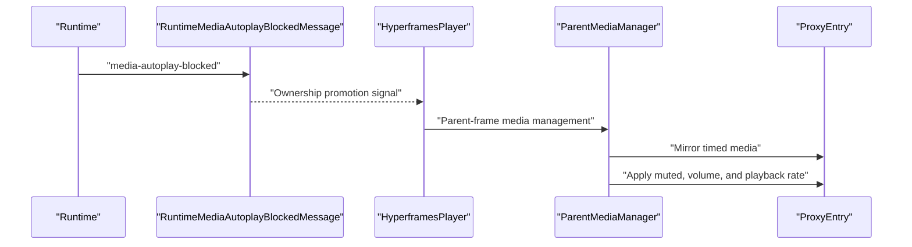
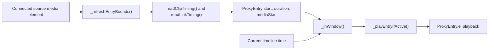
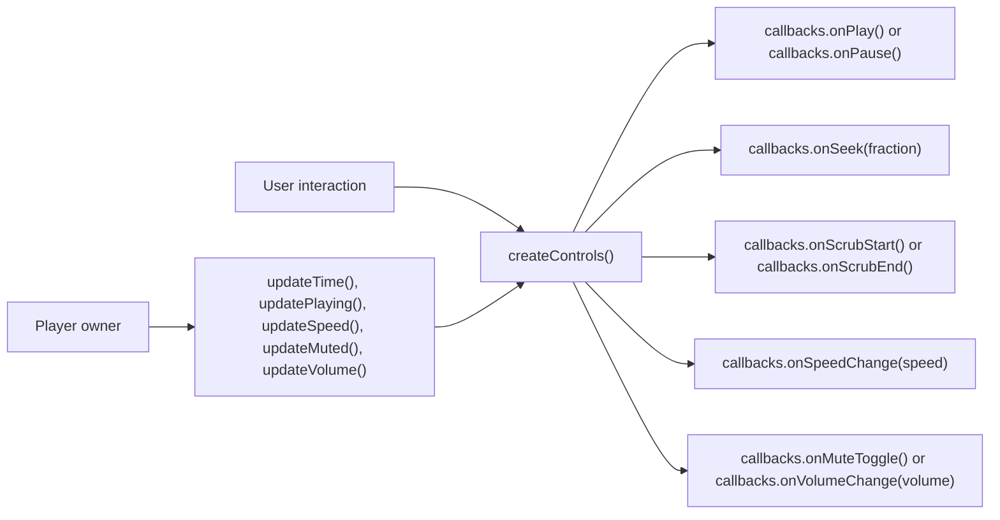
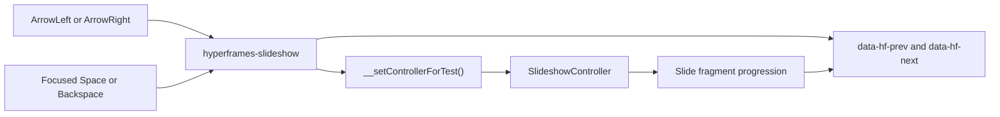

<!-- source: DeepWiki mcp.deepwiki.com · repo heygen-com/hyperframes · page 7.2 Mobile Media and Controls UI · fetched 2026-11-02 -->

# Mobile Media and Controls UI

Relevant source files

The following files were used as context for generating this wiki page:

- [docs/concepts/frame-adapters.mdx](docs/concepts/frame-adapters.mdx)
- [docs/guides/captions-and-recuts.mdx](docs/guides/captions-and-recuts.mdx)
- [docs/guides/faceless-explainer.mdx](docs/guides/faceless-explainer.mdx)
- [docs/guides/general-video.mdx](docs/guides/general-video.mdx)
- [docs/guides/motion-graphics.mdx](docs/guides/motion-graphics.mdx)
- [docs/guides/music-to-video.mdx](docs/guides/music-to-video.mdx)
- [docs/guides/pr-to-video.mdx](docs/guides/pr-to-video.mdx)
- [docs/guides/product-launch-video.mdx](docs/guides/product-launch-video.mdx)
- [docs/guides/slideshow.mdx](docs/guides/slideshow.mdx)
- [docs/packages/player.mdx](docs/packages/player.mdx)
- [packages/core/src/runtime/bridge.test.ts](packages/core/src/runtime/bridge.test.ts)
- [packages/core/src/runtime/bridge.ts](packages/core/src/runtime/bridge.ts)
- [packages/core/src/runtime/clock-stall.test.ts](packages/core/src/runtime/clock-stall.test.ts)
- [packages/core/src/runtime/clock.test.ts](packages/core/src/runtime/clock.test.ts)
- [packages/core/src/runtime/clock.ts](packages/core/src/runtime/clock.ts)
- [packages/core/src/runtime/mediaSteer.ts](packages/core/src/runtime/mediaSteer.ts)
- [packages/core/src/runtime/state.ts](packages/core/src/runtime/state.ts)
- [packages/core/src/runtime/transportPark.test.ts](packages/core/src/runtime/transportPark.test.ts)
- [packages/core/src/runtime/types.ts](packages/core/src/runtime/types.ts)
- [packages/core/tsconfig.json](packages/core/tsconfig.json)
- [packages/player/README.md](packages/player/README.md)
- [packages/player/src/controls.test.ts](packages/player/src/controls.test.ts)
- [packages/player/src/controls.ts](packages/player/src/controls.ts)
- [packages/player/src/direct-timeline-clock.ts](packages/player/src/direct-timeline-clock.ts)
- [packages/player/src/hyperframes-player.test.ts](packages/player/src/hyperframes-player.test.ts)
- [packages/player/src/hyperframes-player.ts](packages/player/src/hyperframes-player.ts)
- [packages/player/src/parent-media.test.ts](packages/player/src/parent-media.test.ts)
- [packages/player/src/parent-media.ts](packages/player/src/parent-media.ts)
- [packages/player/src/playback-state.ts](packages/player/src/playback-state.ts)
- [packages/player/src/range-playback.test.ts](packages/player/src/range-playback.test.ts)
- [packages/player/src/runtime-message-handler.test.ts](packages/player/src/runtime-message-handler.test.ts)
- [packages/player/src/runtime-message-handler.ts](packages/player/src/runtime-message-handler.ts)
- [packages/player/src/slideshow/SlideshowController.test.ts](packages/player/src/slideshow/SlideshowController.test.ts)
- [packages/player/src/slideshow/SlideshowController.ts](packages/player/src/slideshow/SlideshowController.ts)
- [packages/player/src/slideshow/hyperframes-slideshow.test.ts](packages/player/src/slideshow/hyperframes-slideshow.test.ts)
- [packages/player/src/slideshow/hyperframes-slideshow.ts](packages/player/src/slideshow/hyperframes-slideshow.ts)
- [packages/player/src/slideshow/slideshowPresenter.ts](packages/player/src/slideshow/slideshowPresenter.ts)
- [packages/player/src/styles.test.ts](packages/player/src/styles.test.ts)
- [packages/player/src/styles.ts](packages/player/src/styles.ts)
- [packages/player/src/video-source.ts](packages/player/src/video-source.ts)
- [skills/hyperframes/references/types/launch.md](skills/hyperframes/references/types/launch.md)
- [skills/slideshow/SKILL.md](skills/slideshow/SKILL.md)
- [skills/slideshow/references/standalone-harness.md](skills/slideshow/references/standalone-harness.md)

## Purpose and scope

This page describes the player’s parent-frame media proxy subsystem, the `createControls` UI factory, and the slideshow element. It focuses on the implementation details supported by the available source excerpts: proxy ownership and timing, controls structure and callbacks, speed presets, and tested slideshow interactions. [packages/player/src/parent-media.ts:1-22]()[packages/player/src/controls.ts:9-67]()[packages/player/src/slideshow/hyperframes-slideshow.test.ts:19-45]()

Sources: `packages/player/src/parent-media.ts`, `packages/player/src/controls.ts`, `packages/player/src/slideshow/hyperframes-slideshow.test.ts`

---

## Mobile Media Playback Workaround

`ParentMediaManager` maintains mirror copies of timed `<audio>` and `<video>` elements in the parent frame. Its module documentation describes the motivation: mobile browsers can require playback activation in the same frame as the media element, so a proxy controlled in the parent can serve as an audible fallback. [packages/player/src/parent-media.ts:1-10]()

The manager tracks an `audioOwner`, initially `"runtime"`, and separately tracks a URL-backed audio proxy created from `audio-src`. Its constructor receives callbacks for dispatching events and reading the player’s muted, volume, playback-rate, current-time, and paused state. [packages/player/src/parent-media.ts:53-84]()

### Ownership and proxy lifecycle

The runtime message type `RuntimeMediaAutoplayBlockedMessage` identifies the `media-autoplay-blocked` signal as the parent’s trigger for promoting parent-frame proxies. The type comment explains the frame-activation constraint and the intended host response. [packages/core/src/runtime/types.ts:168-178]()

The manager’s `resetForIframeLoad()` resets ownership to `"runtime"`, pauses proxies, clears sources for non-URL entries, retains or recreates the URL-backed entry when applicable, tears down its observer, and dispatches `audioownershipchange` if ownership had been promoted. `destroy()` tears down the observer, pauses and clears all proxy sources, empties the entry list, and resets URL-proxy and ownership state. [packages/player/src/parent-media.ts:95-125]()

The player declares `audio-src` as an observed attribute. The package README documents it as the audio URL used for parent-frame playback on mobile. [packages/player/src/hyperframes-player.ts:95-119]()[packages/player/README.md:68-80]()

| Code entity | Responsibility |
|---|---|
| `ParentMediaManager` | Owns proxy entries, their playback state, and the `"runtime"` / `"parent"` ownership state. [packages/player/src/parent-media.ts:33-68]() |
| `ProxyEntry` | Stores the proxy element, timeline start and duration, media-file start offset, optional source element, and seek-drift bookkeeping. [packages/player/src/parent-media.ts:33-51]() |
| `RuntimeMediaAutoplayBlockedMessage` | Defines the `media-autoplay-blocked` runtime-to-parent signal. [packages/core/src/runtime/types.ts:168-178]() |
| `audio-src` | Player attribute documented for parent-frame audio playback. [packages/player/src/hyperframes-player.ts:95-119]()[packages/player/README.md:68-80]() |

Sources: `packages/player/src/parent-media.ts`, `packages/core/src/runtime/types.ts`, `packages/player/src/hyperframes-player.ts`, `packages/player/README.md`

### Proxy timing and synchronization

A `ProxyEntry` records `start`, `duration`, and `mediaStart`; the proxy’s media position is described as timeline time minus clip start plus the media-file offset. When an entry has a connected source element, `_refreshEntryBounds()` rereads clip timing and link timing, so live timeline edits can update the proxy’s bounds. [packages/player/src/parent-media.ts:33-51]()[packages/player/src/parent-media.ts:153-165]()

`_inWindow()` checks whether the playhead falls inside the clip’s `[start, start + duration)` window. `_playEntryIfActive()` refreshes those bounds and avoids starting a proxy when the playhead is outside that window. The manager also defines a 1.5-second preseek interval for paused proxies approaching their start. [packages/player/src/parent-media.ts:27-31]()[packages/player/src/parent-media.ts:144-175]()

The manager exposes `updateMuted()`, `updateVolume()`, and `updatePlaybackRate()` to apply those values to every proxy entry. [packages/player/src/parent-media.ts:127-137]()

### Ownership and media data flow

**Diagram: runtime autoplay signal and parent proxy ownership**

Sources: `packages/core/src/runtime/types.ts:168-178`, `packages/player/src/parent-media.ts:33-51`, `packages/player/src/parent-media.ts:53-84`, `packages/player/src/parent-media.ts:127-137`

**Diagram: media timing from source clip to proxy window**

Sources: `packages/player/src/parent-media.ts:33-51`, `packages/player/src/parent-media.ts:144-170`

---

## Controls UI Factory (`createControls`)

`createControls(parent, callbacks, options)` builds a controls DOM subtree and appends it to the supplied `ShadowRoot` or `HTMLElement`. It returns methods for updating displayed time, playing state, speed, and volume; hiding volume controls; showing or hiding the controls; and destroying the controls. [packages/player/src/controls.ts:53-67]()

The controls factory accepts callbacks for play, pause, seeking by fraction, optional scrub-start and scrub-end notifications, speed changes, mute toggling, and volume changes. `ControlsOptions` supports custom speed presets and an `audioLocked` setting. [packages/player/src/controls.ts:9-36]()

### Controls structure

The factory creates a play button, scrubber and progress element, time label, speed button and menu, and volume controls. The controls container stops click propagation so interactions inside the overlay do not fall through to the host-level click toggle. [packages/player/src/controls.ts:70-75]()[packages/player/src/controls.ts:77-123]()

When `audioLocked` is enabled, the volume wrapper is hidden; the source comment describes this as removing the viewer’s UI path to change audio state. The controls themselves do not replace the player’s separate media-muting behavior. [packages/player/src/controls.ts:152-155]()

| UI element | Factory entities | Role |
|---|---|---|
| Play/pause | `playBtn` | Invokes `callbacks.onPlay()` or `callbacks.onPause()` according to the factory’s `isPlaying` state. [packages/player/src/controls.ts:77-84]()[packages/player/src/controls.ts:178-182]() |
| Scrubber | `scrubber`, `progress` | Represents the seek bar and progress fill; scrub callbacks are part of `ControlsCallbacks`. [packages/player/src/controls.ts:9-16]()[packages/player/src/controls.ts:86-92]() |
| Time label | `time` | Initially displays `0:00 / 0:00`. [packages/player/src/controls.ts:93-96]() |
| Speed menu | `speedBtn`, `speedMenu` | Contains one menu item for each configured preset. [packages/player/src/controls.ts:97-121]() |
| Volume | `muteBtn`, `volumeSlider` | Provides mute and slider controls, with slider role and value attributes. [packages/player/src/controls.ts:123-150]() |

Sources: `packages/player/src/controls.ts`

### Speed presets and formatting

`SPEED_PRESETS` is `[0.25, 0.5, 1, 1.5, 2, 4]`. The factory uses `options.speedPresets` when supplied, otherwise it uses this default list. It initializes the speed selection to `1x` when `1` is present, falling back to the first configured preset if not. [packages/player/src/controls.ts:22-27]()[packages/player/src/controls.ts:68-69]()[packages/player/src/controls.ts:164-169]()

`formatSpeed()` appends `x` to the supplied speed. `formatTime()` returns `0:00` for negative or non-finite input; otherwise it floors seconds and formats minutes with seconds padded to two digits. [packages/player/src/controls.ts:38-51]()

The tests verify the default presets and formatting for integer and fractional speeds, as well as time formatting for common boundary cases. [packages/player/src/hyperframes-player.test.ts:63-117]()

### Scrubber and callbacks

The `ControlsCallbacks` contract includes `onSeek(fraction)` and optional `onScrubStart()` / `onScrubEnd()` callbacks. The factory’s returned API also exposes `updateTime(current, duration)`, allowing the owner to update the time and progress display. [packages/player/src/controls.ts:9-16]()[packages/player/src/controls.ts:53-67]()

The player tracks `_scrubbing` and documents that this state allows `seek()` to play audio at the playhead during a scrub rather than positioning it silently. The runtime bridge protocol represents seek mode as `"drag"` or `"commit"`, and the bridge dispatches seek requests with a default mode of `"commit"`. [packages/player/src/hyperframes-player.ts:139-145]()[packages/core/src/runtime/types.ts:36-56]()[packages/core/src/runtime/bridge.ts:63-70]()

**Diagram: controls factory and code-entity callbacks**

Sources: `packages/player/src/controls.ts:9-20`, `packages/player/src/controls.ts:53-67`, `packages/player/src/controls.ts:178-187`

### Hide timer

The controls factory maintains a `hideTimeout` variable and exposes `show()` and `hide()` in its returned API. The available excerpt does not show the timeout duration or the event handlers that schedule, reset, or clear the timer. [packages/player/src/controls.ts:53-67]()[packages/player/src/controls.ts:164-168]()

Sources: `packages/player/src/controls.ts`

---

## Slideshow Element

The slideshow custom element is registered as `<hyperframes-slideshow>`. Its test suite dynamically imports the implementation before checking registration and creates instances with an injected controller through `__setControllerForTest()`. [packages/player/src/slideshow/hyperframes-slideshow.test.ts:19-45]()[packages/player/src/slideshow/hyperframes-slideshow.test.ts:49-51]()

The tests establish keyboard behavior: ArrowRight and ArrowLeft navigate when key events are dispatched on `window`; Space and Backspace navigate only when the deck is focused; and removing the element removes its window keydown listener. [packages/player/src/slideshow/hyperframes-slideshow.test.ts:53-123]()

The navigation UI tests verify a single cluster containing previous and next buttons, and a present button with an accessible label and title. Another controller test verifies that Next remains available while fragments on the final slide are still being revealed, then disappears after the final fragment. [packages/player/src/slideshow/hyperframes-slideshow.test.ts:125-135]()[packages/player/src/slideshow/hyperframes-slideshow.test.ts:137-173]()[packages/player/src/slideshow/hyperframes-slideshow.test.ts:175-186]()

**Diagram: slideshow element and controller test surface**

Sources: `packages/player/src/slideshow/hyperframes-slideshow.test.ts:19-45`, `packages/player/src/slideshow/hyperframes-slideshow.test.ts:53-123`, `packages/player/src/slideshow/hyperframes-slideshow.test.ts:125-173`

---

## Summary

`ParentMediaManager` maintains parent-frame proxies for timed media, tracks whether the runtime or parent owns audio, and uses clip-window timing to limit proxy playback. The runtime’s `media-autoplay-blocked` message is defined as the signal for parent-side promotion. [packages/player/src/parent-media.ts:1-10]()[packages/player/src/parent-media.ts:53-68]()[packages/player/src/parent-media.ts:144-170]()[packages/core/src/runtime/types.ts:168-178]()

`createControls` builds the player’s controls subtree and exposes callbacks for playback, seeking, speed, mute, and volume, along with methods for updating UI state and visibility. The slideshow tests document key navigation, focus-sensitive shortcuts, navigation controls, and fragment-aware Next behavior. [packages/player/src/controls.ts:9-20]()[packages/player/src/controls.ts:53-67]()[packages/player/src/slideshow/hyperframes-slideshow.test.ts:53-186]()

Sources: `packages/player/src/parent-media.ts`, `packages/core/src/runtime/types.ts`, `packages/player/src/controls.ts`, `packages/player/src/slideshow/hyperframes-slideshow.test.ts`

---

