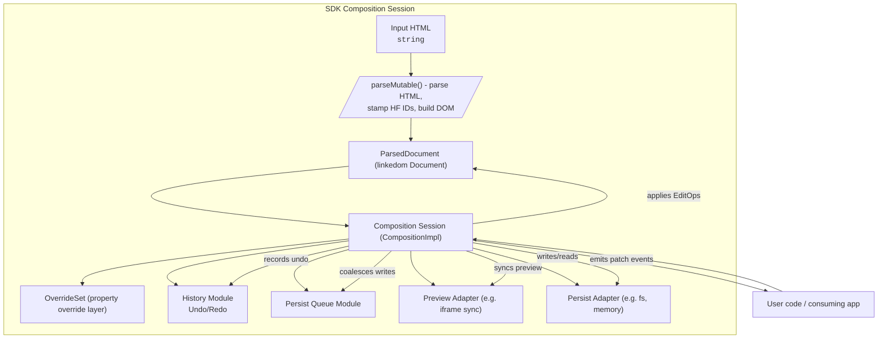
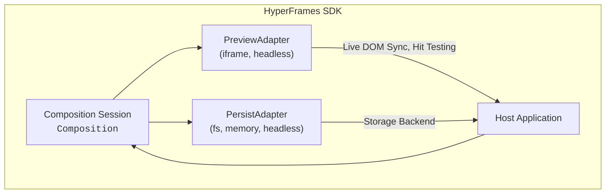

<!-- source: DeepWiki mcp.deepwiki.com · repo heygen-com/hyperframes · page 8 SDK Package · fetched 2026-11-02 -->

# SDK Package

Relevant source files

The following files were used as context for generating this wiki page:

- [packages/sdk/package.json](packages/sdk/package.json)

The `@hyperframes/sdk` package is the headless, framework-neutral composition editing engine for HyperFrames. It serves as a foundational layer enabling programmatic, fine-grained manipulation of HyperFrames project compositions without any UI or rendering dependencies.

This high-level overview explains the role and scope of the SDK in relation to the CLI and Player, the architectural session-based composition model, and links to deeper technical documentation on mutation operations, adapter interfaces, and integration patterns.

---

## Purpose and Scope of `@hyperframes/sdk`

`@hyperframes/sdk` provides the core editing API and mutable document model for HyperFrames compositions. It exposes typed methods and a flexible operation pipeline (`EditOp`s) to query, manipulate, validate, and patch composition HTML and animations in memory. Its description in `package.json` states it is a "Headless, framework-neutral HyperFrames composition editing engine" [packages/sdk/package.json:4]().

Unlike the CLI (`hyperframes` binary) which is command-driven and focused on project initialization, linting, and rendering orchestration, the SDK excels in interactive or embedded editing scenarios, such as building IDEs, live previews, or custom automation tools. Similarly, the Player package (`@hyperframes/player`) focuses on deterministic playback and embedding compositions in web pages, relying on the SDK for composition state manipulation when needed.

This modular architecture lets consumers pick the appropriate interface for their use case:

- **CLI**: Project scaffolding, batch render, and content management.
- **SDK**: Programmatic, session-based incremental editing and composition mutation.
- **Player**: Lightweight playback and event handling in browser environments.

Sources: `packages/sdk/package.json:1-97`

---

## Session-Based Composition Model

At the heart of the SDK is the **composition session**, created by invoking `openComposition(html, options)`. This session encapsulates:

- **Mutable parsed document**: The composition HTML is parsed using `linkedom` [packages/sdk/package.json:89]() and stamped with stable `data-hf-id` identifiers.
- **Override sets**: A sparse map of property overrides that can layer user edits atop base templates, especially in embedded (T3) modes.
- **Undo/redo history**: Supports transactional mutation batching, rollback, and coalescing history entries.
- **Persistence and preview adapters**: Abstracted interfaces for saving changes and synchronizing live previews.
- **Event handlers**: Callbacks for change, patch, errors, and selection updates.

The session exposes a **`Composition` interface**, offering typed convenience methods like `setText()`, `setStyle()`, `addElement()`, and `setVariableValue()`. All composition mutations are internally represented by plain data objects called **`EditOp`**s, which are explicitly dispatched via `dispatch()`.

Batching multiple edits inside `batch()` groups them as a single atomic operation, ensuring consistent undo snapshots and persisting minimal changes.

For details, see [Composition Session and Mutation Engine](#8.1).

### Diagram: Composition Session Architecture and Flow

Sources: `packages/sdk/src/session.ts`

---

## Edit Operations (`EditOp`) and Mutation Engine

The SDK defines a comprehensive catalog of **edit operations** (`EditOp`), each representing an atomic change that can be applied to the composition. The key characteristics are:

- Targeted by explicit `HfId` identifiers — no implicit selection mutations.
- Include element edits (`setStyle`, `setText`, `setAttribute`, `removeElement`), structure edits (`addElement`, `reorderElements`), timing modifications, GSAP animation edits, and variable declarations.
- Mutations are applied through `dispatch(op)` which validates, applies, and emits JSON Patch events representing the forward and inverse changes.
- `can(op)` provides a dry-run validation to check if applying the op would succeed without side effects.
- `batch(fn)` groups multiple calls to `dispatch()` into atomic history and persistence transactions.

The mutation logic is implemented in the `applyOp()` handlers, which mutate the underlying parsed DOM and GSAP AST, generate RFC 6902 compliant forward and inverse patches, and ensure overall consistency of the composition document state.

For details, see [Composition Session and Mutation Engine](#8.1).

Sources: `packages/sdk/src/editing/affordances.ts`

---

## SDK Adapters: Persistence and Preview Integration

The SDK is framework-neutral and does not prescribe how the composition state is persisted or previewed. Instead, it defines **adapter interfaces** allowing flexible integration:

- **PersistAdapter** — Abstracts storage backends for saving the edited composition (e.g., filesystem, in-memory).
- **PreviewAdapter** — Manages live previews and user interaction sync, such as iframe DOM syncing, hit-testing, and draft editing loops.

There are built-in adapter implementations bundled with the SDK:

- **Memory adapter**: In-memory persistence for ephemeral editing [packages/sdk/package.json:22-26]().
- **Filesystem adapter**: Node-only adapter for disk persistence [packages/sdk/package.json:27-31]().
- **Headless adapter**: For headless environment integration [packages/sdk/package.json:32-36]().
- **Iframe preview adapter**: Synchronizes edits to a same-origin iframe for live visual feedback with support for image-alpha hit-testing [packages/sdk/package.json:37-41]().

The adapter layer supports:

- Application of override sets in embedded editing modes.
- Undo/Redo history coalescing.
- Preview commit/cancel workflows for draft edits.

For details, see [SDK Adapters and Integration Patterns](#8.2).

### Diagram: SDK Adapters Interaction

Sources: `packages/sdk/package.json:22-41`

---

## When to Use SDK vs CLI vs Player

| Interface | Role | Primary Use Cases | Dependency |
| :-------- | :------------------------------------------------------- | :------------------------------------------------------- | :------------------------ |
| **CLI** (`hyperframes`) | Command-line tooling for project creation, lint, and rendering | Project scaffolding, batch renders, AI workflows | Node.js, shell |
| **SDK** (`@hyperframes/sdk`) | Programmatic composition editing engine with mutation API | Custom IDEs/editors, programmatic automation, embedded editing | Runtime-agnostic (Node/browser) |
| **Player** (`@hyperframes/player`) | Embeddable web component for deterministic playback | Runtime playback in web pages, lightweight embedding | Browser (Web Component) |

The SDK is the best choice when you need to manipulate compositions interactively or programmatically with rich control over incremental state updates, undo, and persistence hooks. The CLI is ideal for batch or scripted tasks, and the Player specializes in runtime viewing.

Sources: `packages/sdk/package.json:1-97`

---

## Further Reading and Child Pages

For in-depth understanding and practical integration, see the following detailed child pages:

- **8.1 Composition Session and Mutation Engine**  
  Deep dive into `openComposition()`, the `Composition` interface, and the `EditOp` pipeline. Covers linkedom DOM parsing, operation validation, RFC 6902 patch generation, GSAP AST editing, and transactional batching with rollback.

- **8.2 SDK Adapters and Integration Patterns**  
  Covers `PersistAdapter` implementations (filesystem, memory), `PreviewAdapter` (iframe sync, draft loop, alpha hit-testing), embedded override modes, undo/redo history management, persistence coalescing, and advanced canvas integration patterns.

---

# Summary

The `@hyperframes/sdk` package is the essential engine for composition editing in HyperFrames: a headless, framework-neutral, session-based API that powers interactive tooling and embedded editing integrations. It uses explicit edit operations, strong typing, and adapter abstractions to offer detailed and safe mutation workflows. Complemented by the CLI and Player packages, it completes HyperFrames’s modular architecture for motion graphics composition management.

---

Sources:
`packages/sdk/package.json:1-97`

---

