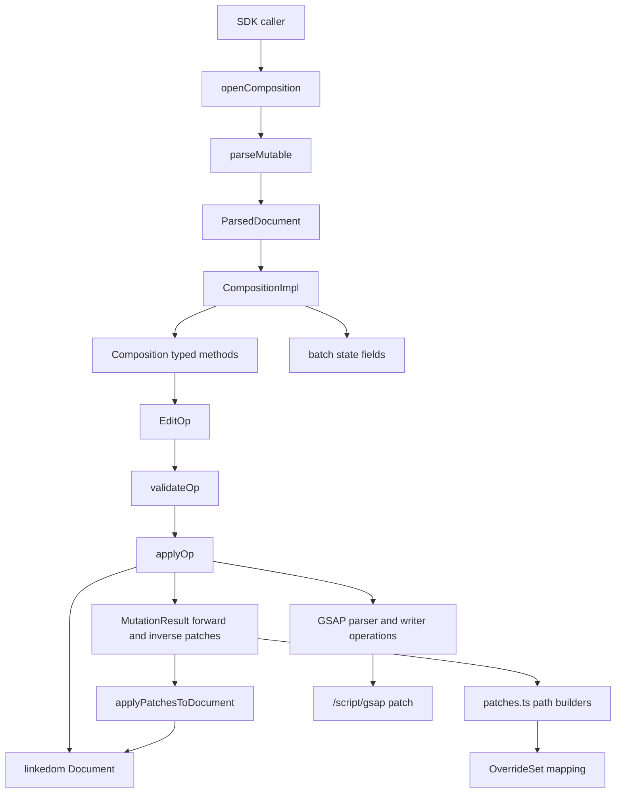
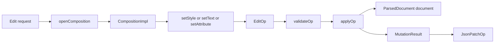
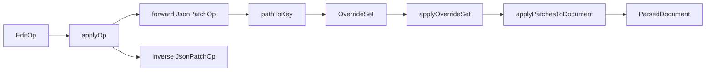

<!-- source: DeepWiki mcp.deepwiki.com · repo heygen-com/hyperframes · page 8.1 Composition Session and Mutation Engine · fetched 2026-11-02 -->

# Composition Session and Mutation Engine

Relevant source files

The following files were used as context for generating this wiki page:

- [docs/sdk/guides/embedded-override-mode.mdx](docs/sdk/guides/embedded-override-mode.mdx)
- [docs/sdk/guides/persistence.mdx](docs/sdk/guides/persistence.mdx)
- [docs/sdk/guides/querying-and-editing.mdx](docs/sdk/guides/querying-and-editing.mdx)
- [docs/sdk/guides/undo-redo-and-patches.mdx](docs/sdk/guides/undo-redo-and-patches.mdx)
- [packages/core/src/parsers/gsapParserAcorn.ts](packages/core/src/parsers/gsapParserAcorn.ts)
- [packages/core/src/parsers/gsapWriterAcorn.ts](packages/core/src/parsers/gsapWriterAcorn.ts)
- [packages/sdk/src/engine/apply-patches.ts](packages/sdk/src/engine/apply-patches.ts)
- [packages/sdk/src/engine/model.ts](packages/sdk/src/engine/model.ts)
- [packages/sdk/src/engine/mutate.gsap.test.ts](packages/sdk/src/engine/mutate.gsap.test.ts)
- [packages/sdk/src/engine/mutate.test.ts](packages/sdk/src/engine/mutate.test.ts)
- [packages/sdk/src/engine/mutate.ts](packages/sdk/src/engine/mutate.ts)
- [packages/sdk/src/engine/patches.ts](packages/sdk/src/engine/patches.ts)
- [packages/sdk/src/index.ts](packages/sdk/src/index.ts)
- [packages/sdk/src/session.subcomp.test.ts](packages/sdk/src/session.subcomp.test.ts)
- [packages/sdk/src/session.test.ts](packages/sdk/src/session.test.ts)
- [packages/sdk/src/session.timings.test.ts](packages/sdk/src/session.timings.test.ts)
- [packages/sdk/src/session.ts](packages/sdk/src/session.ts)
- [packages/sdk/src/types.ts](packages/sdk/src/types.ts)

## Purpose and scope

This page describes the SDK’s composition-editing session and mutation engine: the `Composition` API, typed `EditOp` operations, the mutable document model, patch representation and replay, GSAP script editing, and the session state used for batching. The SDK exports `openComposition()` and its associated options and types from its public entry point. [packages/sdk/src/index.ts:1-21]()

Sources: [packages/sdk/src/index.ts:1-21]()

---

## 1. Introduction

The SDK adapts composition HTML into an editable document model and applies typed operations to that model. Its mutation engine emits forward and inverse RFC 6902 patches, while the session maintains an accumulated override set for edits layered over a base template. [packages/sdk/src/engine/model.ts:1-6]() [packages/sdk/src/engine/mutate.ts:2-8]() [packages/sdk/src/session.ts:1-8]()

The session module describes two modes: standalone sessions wire history and persistence, while embedded T3 callers supply overrides and receive patches for host-owned state. [packages/sdk/src/session.ts:1-8]()

| Concern | Code entity | Role |
|---|---|---|
| Public API | `openComposition`, `Composition`, `EditOp` | Exported SDK entry point and public session/mutation types. [packages/sdk/src/index.ts:1-21]() [packages/sdk/src/index.ts:43-58]() |
| Mutable HTML model | `parseMutable`, `ParsedDocument` | Stamps IDs, parses HTML, and stores the live document. [packages/sdk/src/engine/model.ts:17-39]() |
| Mutation | `applyOp`, `validateOp`, `MutationResult` | Applies operations and returns forward/inverse patches. [packages/sdk/src/engine/mutate.ts:2-8]() [packages/sdk/src/engine/mutate.ts:107-113]() |
| Patch paths | `stylePath`, `timingPath`, `pathToKey` | Defines patch path construction and mapping to override keys. [packages/sdk/src/engine/patches.ts:1-29]() [packages/sdk/src/engine/patches.ts:50-95]() [packages/sdk/src/engine/patches.ts:97-149]() |
| Patch replay | `applyPatchesToDocument`, `applyOverrideSet` | Applies emitted patches or replays overrides onto a parsed document. [packages/sdk/src/engine/apply-patches.ts:1-9]() [packages/sdk/src/engine/apply-patches.ts:120-170]() |

Sources: [packages/sdk/src/index.ts:1-21]() [packages/sdk/src/index.ts:43-58]() [packages/sdk/src/engine/model.ts:17-39]() [packages/sdk/src/engine/mutate.ts:2-8]() [packages/sdk/src/engine/mutate.ts:107-113]() [packages/sdk/src/engine/patches.ts:1-29]() [packages/sdk/src/engine/patches.ts:50-95]() [packages/sdk/src/engine/patches.ts:97-149]() [packages/sdk/src/engine/apply-patches.ts:1-9]() [packages/sdk/src/engine/apply-patches.ts:120-170]()

---

## 2. Parsing HTML into a Mutable Document

### 2.1. Underlying document model

`ParsedDocument` wraps a DOM `Document`, records whether the input was a fragment, and retains the ID-stamped HTML. `parseMutable()` calls `ensureHfIds()`, determines whether the result is a full HTML document, and parses it using `parseHTMLContent()`. The model module documents the resulting live document as the mutable backing store: dispatch mutates it directly, and serialization walks that live DOM rather than synchronizing a separate mutable tree. [packages/sdk/src/engine/model.ts:1-6]() [packages/sdk/src/engine/model.ts:17-39]()

| Field | Meaning |
|---|---|
| `document` | Mutable DOM backing store. [packages/sdk/src/engine/model.ts:17-18]() |
| `wrapped` | Indicates the input was a fragment and was wrapped. [packages/sdk/src/engine/model.ts:19-20]() |
| `stamped` | ID-stamped source HTML, retained as fallback/diff base. [packages/sdk/src/engine/model.ts:21-24]() |
| `keptDeletes` | Optional records for deleted elements that scripts still look up. [packages/sdk/src/engine/model.ts:21-32]() |

Sources: [packages/sdk/src/engine/model.ts:1-6]() [packages/sdk/src/engine/model.ts:17-39]()

### 2.2. Element resolution

`findById()` delegates to `resolveScoped()`, so lookup used by patch replay follows the same canonical-first and scoped-path behavior as forward dispatch. Bare IDs search for matching `data-hf-id` values and prefer a top-level canonical-scope match; if there is no `data-hf-id` match, lookup can fall back to a `data-composition-id` match. Scoped IDs split on `/` and progressively narrow the search into each preceding match’s subtree. [packages/sdk/src/engine/model.ts:41-50]() [packages/sdk/src/engine/model.ts:105-147]()

`querySelectorAllDeep()` traverses composition `<template>` subtrees while skipping ordinary templates. This makes elements in composition templates addressable even though the underlying `querySelectorAll` does not descend into them. [packages/sdk/src/engine/model.ts:56-90]()

Sources: [packages/sdk/src/engine/model.ts:41-50]() [packages/sdk/src/engine/model.ts:56-90]() [packages/sdk/src/engine/model.ts:105-147]()

---

## 3. The `openComposition()` API and `Composition` Interface

### 3.1. Opening a composition session

`openComposition()` is exported by the SDK entry point, alongside `OpenCompositionOptions`. The session module describes it as wiring history and a persistence queue for standalone mode; embedded callers supply overrides and receive patches for host-owned state. [packages/sdk/src/index.ts:45-58]() [packages/sdk/src/session.ts:1-8]()

The visible options include persistence and preview adapters, an immutable session persistence path, an initial override set, tracked mutation origins, a history coalescing window, and an option to disable history. [packages/sdk/src/session.ts:67-84]()

| Option | Purpose |
|---|---|
| `persist` | Persistence adapter. [packages/sdk/src/session.ts:67-70]() |
| `persistPath` | Adapter path used by the persist queue; defaults to `composition.html`. [packages/sdk/src/session.ts:69-71]() |
| `preview` | Preview adapter. [packages/sdk/src/session.ts:71-72]() |
| `overrides` | T3 embedded-mode override set applied on top of the base template. [packages/sdk/src/session.ts:72-74]() |
| `trackedOrigins` | Origins whose mutations enter the undo stack; the documented default is all non-`applyPatches` mutations. [packages/sdk/src/session.ts:74-76]() |
| `coalesceMs` | History-entry auto-coalescing window; documented default is 300 ms. [packages/sdk/src/session.ts:76-77]() |
| `history` | Passing `false` skips attaching SDK history. [packages/sdk/src/session.ts:78-84]() |

Sources: [packages/sdk/src/index.ts:45-58]() [packages/sdk/src/session.ts:1-8]() [packages/sdk/src/session.ts:67-84]()

### 3.2. The `CompositionImpl` class

`CompositionImpl` implements `Composition`. Its visible state includes the parsed document, persistence and preview adapters, accumulated overrides, the base variable defaults captured at open, lazily built element/root snapshots, selection state, event handlers, and optional history and persistence-queue modules. [packages/sdk/src/session.ts:101-134]()

The constructor stores the parsed document and adapters, copies the supplied overrides, stores base variable defaults, and subscribes to preview selection events so they update session selection. [packages/sdk/src/session.ts:145-157]()

The class also maintains batch depth, forward and inverse patch buffers, operation types, an origin, and an outermost-batch override snapshot. These fields establish the state used to accumulate edits across a batch and preserve the prior override set at batch entry. [packages/sdk/src/session.ts:136-143]()

Sources: [packages/sdk/src/session.ts:101-157]()

### 3.3. Session API and operation types

The visible typed methods on `CompositionImpl` delegate to `dispatch()` with corresponding operation objects. Examples include `setStyle`, `setText`, and `setAttribute`. [packages/sdk/src/session.ts:171-183]()

`EditOp` is a discriminated union. Its visible members include style, text, attribute, timing, hold, move, remove/add element, reorder, class style, composition metadata, variable declaration/value operations, and GSAP tween/keyframe operations. Element operations carry explicit target IDs; `addElement` takes a parent, sibling index, and an HTML fragment that must not contain a `<script>`. [packages/sdk/src/types.ts:104-166]()

The SDK exports `Composition`, `EditOp`, `CanResult`, and related public types from its entry point. [packages/sdk/src/index.ts:1-21]()

Sources: [packages/sdk/src/session.ts:171-183]() [packages/sdk/src/types.ts:104-166]() [packages/sdk/src/index.ts:1-21]()

---

## 4. The `EditOp` Mutation Pipeline

### 4.1. `EditOp` operation types

The `EditOp` union makes the operation type explicit and gives element operations explicit target IDs rather than relying on the current selection. [packages/sdk/src/types.ts:104-121]()

The visible union members cover:

- Element content and presentation: `setStyle`, `setText`, `setAttribute`, `moveElement`, `removeElement`, and `addElement`. [packages/sdk/src/types.ts:108-133]()
- Timing, holds, and ordering: `setTiming`, `setHold`, and `reorderElements`. [packages/sdk/src/types.ts:114-139]()
- Composition-level and variable edits: `setCompositionMetadata`, declaration changes, and variable values. [packages/sdk/src/types.ts:139-150]()
- GSAP edits: adding/updating tweens and adding/updating keyframes. [packages/sdk/src/types.ts:151-166]()

Sources: [packages/sdk/src/types.ts:104-166]()

### 4.2. Operation dispatch and validation

The mutation module defines `MutationResult` as forward and inverse patch arrays, with optional metadata for an animation ID or new element ID. Its module comment describes each handler as mutating the linkedom document and returning RFC 6902 patches; handlers are pure with respect to events, leaving event emission to callers. [packages/sdk/src/engine/mutate.ts:2-8]() [packages/sdk/src/engine/mutate.ts:107-113]()

The module exposes `validateOp()` and `applyOp()` through imports at the public SDK entry point for `UnsupportedOpError`; the implementation also defines that error with the stable code `E_UNSUPPORTED_OP`. [packages/sdk/src/index.ts:43-44]() [packages/sdk/src/engine/mutate.ts:154-166]()

`validateSetAttribute()` rejects composition-reserved attributes, event-handler attributes, and unsafe URI values. The reserved list includes `data-hf-id`, composition metadata, timing attributes, and hold attributes; the error directs callers to typed methods such as timing or hold edits. [packages/sdk/src/engine/mutate.ts:115-152]()

The `CanResult` type represents a successful preflight as `{ ok: true }` or a failure with a stable code, message, and optional hint. Its documented codes include target-not-found and missing GSAP timeline/script cases. [packages/sdk/src/types.ts:93-102]()

Sources: [packages/sdk/src/engine/mutate.ts:2-8]() [packages/sdk/src/engine/mutate.ts:107-113]() [packages/sdk/src/engine/mutate.ts:115-166]() [packages/sdk/src/types.ts:93-102]() [packages/sdk/src/index.ts:43-44]()

### 4.3. Applying mutations and generating RFC 6902 patches

Mutation handlers create forward and inverse patch arrays while changing the live DOM. The patch module defines path builders for element styles, text, attributes, timing, holds, whole elements, variables, declarations, metadata, the GSAP script, and CSS. [packages/sdk/src/engine/mutate.ts:2-8]() [packages/sdk/src/engine/patches.ts:1-29]() [packages/sdk/src/engine/patches.ts:50-95]()

Examples of the path grammar include `/elements/{id}/inlineStyles/{property}`, `/elements/{id}/timing/{field}`, `/script/gsap`, and `/style/css`. `pathToKey()` maps patch paths to override-set keys, such as a style path to `{id}.style.{property}` and a variable path to `var.{id}`. [packages/sdk/src/engine/patches.ts:1-29]() [packages/sdk/src/engine/patches.ts:97-149]()

RFC 6902 pointer segments escape `~` as `~0` and `/` as `~1`; the patch builder applies this to IDs and attribute names. [packages/sdk/src/engine/patches.ts:35-48]() [packages/sdk/src/engine/patches.ts:58-62]()

The mutation contract tests verify examples of style changes producing forward and inverse patches and show that applying the inverse restores the serialized document to its prior state. [packages/sdk/src/engine/mutate.test.ts:75-99]() [packages/sdk/src/engine/mutate.test.ts:124-134]()

Sources: [packages/sdk/src/engine/mutate.ts:2-8]() [packages/sdk/src/engine/patches.ts:1-29]() [packages/sdk/src/engine/patches.ts:35-95]() [packages/sdk/src/engine/patches.ts:97-149]() [packages/sdk/src/engine/mutate.test.ts:75-99]() [packages/sdk/src/engine/mutate.test.ts:124-134]()

---

## 5. GSAP Animation Editing via AST

### 5.1. GSAP script integration

The mutation engine imports the Acorn-backed GSAP parser and writer operations, including helpers for adding, updating, and removing animations and keyframes, editing labels, and manipulating arc paths. [packages/sdk/src/engine/mutate.ts:61-87]()

The GSAP script is represented as a patchable document value at `/script/gsap`. The patch path module identifies that path as the GSAP inline script text, and the patch applier recognizes it as a script path. [packages/sdk/src/engine/patches.ts:11-15]() [packages/sdk/src/engine/patches.ts:89-91]() [packages/sdk/src/engine/apply-patches.ts:91-97]()

Sources: [packages/sdk/src/engine/mutate.ts:61-87]() [packages/sdk/src/engine/patches.ts:11-15]() [packages/sdk/src/engine/patches.ts:89-91]() [packages/sdk/src/engine/apply-patches.ts:91-97]()

### 5.2. Parser-backed editing and patching

The mutation module dispatches GSAP keyframe operations to specialized handlers, including setting, adding, removing, and materializing keyframes and splitting animation groups. [packages/sdk/src/engine/mutate.ts:176-214]()

The GSAP mutation tests exercise validation against timeline availability, verify that adding a tween emits a `/script/gsap` patch with an animation ID, and verify that applying the inverse restores the original script. [packages/sdk/src/engine/mutate.gsap.test.ts:41-78]() [packages/sdk/src/engine/mutate.gsap.test.ts:110-139]()

Sources: [packages/sdk/src/engine/mutate.ts:176-214]() [packages/sdk/src/engine/mutate.gsap.test.ts:41-78]() [packages/sdk/src/engine/mutate.gsap.test.ts:110-139]()

---

## 6. Transactional Batching and Rollback

`CompositionImpl` stores batch depth, accumulated forward and inverse patches, operation types, the batch origin, and a snapshot of overrides taken at outermost batch entry. These fields support grouping multiple dispatches and preserving override state for recovery. [packages/sdk/src/session.ts:136-143]()

The available source excerpt shows the transaction state but does not include the batch implementation itself. Consequently, the exact commit and rollback procedure is not described here.

Sources: [packages/sdk/src/session.ts:136-143]()

---

## 7. Patch Application and Override Sets

### 7.1. Applying stored overrides

`applyOverrideSet()` converts override entries into patches and applies them to a freshly parsed document. Null override values become `remove` patches; non-null values become `replace` patches, subject to checks for whole-element snapshot overrides. [packages/sdk/src/engine/apply-patches.ts:120-170]()

Variable declaration snapshots are replayed before variable value entries so an older declaration snapshot does not overwrite a newer value. Scalar variable overrides also restore the corresponding root CSS custom property; object-valued font and image overrides are excluded from that CSS handling. [packages/sdk/src/engine/apply-patches.ts:126-168]()

`OverrideSet` is a sparse map keyed by property paths, with `null` used as a removal marker. The type also permits object values for variables such as fonts and images. [packages/sdk/src/types.ts:72-91]()

Sources: [packages/sdk/src/engine/apply-patches.ts:120-170]() [packages/sdk/src/types.ts:72-91]()

### 7.2. Patch applier

The patch applier is intentionally bounded: it handles the path patterns emitted by the mutation engine and supports the emitted `add`, `remove`, and `replace` subset, rather than implementing general-purpose JSON Patch. Unsupported operations and unknown paths are ignored. [packages/sdk/src/engine/apply-patches.ts:1-9]()

Its path parser recognizes styles, text, attributes, timing, holds, elements, variables, variable declarations, metadata, the GSAP script, and the stylesheet. [packages/sdk/src/engine/apply-patches.ts:40-98]()

Sources: [packages/sdk/src/engine/apply-patches.ts:1-9]() [packages/sdk/src/engine/apply-patches.ts:40-98]()

---

## 8. Data Flow and Lifecycle Summary

**Diagram: Session and mutation data flow**

The diagram connects the public session entry point to the parsed document, typed operations, mutation result, patch mapping, override replay, batch state, and GSAP-specific script editing. [packages/sdk/src/index.ts:45-58]() [packages/sdk/src/session.ts:101-143]() [packages/sdk/src/engine/model.ts:17-39]() [packages/sdk/src/engine/mutate.ts:2-8]() [packages/sdk/src/engine/patches.ts:50-95]() [packages/sdk/src/engine/apply-patches.ts:1-9]() [packages/sdk/src/engine/mutate.ts:61-87]()

Sources: [packages/sdk/src/index.ts:45-58]() [packages/sdk/src/session.ts:101-143]() [packages/sdk/src/engine/model.ts:17-39]() [packages/sdk/src/engine/mutate.ts:2-8]() [packages/sdk/src/engine/patches.ts:50-95]() [packages/sdk/src/engine/apply-patches.ts:1-9]() [packages/sdk/src/engine/mutate.ts:61-87]()

---

## 9. Key Code Entities

| Entity | Responsibility | Citation |
|---|---|---|
| `openComposition` | Publicly exported session entry point. | [packages/sdk/src/index.ts:45-52]() |
| `OpenCompositionOptions` | Configures adapters, overrides, history, and coalescing. | [packages/sdk/src/session.ts:67-84]() |
| `CompositionImpl` | Implements `Composition` and stores session, adapter, cache, event, history, and batch state. | [packages/sdk/src/session.ts:101-143]() |
| `parseMutable` | Stamps IDs and parses HTML into `ParsedDocument`. | [packages/sdk/src/engine/model.ts:17-39]() |
| `resolveScoped` | Resolves bare and scoped IDs to DOM elements. | [packages/sdk/src/engine/model.ts:105-147]() |
| `EditOp` | Typed mutation operation union. | [packages/sdk/src/types.ts:104-166]() |
| `MutationResult` | Carries forward/inverse patch arrays and optional metadata. | [packages/sdk/src/engine/mutate.ts:107-113]() |
| `validateSetAttribute` | Rejects reserved attributes, event-handler attributes, and unsafe URI values. | [packages/sdk/src/engine/mutate.ts:115-152]() |
| `applyOverrideSet` | Replays override values as patches onto a parsed document. | [packages/sdk/src/engine/apply-patches.ts:120-170]() |
| `parsePath` | Parses supported patch path patterns. | [packages/sdk/src/engine/apply-patches.ts:40-98]() |
| `pathToKey` | Maps patch paths to override-set keys. | [packages/sdk/src/engine/patches.ts:97-149]() |

Sources: [packages/sdk/src/index.ts:45-52]() [packages/sdk/src/session.ts:67-143]() [packages/sdk/src/engine/model.ts:17-39]() [packages/sdk/src/engine/model.ts:105-147]() [packages/sdk/src/types.ts:104-166]() [packages/sdk/src/engine/mutate.ts:107-152]() [packages/sdk/src/engine/apply-patches.ts:40-98]() [packages/sdk/src/engine/apply-patches.ts:120-170]() [packages/sdk/src/engine/patches.ts:97-149]()

---

## 10. Natural Language Concepts and Code Entities

### 10.1. From an edit request to session and mutation code

**Diagram: User edit concepts mapped to SDK entities**

This diagram maps the conceptual flow from an edit request to named SDK entities. The session’s visible typed methods delegate to dispatch, while the mutation module defines patch-producing operation handlers. [packages/sdk/src/session.ts:171-183]() [packages/sdk/src/engine/mutate.ts:2-8]() [packages/sdk/src/engine/mutate.ts:107-113]() [packages/sdk/src/engine/model.ts:17-24]()

Sources: [packages/sdk/src/session.ts:171-183]() [packages/sdk/src/engine/mutate.ts:2-8]() [packages/sdk/src/engine/mutate.ts:107-113]() [packages/sdk/src/engine/model.ts:17-24]()

### 10.2. From patch paths to override replay

**Diagram: Patch and override entities**

The patch module maps patch paths to override keys, and the override applier converts stored override entries back into patches for a parsed document. [packages/sdk/src/engine/patches.ts:97-149]() [packages/sdk/src/engine/apply-patches.ts:120-170]()

Sources: [packages/sdk/src/engine/patches.ts:97-149]() [packages/sdk/src/engine/apply-patches.ts:120-170]()

---

## 11. Conclusion

The SDK’s editing session uses a live parsed document as its mutable model, typed `EditOp` operations as its mutation vocabulary, and forward/inverse RFC 6902 patches as its change representation. Override sets map those changes to sparse keys for replay, while GSAP editing operations target the script through parser/writer helpers. The session also tracks batch state and an override snapshot; the available source excerpt does not show the batch execution implementation. [packages/sdk/src/engine/model.ts:1-6]() [packages/sdk/src/types.ts:104-166]() [packages/sdk/src/engine/mutate.ts:2-8]() [packages/sdk/src/engine/patches.ts:97-149]() [packages/sdk/src/engine/mutate.ts:61-87]() [packages/sdk/src/session.ts:136-143]()

Sources: [packages/sdk/src/engine/model.ts:1-6]() [packages/sdk/src/types.ts:104-166]() [packages/sdk/src/engine/mutate.ts:2-8]() [packages/sdk/src/engine/patches.ts:97-149]() [packages/sdk/src/engine/mutate.ts:61-87]() [packages/sdk/src/session.ts:136-143]()

---

