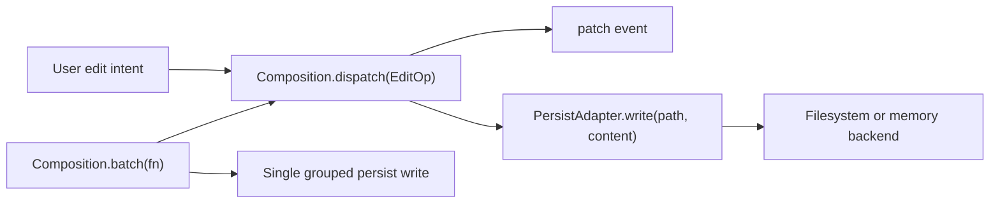
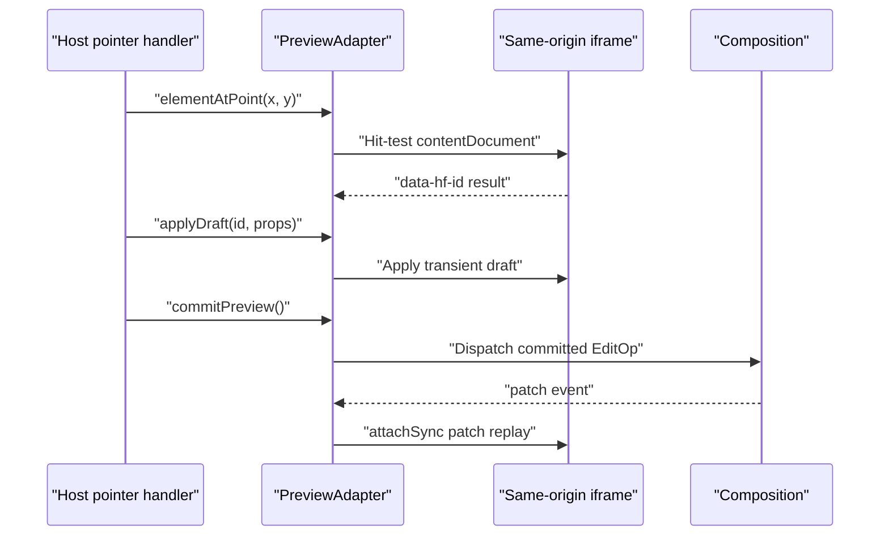
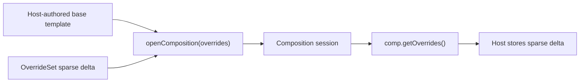

<!-- source: DeepWiki mcp.deepwiki.com · repo heygen-com/hyperframes · page 8.2 SDK Adapters and Integration Patterns · fetched 2026-11-02 -->

# SDK Adapters and Integration Patterns

Relevant source files

The following files were used as context for generating this wiki page:

- [docs/sdk/guides/canvas-integration.mdx](docs/sdk/guides/canvas-integration.mdx)
- [docs/sdk/guides/timing-and-animation.mdx](docs/sdk/guides/timing-and-animation.mdx)
- [docs/sdk/quickstart.mdx](docs/sdk/quickstart.mdx)
- [docs/sdk/reference/adapters.mdx](docs/sdk/reference/adapters.mdx)
- [docs/sdk/reference/composition.mdx](docs/sdk/reference/composition.mdx)
- [docs/sdk/reference/edit-operations.mdx](docs/sdk/reference/edit-operations.mdx)
- [docs/sdk/reference/open-composition.mdx](docs/sdk/reference/open-composition.mdx)
- [docs/sdk/reference/types.mdx](docs/sdk/reference/types.mdx)
- [docs/sdk/reference/utilities.mdx](docs/sdk/reference/utilities.mdx)
- [packages/sdk/src/adapters/headless.test.ts](packages/sdk/src/adapters/headless.test.ts)
- [packages/sdk/src/adapters/headless.ts](packages/sdk/src/adapters/headless.ts)
- [packages/sdk/src/adapters/iframe.sync.test.ts](packages/sdk/src/adapters/iframe.sync.test.ts)
- [packages/sdk/src/adapters/iframe.test.ts](packages/sdk/src/adapters/iframe.test.ts)
- [packages/sdk/src/adapters/iframe.ts](packages/sdk/src/adapters/iframe.ts)
- [packages/sdk/src/adapters/types.ts](packages/sdk/src/adapters/types.ts)
- [packages/sdk/src/history.ts](packages/sdk/src/history.ts)
- [packages/sdk/src/persist-queue.ts](packages/sdk/src/persist-queue.ts)
- [packages/sdk/src/smoke.test.ts](packages/sdk/src/smoke.test.ts)
- [packages/studio/src/components/CompositionMissingBanner.test.tsx](packages/studio/src/components/CompositionMissingBanner.test.tsx)
- [packages/studio/src/components/CompositionMissingBanner.tsx](packages/studio/src/components/CompositionMissingBanner.tsx)
- [packages/studio/src/components/editor/elementPositionOffset.ts](packages/studio/src/components/editor/elementPositionOffset.ts)
- [packages/studio/src/components/editor/manualEdits.test.ts](packages/studio/src/components/editor/manualEdits.test.ts)
- [packages/studio/src/components/editor/manualEdits.ts](packages/studio/src/components/editor/manualEdits.ts)
- [packages/studio/src/components/editor/manualEditsParsing.ts](packages/studio/src/components/editor/manualEditsParsing.ts)
- [packages/studio/src/hooks/draggedGsapPosition.ts](packages/studio/src/hooks/draggedGsapPosition.ts)
- [packages/studio/src/hooks/externalFileChangeOwnership.test.ts](packages/studio/src/hooks/externalFileChangeOwnership.test.ts)
- [packages/studio/src/hooks/useExternalFileChangeCoordinator.test.tsx](packages/studio/src/hooks/useExternalFileChangeCoordinator.test.tsx)
- [packages/studio/src/hooks/useExternalFileChangeCoordinator.ts](packages/studio/src/hooks/useExternalFileChangeCoordinator.ts)
- [packages/studio/src/hooks/useSdkSession.lifecycle.test.tsx](packages/studio/src/hooks/useSdkSession.lifecycle.test.tsx)
- [packages/studio/src/hooks/useSdkSession.ts](packages/studio/src/hooks/useSdkSession.ts)
- [packages/studio/src/hooks/useStudioExternalFileChanges.ts](packages/studio/src/hooks/useStudioExternalFileChanges.ts)
- [packages/studio/src/hooks/useStudioSdkSessions.ts](packages/studio/src/hooks/useStudioSdkSessions.ts)

## Purpose and scope

This section describes how `@hyperframes/sdk` connects a composition-editing session to storage and a preview surface. It covers the `PersistAdapter` and `PreviewAdapter` contracts, iframe preview synchronization and hit-testing, headless operation, embedded override data, edit batching, and the Studio session lifecycle. [docs/sdk/reference/adapters.mdx:6-14]()

Sources: [docs/sdk/reference/adapters.mdx:6-14]()

---

## 1. Persistence adapter

`PersistAdapter` separates session editing from the storage backend. Its contract supports reading and writing composition content, flushing pending writes, listing versions, loading a particular version, and reporting write failures through `persist:error`. A missing path returns `undefined`; a write to the same path replaces the prior value; and a write failure must be emitted rather than thrown to the session. [packages/sdk/src/adapters/types.ts:13-33]()

The documented adapter categories include in-memory storage for tests and demos, filesystem storage for local development, and cloud or HTTP-backed implementations. The adapter interface is the stable integration point; callers can supply an implementation appropriate to their environment. [packages/sdk/src/adapters/types.ts:13-33]()

| Operation | Contract |
|---|---|
| `read(path)` | Returns stored content or `undefined` when the path has never been written. [packages/sdk/src/adapters/types.ts:25-27]() |
| `write(path, content)` | Writes content idempotently; failures are reported through `persist:error`, not thrown. [packages/sdk/src/adapters/types.ts:17-24]() |
| `flush()` | Resolves when queued writes have been committed. [packages/sdk/src/adapters/types.ts:27-30]() |
| `listVersions(path)` | Returns version entries ordered newest-first. [packages/sdk/src/adapters/types.ts:20-22]() |
| `loadFrom(path, versionKey)` | Returns content for a version key, or `undefined` when it is unavailable. [packages/sdk/src/adapters/types.ts:21-23]() |
| `on("persist:error", handler)` | Subscribes to persistence errors and returns an unsubscribe function. [packages/sdk/src/adapters/types.ts:23-33]() |

`PersistVersionEntry.key` is adapter-defined and opaque to callers; pass it to `loadFrom()` rather than interpreting its format. The documentation describes filesystem keys as timestamp-and-counter based and memory keys as incrementing version labels. [docs/sdk/reference/adapters.mdx:61-73]()

Sources: [packages/sdk/src/adapters/types.ts:13-33](), [docs/sdk/reference/adapters.mdx:8-73]()

---

## 2. Preview adapter

`PreviewAdapter` separates the SDK’s editing model from the host’s rendering surface. It provides hit-testing, selection, draft interaction, commit or cancel behavior, and a synchronization hook for mirroring session patches into a live document. [packages/sdk/src/adapters/types.ts:35-141]()

The draft path is intentionally outside the SDK’s per-frame editing loop: the host calls `applyDraft()` directly during pointer movement, while `commitPreview()` derives and dispatches the committed edit when the gesture ends. `cancelPreview()` removes draft state without changing the composition model. [packages/sdk/src/adapters/types.ts:70-77]()[packages/sdk/src/adapters/types.ts:106-120]()

| Method | Integration role |
|---|---|
| `elementAtPoint(x, y, opts?)` | Performs a synchronous hit-test in composition coordinates. [packages/sdk/src/adapters/types.ts:78-81]() |
| `isProvablyEmptyAt?(x, y, opts?)` | Optionally reports whether a point is provably free of painted content; uncertainty returns a non-empty result by design. [packages/sdk/src/adapters/types.ts:82-104]() |
| `applyDraft(id, props)` | Applies transient draft properties to a preview element. [packages/sdk/src/adapters/types.ts:106-108]() |
| `commitPreview()` | Derives and dispatches an edit from draft state. [packages/sdk/src/adapters/types.ts:109-111]() |
| `cancelPreview()` | Reverts draft state without committing it to the model. [packages/sdk/src/adapters/types.ts:112-114]() |
| `select(ids, opts?)` | Sets preview selection. [packages/sdk/src/adapters/types.ts:115-117]() |
| `attachSync(comp)` | Synchronizes a composition’s current overrides and subscribes to subsequent patches. [packages/sdk/src/adapters/types.ts:122-131]() |

Sources: [packages/sdk/src/adapters/types.ts:35-141]()

---

## 3. Same-origin iframe preview

`createIframePreviewAdapter` provides a preview adapter for a same-origin iframe. The iframe must be accessible through `contentDocument`; cross-origin access is not handled by the adapter and is the caller’s responsibility. [packages/sdk/src/adapters/iframe.ts:1-9]()

### Hit-testing

`resolveNearestHfElement()` walks from a DOM element through its ancestors until it finds a `data-hf-id`. A matching `[data-hf-root]` or invisible element is treated as a miss. This helper is kept independent of browser hit-test APIs so it can be unit-tested without a browser. [packages/sdk/src/adapters/iframe.ts:58-87]()

The iframe adapter’s image-alpha hit-testing uses the z-stack from `elementsFromPoint()`, allowing transparent image pixels to fall through to elements behind them. For `` elements, the adapter maps the client point into natural-image coordinates, accounting for `object-fit` and `object-position`, then samples alpha. Cross-origin canvas security failures, unsupported transforms, and images above the pixel budget fall back to treating the hit as opaque. [packages/sdk/src/adapters/iframe.ts:11-27]()[packages/sdk/src/adapters/iframe.ts:109-166]()

`isProvablyEmptyAt()` answers a paint question rather than an element-under-pointer question. Its traversal considers element geometry and computed-style cues; it does not rely on `elementsFromPoint()`, which omits `pointer-events: none` nodes even though they can paint. [packages/sdk/src/adapters/iframe.ts:30-38]()[packages/sdk/src/adapters/types.ts:82-104]()

### Draft loop and commit

Draft movement is based on composition-space `data-x` and `data-y` values. `computeDraftPosition()` treats absent or non-numeric coordinates as zero and adds the accumulated drag delta. The host can apply drafts during pointer movement, then commit once at the end of the gesture or cancel to leave the model unchanged. [packages/sdk/src/adapters/iframe.ts:89-107]()[packages/sdk/src/adapters/types.ts:70-77]()

### Live-document synchronization

`attachSync(comp)` performs an immediate synchronization of the composition’s current overrides and subscribes to future patches, including undo and redo. Calling it again detaches the previous subscription. `/script/gsap` patches are deliberately not mirrored because rewriting a live script would not re-execute it correctly and could conflict with running GSAP state. [packages/sdk/src/adapters/types.ts:122-131]()

The adapter tests verify synchronization for edits made both before and after attachment, including style, text, attributes, removal, undo, and redo. They also verify that GSAP script patches are not mirrored, stylesheet patches are mirrored, detached iframes do not cause patch errors, and reattachment replaces the earlier subscription. [packages/sdk/src/adapters/iframe.sync.test.ts:27-110]()[packages/sdk/src/adapters/iframe.sync.test.ts:112-175]()

Sources: [packages/sdk/src/adapters/iframe.ts:1-38](), [packages/sdk/src/adapters/iframe.ts:58-107](), [packages/sdk/src/adapters/iframe.ts:109-166](), [packages/sdk/src/adapters/types.ts:70-131](), [packages/sdk/src/adapters/iframe.sync.test.ts:27-175]()

---

## 4. Headless integration

The `PreviewAdapter` contract documents a null/headless adapter whose methods are stubs and which requires no browser. This lets a host use the adapter-shaped integration without a live preview surface. The available source excerpt establishes that contract but does not show the headless adapter’s implementation details. [packages/sdk/src/adapters/types.ts:70-77]()

Sources: [packages/sdk/src/adapters/types.ts:70-77]()

---

## 5. Embedded override mode

`OverrideSet` is a sparse map for edits layered over a base composition template. Its keys identify element style, text, attribute, removal, or variable overrides. A `null` value can represent a removal marker. [docs/sdk/reference/types.mdx:149-168]()

In this model, the host can retain the template and exchange the sparse delta rather than treating the serialized HTML as the only representation of edits. The SDK documentation identifies `openComposition()` as accepting overrides and `comp.getOverrides()` as the way to read the accumulated delta. [docs/sdk/reference/types.mdx:149-168]()

Sources: [docs/sdk/reference/types.mdx:149-168]()

---

## 6. Undo, redo, and edit batching

Edits are expressed as `EditOp` values. `dispatch()` applies an operation, emits a patch event, persists when an adapter is attached, and records a history entry. Typed methods such as `setText()` and `setStyle()` are convenience wrappers that dispatch the same operations. [docs/sdk/reference/edit-operations.mdx:6-10]()[docs/sdk/reference/edit-operations.mdx:12-27]()

`batch()` groups dispatches made within its callback into one undo step, one persistence write, and one patch event. Use it when several edits belong to a single logical action. [docs/sdk/reference/edit-operations.mdx:29-43]()

The iframe synchronization tests demonstrate that undo restores the live iframe DOM and redo reapplies the edit, so attached preview synchronization follows history changes as well as forward edits. [packages/sdk/src/adapters/iframe.sync.test.ts:73-110]()

Sources: [docs/sdk/reference/edit-operations.mdx:6-43](), [packages/sdk/src/adapters/iframe.sync.test.ts:73-110]()

---

## 7. Studio session integration

Studio’s `useSdkSession` hook imports `openComposition()` and waits for the live preview to boot before reading and parsing the composition. Its lifecycle tests verify that no fetch or session open occurs before preview boot, then verify that the session opens with history disabled in that path. [packages/studio/src/hooks/useSdkSession.ts:1-10]()[packages/studio/src/hooks/useSdkSession.lifecycle.test.tsx:63-79]()

The lifecycle tests also cover session ownership: publishing a candidate replaces and disposes the previous session, changing projects hides the prior session while the next one opens, and unmounting disposes the current session. [packages/studio/src/hooks/useSdkSession.lifecycle.test.tsx:81-142]()[packages/studio/src/hooks/useSdkSession.lifecycle.test.tsx:144-176]()

Studio coordinates external file changes separately from adapter-level patch mirroring. Its external-change coordinator accepts callbacks for draining pending edits, reloading the preview and SDK session, and refreshing the file tree. The coordinator uses an SSE `file-change` channel and decodes JSON payloads before processing them. [packages/studio/src/hooks/useExternalFileChangeCoordinator.ts:37-80]()[packages/studio/src/hooks/useExternalFileChangeCoordinator.ts:108-141]()

Sources: [packages/studio/src/hooks/useSdkSession.ts:1-10](), [packages/studio/src/hooks/useSdkSession.lifecycle.test.tsx:63-79](), [packages/studio/src/hooks/useSdkSession.lifecycle.test.tsx:81-176](), [packages/studio/src/hooks/useExternalFileChangeCoordinator.ts:37-80](), [packages/studio/src/hooks/useExternalFileChangeCoordinator.ts:108-141]()

---

## 8. Integration flow diagrams

### Diagram 1: From edit intent to SDK entities and persistence

This diagram maps an edit action to the SDK’s named mutation and persistence interfaces. `PersistQueue` is not shown as a confirmed implementation detail here; the documented contract is that a dispatch persists when an adapter is attached, and `batch()` groups persistence into one write. [docs/sdk/reference/edit-operations.mdx:12-43]()[packages/sdk/src/adapters/types.ts:13-33]()

Sources: [docs/sdk/reference/edit-operations.mdx:12-43](), [packages/sdk/src/adapters/types.ts:13-33]()

### Diagram 2: From pointer gesture to iframe preview entities

This diagram connects the host’s pointer gesture to `PreviewAdapter` operations and the same-origin iframe. Draft changes are applied during the gesture; the commit path updates the composition model, and `attachSync()` mirrors model patches back to the live document. [packages/sdk/src/adapters/types.ts:70-77]()[packages/sdk/src/adapters/types.ts:78-131]()[packages/sdk/src/adapters/iframe.ts:1-9]()

Sources: [packages/sdk/src/adapters/types.ts:70-77](), [packages/sdk/src/adapters/types.ts:78-131](), [packages/sdk/src/adapters/iframe.ts:1-9]()

### Diagram 3: Embedded override data path

This diagram associates the human concept of a template edit with the named SDK types used to represent it. The source describes `OverrideSet` as a sparse map layered over a base template and identifies `openComposition()` and `getOverrides()` as its integration points. [docs/sdk/reference/types.mdx:149-168]()

Sources: [docs/sdk/reference/types.mdx:149-168]()

---

## 9. Canvas integration

For a canvas-based editor, the adapter contracts provide integration boundaries rather than prescribing a particular canvas renderer. The host can use its own drawing and pointer pipeline, call `applyDraft()` during interaction, and call `commitPreview()` or `cancelPreview()` when the interaction ends. Hit-testing is exposed through `elementAtPoint()`; the supplied iframe implementation is specifically for same-origin iframe previews. [packages/sdk/src/adapters/types.ts:78-120]()[packages/sdk/src/adapters/iframe.ts:1-9]()

The available source excerpts do not specify a canvas adapter implementation or canvas-specific hit-test algorithm. A canvas host should therefore implement the `PreviewAdapter` contract for its rendering surface rather than assuming the iframe adapter’s DOM and image-alpha behavior applies directly. [packages/sdk/src/adapters/types.ts:70-131]()

Sources: [packages/sdk/src/adapters/types.ts:70-131](), [packages/sdk/src/adapters/iframe.ts:1-9]()

---

## 10. Key entities

| Concern | Code entity | Role |
|---|---|---|
| Storage boundary | `PersistAdapter` | Defines read, write, flush, version lookup, and persistence error subscription. [packages/sdk/src/adapters/types.ts:13-33]() |
| Preview boundary | `PreviewAdapter` | Defines hit-testing, draft operations, selection, and composition synchronization. [packages/sdk/src/adapters/types.ts:70-141]() |
| Iframe hit resolution | `resolveNearestHfElement()` | Resolves the nearest visible, non-root `data-hf-id` element. [packages/sdk/src/adapters/iframe.ts:58-87]() |
| Draft coordinate math | `computeDraftPosition()` | Computes absolute position from current coordinates and accumulated drag deltas. [packages/sdk/src/adapters/iframe.ts:89-107]() |
| Image hit sampling | `mapPointToImagePixel()` and `alphaIsOpaque()` | Maps rendered image coordinates and checks sampled alpha. [packages/sdk/src/adapters/iframe.ts:109-166]() |
| Edit submission | `dispatch()` and `batch()` | Apply edits individually or group them into one logical history and persistence step. [docs/sdk/reference/edit-operations.mdx:12-43]() |
| Sparse template edits | `OverrideSet` | Represents overrides layered over a base composition. [docs/sdk/reference/types.mdx:149-168]() |
| Studio session lifecycle | `useSdkSession` | Opens and owns an SDK session in Studio. [packages/studio/src/hooks/useSdkSession.ts:1-10]() |
| External change handling | `useExternalFileChangeCoordinator` | Coordinates external file-change delivery and reload callbacks. [packages/studio/src/hooks/useExternalFileChangeCoordinator.ts:108-141]() |

Sources: [packages/sdk/src/adapters/types.ts:13-33](), [packages/sdk/src/adapters/types.ts:70-141](), [packages/sdk/src/adapters/iframe.ts:58-107](), [packages/sdk/src/adapters/iframe.ts:109-166](), [docs/sdk/reference/edit-operations.mdx:12-43](), [docs/sdk/reference/types.mdx:149-168](), [packages/studio/src/hooks/useSdkSession.ts:1-10](), [packages/studio/src/hooks/useExternalFileChangeCoordinator.ts:108-141]()

---

