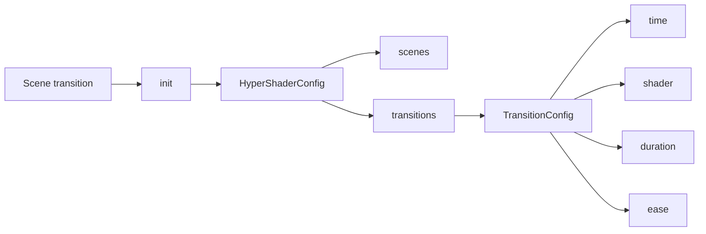
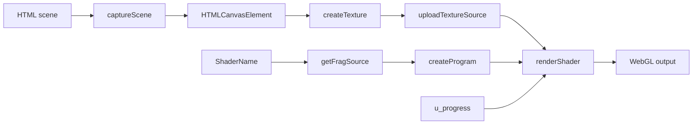

<!-- source: DeepWiki mcp.deepwiki.com · repo heygen-com/hyperframes · page 9 Shader Transitions Package · fetched 2026-11-02 -->

# Shader Transitions Package

Relevant source files

The following files were used as context for generating this wiki page:

- [packages/engine/scripts/generate-lut-reference.py](packages/engine/scripts/generate-lut-reference.py)
- [packages/engine/src/utils/alphaBlit.test.ts](packages/engine/src/utils/alphaBlit.test.ts)
- [packages/engine/src/utils/alphaBlit.ts](packages/engine/src/utils/alphaBlit.ts)
- [packages/producer/tests/hdr-regression/src/index.html](packages/producer/tests/hdr-regression/src/index.html)
- [packages/shader-transitions/src/capture.clone.test.ts](packages/shader-transitions/src/capture.clone.test.ts)
- [packages/shader-transitions/src/capture.test.ts](packages/shader-transitions/src/capture.test.ts)
- [packages/shader-transitions/src/capture.ts](packages/shader-transitions/src/capture.ts)
- [packages/shader-transitions/src/hyper-shader.preview.test.ts](packages/shader-transitions/src/hyper-shader.preview.test.ts)
- [packages/shader-transitions/src/hyper-shader.ts](packages/shader-transitions/src/hyper-shader.ts)
- [packages/shader-transitions/src/index.ts](packages/shader-transitions/src/index.ts)
- [packages/shader-transitions/src/seamTransitionLoop.test.ts](packages/shader-transitions/src/seamTransitionLoop.test.ts)
- [packages/shader-transitions/src/seamTransitionLoop.ts](packages/shader-transitions/src/seamTransitionLoop.ts)
- [packages/shader-transitions/src/shaders/common.ts](packages/shader-transitions/src/shaders/common.ts)
- [packages/shader-transitions/src/shaders/registry.ts](packages/shader-transitions/src/shaders/registry.ts)
- [packages/shader-transitions/src/webgl.test.ts](packages/shader-transitions/src/webgl.test.ts)
- [packages/shader-transitions/src/webgl.ts](packages/shader-transitions/src/webgl.ts)
- [packages/shader-transitions/tsconfig.json](packages/shader-transitions/tsconfig.json)
- [packages/shader-transitions/tsup.config.ts](packages/shader-transitions/tsup.config.ts)

## Purpose and scope

`@hyperframes/shader-transitions` provides WebGL scene-transition effects for HyperFrames compositions. Its public entry point exports `init`, the `HyperShaderConfig` and `TransitionConfig` types, shader names, and related capture and compositing utilities. This page summarizes how those pieces fit together; implementation details belong in the child pages. [packages/shader-transitions/src/index.ts:1-19]()

Sources: [packages/shader-transitions/src/index.ts:1-19]()

## Package at a glance

The package connects composition scene IDs and transition settings to scene capture, shader lookup, and WebGL rendering. `TransitionConfig` specifies a transition’s `time`, optional `shader`, optional `duration`, and optional `ease`; omitting `shader` allows a CSS crossfade. The broader `HyperShaderConfig` includes the background color, ordered scenes, transitions, and optional timeline and composition settings. [packages/shader-transitions/src/hyper-shader.ts:59-75]()

| Code entity | Role |
|---|---|
| `init` | Publicly exported transition entry point. [packages/shader-transitions/src/index.ts:5]() |
| `HyperShaderConfig` | Configuration type for scenes, transitions, color, and optional timeline settings. [packages/shader-transitions/src/hyper-shader.ts:67-75]() |
| `TransitionConfig` | Per-transition timing and optional shader/easing settings. [packages/shader-transitions/src/hyper-shader.ts:59-65]() |
| `getFragSource` / `SHADER_NAMES` | Shader source lookup and public shader-name export. [packages/shader-transitions/src/hyper-shader.ts:14](), [packages/shader-transitions/src/index.ts:7]() |
| `captureScene` | Captures a scene into a canvas, with browser-native HTML-in-canvas support detection and an `html2canvas` fallback. [packages/shader-transitions/src/capture.ts:105-114](), [packages/shader-transitions/src/capture.ts:152-165]() |
| `renderShader` | Binds scene textures and transition uniforms, then draws the shader over a fullscreen quad. [packages/shader-transitions/src/webgl.ts:116-144]() |

Sources: [packages/shader-transitions/src/index.ts:1-19](), [packages/shader-transitions/src/hyper-shader.ts:14-75](), [packages/shader-transitions/src/capture.ts:105-165](), [packages/shader-transitions/src/webgl.ts:116-144]()

## From transition configuration to code entities

The diagram maps the terms used to describe a transition to the package’s corresponding symbols. `init` is exported publicly; its configuration types are defined in `hyper-shader.ts`. [packages/shader-transitions/src/index.ts:5-7](), [packages/shader-transitions/src/hyper-shader.ts:59-75]()

**Configuration-to-code map**

Sources: [packages/shader-transitions/src/index.ts:5-7](), [packages/shader-transitions/src/hyper-shader.ts:59-75]()

## From scene images to WebGL output

At a high level, scene capture supplies canvas images, shader lookup supplies fragment-shader source, and the WebGL helpers create programs and render using scene textures and transition parameters. The package also exports a seam-transition loop and page-side compositor utilities; see the child page for their relationship to the broader render path. [packages/shader-transitions/src/capture.ts:152-165](), [packages/shader-transitions/src/hyper-shader.ts:1-16](), [packages/shader-transitions/src/webgl.ts:57-72](), [packages/shader-transitions/src/webgl.ts:116-165](), [packages/shader-transitions/src/index.ts:8-19]()

**Capture and rendering code map**

Sources: [packages/shader-transitions/src/capture.ts:152-165](), [packages/shader-transitions/src/hyper-shader.ts:14-16](), [packages/shader-transitions/src/webgl.ts:57-72](), [packages/shader-transitions/src/webgl.ts:116-165]()

## Shader registry and capture

The shader registry defines named fragment-shader effects, including `domain-warp`, `ridged-burn`, `whip-pan`, `sdf-iris`, and `ripple-waves`. The public package exports `SHADER_NAMES` and the `ShaderName` type so consumers can refer to the registered effects. [packages/shader-transitions/src/shaders/registry.ts:3-26](), [packages/shader-transitions/src/shaders/registry.ts:43-87](), [packages/shader-transitions/src/index.ts:7]()

`captureScene` can use native HTML-in-canvas capture when supported, and falls back to `html2canvas` if that route is unavailable or fails. Capture options include visibility handling, browser-paint preference, and scale. [packages/shader-transitions/src/capture.ts:43-51](), [packages/shader-transitions/src/capture.ts:105-114](), [packages/shader-transitions/src/capture.ts:152-181]()

For details, see [Shader Transitions API and Effects](#9.1).

Sources: [packages/shader-transitions/src/shaders/registry.ts:3-26](), [packages/shader-transitions/src/shaders/registry.ts:43-87](), [packages/shader-transitions/src/index.ts:7](), [packages/shader-transitions/src/capture.ts:43-51](), [packages/shader-transitions/src/capture.ts:105-181]()

## GSAP and rendering integration

The configuration type accepts an optional GSAP timeline, and the package declares the GSAP timeline operations it uses. The package also exports page-side compositing helpers and a seam-transition loop, which connect the transition subsystem to other rendering paths. [packages/shader-transitions/src/hyper-shader.ts:18-56](), [packages/shader-transitions/src/hyper-shader.ts:67-75](), [packages/shader-transitions/src/index.ts:8-19]()

For the WebGL engine, effect registry, capture behavior, seam loop, page-side compositing, and transparency details, see [Shader Transitions API and Effects](#9.1). [packages/shader-transitions/src/index.ts:8-19]()

Sources: [packages/shader-transitions/src/hyper-shader.ts:18-56](), [packages/shader-transitions/src/hyper-shader.ts:67-75](), [packages/shader-transitions/src/index.ts:8-19]()

## Registry transition blocks

Registry transition blocks provide a higher-level way to package transition effects for use in compositions. Their block families, manifests, and timing conventions are covered separately from the package’s WebGL engine. [packages/shader-transitions/src/index.ts:5-7]()

For details, see [Transition Blocks in the Registry](#9.2).

Sources: [packages/shader-transitions/src/index.ts:5-7]()

## Child pages

- [Shader Transitions API and Effects](#9.1) — `hyper-shader.ts`, WebGL effects and registry, `capture.ts`, seam transition loop, page-side compositing, and `alphaBlit` transparency.
- [Transition Blocks in the Registry](#9.2) — Registry transition block families, manifests, and timing conventions.

---

