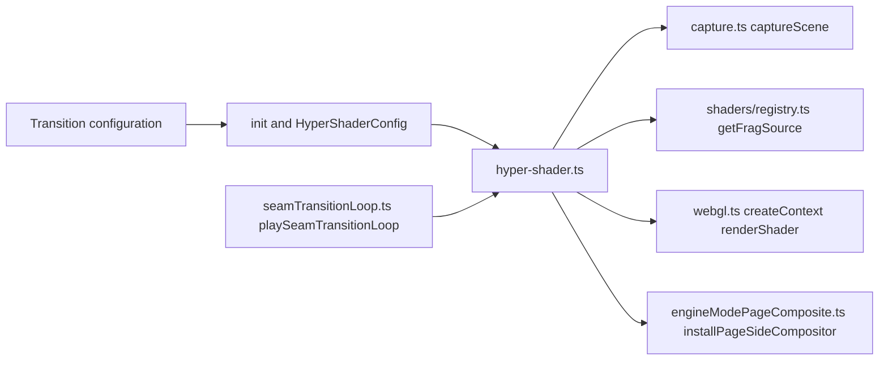
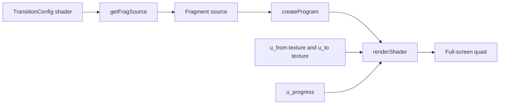
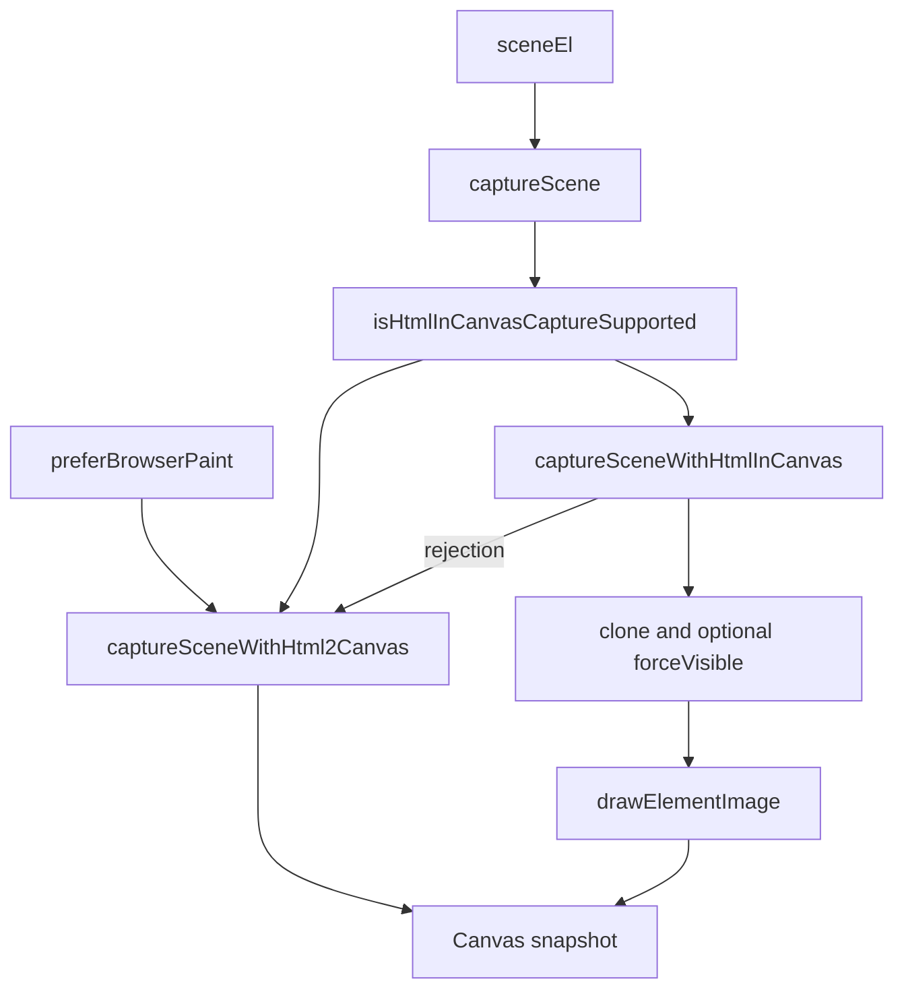
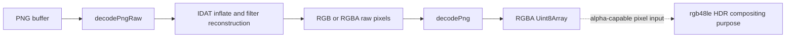

<!-- source: DeepWiki mcp.deepwiki.com · repo heygen-com/hyperframes · page 9.1 Shader Transitions API and Effects · fetched 2026-11-02 -->

# Shader Transitions API and Effects

Relevant source files

The following files were used as context for generating this wiki page:

- [packages/engine/scripts/generate-lut-reference.py](packages/engine/scripts/generate-lut-reference.py)
- [packages/engine/src/utils/alphaBlit.test.ts](packages/engine/src/utils/alphaBlit.test.ts)
- [packages/engine/src/utils/alphaBlit.ts](packages/engine/src/utils/alphaBlit.ts)
- [packages/producer/tests/hdr-regression/src/index.html](packages/producer/tests/hdr-regression/src/index.html)
- [packages/shader-transitions/src/capture.clone.test.ts](packages/shader-transitions/src/capture.clone.test.ts)
- [packages/shader-transitions/src/capture.test.ts](packages/shader-transitions/src/capture.test.ts)
- [packages/shader-transitions/src/capture.ts](packages/shader-transitions/src/capture.ts)
- [packages/shader-transitions/src/hyper-shader.preview.test.ts](packages/shader-transitions/src/hyper-shader.preview.test.ts)
- [packages/shader-transitions/src/hyper-shader.ts](packages/shader-transitions/src/hyper-shader.ts)
- [packages/shader-transitions/src/index.ts](packages/shader-transitions/src/index.ts)
- [packages/shader-transitions/src/seamTransitionLoop.test.ts](packages/shader-transitions/src/seamTransitionLoop.test.ts)
- [packages/shader-transitions/src/seamTransitionLoop.ts](packages/shader-transitions/src/seamTransitionLoop.ts)
- [packages/shader-transitions/src/shaders/common.ts](packages/shader-transitions/src/shaders/common.ts)
- [packages/shader-transitions/src/shaders/registry.ts](packages/shader-transitions/src/shaders/registry.ts)
- [packages/shader-transitions/src/webgl.test.ts](packages/shader-transitions/src/webgl.test.ts)
- [packages/shader-transitions/src/webgl.ts](packages/shader-transitions/src/webgl.ts)
- [packages/shader-transitions/tsconfig.json](packages/shader-transitions/tsconfig.json)
- [packages/shader-transitions/tsup.config.ts](packages/shader-transitions/tsup.config.ts)

## Purpose and scope

This page documents the `@hyperframes/shader-transitions` API and the visible implementation boundaries of its WebGL engine, shader registry, scene capture path, seam-transition-loop exports, page-side-compositor exports, and the engine’s `alphaBlit` utility. The supplied source excerpts show the public configuration and WebGL primitives, but do not include the implementation bodies for the seam loop or page-side compositor; those are described only at the level supported by their exports. [packages/shader-transitions/src/index.ts:1-19]() [packages/shader-transitions/src/hyper-shader.ts:1-16]() [packages/engine/src/utils/alphaBlit.ts:1-10]()

Sources: `packages/shader-transitions/src/index.ts`, `packages/shader-transitions/src/hyper-shader.ts`, `packages/engine/src/utils/alphaBlit.ts`

## 1. WebGL engine: `hyper-shader.ts`

### Core architecture and public configuration

The package entry point exports `init`, `HyperShaderConfig`, and `TransitionConfig` from `hyper-shader.ts`. `TransitionConfig` requires a transition `time`; it optionally accepts a `shader`, `duration`, and GSAP `ease`. Omitting `shader` is documented as selecting a CSS crossfade rather than a WebGL shader. `HyperShaderConfig` requires `bgColor`, `scenes`, and `transitions`; it can also specify an `accentColor`, a GSAP `timeline`, `compositionId`, and `previewCaptureFps`. [packages/shader-transitions/src/index.ts:1-7]() [packages/shader-transitions/src/hyper-shader.ts:59-75]()

The engine imports WebGL setup, program, texture, upload, and draw helpers from `webgl.ts`; shader lookup from `shaders/registry.ts`; capture helpers from `capture.ts`; and `installPageSideCompositor` from `engineModePageComposite.ts`. This establishes the module boundaries for configuration-driven transitions, without exposing the full `init()` implementation in the supplied excerpt. [packages/shader-transitions/src/hyper-shader.ts:1-16]()

The transition state types include the active flag, program, progress, and transition index. Cached transition records track scene IDs, timing, shader program, captured frames, cache key, readiness, fallback state, texture-loading state, and an optional error. [packages/shader-transitions/src/hyper-shader.ts:77-121]()

Sources: `packages/shader-transitions/src/index.ts`, `packages/shader-transitions/src/hyper-shader.ts`

### Engine-to-code map

This diagram maps the system concepts to the corresponding code entities and public entry points. It shows module relationships implied by imports and exports; it does not assert unshown internal call order. [packages/shader-transitions/src/index.ts:1-19]() [packages/shader-transitions/src/hyper-shader.ts:1-16]()

**Diagram: Shader transition concepts mapped to package entities**

Sources: `packages/shader-transitions/src/index.ts`, `packages/shader-transitions/src/hyper-shader.ts`

### WebGL setup and draw primitives

`createContext()` requests a WebGL context with `preserveDrawingBuffer: true`, sets the viewport to the requested dimensions, and disables unpack Y-flipping. The default dimensions are 1920 by 1080. `setupQuad()` creates a static buffer containing four vertices for a full-screen quad. [packages/shader-transitions/src/webgl.ts:3-24]()

`createProgram()` uses the shared vertex source and delegates to `createProgramWithVertex()`. The latter compiles the vertex shader, links it with a fragment shader, and deletes the vertex shader in a `finally` block. Program linking deletes the fragment shader after attaching it and throws if compilation or linking fails. [packages/shader-transitions/src/webgl.ts:26-72]()

`renderShader()` binds the outgoing and incoming textures to texture units 0 and 1, assigns the `u_progress`, `u_resolution`, and accent-color uniforms, configures the quad position attribute, and draws a four-vertex triangle strip. Uniform and attribute locations are cached per program in a `WeakMap`. [packages/shader-transitions/src/webgl.ts:86-114]() [packages/shader-transitions/src/webgl.ts:116-144]()

`createTexture()` initializes a 1×1 RGBA texture with clamp-to-edge wrapping and linear filtering. `uploadTextureSource()` replaces its image data with the supplied `TexImageSource`. [packages/shader-transitions/src/webgl.ts:146-165]()

Sources: `packages/shader-transitions/src/webgl.ts`

### Timeline defaults and transition state

`hyper-shader.ts` defines shared defaults of `0.7` seconds for duration and `"power2.inOut"` for easing. The source comments state that these defaults are used across metadata writing, browser/render mode, and engine mode so that transitions without explicit values use consistent timing and easing. [packages/shader-transitions/src/hyper-shader.ts:153-159]()

The file declares the GSAP timeline operations used by the engine, including `play`, `pause`, `time`, optional `seek`, optional `totalTime`, and timeline-building methods such as `call`, `to`, `set`, `from`, and `fromTo`. The supplied excerpt does not show the later `init()` implementation, so it does not establish the detailed timeline callback sequence. [packages/shader-transitions/src/hyper-shader.ts:18-56]()

Sources: `packages/shader-transitions/src/hyper-shader.ts`

## 2. Available transition shaders: `shaders/registry.ts`

### Registry and shader interface

The shader registry defines fragment-source entries keyed by shader name. The shown shader implementations use `u_from`, `u_to`, and `u_progress`; effects can also use the resolution and accent uniforms supported by the shared WebGL renderer. `hyper-shader.ts` imports `getFragSource` and the `ShaderName` type from this registry. [packages/shader-transitions/src/shaders/registry.ts:1-7]() [packages/shader-transitions/src/hyper-shader.ts:14-16]() [packages/shader-transitions/src/webgl.ts:86-94]()

The registry excerpt includes the following named effects:

| Shader name | Effect behavior visible in the source |
|---|---|
| `domain-warp` | Noise-driven UV distortion and an accent-colored edge treatment. [packages/shader-transitions/src/shaders/registry.ts:8-24]() |
| `ridged-burn` | Ridged-noise transition with a heat band and spark contribution. [packages/shader-transitions/src/shaders/registry.ts:26-41]() |
| `whip-pan` | Samples multiple horizontal offsets from each scene and blends the resulting colors. [packages/shader-transitions/src/shaders/registry.ts:43-56]() |
| `sdf-iris` | Uses a progress-driven radial boundary and accent glow rings. [packages/shader-transitions/src/shaders/registry.ts:58-70]() |
| `ripple-waves` | Distorts outgoing and incoming UVs with radial wave terms. [packages/shader-transitions/src/shaders/registry.ts:72-87]() |
| `gravitational-lens` | Warps the outgoing scene, applies channel offsets, and blends toward the incoming scene. [packages/shader-transitions/src/shaders/registry.ts:89-105]() |
| `cinematic-zoom` | Accumulates multiple samples along radial offsets for both scenes before blending. [packages/shader-transitions/src/shaders/registry.ts:107-125]() |
| `chromatic-split` | Samples red and blue channels at opposing offsets while retaining centered green samples. [packages/shader-transitions/src/shaders/registry.ts:127-142]() |
| `glitch` | Begins a block- and scanline-displacement effect with progress-dependent intensity. [packages/shader-transitions/src/shaders/registry.ts:144-160]() |

These are the entries visible in the supplied registry excerpt; it ends partway through the `glitch` definition, so this page does not infer its remaining implementation or the full set of registry names. [packages/shader-transitions/src/shaders/registry.ts:144-160]()

Sources: `packages/shader-transitions/src/shaders/registry.ts`, `packages/shader-transitions/src/hyper-shader.ts`, `packages/shader-transitions/src/webgl.ts`

### Registry-to-renderer data flow

The registry supplies fragment source by shader name, while the WebGL layer compiles fragment source into a program and renders with two input textures plus progress and color uniforms. The diagram connects these code entities without claiming details about the omitted `init()` body. [packages/shader-transitions/src/hyper-shader.ts:14-16]() [packages/shader-transitions/src/webgl.ts:26-72]() [packages/shader-transitions/src/webgl.ts:116-144]()

**Diagram: Shader name and scene textures to a rendered transition**

Sources: `packages/shader-transitions/src/hyper-shader.ts`, `packages/shader-transitions/src/webgl.ts`, `packages/shader-transitions/src/shaders/registry.ts`

## 3. Scene snapshot mechanism: `capture.ts`

### Capture API and visibility handling

`captureScene()` accepts a scene element, background color, dimensions, and optional capture settings; it returns a promise for a canvas. The options include `forceVisible`, `preferBrowserPaint`, and `scale`. Dimensions default to the WebGL defaults. [packages/shader-transitions/src/capture.ts:3-4]() [packages/shader-transitions/src/capture.ts:47-51]() [packages/shader-transitions/src/capture.ts:152-165]()

`initCapture()` installs a one-time patch to `CanvasRenderingContext2D.prototype.createPattern`. The patch returns `null` for image-like sources with zero width or height and otherwise delegates to the original method. [packages/shader-transitions/src/capture.ts:23-45]()

When visibility must be forced, `showSceneAndClips()` sets the scene opacity to `1`, reveals the scene with `revealClip`, and reveals descendant elements matching `[data-start]`. `forceSceneVisibleInClone()` finds a clone by the source element’s ID and applies that visibility treatment. [packages/shader-transitions/src/capture.ts:53-63]()

### Capture paths

`isHtmlInCanvasCaptureSupported()` checks for the canvas `layoutSubtree` property and a 2D context exposing `drawElementImage`. If that native capture path is supported and `preferBrowserPaint` is not set, `captureScene()` attempts HTML-in-canvas capture and falls back to the `html2canvas` path if the attempt rejects. Otherwise it uses `html2canvas` directly. [packages/shader-transitions/src/capture.ts:105-114]() [packages/shader-transitions/src/capture.ts:152-165]()

The native path creates a hidden canvas with `layoutsubtree`, clones the scene into it, optionally forces the clone visible, waits for two animation frames, paints the background, and calls `drawElementImage` on the clone. It copies the resulting canvas to a result canvas and removes the temporary canvas on success or failure. [packages/shader-transitions/src/capture.ts:116-150]()

The fallback path invokes `html2canvas` with the requested width, height, scale, background color, logging disabled, and a configurable `foreignObjectRendering` setting. The supplied excerpt begins the fallback’s compatibility comments but does not include the remainder of its options or retry logic. [packages/shader-transitions/src/capture.ts:167-194]()

Sources: `packages/shader-transitions/src/capture.ts`

### Snapshot capture flow

The capture module has two browser-side rasterization paths: native HTML-in-canvas capture and the `html2canvas` fallback. The native path supports clone visibility handling and cleanup; the fallback uses `html2canvas`. [packages/shader-transitions/src/capture.ts:53-63]() [packages/shader-transitions/src/capture.ts:105-165]()

**Diagram: Scene snapshot path selection**

Sources: `packages/shader-transitions/src/capture.ts`

## 4. Seam transition loop and page-side compositing

### Seam transition loop API

The package entry point exports `playSeamTransitionLoop` and the associated `SeamTransitionFrameSource`, `SeamTransitionLoopHandle`, and `SeamTransitionLoopOptions` types from `seamTransitionLoop.ts`. The supplied content does not include that file’s implementation, so loop scheduling, frame selection, and lifecycle details are not specified here. [packages/shader-transitions/src/index.ts:14-19]()

Sources: `packages/shader-transitions/src/index.ts`

### Page-side compositor API

`hyper-shader.ts` imports `installPageSideCompositor` from `engineModePageComposite.ts`. The package entry point also exports `installPageSideCompositor`, `isPageSideCompositingSupported`, `PAGE_COMPOSITOR_BUILD_CANARY`, and `PAGE_COMPOSITOR_CANVAS_ID`. The compositor implementation itself is not present in the supplied file contents, so its capture protocol and rendering behavior cannot be detailed from these excerpts. [packages/shader-transitions/src/hyper-shader.ts:14-16]() [packages/shader-transitions/src/index.ts:8-13]()

Sources: `packages/shader-transitions/src/index.ts`, `packages/shader-transitions/src/hyper-shader.ts`

## 5. Alpha blit and transparency

### PNG decoding boundary

`packages/engine/src/utils/alphaBlit.ts` describes an in-memory PNG decode and alpha-compositing utility for `rgb48le` HDR frames. Its module comments say it replaces per-frame FFmpeg spawns for a two-pass HDR compositing path and uses Node’s built-in `zlib` plus a CRC helper. [packages/engine/src/utils/alphaBlit.ts:1-10]()

The shared `decodePngRaw()` routine verifies the PNG signature, reads IHDR metadata, collects IDAT data, inflates the payload, and reconstructs scanlines using PNG filter types 0 through 4. It accepts RGB and RGBA color types and rejects Adam7-interlaced PNGs. [packages/engine/src/utils/alphaBlit.ts:23-31]() [packages/engine/src/utils/alphaBlit.ts:32-99]() [packages/engine/src/utils/alphaBlit.ts:100-149]()

The exported `decodePng()` supports 8-bit RGB and RGBA input. RGBA pixels are copied; RGB pixels are expanded to RGBA with alpha set to 255. It returns the dimensions and a four-channel byte array. [packages/engine/src/utils/alphaBlit.ts:152-183]()

The supplied alpha-blit excerpt ends before the compositing function bodies. The test imports identify related APIs such as `decodePngToRgb48le`, `blitRgba8OverRgb48le`, `blitRgb48leRegion`, and `blitRgb48leAffine`, but their algorithms and exact call relationships are not documented here. [packages/engine/src/utils/alphaBlit.test.ts:3-13]()

Sources: `packages/engine/src/utils/alphaBlit.ts`, `packages/engine/src/utils/alphaBlit.test.ts`

### Transparency data flow

The diagram distinguishes the available, source-backed PNG decoding steps from the broader HDR compositing purpose stated in the module comments. It does not assert unshown function call sites between `alphaBlit` and the shader-transition package. [packages/engine/src/utils/alphaBlit.ts:1-10]() [packages/engine/src/utils/alphaBlit.ts:32-35]() [packages/engine/src/utils/alphaBlit.ts:152-183]()

**Diagram: PNG bytes toward RGBA pixels and HDR compositing**

Sources: `packages/engine/src/utils/alphaBlit.ts`

## 6. Package integration and code map

The package entry point calls `declareClipRevealAware()` and exports the shader API, capture-support check, shader names, page-side compositor APIs, and seam-transition-loop API. This is the public integration surface evidenced by the provided entry-point excerpt. [packages/shader-transitions/src/index.ts:1-19]()

The engine’s supplied imports show its dependencies on the capture module, shader registry, WebGL helpers, and page-side compositor. The `alphaBlit` utility is in the engine package and documents HDR alpha compositing, but the supplied excerpts do not show a direct import or invocation connecting it to `hyper-shader.ts`. [packages/shader-transitions/src/hyper-shader.ts:1-16]() [packages/engine/src/utils/alphaBlit.ts:1-10]()

| Code entity | Role visible in supplied source |
|---|---|
| `init` | Public shader-transition initializer exported from `hyper-shader.ts`. [packages/shader-transitions/src/index.ts:5-7]() |
| `TransitionConfig` | Transition timing and optional shader, duration, and easing configuration. [packages/shader-transitions/src/hyper-shader.ts:59-65]() |
| `HyperShaderConfig` | Engine configuration for background, scenes, transitions, and optional controls. [packages/shader-transitions/src/hyper-shader.ts:67-75]() |
| `captureScene` | Captures a scene into a canvas using native capture or `html2canvas`. [packages/shader-transitions/src/capture.ts:152-165]() |
| `getFragSource` / `ShaderName` | Registry lookup and shader-name type imported by the engine. [packages/shader-transitions/src/hyper-shader.ts:14-16]() |
| `renderShader` | Binds textures and uniforms and draws the full-screen quad. [packages/shader-transitions/src/webgl.ts:116-144]() |
| `playSeamTransitionLoop` | Public seam-loop export; implementation not included in supplied contents. [packages/shader-transitions/src/index.ts:14-19]() |
| `installPageSideCompositor` | Public page-side compositor export and engine import; implementation not included in supplied contents. [packages/shader-transitions/src/index.ts:8-13]() [packages/shader-transitions/src/hyper-shader.ts:14-16]() |
| `decodePng` | Converts supported 8-bit PNG data into RGBA bytes. [packages/engine/src/utils/alphaBlit.ts:152-183]() |

Sources: `packages/shader-transitions/src/index.ts`, `packages/shader-transitions/src/hyper-shader.ts`, `packages/shader-transitions/src/capture.ts`, `packages/shader-transitions/src/webgl.ts`, `packages/engine/src/utils/alphaBlit.ts`

---

