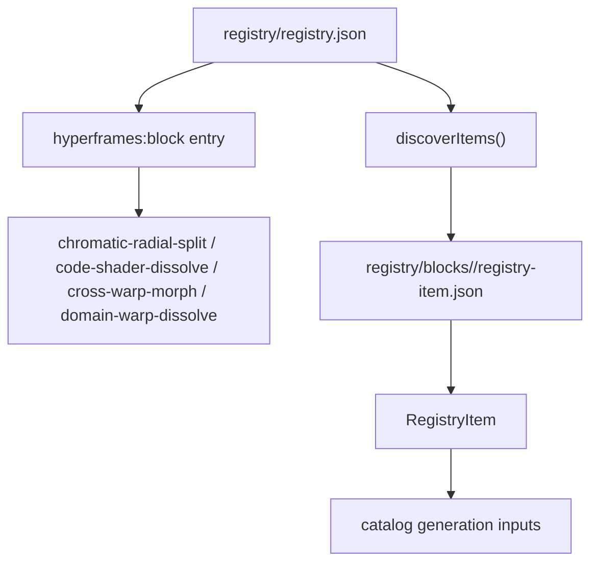
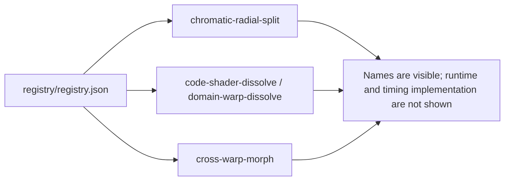
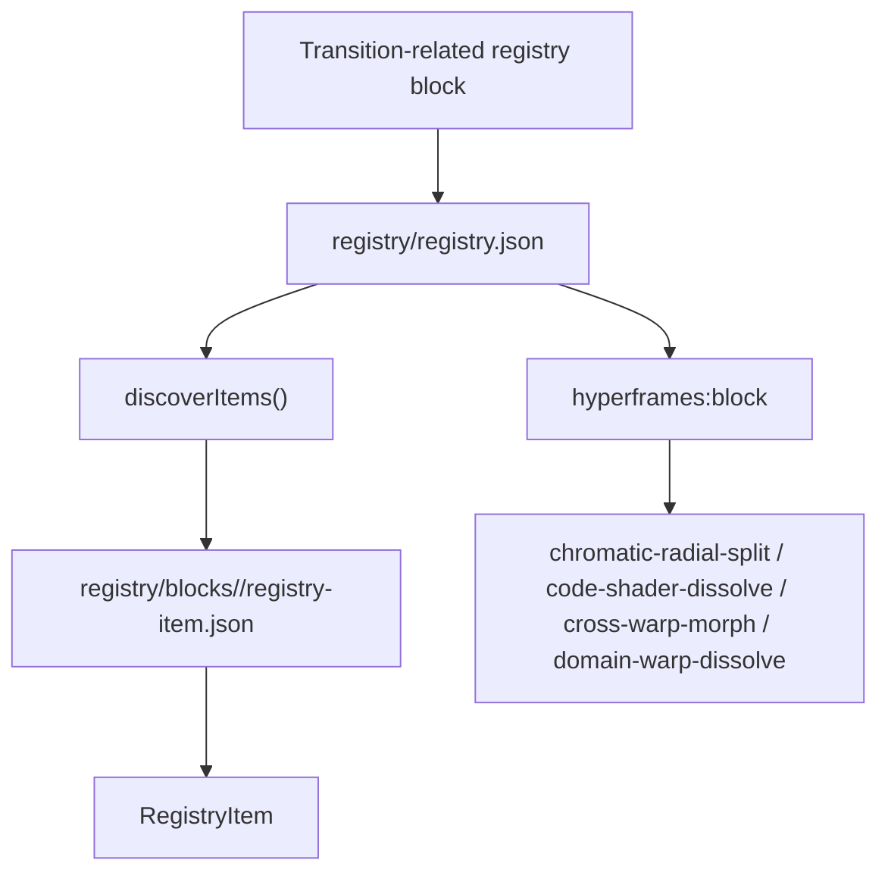

<!-- source: DeepWiki mcp.deepwiki.com · repo heygen-com/hyperframes · page 9.2 Transition Blocks in the Registry · fetched 2026-11-02 -->

# Transition Blocks in the Registry

Relevant source files

The following files were used as context for generating this wiki page:

- [docs/catalog/components/filmed-screen.mdx](docs/catalog/components/filmed-screen.mdx)
- [docs/catalog/components/motion-blur.mdx](docs/catalog/components/motion-blur.mdx)
- [docs/catalog/components/shutter-slam.mdx](docs/catalog/components/shutter-slam.mdx)
- [docs/catalog/components/texture-mask-text.mdx](docs/catalog/components/texture-mask-text.mdx)
- [docs/docs.json](docs/docs.json)
- [docs/public/catalog-index.json](docs/public/catalog-index.json)
- [docs/public/catalog/components/filmed-screen.json](docs/public/catalog/components/filmed-screen.json)
- [docs/public/catalog/components/motion-blur.json](docs/public/catalog/components/motion-blur.json)
- [docs/public/catalog/components/shutter-slam.json](docs/public/catalog/components/shutter-slam.json)
- [docs/snippets/catalog-gallery-data.mdx](docs/snippets/catalog-gallery-data.mdx)
- [packages/cli/src/registry/motionBlurShutter.browser.test.ts](packages/cli/src/registry/motionBlurShutter.browser.test.ts)
- [packages/core/src/registry/catalogGeneratorInstructions.test.ts](packages/core/src/registry/catalogGeneratorInstructions.test.ts)
- [packages/producer/src/benchmark.ts](packages/producer/src/benchmark.ts)
- [packages/producer/src/transparency-test.ts](packages/producer/src/transparency-test.ts)
- [packages/producer/tests/perf/README.md](packages/producer/tests/perf/README.md)
- [packages/producer/tests/transparency-regression/meta.json](packages/producer/tests/transparency-regression/meta.json)
- [packages/producer/tests/transparency-regression/src/index.html](packages/producer/tests/transparency-regression/src/index.html)
- [registry/blocks/gooey-split/gooey-split.html](registry/blocks/gooey-split/gooey-split.html)
- [registry/blocks/gooey-split/registry-item.json](registry/blocks/gooey-split/registry-item.json)
- [registry/catalog-artifact/local-vectors.bin](registry/catalog-artifact/local-vectors.bin)
- [registry/catalog-artifact/local-vectors.json](registry/catalog-artifact/local-vectors.json)
- [registry/components/motion-blur/demo.html](registry/components/motion-blur/demo.html)
- [registry/components/motion-blur/motion-blur.html](registry/components/motion-blur/motion-blur.html)
- [registry/components/motion-blur/registry-item.json](registry/components/motion-blur/registry-item.json)
- [registry/components/shutter-slam/demo.html](registry/components/shutter-slam/demo.html)
- [registry/components/shutter-slam/shutter-slam.html](registry/components/shutter-slam/shutter-slam.html)
- [registry/registry.json](registry/registry.json)
- [scripts/catalog-drift.test.ts](scripts/catalog-drift.test.ts)
- [scripts/catalog-drift.ts](scripts/catalog-drift.ts)
- [scripts/catalog-hosted-files.test.ts](scripts/catalog-hosted-files.test.ts)
- [scripts/catalog-hosted-files.ts](scripts/catalog-hosted-files.ts)
- [scripts/catalog-preview-temp.ts](scripts/catalog-preview-temp.ts)
- [scripts/catalog-publication.test.mjs](scripts/catalog-publication.test.mjs)
- [scripts/catalog-vectors.mjs](scripts/catalog-vectors.mjs)
- [scripts/generate-catalog-pages.ts](scripts/generate-catalog-pages.ts)
- [scripts/generate-catalog-previews.ts](scripts/generate-catalog-previews.ts)
- [scripts/generate-template-previews.ts](scripts/generate-template-previews.ts)
- [scripts/publish-catalog.mjs](scripts/publish-catalog.mjs)
- [scripts/registry-target-paths.mjs](scripts/registry-target-paths.mjs)
- [scripts/registry-target-paths.test.mjs](scripts/registry-target-paths.test.mjs)
- [scripts/upload-docs-images.sh](scripts/upload-docs-images.sh)

## Purpose and scope

This page describes what the provided repository evidence establishes about transition-related registry items: how the registry index names items, how catalog generation finds block manifests, and which transition-family names are visible in the supplied files. The supplied contents do **not** include the shader-transition package implementation or the individual manifests for the named transition items, so this page does not assert their runtime wrapper behavior, shader configuration, or timing conventions. [registry/registry.json:191-192]()[registry/registry.json:235-236]()[registry/registry.json:267-280]()[scripts/generate-catalog-pages.ts:117-149]()

Sources: `registry/registry.json`, `scripts/generate-catalog-pages.ts`

---

## What the supplied files establish

The central registry index contains entries typed as `hyperframes:block`; among the visible entries are `chromatic-radial-split`, `code-shader-dissolve`, `cross-warp-morph`, and `domain-warp-dissolve`. Their names indicate transition-related effects, but the index excerpt does not specify how they are implemented or timed. [registry/registry.json:191-192]()[registry/registry.json:235-236]()[registry/registry.json:267-280]()

The catalog generator reads `registry/registry.json`, selects entries whose type is `hyperframes:block` or `hyperframes:component`, and constructs a per-item path ending in `registry-item.json`. It reads that item manifest as a `RegistryItem` and sorts the discovered results by manifest name. This establishes the discovery and catalog-generation path; it does not demonstrate that a manifest field configures a shader engine. [scripts/generate-catalog-pages.ts:20-25]()[scripts/generate-catalog-pages.ts:117-149]()

| Registry name | What is directly evidenced |
|---|---|
| `chromatic-radial-split` | An item named `chromatic-radial-split` is indexed as `hyperframes:block`. [registry/registry.json:191-192]() |
| `code-shader-dissolve` | An item named `code-shader-dissolve` is indexed as `hyperframes:block`. [registry/registry.json:235-236]() |
| `cross-warp-morph` | An item named `cross-warp-morph` is indexed as `hyperframes:block`. [registry/registry.json:267-268]() |
| `domain-warp-dissolve` | An item named `domain-warp-dissolve` is indexed as `hyperframes:block`. [registry/registry.json:279-280]() |

Sources: `registry/registry.json`, `scripts/generate-catalog-pages.ts`

---

## Registry discovery and catalog flow

The supported data flow begins at the top-level registry index. The generator recognizes block and component item types, locates each item’s `registry-item.json` under the corresponding type directory, parses it, and collects it for catalog generation. The shown code does not connect these manifests to shader initialization, scene capture, WebGL rendering, or a transition timeline. [scripts/generate-catalog-pages.ts:117-149]()

**Diagram: Registry names mapped to catalog-generation entities**

Sources: `registry/registry.json`, `scripts/generate-catalog-pages.ts`

---

## Manifest and timing evidence

The supplied catalog-generator code shows that an item manifest is parsed and treated as a `RegistryItem`. It also shows a separate preview-generation helper locating the first manifest file with type `hyperframes:composition`, using its path as the composition entry; if no such file is found, the helper falls back to `<name>.html`. That preview-entry selection is not evidence of transition timing or shader configuration. [scripts/generate-catalog-pages.ts:117-149]()[scripts/generate-catalog-previews.ts:87-93]()

The supplied files do not show transition-specific manifest contents or fields such as `shader`, `duration`, `ease`, or transition start time. Consequently, no default duration, easing rule, time unit, progress mapping, or scene sequencing convention can be confirmed from this input. The prior page’s proposed manifest example and claims about default timing are not supported by the supplied file contents. [scripts/generate-catalog-pages.ts:117-149]()[scripts/generate-catalog-previews.ts:87-93]()

| Question | Supported answer from supplied files |
|---|---|
| How are block entries distinguished in the index? | The catalog generator selects entries with type `hyperframes:block`. [scripts/generate-catalog-pages.ts:123-132]() |
| Where does it look for a block manifest? | Under `registry/blocks/<name>/registry-item.json`. [scripts/generate-catalog-pages.ts:123-141]() |
| What manifest type does the generator use? | `RegistryItem`. [scripts/generate-catalog-pages.ts:20-25]()[scripts/generate-catalog-pages.ts:139-146]() |
| What is the transition duration or default easing? | Not established by the supplied files. [scripts/generate-catalog-pages.ts:117-149]() |
| What field selects a shader or controls progress? | Not established by the supplied files. [scripts/generate-catalog-pages.ts:117-149]() |

Sources: `scripts/generate-catalog-pages.ts`, `scripts/generate-catalog-previews.ts`

---

## Transition families: names versus implementation

The visible registry entries include names containing `radial`, `dissolve`, and `warp`. These strings support identifying candidate transition-related items by name. They do not establish that the items share an implementation, wrap a particular shader engine, or correspond to specific shader families or algorithms. [registry/registry.json:191-192]()[registry/registry.json:235-236]()[registry/registry.json:267-280]()

**Diagram: Transition-related registry names and the boundary of available evidence**

Sources: `registry/registry.json`

---

## Natural-language concepts and code entities

The following diagram maps the user-facing idea of a transition block to the code entities visible in the supplied files. `discoverItems()` is the demonstrated catalog discovery function; the transition names are entries in `registry/registry.json`. The files supplied here do not show the shader package’s functions or classes, so the diagram deliberately stops at catalog inputs. [registry/registry.json:191-192]()[registry/registry.json:235-236]()[registry/registry.json:267-280]()[scripts/generate-catalog-pages.ts:117-149]()

**Diagram: Transition-block concept mapped to supplied code entities**

Sources: `registry/registry.json`, `scripts/generate-catalog-pages.ts`

---

## Implementation details not established here

The supplied contents do not include `packages/shader-transitions` source files, the named transition items’ `registry-item.json` files, or their composition HTML. Therefore, they are insufficient to document an engine entry point, a shader registry, scene snapshot/capture mechanics, WebGL texture flow, GSAP integration, transition progress uniforms, or deterministic seek behavior. Those details should be documented only after consulting the corresponding implementation and item files. [registry/registry.json:191-192]()[registry/registry.json:235-236]()[registry/registry.json:267-280]()[scripts/generate-catalog-pages.ts:117-149]()

Sources: `registry/registry.json`, `scripts/generate-catalog-pages.ts`

---

## Summary

The demonstrated registry path is: an item is listed in `registry/registry.json`, the catalog generator recognizes its `hyperframes:block` type, then looks for and parses its item manifest as a `RegistryItem`. The visible index includes names associated with radial, dissolve, and warp transitions. The supplied files do not establish how those blocks wrap the shader engine or what timing conventions they use. [registry/registry.json:191-192]()[registry/registry.json:235-236]()[registry/registry.json:267-280]()[scripts/generate-catalog-pages.ts:117-149]()

Sources: `registry/registry.json`, `scripts/generate-catalog-pages.ts`

---

