# Page: HyperFrames Overview

# HyperFrames Overview

<details>
<summary>Relevant source files</summary>

The following files were used as context for generating this wiki page:

- [.claude-plugin/plugin.json](.claude-plugin/plugin.json)
- [.codex-plugin/plugin.json](.codex-plugin/plugin.json)
- [.cursor-plugin/plugin.json](.cursor-plugin/plugin.json)
- [docs/changelog.mdx](docs/changelog.mdx)
- [docs/concepts/compositions.mdx](docs/concepts/compositions.mdx)
- [docs/concepts/data-attributes.mdx](docs/concepts/data-attributes.mdx)
- [docs/concepts/determinism.mdx](docs/concepts/determinism.mdx)
- [docs/concepts/variables.mdx](docs/concepts/variables.mdx)
- [docs/deploy/aws-lambda.mdx](docs/deploy/aws-lambda.mdx)
- [docs/deploy/migrating-to-hyperframes-lambda.mdx](docs/deploy/migrating-to-hyperframes-lambda.mdx)
- [docs/introduction.mdx](docs/introduction.mdx)
- [docs/packages/aws-lambda.mdx](docs/packages/aws-lambda.mdx)
- [docs/packages/core.mdx](docs/packages/core.mdx)
- [docs/packages/gcp-cloud-run.mdx](docs/packages/gcp-cloud-run.mdx)
- [docs/packages/shader-transitions.mdx](docs/packages/shader-transitions.mdx)
- [docs/packages/studio.mdx](docs/packages/studio.mdx)
- [docs/studio/canvas.mdx](docs/studio/canvas.mdx)
- [packages/aws-lambda/package.json](packages/aws-lambda/package.json)
- [packages/cli/package.json](packages/cli/package.json)
- [packages/cli/src/docs/compositions.md](packages/cli/src/docs/compositions.md)
- [packages/core/package.json](packages/core/package.json)
- [packages/engine/package.json](packages/engine/package.json)
- [packages/gcp-cloud-run/package.json](packages/gcp-cloud-run/package.json)
- [packages/player/package.json](packages/player/package.json)
- [packages/producer/package.json](packages/producer/package.json)
- [packages/shader-transitions/package.json](packages/shader-transitions/package.json)
- [packages/studio/package.json](packages/studio/package.json)

</details>


HyperFrames is an open-source framework for turning HTML, CSS, media, and seekable animations into deterministic MP4 videos [packages/cli/package.json:4-4](). By treating the browser as a high-fidelity rendering engine, it allows developers and AI agents to author videos using standard web technologies.

The system is built on the principle of **Deterministic Rendering**, ensuring that identical inputs consistently produce identical frames and video output. It is designed to be agent-friendly, featuring a comprehensive "skills" system that teaches AI coding agents the specific patterns required for video production [packages/cli/package.json:8-10]().

Sources: [packages/cli/package.json:4-4](), [packages/cli/package.json:8-10]()

## Monorepo Package Structure

HyperFrames is organized as a monorepo with specialized packages handling distinct layers of the video production, editing, and deployment stack.

| Package | Role | Description |
| :--- | :--- | :--- |
| [`@hyperframes/cli`](packages/cli/package.json:2-4)() | **Interface** | The `hyperframes` binary [packages/cli/package.json:29-31]() handling scaffolding, preview servers, and render orchestration. |
| [`@hyperframes/core`](packages/core/package.json:2-3)() | **Logic & Runtime** | Shared libraries for HTML compilation, registry, and the runtime IIFE [packages/core/package.json:1-203](). |
| [`@hyperframes/parsers`](packages/parsers/package.json:1-15)() | **AST & Contracts** | GSAP AST parsing and writing, clip tweens, asset resolution, and composition contracts. |
| [`@hyperframes/lint`](packages/lint/package.json:1-15)() | **Validation** | Rule sets for core rules, media checks, GSAP correctness, captions, and layout analysis. |
| [`@hyperframes/studio`](packages/studio/package.json:2-3)() | **IDE** | React-based browser surface for NLE editing, file management, and timeline scrubbing [packages/studio/package.json:1-30](). |
| [`@hyperframes/studio-server`](packages/studio-server/package.json:1-15)() | **Backend** | Hono backend supporting file management, preview sync, media proxy/transcoding, and history. |
| [`@hyperframes/producer`](packages/producer/package.json:2-4)() | **Orchestrator** | Manages render job orchestration, the HTTP server, and staged pipelines [packages/producer/package.json:2-4](). |
| [`@hyperframes/engine`](packages/engine/package.json:2-4)() | **Execution** | Puppeteer and FFmpeg layer for deterministic frame capture, video extraction, and audio mixing [packages/engine/package.json:4-4](). |
| [`@hyperframes/player`](packages/player/package.json:2-4)() | **Distribution** | Embeddable `<hyperframes-player>` web component and slideshow element [packages/player/package.json:2-4](). |
| [`@hyperframes/sdk`](packages/sdk/package.json:1-15)() | **Headless SDK** | Framework-neutral composition editing engine, session models, and RFC 6902 patch pipelines. |
| [`@hyperframes/shader-transitions`](packages/shader-transitions/package.json:2-4)() | **WebGL Effects** | WebGL scene transitions, shader registry, and GSAP integration [packages/shader-transitions/package.json:2-4](). |
| [`@hyperframes/aws-lambda`](packages/aws-lambda/package.json:2-4)() | **Cloud Adapter** | AWS Lambda handler, client-side SDK, and CDK construct for distributed rendering [packages/aws-lambda/package.json:2-4](). |
| [`@hyperframes/gcp-cloud-run`](packages/gcp-cloud-run/package.json:1-15)() | **Cloud Adapter** | Hono Cloud Run server, Terraform modules, and GCS transport adapters. |

Sources: [packages/cli/package.json:2-4](), [packages/cli/package.json:29-31](), [packages/core/package.json:2-3](), [packages/core/package.json:1-203](), [packages/parsers/package.json:1-15](), [packages/lint/package.json:1-15](), [packages/studio/package.json:2-3](), [packages/studio/package.json:1-30](), [packages/studio-server/package.json:1-15](), [packages/producer/package.json:2-4](), [packages/engine/package.json:2-4](), [packages/engine/package.json:4-4](), [packages/player/package.json:2-4](), [packages/sdk/package.json:1-15](), [packages/shader-transitions/package.json:2-4](), [packages/aws-lambda/package.json:2-4](), [packages/gcp-cloud-run/package.json:1-15]()

## System Architecture

The following diagram bridges natural language authoring concepts with the code entities and subsystems that implement them.

**Code Entity & Subsystem Mapping**
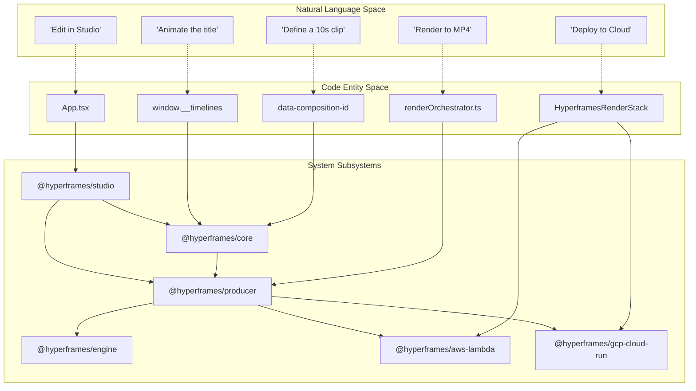
Sources: [packages/cli/package.json:4-4](), [packages/producer/package.json:2-4](), [packages/core/package.json:2-3](), [packages/studio/package.json:2-3](), [packages/aws-lambda/package.json:2-4](), [packages/gcp-cloud-run/package.json:1-15]()

## Core Subsystems

### The CLI and AI Skills
The CLI package (`@hyperframes/cli`) provides the primary developer command suite for project initialization (`hyperframes init`), preview servers (`hyperframes preview`), and final rendering (`hyperframes render`) [packages/cli/package.json:2-4](). It integrates with the AI skills system (`skills/`) to guide coding agents through valid HyperFrames authoring patterns [packages/cli/package.json:8-10]().
For details, see [Getting Started](#1.1).

Sources: [packages/cli/package.json:2-4](), [packages/cli/package.json:8-10]()

### Deterministic Runtime and Core Concepts
Core composition models rely on strict HTML contracts, data attributes (`data-composition-id`, `data-start`, `data-duration`), and specialized runtime IIFEs that intercept time-based APIs [packages/core/package.json:1-203](). Seek-driven frame rendering via `renderSeek` and Frame Adapters (GSAP, Lottie, CSS, WAAPI) guarantee complete frame determinism [packages/core/package.json:1-203]().
For details, see [Core Concepts](#1.2).

Sources: [packages/core/package.json:1-203]()

### Rendering Pipeline and Execution
Rendering is orchestrated by `@hyperframes/producer` through staged pipelines, leveraging `@hyperframes/engine` to execute Chrome via the `BeginFrame` CDP protocol alongside FFmpeg for mixing and encoding [packages/producer/package.json:2-4](), [packages/engine/package.json:4-4]().

**Subsystem Interaction Flow**
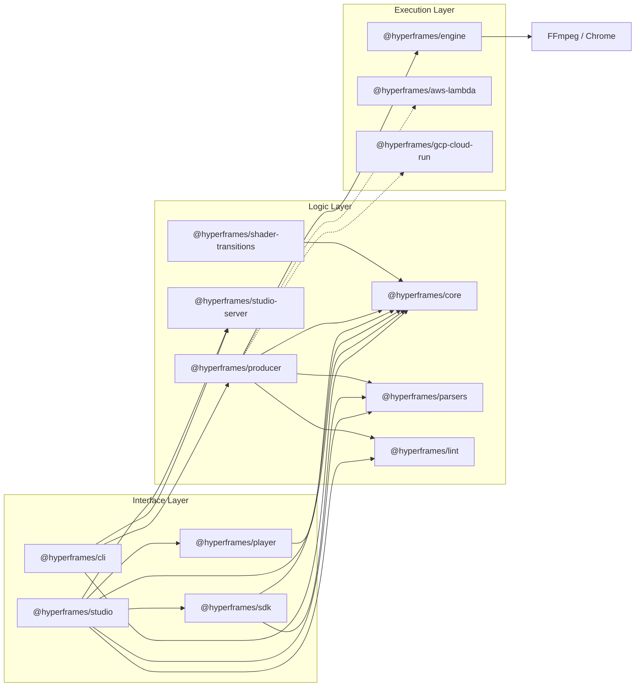
Sources: [packages/cli/package.json:2-4](), [packages/producer/package.json:2-4](), [packages/aws-lambda/package.json:2-4](), [packages/core/package.json:2-3](), [packages/studio/package.json:2-3](), [packages/sdk/package.json:1-15](), [packages/player/package.json:2-4](), [packages/parsers/package.json:1-15](), [packages/lint/package.json:1-15](), [packages/studio-server/package.json:1-15](), [packages/shader-transitions/package.json:2-4](), [packages/engine/package.json:4-4](), [packages/gcp-cloud-run/package.json:1-15]()

## Next Steps

Explore the child pages for detailed technical implementation and usage guides:

*   **[Getting Started](#1.1)**: Installation, CLI usage, previewing in Studio, and rendering a first video.
*   **[Core Concepts](#1.2)**: Compositions, Data Attributes, Frame Adapters, and Deterministic Rendering.

Sources: [packages/cli/package.json:8-10]()

---

# Page: Getting Started

# Getting Started

<details>
<summary>Relevant source files</summary>

The following files were used as context for generating this wiki page:

- [.claude-plugin/marketplace.json](.claude-plugin/marketplace.json)
- [AGENTS.md](AGENTS.md)
- [CLAUDE.md](CLAUDE.md)
- [DESIGN.md](DESIGN.md)
- [README.md](README.md)
- [docs/catalog-gallery.css](docs/catalog-gallery.css)
- [docs/contributing/testing-local-changes.mdx](docs/contributing/testing-local-changes.mdx)
- [docs/custom.css](docs/custom.css)
- [docs/examples.mdx](docs/examples.mdx)
- [docs/guides/free-agents.mdx](docs/guides/free-agents.mdx)
- [docs/guides/gsap-animation.mdx](docs/guides/gsap-animation.mdx)
- [docs/guides/skills.mdx](docs/guides/skills.mdx)
- [docs/packages/cli.mdx](docs/packages/cli.mdx)
- [docs/quickstart.mdx](docs/quickstart.mdx)
- [docs/reference/html-schema.mdx](docs/reference/html-schema.mdx)
- [docs/snippets/advanced-path-grid.jsx](docs/snippets/advanced-path-grid.jsx)
- [docs/snippets/day-list.jsx](docs/snippets/day-list.jsx)
- [docs/snippets/docs-video.jsx](docs/snippets/docs-video.jsx)
- [docs/snippets/example-player.jsx](docs/snippets/example-player.jsx)
- [docs/snippets/film-rows.jsx](docs/snippets/film-rows.jsx)
- [docs/snippets/hover-video.jsx](docs/snippets/hover-video.jsx)
- [docs/snippets/quickstart-continuation-grid.jsx](docs/snippets/quickstart-continuation-grid.jsx)
- [docs/snippets/remix-shelf.jsx](docs/snippets/remix-shelf.jsx)
- [docs/snippets/replica-compare.jsx](docs/snippets/replica-compare.jsx)
- [docs/template-gallery.css](docs/template-gallery.css)
- [docs/thirty-days.mdx](docs/thirty-days.mdx)
- [packages/cli/src/cli.ts](packages/cli/src/cli.ts)
- [packages/cli/src/commands/coreSkillContent.test.ts](packages/cli/src/commands/coreSkillContent.test.ts)
- [packages/cli/src/commands/feedback.test.ts](packages/cli/src/commands/feedback.test.ts)
- [packages/cli/src/commands/feedback.ts](packages/cli/src/commands/feedback.ts)
- [packages/cli/src/commands/init.test.ts](packages/cli/src/commands/init.test.ts)
- [packages/cli/src/commands/init.ts](packages/cli/src/commands/init.ts)
- [packages/cli/src/help.ts](packages/cli/src/help.ts)
- [packages/cli/src/templates/_shared/AGENTS.md](packages/cli/src/templates/_shared/AGENTS.md)
- [packages/cli/src/templates/_shared/CLAUDE.md](packages/cli/src/templates/_shared/CLAUDE.md)
- [packages/cli/src/utils/submitFeedback.test.ts](packages/cli/src/utils/submitFeedback.test.ts)
- [packages/cli/src/utils/submitFeedback.ts](packages/cli/src/utils/submitFeedback.ts)
- [scripts/check-docs-snippet-motion.test.mjs](scripts/check-docs-snippet-motion.test.mjs)
- [scripts/sync-docs-catalog.mjs](scripts/sync-docs-catalog.mjs)
- [skills-manifest.json](skills-manifest.json)
- [skills/hyperframes-cli/SKILL.md](skills/hyperframes-cli/SKILL.md)
- [skills/hyperframes-cli/references/lint-validate-inspect.md](skills/hyperframes-cli/references/lint-validate-inspect.md)
- [skills/hyperframes-cli/references/preview-render.md](skills/hyperframes-cli/references/preview-render.md)
- [skills/hyperframes/SKILL.md](skills/hyperframes/SKILL.md)

</details>


HyperFrames is an open-source video rendering framework that allows you to create, preview, and render HTML-based video compositions [README.md:32](). It is designed specifically for **deterministic rendering** and **AI-agent-driven workflows**, where an AI (like Claude Code or Cursor) can author and iterate on video projects as easily as it writes code [README.md:32]().

This page covers installing the CLI, running `hyperframes init`, previewing in Studio, rendering your first video, and handling both manual and AI-agent workflows.

## Prerequisites

Before using the CLI, ensure your environment meets the following requirements:

*   **Node.js >= 22**: Required for the CLI runtime and the Vite-based preview server [README.md:13](), [docs/packages/cli.mdx:13]().
*   **FFmpeg**: Required for local video rendering, transcoding, and probing [skills/hyperframes-cli/SKILL.md:16]().
*   **npx**: Used to run the CLI and install AI skills [docs/packages/cli.mdx:14]().

Sources: [README.md:13](), [docs/packages/cli.mdx:13-14](), [skills/hyperframes-cli/SKILL.md:16]()

---

## Installation and AI Setup

HyperFrames provides **Skills** via the `vercel-labs/skills` protocol. These skills teach AI agents framework-specific patterns (like `window.__timelines` registration and `data-*` semantics) that generic web documentation lacks [CLAUDE.md:5-7]().

### 1. Install AI Skills (Recommended)
To prepare your AI agent for HyperFrames development, run:
```bash
npx hyperframes skills update
```
This installs/refreshes the core set of skills (`/hyperframes`, `/hyperframes-cli`, `/hyperframes-registry`, `/media-use`) and any other skills already installed [CLAUDE.md:10-10](). This teaches your coding agent how to write correct compositions, GSAP timelines, and use first-party adapters [README.md:59-62](), [CLAUDE.md:23-26]().

For Claude Code, you can install the plugin directly:
```bash
claude plugin marketplace add heygen-com/hyperframes
claude plugin install hyperframes@hyperframes
```
Then enable auto-update for the `hyperframes` marketplace [README.md:40-52]().

### 2. Manual CLI Usage
The CLI is defined in `@hyperframes/cli` [CLAUDE.md:78]() and can be executed via:
```bash
npx hyperframes <command>
```
No installation is required when using `npx` [docs/packages/cli.mdx:14-15](). Alternatively, you can install it globally:
```bash
npm install -g hyperframes
```

Sources: [README.md:40-52, 59-62](), [docs/packages/cli.mdx:14-19](), [CLAUDE.md:5-7, 10, 23-26, 78]()

---

## Workflow: Creating Your First Video

The HyperFrames lifecycle moves from initialization to preview, validation, and final rendering.

### Step 1: Initialize a Project
The `init` command scaffolds a new composition project. It supports an interactive wizard for manual use and non-interactive flags for AI agents [docs/packages/cli.mdx:67-71](), [packages/cli/src/commands/init.ts:12-19]().

```bash
# Default: centered Inter blank. Non-TTY skips the wizard.
npx hyperframes init my-video

# Start from a video file
npx hyperframes init my-video --video video.mp4 --non-interactive

# With the Tailwind browser runtime
npx hyperframes init my-video --tailwind
```

**What happens during `init`:**
1.  **Template Resolution**: The CLI resolves a template from bundled assets or remote templates [packages/cli/src/commands/init.ts:41-46](). The default is a centered blank composition [packages/cli/src/commands/init.ts:64]().
2.  **Media Ingestion & Probing**: If `--video` or `--audio` is provided, the CLI uses `ffprobe` to determine dimensions, framerate, and duration [packages/cli/src/commands/init.ts:116-178]().
3.  **Transcoding**: Non-web-compatible videos are checked and transcoded to H.264/AAC MP4 for browser preview compatibility [packages/cli/src/commands/init.ts:180-197]().
4.  **Skill & Agent Configuration**: It initializes project files including `CLAUDE.md` and `AGENTS.md` to guide agent workflows [packages/cli/src/templates/_shared/CLAUDE.md](), [packages/cli/src/templates/_shared/AGENTS.md]().

Sources: [docs/packages/cli.mdx:67-71, 90-102](), [packages/cli/src/commands/init.ts:12-19, 41-46, 64, 116-178, 180-197](), [packages/cli/src/templates/_shared/CLAUDE.md](), [packages/cli/src/templates/_shared/AGENTS.md]()

### Step 2: Preview in the Studio
Start the development server to see your composition in the browser with Hot Module Replacement (HMR):
```bash
cd my-video
npx hyperframes preview
```
This command launches the Studio in your browser, providing a live preview of your composition [skills/hyperframes-cli/SKILL.md:34](). For agents or non-interactive environments, you can use the `--background` flag to keep the server running without blocking the terminal [skills/hyperframes-cli/SKILL.md:34]().

Sources: [skills/hyperframes-cli/SKILL.md:34]()

### Step 3: Check and Render to MP4
Before rendering, run the comprehensive check gate to catch layout, lint, or runtime issues:
```bash
npm run check
```
This command executes `npx hyperframes check`, which performs static HTML structure checks (`lint`), runtime checks in a headless browser, layout audits, and WCAG contrast checks [skills/hyperframes-cli/SKILL.md:18, 31-32]().

Once verified, render the final high-quality video:
```bash
npx hyperframes render --quality looks --output final.mp4
```
The `render` command generates an MP4 file. `--quality looks` is recommended for final output, while `draft` can be used for faster iterations [skills/hyperframes-cli/SKILL.md:59]().

Sources: [skills/hyperframes-cli/SKILL.md:18, 31-32, 59]()

---

## System Architecture: Data Flow

The following diagram illustrates how the CLI orchestrates the transition from natural language/media inputs to a structured code project.

### CLI Initialization Data Flow
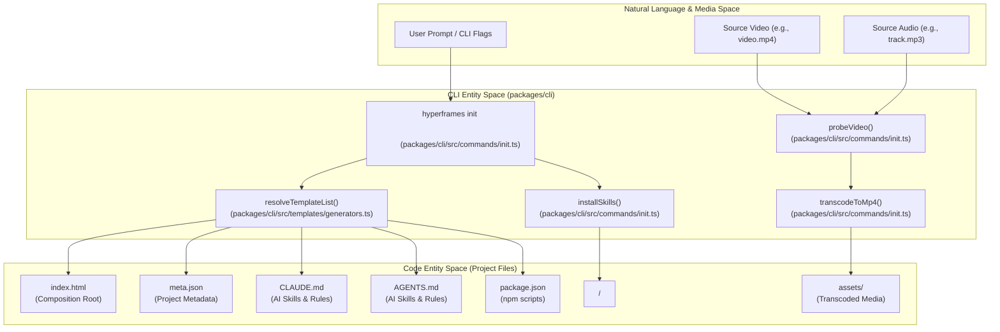
Sources: [packages/cli/src/commands/init.ts:1-197](), [packages/cli/src/templates/generators.ts](), [packages/cli/src/templates/_shared/CLAUDE.md](), [packages/cli/src/templates/_shared/AGENTS.md]()

---

## Project Structure Reference

A standard HyperFrames project contains the following files:

| File/Folder | Description |
| :--- | :--- |
| `index.html` | Root composition — your video's entry point with `data-composition-id` [docs/reference/html-schema.mdx:38-45]() |
| `meta.json` | Project metadata (id, name) [packages/cli/src/templates/_shared/CLAUDE.md]() |
| `assets/` | Media files (video, audio, images) [packages/cli/src/templates/_shared/CLAUDE.md]() |
| `compositions/` | Sub-compositions loaded via `data-composition-src` [packages/cli/src/templates/_shared/CLAUDE.md]() |
| `CLAUDE.md` | Skill-specific patterns and agent instructions [packages/cli/src/templates/_shared/CLAUDE.md:1-5]() |
| `AGENTS.md` | Agent-specific instructions, often mirroring `CLAUDE.md` [packages/cli/src/templates/_shared/AGENTS.md]() |
| `package.json` | Contains `npm` scripts for `dev`, `check`, `render`, and `publish` [packages/cli/src/commands/init.test.ts:56-64]() |

### Composition Anatomy
Every composition must follow core rules to be valid:
1.  **Root Element**: Must have `data-composition-id`, `data-start="0"`, `data-width`, and `data-height` [docs/reference/html-schema.mdx:38-45]().
2.  **Timed Clips**: Elements must have `data-start`, `data-duration`, and preferably `class="clip"` [docs/reference/html-schema.mdx:46-55, 93-101]().
3.  **Animation Registration**: GSAP timelines must be created with `{ paused: true }` and registered on `window.__timelines` [docs/reference/html-schema.mdx:57-67]().

### Runtime Orchestration
The diagram below maps CLI commands to their underlying execution packages during initialization, preview, and rendering.

### CLI to Core Package Mapping
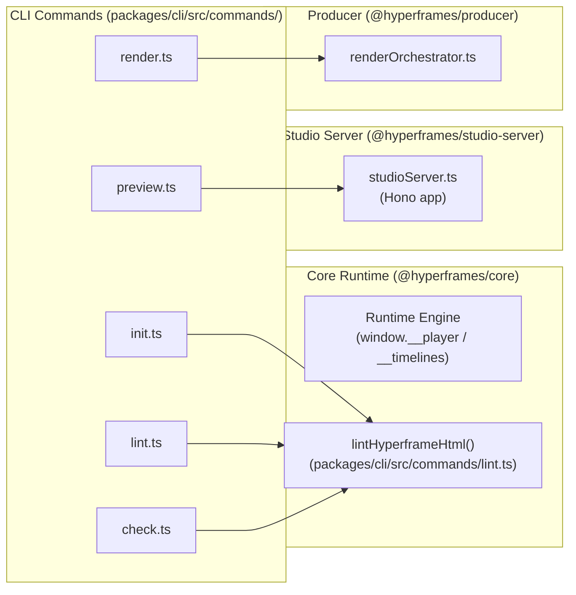
Sources: [packages/cli/src/cli.ts:130-150](), [skills/hyperframes-cli/SKILL.md:14-29](), [docs/reference/html-schema.mdx:38-67, 93-101](), [packages/cli/src/commands/init.test.ts:56-64]()

---

## AI-Agent Workflow

When using an AI agent (Claude Code, Cursor, etc.), the workflow is optimized for speed and correctness:

1.  **Describe**: Tell the agent what video to build using the `/hyperframes` skill. For example: "Using `/hyperframes`, create a 10-second product intro with a fade-in title, a background video, and subtle background music." [README.md:70-72](), [docs/quickstart.mdx:84-85]().
2.  **Skill Context**: The agent loads the `/hyperframes` skill, which carries the render contract and work loop, ensuring it uses correct `data-attributes` and `window.__timelines` syntax [CLAUDE.md:23-26](), [skills/hyperframes/SKILL.md:16-25]().
3.  **Scaffold**: The agent runs `npx hyperframes init` to create the project structure and may use `npx hyperframes add` to install components from the registry [skills/hyperframes-cli/SKILL.md:16-17, 21]().
4.  **Validate**: The agent runs `npx hyperframes check --json` to execute linting, layout audits, and motion checks. It fixes any reported errors before proceeding [skills/hyperframes-cli/SKILL.md:31-32]().
5.  **Preview**: The agent starts a preview server using `npx hyperframes preview --background` and provides the URL for review [skills/hyperframes-cli/SKILL.md:34]().
6.  **Render**: Once the preview is approved, the agent renders the final video using `npx hyperframes render` [skills/hyperframes-cli/SKILL.md:35]().

Sources: [README.md:70-72](), [docs/quickstart.mdx:84-85](), [CLAUDE.md:23-26](), [skills/hyperframes/SKILL.md:16-25](), [skills/hyperframes-cli/SKILL.md:16-17, 21, 31-32, 34-35]()

---

# Page: Core Concepts

# Core Concepts

<details>
<summary>Relevant source files</summary>

The following files were used as context for generating this wiki page:

- [docs/concepts/compositions.mdx](docs/concepts/compositions.mdx)
- [docs/concepts/data-attributes.mdx](docs/concepts/data-attributes.mdx)
- [docs/concepts/determinism.mdx](docs/concepts/determinism.mdx)
- [docs/concepts/variables.mdx](docs/concepts/variables.mdx)
- [docs/deploy/aws-lambda.mdx](docs/deploy/aws-lambda.mdx)
- [docs/deploy/migrating-to-hyperframes-lambda.mdx](docs/deploy/migrating-to-hyperframes-lambda.mdx)
- [docs/introduction.mdx](docs/introduction.mdx)
- [docs/packages/aws-lambda.mdx](docs/packages/aws-lambda.mdx)
- [docs/packages/core.mdx](docs/packages/core.mdx)
- [docs/packages/gcp-cloud-run.mdx](docs/packages/gcp-cloud-run.mdx)
- [docs/packages/shader-transitions.mdx](docs/packages/shader-transitions.mdx)
- [docs/packages/studio.mdx](docs/packages/studio.mdx)
- [docs/studio/canvas.mdx](docs/studio/canvas.mdx)
- [packages/cli/src/docs/compositions.md](packages/cli/src/docs/compositions.md)

</details>


HyperFrames is built on a foundation of deterministic, frame-based rendering using standard web technologies. Unlike traditional video editors that use a variable "wall-clock" for playback, HyperFrames treats HTML and CSS as a seekable state machine.

This page provides a high-level overview of the foundational concepts of the HyperFrames architecture: Compositions, Data Attributes, Deterministic Rendering, and Frame Adapters. For a tour of supporting non-package directories, see [Repository Layout and Supporting Directories](#1.2.3).

## The Architecture at a Glance

The following diagram illustrates how high-level project definitions in "Natural Language Space" map to specific "Code Entities" within the HyperFrames ecosystem.

### From Intent to Execution
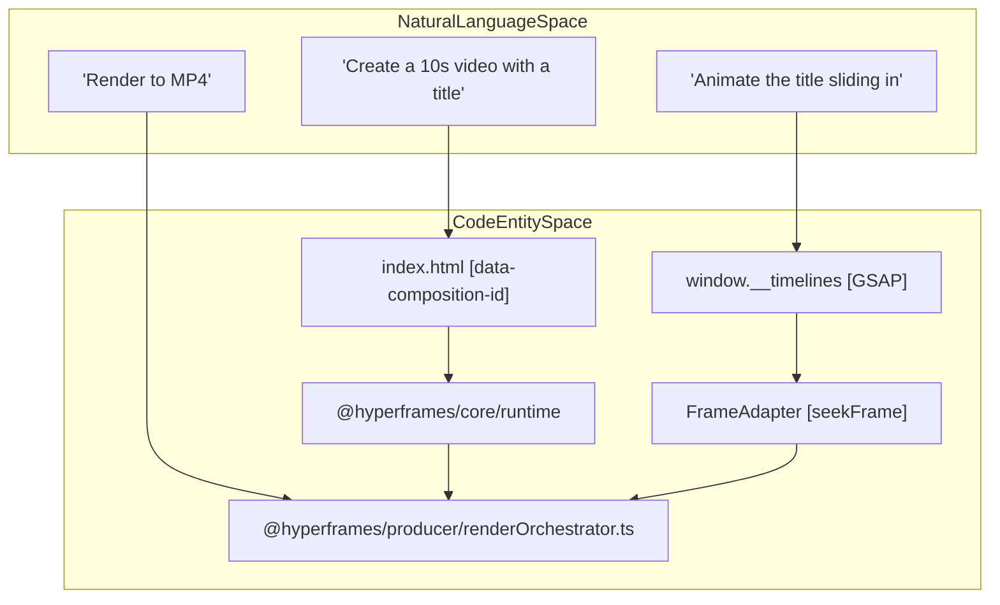
Sources: [docs/concepts/compositions.mdx:6-17](), [docs/packages/core.mdx:26-27](), [docs/packages/aws-lambda.mdx:28-31]()

---

## 1. Compositions and Data Attributes

A **Composition** is the fundamental unit of a HyperFrames project. It is a standard HTML document that describes a video timeline. Every element that appears on the timeline—whether it is a video, an image, or a nested animation—is governed by **Data Attributes**.

### Key Concepts:
*   **Root Element**: Every composition must have a root element with a `data-composition-id` [docs/concepts/compositions.mdx:18-25]().
*   **Declarative Timing**: Timing is handled via attributes like `data-start`, `data-duration`, and `data-track-index` [docs/concepts/data-attributes.mdx:17-20]().
*   **Clips**: A clip is any element with timing attributes. Elements with `class="clip"` have their visibility managed automatically by the runtime [docs/concepts/data-attributes.mdx:21-25]().
*   **Variables**: Designs can be reused with different content by declaring `data-composition-variables` on the `<html>` tag and passing `data-variable-values` on sub-composition host elements [docs/concepts/variables.mdx:54-61](), [docs/concepts/variables.mdx:145-162](). These variables are accessible via `window.__hyperframes.getVariables()` [docs/concepts/variables.mdx:132-138]().

For a detailed reference on the HTML model, clip types, and timing attributes, see **[Compositions and Data Attributes](#1.2.1)**.

Sources: [docs/concepts/compositions.mdx:6-57](), [docs/concepts/variables.mdx:54-162](), [docs/concepts/data-attributes.mdx:17-25]()

---

## 2. Deterministic Rendering

HyperFrames guarantees that the same composition always produces identical video output. This is achieved by treating time as a discrete frame number rather than a continuous clock.

### Determinism Rules:
*   **No Wall-Clocks**: Usage of `Date.now()`, `requestAnimationFrame`, or system timers is forbidden during render execution [docs/concepts/determinism.mdx:27-28]().
*   **Integer Math**: The engine calculates time using `time = floor(frame) / fps` [docs/concepts/determinism.mdx:39-40]().
*   **Seek-Driven**: The renderer asks for one frame at a time, and the answer depends solely on that frame index [docs/concepts/determinism.mdx:12-14]().
*   **Pre-extraction**: Every asset loads before the first frame to prevent mid-render fetching [docs/concepts/determinism.mdx:31]().

For deep dives into seek-driven frame-by-frame rendering, forbidden wall-clock APIs, and `window.__timelines`, see **[Deterministic Rendering and Frame Adapters](#1.2.2)**.

Sources: [docs/concepts/compositions.mdx:42-45](), [docs/concepts/determinism.mdx:12-40]()

---

## 3. Frame Adapters

While Data Attributes handle the "when" of clips, **Frame Adapters** handle the "how" of the motion. An adapter bridges external animation libraries (such as GSAP, Lottie, CSS, or WAAPI) to the HyperFrames rendering loop.

### How Adapters Map to Code
The following sequence diagram shows how the `FrameAdapter` pattern interacts with the global runtime state and the producer rendering pipeline.

### Render Loop Sequence
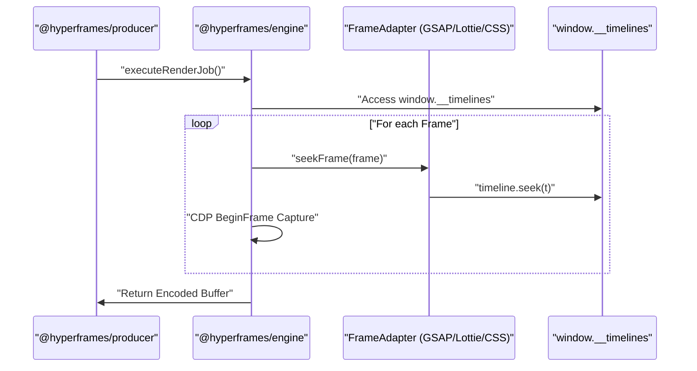
Sources: [docs/packages/core.mdx:167-188](), [docs/concepts/determinism.mdx:42-54]()

### Supported Runtimes:
*   **GSAP**: Timelines must be created with `{ paused: true }` and registered on `window.__timelines` [docs/concepts/compositions.mdx:99-101](). The `@hyperframes/core` package includes `createGSAPFrameAdapter` [docs/packages/core.mdx:172-172]().
*   **CSS/WAAPI**: Adapters map progress to element styles or animation offsets.
*   **Lottie**: Vector animations are seeked frame-by-frame by the runtime adapter.

For further details on the Frame Adapter pattern and the `BeginFrame` CDP integration, see **[Deterministic Rendering and Frame Adapters](#1.2.2)**.

Sources: [docs/packages/core.mdx:167-188](), [docs/concepts/compositions.mdx:99-101]()

---

## Summary of Core Terminology

| Term | Definition | Code Reference |
| :--- | :--- | :--- |
| **Composition** | An HTML document representing a video timeline. | `data-composition-id` [docs/cli/src/docs/compositions.md:10-10]() |
| **Clip** | An individual element (video, audio, img) on the timeline. | `class="clip"` [docs/concepts/data-attributes.mdx:21-21]() |
| **Track** | A horizontal layer in the Studio editor; does not affect paint order. | `data-track-index` [docs/concepts/data-attributes.mdx:20-20]() |
| **Media Start** | The offset into a source file for trimming (media clips only). | `data-playback-start` [docs/concepts/compositions.mdx:113-113]() |
| **Playback Start** | The offset into a child timeline for nested compositions. | `data-playback-start` [docs/concepts/compositions.mdx:113-113]() |
| **Variables** | Key-value pairs that allow dynamic content injection. | `data-variable-values` [docs/cli/src/docs/compositions.md:32-32]() |

Sources: [docs/concepts/compositions.mdx:18-57](), [docs/concepts/variables.mdx:112-162](), [docs/concepts/data-attributes.mdx:17-25](), [docs/cli/src/docs/compositions.md:10-32]()

---

# Page: Compositions and Data Attributes

# Compositions and Data Attributes

<details>
<summary>Relevant source files</summary>

The following files were used as context for generating this wiki page:

- [docs/concepts/compositions.mdx](docs/concepts/compositions.mdx)
- [docs/concepts/data-attributes.mdx](docs/concepts/data-attributes.mdx)
- [docs/concepts/determinism.mdx](docs/concepts/determinism.mdx)
- [docs/concepts/variables.mdx](docs/concepts/variables.mdx)
- [docs/deploy/aws-lambda.mdx](docs/deploy/aws-lambda.mdx)
- [docs/deploy/migrating-to-hyperframes-lambda.mdx](docs/deploy/migrating-to-hyperframes-lambda.mdx)
- [docs/introduction.mdx](docs/introduction.mdx)
- [docs/packages/aws-lambda.mdx](docs/packages/aws-lambda.mdx)
- [docs/packages/core.mdx](docs/packages/core.mdx)
- [docs/packages/gcp-cloud-run.mdx](docs/packages/gcp-cloud-run.mdx)
- [docs/packages/shader-transitions.mdx](docs/packages/shader-transitions.mdx)
- [docs/packages/studio.mdx](docs/packages/studio.mdx)
- [docs/studio/canvas.mdx](docs/studio/canvas.mdx)
- [packages/cli/src/docs/compositions.md](packages/cli/src/docs/compositions.md)
- [packages/core/package-subpaths.json](packages/core/package-subpaths.json)
- [packages/core/src/runtime/audioFx.test.ts](packages/core/src/runtime/audioFx.test.ts)
- [packages/core/src/runtime/audioFx.ts](packages/core/src/runtime/audioFx.ts)
- [packages/core/src/runtime/init.test.ts](packages/core/src/runtime/init.test.ts)
- [packages/core/src/runtime/init.ts](packages/core/src/runtime/init.ts)
- [packages/core/src/runtime/init.videoPreseek.test.ts](packages/core/src/runtime/init.videoPreseek.test.ts)
- [packages/core/src/runtime/media.preseek.test.ts](packages/core/src/runtime/media.preseek.test.ts)
- [packages/core/src/runtime/media.test.ts](packages/core/src/runtime/media.test.ts)
- [packages/core/src/runtime/media.ts](packages/core/src/runtime/media.ts)
- [packages/core/src/runtime/mediaSteer.test.ts](packages/core/src/runtime/mediaSteer.test.ts)
- [packages/core/src/runtime/startResolver.test.ts](packages/core/src/runtime/startResolver.test.ts)
- [packages/core/src/runtime/startResolver.ts](packages/core/src/runtime/startResolver.ts)
- [packages/core/src/runtime/timeline.test.ts](packages/core/src/runtime/timeline.test.ts)
- [packages/core/src/runtime/timeline.ts](packages/core/src/runtime/timeline.ts)
- [packages/core/src/runtime/webAudioTransport.test.ts](packages/core/src/runtime/webAudioTransport.test.ts)
- [packages/core/src/runtime/webAudioTransport.ts](packages/core/src/runtime/webAudioTransport.ts)
- [packages/parsers/src/referenceResolver.test.ts](packages/parsers/src/referenceResolver.test.ts)
- [packages/parsers/src/referenceResolver.ts](packages/parsers/src/referenceResolver.ts)
- [packages/producer/src/services/render/wrappedMountTiming.integration.test.ts](packages/producer/src/services/render/wrappedMountTiming.integration.test.ts)

</details>


This page details the core HTML composition model used by HyperFrames to represent video timelines declaratively. It explains how compositions and clips are structured in the DOM, the key data attributes that define timing and nesting relationships, and the runtime contract driven by `class="clip"`. The page also covers the purpose and usage of `data-composition-id`, clip types, timing semantics including relative timings, and how sub-compositions integrate into a parent timeline via playback offsets.

---

## The Composition Model

In HyperFrames, a **composition** is an HTML document (or subtree) that declares a video structure. Each composition is identified by a root element bearing a `data-composition-id` attribute, which acts as a unique namespace for timeline registration and animation. Nested compositions appear as child elements with their own `data-composition-id`. The runtime manages timing, visibility, and media playback deterministically through a rich declarative attribute set [docs/concepts/compositions.mdx:6-11]().

### Root Element Required Attributes

Every composition root (top-level or sub-composition) must specify:

| Attribute | Description |
|---|---|
| `data-composition-id` | Unique string ID for the composition’s timeline and registered animation. This ID is how the runtime and SDK identify the composition in the global `window.__timelines` object. |
| `data-width` / `data-height` | Author’s declared frame dimensions in pixels (e.g. 1920x1080). |
| `data-duration` | Duration in seconds of the composition timeline, used for playback length and visibility calculations. |
| `data-no-timeline` | Optional boolean flag to mark a composition that does not use a timeline (e.g. pure CSS/Three.js). It signals the runtime not to wait on GSAP timeline registration. |

The root element establishes the coordinate and timing boundaries for the contained clips [docs/concepts/compositions.mdx:18-27]().

### Clip Types

Clips—units rendered on the timeline—must be marked with `class="clip"` and fall into these categories:

| Clip Type | HTML Tag / Selector | Notes |
|---|---|---|
| Video clip | `<video class="clip">` | Requires `muted` and `playsinline` for deterministic playback. Supports trimming with `data-media-start`. |
| Audio clip | `<audio class="clip">` | Audio-only media intended for mixing. |
| Image clip | `` | Static still images on the timeline. |
| Nested composition | `<div class="clip" data-composition-id>` | Embeds another composition inline or via `data-composition-src`. |

Each clip’s playback and screen visibility derive from their timing attributes, and the runtime enforces that `class="clip"` elements are automatically hidden outside their active intervals [docs/concepts/compositions.mdx:48-53, 27-29]().

Sources:
- [docs/concepts/compositions.mdx:6-11]()
- [docs/concepts/compositions.mdx:18-27]()
- [docs/concepts/compositions.mdx:48-53]()
- [docs/concepts/compositions.mdx:27-29]()

---

## Data Attribute Timing Model

HyperFrames uses declarative `data-*` attributes to specify clip timing relative to composition boundaries. Timing is computed and enforced by the runtime.

### Core Timing Attributes

| Attribute | Type/Format | Meaning / Effect |
|---|---|---|
| `data-start` | Number or relative string | Start time in seconds relative to the composition’s start.<br>Can be numeric (e.g. `"0.5"`) or relative (e.g. `"intro + 0.5"` referencing another clip). |
| `data-duration` | Number | How long the clip remains active (seconds). |
| `data-end` | Number or calculated | Optional explicit end time; if absent calculated as `start + duration`. |
| `data-track-index` | Integer | The track/lane index to position the clip vertically on the timeline, used to avoid temporal overlap in the UI but not affecting layer rendering order. |
| `data-playback-start` | Number | For nested compositions: the offset into the child timeline to begin playback at (local offset inside the nested comp). Default is 0. |
| `data-playback-rate` | Number | Playback speed multiplier (e.g. 1 = normal speed). |

These attributes map one-to-one to runtime timeline entries that drive clip visibility, media seek, and composition nesting with offset adjustment [packages/core/src/runtime/timeline.ts:36-91]().

### Relative Timing Syntax

`data-start` can be relative to another clip's end or start using syntax like:

```html
data-start="intro + 0.5"
```

Meaning this clip begins 0.5 seconds after the clip with id `intro` ends. The compiler and runtime resolve such references in the timeline registration phase [docs/reference/html-schema.mdx:173-190](). The `createRuntimeStartTimeResolver` function is responsible for parsing and resolving these expressions [packages/core/src/runtime/startResolver.ts:138-155]().

### The `class="clip"` Contract

All clips must have `class="clip"` to opt into:

- The runtime automatically hiding the clip outside its active `[start, start + duration)` window.
- Consistent driver of clip visibility independent of any imperative script.
- A contract that prevents direct script manipulation of `.style.display` or media playback controls for clips, ensuring deterministic seek-driven playback.

This contract enables deterministic frame-by-frame rendering. See the detailed runtime visibility function that checks clip window inclusion [packages/core/src/runtime/timeline.ts:36-91]().

Sources:
- [packages/core/src/runtime/timeline.ts:36-91]()
- [docs/reference/html-schema.mdx:173-190]()
- [packages/core/src/runtime/startResolver.ts:138-155]()
- [docs/concepts/compositions.mdx:27-29]()

---

## Nested Compositions

HyperFrames supports complex video hierarchies by nesting compositions inside others.

### Ways to Nest Compositions

1.  **External Composition Source**

    A container element uses both:

    -   `data-composition-id="unique-id"` (runtime registration key)
    -   `data-composition-src="path/to/composition.html"` (reference to external file)

    At runtime, the external file is fetched and its `<template>` content mounted inside the referencing element. The child composition's timeline is registered under its `data-composition-id` inside the global timeline registry (`window.__timelines`).

    Example:

    ```html
    <div
      data-composition-id="intro-anim"
      data-composition-src="compositions/intro-anim.html"
      data-start="0"
      data-duration="4"
      data-playback-start="0"
      data-track-index="3"
    ></div>
    ```

    The nested timeline plays starting at `data-playback-start` seconds into the child timeline. The parent timeline offsets the child playback by its own `data-start` timing. The nested composition timings are local to itself; the parent is responsible for global offsetting [docs/concepts/compositions.mdx:63-115]().

2.  **Inline Composition**

    A nested composition may appear inline, as a subtree inside the parent HTML without the `data-composition-src`. This comp is still identified by `data-composition-id`, and its timeline is registered normally.

    Example:

    ```html
    <div id="root" data-composition-id="root" data-start="0" data-width="1920" data-height="1080">
      <div id="el-5" data-composition-id="intro-anim" data-start="0" data-track-index="3" data-width="1920" data-height="1080">
        <div class="title">Welcome!</div>
      </div>

      <script>
        const introTl = gsap.timeline({ paused: true });
        window.__timelines["intro-anim"] = introTl;
      </script>
    </div>
    ```

    No `<template>` wrapper needed, and the inline nested timeline registers normally under its ID [docs/concepts/compositions.mdx:118-143]().

### Data Flow Diagram for Nested Compositions

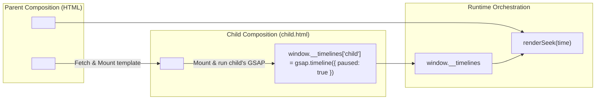
**Diagram: Nested Composition Data Flow**

The parent element's `data-start` defines when the child composition begins playing on the global timeline; `data-playback-start` (if present) defines where inside the child timeline playback begins. The runtime’s `renderSeek` function is responsible for syncing these nested timelines together [docs/concepts/compositions.mdx:64-110]().

Sources:
- [docs/concepts/compositions.mdx:63-115]()
- [docs/concepts/compositions.mdx:118-143]()
- [docs/concepts/compositions.mdx:64-110]()

---

## Media and Playback Attributes

Media clips (`<video>`, `<audio>`) support additional attributes to control playback and rendering:

| Attribute | Role |
|---|---|
| `data-media-start` | Offset in seconds inside the media source to begin playback from (trimming). |
| `data-playback-start` | For nested compositions: local offset inside nested timeline playback. |
| `data-playback-rate` | Playback speed multiplier (0.1 to 5.0). This value is read by `readElementPlaybackRate` [packages/core/src/runtime/media.ts:27-28]() and clamped to a valid range [packages/core/src/runtime/media.test.ts:60-65](). |
| `data-has-audio="true"` | Declares this video clip contributes audio to the final mix. Important for render pipeline audio muxing. |
| `data-color-grading` | JSON object describing LUTs and adjustments to apply color transformations during rendering. |

These media attributes form the basis for deterministic playback, ensuring the timeline controls the exact media position without relying on browser clock time [docs/reference/html-schema.mdx:125-158](), [docs/concepts/determinism.mdx:11-14](). The `refreshRuntimeMediaCache` function collects these attributes to build `RuntimeMediaClip` objects [packages/core/src/runtime/media.ts:113-151]().

Sources:
- [packages/core/src/runtime/media.ts:27-28]()
- [packages/core/src/runtime/media.test.ts:60-65]()
- [docs/reference/html-schema.mdx:125-158]()
- [docs/concepts/determinism.mdx:11-14]()
- [packages/core/src/runtime/media.ts:113-151]()

---

## Deterministic Rendering and Visibility Contract

HyperFrames implements a **pure seek-driven deterministic rendering model**:

-   The runtime determines exactly which clips are visible at each frame by inspecting timing attributes.
-   Elements with `class="clip"` are rendered visible if and only if the current frame’s time lies within their `[data-start, data-start + data-duration)` window.
-   Media playback positions (video/audio currentTime) are set directly from the frame clock.
-   Script-initiated `.play()`, `.pause()`, or `.currentTime` modifications are forbidden to avoid animation drift.

The function `isRuntimeElementVisibleAt` [packages/core/src/runtime/timeline.ts:76-99]() in `packages/core/src/runtime/timeline.ts` encapsulates this visibility logic, reading `data-start`, `data-duration`, and nested composition info from the DOM, with fallback to timeline metadata in `window.__timelines`. This function uses `runtimeElementWindow` to determine the clip's active time span [packages/core/src/runtime/timeline.ts:34-74]().

This makes HyperFrames projects fully frame-reproducible: rendering frame 7 always yields the same DOM and media state regardless of runtime environment.

Sources:
- [packages/core/src/runtime/timeline.ts:76-99]()
- [packages/core/src/runtime/timeline.ts:34-74]()
- [docs/concepts/determinism.mdx:1-55]()

---

## Summary Diagram: Data Attributes to Runtime Control Space

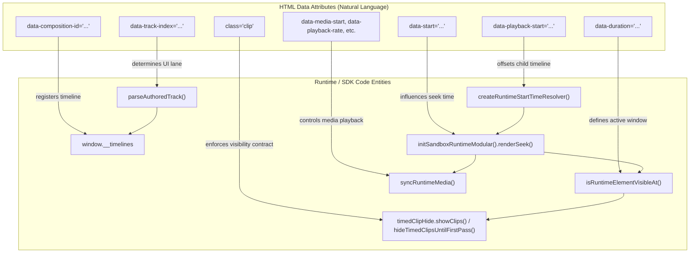
**Diagram: Data Attributes to Runtime Control Flow**

This mapping diagram shows how the declarative composition attributes drive internal timeline registration, deterministic playback timing, and runtime visibility enforcement. Key runtime functions like `initSandboxRuntimeModular` [packages/core/src/runtime/init.ts:5]() orchestrate the overall rendering process, while `syncRuntimeMedia` [packages/core/src/runtime/media.ts:93]() handles media synchronization.

Sources:
- [packages/core/src/runtime/init.ts:5]()
- [packages/core/src/runtime/media.ts:93]()
- [packages/core/src/runtime/timeline.ts:76-99]()
- [packages/core/src/runtime/startResolver.ts:41]()
- [packages/core/src/runtime/timeline.ts:154-159]()
- [packages/core/src/runtime/timedClipHide.ts:38]()
- [packages/core/src/runtime/timedClipHide.ts:7]()

---

# References and Sources

-   HyperFrames composition model, nested composition example, and clip types [docs/concepts/compositions.mdx:6-185]()
-   Runtime timeline visibility checks, media timing resolution, and clip track parsing: `packages/core/src/runtime/timeline.ts:36-91, 93-151`()
-   Data attribute timing compilation principles [packages/core/src/compiler/timingCompiler.ts:1-179]()
-   Visibility and timing enforcement via `class="clip"` contract [docs/concepts/compositions.mdx:27-29]()
-   Nested composition mounting and playback offset [docs/concepts/compositions.mdx:63-115]()
-   Media attributes and color grading contract [docs/reference/html-schema.mdx:125-158]()
-   Runtime deterministic playback and disallowed script control [docs/concepts/determinism.mdx:1-55]()
-   `createRuntimeStartTimeResolver` definition [packages/core/src/runtime/startResolver.ts:41]()
-   `readElementPlaybackRate` definition [packages/core/src/runtime/media.ts:27-28]()
-   `refreshRuntimeMediaCache` definition [packages/core/src/runtime/media.ts:113-151]()
-   `parseAuthoredTrack` definition [packages/core/src/runtime/timeline.ts:154-159]()
-   `initSandboxRuntimeModular` definition [packages/core/src/runtime/init.ts:5]()
-   `syncRuntimeMedia` definition [packages/core/src/runtime/media.ts:93]()
-   `showClips` and `hideTimedClipsUntilFirstPass` definitions [packages/core/src/runtime/timedClipHide.ts:38]() and [packages/core/src/runtime/timedClipHide.ts:7]()

---

This page fully describes the foundational HyperFrames HTML composition and timing attribute scheme, pivotal for understanding rendering orchestration and frame-accurate playback.

---

# Page: Deterministic Rendering and Frame Adapters

# Deterministic Rendering and Frame Adapters

<details>
<summary>Relevant source files</summary>

The following files were used as context for generating this wiki page:

- [docs/guides/rendering.mdx](docs/guides/rendering.mdx)
- [docs/packages/engine.mdx](docs/packages/engine.mdx)
- [docs/packages/producer.mdx](docs/packages/producer.mdx)
- [packages/cli/src/commands/render.test.ts](packages/cli/src/commands/render.test.ts)
- [packages/cli/src/commands/render.ts](packages/cli/src/commands/render.ts)
- [packages/cli/src/docs/rendering.md](packages/cli/src/docs/rendering.md)
- [packages/cli/src/telemetry/events.test.ts](packages/cli/src/telemetry/events.test.ts)
- [packages/cli/src/telemetry/events.ts](packages/cli/src/telemetry/events.ts)
- [packages/cli/src/telemetry/renderObservability.test.ts](packages/cli/src/telemetry/renderObservability.test.ts)
- [packages/cli/src/telemetry/renderObservability.ts](packages/cli/src/telemetry/renderObservability.ts)
- [packages/cli/src/utils/dockerRunArgs.test.ts](packages/cli/src/utils/dockerRunArgs.test.ts)
- [packages/cli/src/utils/dockerRunArgs.ts](packages/cli/src/utils/dockerRunArgs.ts)
- [packages/core/scripts/build-audio-fx-runtime.ts](packages/core/scripts/build-audio-fx-runtime.ts)
- [packages/core/scripts/build-position-edits-render.ts](packages/core/scripts/build-position-edits-render.ts)
- [packages/core/src/generated/position-edits-render-inline.test.ts](packages/core/src/generated/position-edits-render-inline.test.ts)
- [packages/core/src/generated/position-edits-render-inline.ts](packages/core/src/generated/position-edits-render-inline.ts)
- [packages/core/src/runtime/adapters/gsap.steps.test.ts](packages/core/src/runtime/adapters/gsap.steps.test.ts)
- [packages/core/src/runtime/adapters/gsap.ts](packages/core/src/runtime/adapters/gsap.ts)
- [packages/core/src/runtime/diagnostics.test.ts](packages/core/src/runtime/diagnostics.test.ts)
- [packages/core/src/runtime/diagnostics.ts](packages/core/src/runtime/diagnostics.ts)
- [packages/core/src/runtime/domRealm.ts](packages/core/src/runtime/domRealm.ts)
- [packages/core/src/runtime/init.positionEdits.test.ts](packages/core/src/runtime/init.positionEdits.test.ts)
- [packages/core/src/runtime/init.sceneCallbackError.test.ts](packages/core/src/runtime/init.sceneCallbackError.test.ts)
- [packages/core/src/runtime/pausedTransportInvariant.test.ts](packages/core/src/runtime/pausedTransportInvariant.test.ts)
- [packages/core/src/runtime/positionEdits.test.ts](packages/core/src/runtime/positionEdits.test.ts)
- [packages/core/src/runtime/positionEdits.ts](packages/core/src/runtime/positionEdits.ts)
- [packages/core/stubs/position-edits-render-entry.ts](packages/core/stubs/position-edits-render-entry.ts)
- [packages/engine/src/config.test.ts](packages/engine/src/config.test.ts)
- [packages/engine/src/config.ts](packages/engine/src/config.ts)
- [packages/engine/src/index.ts](packages/engine/src/index.ts)
- [packages/engine/src/services/browserManager.test.ts](packages/engine/src/services/browserManager.test.ts)
- [packages/engine/src/services/browserManager.ts](packages/engine/src/services/browserManager.ts)
- [packages/engine/src/services/chunkEncoder.relativePaths.test.ts](packages/engine/src/services/chunkEncoder.relativePaths.test.ts)
- [packages/engine/src/services/frameCapture.test.ts](packages/engine/src/services/frameCapture.test.ts)
- [packages/engine/src/services/frameCapture.ts](packages/engine/src/services/frameCapture.ts)
- [packages/engine/src/types.ts](packages/engine/src/types.ts)
- [packages/producer/src/services/render/observability.ts](packages/producer/src/services/render/observability.ts)
- [packages/producer/src/services/render/perfSummary.test.ts](packages/producer/src/services/render/perfSummary.test.ts)
- [packages/producer/src/services/render/perfSummary.ts](packages/producer/src/services/render/perfSummary.ts)
- [packages/producer/src/services/renderOrchestrator.deGateProbe.test.ts](packages/producer/src/services/renderOrchestrator.deGateProbe.test.ts)
- [packages/producer/src/services/renderOrchestrator.test.ts](packages/producer/src/services/renderOrchestrator.test.ts)
- [packages/producer/src/services/renderOrchestrator.ts](packages/producer/src/services/renderOrchestrator.ts)

</details>


HyperFrames utilizes a **seek-driven, frame-by-frame rendering model** to ensure that every export is pixel-independent, reproducible, and deterministic across disparate execution environments. This model decouples rendering progress from the browser's native system clock, replacing wall-clock timing with discrete frame indices and precise time offsets.

---

## The Deterministic Model and Forbidden Wall-Clock APIs

In standard browser runtimes, animations execute against `performance.now()` or `requestAnimationFrame`, which depend on hardware timers and system load. This introduces non-determinism during video encoding because frame capture durations vary. HyperFrames eliminates this variance by freezing native time sources and routing all animation progress through deterministic seek operations [packages/core/src/runtime/init.ts:117-159]().

### Virtual Time and Intercepted APIs
To enforce determinism during headful or headless capture, the runtime environment and producer services shim wall-clock APIs:
*   `Date.now()` and `performance.now()` are overridden to reflect the exact virtual timeline offset rather than elapsed wall time.
*   `requestAnimationFrame` callbacks are synchronized with the render scheduler's tick loop rather than hardware vsync [packages/core/src/runtime/init.test.ts:132-155]().
*   Same-origin iframe hierarchies propagate seek updates downward via parent-child communication bridges [packages/core/src/runtime/init.ts:3-3]().

### The BeginFrame API and CDP
At the capture layer, `@hyperframes/engine` interacts with Chromium via the Chrome DevTools Protocol (CDP) using the atomic **BeginFrame** command (`HeadlessExperimental.beginFrame`). This commands the browser browser engine to execute a single, isolated layout-paint-composite cycle for a precise `frameTimeTicks` timestamp, bypassing real-world time elapsed between renders [packages/engine/src/services/screenshotService.ts:166-179](). The `frameCapture` service in `@hyperframes/engine` orchestrates this process [packages/engine/src/services/frameCapture.ts:1-9]().

Sources: [packages/core/src/runtime/init.ts:117-159](), [packages/core/src/runtime/init.test.ts:132-155](), [packages/engine/src/services/screenshotService.ts:166-179](), [packages/engine/src/services/frameCapture.ts:1-9]()

---

## Frame Adapter Pattern

The Frame Adapter pattern bridges the HyperFrames runtime with diverse third-party animation libraries and native browser animation technologies. Each adapter implements a uniform interface that allows the runtime to discover, seek, pause, and step animations without knowing their internal implementation details.

### Supported Adapters and Code Mapping
The runtime instantiates modular adapters during initialization in `initSandboxRuntimeModular` [packages/core/src/runtime/init.ts:10-21]() (`createGsapAdapter`, `createLottieAdapter`, `createCssAdapter`, `createWaapiAdapter`, `createThreeAdapter`, `createTypegpuAdapter`, etc.):

| Adapter Function | Target Technology | Code Entity / Implementation File |
| :--- | :--- | :--- |
| `createGsapAdapter` | GSAP Timelines & Tweens | [packages/core/src/runtime/adapters/gsap.ts]() |
| `createLottieAdapter` | Bodymovin / DotLottie | [packages/core/src/runtime/init.ts:13]() |
| `createCssAdapter` | CSS Keyframe & Transition Animations | [packages/core/src/runtime/init.ts:10]() |
| `createWaapiAdapter` | Web Animations API (WAAPI) | [packages/core/src/runtime/init.ts:31]() |
| `createThreeAdapter` | Three.js Scene Mixers & Clocks | [packages/core/src/runtime/init.ts:14]() |
| `createTypegpuAdapter` | TypeGPU / WebGPU Pipelines | [packages/core/src/runtime/init.ts:20]() |

Sources: [packages/core/src/runtime/init.ts:10-31](), [packages/core/src/runtime/adapters/gsap.ts]()

---

## Global Timelines and State (`window.__timelines`)

Composition runtimes expose global registries on the `window` object to allow cross-frame control, timeline inspection, and seek propagation [packages/core/src/runtime/window.d.ts:37-92]().

### Key Globals
*   `window.__timelines`: A record mapping composition identifiers to their root timeline instances (`RuntimeTimelineLike`) [packages/core/src/runtime/window.d.ts:37]().
*   `window.__hf`: Exposes runtime utilities including `seek`, `duration`, `colorGrading`, and audio level meters [packages/core/src/runtime/window.d.ts:52-87]().
*   `window.__player`: Provides high-level control APIs (`getDuration()`, playback state) for embedding and Studio integration [packages/core/src/runtime/window.d.ts:38]().

When the player or render engine pauses or seeks a timeline, partial timelines lacking standard methods (such as `pause()`) are handled gracefully via `pauseTimelineIfPossible` to prevent runtime crashes [packages/core/src/runtime/init.ts:148-164]().

### Diagram: Runtime Global State and Control Flow
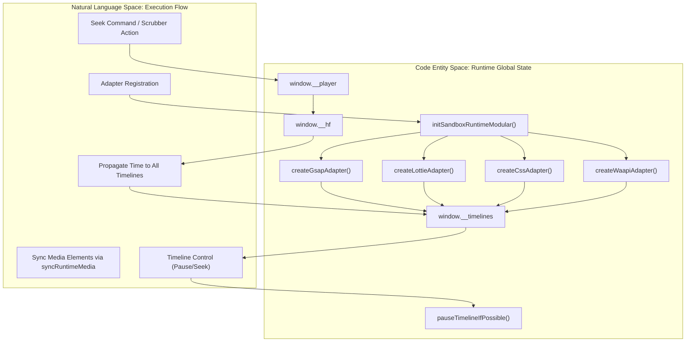

Sources: [packages/core/src/runtime/init.ts:3-164](), [packages/core/src/runtime/window.d.ts:37-92]()

---

## The `renderSeek` Lifecycle

The `renderSeek` routine (managed via runtime bridge and adapter dispatchers) enforces deterministic alignment across HTML elements, audio playback, and visual animations.

### Seek Execution Steps
1.  **Quantization**: Requested time values are quantized to frame boundaries using `quantizeSeekTime` and `quantizeTimeToFrame` [packages/core/src/runtime/init.ts:100-100]().
2.  **Timeline Scrubbing**: Timelines registered in `window.__timelines` are updated to the exact target time via their respective seek methods [packages/core/src/runtime/init.test.ts:41-48]().
3.  **Media Element Alignment**: `syncRuntimeMedia` inspects active video and audio clips (`RuntimeMediaClip`), aligning their `currentTime` and volume envelopes with the target timeline instant [packages/core/src/runtime/media.ts:41-115]().
4.  **Await Seek Barriers**: For video elements or WebGL textures requiring frame decode completion, the runtime registers a seek barrier promise using `registerSeekCompletion` and `waitForSeekCompletion` [packages/core/src/runtime/media.ts:37-50]().

### Diagram: `renderSeek` Data Flow
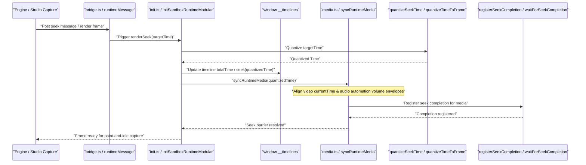

Sources: [packages/core/src/runtime/init.ts:26-30](), [packages/core/src/runtime/media.ts:37-51](), [packages/core/src/runtime/window.d.ts:55]()

---

# Page: Repository Layout and Supporting Directories

# Repository Layout and Supporting Directories

<details>
<summary>Relevant source files</summary>

The following files were used as context for generating this wiki page:

- [.gitattributes](.gitattributes)
- [.github/actions/install-ffmpeg-linux/action.yml](.github/actions/install-ffmpeg-linux/action.yml)
- [.gitignore](.gitignore)
- [Dockerfile.test](Dockerfile.test)
- [docs/weekly-updates.mdx](docs/weekly-updates.mdx)
- [examples/k8s-jobs/Dockerfile.example](examples/k8s-jobs/Dockerfile.example)
- [examples/k8s-jobs/Dockerfile.example.dockerignore](examples/k8s-jobs/Dockerfile.example.dockerignore)
- [examples/k8s-jobs/README.md](examples/k8s-jobs/README.md)
- [gemini-extension.json](gemini-extension.json)
- [packages/cli/src/docker/Dockerfile.render](packages/cli/src/docker/Dockerfile.render)
- [packages/engine/src/utils/urlDownloader.test.ts](packages/engine/src/utils/urlDownloader.test.ts)
- [packages/engine/src/utils/urlDownloader.ts](packages/engine/src/utils/urlDownloader.ts)
- [packages/gcp-cloud-run/Dockerfile](packages/gcp-cloud-run/Dockerfile)
- [packages/producer/tests/distributed/mp4-h264-sdr/output/compiled.html](packages/producer/tests/distributed/mp4-h264-sdr/output/compiled.html)
- [packages/producer/tests/distributed/mp4-h264-sdr/output/output.mp4](packages/producer/tests/distributed/mp4-h264-sdr/output/output.mp4)
- [plugin.json](plugin.json)

</details>


## Purpose and Scope

The HyperFrames monorepo contains several non-package directories that support documentation generation, catalog management, AI agent plugin mirrors, build automation, release planning, and reference examples. While package logic resides under `packages/`, these supporting directories govern how the codebase is documented, tested, indexed, and consumed by both human developers and AI coding assistants.

Sources: [`docs/docs.json:1-49`](), [`registry/registry.json:1-30`](), [`plugin.json:1-14`]()

---

## Documentation and Catalog Subsystem (`docs/` and `registry/`)

The documentation and registry infrastructure transforms raw HTML/JS components and blocks into structured search indexes, Mintlify MDX pages [scripts/generate-catalog-pages.ts:8-10](), and playable component catalogs [docs/public/catalog-index.json:1-17]().

### Directory Roles and Artifact Flow

The `docs/` directory houses the Mintlify configuration [docs/docs.json:1-49](), changelogs [docs/weekly-updates.mdx:1-11](), community portals [docs/community/adopters.mdx:1-4](), and snippets. The `registry/` directory contains component sources, schemas, and metadata manifests (`registry.json`) [registry/registry.json:1-5]().

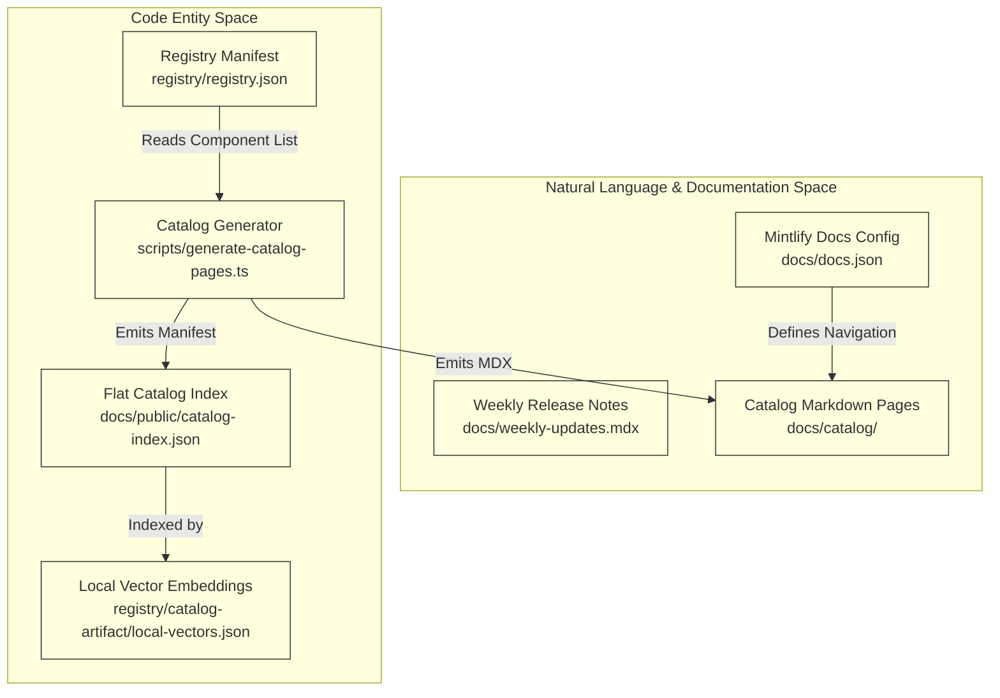

Sources: [`docs/docs.json:1-49`](), [`docs/weekly-updates.mdx:1-11`](), [`registry/registry.json:1-5`](), [`scripts/generate-catalog-pages.ts:1-37`](), [`docs/public/catalog-index.json:1-25`]()

---

## Agent Skills and Plugin Mirrors (`skills/`, `.claude/`, `.agents/`)

HyperFrames provides first-class support for AI coding agents via specialized skill definitions and plugin mirrors. These directories teach external assistants (such as Claude Code, Cursor, and Gemini) about composition lifecycles, GSAP AST parsing, and rendering pipelines.

### Plugin Architecture

Root-level manifests configure how IDE extensions and agent protocols load the tool definitions:

- `plugin.json`: Defines the agent plugin metadata, name (`hyperframes`), version, and capabilities [plugin.json:1-14]().
- `gemini-extension.json`: Configures Gemini-specific extension bindings [gemini-extension.json:1-5]().
- `skills/`: Contains modular domain prompts and creation workflows (e.g., caption generation, product launch videos).
- `.claude/` and `.agents/`: These directories serve as mirrors for agent-installed skills. They are typically ignored by Git, except for a few repo-native skills that are explicitly included [`.gitignore:123-144`](). This setup allows agents to auto-discover project skills while keeping user-specific installations separate.

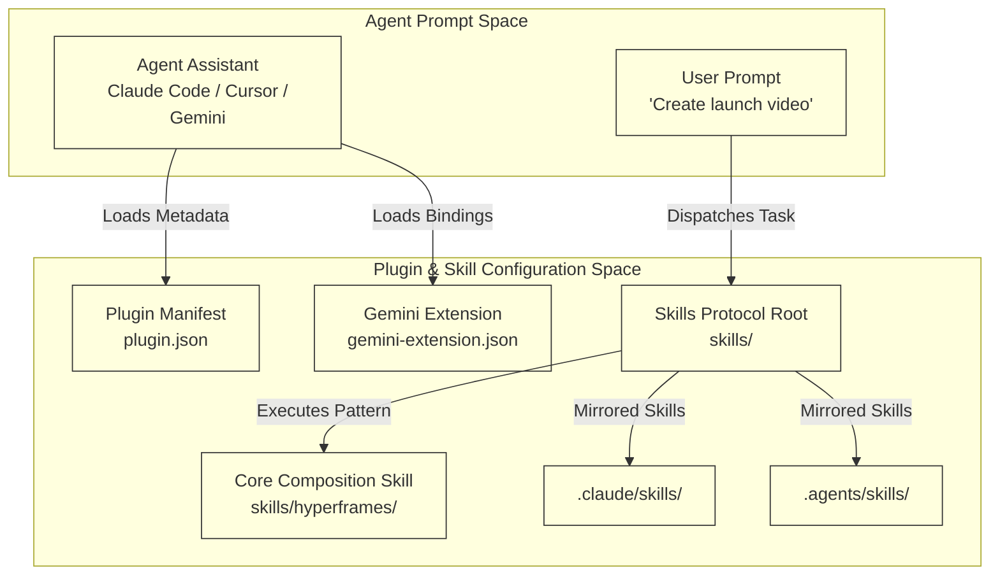

Sources: [`plugin.json:1-14`](), [`gemini-extension.json:1-6`](), [`.gitignore:123-144`]()

---

## Automation, Safety, and Release Scripts (`scripts/`, `plans/`, `releases/`)

The root `scripts/` directory includes build scripts, catalog generators [scripts/generate-catalog-pages.ts:1-14](), and regression safety guards like `check-no-main-deletions.mjs` [scripts/check-no-main-deletions.mjs:1-21]().

### Safety Guards and Change Validation

The script `scripts/check-no-main-deletions.mjs` prevents accidental removal of critical files on protected branches by verifying structural diffs against `origin/main`:

- `ALLOWED_DELETIONS`: A declarative `Map` [scripts/check-no-main-deletions.mjs:45-45]() recording intentional file removals accompanied by justification strings [scripts/check-no-main-deletions.mjs:27-38]().
- `plans/`: Stores architectural design documents and RFC proposals. These are typically working artifacts and are not committed to the repository [`.gitignore:84-86`]().
- `releases/`: Aggregates historical release notes and changelog drafts.

Sources: [`scripts/generate-catalog-pages.ts:1-14`](), [`scripts/check-no-main-deletions.mjs:1-48`](), [`.gitignore:84-86`]()

---

## Reference Examples and Themes (`examples/`, `themes/`)

The `examples/` and `themes/` directories provide production-ready deployment configurations and visual design token libraries.

- `examples/`: Houses standalone deployment templates for infrastructure adapters, including AWS Lambda, GCP Cloud Run, and Kubernetes cron jobs. Specific examples like `examples/aws-lambda`, `examples/k8s-jobs`, and `examples/gcp-cloud-run` are tracked in Git, while other local examples are ignored [`.gitignore:97-107`]().
    - `examples/k8s-jobs/Dockerfile.example`: Provides a reference Dockerfile for non-Lambda runtimes, demonstrating how to build an image with Node, Bun, `chrome-headless-shell`, FFmpeg, and the `@hyperframes/producer/distributed` primitives [examples/k8s-jobs/Dockerfile.example:1-32](). This Dockerfile is built from the monorepo root and includes system dependencies, FFmpeg, and Chrome [examples/k8s-jobs/Dockerfile.example:37-123]().
- `themes/`: Defines base typography, CSS variables, and color grading LUTs utilized across studio previews and rendered output passes.

Sources: [`docs/community/adopters.mdx:1-10`](), [`ADOPTERS.md:1-10`](), [`.gitignore:97-107`](), [`examples/k8s-jobs/Dockerfile.example:1-32`](), [`examples/k8s-jobs/Dockerfile.example:37-123`]()

---

# Page: CLI Reference

# CLI Reference

<details>
<summary>Relevant source files</summary>

The following files were used as context for generating this wiki page:

- [.claude-plugin/marketplace.json](.claude-plugin/marketplace.json)
- [AGENTS.md](AGENTS.md)
- [CLAUDE.md](CLAUDE.md)
- [README.md](README.md)
- [docs/guides/skills.mdx](docs/guides/skills.mdx)
- [docs/packages/cli.mdx](docs/packages/cli.mdx)
- [docs/quickstart.mdx](docs/quickstart.mdx)
- [packages/cli/src/cli.lifecycle.test.ts](packages/cli/src/cli.lifecycle.test.ts)
- [packages/cli/src/cli.ts](packages/cli/src/cli.ts)
- [packages/cli/src/commands/coreSkillContent.test.ts](packages/cli/src/commands/coreSkillContent.test.ts)
- [packages/cli/src/commands/feedback.test.ts](packages/cli/src/commands/feedback.test.ts)
- [packages/cli/src/commands/feedback.ts](packages/cli/src/commands/feedback.ts)
- [packages/cli/src/commands/init.test.ts](packages/cli/src/commands/init.test.ts)
- [packages/cli/src/commands/init.ts](packages/cli/src/commands/init.ts)
- [packages/cli/src/commands/open.ts](packages/cli/src/commands/open.ts)
- [packages/cli/src/help.ts](packages/cli/src/help.ts)
- [packages/cli/src/templates/_shared/AGENTS.md](packages/cli/src/templates/_shared/AGENTS.md)
- [packages/cli/src/templates/_shared/CLAUDE.md](packages/cli/src/templates/_shared/CLAUDE.md)
- [packages/cli/src/utils/backgroundChecks.test.ts](packages/cli/src/utils/backgroundChecks.test.ts)
- [packages/cli/src/utils/projectShortcut.test.ts](packages/cli/src/utils/projectShortcut.test.ts)
- [packages/cli/src/utils/projectShortcut.ts](packages/cli/src/utils/projectShortcut.ts)
- [packages/cli/src/utils/submitFeedback.test.ts](packages/cli/src/utils/submitFeedback.test.ts)
- [packages/cli/src/utils/submitFeedback.ts](packages/cli/src/utils/submitFeedback.ts)
- [packages/studio-server/src/routes/thumbnail.file-race.test.ts](packages/studio-server/src/routes/thumbnail.file-race.test.ts)
- [packages/studio-server/src/routes/thumbnail.test.ts](packages/studio-server/src/routes/thumbnail.test.ts)
- [packages/studio-server/src/routes/thumbnail.ts](packages/studio-server/src/routes/thumbnail.ts)
- [packages/studio/src/hooks/gsapValueAtPlayhead.browser.test.ts](packages/studio/src/hooks/gsapValueAtPlayhead.browser.test.ts)
- [packages/studio/src/player/hooks/timelinePlayerSync.test.ts](packages/studio/src/player/hooks/timelinePlayerSync.test.ts)
- [packages/studio/src/player/hooks/timelinePlayerSync.ts](packages/studio/src/player/hooks/timelinePlayerSync.ts)
- [packages/studio/src/utils/gsapUndoRestore.browser.test.ts](packages/studio/src/utils/gsapUndoRestore.browser.test.ts)
- [packages/studio/tests/chromeTestUtils.browser.test.ts](packages/studio/tests/chromeTestUtils.browser.test.ts)
- [packages/studio/tests/chromeTestUtils.test.ts](packages/studio/tests/chromeTestUtils.test.ts)
- [packages/studio/tests/chromeTestUtils.ts](packages/studio/tests/chromeTestUtils.ts)
- [packages/studio/vite.browser.test.ts](packages/studio/vite.browser.test.ts)
- [packages/studio/vite.browser.ts](packages/studio/vite.browser.ts)
- [packages/studio/vite.browserVersion.test.ts](packages/studio/vite.browserVersion.test.ts)
- [scripts/ci/inline-gsap.mjs](scripts/ci/inline-gsap.mjs)
- [scripts/inline-gsap.test.mjs](scripts/inline-gsap.test.mjs)
- [skills-manifest.json](skills-manifest.json)
- [skills/hyperframes-cli/SKILL.md](skills/hyperframes-cli/SKILL.md)
- [skills/hyperframes-cli/references/lint-validate-inspect.md](skills/hyperframes-cli/references/lint-validate-inspect.md)
- [skills/hyperframes-cli/references/preview-render.md](skills/hyperframes-cli/references/preview-render.md)
- [skills/hyperframes/SKILL.md](skills/hyperframes/SKILL.md)

</details>


The `hyperframes` CLI serves as the primary entry point for creating, previewing, and rendering HTML video compositions, acting as a unified wrapper around core, producer, engine, and studio subsystems [docs/packages/cli.mdx:1-5](). Designed with an agent-friendly architecture, it supports automated coding agents (e.g., Claude Code, Cursor, Gemini) while providing robust ergonomics for human developers [skills/hyperframes-cli/SKILL.md:1-20]().

Sources: [docs/packages/cli.mdx:1-5](), [skills/hyperframes-cli/SKILL.md:1-20]()

## Command Architecture and Lazy Loading

The CLI binary is built on top of the `citty` framework [packages/cli/src/cli.ts:85](). To ensure rapid startup times (approx. 10ms for version checks), all subcommands and heavy dependencies are lazy-loaded via dynamic `import()` [packages/cli/src/cli.ts:46-61](), [packages/cli/src/cli.ts:129-150](). It also automatically discovers and parses `.env` files in the working directory to supply API keys for AI services [packages/cli/src/cli.ts:63-79]().

### Subcommand Registry Overview

The `hyperframes` CLI provides a comprehensive suite of commands categorized by their primary function. This table offers a high-level overview; detailed usage and flags for each command are covered in their respective child pages.

| Command Group | Representative Commands | Purpose |
|:---|:---|:---|
| **Project Setup** | `init`, `add`, `catalog` | Initialize new projects, add registry items, browse available components. |
| **Media Ingestion** | `capture`, `media-use`, `transcribe`, `tts`, `remove-background`, `media-treatment`, `beats`, `normalize-audio` | Bring external content into HyperFrames projects, process audio and video. |
| **Preview & Share** | `preview`, `present`, `play`, `publish`, `open`, `catch-up` | Visualize compositions, share outputs, manage Studio sessions. |
| **Diagnostics & Validation** | `lint`, `check`, `snapshot`, `keyframes`, `compare`, `grade-compare` | Identify and resolve issues in compositions, ensure quality and consistency. |
| **Terminal Editing** | `timeline`, `history` | Perform programmatic edits to composition timelines. |
| **Rendering** | `render`, `benchmark` | Generate final video files from compositions. |
| **Cloud Rendering** | `cloud`, `lambda`, `cloudrun` | Orchestrate renders on remote infrastructure. |
| **System Utilities** | `doctor`, `browser`, `upgrade`, `docs`, `info`, `compositions`, `clean` | Maintain the CLI environment, access documentation, manage project state. |
| **Integrations & Telemetry** | `auth`, `skills`, `usage`, `figma`, `events`, `telemetry`, `feedback` | Connect with external services, manage AI skills, provide feedback. |

Sources: [docs/packages/cli.mdx:23-33]()

**CLI Execution Flow**
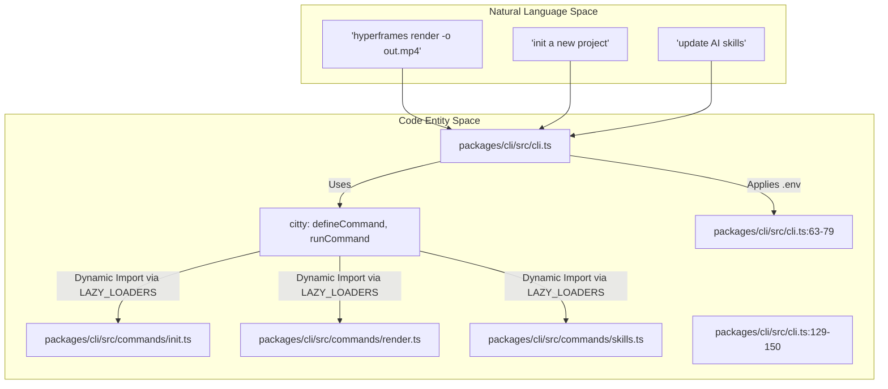
Sources: [packages/cli/src/cli.ts:63-79](), [packages/cli/src/cli.ts:85](), [packages/cli/src/cli.ts:129-150](), [packages/cli/src/commands/init.ts:8](), [packages/cli/src/commands/render.ts](), [packages/cli/src/commands/skills.ts]()

## Agent-Friendly Design

The CLI is built with AI agents in mind, ensuring predictable and scriptable interactions:
- **Non-Interactive by Default**: Commands prioritize flags over prompts, making them suitable for automated environments [docs/packages/cli.mdx:67-73](). `init` and `catalog --human-friendly` are exceptions, offering interactive modes on TTYs [docs/packages/cli.mdx:69-71]().
- **Machine-Readable Output**: The `--json` flag is supported by almost every command, providing structured data for programmatic consumption [docs/packages/cli.mdx:46-47]().
- **Metadata Envelope**: JSON output includes a `_meta` field with CLI version, latest available version, and update status, allowing agents to detect outdated CLIs without additional calls [docs/packages/cli.mdx:48-65]().
- **Silent Updates**: The CLI manages its own updates in the background for owned installs (npm, bun, pnpm), notifying the user on the next run. For `npx` or unknown installers, it provides an update notice. These mechanisms are suppressed in CI or non-TTY environments [docs/packages/cli.mdx:74-86]().

Sources: [docs/packages/cli.mdx:46-86]()

## Diagnostics, Health, and Environment

The CLI includes commands to diagnose and manage its environment and dependencies, ensuring a stable rendering pipeline.

**System Health and Dependency Mapping**
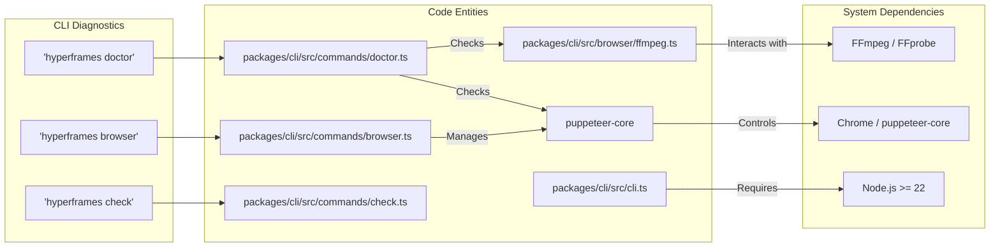
Sources: [packages/cli/src/cli.ts:1-45](), [packages/cli/src/commands/doctor.ts](), [packages/cli/src/commands/browser.ts](), [packages/cli/src/commands/check.ts](), [packages/cli/src/browser/ffmpeg.ts]()

---

## Detailed Command References

For complete syntax, options, and architectural deep-dives, consult the child pages below:

- **[Project Initialization and Scaffolding](#2.1)** — Covers `hyperframes init` template resolution, local media ingestion/transcoding, Whisper transcription integration, `meta.json` generation, and block installs via `hyperframes add`.
- **[Preview Server and Studio Launch](#2.2)** — Details `hyperframes preview` and `play`, Vite-based Studio server orchestration, port selection, HMR wiring in `studioServer.ts`, and orphan process cleanup.
- **[Rendering Command](#2.3)** — Reference for `hyperframes render` configuration flags (fps, quality, format, workers, docker), render planning, segmented pipelines, and the producer HTTP API.
- **[AI and Media Commands](#2.4)** — Explores AI integrations including `transcribe`, `tts`, `remove-background`, `media-treatment`, `beats`, `normalize-audio`, `capture`, `figma`, and registry operations via `catalog`.
- **[Diagnostics, Validation and Check Gate](#2.5)** — Explains the composite audit pipeline combining `check`, `lint`, `validate`, `snapshot`, `layout`, `inspect`, and `doctor`.
- **[Telemetry, Canary and Update System](#2.6)** — Documents background telemetry transport, canary rollout registries, passive update checks, and CLI exit lifecycle flushing.

Sources: [docs/packages/cli.mdx:23-33]()

---

# Page: Project Initialization and Scaffolding

# Project Initialization and Scaffolding

<details>
<summary>Relevant source files</summary>

The following files were used as context for generating this wiki page:

- [.claude-plugin/marketplace.json](.claude-plugin/marketplace.json)
- [AGENTS.md](AGENTS.md)
- [CLAUDE.md](CLAUDE.md)
- [README.md](README.md)
- [docs/guides/skills.mdx](docs/guides/skills.mdx)
- [docs/packages/cli.mdx](docs/packages/cli.mdx)
- [docs/quickstart.mdx](docs/quickstart.mdx)
- [packages/aws-lambda/build.mjs](packages/aws-lambda/build.mjs)
- [packages/cli/src/api.test.ts](packages/cli/src/api.test.ts)
- [packages/cli/src/api/transcribe.ts](packages/cli/src/api/transcribe.ts)
- [packages/cli/src/cli.ts](packages/cli/src/cli.ts)
- [packages/cli/src/commands/add.test.ts](packages/cli/src/commands/add.test.ts)
- [packages/cli/src/commands/add.ts](packages/cli/src/commands/add.ts)
- [packages/cli/src/commands/coreSkillContent.test.ts](packages/cli/src/commands/coreSkillContent.test.ts)
- [packages/cli/src/commands/feedback.test.ts](packages/cli/src/commands/feedback.test.ts)
- [packages/cli/src/commands/feedback.ts](packages/cli/src/commands/feedback.ts)
- [packages/cli/src/commands/init.test.ts](packages/cli/src/commands/init.test.ts)
- [packages/cli/src/commands/init.ts](packages/cli/src/commands/init.ts)
- [packages/cli/src/commands/transcribe.test.ts](packages/cli/src/commands/transcribe.test.ts)
- [packages/cli/src/commands/transcribe.ts](packages/cli/src/commands/transcribe.ts)
- [packages/cli/src/help.ts](packages/cli/src/help.ts)
- [packages/cli/src/registry/boundedFile.test.ts](packages/cli/src/registry/boundedFile.test.ts)
- [packages/cli/src/registry/boundedFile.ts](packages/cli/src/registry/boundedFile.ts)
- [packages/cli/src/registry/compatibility.test.ts](packages/cli/src/registry/compatibility.test.ts)
- [packages/cli/src/registry/compatibility.ts](packages/cli/src/registry/compatibility.ts)
- [packages/cli/src/registry/index.ts](packages/cli/src/registry/index.ts)
- [packages/cli/src/registry/installer.test.ts](packages/cli/src/registry/installer.test.ts)
- [packages/cli/src/registry/installer.ts](packages/cli/src/registry/installer.ts)
- [packages/cli/src/registry/publication.test.ts](packages/cli/src/registry/publication.test.ts)
- [packages/cli/src/registry/publication.ts](packages/cli/src/registry/publication.ts)
- [packages/cli/src/registry/remote.test.ts](packages/cli/src/registry/remote.test.ts)
- [packages/cli/src/registry/remote.ts](packages/cli/src/registry/remote.ts)
- [packages/cli/src/registry/resolver.test.ts](packages/cli/src/registry/resolver.test.ts)
- [packages/cli/src/registry/resolver.ts](packages/cli/src/registry/resolver.ts)
- [packages/cli/src/registry/transport.test.ts](packages/cli/src/registry/transport.test.ts)
- [packages/cli/src/registry/transport.ts](packages/cli/src/registry/transport.ts)
- [packages/cli/src/registry/variableDefaults.test.ts](packages/cli/src/registry/variableDefaults.test.ts)
- [packages/cli/src/registry/variableDefaults.ts](packages/cli/src/registry/variableDefaults.ts)
- [packages/cli/src/telemetry/lintRun.e2e.test.ts](packages/cli/src/telemetry/lintRun.e2e.test.ts)
- [packages/cli/src/templates/_shared/AGENTS.md](packages/cli/src/templates/_shared/AGENTS.md)
- [packages/cli/src/templates/_shared/CLAUDE.md](packages/cli/src/templates/_shared/CLAUDE.md)
- [packages/cli/src/templates/generators.ts](packages/cli/src/templates/generators.ts)
- [packages/cli/src/templates/remote.ts](packages/cli/src/templates/remote.ts)
- [packages/cli/src/utils/download.test.ts](packages/cli/src/utils/download.test.ts)
- [packages/cli/src/utils/download.ts](packages/cli/src/utils/download.ts)
- [packages/cli/src/utils/motionSpec.test.ts](packages/cli/src/utils/motionSpec.test.ts)
- [packages/cli/src/utils/submitFeedback.test.ts](packages/cli/src/utils/submitFeedback.test.ts)
- [packages/cli/src/utils/submitFeedback.ts](packages/cli/src/utils/submitFeedback.ts)
- [packages/cli/src/whisper/manager.install.test.ts](packages/cli/src/whisper/manager.install.test.ts)
- [packages/cli/src/whisper/manager.model.test.ts](packages/cli/src/whisper/manager.model.test.ts)
- [packages/cli/src/whisper/manager.ts](packages/cli/src/whisper/manager.ts)
- [packages/cli/src/whisper/modelFile.ts](packages/cli/src/whisper/modelFile.ts)
- [packages/cli/src/whisper/normalize.test.ts](packages/cli/src/whisper/normalize.test.ts)
- [packages/cli/src/whisper/normalize.ts](packages/cli/src/whisper/normalize.ts)
- [packages/cli/src/whisper/parakeet.ts](packages/cli/src/whisper/parakeet.ts)
- [packages/cli/src/whisper/progress.test.ts](packages/cli/src/whisper/progress.test.ts)
- [packages/cli/src/whisper/progress.ts](packages/cli/src/whisper/progress.ts)
- [packages/cli/src/whisper/sherpa.test.ts](packages/cli/src/whisper/sherpa.test.ts)
- [packages/cli/src/whisper/sherpa.ts](packages/cli/src/whisper/sherpa.ts)
- [packages/cli/src/whisper/sherpaWorker.test.ts](packages/cli/src/whisper/sherpaWorker.test.ts)
- [packages/cli/src/whisper/sherpaWorker.ts](packages/cli/src/whisper/sherpaWorker.ts)
- [packages/cli/src/whisper/transcribe.metadata.test.ts](packages/cli/src/whisper/transcribe.metadata.test.ts)
- [packages/cli/src/whisper/transcribe.test.ts](packages/cli/src/whisper/transcribe.test.ts)
- [packages/cli/src/whisper/transcribe.ts](packages/cli/src/whisper/transcribe.ts)
- [packages/gcp-cloud-run/build.mjs](packages/gcp-cloud-run/build.mjs)
- [scripts/verify-packed-manifests.mjs](scripts/verify-packed-manifests.mjs)
- [scripts/verify-packed-manifests.test.mjs](scripts/verify-packed-manifests.test.mjs)
- [skills-manifest.json](skills-manifest.json)
- [skills/hyperframes-cli/SKILL.md](skills/hyperframes-cli/SKILL.md)
- [skills/hyperframes-cli/references/lint-validate-inspect.md](skills/hyperframes-cli/references/lint-validate-inspect.md)
- [skills/hyperframes-cli/references/preview-render.md](skills/hyperframes-cli/references/preview-render.md)
- [skills/hyperframes/SKILL.md](skills/hyperframes/SKILL.md)

</details>


## Purpose and Scope

This page details the project initialization and scaffolding subsystem of the HyperFrames CLI, driven by `hyperframes init` [docs/packages/cli.mdx:88-101]() and extended via `hyperframes add` [packages/cli/src/commands/add.ts:6-12](). It covers template resolution, media ingestion and transcoding via `ffprobe` and `ffmpeg`, Whisper transcription, metadata and agent documentation generation (`meta.json`, `CLAUDE.md`), and remote registry block installation.

---

## The `init` Lifecycle and Scaffolding Pipeline

The `hyperframes init` command executes a multi-stage pipeline to establish a new deterministic composition project directory [packages/cli/src/commands/init.ts:8-24]().

### 1. Template Resolution
Templates fall into two categories:
- **Bundled Templates**: Minimal offline scaffolds (such as `blank`) packaged directly inside the CLI build [packages/cli/src/commands/init.ts:41-46](). These are resolved using `resolveTemplateList` [packages/cli/src/templates/generators.ts:32-49]().
- **Remote Examples**: Community or registry-hosted examples (such as `warm-grain` or `swiss-grid`) retrieved via `fetchRemoteTemplate` [packages/cli/src/templates/generators.ts:36-46](), [packages/cli/src/commands/init.ts:45]().

The helper function `resolveScaffoldTemplateId` selects the base template based on CLI flags (`--example`, `--video`, `--audio`) [packages/cli/src/commands/init.ts:62-67]().

### 2. Media Ingestion and Transcoding
When a consumer supplies `--video` or `--audio` inputs, the initialization pipeline executes media analysis:
- **Probing**: The function `probeVideo` invokes `ffprobe` to extract duration, dimensions, frame rate (`fps`), codec names, and stream existence flags [packages/cli/src/commands/init.ts:116-178]().
- **Web Compatibility**: The `WEB_CODECS` set defines compatible video codecs (`h264`, `vp8`, `vp9`, `av1`) [packages/cli/src/commands/init.ts:78-78](). The `probeVideo` function determines if the video stream's codec is web-compatible.
- **Transcoding**: Incompatible streams are transcoded via `transcodeToMp4`, which wraps an `ffmpeg` spawn process targeting web-friendly H.264/AAC output [packages/cli/src/commands/init.ts:186-207]().

### 3. Transcription and Caption Patching
When media files require voice synchronization, the pipeline optionally integrates word-level Whisper transcription:
- **Transcription**: `transcribeAudio` executes local transcription engines to generate timestamped word indices [packages/cli/src/commands/transcribe.ts:113-118]().
- **Silence Stripping & Patching**: The `patchCaptionHtml` utility reads `transcript.json` and injects timed DOM elements into the scaffolded HTML [packages/cli/src/commands/transcribe.ts:147-147]().

### 4. Tailwind CSS and Agent Documentation Generation
Scaffolding concludes by writing root composition files, configuration, and agent instructions. If `--tailwind` is passed, the command injects a pinned Tailwind CSS browser runtime (`v4.2.4`) with subresource integrity [packages/cli/src/commands/init.ts:91-95](). It also writes agent guidelines (`CLAUDE.md` and `AGENTS.md`) [packages/cli/src/templates/_shared/CLAUDE.md:1-20]().

**Diagram: Init Command Data Flow**
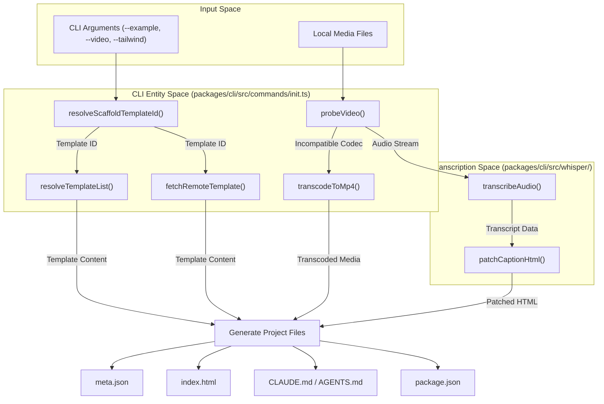
Sources: [packages/cli/src/commands/init.ts:106-207](), [packages/cli/src/commands/transcribe.ts:113-147](), [packages/cli/src/templates/_shared/CLAUDE.md:1-20](), [packages/cli/src/commands/init.ts:62-67](), [packages/cli/src/templates/generators.ts:32-49](), [packages/cli/src/templates/generators.ts:36-46]()

---

## Project Structure and Scaffolding Artifacts

A newly scaffolded HyperFrames project contains a deterministic layout:

| Path | Description |
| :--- | :--- |
| `index.html` | Entry point composition declaring root timing and `data-composition-id` [skills/hyperframes/SKILL.md:12-12](). |
| `meta.json` | Project identity, identifier, and version metadata. |
| `package.json` | Pinned build and render scripts (`dev`, `check`, `render`, `publish`) locking `hyperframes@version` [packages/cli/src/commands/init.test.ts:37-48](). |
| `compositions/` | Directory containing sub-compositions mounted via `data-composition-src` [skills/hyperframes/SKILL.md:12-12](). |
| `CLAUDE.md` / `AGENTS.md` | Context definitions for coding agents specifying framework rules and skill routing [CLAUDE.md:1-31](). These files are kept byte-identical [CLAUDE.md:36-36](). |

Sources: [packages/cli/src/commands/init.test.ts:37-48](), [CLAUDE.md:1-31](), [CLAUDE.md:36-36](), [skills/hyperframes/SKILL.md:12-12]()

---

## Registry Installs with `hyperframes add`

The `hyperframes add` command extends an existing project by installing pre-built registry blocks and components [packages/cli/src/commands/add.ts:6-12]().

### Registry Resolution and Dependencies
The CLI resolves registry items via `resolveItemWithDependencies` or searches by tag using `resolveItemsByTag` [packages/cli/src/commands/add.ts:28-31](). It communicates with the remote registry backend to pull manifests and associated assets [packages/cli/src/registry/remote.ts:26-27]().

### Target Path Remapping and Snippet Generation
1. **Target Remapping**: The `remapTarget` function inspects item definitions and remaps destination file paths according to project settings in `hyperframes.json#paths` (e.g., relocating blocks from `compositions/` to customized directories) [packages/cli/src/commands/add.ts:53-72]().
2. **Snippet Generation**: Once files are installed, `buildSnippet` generates the correct HTML embedding markup (`data-composition-src`, `data-duration`, dimensions, and variable bindings), which is copied to the system clipboard [packages/cli/src/commands/add.ts:125-147]().

**Diagram: Registry Block Installation Flow**
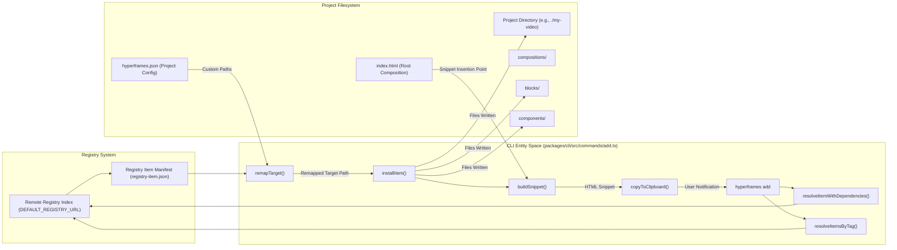
Sources: [packages/cli/src/commands/add.ts:32-147](), [packages/cli/src/registry/remote.ts:26-27](), [packages/cli/src/registry/resolver.ts:76-91](), [packages/cli/src/commands/add.ts:28-31](), [packages/cli/src/commands/add.ts:53-72]()

---

## Key Implementation Details

- **Deterministic Initialization**: During `init`, media streams are probed to lock down exact `data-duration` attributes, preventing timing drift between the HTML runtime and underlying assets [packages/cli/src/commands/init.ts:151-155]().
- **Non-Interactive Execution**: For CI pipelines and automated coding agents, passing `--non-interactive` forces default resolution behavior without blocking on terminal prompts (`clack`) [packages/cli/src/commands/init.ts:19-21](), [packages/cli/src/commands/init.test.ts:59-69]().
- **EPIPE Stream Suppression**: The CLI entry point registers stream error handlers on `process.stdout` and `process.stderr` to safely handle closed pipes when executed within automated runner pipelines, avoiding uncaught exception crashes [packages/cli/src/cli.ts:17-23]().
- **AI Skill Management**: The `init` command can optionally skip AI skill installation via `--skip-skills` [packages/cli/src/commands/init.ts:21-21](). The `HYPERFRAMES_SKIP_SKILLS` environment variable also controls this behavior [packages/cli/src/commands/init.test.ts:37-43](). The `hyperframes skills update` command is used to install or refresh the core set of skills [README.md:79-79]().

Sources: [packages/cli/src/commands/init.ts:19-155](), [packages/cli/src/commands/init.test.ts:59-69](), [packages/cli/src/cli.ts:17-23](), [packages/cli/src/commands/init.ts:21-21](), [packages/cli/src/commands/init.test.ts:37-43](), [README.md:79-79]()

---

# Page: Preview Server and Studio Launch

# Preview Server and Studio Launch

<details>
<summary>Relevant source files</summary>

The following files were used as context for generating this wiki page:

- [packages/cli/src/commands/catch-up.test.ts](packages/cli/src/commands/catch-up.test.ts)
- [packages/cli/src/commands/catch-up.ts](packages/cli/src/commands/catch-up.ts)
- [packages/cli/src/commands/play.test.ts](packages/cli/src/commands/play.test.ts)
- [packages/cli/src/commands/play.ts](packages/cli/src/commands/play.ts)
- [packages/cli/src/commands/present.ts](packages/cli/src/commands/present.ts)
- [packages/cli/src/commands/preview.startFailure.test.ts](packages/cli/src/commands/preview.startFailure.test.ts)
- [packages/cli/src/commands/preview.test.ts](packages/cli/src/commands/preview.test.ts)
- [packages/cli/src/commands/preview.ts](packages/cli/src/commands/preview.ts)
- [packages/cli/src/commands/previewLifecycle.test.ts](packages/cli/src/commands/previewLifecycle.test.ts)
- [packages/cli/src/commands/previewLifecycle.ts](packages/cli/src/commands/previewLifecycle.ts)
- [packages/cli/src/commands/previewLifecycleOutput.test.ts](packages/cli/src/commands/previewLifecycleOutput.test.ts)
- [packages/cli/src/commands/previewLifecycleOutput.ts](packages/cli/src/commands/previewLifecycleOutput.ts)
- [packages/cli/src/commands/serverPort.test.ts](packages/cli/src/commands/serverPort.test.ts)
- [packages/cli/src/server/readBundleFile.ts](packages/cli/src/server/readBundleFile.ts)
- [packages/cli/src/server/runtimeSource.file-race.test.ts](packages/cli/src/server/runtimeSource.file-race.test.ts)
- [packages/cli/src/server/runtimeSource.ts](packages/cli/src/server/runtimeSource.ts)
- [packages/cli/src/server/studioRenderTelemetry.test.ts](packages/cli/src/server/studioRenderTelemetry.test.ts)
- [packages/cli/src/server/studioRenderTelemetry.ts](packages/cli/src/server/studioRenderTelemetry.ts)
- [packages/cli/src/server/studioServer.file-race.test.ts](packages/cli/src/server/studioServer.file-race.test.ts)
- [packages/cli/src/server/studioServer.test.ts](packages/cli/src/server/studioServer.test.ts)
- [packages/cli/src/server/studioServer.ts](packages/cli/src/server/studioServer.ts)
- [packages/cli/src/utils/appHistory.test.ts](packages/cli/src/utils/appHistory.test.ts)
- [packages/cli/src/utils/appHistory.ts](packages/cli/src/utils/appHistory.ts)
- [packages/cli/src/utils/compositionServer.test.ts](packages/cli/src/utils/compositionServer.test.ts)
- [packages/cli/src/utils/compositionServer.ts](packages/cli/src/utils/compositionServer.ts)
- [packages/cli/src/utils/openBrowser.test.ts](packages/cli/src/utils/openBrowser.test.ts)
- [packages/cli/src/utils/openBrowser.ts](packages/cli/src/utils/openBrowser.ts)
- [packages/cli/src/utils/port.test.ts](packages/cli/src/utils/port.test.ts)
- [packages/cli/src/utils/port.ts](packages/cli/src/utils/port.ts)
- [packages/cli/src/utils/staticProjectServer.charset.browser.test.ts](packages/cli/src/utils/staticProjectServer.charset.browser.test.ts)
- [packages/cli/src/utils/staticProjectServer.test.ts](packages/cli/src/utils/staticProjectServer.test.ts)
- [packages/cli/src/utils/staticProjectServer.ts](packages/cli/src/utils/staticProjectServer.ts)
- [packages/cli/src/utils/windowsAppData.ts](packages/cli/src/utils/windowsAppData.ts)
- [packages/core/src/compiler/pngColourTags.test.ts](packages/core/src/compiler/pngColourTags.test.ts)
- [packages/core/src/compiler/pngColourTags.ts](packages/core/src/compiler/pngColourTags.ts)
- [packages/studio-server/src/helpers/encoderOptions.test.ts](packages/studio-server/src/helpers/encoderOptions.test.ts)
- [packages/studio-server/src/helpers/encoderOptions.ts](packages/studio-server/src/helpers/encoderOptions.ts)
- [packages/studio-server/src/helpers/mime.ts](packages/studio-server/src/helpers/mime.ts)
- [packages/studio-server/src/index.ts](packages/studio-server/src/index.ts)
- [packages/studio-server/src/routes/render.test.ts](packages/studio-server/src/routes/render.test.ts)
- [packages/studio-server/src/routes/render.ts](packages/studio-server/src/routes/render.ts)
- [packages/studio-server/src/types.ts](packages/studio-server/src/types.ts)
- [packages/studio/src/utils/frameCapture.test.ts](packages/studio/src/utils/frameCapture.test.ts)
- [packages/studio/src/utils/frameCapture.ts](packages/studio/src/utils/frameCapture.ts)
- [packages/studio/src/utils/projectRouting.test.ts](packages/studio/src/utils/projectRouting.test.ts)
- [packages/studio/src/utils/projectRouting.ts](packages/studio/src/utils/projectRouting.ts)
- [packages/studio/vite.adapter.projects.test.ts](packages/studio/vite.adapter.projects.test.ts)
- [packages/studio/vite.adapter.ts](packages/studio/vite.adapter.ts)
- [packages/studio/vite.config.ts](packages/studio/vite.config.ts)
- [packages/studio/vite.thumbnail.test.ts](packages/studio/vite.thumbnail.test.ts)
- [packages/studio/vite.thumbnail.ts](packages/studio/vite.thumbnail.ts)

</details>


The `hyperframes preview` command initializes a local development environment that combines a **Vite-based Studio frontend** with a **Hono-based Studio API** (`studioServer.ts`) [packages/cli/src/server/studioServer.ts:1-6](). This system provides real-time visual editing, project linting, and in-browser rendering capabilities. The architecture is designed to handle different execution contexts, ranging from local standalone projects to full monorepo development [packages/cli/src/commands/preview.ts:125-140]().

### Preview Command Lifecycle

When `hyperframes preview` is executed, the CLI performs a sequence of environment checks and port scans to ensure a smooth launch. It first cleans up any orphaned `chrome-headless-shell` processes from previous crashed sessions [packages/cli/src/utils/orphanCleanup.ts:1-25]() and lints the project to surface any immediate findings [packages/cli/src/commands/preview.ts:51-56]().

The command then determines which execution mode of the Studio to launch:
1. **Monorepo Dev Mode**: If `isDevMode()` is true, it spawns the Studio using the monorepo source [packages/cli/src/commands/preview.ts:42-48]().
2. **Local Studio Mode**: If a project has `@hyperframes/studio` installed locally, it uses Vite for full HMR [packages/cli/src/commands/preview.ts:183-191]().
3. **Embedded Mode**: For most users, it starts an embedded server using pre-bundled assets within the CLI resolved via `resolveStudioBundle()` [packages/cli/src/server/studioServer.ts:125-147]().

Sources: [packages/cli/src/commands/preview.ts:42-191](), [packages/cli/src/server/studioServer.ts:125-147](), [packages/cli/src/utils/orphanCleanup.ts:1-25]()

---

### Port Selection and Instance Reuse

HyperFrames implements a robust port handling strategy to manage multiple preview instances and handle network edge cases [packages/cli/src/server/portUtils.ts:1-60]().

#### Port Utilities Logic
- **Multi-host testing**: The port scanner checks `127.0.0.1`, `0.0.0.0`, `::1`, and `::` sequentially to verify if a port is free [packages/cli/src/server/portUtils.ts:1-50]().
- **Instance Detection**: If a port is occupied, the CLI probes it to check if the running server matches the current project and build signature [packages/cli/src/server/portUtils.ts:100-157](). If they match, it reuses the active server rather than failing or spawning a duplicate [packages/cli/src/commands/preview.ts:136-146]().
- **Management**: Flags like `--list` and `--kill-all` allow users to scan or terminate active servers across the environment [packages/cli/src/commands/preview.ts:166-175]().

Sources: [packages/cli/src/server/portUtils.ts:1-161](), [packages/cli/src/commands/preview.ts:136-175]()

---

### Studio Server Architecture (`studioServer.ts`)

The `studioServer.ts` module provides the CLI-specific adapter for the shared Studio API module located in `@hyperframes/studio-server` [packages/cli/src/server/studioServer.ts:1-6](). It integrates file watching [packages/cli/src/server/fileWatcher.js:1-21](), project signatures [packages/studio-server/src/helpers/projectSignature.js:1-25](), and preview bundling routes [packages/studio-server/src/routes/preview.js:1-65]().

#### Code Entity Mapping: Studio Server

The following diagram illustrates how `StudioServer` wires Hono requests from the Studio UI to the underlying CLI adapters and producer subsystems [packages/cli/src/server/studioServer.ts:1-64]().

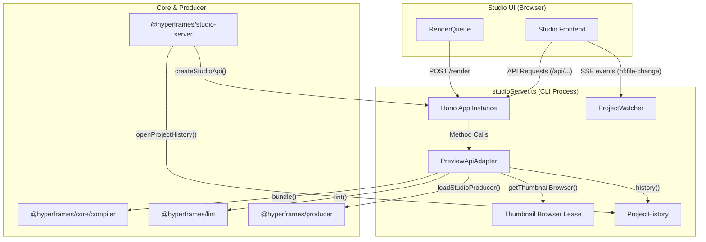
Sources: [packages/cli/src/server/studioServer.ts:1-64](), [packages/cli/src/server/fileWatcher.js:1-21](), [packages/studio-server/src/index.ts:1-78]()

#### Key Implementation Details
- **Thumbnail Browser Pool**: The server coordinates thumbnail generation via a shared browser lease manager, ensuring that thumbnail extraction and render tasks share optimized browser processes [packages/cli/src/server/studioServer.ts:60-80]().
- **Manual Edits**: It supports applying user edits stored in `.hyperframes/studio-manual-edits.json` via `createStudioManualEditsRenderBodyScript()` [packages/cli/src/server/studioServer.ts:45-46]().
- **Vite Integration**: During development in the monorepo, Vite's `devProjectApi` plugin bridges Hono requests to Node HTTP responses and manages project signature caches [packages/studio/vite.config.ts:65-141]().
- **Project History**: The `studioServer` integrates with the project history system from `@hyperframes/studio-server`, allowing for undo/redo functionality and tracking project changes. It uses `openProjectHistory` and `historyCache` to manage project history instances [packages/cli/src/server/studioServer.ts:65-69]().

Sources: [packages/cli/src/server/studioServer.ts:45-46](), [packages/cli/src/server/studioServer.ts:60-80](), [packages/cli/src/server/studioServer.ts:65-69](), [packages/studio/vite.config.ts:65-141]()

---

### Telemetry and Canary Integration

The preview server is a long-lived process that reacts dynamically to configuration and telemetry changes.

- **Posture Refresh**: The `refreshTelemetryPosture()` helper invalidates cached telemetry and config parameters at request boundaries, ensuring that external modifications (such as disabling telemetry via the CLI) take effect immediately [packages/cli/src/server/telemetryIdentity.ts:21-33]().
- **Canary Decisions**: Canary rollout flags are resolved and shared with the Studio session to maintain consistency between CLI commands and browser UI features [packages/cli/src/commands/preview.ts:1-50]().

Sources: [packages/cli/src/server/telemetryIdentity.ts:21-33](), [packages/cli/src/commands/preview.ts:1-50]()

---

### Lightweight Player Server (`play.ts`)

For workflows requiring a fast preview without the full Studio IDE overhead, the `hyperframes play` command boots a lightweight Hono server to serve compositions [packages/cli/src/commands/play.ts:1-60]().

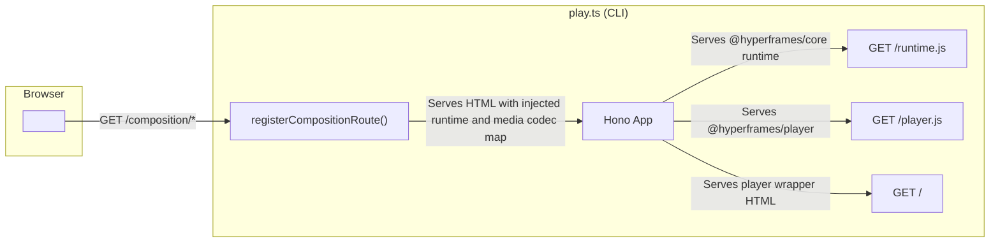
Sources: [packages/cli/src/commands/play.ts:1-193]()

- **Runtime Injection**: It dynamically injects the Hyperframe runtime script into composition documents [packages/cli/src/commands/play.ts:135-162]().
- **Media Proxying**: Automatically transcodes browser-hostile video codecs (such as HEVC, ProRes, and AV1) into authoring-friendly web proxies using background transcoders [packages/cli/src/commands/play.ts:25-55](). The `resolveAutoProxy` utility determines if auto-proxying should be enabled based on project configuration and CLI flags [packages/cli/src/commands/play.ts:27-28]().
- **Player and Runtime Serving**: The `play` command serves the `@hyperframes/player` web component and the core HyperFrames runtime directly from the CLI's bundled assets [packages/cli/src/commands/play.ts:153-168]().

Sources: [packages/cli/src/commands/play.ts:25-162](), [packages/cli/src/commands/play.ts:27-28](), [packages/cli/src/commands/play.ts:153-168]()

---

# Page: Rendering Command

# Rendering Command

<details>
<summary>Relevant source files</summary>

The following files were used as context for generating this wiki page:

- [docs/guides/rendering.mdx](docs/guides/rendering.mdx)
- [docs/packages/engine.mdx](docs/packages/engine.mdx)
- [docs/packages/producer.mdx](docs/packages/producer.mdx)
- [packages/cli/src/commands/cloudrun.ts](packages/cli/src/commands/cloudrun.ts)
- [packages/cli/src/commands/lambda.ts](packages/cli/src/commands/lambda.ts)
- [packages/cli/src/commands/lambda/render-batch.test.ts](packages/cli/src/commands/lambda/render-batch.test.ts)
- [packages/cli/src/commands/lambda/render-batch.ts](packages/cli/src/commands/lambda/render-batch.ts)
- [packages/cli/src/commands/lambda/render.test.ts](packages/cli/src/commands/lambda/render.test.ts)
- [packages/cli/src/commands/lambda/render.ts](packages/cli/src/commands/lambda/render.ts)
- [packages/cli/src/commands/render.test.ts](packages/cli/src/commands/render.test.ts)
- [packages/cli/src/commands/render.ts](packages/cli/src/commands/render.ts)
- [packages/cli/src/commands/render/execute.test.ts](packages/cli/src/commands/render/execute.test.ts)
- [packages/cli/src/commands/render/execute.ts](packages/cli/src/commands/render/execute.ts)
- [packages/cli/src/commands/render/plan.test.ts](packages/cli/src/commands/render/plan.test.ts)
- [packages/cli/src/commands/render/plan.ts](packages/cli/src/commands/render/plan.ts)
- [packages/cli/src/docs/rendering.md](packages/cli/src/docs/rendering.md)
- [packages/cli/src/telemetry/events.test.ts](packages/cli/src/telemetry/events.test.ts)
- [packages/cli/src/telemetry/events.ts](packages/cli/src/telemetry/events.ts)
- [packages/cli/src/telemetry/renderObservability.test.ts](packages/cli/src/telemetry/renderObservability.test.ts)
- [packages/cli/src/telemetry/renderObservability.ts](packages/cli/src/telemetry/renderObservability.ts)
- [packages/cli/src/utils/compositionFps.test.ts](packages/cli/src/utils/compositionFps.test.ts)
- [packages/cli/src/utils/compositionFps.ts](packages/cli/src/utils/compositionFps.ts)
- [packages/cli/src/utils/dockerRunArgs.test.ts](packages/cli/src/utils/dockerRunArgs.test.ts)
- [packages/cli/src/utils/dockerRunArgs.ts](packages/cli/src/utils/dockerRunArgs.ts)
- [packages/cli/src/utils/missingPackage.test.ts](packages/cli/src/utils/missingPackage.test.ts)
- [packages/cli/src/utils/missingPackage.ts](packages/cli/src/utils/missingPackage.ts)
- [packages/cli/src/utils/renderArgs.test.ts](packages/cli/src/utils/renderArgs.test.ts)
- [packages/cli/src/utils/renderArgs.ts](packages/cli/src/utils/renderArgs.ts)
- [packages/engine/src/config.test.ts](packages/engine/src/config.test.ts)
- [packages/engine/src/config.ts](packages/engine/src/config.ts)
- [packages/engine/src/index.ts](packages/engine/src/index.ts)
- [packages/engine/src/services/browserManager.test.ts](packages/engine/src/services/browserManager.test.ts)
- [packages/engine/src/services/browserManager.ts](packages/engine/src/services/browserManager.ts)
- [packages/engine/src/services/chunkEncoder.relativePaths.test.ts](packages/engine/src/services/chunkEncoder.relativePaths.test.ts)
- [packages/engine/src/services/frameCapture.test.ts](packages/engine/src/services/frameCapture.test.ts)
- [packages/engine/src/services/frameCapture.ts](packages/engine/src/services/frameCapture.ts)
- [packages/engine/src/types.ts](packages/engine/src/types.ts)
- [packages/producer/src/renderRequest.test.ts](packages/producer/src/renderRequest.test.ts)
- [packages/producer/src/renderRequest.ts](packages/producer/src/renderRequest.ts)
- [packages/producer/src/services/distributed/renderConfigValidation.ts](packages/producer/src/services/distributed/renderConfigValidation.ts)
- [packages/producer/src/services/render/observability.ts](packages/producer/src/services/render/observability.ts)
- [packages/producer/src/services/render/perfSummary.test.ts](packages/producer/src/services/render/perfSummary.test.ts)
- [packages/producer/src/services/render/perfSummary.ts](packages/producer/src/services/render/perfSummary.ts)
- [packages/producer/src/services/render/segmentManifest.test.ts](packages/producer/src/services/render/segmentManifest.test.ts)
- [packages/producer/src/services/render/segmentManifest.ts](packages/producer/src/services/render/segmentManifest.ts)
- [packages/producer/src/services/renderOrchestrator.deGateProbe.test.ts](packages/producer/src/services/renderOrchestrator.deGateProbe.test.ts)
- [packages/producer/src/services/renderOrchestrator.test.ts](packages/producer/src/services/renderOrchestrator.test.ts)
- [packages/producer/src/services/renderOrchestrator.ts](packages/producer/src/services/renderOrchestrator.ts)

</details>


The `hyperframes render` command is the primary entry point for transforming HTML-based compositions into high-fidelity video files. It orchestrates a multi-stage pipeline involving headless browser capture, audio processing, and FFmpeg encoding.

## Command Overview and Configuration Flags

The CLI uses the `citty` framework to define the `render` command [packages/cli/src/commands/render.ts:153-157](). It supports a comprehensive set of configuration flags handled through `packages/cli/src/commands/render.ts` and associated plan builders.

### Core Configuration Flags
| Flag | Type | Default | Description |
| :--- | :--- | :--- | :--- |
| `dir` | Positional | `.` | The project directory containing the composition [packages/cli/src/commands/render.ts:160-163](). |
| `--composition` | string | `index.html` | Render a specific composition file (e.g., `compositions/intro.html`) [packages/cli/src/commands/render.ts:164-171](). |
| `--output` | string | `renders/<name>.mp4` | Destination path for the rendered file [packages/cli/src/commands/render.ts:172-176](). |
| `--fps` | string | Composition root `data-fps` or `30` | Target frame rate (supports integers or rational strings like `30000/1001`) [packages/cli/src/commands/render.ts:177-184](). |
| `--quality` | string | `standard` | Preset: `draft`, `standard`, or `high`. |
| `--format` | string | `mp4` | Container: `mp4`, `webm`, `mov`, `gif`, `hls`, or `png-sequence` [packages/cli/src/commands/render.ts:156](). |
| `--workers` | string | `auto` | Parallel render workers. Each spawns a Chrome process. |

### Advanced Encoding and Capture Flags
*   **`--docker`**: Executes the render inside a container for deterministic environment parity [packages/cli/src/commands/render.ts:35]().
*   **`--variables`**: JSON string to override values declared in composition parameters [packages/cli/src/commands/render.ts:50-52]().
*   **`--variables-file`**: Load override variables from an external JSON file [packages/cli/src/commands/render.ts:54-56]().
*   **`--batch`**: Batch render one output per row in a JSON array file [packages/cli/src/commands/render.ts:58-60]().
*   **`--no-browser-gpu`**: Opt out of browser-side GPU acceleration [packages/cli/src/commands/render.ts:40]().
*   **`--frames-cache-dir`**: Relocate the frame cache directory off primary storage partitions [packages/cli/src/commands/render.ts:46-48]().

Sources: [packages/cli/src/commands/render.ts:153-2060]()

---

## Local vs. Docker Rendering Modes

HyperFrames provides two primary execution modes to balance speed, hardware utilization, and environment reproducibility.

### Local Mode (Default)
Local rendering uses the system's `ffmpeg` and a local Chromium or bundled `chrome-headless-shell` instance [packages/cli/src/commands/render.ts:123-127](). It is optimized for speed and allows host GPU acceleration.
*   **Browser GPU**: The CLI resolves the GPU mode via `resolveBrowserGpuForCli` [packages/cli/src/commands/render.ts:7]() and `resolveBrowserGpuMode` [packages/engine/src/services/browserManager.js:32](), supporting hardware ANGLE backends or software SwiftShader fallbacks [packages/engine/src/config.ts:43-53]().
*   **Upsampling**: Supports supersampling resolutions (e.g., 4K) via Chrome Device Pixel Ratio (DPR) scaling [packages/cli/src/commands/render.ts:20-22]().

### Docker Mode
Invoked via `--docker`, this mode guarantees deterministic rendering parity across heterogeneous developer and CI hosts [packages/cli/src/commands/render.ts:35]().
*   **Implementation**: The CLI builds container execution arguments using `buildDockerRunArgs` and `resolveDockerPlatform` [packages/cli/src/utils/dockerRunArgs.ts:1-10]().
*   **Container Image**: Relies on `Dockerfile.render`, which packages a pinned `chrome-headless-shell` build and standard system fonts.

Sources: [packages/cli/src/commands/render.ts:35](), [packages/cli/src/utils/dockerRunArgs.ts:1-10](), [packages/engine/src/config.ts:43-53](), [packages/engine/src/services/browserManager.js:32]()

---

## Render Plan, Lint, and Execution

The render lifecycle begins by generating a render plan, running optional pre-flight checks and linters, and executing the compiled pipeline stages.

### Plan and Execute Architecture

#### Diagram: CLI Render Plan to Execution Flow
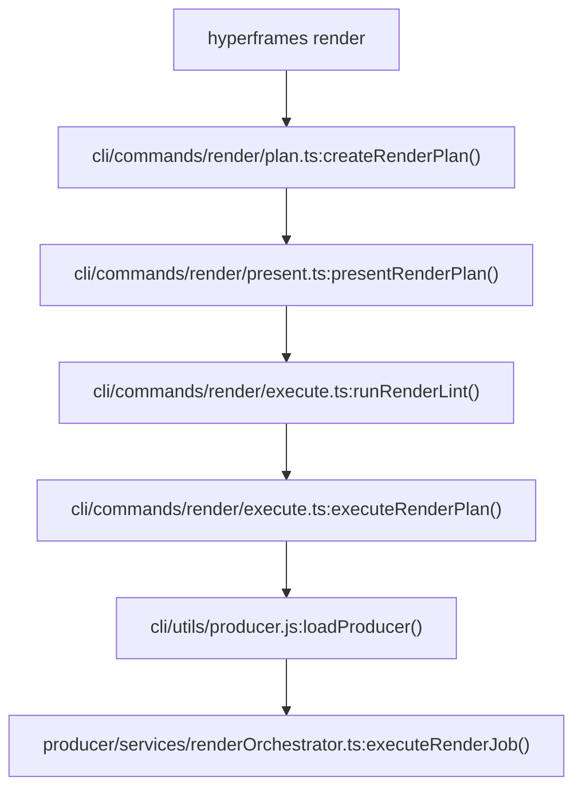
Sources: [packages/cli/src/commands/render.ts:7-12](), [packages/cli/src/commands/render/plan.ts:1-40](), [packages/cli/src/commands/render/execute.ts:1-50](), [packages/cli/src/utils/producer.js:1-10]()

*   **`createRenderPlan`**: Validates input arguments, locates composition entry points, and resolves output path matrices [packages/cli/src/commands/render/plan.ts:1-40]().
*   **`runRenderLint`**: Inspects composition markup and script contracts before committing CPU cycles to video encoding [packages/cli/src/commands/render/execute.ts:1-35]().
*   **`executeRenderPlan`**: Invokes the producer runtime via `loadProducer()` to instantiate and run the render job [packages/cli/src/commands/render.ts:66]().

Sources: [packages/cli/src/commands/render.ts:7-12](), [packages/cli/src/commands/render/execute.ts:1-45]()

---

## Segmented and Long-Form Renders

For long-form compositions or memory-constrained environments, HyperFrames utilizes segmented rendering strategies.

*   **Segment Planning**: `resolveSegmentFrames` and `computeSegmentPlanHash` partition long timelines into discrete time windows [packages/producer/src/services/renderOrchestrator.ts:163-173]().
*   **Segmented Capture Stage**: `runCaptureSegmentedStage` delegates frame rendering across isolated segment directories managed by `segmentManifest.ts` [packages/producer/src/services/renderOrchestrator.ts:157](), [packages/producer/src/services/render/stages/captureSegmentedStage.ts:1-25]().
*   **Recycle Policy**: `resolveSegmentBrowserRecycle` manages browser instance recycling between segments to mitigate memory leaks during extended multi-minute renders [packages/producer/src/services/renderOrchestrator.ts:164]().

Sources: [packages/producer/src/services/renderOrchestrator.ts:157-173](), [packages/producer/src/services/render/stages/captureSegmentedStage.ts:1-30]()

---

## Producer HTTP API and Orchestration

The `@hyperframes/producer` package exposes programmatic render control via an internal HTTP server and orchestration service.

### Orchestration Pipeline Stages
The `executeRenderJob` function inside `renderOrchestrator.ts` sequences six distinct stages [packages/producer/src/services/renderOrchestrator.ts:5-22]():
1.  **Compile (`compileStage.ts`)**: Bundles and prepares HTML/CSS assets.
2.  **Probe (`probeStage.ts`)**: Browser-driven duration discovery and media reconciliation.
3.  **Extract Videos (`extractVideosStage.ts`)**: Pre-extracts underlying video elements via FFmpeg.
4.  **Audio (`audioStage.ts`)**: Mixes multi-track audio elements and applies audio groups [packages/producer/src/services/renderOrchestrator.ts:60]().
5.  **Capture (`captureStage.ts` / `captureSegmentedStage.ts`)**: Captures frames via Chromium BeginFrame or screenshot protocols [packages/producer/src/services/renderOrchestrator.ts:18-19]().
6.  **Encode & Assemble (`encodeStage.ts`, `assembleStage.ts`)**: Multiplexes frames and audio into final output containers [packages/producer/src/services/renderOrchestrator.ts:20-21]().

#### Diagram: Producer Orchestrator and Pipeline Execution
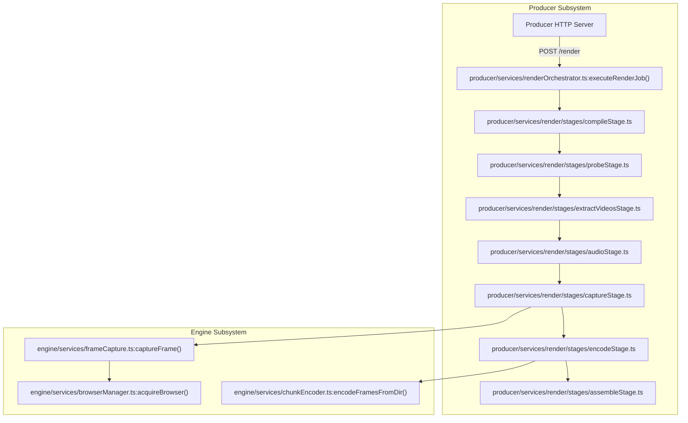
Sources: [packages/producer/src/services/renderOrchestrator.ts:5-22](), [packages/engine/src/services/frameCapture.ts:1-12](), [packages/engine/src/services/browserManager.ts:1-10](), [packages/engine/src/services/chunkEncoder.ts:1-10]()

Sources: [packages/producer/src/services/renderOrchestrator.ts:1-192](), [packages/engine/src/index.ts:1-35]()

---

## Output Formats and Quality Presets

HyperFrames supports multiple output containers and encoding profiles resolved via `renderFormat.js` and `chunkEncoder.ts` [packages/engine/src/index.ts:182-201]().

| Format | Extension | Transparency | Use Case |
| :--- | :--- | :--- | :--- |
| **MP4** | `.mp4` | No | Universal playback, H.264 pipeline [packages/cli/src/commands/render.ts:17](). |
| **WebM** | `.webm` | **Yes** | Transparent web overlays via VP9 [packages/cli/src/commands/render.ts:24](). |
| **MOV** | `.mov` | **Yes** | Professional NLE editing via ProRes 4444 [packages/cli/src/commands/render.ts:23](). |
| **GIF** | `.gif` | No | Looped animations for documentation and PRs [packages/cli/src/commands/render.ts:26-27](). |
| **PNG Sequence** | Directory | **Yes** | Raw RGBA frames for After Effects, Nuke, or Fusion [packages/cli/src/commands/render.ts:30-31](). |
| **HLS VOD** | Directory | No | Master playlist and MPEG-TS segments for adaptive streaming [packages/cli/src/commands/render.ts:34-36]().

### Quality Presets
The CLI maps `--quality` to CRF and encoder speed presets via `getEncoderPreset` [packages/engine/src/index.ts:193]().
*   **`draft`**: Optimized for speed with relaxed compression tolerances [packages/engine/src/config.ts:27]().
*   **`standard`**: Balanced quality and file size for general exports [packages/engine/src/config.ts:27]().
*   **`high`**: High-bitrate, slow-preset configuration for final mastering [packages/engine/src/config.ts:27]().

Sources: [packages/cli/src/commands/render.ts:17-36](), [packages/engine/src/config.ts:24-30](), [packages/engine/src/index.ts:182-201]()

---

# Page: AI and Media Commands

# AI and Media Commands

<details>
<summary>Relevant source files</summary>

The following files were used as context for generating this wiki page:

- [packages/cli/src/audio/providers.ts](packages/cli/src/audio/providers.ts)
- [packages/cli/src/background-removal/dependency-compat.test.ts](packages/cli/src/background-removal/dependency-compat.test.ts)
- [packages/cli/src/background-removal/inference.test.ts](packages/cli/src/background-removal/inference.test.ts)
- [packages/cli/src/background-removal/inference.ts](packages/cli/src/background-removal/inference.ts)
- [packages/cli/src/background-removal/pipeline.rotation.test.ts](packages/cli/src/background-removal/pipeline.rotation.test.ts)
- [packages/cli/src/background-removal/pipeline.test.ts](packages/cli/src/background-removal/pipeline.test.ts)
- [packages/cli/src/background-removal/pipeline.ts](packages/cli/src/background-removal/pipeline.ts)
- [packages/cli/src/background-removal/pipeline.windowsHide.test.ts](packages/cli/src/background-removal/pipeline.windowsHide.test.ts)
- [packages/cli/src/cli.commands.test.ts](packages/cli/src/cli.commands.test.ts)
- [packages/cli/src/commands/auth/status-guidance.ts](packages/cli/src/commands/auth/status-guidance.ts)
- [packages/cli/src/commands/lambda/repoRoot.test.ts](packages/cli/src/commands/lambda/repoRoot.test.ts)
- [packages/cli/src/commands/lambda/repoRoot.ts](packages/cli/src/commands/lambda/repoRoot.ts)
- [packages/cli/src/commands/media-treatment.test.ts](packages/cli/src/commands/media-treatment.test.ts)
- [packages/cli/src/commands/media-treatment.ts](packages/cli/src/commands/media-treatment.ts)
- [packages/cli/src/commands/remove-background.ts](packages/cli/src/commands/remove-background.ts)
- [packages/cli/src/commands/skills.test.ts](packages/cli/src/commands/skills.test.ts)
- [packages/cli/src/commands/skills.ts](packages/cli/src/commands/skills.ts)
- [packages/cli/src/commands/tts.test.ts](packages/cli/src/commands/tts.test.ts)
- [packages/cli/src/commands/tts.ts](packages/cli/src/commands/tts.ts)
- [packages/cli/src/tts/manager.test.ts](packages/cli/src/tts/manager.test.ts)
- [packages/cli/src/tts/manager.ts](packages/cli/src/tts/manager.ts)
- [packages/cli/src/tts/python.test.ts](packages/cli/src/tts/python.test.ts)
- [packages/cli/src/tts/python.ts](packages/cli/src/tts/python.ts)
- [packages/cli/src/tts/synthesize.cache.test.ts](packages/cli/src/tts/synthesize.cache.test.ts)
- [packages/cli/src/tts/synthesize.test.ts](packages/cli/src/tts/synthesize.test.ts)
- [packages/cli/src/tts/synthesize.ts](packages/cli/src/tts/synthesize.ts)
- [packages/cli/src/utils/command-failure-tracking.test.ts](packages/cli/src/utils/command-failure-tracking.test.ts)
- [packages/cli/src/utils/command-failure-tracking.ts](packages/cli/src/utils/command-failure-tracking.ts)
- [packages/cli/src/utils/jsonFlag.test.ts](packages/cli/src/utils/jsonFlag.test.ts)
- [packages/cli/src/utils/jsonFlag.ts](packages/cli/src/utils/jsonFlag.ts)
- [packages/cli/src/utils/jsonFlag.windows.test.ts](packages/cli/src/utils/jsonFlag.windows.test.ts)
- [packages/cli/src/utils/reject-extra-positionals.test.ts](packages/cli/src/utils/reject-extra-positionals.test.ts)
- [packages/cli/src/utils/reject-extra-positionals.ts](packages/cli/src/utils/reject-extra-positionals.ts)
- [packages/cli/src/utils/reject-unknown-flags.test.ts](packages/cli/src/utils/reject-unknown-flags.test.ts)
- [packages/cli/src/utils/reject-unknown-flags.ts](packages/cli/src/utils/reject-unknown-flags.ts)
- [packages/cli/src/utils/skillsManifest.test.ts](packages/cli/src/utils/skillsManifest.test.ts)
- [packages/cli/src/utils/skillsManifest.ts](packages/cli/src/utils/skillsManifest.ts)
- [packages/cli/src/utils/skillsUpdateCheck.test.ts](packages/cli/src/utils/skillsUpdateCheck.test.ts)
- [packages/cli/src/utils/skillsUpdateCheck.ts](packages/cli/src/utils/skillsUpdateCheck.ts)
- [packages/cli/src/utils/variables.test.ts](packages/cli/src/utils/variables.test.ts)
- [packages/cli/src/utils/variables.ts](packages/cli/src/utils/variables.ts)
- [packages/cli/src/whisper/parakeet.test.ts](packages/cli/src/whisper/parakeet.test.ts)
- [packages/studio-server/src/routes/media.test.ts](packages/studio-server/src/routes/media.test.ts)
- [packages/studio-server/src/routes/media.ts](packages/studio-server/src/routes/media.ts)
- [skills/hyperframes/references/skill-lifecycle.md](skills/hyperframes/references/skill-lifecycle.md)
- [skills/media-use/references/grading.md](skills/media-use/references/grading.md)

</details>


## Purpose and scope

This page covers CLI commands for AI-assisted media workflows and related tooling. The available implementation details here cover `tts`, `remove-background`, `media-treatment`, and `skills` in depth. The requested `transcribe`, `beats`, `normalize-audio`, `capture`, `figma`, and `catalog` commands are included in the command map, but their implementation files were not provided, so this page does not infer their behavior. [packages/cli/src/commands/tts.ts:40-85]()

Sources: [packages/cli/src/commands/tts.ts:40-85]()

## Command map

The CLI command set includes the media and AI commands listed below. The provided command-registration test explicitly names `catalog`, `figma`, `skills`, and `tts`; the remaining command names are in this page’s stated scope, but their registration and implementation details are not available in the supplied files. [packages/cli/src/cli.commands.test.ts:20-29]()

| Command | Implementation detail available here |
|---|---|
| `transcribe` | Not available in the supplied file contents |
| `tts` | CLI argument handling and local Kokoro synthesis |
| `remove-background` | Frame inference and rendering pipeline |
| `media-treatment` | Capability discovery and HTML treatment operations |
| `beats` | Not available in the supplied file contents |
| `normalize-audio` | Not available in the supplied file contents |
| `capture` | Not available in the supplied file contents |
| `figma` | Command is named in the CLI command test; implementation not supplied |
| `catalog` | Command is named in the CLI command test; implementation not supplied |
| `skills` | Installation, update, and skill-freshness management |

Sources: [packages/cli/src/cli.commands.test.ts:20-29](), [packages/cli/src/commands/tts.ts:40-85](), [packages/cli/src/commands/skills.ts:121-153](), [packages/cli/src/commands/media-treatment.ts:41-91]()

## Text-to-speech (`hyperframes tts`)

### CLI input, validation, and output

The `tts` command accepts text as a positional argument or reads a `.txt` file. It also supports the compatibility alias `--text-file`, output-path aliases, voice and speed selection, language override, voice listing, and JSON output. [packages/cli/src/commands/tts.ts:40-85]()

The command rejects simultaneous positional text and `--text-file` input, empty text, and speeds outside `0.1`–`3.0`. It resolves the output path (defaulting to `speech.wav`), chooses the default voice when none is supplied, and infers the phonemizer language from the voice ID unless `--lang` overrides it. [packages/cli/src/commands/tts.ts:87-150]()

Synthesis is loaded dynamically from `../tts/synthesize.js`. In JSON mode, the command emits either a success object with voice, speed, language, duration, and output path, or a failure object with an error message. [packages/cli/src/commands/tts.ts:152-199]()

### Synthesis implementation

`synthesize()` uses Kokoro-82M through `kokoro-onnx`. It resolves default voice, speed, and language, checks for Python, and uses a cached Python script at `~/.cache/hyperframes/tts/synth-v4.py`. The script is written on demand and older versioned synthesis scripts are removed best-effort. [packages/cli/src/tts/synthesize.ts:115-143](), [packages/cli/src/tts/synthesize.ts:149-187]()

The embedded Python script constructs a `kokoro_onnx.Kokoro` model and calls `model.create()` with voice and speed. It passes `lang` only when the installed library’s `create()` signature supports that argument. If Kokoro raises the recognized voice-token-overflow `IndexError`, the script splits the text near a whitespace or sentence boundary and retries each half recursively, then joins the generated samples after checking their sample rates match. [packages/cli/src/tts/synthesize.ts:23-35](), [packages/cli/src/tts/synthesize.ts:57-105]()

The CLI returns synthesis metadata including sample rate, duration, output path, and whether the installed Kokoro version applied the requested language. For `zh`, the Python/espeak boundary maps the public language code to `cmn`. [packages/cli/src/tts/synthesize.ts:108-113](), [packages/cli/src/tts/synthesize.ts:149-168]()

### TTS data flow

**Diagram: CLI text input to synthesized audio**

```mermaid
flowchart LR
    UserInput["Text argument or .txt file"] --> TtsCommand["commands/tts.ts"]
    TtsCommand --> Validate["Input, speed, voice, and language validation"]
    Validate --> Synthesize["synthesize()"]
    Synthesize --> EnsureScript["ensureSynthScript()"]
    EnsureScript --> PythonScript["synth-v4.py"]
    PythonScript --> Kokoro["kokoro_onnx.Kokoro"]
    Kokoro --> SoundFile["soundfile.write()"]
    SoundFile --> Output["Audio file and synthesis metadata"]
```

Sources: [packages/cli/src/commands/tts.ts:87-199](), [packages/cli/src/tts/synthesize.ts:23-105](), [packages/cli/src/tts/synthesize.ts:115-187]()

## Background removal (`hyperframes remove-background`)

### Inference session

`createSession()` loads `sharp` and `onnxruntime-node` as optional packages, selects execution providers, ensures the model is available, and creates an ONNX inference session with graph optimization enabled. If provider initialization fails and the selected provider is not CPU, it retries on CPU. [packages/cli/src/background-removal/inference.ts:56-85]()

The session’s `process()` method preprocesses an RGB frame, runs inference, and postprocesses the output into a foreground RGBA buffer. When requested, it also produces an inverse-alpha background plate. The session reuses buffers across calls and exposes `close()` to release the ONNX session. [packages/cli/src/background-removal/inference.ts:28-48](), [packages/cli/src/background-removal/inference.ts:93-150]()

Preprocessing resizes each input to `320 × 320`, then normalizes its channels using the declared ImageNet means and standard deviations. If a provider loads but later fails during frame processing, the session retries once on CPU. [packages/cli/src/background-removal/inference.ts:13-20](), [packages/cli/src/background-removal/inference.ts:99-115](), [packages/cli/src/background-removal/inference.ts:153-185]()

### Rendering pipeline

The rendering pipeline decodes source frames with FFmpeg, performs inference per frame, and encodes the resulting RGBA frames with a second FFmpeg process. Supported output formats are WebM, MOV, and PNG; PNG is for a single-image input. An optional background output is an inverse-alpha plate, not an inpainted clean plate. [packages/cli/src/background-removal/pipeline.ts:2-15](), [packages/cli/src/background-removal/pipeline.ts:31-66]()

`inferInputKind()` and `inferOutputFormat()` validate input and output extensions. `probeMedia()` obtains media metadata through `@hyperframes/engine`; for video, it determines frame count from duration and frame rate, and checks rotation metadata so decoded dimensions can be transposed when necessary. [packages/cli/src/background-removal/pipeline.ts:84-111](), [packages/cli/src/background-removal/pipeline.ts:120-195]()

The pipeline defines `RenderOptions`, `ProgressEvent`, and `RenderResult` to carry paths, device/model and quality options, progress notifications, frame counts, duration, provider, and output format. [packages/cli/src/background-removal/pipeline.ts:31-82]()

### Background-removal data flow

**Diagram: source media through inference to encoded output**

```mermaid
flowchart LR
    Input["Video or image input"] --> Probe["probeMedia()"]
    Probe --> Decode["FFmpeg frame decoding"]
    Decode --> Session["createSession()"]
    Session --> Preprocess["preprocess()"]
    Preprocess --> Model["ONNX inference session"]
    Model --> Postprocess["postprocess()"]
    Postprocess --> Foreground["Foreground RGBA frames"]
    Postprocess --> Plate["Optional inverse-alpha plate"]
    Foreground --> Encode["FFmpeg encoder"]
    Plate --> Encode
    Encode --> Output["WebM, MOV, or PNG output"]
```

Sources: [packages/cli/src/background-removal/pipeline.ts:2-15](), [packages/cli/src/background-removal/pipeline.ts:84-111](), [packages/cli/src/background-removal/pipeline.ts:174-195](), [packages/cli/src/background-removal/inference.ts:56-150](), [packages/cli/src/background-removal/inference.ts:153-185]()

## Media treatment (`hyperframes media-treatment`)

### Capability discovery

`getMediaTreatmentCapabilityOverview()` builds a compact capability overview from `getHfColorGradingCapabilities()`. It describes correction, grading, presets, finishing, effect families, palettes, animation, LUTs, and registry-owned overlays. `getMediaTreatmentCapabilityDetail(id)` resolves a requested effect, effect family, adjustment, finishing control, preset, or palette into focused descriptive and application data. [packages/cli/src/commands/media-treatment.ts:41-91](), [packages/cli/src/commands/media-treatment.ts:93-178]()

For animatable controls, the detail output includes the corresponding property and guidance for authoring a finite tween on a paused timeline registered in `window.__timelines`. It also documents that an authored CSS property can override the payload value for that control. [packages/cli/src/commands/media-treatment.ts:93-108]()

The command imports shared color-grading normalization and serialization utilities, the parser’s color-grading contract validation, asset-resolution helpers, mutable source-document parsing, `ensureHfIds`, and HTML linting. These imports define its integration points with core, parsers, Studio Server mutation utilities, and lint. [packages/cli/src/commands/media-treatment.ts:1-39]()

### Treatment data flow

**Diagram: capability lookup and HTML-treatment dependencies**

```mermaid
flowchart LR
    Command["media-treatment command"] --> Overview["getMediaTreatmentCapabilityOverview()"]
    Command --> Detail["getMediaTreatmentCapabilityDetail(id)"]
    Overview --> CoreCaps["getHfColorGradingCapabilities()"]
    Detail --> CoreCaps
    Command --> Source["parseSourceDocument()"]
    Source --> Normalize["normalizeHfColorGrading()"]
    Normalize --> Contract["validateColorGradingContract()"]
    Contract --> Serialize["serializeHfColorGrading()"]
    Command --> IDs["ensureHfIds()"]
    Command --> Lint["lintHyperframeHtml()"]
```

Sources: [packages/cli/src/commands/media-treatment.ts:1-39](), [packages/cli/src/commands/media-treatment.ts:41-91](), [packages/cli/src/commands/media-treatment.ts:93-178]()

## Skills (`hyperframes skills`)

### Installation behavior

The `skills` command provides install, check, and update workflows. Its documented examples include installing all HyperFrames skills, checking freshness, emitting machine-readable check output, updating core and already-installed skills, and requesting an on-demand skill. [packages/cli/src/commands/skills.ts:25-31]()

The installer invokes the upstream `skills add` command through `spawnNpx()`. It directs child output to standard error so installer chatter does not corrupt JSON output, applies a five-minute timeout, and sets Git environment variables to disable clone protection and skip LFS smudging for the text-focused skill install. [packages/cli/src/commands/skills.ts:57-95]()

The global install arguments select Claude Code and the universal agent store, use `--copy` and `--full-depth`, and confirm without prompting. `skillSelectionArgs()` turns a selection into repeated `--skill` arguments; `runSkillsAdd()` combines those arguments with the source and global-install options. [packages/cli/src/commands/skills.ts:97-140]()

Skill names are validated against a plain-name pattern before they are passed into the spawned command. The source is the HyperFrames GitHub repository, and the implementation notes that a full-depth clone is used so installation freshness agrees with the freshness check. [packages/cli/src/commands/skills.ts:142-153]()

### Freshness model

`skillsManifest.ts` fingerprints the entire skill bundle rather than only `SKILL.md`, so references and scripts contribute to freshness. The manifest contains a source and per-skill hash/file count; skill status is classified as `current`, `outdated`, or `missing`. [packages/cli/src/utils/skillsManifest.ts:1-16](), [packages/cli/src/utils/skillsManifest.ts:47-76]()

Core skills are identified by the `hyperframes` entry name, the `hyperframes-` prefix, or `media-use`. A pinned fallback list supports offline or rate-limited operation when the live manifest cannot be enumerated. Other skills, including optional integrations such as `figma`, are described as on-demand in the source comments. [packages/cli/src/utils/skillsManifest.ts:103-139]()

### Skills installation flow

**Diagram: command selection to global installation and reconciliation**

```mermaid
flowchart LR
    User["hyperframes skills"] --> SkillsCommand["commands/skills.ts"]
    SkillsCommand --> Selection["skillSelectionArgs()"]
    Selection --> Add["runSkillsAdd()"]
    Add --> Spawn["spawnNpx()"]
    Spawn --> Upstream["skills add"]
    Upstream --> Global["Global Claude Code and universal stores"]
    SkillsCommand --> Check["checkSkills()"]
    Check --> Manifest["skills-manifest.json and installed bundle hashes"]
    SkillsCommand --> Mirror["mirrorGlobalSkills()"]
```

Sources: [packages/cli/src/commands/skills.ts:9-22](), [packages/cli/src/commands/skills.ts:57-95](), [packages/cli/src/commands/skills.ts:97-153](), [packages/cli/src/utils/skillsManifest.ts:1-16](), [packages/cli/src/utils/skillsManifest.ts:47-76]()

## Command names and code entities

The following diagram connects the natural-language command names in this page to code entities whose paths are present in the supplied files. Commands without supplied implementation files are shown as unresolved rather than mapped speculatively. [packages/cli/src/commands/tts.ts:40-44](), [packages/cli/src/commands/skills.ts:25-31](), [packages/cli/src/cli.commands.test.ts:20-29]()

**Diagram: command names mapped to known code entities**

```mermaid
flowchart TD
    Transcribe["transcribe"] --> TranscribeUnknown["Implementation not supplied"]
    TTS["tts"] --> TTSCommand["commands/tts.ts"]
    TTSCommand --> Synthesize["tts/synthesize.ts"]
    RemoveBackground["remove-background"] --> RemoveUnknown["Command implementation not supplied"]
    RemoveUnknown --> Pipeline["background-removal/pipeline.ts"]
    Pipeline --> Inference["background-removal/inference.ts"]
    MediaTreatment["media-treatment"] --> Treatment["commands/media-treatment.ts"]
    Beats["beats"] --> BeatsUnknown["Implementation not supplied"]
    NormalizeAudio["normalize-audio"] --> NormalizeUnknown["Implementation not supplied"]
    Capture["capture"] --> CaptureUnknown["Implementation not supplied"]
    Figma["figma"] --> FigmaUnknown["Implementation not supplied"]
    Catalog["catalog"] --> CatalogUnknown["Implementation not supplied"]
    Skills["skills"] --> SkillsCommand["commands/skills.ts"]
    SkillsCommand --> Manifest["utils/skillsManifest.ts"]
```

Sources: [packages/cli/src/commands/tts.ts:40-44](), [packages/cli/src/tts/synthesize.ts:149-187](), [packages/cli/src/background-removal/pipeline.ts:2-15](), [packages/cli/src/background-removal/inference.ts:56-150](), [packages/cli/src/commands/media-treatment.ts:41-91](), [packages/cli/src/commands/skills.ts:25-31](), [packages/cli/src/utils/skillsManifest.ts:47-76](), [packages/cli/src/cli.commands.test.ts:20-29]()

## CLI registration references

The supplied command-registration test’s `LIST_COMMANDS` map includes `catalog`, `figma`, `skills`, and `tts`. It does not provide implementation details for `catalog` or `figma`, and it does not establish registration details for the other commands listed in this page. [packages/cli/src/cli.commands.test.ts:20-29]()

**Diagram: supplied command-test references**

```mermaid
flowchart LR
    Test["cli.commands.test.ts"] --> Catalog["catalog"]
    Test --> Figma["figma"]
    Test --> Skills["skills"]
    Test --> TTS["tts"]
    Catalog --> NoImpl["Implementation not supplied"]
    Figma --> NoImpl
```

Sources: [packages/cli/src/cli.commands.test.ts:20-29]()

## Scope limitations

The supplied file contents do not include implementation files for `transcribe`, `beats`, `normalize-audio`, `capture`, `figma`, or `catalog`. Their detailed behavior, data flow, and key functions therefore cannot be documented from the available evidence. The supplied `remove-background` files describe inference and rendering internals, but do not include the command wrapper itself. [packages/cli/src/background-removal/pipeline.ts:1-15](), [packages/cli/src/background-removal/inference.ts:1-12](), [packages/cli/src/cli.commands.test.ts:20-29]()

Sources: [packages/cli/src/background-removal/pipeline.ts:1-15](), [packages/cli/src/background-removal/inference.ts:1-12](), [packages/cli/src/cli.commands.test.ts:20-29]()

---

# Page: Diagnostics, Validation and Check Gate

# Diagnostics, Validation and Check Gate

<details>
<summary>Relevant source files</summary>

The following files were used as context for generating this wiki page:

- [docs/developers/harness-tool-context.mdx](docs/developers/harness-tool-context.mdx)
- [packages/cli/scripts/test-home.mjs](packages/cli/scripts/test-home.mjs)
- [packages/cli/src/audio/analysis/targets.test.ts](packages/cli/src/audio/analysis/targets.test.ts)
- [packages/cli/src/audio/analysis/targets.ts](packages/cli/src/audio/analysis/targets.ts)
- [packages/cli/src/browser/gpuPolicy.test.ts](packages/cli/src/browser/gpuPolicy.test.ts)
- [packages/cli/src/browser/gpuPolicy.ts](packages/cli/src/browser/gpuPolicy.ts)
- [packages/cli/src/browser/launch.boundedClose.test.ts](packages/cli/src/browser/launch.boundedClose.test.ts)
- [packages/cli/src/browser/launch.noListen.test.ts](packages/cli/src/browser/launch.noListen.test.ts)
- [packages/cli/src/browser/launch.pipeEof.test.ts](packages/cli/src/browser/launch.pipeEof.test.ts)
- [packages/cli/src/browser/launch.ts](packages/cli/src/browser/launch.ts)
- [packages/cli/src/browser/sandboxDenied.test.ts](packages/cli/src/browser/sandboxDenied.test.ts)
- [packages/cli/src/capture/captureCompositionFrame.browserFallback.test.ts](packages/cli/src/capture/captureCompositionFrame.browserFallback.test.ts)
- [packages/cli/src/capture/captureCompositionFrame.test.ts](packages/cli/src/capture/captureCompositionFrame.test.ts)
- [packages/cli/src/capture/captureCompositionFrame.ts](packages/cli/src/capture/captureCompositionFrame.ts)
- [packages/cli/src/capture/contactSheet.test.ts](packages/cli/src/capture/contactSheet.test.ts)
- [packages/cli/src/capture/contactSheet.ts](packages/cli/src/capture/contactSheet.ts)
- [packages/cli/src/capture/launchCaptureBrowser.signal.test.ts](packages/cli/src/capture/launchCaptureBrowser.signal.test.ts)
- [packages/cli/src/commands/check.test.ts](packages/cli/src/commands/check.test.ts)
- [packages/cli/src/commands/check.ts](packages/cli/src/commands/check.ts)
- [packages/cli/src/commands/checkArtifacts.test.ts](packages/cli/src/commands/checkArtifacts.test.ts)
- [packages/cli/src/commands/checkCapture.test.ts](packages/cli/src/commands/checkCapture.test.ts)
- [packages/cli/src/commands/clean.test.ts](packages/cli/src/commands/clean.test.ts)
- [packages/cli/src/commands/doctor.test.ts](packages/cli/src/commands/doctor.test.ts)
- [packages/cli/src/commands/doctor.ts](packages/cli/src/commands/doctor.ts)
- [packages/cli/src/commands/inspect.test.ts](packages/cli/src/commands/inspect.test.ts)
- [packages/cli/src/commands/inspect.ts](packages/cli/src/commands/inspect.ts)
- [packages/cli/src/commands/keyframes.regression.test.ts](packages/cli/src/commands/keyframes.regression.test.ts)
- [packages/cli/src/commands/keyframes.test.ts](packages/cli/src/commands/keyframes.test.ts)
- [packages/cli/src/commands/keyframes.ts](packages/cli/src/commands/keyframes.ts)
- [packages/cli/src/commands/layout-audit.browser.js](packages/cli/src/commands/layout-audit.browser.js)
- [packages/cli/src/commands/layout-audit.browser.test.ts](packages/cli/src/commands/layout-audit.browser.test.ts)
- [packages/cli/src/commands/layout-audit.chromium.test.ts](packages/cli/src/commands/layout-audit.chromium.test.ts)
- [packages/cli/src/commands/layout.test.ts](packages/cli/src/commands/layout.test.ts)
- [packages/cli/src/commands/layout.ts](packages/cli/src/commands/layout.ts)
- [packages/cli/src/commands/models.test.ts](packages/cli/src/commands/models.test.ts)
- [packages/cli/src/commands/models.ts](packages/cli/src/commands/models.ts)
- [packages/cli/src/commands/motion-signature.browser.chromium.test.ts](packages/cli/src/commands/motion-signature.browser.chromium.test.ts)
- [packages/cli/src/commands/motion-signature.browser.js](packages/cli/src/commands/motion-signature.browser.js)
- [packages/cli/src/commands/motionShot.test.ts](packages/cli/src/commands/motionShot.test.ts)
- [packages/cli/src/commands/motionShot.ts](packages/cli/src/commands/motionShot.ts)
- [packages/cli/src/commands/motionShotLayout.test.ts](packages/cli/src/commands/motionShotLayout.test.ts)
- [packages/cli/src/commands/motionShotLayout.ts](packages/cli/src/commands/motionShotLayout.ts)
- [packages/cli/src/commands/snapshot-contactSheet.test.ts](packages/cli/src/commands/snapshot-contactSheet.test.ts)
- [packages/cli/src/commands/snapshot.test.ts](packages/cli/src/commands/snapshot.test.ts)
- [packages/cli/src/commands/snapshot.ts](packages/cli/src/commands/snapshot.ts)
- [packages/cli/src/commands/snapshotSampling.test.ts](packages/cli/src/commands/snapshotSampling.test.ts)
- [packages/cli/src/commands/snapshotSampling.ts](packages/cli/src/commands/snapshotSampling.ts)
- [packages/cli/src/commands/timeline.ts](packages/cli/src/commands/timeline.ts)
- [packages/cli/src/commands/validate.media-fit.test.ts](packages/cli/src/commands/validate.media-fit.test.ts)
- [packages/cli/src/commands/validate.test.ts](packages/cli/src/commands/validate.test.ts)
- [packages/cli/src/commands/validate.ts](packages/cli/src/commands/validate.ts)
- [packages/cli/src/media-use/lib/test-home.test.mjs](packages/cli/src/media-use/lib/test-home.test.mjs)
- [packages/cli/src/registry/wordpiece.test.ts](packages/cli/src/registry/wordpiece.test.ts)
- [packages/cli/src/testHome.test.ts](packages/cli/src/testHome.test.ts)
- [packages/cli/src/timeline/a2Commands.ids.test.ts](packages/cli/src/timeline/a2Commands.ids.test.ts)
- [packages/cli/src/timeline/a2Commands.ts](packages/cli/src/timeline/a2Commands.ts)
- [packages/cli/src/timeline/a2MutationCommand.ts](packages/cli/src/timeline/a2MutationCommand.ts)
- [packages/cli/src/timeline/a2Mutations.ts](packages/cli/src/timeline/a2Mutations.ts)
- [packages/cli/src/timeline/a2Shared.ts](packages/cli/src/timeline/a2Shared.ts)
- [packages/cli/src/timeline/describeProject.inPoint.test.ts](packages/cli/src/timeline/describeProject.inPoint.test.ts)
- [packages/cli/src/timeline/describeProject.test.ts](packages/cli/src/timeline/describeProject.test.ts)
- [packages/cli/src/timeline/describeProject.ts](packages/cli/src/timeline/describeProject.ts)
- [packages/cli/src/timeline/formatTimeline.ts](packages/cli/src/timeline/formatTimeline.ts)
- [packages/cli/src/timeline/timeExpr.test.ts](packages/cli/src/timeline/timeExpr.test.ts)
- [packages/cli/src/timeline/timeline.e2e.test.ts](packages/cli/src/timeline/timeline.e2e.test.ts)
- [packages/cli/src/utils/artifactCapture.test.ts](packages/cli/src/utils/artifactCapture.test.ts)
- [packages/cli/src/utils/artifactCapture.ts](packages/cli/src/utils/artifactCapture.ts)
- [packages/cli/src/utils/checkBrowser.test.ts](packages/cli/src/utils/checkBrowser.test.ts)
- [packages/cli/src/utils/checkBrowser.ts](packages/cli/src/utils/checkBrowser.ts)
- [packages/cli/src/utils/checkFindingFrames.ts](packages/cli/src/utils/checkFindingFrames.ts)
- [packages/cli/src/utils/checkPipeline.ts](packages/cli/src/utils/checkPipeline.ts)
- [packages/cli/src/utils/checkSweep.chromium.test.ts](packages/cli/src/utils/checkSweep.chromium.test.ts)
- [packages/cli/src/utils/checkTypes.ts](packages/cli/src/utils/checkTypes.ts)
- [packages/cli/src/utils/layoutAudit.test.ts](packages/cli/src/utils/layoutAudit.test.ts)
- [packages/cli/src/utils/layoutAudit.ts](packages/cli/src/utils/layoutAudit.ts)
- [packages/cli/src/utils/motionAudit.test.ts](packages/cli/src/utils/motionAudit.test.ts)
- [packages/cli/src/utils/motionAudit.ts](packages/cli/src/utils/motionAudit.ts)
- [packages/cli/src/utils/optionalPackages.test.ts](packages/cli/src/utils/optionalPackages.test.ts)
- [packages/cli/src/utils/optionalPackages.ts](packages/cli/src/utils/optionalPackages.ts)
- [packages/cli/src/utils/sharpLoadFailure.test.ts](packages/cli/src/utils/sharpLoadFailure.test.ts)
- [packages/cli/src/utils/sharpLoadFailure.ts](packages/cli/src/utils/sharpLoadFailure.ts)
- [packages/cli/src/utils/toolContext.test.ts](packages/cli/src/utils/toolContext.test.ts)
- [packages/cli/src/utils/toolContext.ts](packages/cli/src/utils/toolContext.ts)
- [packages/cli/vitest.config.ts](packages/cli/vitest.config.ts)
- [packages/parsers/src/__goldens__/complex.parsed.json](packages/parsers/src/__goldens__/complex.parsed.json)
- [packages/parsers/src/__goldens__/minimal.parsed.json](packages/parsers/src/__goldens__/minimal.parsed.json)
- [packages/parsers/src/__goldens__/moderate.parsed.json](packages/parsers/src/__goldens__/moderate.parsed.json)
- [packages/producer/src/logger.test.ts](packages/producer/src/logger.test.ts)
- [packages/producer/src/logger.ts](packages/producer/src/logger.ts)
- [packages/studio-server/src/helpers/duplicateElement.test.ts](packages/studio-server/src/helpers/duplicateElement.test.ts)
- [packages/studio-server/src/helpers/duplicateElement.ts](packages/studio-server/src/helpers/duplicateElement.ts)
- [skills/hyperframes-cli/references/upgrade-info-misc.md](skills/hyperframes-cli/references/upgrade-info-misc.md)

</details>


## Purpose and scope

This page describes the CLI’s diagnostics layer: static linting, runtime validation, browser-based layout and contrast audits, snapshot capture, and the composite `check` gate. The available implementation detail is concentrated in `check.ts`, `checkPipeline.ts`, `checkBrowser.ts`, `checkTypes.ts`, `validate.ts`, `snapshot.ts`, and the browser-side layout audit script. [packages/cli/src/commands/check.ts:1-41]() [packages/cli/src/utils/checkPipeline.ts:1-91]() [packages/cli/src/utils/checkBrowser.ts:1-90]() [packages/cli/src/utils/checkTypes.ts:1-38]() [packages/cli/src/commands/validate.ts:1-27]() [packages/cli/src/commands/snapshot.ts:1-32]()

Sources: `packages/cli/src/commands/check.ts`; `packages/cli/src/utils/checkPipeline.ts`; `packages/cli/src/utils/checkBrowser.ts`; `packages/cli/src/utils/checkTypes.ts`; `packages/cli/src/commands/validate.ts`; `packages/cli/src/commands/snapshot.ts`

## Command roles and boundaries

The CLI exposes separate diagnostic workflows as well as the composite `check` command. The shown code establishes the check command’s pipeline and options, the browser-side audit machinery it uses, the media-duration audit exposed by `validate.ts`, and snapshot capture utilities; it does not provide the implementations of every command named in the page scope, so command-specific details for `inspect`, `keyframes`, `timeline`, `doctor`, and the standalone `lint` and `layout` commands are not inferred here. [packages/cli/src/commands/check.ts:27-41]() [packages/cli/src/utils/checkBrowser.ts:25-60]() [packages/cli/src/commands/validate.ts:99-149]() [packages/cli/src/commands/snapshot.ts:47-70]()

| Workflow | What the available implementation shows |
|---|---|
| `check` | Composite quality gate. Its options include static/runtime sampling, contrast, strictness, snapshots, optional finding frames and inspection, layout tuning, media proxy controls, and browser GPU mode. [packages/cli/src/commands/check.ts:160-178]() [packages/cli/src/utils/checkTypes.ts:15-38]() |
| `validate` | Includes a live-page audit for audio clips whose intrinsic media duration may be shorter than their declared `data-duration` slot. [packages/cli/src/commands/validate.ts:138-149]() |
| `snapshot` | Captures stills using browser-page seeking and screenshot helpers, and uses FFmpeg-related helpers for media-frame extraction. [packages/cli/src/commands/snapshot.ts:47-59]() [packages/cli/src/commands/snapshot.ts:134-159]() |
| Layout and contrast audits | Browser-side layout logic and browser orchestration are integrated into the check browser driver. [packages/cli/src/commands/layout-audit.browser.js:1-28]() [packages/cli/src/utils/checkBrowser.ts:25-45]() |
| `lint`, `layout`, `inspect`, `keyframes`, `timeline`, `doctor` | Their names appear in the requested command scope, but their implementations are not included in the supplied source excerpts; behavior is therefore not specified here. |

Sources: `packages/cli/src/commands/check.ts`; `packages/cli/src/utils/checkTypes.ts`; `packages/cli/src/commands/validate.ts`; `packages/cli/src/commands/snapshot.ts`; `packages/cli/src/utils/checkBrowser.ts`; `packages/cli/src/commands/layout-audit.browser.js`

## Composite `check` pipeline

`check.ts` defines the command entry point and default dependencies. The default pipeline dependency captures an artifact revision, calls `runCheckPipeline`, reports generated frame and finding images to the tool context, then attempts to save the report and associated artifacts; failure to record is warned about rather than replacing the check report. [packages/cli/src/commands/check.ts:54-89]()

`runCheckPipeline` is the orchestration layer. Its imports show the main subsystems it joins: linting, deadline and stop handling, snapshot-directory lifecycle, layout issue aggregation, motion evaluation, craft audit, HDR auto-promotion inspection, project media collection, and contrast calculations. [packages/cli/src/utils/checkPipeline.ts:1-62]()

The default check options enable nine samples, contrast, static-issue collapsing, and a 2-pixel tolerance; snapshots and strict mode default off, and the browser GPU mode defaults to `auto`. [packages/cli/src/utils/checkPipeline.ts:109-127]()

### Sampling and options

The check options type carries the user-facing sampling and audit controls: optional range, component selectors, explicit `at` times, transition sampling, issue cap, tolerance, timeout, contrast behavior, strictness, snapshots, finding frames, inspection, caption-zone and frame-check options, layout tuning, proxy override, and browser GPU mode. [packages/cli/src/utils/checkTypes.ts:15-60]()

The sample-grid builder receives a `CheckAuditDriver` and options, then constructs a `SampleGrid` whose categories include layout, user-picked, caption, frame, transition, and contrast samples. [packages/cli/src/utils/checkPipeline.ts:145-155]() [packages/cli/src/utils/checkPipeline.ts:205-208]()

Range validation rejects non-finite or reversed ranges and ranges outside the composition duration; when a range is supplied, layout samples are built relative to that interval and shifted back to global composition time. [packages/cli/src/utils/checkPipeline.ts:167-203]()

Contrast sampling is capped at five points, evenly strided across the merged grid when more than five candidates exist. [packages/cli/src/utils/checkPipeline.ts:129-136]()

### Report, exit status, and artifacts

`CheckFinding` represents an anchored finding with selector, source file, bounding box, time, code, severity, and message, with optional time range, text, fix hint, URL, and line. Contrast findings additionally carry foreground/background colors, measured and required ratios, suggested color, and large-text status. [packages/cli/src/utils/checkTypes.ts:77-124]()

The command writes a JSON report under `.hyperframes/artifacts/checks`, registers a check artifact with scope and options metadata, and registers snapshot artifacts for full frames and finding crops. [packages/cli/src/commands/check.ts:91-149]()

The command’s report and artifact paths are also sent through `reportArtifacts`, while `runCheckPipeline` imports telemetry functions for check reports, command failures, and lint runs. [packages/cli/src/commands/check.ts:63-76]() [packages/cli/src/utils/checkPipeline.ts:22-30]()

**Diagram: From check request to report and recorded artifacts**

```mermaid
flowchart TD
  CheckCmd["check.ts"]
  Options["CheckOptions"]
  Pipeline["runCheckPipeline"]
  Lint["lintProject"]
  Browser["runBrowserCheck"]
  Samples["buildSampleGrid"]
  Findings["CheckReport and findings"]
  Snapshots["snapshot files and finding crops"]
  Persist["saveCheckReport and recordArtifacts"]
  ToolContext["reportArtifacts"]

  CheckCmd --> Options
  CheckCmd --> Pipeline
  Pipeline --> Lint
  Pipeline --> Browser
  Pipeline --> Samples
  Lint --> Findings
  Browser --> Findings
  Samples --> Browser
  Findings --> Snapshots
  Pipeline --> CheckCmd
  CheckCmd --> Persist
  CheckCmd --> ToolContext
```

Sources: `packages/cli/src/commands/check.ts`; `packages/cli/src/utils/checkPipeline.ts`; `packages/cli/src/utils/checkTypes.ts`

## Headless browser audits

`checkBrowser.ts` imports the managed-browser lifecycle, capture and seek helpers, the standalone validation duration audit, the layout browser script loader, motion and contrast utilities, and the static project server. Its result types distinguish browser findings, layout issues, contrast entries, frames, and other audit data. [packages/cli/src/utils/checkBrowser.ts:1-90]()

The shared audit seek configuration uses bridge/timeline fallback, double-animation-frame settling, and a bounded font wait. A separate dense-geometry configuration disables animation-frame settling, font waits, settle sleeps, video-frame waits, and WebGL draws for geometry-only reads. [packages/cli/src/capture/captureCompositionFrame.ts:30-60]()

The browser-page setup API accepts a render-ready timeout, GPU mode, abort signal, browser callbacks, navigation hooks, and an optional prelaunched browser. The settled-page result records whether the runtime failed to signal `__renderReady` before its timeout. [packages/cli/src/capture/captureCompositionFrame.ts:105-141]()

Before the timed render-ready wait begins, `preResolveHostileMediaProxies` can prepare browser-playable local video copies. The implementation’s documentation says proxy failure is treated as a warning because the default render can decode the original with FFmpeg. [packages/cli/src/utils/checkBrowser.ts:187-203]()

The browser audit imports `auditClipDurations` from `validate.ts`. That audit examines `audio[data-duration]` elements in the live page and compares media-duration information against declared clip slots; it exists because static lint cannot observe intrinsic media duration. [packages/cli/src/utils/checkBrowser.ts:25-30]() [packages/cli/src/commands/validate.ts:138-154]()

### Browser-side layout analysis

The browser audit script rounds geometry to two decimal places and computes overflow against container rectangles with configurable tolerances. [packages/cli/src/commands/layout-audit.browser.js:4-53]()

Selectors are chosen from element IDs, selected data attributes (`data-layout-name`, `data-composition-id`, or `data-start`), classes, or structural `nth-of-type` paths; a uniqueness check falls back to a structural selector when the preferred selector is ambiguous. [packages/cli/src/commands/layout-audit.browser.js:56-108]()

The layout audit recognizes authored-element opt-outs and allowances: ignore flags, allowed overflow, caption-zone allowance, and text-clip opt-out. It also handles color-grading canvases by mapping the stand-in back to the preceding authored element. [packages/cli/src/commands/layout-audit.browser.js:110-133]()

The script accounts for opacity through an element’s ancestor chain and detects effective clip paths before using probe points for paint and occlusion checks, avoiding false positives for elements clipped to an empty painted region. [packages/cli/src/commands/layout-audit.browser.js:135-169]()

The supplied tests exercise cases including degenerate composition-root bounds, unique data-attribute selectors, nowrap overflow, and explicit overflow allowance. [packages/cli/src/commands/layout-audit.browser.test.ts:34-66]() [packages/cli/src/commands/layout-audit.browser.test.ts:68-136]()

### Contrast and finding evidence

The browser orchestrator imports contrast preparation and motion-reading helpers, while the check pipeline imports contrast parsing, required-ratio calculation, and compliant foreground-color suggestions. [packages/cli/src/utils/checkBrowser.ts:37-45]() [packages/cli/src/utils/checkPipeline.ts:57-63]()

A contrast audit entry is anchored to an element and time and stores text, ratio, WCAG-AA status, text size class, and foreground/background values. The check report can turn such entries into findings with required ratio and suggested color. [packages/cli/src/utils/checkTypes.ts:108-124]()

Finding evidence has explicit data types for full frames, inspection targets, annotation boxes, and per-finding crop requests. The check command uses crop requests when associating saved finding images with report findings. [packages/cli/src/utils/checkTypes.ts:137-168]() [packages/cli/src/commands/check.ts:133-147]()

**Diagram: Natural-language audit concepts mapped to code entities**

```mermaid
flowchart LR
  QualityGate["Composite check gate"]
  CheckCommand["commands/check.ts"]
  Pipeline["utils/checkPipeline.ts"]
  BrowserDriver["utils/checkBrowser.ts"]
  BrowserPage["openSettledCompositionPage"]
  Seek["seekCompositionTimeline"]
  LayoutScript["commands/layout-audit.browser.js"]
  Contrast["contrastMotion and contrast calculations"]
  Validation["commands/validate.ts auditClipDurations"]
  Types["utils/checkTypes.ts"]

  QualityGate --> CheckCommand
  CheckCommand --> Pipeline
  Pipeline --> BrowserDriver
  BrowserDriver --> BrowserPage
  BrowserDriver --> Seek
  BrowserDriver --> LayoutScript
  BrowserDriver --> Contrast
  BrowserDriver --> Validation
  Pipeline --> Types
```

Sources: `packages/cli/src/commands/check.ts`; `packages/cli/src/utils/checkPipeline.ts`; `packages/cli/src/utils/checkBrowser.ts`; `packages/cli/src/capture/captureCompositionFrame.ts`; `packages/cli/src/commands/layout-audit.browser.js`; `packages/cli/src/commands/validate.ts`; `packages/cli/src/utils/checkTypes.ts`

## `validate`: live media-duration checks

`auditClipDurations` evaluates the live page to inspect audio elements carrying `data-duration`. It waits for media metadata or an error, with a bounded wait, because a fixed page-settle delay may end before a slow audio resource has loaded metadata. [packages/cli/src/commands/validate.ts:107-135]() [packages/cli/src/commands/validate.ts:145-162]()

The command’s runtime helpers also expose composition duration lookup: it first reads a positive `window.__hf.duration`, then falls back to the composition root’s `data-duration`. [packages/cli/src/commands/validate.ts:99-105]()

For navigation timeouts, `navigationTimeoutHint` identifies Puppeteer navigation-timeout errors and returns guidance about blocking external scripts, local vendoring, and increasing the navigation timeout. [packages/cli/src/commands/validate.ts:54-66]()

Sources: `packages/cli/src/commands/validate.ts`; `packages/cli/src/utils/checkBrowser.ts`

## `snapshot`: deterministic frame evidence

The snapshot command imports the composition-page capture and seek helpers, FFmpeg utilities, project lint preflight utilities, and snapshot sampling functions. It defines a 30-second bound for a single-frame FFmpeg extraction and formats timestamps to three decimal places without preserving floating-point noise. [packages/cli/src/commands/snapshot.ts:47-59]() [packages/cli/src/commands/snapshot.ts:73-84]() [packages/cli/src/commands/snapshot.ts:134-159]()

`renderNotReadyError` attempts to retrieve an engine diagnostic and reports that no frame was saved when the composition did not become render-ready within the configured timeout. [packages/cli/src/commands/snapshot.ts:140-152]()

Snapshot helpers classify requested output paths as written or missing by resolving them against the project directory and checking that each file has nonzero size. [packages/cli/src/commands/snapshot.ts:162-177]()

The capture utilities provide screenshot-oriented seek options that extend audit settling with an image wait, plus helpers for crop regions and settled composition pages. [packages/cli/src/capture/captureCompositionFrame.ts:30-60]()

The snapshot tests verify that transparent PNG screenshots request `omitBackground`, that proxy configuration is forwarded, and that reference-video comparison extracts a frame at the requested timestamp. [packages/cli/src/commands/snapshot.test.ts:113-139]()

Sources: `packages/cli/src/commands/snapshot.ts`; `packages/cli/src/capture/captureCompositionFrame.ts`; `packages/cli/src/commands/snapshot.test.ts`

## Natural-language workflow and code-entity map

This map connects user-facing diagnostic goals to the concrete names visible in the implementation. The check command delegates to the pipeline; the pipeline’s browser work is separated into `runBrowserCheck`; capture and seek behavior is shared through `captureCompositionFrame.ts`; and the command records report and image artifacts through Studio Server history. [packages/cli/src/commands/check.ts:54-83]() [packages/cli/src/utils/checkPipeline.ts:1-62]() [packages/cli/src/utils/checkBrowser.ts:1-60]() [packages/cli/src/capture/captureCompositionFrame.ts:1-24]()

**Diagram: Diagnostic goal to implementation path**

```mermaid
flowchart TD
  UserGoal["Verify a project"]
  CheckCommand["commands/check.ts"]
  RunPipeline["runCheckPipeline"]
  LintProject["lintProject"]
  RunBrowser["runBrowserCheck"]
  Driver["CheckAuditDriver"]
  AuditScript["layout-audit.browser.js"]
  Capture["captureCompositionFrame.ts"]
  Report["CheckReport"]
  History["recordArtifacts"]
  Evidence["Snapshots and finding crops"]

  UserGoal --> CheckCommand
  CheckCommand --> RunPipeline
  RunPipeline --> LintProject
  RunPipeline --> RunBrowser
  RunBrowser --> Driver
  Driver --> AuditScript
  RunBrowser --> Capture
  RunPipeline --> Report
  CheckCommand --> History
  Report --> Evidence
  Evidence --> History
```

Sources: `packages/cli/src/commands/check.ts`; `packages/cli/src/utils/checkPipeline.ts`; `packages/cli/src/utils/checkBrowser.ts`; `packages/cli/src/utils/checkTypes.ts`; `packages/cli/src/capture/captureCompositionFrame.ts`; `packages/cli/src/commands/layout-audit.browser.js`

## Operational behavior and limitations

The browser audit uses deadline and stop-signal abstractions, and the browser-side check imports managed-browser cleanup and stop-signal handling. This supports bounded execution and cleanup when a check is interrupted. [packages/cli/src/utils/checkPipeline.ts:1-13]() [packages/cli/src/utils/checkBrowser.ts:1-9]()

The check options distinguish project-wide static lint scope from runtime sampling scope: the `--range` argument is described as a runtime interval, while static lint remains project-wide. [packages/cli/src/commands/check.ts:160-172]()

Browser checks can be skipped or narrowed through options and report metadata; the saved check artifact records `browserSkipped`, scope, result status, and the options used. [packages/cli/src/commands/check.ts:102-118]()

Sources: `packages/cli/src/utils/checkPipeline.ts`; `packages/cli/src/utils/checkBrowser.ts`; `packages/cli/src/commands/check.ts`

## Summary

The diagnostic gate is organized around `runCheckPipeline`, with `check.ts` providing command parsing, report presentation, evidence handling, and artifact persistence. [packages/cli/src/commands/check.ts:27-41]() [packages/cli/src/utils/checkPipeline.ts:1-62]()

Its runtime path uses managed Chromium, shared composition seek helpers, browser-side layout analysis, contrast and motion helpers, and live media-duration validation. [packages/cli/src/utils/checkBrowser.ts:1-60]() [packages/cli/src/capture/captureCompositionFrame.ts:30-60]() [packages/cli/src/commands/validate.ts:138-154]()

Snapshot and finding evidence can be associated with a saved check report, while checks can also emit machine-readable JSON and register generated images with the tool context. [packages/cli/src/commands/check.ts:43-49]() [packages/cli/src/commands/check.ts:63-76]() [packages/cli/src/commands/check.ts:91-158]()

Sources: `packages/cli/src/commands/check.ts`; `packages/cli/src/utils/checkPipeline.ts`; `packages/cli/src/utils/checkBrowser.ts`; `packages/cli/src/capture/captureCompositionFrame.ts`; `packages/cli/src/commands/validate.ts`

---

# Page: Telemetry, Canary and Update System

# Telemetry, Canary and Update System

<details>
<summary>Relevant source files</summary>

The following files were used as context for generating this wiki page:

- [docs/contributing/canary-rollouts.mdx](docs/contributing/canary-rollouts.mdx)
- [packages/cli/src/cli.lifecycle.test.ts](packages/cli/src/cli.lifecycle.test.ts)
- [packages/cli/src/commands/open.ts](packages/cli/src/commands/open.ts)
- [packages/cli/src/server/telemetryIdentity.test.ts](packages/cli/src/server/telemetryIdentity.test.ts)
- [packages/cli/src/server/telemetryIdentity.ts](packages/cli/src/server/telemetryIdentity.ts)
- [packages/cli/src/telemetry/agent_runtime.test.ts](packages/cli/src/telemetry/agent_runtime.test.ts)
- [packages/cli/src/telemetry/agent_runtime.ts](packages/cli/src/telemetry/agent_runtime.ts)
- [packages/cli/src/telemetry/canary.test.ts](packages/cli/src/telemetry/canary.test.ts)
- [packages/cli/src/telemetry/canary.ts](packages/cli/src/telemetry/canary.ts)
- [packages/cli/src/telemetry/client.test.ts](packages/cli/src/telemetry/client.test.ts)
- [packages/cli/src/telemetry/client.ts](packages/cli/src/telemetry/client.ts)
- [packages/cli/src/telemetry/config.test.ts](packages/cli/src/telemetry/config.test.ts)
- [packages/cli/src/telemetry/config.ts](packages/cli/src/telemetry/config.ts)
- [packages/cli/src/telemetry/feedback.test.ts](packages/cli/src/telemetry/feedback.test.ts)
- [packages/cli/src/telemetry/feedback.ts](packages/cli/src/telemetry/feedback.ts)
- [packages/cli/src/telemetry/system.test.ts](packages/cli/src/telemetry/system.test.ts)
- [packages/cli/src/telemetry/system.ts](packages/cli/src/telemetry/system.ts)
- [packages/cli/src/utils/backgroundChecks.test.ts](packages/cli/src/utils/backgroundChecks.test.ts)
- [packages/cli/src/utils/projectShortcut.test.ts](packages/cli/src/utils/projectShortcut.test.ts)
- [packages/cli/src/utils/projectShortcut.ts](packages/cli/src/utils/projectShortcut.ts)
- [packages/core/src/canary.test.ts](packages/core/src/canary.test.ts)
- [packages/core/src/canary.ts](packages/core/src/canary.ts)
- [packages/core/src/canaryRegistry.ts](packages/core/src/canaryRegistry.ts)
- [packages/studio-server/src/routes/thumbnail.file-race.test.ts](packages/studio-server/src/routes/thumbnail.file-race.test.ts)
- [packages/studio-server/src/routes/thumbnail.test.ts](packages/studio-server/src/routes/thumbnail.test.ts)
- [packages/studio-server/src/routes/thumbnail.ts](packages/studio-server/src/routes/thumbnail.ts)
- [packages/studio/src/hooks/gsapValueAtPlayhead.browser.test.ts](packages/studio/src/hooks/gsapValueAtPlayhead.browser.test.ts)
- [packages/studio/src/player/hooks/timelinePlayerSync.test.ts](packages/studio/src/player/hooks/timelinePlayerSync.test.ts)
- [packages/studio/src/player/hooks/timelinePlayerSync.ts](packages/studio/src/player/hooks/timelinePlayerSync.ts)
- [packages/studio/src/telemetry/canary.test.ts](packages/studio/src/telemetry/canary.test.ts)
- [packages/studio/src/telemetry/canary.ts](packages/studio/src/telemetry/canary.ts)
- [packages/studio/src/utils/gsapUndoRestore.browser.test.ts](packages/studio/src/utils/gsapUndoRestore.browser.test.ts)
- [packages/studio/src/utils/studioTelemetry.test.ts](packages/studio/src/utils/studioTelemetry.test.ts)
- [packages/studio/src/utils/studioTelemetry.ts](packages/studio/src/utils/studioTelemetry.ts)
- [packages/studio/tests/chromeTestUtils.browser.test.ts](packages/studio/tests/chromeTestUtils.browser.test.ts)
- [packages/studio/tests/chromeTestUtils.test.ts](packages/studio/tests/chromeTestUtils.test.ts)
- [packages/studio/tests/chromeTestUtils.ts](packages/studio/tests/chromeTestUtils.ts)
- [packages/studio/vite.browser.test.ts](packages/studio/vite.browser.test.ts)
- [packages/studio/vite.browser.ts](packages/studio/vite.browser.ts)
- [packages/studio/vite.browserVersion.test.ts](packages/studio/vite.browserVersion.test.ts)
- [scripts/ci/inline-gsap.mjs](scripts/ci/inline-gsap.mjs)
- [scripts/inline-gsap.test.mjs](scripts/inline-gsap.test.mjs)

</details>


This leaf page details the implementation of the background telemetry client integrated into the HyperFrames CLI and Studio, covering event collection, configuration management (`~/.hyperframes/`), system metadata enrichment, sandbox and agent runtime detection, the canary rollout registry, passive update checks, and the CLI exit lifecycle flush.

---

## Telemetry System Architecture and Configuration

The telemetry subsystem collects anonymized usage data from CLI commands and related workflows to track product usage and assist with debugging. It operates as a non-blocking background client that enriches each event with system metadata, respects user opt-out preferences, and reliably delivers events asynchronously or synchronously at process termination.

### Configuration Storage and Isolation

The CLI configuration and telemetry identifiers reside in the `~/.hyperframes/` home directory:
- `config.json`: Stores volatile options such as `telemetryEnabled`, `anonymousId`, disclosure flags, and update attempt timestamps. Managed via `readConfig()` and `writeConfig()` [packages/cli/src/telemetry/config.ts:1-130]().
- `install-state.json`: A decoupled file sharing `CONFIG_DIR` that houses three persistent installation markers: `markerAt`, `deParallelRouterTrialFired` (circuit-breaker state), and `bucketSeed` (canary bucketing unit) [packages/cli/src/telemetry/config.ts:19-74](). Decoupling `install-state.json` from `config.json` prevents cohort reshuffling or tripped circuit-breaker states when `config.json` is re-minted or reset.

```mermaid
graph TD
  subgraph Natural_Language_Space
    U["User Privacy Choice"]
    CF["Config Storage File"]
    SF["Install State File"]
  end

  subgraph Code_Entity_Space
    P["telemetryRuntimeOverride() in policy.ts"]
    R["readConfig() in config.ts"]
    W["writeConfig(config) in config.ts"]
    S["salvageInstallState() in config.ts"]

    U --> P
    CF --> R
    CF --> W
    SF --> S
    R --> T["shouldTrack() in client.ts"]
    P --> T
  end
```

Sources:
- [packages/cli/src/telemetry/config.ts:1-130]()
- [packages/cli/src/telemetry/client.ts:27-62]()

---

## Event Enrichment and Agent/Sandbox Runtime Detection

When telemetry is enabled, `trackEvent()` [packages/cli/src/telemetry/client.ts:69-136]() enriches every event payload before passing it to the transport queue.

### System Metadata Enrichment

The `getSystemMeta()` function collects static system and environment information once per CLI session [packages/cli/src/telemetry/system.ts:86-120]():
- OS release, CPU core count, CPU model, CPU speed, and total system memory in MB (`memory_total_mb`) [packages/cli/src/telemetry/system.ts:101-105]().
- Environment flags: `is_docker`, `is_ci`, `ci_name`, `is_wsl`, and `is_tty` [packages/cli/src/telemetry/system.ts:106-110]().
- Managed sandbox runtime classification (`sandbox_runtime`) via `detectSandboxRuntime()` (e.g., gvisor, firecracker, docker, kvm, wsl) [packages/cli/src/telemetry/agent_runtime.ts:22-22]().
- Coding agent vendor classification (`agent_runtime`) via `detectAgentRuntime()` (e.g., claude_code, codex, cursor, copilot_agent, replit, hermes, openclaw, pi, windsurf, cline, gemini_cli, crush) using environment variable existence checks without reading sensitive values like API keys [packages/cli/src/telemetry/agent_runtime.ts:6-165]().

```mermaid
graph TD
  subgraph Natural_Language_Space
    EV["Environment & Process Signals"]
    HW["Host Hardware & OS Details"]
    AG["Coding Agent / Sandbox Vendor"]
  end

  subgraph Code_Entity_Space
    SM["getSystemMeta() in system.ts"]
    AR["detectAgentRuntime() in agent_runtime.ts"]
    SR["detectSandboxRuntime() in agent_runtime.ts"]
    TE["trackEvent() in client.ts"]

    EV --> SM
    HW --> SM
    AG --> AR
    AG --> SR
    SM --> TE
    AR --> TE
    SR --> TE
  end
```

Sources:
- [packages/cli/src/telemetry/client.ts:69-136]()
- [packages/cli/src/telemetry/system.ts:28-120]()
- [packages/cli/src/telemetry/agent_runtime.ts:1-153]()

---

## Canary Rollout Registry and Evaluation

Canary rollouts allow experimental features to be staged to a stable fraction of installs.

### Canary Implementation

- **Registry (`canaryRegistry.ts`)**: Every rollout is declared centrally in `CANARIES` with a `name`, `percentage` (0-100), `description`, `owner`, and `sunsetAfter` date [packages/core/src/canaryRegistry.ts:29-46]().
- **Evaluation (`canary.ts`)**: Canary bucketing is computed via a pure FNV-1a 32-bit hash combining the feature name and `unitId` (`bucketSeed` or `anonymousId`), mapped to a 0–99 bucket [packages/core/src/canary.ts:1-130]().
- **Overrides**: Environment variables matching `HF_CANARY_<FEATURE>` (upper-snake-case) take immediate precedence over percentage thresholds for local testing, CI overrides, or support sessions [packages/core/src/canaryRegistry.ts:89-92](), [packages/cli/src/telemetry/canary.ts:80-88]().
- **Opt-out Integration**: Opting out of telemetry opts out of canaries entirely (`telemetryActive()` check) [packages/cli/src/telemetry/canary.ts:34-51]().

```mermaid
graph LR
  subgraph Natural_Language_Space
    F["Feature Canary Definition"]
    U["Install Unit ID / Seed"]
    O["Environment Override"]
  end

  subgraph Code_Entity_Space
    FC["findCanary() in canaryRegistry.ts"]
    EC["evaluateCanary() in canary.ts"]
    RC["resolveCanary() in telemetry/canary.ts"]
    IC["isCanaryEnabled() in telemetry/canary.ts"]

    F --> FC
    FC --> EC
    U --> EC
    O --> RC
    EC --> RC
    RC --> IC
  end
```

Sources:
- [packages/core/src/canaryRegistry.ts:1-107]()
- [packages/core/src/canary.test.ts:1-172]()
- [packages/cli/src/telemetry/canary.ts:1-163]()
- [docs/contributing/canary-rollouts.mdx:1-107]()

---

## Passive Update Check System

The CLI runs a background daily update check against the npm registry endpoint (`https://registry.npmjs.org/hyperframes/latest`) to notify users of newer versions.

- **Execution**: Runs asynchronously during command execution.
- **Caching**: Timestamps (`lastUpdateAttemptAt`) are persisted in `config.json` to prevent network spam within 24-hour windows.
- **Opt-out & Suppression**: Automatically disabled in CI environments, development builds, or when `HYPERFRAMES_NO_UPDATE_CHECK=1` is present.
- **Output**: When an update is detected, a notice is printed to `stderr`, and version metadata (`version`, `latestVersion`, `updateAvailable`) is included in `--json` command outputs under `_meta`.

Sources:
- [packages/cli/src/telemetry/config.ts:116-125]()
- [packages/cli/src/utils/backgroundChecks.test.ts:1-100]()

---

## CLI Exit Lifecycle and Telemetry Flush

To ensure telemetry events and command results are recorded without blocking user workflows, the CLI manages a dedicated lifecycle flush mechanism.

- **Command Tracking**: Commands invoke `trackCommand()`, `trackCommandResult()`, and `trackCliError()` to record metrics and exit codes [packages/cli/src/cli.lifecycle.test.ts:33-146]().
- **Async Flush**: Upon normal completion, an asynchronous `flush()` submits queued events to the PostHog batch endpoint [packages/cli/src/telemetry/client.ts:25-25]().
- **Synchronous Flush (`flushSync`)**: On signal interruptions (`SIGINT`) or unexpected crashes, the CLI utilizes `flushSync()` to deliver events reliably before process termination [packages/cli/src/telemetry/client.ts:25-25](), [packages/cli/src/cli.lifecycle.test.ts:174-188]().

```mermaid
sequenceDiagram
  participant CLI as "CLI Process"
  participant TC as "telemetry/client.ts"
  participant TR as "transport.ts Queue"
  participant PH as "PostHog API"

  CLI->>TC: trackCommandResult()
  alt Normal Exit
    CLI->>TR: flush() (Async POST)
    TR->>PH: POST /batch/
  else Signal Interrupt / Crash
    CLI->>TR: flushSync()
    TR->>PH: Detached Process / Synchronous Beacon Delivery
  end
```

Sources:
- [packages/cli/src/telemetry/client.ts:25-26]()
- [packages/cli/src/cli.lifecycle.test.ts:33-188]()

---

Studio and browser-side tracking (`packages/studio/src/utils/studioTelemetry.ts`) share the same anonymized distinct IDs, policy checks, and canary cohort properties, ensuring consistent telemetry across both CLI and web UI surfaces [packages/studio/src/utils/studioTelemetry.test.ts:1-100]().

Sources:
- [packages/studio/src/utils/studioTelemetry.ts:1-190]()

---

# Page: Core, Parsers and Lint Packages

# Core, Parsers and Lint Packages

<details>
<summary>Relevant source files</summary>

The following files were used as context for generating this wiki page:

- [packages/cli/src/commands/lambda/_dimensions.test.ts](packages/cli/src/commands/lambda/_dimensions.test.ts)
- [packages/cli/src/commands/lambda/_dimensions.ts](packages/cli/src/commands/lambda/_dimensions.ts)
- [packages/cli/src/utils/compositionViewport.test.ts](packages/cli/src/utils/compositionViewport.test.ts)
- [packages/cli/src/utils/compositionViewport.ts](packages/cli/src/utils/compositionViewport.ts)
- [packages/core/src/core.types.ts](packages/core/src/core.types.ts)
- [packages/core/src/index.test.ts](packages/core/src/index.test.ts)
- [packages/core/src/index.ts](packages/core/src/index.ts)
- [packages/core/src/runtime/player.test.ts](packages/core/src/runtime/player.test.ts)
- [packages/core/src/runtime/player.ts](packages/core/src/runtime/player.ts)
- [packages/lint/package.json](packages/lint/package.json)
- [packages/lint/src/rules/media.test.ts](packages/lint/src/rules/media.test.ts)
- [packages/lint/src/rules/media.ts](packages/lint/src/rules/media.ts)
- [packages/parsers/package.json](packages/parsers/package.json)
- [packages/parsers/src/mediaSrcMutation.test.ts](packages/parsers/src/mediaSrcMutation.test.ts)
- [packages/parsers/src/mediaSrcMutation.ts](packages/parsers/src/mediaSrcMutation.ts)
- [packages/parsers/src/outputResolutionCompatibility.test.ts](packages/parsers/src/outputResolutionCompatibility.test.ts)
- [packages/parsers/src/outputResolutionCompatibility.ts](packages/parsers/src/outputResolutionCompatibility.ts)
- [packages/parsers/src/types.ts](packages/parsers/src/types.ts)
- [packages/producer/src/services/render/shared.ts](packages/producer/src/services/render/shared.ts)
- [packages/producer/src/services/render/stages/compileStage.test.ts](packages/producer/src/services/render/stages/compileStage.test.ts)
- [packages/producer/src/services/render/stages/compileStage.ts](packages/producer/src/services/render/stages/compileStage.ts)
- [packages/producer/src/services/render/stages/probeStage.test.ts](packages/producer/src/services/render/stages/probeStage.test.ts)
- [packages/producer/src/services/render/stages/probeStage.ts](packages/producer/src/services/render/stages/probeStage.ts)
- [packages/studio-server/package.json](packages/studio-server/package.json)

</details>


The shared library packages within the HyperFrames monorepo—principally `@hyperframes/core`, `@hyperframes/parsers`, `@hyperframes/lint`, and `@hyperframes/studio-server`—provide the foundational building blocks, deterministic runtime contracts, AST manipulation tools, lint rules, and backend API routes used across the CLI, Studio, Producer, and Player.

This page provides a high-level parent overview of these shared packages. For in-depth technical details, refer to the respective child sections linked below.

---

## System Architecture

These core shared packages bridge Natural Language Space and Code Entity Space by defining canonical data structures, parsing AST tokens for GSAP animations, enforcing composition readiness rules, and handling server-side file and project operations.

### Subsystem Mapping

| Subsystem Package / Path | Primary Responsibility | Key Code Entities / Modules |
|--------------------------|------------------------|-----------------------------|
| **`@hyperframes/core`** [packages/core/package.json:1-42]() | Runtime IIFE, compiler timing, audio processing, registry schemas, and project core utilities. | `renderSeek`, `htmlBundler`, `registry`, `audioFx` |
| **`@hyperframes/parsers`** [packages/parsers/package.json:1-30]() | Acorn/recast GSAP parsing and writing, clip tweens, asset resolution, and color-grading contracts. | `colorGradingContract.ts`, AST transformers |
| **`@hyperframes/lint`** [packages/lint/package.json:1-30]() | Synchronous/asynchronous validation rules ensuring determinism, media integrity, and semantic correctness. | Lint rule sets, finding deduplication |
| **`@hyperframes/studio-server`** [packages/studio-server/package.json:1-30]() | Hono backend server for file management, proxy transcoding, history tracking, and mutation helpers. | `safePath.ts`, Hono route groups |

### Package Dependency and Subsystem Interaction

```mermaid
graph TD
  subgraph "Code Entity Space: Shared Packages"
    Core["@hyperframes/core (`packages/core`)"]
    Parsers["@hyperframes/parsers (`packages/parsers`)"]
    Lint["@hyperframes/lint (`packages/lint`)"]
    StudioServer["@hyperframes/studio-server (`packages/studio-server`)"]
  end

  subgraph "Consumer Ecosystem"
    CLI["@hyperframes/cli"]
    Producer["@hyperframes/producer"]
    Studio["@hyperframes/studio"]
    Player["@hyperframes/player"]
  end

  Core -- "Provides runtime & compilation" --> Producer
  Core -- "Provides types & schemas" --> CLI
  Parsers -- "Provides AST parsing" --> StudioServer
  Parsers -- "Provides GSAP transforms" --> Studio
  Lint -- "Validates markup" --> CLI
  Lint -- "Real-time checks" --> Studio
  StudioServer -- "Backend API & proxy" --> Studio
  Core -- "Embeds runtime IIFE" --> Player
```

Sources:
- [packages/core/package.json:1-42]()
- [packages/parsers/package.json:1-30]()
- [packages/lint/package.json:1-30]()
- [packages/studio-server/package.json:1-30]()

### Natural Language Space to Code Entity Space Bridge

```mermaid
graph LR
  subgraph "Natural Language Space"
    NLCompile[""Composition Compilation""]
    NLLint[""Markup Validation""]
    NLRuntime[""Deterministic Seek""]
  end

  subgraph "Code Entity Space"
    CodeCompile["`compileForRender()`\n[packages/producer/src/services/render/stages/compileStage.ts:41-42]()"]
    CodeLint["`lintHyperframeHtml()`\n[packages/lint/src/rules/media.test.ts:2-2]()"]
    CodeRuntime["`createRuntimePlayer()`\n[packages/core/src/runtime/player.test.ts:2-2]()"]
  end

  NLCompile --> CodeCompile
  NLLint --> CodeLint
  NLRuntime --> CodeRuntime
```

Sources:
- [packages/producer/src/services/render/stages/compileStage.ts:41-42]()
- [packages/lint/src/rules/media.test.ts:2-2]()
- [packages/core/src/runtime/player.test.ts:2-2]()

---

## Sub-Topics and Child Pages

### 3.1 Runtime Engine
The HyperFrames runtime IIFE manages initialization lifecycle hooks, global objects (`window.__player`, `window.__timelines`, `window.__hf`), postMessage bridges, media synchronization, WebAudio transport, composition loading, and render-seek determinism.
- For details, see [Runtime Engine](#3.1).

Sources:
- [packages/core/package.json:1-42]()

### 3.2 HTML Compiler and Bundler
The compiler subsystem transforms authored HTML compositions into render-ready documents. It handles HTML bundling, timing compilation (`data-start`, `data-duration`), composition scoping, inline sub-compositions, composition assembly, script execution runs, and sub-composition path rewriting.
- For details, see [HTML Compiler and Bundler](#3.2).

Sources:
- [packages/core/package.json:1-42]()

### 3.3 Linting System
The `@hyperframes/lint` package provides rule sets targeting core mechanics, media integrity, GSAP adherence, captions, composition semantics, and font usage. It supports browser builds, project-wide linting, HEVC preview audits, and finding deduplication with precise source locations.
- For details, see [Linting System](#3.3).

Sources:
- [packages/lint/package.json:1-30]()

### 3.4 Registry and Schema System
The registry schema subsystem (`core/registry`) defines `ItemType`, `FileType`, and `RegistryItem` models alongside JSON schemas. It drives the installer, remote resolver fetching, and CLI block/component installations (`hyperframes add`).
- For details, see [Registry and Schema System](#3.4).

Sources:
- [packages/core/package.json:1-42]()

### 3.5 Parsers Package (GSAP and Contracts)
The `@hyperframes/parsers` package parses and writes GSAP animations using `acorn`/`recast`. It handles clip tweens, asset resolution, media duration contracts, composition contracts, color-grading contracts (`colorGradingContract.ts`), and `hf-id` assignment.
- For details, see [Parsers Package (GSAP and Contracts)](#3.5).

Sources:
- [packages/parsers/package.json:1-30]()

### 3.6 Audio, Color Grading and Media Effects
Defines audio FX graphs, worklets, audio groups, automation, carving, web audio routing, color-grading contracts, runtime LUT application, HDR tone mapping, and media grade analysis.
- For details, see [Audio, Color Grading and Media Effects](#3.6).

Sources:
- [packages/core/package.json:1-42]()

### 3.7 Studio Server (Hono Backend)
The `@hyperframes/studio-server` package provides the Hono backend application supporting file operations, preview routing, lint endpoints, render triggers, thumbnails, media proxy/transcoding, path safety (`safePath.ts`), and project history.
- For details, see [Studio Server (Hono Backend)](#3.7).

Sources:
- [packages/studio-server/package.json:1-30]()

---

# Page: Runtime Engine

# Runtime Engine

<details>
<summary>Relevant source files</summary>

The following files were used as context for generating this wiki page:

- [docs/guides/frame-sources.md](docs/guides/frame-sources.md)
- [docs/guides/imported-film-html.md](docs/guides/imported-film-html.md)
- [docs/reference/audio-effects.mdx](docs/reference/audio-effects.mdx)
- [packages/cli/src/server/studioServer.pathSafety.test.ts](packages/cli/src/server/studioServer.pathSafety.test.ts)
- [packages/cli/src/server/studioServer.staticAssets.test.ts](packages/cli/src/server/studioServer.staticAssets.test.ts)
- [packages/cli/src/server/studioServerTestFixture.ts](packages/cli/src/server/studioServerTestFixture.ts)
- [packages/core/package-subpaths.json](packages/core/package-subpaths.json)
- [packages/core/src/audioGroups.test.ts](packages/core/src/audioGroups.test.ts)
- [packages/core/src/audioGroups.ts](packages/core/src/audioGroups.ts)
- [packages/core/src/runtime/audioFx.test.ts](packages/core/src/runtime/audioFx.test.ts)
- [packages/core/src/runtime/audioFx.ts](packages/core/src/runtime/audioFx.ts)
- [packages/core/src/runtime/entry.startupFailure.test.ts](packages/core/src/runtime/entry.startupFailure.test.ts)
- [packages/core/src/runtime/entry.test.ts](packages/core/src/runtime/entry.test.ts)
- [packages/core/src/runtime/entry.ts](packages/core/src/runtime/entry.ts)
- [packages/core/src/runtime/filmBridge.test.ts](packages/core/src/runtime/filmBridge.test.ts)
- [packages/core/src/runtime/filmBridge.ts](packages/core/src/runtime/filmBridge.ts)
- [packages/core/src/runtime/frameSources.test.ts](packages/core/src/runtime/frameSources.test.ts)
- [packages/core/src/runtime/frameSources.ts](packages/core/src/runtime/frameSources.ts)
- [packages/core/src/runtime/init.test.ts](packages/core/src/runtime/init.test.ts)
- [packages/core/src/runtime/init.timelineHidesClip.test.ts](packages/core/src/runtime/init.timelineHidesClip.test.ts)
- [packages/core/src/runtime/init.ts](packages/core/src/runtime/init.ts)
- [packages/core/src/runtime/init.videoPreseek.test.ts](packages/core/src/runtime/init.videoPreseek.test.ts)
- [packages/core/src/runtime/media.preseek.test.ts](packages/core/src/runtime/media.preseek.test.ts)
- [packages/core/src/runtime/media.test.ts](packages/core/src/runtime/media.test.ts)
- [packages/core/src/runtime/media.ts](packages/core/src/runtime/media.ts)
- [packages/core/src/runtime/mediaSteer.test.ts](packages/core/src/runtime/mediaSteer.test.ts)
- [packages/core/src/runtime/preloadMedia.test.ts](packages/core/src/runtime/preloadMedia.test.ts)
- [packages/core/src/runtime/preloadMedia.ts](packages/core/src/runtime/preloadMedia.ts)
- [packages/core/src/runtime/startResolver.test.ts](packages/core/src/runtime/startResolver.test.ts)
- [packages/core/src/runtime/startResolver.ts](packages/core/src/runtime/startResolver.ts)
- [packages/core/src/runtime/timedClipHide.ts](packages/core/src/runtime/timedClipHide.ts)
- [packages/core/src/runtime/timeline.test.ts](packages/core/src/runtime/timeline.test.ts)
- [packages/core/src/runtime/timeline.ts](packages/core/src/runtime/timeline.ts)
- [packages/core/src/runtime/webAudioTransport.test.ts](packages/core/src/runtime/webAudioTransport.test.ts)
- [packages/core/src/runtime/webAudioTransport.ts](packages/core/src/runtime/webAudioTransport.ts)
- [packages/core/src/runtime/window.d.ts](packages/core/src/runtime/window.d.ts)
- [packages/engine/src/services/fileServer.pathSafety.test.ts](packages/engine/src/services/fileServer.pathSafety.test.ts)
- [packages/engine/src/services/fileServer.test.ts](packages/engine/src/services/fileServer.test.ts)
- [packages/engine/src/services/fileServer.ts](packages/engine/src/services/fileServer.ts)
- [packages/engine/src/services/renderFrameVideoHold.browser.test.ts](packages/engine/src/services/renderFrameVideoHold.browser.test.ts)
- [packages/engine/src/services/renderFrameVideoHold.ts](packages/engine/src/services/renderFrameVideoHold.ts)
- [packages/parsers/src/referenceResolver.test.ts](packages/parsers/src/referenceResolver.test.ts)
- [packages/parsers/src/referenceResolver.ts](packages/parsers/src/referenceResolver.ts)
- [packages/producer/src/services/coreRuntimeBrowser.test.ts](packages/producer/src/services/coreRuntimeBrowser.test.ts)
- [packages/producer/src/services/fileServer.test.ts](packages/producer/src/services/fileServer.test.ts)
- [packages/producer/src/services/fileServer.ts](packages/producer/src/services/fileServer.ts)
- [packages/producer/src/services/render/wrappedMountTiming.integration.test.ts](packages/producer/src/services/render/wrappedMountTiming.integration.test.ts)
- [packages/sdk/src/session.film-scenes.test.ts](packages/sdk/src/session.film-scenes.test.ts)
- [skills/media-use/references/mixing.md](skills/media-use/references/mixing.md)

</details>


## Purpose and scope

The HyperFrames runtime is a browser-side system assembled by `packages/core/src/runtime/init.ts`. Its imports show the main responsibilities covered here: runtime state and player creation, composition loading, animation adapters, timeline and media handling, the control bridge, and WebAudio transport. [packages/core/src/runtime/init.ts:2-30]()[packages/core/src/runtime/init.ts:51-69]()[packages/core/src/runtime/init.ts:81-123]()[packages/core/src/runtime/init.ts:134-169]()

This page documents the runtime’s observable globals and the relationships between its modules. The supplied source excerpts establish those interfaces and dependencies, but do not include the implementation bodies for the full initialization sequence, bridge handlers, or seek loop; descriptions of those behaviors are therefore limited to what the provided code directly supports. [packages/core/src/runtime/init.ts:1-201]()[packages/core/src/runtime/window.d.ts:36-145]()

Sources: `packages/core/src/runtime/init.ts`, `packages/core/src/runtime/window.d.ts`

---

## Initialization and Global Namespace

`initSandboxRuntimeModular` is the modular runtime initializer imported by the runtime tests. The initializer module imports `createRuntimeState`, `createRuntimePlayer`, `loadCompositions`, and `installRuntimeControlBridge`, along with media, timeline, animation-adapter, and WebAudio components. [packages/core/src/runtime/init.ts:30-30]()[packages/core/src/runtime/init.ts:53-80]()[packages/core/src/runtime/init.ts:115-137]()[packages/core/src/runtime/init.test.ts:5-5]()

### Core Global Variables on `window`

The global declarations define the main integration surfaces available to code running in the composition page. [packages/core/src/runtime/window.d.ts:36-66]()

| Global | Declared role |
|---|---|
| `window.__player` | Optional `PlayerAPI` exposed to the page. [packages/core/src/runtime/window.d.ts:39-40]() |
| `window.__timelines` | Registry mapping composition IDs to runtime timelines. [packages/core/src/runtime/window.d.ts:39-39]() |
| `window.__hf` | Optional runtime API object. Its declared properties include color grading, seeking, duration metadata, paused-media leases, audio meters, and build-readiness promises. [packages/core/src/runtime/window.d.ts:57-91]() |
| `window.__renderReady` | Optional readiness flag declared for render mode. [packages/core/src/runtime/window.d.ts:93-97]() |
| `window.__playerReady` | Optional player readiness flag. [packages/core/src/runtime/window.d.ts:93-94]() |
| `window.__hfStartupError` | Optional startup-error string, documented as set when startup or readiness publishing throws. [packages/core/src/runtime/window.d.ts:95-96]() |
| `window.__hfRuntimeTeardown` | Optional runtime teardown callback. [packages/core/src/runtime/window.d.ts:97-97]() |
| `window.__hfWaitForSeekCompletion` | Optional promise-returning seek-completion hook. [packages/core/src/runtime/window.d.ts:135-139]() |
| `window.__hfReseekGpu` | Optional GPU reseek callback, documented for rerendering GPU adapters after injected video frames. [packages/core/src/runtime/window.d.ts:128-134]() |

The initializer’s imports connect those public surfaces to concrete modules: `createRuntimePlayer` creates the player, `createRuntimeState` creates runtime state, and `installRuntimeControlBridge` installs the control bridge. [packages/core/src/runtime/init.ts:30-30]()[packages/core/src/runtime/init.ts:115-116]()

### Initialization lifecycle: module-level view

The provided initializer excerpt is the import and dependency section, not the body of `initSandboxRuntimeModular`; it does not establish the exact execution order of startup steps. It does establish that initialization draws on composition loading, font readiness, caption overrides, position edits, player/state creation, media synchronization, analytics, and the animation adapters listed below. [packages/core/src/runtime/init.ts:51-80]()[packages/core/src/runtime/init.ts:81-123]()[packages/core/src/runtime/init.ts:134-169]()

**Diagram: Runtime initializer dependencies mapped to code entities**

```mermaid
flowchart LR
    Init["initSandboxRuntimeModular"]
    State["createRuntimeState"]
    Player["createRuntimePlayer"]
    Bridge["installRuntimeControlBridge"]
    Compositions["loadCompositions"]
    Fonts["waitForFonts"]
    Media["syncRuntimeMedia"]
    Timeline["collectRuntimeTimelinePayload"]
    Audio["WebAudioTransport"]
    Adapters["createGsapAdapter / createCssAdapter / createWaapiAdapter"]

    Init --> State
    Init --> Player
    Init --> Bridge
    Init --> Compositions
    Init --> Fonts
    Init --> Media
    Init --> Timeline
    Init --> Audio
    Init --> Adapters
```

Sources: `packages/core/src/runtime/init.ts:30-30`, `packages/core/src/runtime/init.ts:53-80`, `packages/core/src/runtime/init.ts:81-123`, `packages/core/src/runtime/init.ts:134-169`

### Animation adapter surface

The initializer imports adapters for CSS, GSAP, Anime.js, Lottie, Three.js, Mapbox, Leaflet, Google Maps, MapLibre, D3, TypeGPU, and WAAPI, as well as a frame-source adapter. These imports identify the supported adapter modules; the provided excerpt does not show their initialization or per-seek invocation. [packages/core/src/runtime/init.ts:53-69]()[packages/core/src/runtime/init.ts:82-82]()

The global type declarations also document time and completion hooks relevant to adapters: `__hfTypegpuTime` exposes a seek position, the `"hf-seek"` event can signal a time change, and `__hfWaitForSeekCompletion` can await work registered by seek listeners. [packages/core/src/runtime/window.d.ts:119-139]()

Sources: `packages/core/src/runtime/init.ts:53-69`, `packages/core/src/runtime/init.ts:82-82`, `packages/core/src/runtime/window.d.ts:119-139`

---

## Deterministic Rendering with `renderSeek`

The runtime types declare `RuntimeSeekOptions`, and `window.__hf.seek` is typed as a function accepting a time in seconds and optional seek options. The provided excerpts do not show the implementation of `renderSeek` or enough of `init.ts` to specify its complete execution order. [packages/core/src/runtime/types.ts:—]()[packages/core/src/runtime/window.d.ts:57-62]()

The declarations do establish two deterministic-rendering contracts:

- Export visibility can use frame-snapped clip windows, while interactive visibility uses authored timing in `isRuntimeElementVisibleAt`. [packages/core/src/runtime/timeline.ts:76-99]()
- GPU adapters can receive the current seek time through `__hfTypegpuTime` or the `"hf-seek"` event, and can expose seek-completion work through `__hfWaitForSeekCompletion`. [packages/core/src/runtime/window.d.ts:119-139]()

`runtimeElementWindow` derives a node’s start and end from the runtime start-time resolver and duration rules. Composition nodes may fall back to a registered child timeline’s live duration when there is no authored timing and the resolved duration is absent or nonpositive. [packages/core/src/runtime/timeline.ts:34-74]()

**Diagram: Seek-related time and visibility interfaces**

```mermaid
flowchart LR
    Seek["__hf.seek / RuntimeSeekOptions"]
    Time["currentTime"]
    Window["runtimeElementWindow"]
    Visibility["isRuntimeElementVisibleAt"]
    Export["exportClipWindow"]
    GpuTime["__hfTypegpuTime"]
    Event["hf-seek"]
    Completion["__hfWaitForSeekCompletion"]

    Seek --> Time
    Time --> Window
    Window --> Visibility
    Visibility --> Export
    Time --> GpuTime
    Time --> Event
    Event --> Completion
```

Sources: `packages/core/src/runtime/window.d.ts:57-62`, `packages/core/src/runtime/window.d.ts:119-139`, `packages/core/src/runtime/timeline.ts:34-99`

### Virtual time and render-mode claims

The supplied producer file-server excerpt says it injects a verified HyperFrame runtime and render-mode extension into `index.html`; its test file refers to a virtual-time shim and a bridge script. These excerpts do not provide the shim’s implementation or establish the exact APIs it overrides, so this page does not attribute specific clock or random-number behavior to it. [packages/producer/src/services/fileServer.ts:2-9]()[packages/producer/src/services/fileServer.test.ts:94-125]()

Sources: `packages/producer/src/services/fileServer.ts:2-9`, `packages/producer/src/services/fileServer.test.ts:94-125`

---

## Media Management and Synchronization

The runtime initializer imports `refreshRuntimeMediaCache` and `syncRuntimeMedia` from the media module, and imports `mediaElementTime` from the media clock module. [packages/core/src/runtime/init.ts:31-33]()[packages/core/src/runtime/init.ts:81-96]()

### Runtime media clip discovery

`refreshRuntimeMediaCache` scans `video` and `audio` elements by default and includes timed elements with `data-start`. It resolves start and duration, reads media start, playback rate, rate specification, loop state, and source duration, and returns timed elements, media clips, video clips, and the maximum media end. Callers can provide custom element lists and resolver callbacks. [packages/core/src/runtime/media.ts:91-120]()[packages/core/src/runtime/media.ts:121-151]()

The duration logic accounts for playback rate when deriving a missing duration from the source duration. It then applies host-slot cuts to the clip window. [packages/core/src/runtime/media.ts:129-148]()

| Runtime media field or value | Source behavior |
|---|---|
| `start` | Resolved from a caller callback or `data-start`. [packages/core/src/runtime/media.ts:124-128]() |
| `mediaStart` | Read from the media element through `readElementPlaybackStart`. [packages/core/src/runtime/media.ts:129-130]() |
| `playbackRate` and `rate` | Read from playback-rate helpers. [packages/core/src/runtime/media.ts:129-132]() |
| `duration` | Taken from a resolver or `data-duration`; if unavailable and source duration is known, derived using the rate specification and media start. [packages/core/src/runtime/media.ts:133-141]() |
| `end` | Computed from start and duration when duration is known; otherwise initialized to positive infinity before host-slot processing. [packages/core/src/runtime/media.ts:141-148]() |
| `volume` | Parsed from `data-volume` when constructing the clip. [packages/core/src/runtime/media.ts:149-151]() |

**Diagram: Media DOM to runtime cache**

```mermaid
flowchart LR
    DOM["video / audio elements"]
    Filter["refreshRuntimeMediaCache"]
    Timing["data-start / data-duration"]
    Source["duration / playback rate / media start"]
    Slots["cutToHostSlots"]
    Result["timedMediaEls / mediaClips / videoClips / maxMediaEnd"]

    DOM --> Filter
    Filter --> Timing
    Filter --> Source
    Timing --> Slots
    Source --> Slots
    Slots --> Result
```

Sources: `packages/core/src/runtime/media.ts:91-151`

### Media synchronization and seek barriers

The media module exports `syncRuntimeMedia`, and its dependencies include clip-visibility logic, media-clock calculation, seek-completion registration, and media-steering helpers. The supplied excerpt does not include the `syncRuntimeMedia` implementation body, so it does not support a detailed description of its drift-correction algorithm. [packages/core/src/runtime/media.ts:1-24]()

One explicit synchronization barrier handles videos that are seeking or loading their first frame. `holdSeekBarrierUntilVideoLands` registers a seek-completion promise and releases it on specified media events or after a five-second cap; it skips non-video elements, elements that are neither seeking nor loading, and injected render-frame videos. [packages/core/src/runtime/media.ts:36-65]()

Sources: `packages/core/src/runtime/media.ts:1-24`, `packages/core/src/runtime/media.ts:36-65`

### WebAudio transport

The initializer imports `WebAudioTransport` and route-classification helpers. [packages/core/src/runtime/init.ts:168-174]()

The transport module imports audio FX, automation, audio-group routing, level taps, media playback-rate helpers, and fade handling. It defines `startBoundedSource`, which starts a buffer source at a calculated offset and bounds playback to the remaining authored clip duration when a finite bound exists. [packages/core/src/runtime/webAudioTransport.ts:1-25]()[packages/core/src/runtime/webAudioTransport.ts:65-96]()

`attachClipStages` creates gain nodes, optionally inserts a fade node, connects the clip gain stage, and attaches the element FX chain and volume lane. [packages/core/src/runtime/webAudioTransport.ts:142-169]()

The tests distinguish two routes: a media-element source route that connects native media through WebAudio without decoding it, and a buffer-source route represented by `AudioBufferSourceNode` scheduling. The tests also verify that routed native media retains its own clock. [packages/core/src/runtime/webAudioTransport.test.ts:124-149]()

**Diagram: WebAudio transport components**

```mermaid
flowchart LR
    Media["HTMLMediaElement"]
    Route["scheduleMediaElementPlayback"]
    Native["createMediaElementSource"]
    Buffer["createBufferSource"]
    Stages["attachClipStages"]
    Gain["GainNode / audio-group gain"]
    Destination["WebAudio destination"]

    Media --> Route
    Route --> Native
    Route --> Buffer
    Native --> Stages
    Buffer --> Stages
    Stages --> Gain
    Gain --> Destination
```

Sources: `packages/core/src/runtime/webAudioTransport.ts:1-25`, `packages/core/src/runtime/webAudioTransport.ts:65-96`, `packages/core/src/runtime/webAudioTransport.ts:142-169`, `packages/core/src/runtime/webAudioTransport.test.ts:124-149`

---

## PostMessage Bridge Protocol

The initializer imports `installRuntimeControlBridge`, `postRuntimeMessage`, and `setRuntimeProtocolFps` from `./bridge`. The provided materials do not include `bridge.ts`, so they do not establish the message schema, sender validation, or the exact set of command and event types. [packages/core/src/runtime/init.ts:30-30]()

The runtime window declarations expose related page-side surfaces: `__player` is typed as `PlayerAPI`, `__timelines` is a composition-ID registry, and `__hf.seek` is a seek function. These are declarations, not evidence of specific postMessage commands. [packages/core/src/runtime/window.d.ts:36-62]()

The producer file-server tests identify a bridge script and verify that virtual-time seeks are propagated into same-origin child frames. This supports the existence of that child-frame propagation path, but not a general runtime bridge protocol description. [packages/producer/src/services/fileServer.test.ts:121-125]()

**Diagram: Runtime control bridge entities**

```mermaid
flowchart LR
    Parent["Parent frame"]
    Bridge["installRuntimeControlBridge"]
    Post["postRuntimeMessage"]
    Player["window.__player"]
    Timelines["window.__timelines"]
    Seek["window.__hf.seek"]

    Parent --> Bridge
    Bridge --> Player
    Bridge --> Timelines
    Bridge --> Seek
    Post --> Parent
```

Sources: `packages/core/src/runtime/init.ts:30-30`, `packages/core/src/runtime/window.d.ts:36-62`, `packages/producer/src/services/fileServer.test.ts:121-125`

---

## Composition Loading and Runtime Timeline Data

The initializer imports `loadCompositions` from `./compositionLoader`, plus font-waiting and post-font script helpers. The provided excerpt identifies those dependencies but does not include the loader implementation or establish its fetch, parsing, or DOM-mounting behavior. [packages/core/src/runtime/init.ts:134-137]()

`runtimeElementWindow` resolves an element’s start and duration, excludes nonvisual document nodes such as scripts and styles, and treats the root composition as having an unbounded end. For a composition element without authored timing, it can use the registered child timeline’s live duration. [packages/core/src/runtime/timeline.ts:34-74]()

`collectRuntimeTimelinePayload` is imported by the initializer. The timeline tests show that its payload includes clip and scene arrays, composition dimensions, duration, frame-rate information, and protocol/contract version metadata for an empty document. [packages/core/src/runtime/init.ts:117-123]()[packages/core/src/runtime/timeline.test.ts:39-54]()

The same tests show that timed DOM elements can be represented as clips, that `data-hf-id` can supply an ID when an element has no ordinary ID, and that authored track indices—including zero—are preserved. [packages/core/src/runtime/timeline.test.ts:56-73]()[packages/core/src/runtime/timeline.test.ts:75-133]()

**Diagram: Composition DOM and timeline payload entities**

```mermaid
flowchart LR
    DOM["Composition DOM"]
    Resolver["createRuntimeStartTimeResolver"]
    Window["runtimeElementWindow"]
    Collector["collectRuntimeTimelinePayload"]
    Payload["RuntimeTimelineMessage"]
    Registry["window.__timelines"]

    DOM --> Resolver
    Resolver --> Window
    Window --> Collector
    Registry --> Window
    Collector --> Payload
```

Sources: `packages/core/src/runtime/init.ts:117-123`, `packages/core/src/runtime/timeline.ts:34-74`, `packages/core/src/runtime/timeline.test.ts:39-54`

---

## Relationships Between Core Runtime Entities

### Mapping system concepts to code entities

This map associates the runtime’s named interfaces with the modules that the supplied excerpts identify. It shows dependencies and API relationships, not a claim about runtime call order. [packages/core/src/runtime/init.ts:30-30]()[packages/core/src/runtime/init.ts:115-123]()[packages/core/src/runtime/init.ts:134-169]()[packages/core/src/runtime/window.d.ts:36-62]()

```mermaid
flowchart LR
    Init["initSandboxRuntimeModular"]
    State["createRuntimeState"]
    Player["createRuntimePlayer"]
    GlobalPlayer["window.__player"]
    GlobalTimelines["window.__timelines"]
    GlobalHf["window.__hf"]
    Bridge["installRuntimeControlBridge / postRuntimeMessage"]
    Loader["loadCompositions"]
    Timeline["collectRuntimeTimelinePayload"]
    MediaCache["refreshRuntimeMediaCache"]
    MediaSync["syncRuntimeMedia"]
    Audio["WebAudioTransport"]

    Init --> State
    Init --> Player
    Player --> GlobalPlayer
    Init --> Bridge
    Init --> Loader
    Init --> Timeline
    Timeline --> GlobalTimelines
    Init --> MediaCache
    Init --> MediaSync
    Init --> Audio
    GlobalHf --> Player
```

Sources: `packages/core/src/runtime/init.ts:30-30`, `packages/core/src/runtime/init.ts:115-123`, `packages/core/src/runtime/init.ts:134-169`, `packages/core/src/runtime/window.d.ts:36-62`

### Data flow from composition DOM to runtime timeline payload

The timeline module derives element windows from DOM elements and a start-time resolver. The exported `collectRuntimeTimelinePayload` is imported by the initializer, and tests demonstrate that it produces a structured timeline payload from timed elements. [packages/core/src/runtime/timeline.ts:34-99]()[packages/core/src/runtime/init.ts:117-123]()[packages/core/src/runtime/timeline.test.ts:113-133]()

```mermaid
flowchart LR
    DOM["Timed composition DOM"]
    StartResolver["createRuntimeStartTimeResolver"]
    ElementWindow["runtimeElementWindow"]
    Collector["collectRuntimeTimelinePayload"]
    Message["RuntimeTimelineMessage"]
    Parent["Runtime host / consumer"]

    DOM --> StartResolver
    StartResolver --> ElementWindow
    ElementWindow --> Collector
    Collector --> Message
    Message --> Parent
```

Sources: `packages/core/src/runtime/timeline.ts:34-99`, `packages/core/src/runtime/init.ts:117-123`, `packages/core/src/runtime/timeline.test.ts:113-133`

---

## References

- `packages/core/src/runtime/init.ts` — runtime imports and subsystem dependencies. [packages/core/src/runtime/init.ts:1-201]()
- `packages/core/src/runtime/window.d.ts` — declared browser globals and runtime hooks. [packages/core/src/runtime/window.d.ts:36-145]()
- `packages/core/src/runtime/media.ts` — media cache construction and video seek barrier. [packages/core/src/runtime/media.ts:36-65]()[packages/core/src/runtime/media.ts:91-151]()
- `packages/core/src/runtime/timeline.ts` — runtime element windows and visibility behavior. [packages/core/src/runtime/timeline.ts:34-99]()
- `packages/core/src/runtime/webAudioTransport.ts` — bounded buffer scheduling and clip-stage wiring. [packages/core/src/runtime/webAudioTransport.ts:65-96]()[packages/core/src/runtime/webAudioTransport.ts:142-169]()
- `packages/core/src/runtime/webAudioTransport.test.ts` — tested WebAudio route behavior. [packages/core/src/runtime/webAudioTransport.test.ts:124-149]()
- `packages/producer/src/services/fileServer.ts` — render-mode runtime injection context. [packages/producer/src/services/fileServer.ts:2-9]()
- `packages/producer/src/services/fileServer.test.ts` — virtual-time shim and same-origin frame bridge test references. [packages/producer/src/services/fileServer.test.ts:94-125]()

---

# Page: HTML Compiler and Bundler

# HTML Compiler and Bundler

<details>
<summary>Relevant source files</summary>

The following files were used as context for generating this wiki page:

- [packages/core/src/compiler/__goldens__/pageBuild.preview.html](packages/core/src/compiler/__goldens__/pageBuild.preview.html)
- [packages/core/src/compiler/__goldens__/pageBuild.render.html](packages/core/src/compiler/__goldens__/pageBuild.render.html)
- [packages/core/src/compiler/compositionScoping.test.ts](packages/core/src/compiler/compositionScoping.test.ts)
- [packages/core/src/compiler/compositionScoping.ts](packages/core/src/compiler/compositionScoping.ts)
- [packages/core/src/compiler/htmlBundler.test.ts](packages/core/src/compiler/htmlBundler.test.ts)
- [packages/core/src/compiler/htmlBundler.ts](packages/core/src/compiler/htmlBundler.ts)
- [packages/core/src/compiler/index.ts](packages/core/src/compiler/index.ts)
- [packages/core/src/compiler/inlineSubCompositions.test.ts](packages/core/src/compiler/inlineSubCompositions.test.ts)
- [packages/core/src/compiler/inlineSubCompositions.ts](packages/core/src/compiler/inlineSubCompositions.ts)
- [packages/core/src/runtime/afterFonts.ts](packages/core/src/runtime/afterFonts.ts)
- [packages/core/src/runtime/applyVariableBindings.test.ts](packages/core/src/runtime/applyVariableBindings.test.ts)
- [packages/core/src/runtime/applyVariableBindings.ts](packages/core/src/runtime/applyVariableBindings.ts)
- [packages/core/src/runtime/compositionLoader.test.ts](packages/core/src/runtime/compositionLoader.test.ts)
- [packages/core/src/runtime/compositionLoader.ts](packages/core/src/runtime/compositionLoader.ts)
- [packages/core/src/runtime/entry.afterFonts.test.ts](packages/core/src/runtime/entry.afterFonts.test.ts)
- [packages/core/src/runtime/init.swapScenes.test.ts](packages/core/src/runtime/init.swapScenes.test.ts)
- [packages/core/src/runtime/sceneWindow.ts](packages/core/src/runtime/sceneWindow.ts)
- [packages/producer/src/services/htmlCompiler.test.ts](packages/producer/src/services/htmlCompiler.test.ts)
- [packages/producer/src/services/htmlCompiler.ts](packages/producer/src/services/htmlCompiler.ts)

</details>


The `compiler/` subsystem within `@hyperframes/core` handles transforming modular, authored HTML compositions into deterministic, scoped, and self-contained HTML outputs. It orchestrates timing attribute resolution, recursive inlining of sub-compositions, composition assembly, script run sequencing, scoped CSS/JS isolation, asset path rewriting, and static validity checks. This subsystem is critical for both preview environments (such as Studio) and production rendering pipelines (such as Producer).

---

## System Overview

Given a project directory containing HTML compositions and associated media or assets, the compiler and bundler pipeline executes the following phases:

1. **Composition Parsing & Assembly**: Analyzes the root document structure and plans composition assembly hierarchies using `compositionAssembly.ts` [packages/core/src/compiler/compositionAssembly.ts:1-18]().
2. **Recursive Inlining**: Resolves and inlines sub-compositions via `data-composition-src` attributes using `inlineSubCompositions.ts` [packages/core/src/compiler/inlineSubCompositions.ts:1-72]().
3. **Scoping & Isolation**: Scopes CSS selectors, isolates script runs via `scriptRuns.ts` [packages/core/src/scriptRuns.ts](), and encapsulates instances using `compositionScoping.ts` [packages/core/src/compiler/compositionScoping.ts:1-164]().
4. **Timing Resolution**: Compiles authored timing attributes (`data-start` and `data-duration`) into normalized `data-end` bounds via `timingCompiler.ts` [packages/core/src/compiler/timingCompiler.ts:1-25]().
5. **Asset Rebasing & Validation**: Rewrites asset paths and enforces compile-time determinism invariants through `staticGuard.ts` [packages/core/src/compiler/staticGuard.ts:1-41]().

### Data Flow Diagram

```mermaid
graph TD
    ProjectDir["Project Directory (HTML + Assets)"] -->|bundleToSingleHtml| htmlBundler["htmlBundler.ts"]
    
    htmlBundler -->|planAssembly| compositionAssembly["compositionAssembly.ts"]
    htmlBundler -->|inlineSubCompositions| inlineSubCompositions["inlineSubCompositions.ts"]
    
    inlineSubCompositions -->|checkSubCompositionUsability| validity["sub-composition-validity.ts"]
    inlineSubCompositions -->|scope CSS & JS| compositionScoping["compositionScoping.ts"]
    compositionScoping -->|organize script runs| scriptRuns["scriptRuns.ts"]
    
    htmlBundler -->|compileTimingAttrs| timingCompiler["timingCompiler.ts"]
    timingCompiler --> compiledHtml["Compiled HTML Bundle"]
    
    staticGuard["staticGuard.ts"] -.-> htmlBundler
```

**Legend:**
- `htmlBundler.ts`: Orchestrates the self-contained HTML bundle generation [packages/core/src/compiler/htmlBundler.ts:1-36]().
- `compositionAssembly.ts`: Plans hierarchical composition nesting and root counts [packages/core/src/compiler/compositionAssembly.ts:1-18]().
- `inlineSubCompositions.ts`: Recursively pulls in sub-composition fragments [packages/core/src/compiler/inlineSubCompositions.ts:1-72]().
- `compositionScoping.ts`: Isolates CSS and wraps inline script execution context [packages/core/src/compiler/compositionScoping.ts:1-164]().
- `scriptRuns.ts`: Manages script ordering, deferred font injection, and style runs [packages/core/src/compiler/scriptRuns.ts]().
- `timingCompiler.ts`: Converts start/duration attributes to absolute end bounds [packages/core/src/compiler/timingCompiler.ts:1-25]().

Sources: [packages/core/src/compiler/htmlBundler.ts:1-36](), [packages/core/src/compiler/compositionAssembly.ts:1-18](), [packages/core/src/compiler/inlineSubCompositions.ts:1-72](), [packages/core/src/compiler/compositionScoping.ts:1-164](), [packages/core/src/compiler/timingCompiler.ts:1-25]()

---

## Core Compiler Modules

### HTML Bundler (`htmlBundler.ts`)
The HTML Bundler serves as the primary entry point for compiling a multi-file project into a single, cohesive HTML document.
- **Key Function**: `bundleToSingleHtml(projectDir: string, options?: BundleOptions): Promise<string>` [packages/core/src/compiler/htmlBundler.ts:1-36]()
- **Responsibilities**: Reads entry compositions, coordinates recursive inlining, rebases relative asset URLs in CSS and HTML, manages file read caching via `AsyncLocalStorage`, and injects the runtime bootstrap script either inline or as an external source.

Sources: [packages/core/src/compiler/htmlBundler.ts:1-107]()

### Timing Compiler (`timingCompiler.ts`)
The Timing Compiler provides deterministic, browser-safe resolution of temporal layout attributes.
- **Key Function**: `compileTimingAttrs(document: Document)` [packages/core/src/compiler/timingCompiler.ts:1-25]()
- **Responsibilities**: Translates `data-start` and `data-duration` attributes into explicit `data-end` time markers, clamps durations against container limits, and prepares structured data arrays for the playback engine.

Sources: [packages/core/src/compiler/timingCompiler.ts:1-25]()

### Composition Assembly and Script Runs (`compositionAssembly.ts` & `scriptRuns.ts`)
- **Composition Assembly**: Computes composition tree depths, verifies page root counts, and determines asset boundaries [packages/core/src/compiler/compositionAssembly.ts:1-18]().
- **Script Runs**: Manages ordering semantics for inline scripts, groups style definitions, defers execution until custom fonts load via `deferScriptsUntilFonts()`, and handles script error boundaries [packages/core/src/compiler/scriptRuns.ts]().

Sources: [packages/core/src/compiler/compositionAssembly.ts:1-18](), [packages/core/src/compiler/scriptRuns.ts]()

---

## Sub-Composition Path Rewriting and Validity Checks

When sub-compositions reference nested assets or other compositions via relative paths (e.g., `../assets/clip.mp4`), those paths must be adjusted so they resolve correctly when mounted into the host DOM or compiled into a single flat document.

- **Path Rewriting**: The compiler and runtime loader adjust `src`, `href`, inline `style` url attributes, and CSS rules within `<style>` blocks to reflect their contextual base directories [packages/core/src/runtime/compositionLoader.ts:115-180]().
- **Usability Checks**: Before inlining, `checkSubCompositionUsability()` validates that referenced sub-composition files exist, are non-empty, and parse correctly as HTML fragments, preventing runtime crash loops [packages/core/src/compiler/inlineSubCompositions.ts:40-50]().

Sources: [packages/core/src/runtime/compositionLoader.ts:115-180](), [packages/core/src/compiler/inlineSubCompositions.ts:40-50]()

---

## Code Entity Mapping: Natural Language to Code Modules

```mermaid
classDiagram
    class HtmlBundler {
        +bundleToSingleHtml(projectDir, options)
        +injectInterceptor(html, runtimeMode)
        +rebaseCssUrls(css, cssFileDir, projectDir)
    }
    class CompositionAssembly {
        +countPageRoot(document)
        +planCompositionAssembly(document)
    }
    class InlineSubCompositions {
        +inlineSubCompositions(document, hosts, options)
        +ensureExternalLinkTag(document, links)
    }
    class CompositionScoping {
        +scopeCssToComposition(css, compositionId)
        +wrapScopedCompositionScript(source, compositionId)
    }
    class TimingCompiler {
        +compileTimingAttrs(document)
        +injectDurations(elements)
    }
    class StaticGuard {
        +validateHyperframeHtmlContract(document)
    }

    HtmlBundler --> CompositionAssembly : "plans layout"
    HtmlBundler --> InlineSubCompositions : "inlines sub-compositions"
    InlineSubCompositions --> CompositionScoping : "scopes CSS/JS"
    HtmlBundler --> TimingCompiler : "resolves temporal boundaries"
    HtmlBundler --> StaticGuard : "enforces contract guard"
```

Sources: [packages/core/src/compiler/htmlBundler.ts:1-40](), [packages/core/src/compiler/compositionAssembly.ts:1-18](), [packages/core/src/compiler/inlineSubCompositions.ts:1-72](), [packages/core/src/compiler/compositionScoping.ts:1-50](), [packages/core/src/compiler/timingCompiler.ts:1-25](), [packages/core/src/compiler/staticGuard.ts:1-41]()

---

## Implementation Details

### 1. Root Flattening and ID Normalization
Inlining sub-compositions in production rendering can strip the root `<div data-composition-id="...">` wrapper. To prevent authored CSS `#id` selectors from breaking, the compiler assigns a `data-hf-authored-id` attribute and rewrites CSS selectors accordingly [packages/core/src/compiler/compositionScoping.ts:32-40]().

Sources: [packages/core/src/compiler/compositionScoping.ts:32-40](), [packages/core/src/compiler/inlineSubCompositions.test.ts:107-135]()

### 2. Static Guard Validation
The `validateHyperframeHtmlContract()` function ensures that all compiled compositions contain required attributes (`data-composition-id`), valid timed element classifications (`class="clip"`), and runtime bootstrap markers before allowing preview or render passes to proceed [packages/core/src/compiler/staticGuard.ts:1-41]().

Sources: [packages/core/src/compiler/staticGuard.ts:1-41]()

---

### References to Code Files
- `htmlBundler.ts`: [packages/core/src/compiler/htmlBundler.ts:1-174]()
- `compositionAssembly.ts`: [packages/core/src/compiler/compositionAssembly.ts:1-18]()
- `inlineSubCompositions.ts`: [packages/core/src/compiler/inlineSubCompositions.ts:1-154]()
- `compositionScoping.ts`: [packages/core/src/compiler/compositionScoping.ts:1-164]()
- `timingCompiler.ts`: [packages/core/src/compiler/timingCompiler.ts:1-40]()
- `staticGuard.ts`: [packages/core/src/compiler/staticGuard.ts:1-41]()

---

# Page: Linting System

# Linting System

<details>
<summary>Relevant source files</summary>

The following files were used as context for generating this wiki page:

- [docs/packages/lint.mdx](docs/packages/lint.mdx)
- [docs/reference/lint-rules.mdx](docs/reference/lint-rules.mdx)
- [packages/cli/src/commands/lint.test.ts](packages/cli/src/commands/lint.test.ts)
- [packages/cli/src/commands/lint.ts](packages/cli/src/commands/lint.ts)
- [packages/cli/src/utils/lintFormat.test.ts](packages/cli/src/utils/lintFormat.test.ts)
- [packages/cli/src/utils/lintFormat.ts](packages/cli/src/utils/lintFormat.ts)
- [packages/cli/src/utils/lintProject.test.ts](packages/cli/src/utils/lintProject.test.ts)
- [packages/cli/src/utils/lintProject.ts](packages/cli/src/utils/lintProject.ts)
- [packages/cli/src/utils/project.test.ts](packages/cli/src/utils/project.test.ts)
- [packages/cli/src/utils/project.ts](packages/cli/src/utils/project.ts)
- [packages/cli/src/utils/webmAlphaCheck.test.ts](packages/cli/src/utils/webmAlphaCheck.test.ts)
- [packages/cli/src/utils/webmAlphaCheck.ts](packages/cli/src/utils/webmAlphaCheck.ts)
- [packages/lint/src/context.ts](packages/lint/src/context.ts)
- [packages/lint/src/hevcPreviewLint.test.ts](packages/lint/src/hevcPreviewLint.test.ts)
- [packages/lint/src/hevcPreviewLint.ts](packages/lint/src/hevcPreviewLint.ts)
- [packages/lint/src/project.test.ts](packages/lint/src/project.test.ts)
- [packages/lint/src/project.ts](packages/lint/src/project.ts)
- [packages/lint/src/rules/captions.test.ts](packages/lint/src/rules/captions.test.ts)
- [packages/lint/src/rules/captions.ts](packages/lint/src/rules/captions.ts)
- [packages/lint/src/rules/composition.test.ts](packages/lint/src/rules/composition.test.ts)
- [packages/lint/src/rules/composition.ts](packages/lint/src/rules/composition.ts)
- [packages/lint/src/rules/core.test.ts](packages/lint/src/rules/core.test.ts)
- [packages/lint/src/rules/core.ts](packages/lint/src/rules/core.ts)
- [packages/lint/src/rules/fonts.test.ts](packages/lint/src/rules/fonts.test.ts)
- [packages/lint/src/rules/fonts.ts](packages/lint/src/rules/fonts.ts)
- [packages/lint/src/rules/gsap.test.ts](packages/lint/src/rules/gsap.test.ts)
- [packages/lint/src/rules/gsap.ts](packages/lint/src/rules/gsap.ts)
- [packages/lint/src/rules/structure.catalog.test.ts](packages/lint/src/rules/structure.catalog.test.ts)
- [packages/lint/src/rules/structure.test.ts](packages/lint/src/rules/structure.test.ts)
- [packages/lint/src/rules/structure.ts](packages/lint/src/rules/structure.ts)
- [packages/lint/src/sourceLocations.test.ts](packages/lint/src/sourceLocations.test.ts)
- [packages/lint/src/sourceLocations.ts](packages/lint/src/sourceLocations.ts)
- [packages/lint/src/utils.test.ts](packages/lint/src/utils.test.ts)
- [packages/lint/src/utils.ts](packages/lint/src/utils.ts)
- [packages/parsers/src/assetResolution.test.ts](packages/parsers/src/assetResolution.test.ts)
- [packages/parsers/src/assetResolution.ts](packages/parsers/src/assetResolution.ts)
- [registry/examples/product-promo/compositions/scene2-4-canvas.html](registry/examples/product-promo/compositions/scene2-4-canvas.html)
- [skills/hyperframes/references/format.md](skills/hyperframes/references/format.md)

</details>


## Purpose and scope

`@hyperframes/lint` checks HyperFrames HTML compositions and, through `lintProject`, project files for contract violations, asset issues, and authoring hazards. Findings have stable codes and severities; the CLI and other embedders can use them for reporting and render gates. The documented rule families include structure and timeline, composition contract, and other rule groups implemented under `packages/lint/src/rules/`.[docs/reference/lint-rules.mdx:7-17]()

Sources: [docs/reference/lint-rules.mdx:7-17]()

## Architecture and data flow

The linter has two entry points with different scopes: `lintHyperframeHtml` analyzes a single HTML document, while `lintProject` coordinates linting across a project and returns per-file results plus aggregate severity counts. Project linting also gathers CSS sources and invokes HEVC-specific checks.[packages/lint/src/project.ts:37-48]()[packages/lint/src/project.ts:84-89]()

### Document lint: natural-language concepts to code entities

The following diagram maps the single-document linting concepts to code entities visible in the lint package. The supplied source excerpt shows the HTML parsing utilities and project-level call to `lintHyperframeHtml`; it does not expose the internal rule-dispatch implementation.[packages/lint/src/utils.ts:63-139]()[packages/lint/src/project.ts:37-43]()

**Diagram: Document input to lint entities**

```mermaid
flowchart LR
    subgraph "Natural Language Space"
        HTML["Composition HTML"]
        CSS["Inline and linked CSS"]
        JS["Inline scripts"]
        Findings["Lint findings"]
    end

    subgraph "Code Entity Space: packages/lint"
        Parse["parseHtmlStructure"]
        Context["LintContext"]
        Entry["lintHyperframeHtml"]
        Core["core.ts"]
        Composition["composition.ts"]
        GSAP["gsap.ts"]
        Utils["utils.ts"]
    end

    HTML --> Parse
    Parse --> Context
    CSS --> Context
    JS --> Context
    Context --> Entry
    Entry --> Core
    Entry --> Composition
    Entry --> GSAP
    Utils --> Parse
    Core --> Findings
    Composition --> Findings
    GSAP --> Findings
```

Sources: [packages/lint/src/utils.ts:63-139]()[packages/lint/src/rules/core.ts:1-25]()[packages/lint/src/rules/composition.ts:1-28]()[packages/lint/src/rules/gsap.ts:35-47]()[packages/lint/src/project.ts:37-43]()

### Project lint: natural-language concepts to code entities

Project linting reads the entry document and composition files, assembles relevant CSS and project context, then calls the single-document linter. `ProjectLintResult` represents the per-file results and aggregate error, warning, and info counts. The available project excerpt identifies the relevant functions and result type, but does not show the full `lintProject` body.[packages/lint/src/project.ts:52-69]()[packages/lint/src/project.ts:84-89]()[packages/lint/src/project.ts:157-180]()

**Diagram: Project-wide lint entities**

```mermaid
flowchart LR
    subgraph "Natural Language Space"
        Project["Project directory"]
        EntryFile["index.html and composition HTML"]
        Stylesheets["Local linked stylesheets"]
        Media["Local media candidates"]
        Report["Per-file findings and totals"]
    end

    subgraph "Code Entity Space: packages/lint"
        ProjectLint["lintProject"]
        ReadCss["collectCssSources"]
        LocalCss["collectLocalStylesheets"]
        HtmlLint["lintHyperframeHtml"]
        Hevc["lintHevcPreviewCodec"]
        StartEof["lintVideoMediaStartPastEof"]
        Result["ProjectLintResult"]
    end

    Project --> ProjectLint
    ProjectLint --> EntryFile
    EntryFile --> ReadCss
    Stylesheets --> LocalCss
    LocalCss --> ReadCss
    ReadCss --> HtmlLint
    EntryFile --> HtmlLint
    Project --> Hevc
    Media --> Hevc
    Media --> StartEof
    HtmlLint --> Result
    Hevc --> Result
    StartEof --> Result
    Result --> Report
```

Sources: [packages/lint/src/project.ts:37-48]()[packages/lint/src/project.ts:84-89]()[packages/lint/src/project.ts:115-180]()

## Parsing and lint context

`parseHtmlStructure` uses `htmlparser2` to collect open tags and extract script and style blocks while retaining their source offsets. Its result includes `tags`, `scripts`, and `styles`; extracted blocks retain fields such as `contentStart`, `raw`, and `index` for later analysis.[packages/lint/src/utils.ts:4-25]()[packages/lint/src/utils.ts:63-139]()

Project linting collects CSS from three places: `<style>` elements, local linked stylesheets, and elements with inline `style` attributes. It recursively examines template contents so styles and links inside `<template>` elements are included. Local stylesheet paths are resolved relative to the composition file when applicable, with a project-root fallback in the supported case.[packages/lint/src/project.ts:71-81]()[packages/lint/src/project.ts:115-138]()[packages/lint/src/project.ts:157-180]()

Sources: [packages/lint/src/utils.ts:4-25]()[packages/lint/src/utils.ts:63-139]()[packages/lint/src/project.ts:71-81]()[packages/lint/src/project.ts:115-138]()[packages/lint/src/project.ts:157-180]()

## Rule sets

The rules report findings with stable codes. Documentation defines **Error** as a broken composition or render hazard that fails `hyperframes check` by default; **Warning** as a quality, determinism, or maintainability hazard that requires strict mode to fail `check`; and **Info** as a heads-up shown by verbose lint output.[docs/reference/lint-rules.mdx:7-17]()

| Rule area | Implementation or documentation pointer | Examples of checks |
|---|---|---|
| Core | `packages/lint/src/rules/core.ts` | Inline script syntax and CSS/selector-related checks. The module imports CSS parsing and selector parsing utilities, and defines syntax exemptions for JSON, import maps, modules, slideshow JSON, and GLSL script types.[packages/lint/src/rules/core.ts:1-33]() |
| Media | Rule family is part of the lint system; project lint also imports media-related utilities and HEVC checks.[packages/lint/src/project.ts:37-50]() | Project-level video start-time and HEVC preview codec checks.[packages/lint/src/project.ts:37-41]() |
| GSAP | `packages/lint/src/rules/gsap.ts` | Parses GSAP animation scripts using the Acorn parser from `@hyperframes/parsers/gsap-parser-acorn`; extracts animation timing, targets, properties, and related metadata.[packages/lint/src/rules/gsap.ts:22-33]()[packages/lint/src/rules/gsap.ts:118-164]() |
| Captions | Caption-specific lint rules are part of the documented lint rule directory.[docs/reference/lint-rules.mdx:7-7]() | Caption finding codes and guidance are documented in the lint-rules reference.[docs/reference/lint-rules.mdx:19-48]() |
| Composition | `packages/lint/src/rules/composition.ts` | Composition variables, timing contracts, asset paths, complexity guidance, and heavy-overlay checks. The shown module imports shared composition and media-duration parsers.[packages/lint/src/rules/composition.ts:1-28]()[packages/lint/src/rules/composition.ts:30-53]() |
| Fonts | The lint package includes a fonts rule module.[docs/reference/lint-rules.mdx:7-7]() | Font-specific behavior is not detailed in the supplied source excerpts. |
| Structure and timeline | Documented in the lint-rules reference.[docs/reference/lint-rules.mdx:19-63]() | Missing timeline timing, caption track classification, overlapping visibility windows, and clips extending beyond root duration.[docs/reference/lint-rules.mdx:26-63]() |

Sources: [packages/lint/src/rules/core.ts:1-33]()[packages/lint/src/rules/gsap.ts:22-33]()[packages/lint/src/rules/gsap.ts:118-164]()[packages/lint/src/rules/composition.ts:1-53]()[packages/lint/src/project.ts:37-50]()[docs/reference/lint-rules.mdx:7-17]()[docs/reference/lint-rules.mdx:19-63]()

### Core rules

The core module imports PostCSS and `postcss-selector-parser`, and defines script types exempt from inline syntax checks. Its selector helpers identify unescaped digit-leading IDs in CSS selectors and in recognized JavaScript selector calls; parsing failures are handled without treating an unparseable selector as a known target.[packages/lint/src/rules/core.ts:1-33]()[packages/lint/src/rules/core.ts:96-132]()

Tests establish that script syntax checks distinguish actual attributes from text that merely resembles attributes, skip scripts with a real `src`, and do not lint content embedded in an iframe’s `srcdoc` as part of the containing document.[packages/lint/src/rules/core.test.ts:40-77]()[packages/lint/src/rules/core.test.ts:104-142]()

Sources: [packages/lint/src/rules/core.ts:1-33]()[packages/lint/src/rules/core.ts:96-132]()[packages/lint/src/rules/core.test.ts:40-77]()[packages/lint/src/rules/core.test.ts:104-142]()

### Composition rules

The composition module imports parser contracts for composition attributes, clip timing, duration resolution, media duration, and composition variables. It defines warning thresholds for composition size and heavy overlay counts, plus helpers for counting physical and structural lines. The overlay rule’s configured threshold is 25 qualifying elements; its CSS pattern covers blur filters, non-`none` clip paths, and radial gradients.[packages/lint/src/rules/composition.ts:17-28]()[packages/lint/src/rules/composition.ts:30-53]()[packages/lint/src/rules/composition.ts:72-99]()

The module also identifies registry source files and registry-installed files, which allows rules to distinguish source blocks and installed content from ordinary composition files.[packages/lint/src/rules/composition.ts:110-119]() Tests verify that a file over 300 lines can produce `composition_file_too_large`, while a file at exactly 300 lines does not; inline style-block contents are excluded from structural-line counting.[packages/lint/src/rules/composition.test.ts:70-118]()

The canonical timing tests establish that deprecated timing attributes are reported when used inconsistently, while a `data-end` generated to match `data-duration` is not reported as stale.[packages/lint/src/rules/composition.test.ts:7-18]()[packages/lint/src/rules/composition.test.ts:40-67]()

Sources: [packages/lint/src/rules/composition.ts:17-28]()[packages/lint/src/rules/composition.ts:30-53]()[packages/lint/src/rules/composition.ts:72-119]()[packages/lint/src/rules/composition.test.ts:7-18]()[packages/lint/src/rules/composition.test.ts:40-118]()

### GSAP rules

The GSAP rule module lazily imports `parseGsapScriptAcorn` from `@hyperframes/parsers/gsap-parser-acorn`. Parsed animations are converted into windows with start and end times, target selectors, animated properties, and method metadata. `gsap.set` is modeled as zero-duration; repeated animations adjust effective duration, and infinite repeats receive an unbounded end time.[packages/lint/src/rules/gsap.ts:22-33]()[packages/lint/src/rules/gsap.ts:118-164]()

The module caches extracted windows by script content. It skips scripts without `gsap.timeline` and skips animations whose start cannot be resolved to a numeric position.[packages/lint/src/rules/gsap.ts:118-140]()

Tests cover undefined CSS variables in color tweens, checking both `fromTo()` endpoints, and accepting variables declared in style blocks, inline styles, composition variables, or with a `var()` fallback.[packages/lint/src/rules/gsap.test.ts:5-98]() They also cover timeline registration relative to asynchronous font loading.[packages/lint/src/rules/gsap.test.ts:100-165]()

Sources: [packages/lint/src/rules/gsap.ts:22-33]()[packages/lint/src/rules/gsap.ts:118-164]()[packages/lint/src/rules/gsap.test.ts:5-98]()[packages/lint/src/rules/gsap.test.ts:100-165]()

## Project-wide linting

`lintProject` is the project-level API exported from `packages/lint/src/project.ts`. Its result shape contains per-file records with a file path, a `HyperframeLintResult`, and a content hash, alongside aggregate error, warning, and info totals.[packages/lint/src/project.ts:84-89]()

Project linting prepares external context for each document. `collectCssSources` collects inline style blocks, local stylesheets, and inline style attributes; `collectExternalStyles` packages local stylesheet content with its file and root-relative path. `querySelectorAllIncludingTemplates` recursively searches template content for elements that would otherwise be absent from Linkedom’s normal query tree.[packages/lint/src/project.ts:71-81]()[packages/lint/src/project.ts:140-179]()

`contentDigest` computes a truncated SHA-256 digest of a file’s HTML. The source comments describe its purpose as distinguishing an edited file whose finding persists from a repeated lint of unchanged content; it is not used as a security boundary.[packages/lint/src/project.ts:91-100]()

The CLI utility re-exports `lintProject` and `shouldBlockRender` from `@hyperframes/lint`. It also provides `hasDefinitiveEntryMismatch`, which detects the `blank_root_with_standalone_composition` finding, and a helper that returns the suggested composition when present.[packages/cli/src/utils/lintProject.ts:1-23]()

Sources: [packages/lint/src/project.ts:71-100]()[packages/lint/src/project.ts:115-179]()[packages/cli/src/utils/lintProject.ts:1-23]()

## HEVC preview lint

Project lint imports `collectLocalVideoCandidates`, `lintHevcPreviewCodec`, and `lintVideoMediaStartPastEof` from `hevcPreviewLint.ts`. These checks are integrated at the project layer alongside the HTML linter and project shader linting. The supplied excerpt does not include the HEVC implementation details or its finding codes.[packages/lint/src/project.ts:37-43]()

Sources: [packages/lint/src/project.ts:37-43]()

## Findings, deduplication, and source locations

Findings are represented by the `HyperframeLintFinding` type in the project-lint interface, and per-file results are carried in `ProjectLintResult`. A short content digest is attached to each file result for comparison across runs.[packages/lint/src/project.ts:44-48]()[packages/lint/src/project.ts:84-100]()

The supplied source excerpts do not show the finding-deduplication implementation or the source-location resolver’s line/column mapping behavior. Those implementation details should be consulted in `packages/lint/src/sourceLocations.ts` and the lint engine sources; they are not inferred here.[packages/lint/src/project.ts:44-48]()

Sources: [packages/lint/src/project.ts:44-48]()[packages/lint/src/project.ts:84-100]()

## Summary of key entities

| Entity | Role |
|---|---|
| `lintHyperframeHtml` | Single-document HTML lint entry called by project lint.[packages/lint/src/project.ts:37-43]() |
| `lintProject` | Project-level lint API; returns per-file results and aggregate severity totals.[packages/lint/src/project.ts:84-89]() |
| `parseHtmlStructure` | Extracts HTML tags, script blocks, and style blocks while retaining source offsets.[packages/lint/src/utils.ts:63-139]() |
| `collectCssSources` | Gathers inline styles, local stylesheets, and inline style attributes for project linting.[packages/lint/src/project.ts:157-180]() |
| `extractGsapWindows` | Parses GSAP timelines and constructs animation windows for lint analysis.[packages/lint/src/rules/gsap.ts:118-164]() |
| `lintHevcPreviewCodec` | Project-level HEVC preview check imported by `project.ts`.[packages/lint/src/project.ts:37-43]() |
| `shouldBlockRender` | Re-exported through the CLI lint facade from `@hyperframes/lint`.[packages/cli/src/utils/lintProject.ts:1-3]() |
| `ProjectLintResult` | Per-file result list and aggregate error, warning, and info counts.[packages/lint/src/project.ts:84-89]() |

Sources: [packages/lint/src/utils.ts:63-139]()[packages/lint/src/project.ts:37-48]()[packages/lint/src/project.ts:84-100]()[packages/lint/src/project.ts:157-180]()[packages/lint/src/rules/gsap.ts:118-164]()[packages/cli/src/utils/lintProject.ts:1-3]()

## Finding severity and rule reference

The lint-rules reference is the detailed catalog of finding codes, severities, and suggested fixes. It documents the severity semantics and organizes checks by areas including structure and timeline and composition contract.[docs/reference/lint-rules.mdx:7-17]()[docs/reference/lint-rules.mdx:19-67]()

Examples in that reference include `timeline_element_missing_timing`, `caption_track_kind_missing`, `deprecated_data_end`, `deprecated_data_layer`, `invalid_parent_traversal_in_asset_path`, and `composition_heavy_overlay_count_high`, each with authoring guidance.[docs/reference/lint-rules.mdx:26-48]()[docs/reference/lint-rules.mdx:93-133]()

Sources: [docs/reference/lint-rules.mdx:7-17]()[docs/reference/lint-rules.mdx:19-67]()[docs/reference/lint-rules.mdx:93-133]()

## Summary

`@hyperframes/lint` separates document-level checks from project-level collection and probes. The project layer gathers local CSS and invokes HTML, shader, media-start, and HEVC-related checks; the rule modules analyze composition contracts and GSAP scripts using parser utilities. Findings are returned per file with aggregate severity totals, and the CLI exposes the lint API and render-blocking helper.[packages/lint/src/project.ts:37-48]()[packages/lint/src/project.ts:84-100]()[packages/lint/src/project.ts:157-180]()[packages/cli/src/utils/lintProject.ts:1-3]()

Sources: [packages/lint/src/project.ts:37-48]()[packages/lint/src/project.ts:84-100]()[packages/lint/src/project.ts:157-180]()[packages/cli/src/utils/lintProject.ts:1-3]()

---

# Page: Registry and Schema System

# Registry and Schema System

<details>
<summary>Relevant source files</summary>

The following files were used as context for generating this wiki page:

- [docs/catalog/components/filmed-screen.mdx](docs/catalog/components/filmed-screen.mdx)
- [docs/catalog/components/motion-blur.mdx](docs/catalog/components/motion-blur.mdx)
- [docs/catalog/components/shutter-slam.mdx](docs/catalog/components/shutter-slam.mdx)
- [docs/docs.json](docs/docs.json)
- [docs/public/catalog-index.json](docs/public/catalog-index.json)
- [docs/public/catalog/components/filmed-screen.json](docs/public/catalog/components/filmed-screen.json)
- [docs/public/catalog/components/motion-blur.json](docs/public/catalog/components/motion-blur.json)
- [docs/public/catalog/components/shutter-slam.json](docs/public/catalog/components/shutter-slam.json)
- [docs/snippets/catalog-gallery-data.mdx](docs/snippets/catalog-gallery-data.mdx)
- [packages/cli/src/commands/add.test.ts](packages/cli/src/commands/add.test.ts)
- [packages/cli/src/commands/add.ts](packages/cli/src/commands/add.ts)
- [packages/cli/src/registry/boundedFile.test.ts](packages/cli/src/registry/boundedFile.test.ts)
- [packages/cli/src/registry/boundedFile.ts](packages/cli/src/registry/boundedFile.ts)
- [packages/cli/src/registry/compatibility.test.ts](packages/cli/src/registry/compatibility.test.ts)
- [packages/cli/src/registry/compatibility.ts](packages/cli/src/registry/compatibility.ts)
- [packages/cli/src/registry/index.ts](packages/cli/src/registry/index.ts)
- [packages/cli/src/registry/installer.test.ts](packages/cli/src/registry/installer.test.ts)
- [packages/cli/src/registry/installer.ts](packages/cli/src/registry/installer.ts)
- [packages/cli/src/registry/motionBlurShutter.browser.test.ts](packages/cli/src/registry/motionBlurShutter.browser.test.ts)
- [packages/cli/src/registry/publication.test.ts](packages/cli/src/registry/publication.test.ts)
- [packages/cli/src/registry/publication.ts](packages/cli/src/registry/publication.ts)
- [packages/cli/src/registry/remote.test.ts](packages/cli/src/registry/remote.test.ts)
- [packages/cli/src/registry/remote.ts](packages/cli/src/registry/remote.ts)
- [packages/cli/src/registry/resolver.test.ts](packages/cli/src/registry/resolver.test.ts)
- [packages/cli/src/registry/resolver.ts](packages/cli/src/registry/resolver.ts)
- [packages/cli/src/registry/transport.test.ts](packages/cli/src/registry/transport.test.ts)
- [packages/cli/src/registry/transport.ts](packages/cli/src/registry/transport.ts)
- [packages/cli/src/registry/variableDefaults.test.ts](packages/cli/src/registry/variableDefaults.test.ts)
- [packages/cli/src/registry/variableDefaults.ts](packages/cli/src/registry/variableDefaults.ts)
- [packages/cli/src/telemetry/lintRun.e2e.test.ts](packages/cli/src/telemetry/lintRun.e2e.test.ts)
- [packages/cli/src/templates/generators.ts](packages/cli/src/templates/generators.ts)
- [packages/cli/src/templates/remote.ts](packages/cli/src/templates/remote.ts)
- [packages/cli/src/utils/motionSpec.test.ts](packages/cli/src/utils/motionSpec.test.ts)
- [registry/blocks/gooey-split/gooey-split.html](registry/blocks/gooey-split/gooey-split.html)
- [registry/blocks/gooey-split/registry-item.json](registry/blocks/gooey-split/registry-item.json)
- [registry/catalog-artifact/local-vectors.bin](registry/catalog-artifact/local-vectors.bin)
- [registry/catalog-artifact/local-vectors.json](registry/catalog-artifact/local-vectors.json)
- [registry/components/motion-blur/demo.html](registry/components/motion-blur/demo.html)
- [registry/components/motion-blur/motion-blur.html](registry/components/motion-blur/motion-blur.html)
- [registry/components/motion-blur/registry-item.json](registry/components/motion-blur/registry-item.json)
- [registry/components/shutter-slam/demo.html](registry/components/shutter-slam/demo.html)
- [registry/components/shutter-slam/shutter-slam.html](registry/components/shutter-slam/shutter-slam.html)
- [registry/registry.json](registry/registry.json)
- [scripts/catalog-drift.test.ts](scripts/catalog-drift.test.ts)
- [scripts/catalog-drift.ts](scripts/catalog-drift.ts)
- [scripts/catalog-publication.test.mjs](scripts/catalog-publication.test.mjs)
- [scripts/catalog-vectors.mjs](scripts/catalog-vectors.mjs)
- [scripts/publish-catalog.mjs](scripts/publish-catalog.mjs)

</details>


The registry system connects named reusable items to manifests, remote files, and project installation. This page covers the item and file concepts visible to the CLI, remote manifest resolution and caching, and the `hyperframes add` workflow. The supplied source excerpts do not include the definitions of the core types, JSON Schema files, or installer implementation, so details of those implementations are not inferred here. [packages/cli/src/commands/add.ts:17-36](), [packages/cli/src/registry/remote.ts:7-18]()

Sources: [packages/cli/src/commands/add.ts:17-36](), [packages/cli/src/registry/remote.ts:7-18]()

---

## Data Model and Types

The CLI imports `RegistryItem` and `ITEM_TYPE_DIRS` from `@hyperframes/core`. Remote fetching also imports `ItemType`, `FileTarget`, and `RegistryManifest`, while the resolver uses `RegistryManifestEntry`. These types are the boundary between registry data and CLI behavior; the excerpts provided show their use, but not their core definitions. [packages/cli/src/commands/add.ts:17-22](), [packages/cli/src/registry/remote.ts:23-29](), [packages/cli/src/registry/resolver.ts:7-9]()

### Item Classification (`ItemType`)

The CLI and remote registry identify examples, blocks, and components using the string values `hyperframes:example`, `hyperframes:block`, and `hyperframes:component`. The top-level manifest excerpt lists examples and blocks; the CLI tests include fixtures for all three types. [registry/registry.json:5-40](), [packages/cli/src/commands/add.test.ts:30-42]()

| Item type | Observed use |
|---|---|
| `hyperframes:example` | Present in the top-level manifest and test fixtures. The `add.ts` target-remapping function leaves example targets unchanged; its comment says examples are installed by `init`, not `add`. [registry/registry.json:5-8](), [packages/cli/src/commands/add.test.ts:30-42](), [packages/cli/src/commands/add.ts:59-73]() |
| `hyperframes:block` | Listed in the registry manifest; `add` remaps its default `compositions/` target prefix and can generate a composition-mount snippet. [registry/registry.json:38-44](), [packages/cli/src/commands/add.ts:54-65](), [packages/cli/src/commands/add.ts:126-143]() |
| `hyperframes:component` | Present in CLI fixtures; `add` remaps its `compositions/components/` target prefix and generates a paste-location comment. [packages/cli/src/commands/add.test.ts:62-85](), [packages/cli/src/commands/add.ts:66-70](), [packages/cli/src/commands/add.ts:144-147]() |

### File Classification (`FileType`)

The CLI fixtures demonstrate file roles including `hyperframes:composition`, `hyperframes:snippet`, `hyperframes:style`, and `hyperframes:asset`. The `primaryInstalledTarget` function prefers a snippet file, then a composition file, then the first file in the item. These observed roles explain how the CLI selects the file referenced by its post-install snippet; they do not establish the complete set of `FileType` values. [packages/cli/src/commands/add.test.ts:45-85](), [packages/cli/src/commands/add.ts:96-110]()

| File type | Example or observed use |
|---|---|
| `hyperframes:composition` | A block composition is used as a fallback target; examples also use composition files. [packages/cli/src/commands/add.test.ts:53-59](), [packages/cli/src/commands/add.test.ts:145-154]() |
| `hyperframes:snippet` | Preferred by `primaryInstalledTarget`; a component fixture uses this role. [packages/cli/src/commands/add.ts:105-110](), [packages/cli/src/commands/add.test.ts:68-73]() |
| `hyperframes:style` | A component fixture includes a stylesheet with this role. [packages/cli/src/commands/add.test.ts:75-78](), [packages/cli/src/commands/add.test.ts:115-128]() |
| `hyperframes:asset` | A component fixture includes an image asset with this role. [packages/cli/src/commands/add.test.ts:80-83]() |

The item fixture illustrates the manifest shape consumed by `add`: schema reference, name, type, descriptive metadata, optional dimensions and duration, and a list of files with source paths, targets, and roles. It is a test fixture, not a complete schema specification. [packages/cli/src/commands/add.test.ts:45-60]()

### Registry Data Flow: Names to Code Entities

The registry manifest names items and assigns types. `ITEM_TYPE_DIRS` maps the requested type into the remote path layout, while `fetchItemManifest` retrieves the per-item manifest and the resolver turns manifests into items for callers. [registry/registry.json:5-40](), [packages/cli/src/registry/remote.ts:23-29](), [packages/cli/src/registry/remote.ts:150-161](), [packages/cli/src/registry/resolver.ts:31-40]()

**Diagram: Registry names and item types mapped to resolver entities**

```mermaid
flowchart LR
    manifest["registry/registry.json: items[]"] --> entry["RegistryManifestEntry"]
    entry --> filter["listRegistryItems()"]
    filter --> item["fetchItemManifest(name, type)"]
    item --> dirs["ITEM_TYPE_DIRS[type]"]
    dirs --> path["registry path: type-dir/name/registry-item.json"]
    path --> data["RegistryItem"]
```

Sources: [registry/registry.json:1-40](), [packages/cli/src/registry/remote.ts:12-18](), [packages/cli/src/registry/remote.ts:23-29](), [packages/cli/src/registry/remote.ts:150-161](), [packages/cli/src/registry/resolver.ts:31-40]()

---

## JSON Schema References and Validation

The top-level registry manifest includes a `$schema` reference to `https://hyperframes.heygen.com/schema/registry.json`. Test item fixtures include a `$schema` reference to `https://hyperframes.heygen.com/schema/registry-item.json`. The remote module imports `validRegistryManifest` and `validRegistryItem` and uses them to validate parsed JSON before returning it. The actual JSON Schema documents and the validator definitions were not included in the supplied contents, so their required fields and constraints cannot be detailed here. [registry/registry.json:1-5](), [packages/cli/src/commands/add.test.ts:45-49](), [packages/cli/src/registry/remote.ts:1-5](), [packages/cli/src/registry/remote.ts:104-113](), [packages/cli/src/registry/remote.ts:155-164]()

The remote fetch path checks HTTP success, bounds the response size, parses JSON, and applies the supplied validator. For item manifests, the validator additionally checks the fetched value against the requested name and type. [packages/cli/src/registry/remote.ts:104-113](), [packages/cli/src/registry/remote.ts:155-160]()

**Diagram: Manifest schema references and runtime validation**

```mermaid
flowchart LR
    registryJson["registry/registry.json"] --> schemaRegistry["$schema: registry.json"]
    itemJson["registry-item.json"] --> schemaItem["$schema: registry-item.json"]
    response["fetchRegistryHttps() response"] --> bounded["readBoundedResponse()"]
    bounded --> parse["JSON.parse()"]
    parse --> validateManifest["validRegistryManifest()"]
    parse --> validateItem["validRegistryItem(value, name, type)"]
```

Sources: [registry/registry.json:1-5](), [packages/cli/src/commands/add.test.ts:45-49](), [packages/cli/src/registry/remote.ts:1-5](), [packages/cli/src/registry/remote.ts:104-113](), [packages/cli/src/registry/remote.ts:155-160]()

---

## CLI Installation and Target Path Remapping

`hyperframes add` is presented as the command for adding blocks and components. Its examples include adding a named block, an effect component, items by tag, and specifying a project directory. The command imports core registry types, registry helpers, the dependency-aware resolver, compatibility checks, project configuration utilities, and clipboard support. [packages/cli/src/commands/add.ts:5-12](), [packages/cli/src/commands/add.ts:17-46]()

### Resolution and Installation Workflow

The resolver fetches the top-level manifest and resolves item names to typed registry entries. The `add` command imports `resolveItemWithDependencies`, as well as `prepareItem` and `publishItem` from its registry module; the installer implementation and the `runAdd` body were not included in the supplied excerpt, so the exact sequence of file preparation, writing, and result handling is not described here. [packages/cli/src/registry/resolver.ts:31-40](), [packages/cli/src/registry/resolver.ts:140-160](), [packages/cli/src/commands/add.ts:24-36]()

**Diagram: `hyperframes add` from command entry to registry resolution**

```mermaid
sequenceDiagram
    participant User as "User"
    participant Add as "packages/cli/src/commands/add.ts"
    participant Resolve as "resolveItemWithDependencies()"
    participant Remote as "fetchRegistryManifest() and fetchItemManifest()"
    participant Installer as "prepareItem() and publishItem()"

    User->>Add: "hyperframes add item-name"
    Add->>Resolve: "resolve requested item and dependencies"
    Resolve->>Remote: "fetch manifest and item manifests"
    Remote-->>Resolve: "validated registry data"
    Resolve-->>Add: "RegistryItem list"
    Add->>Installer: "prepare and publish item"
```

Sources: [packages/cli/src/commands/add.ts:5-12](), [packages/cli/src/commands/add.ts:24-36](), [packages/cli/src/registry/resolver.ts:31-40](), [packages/cli/src/registry/resolver.ts:140-160](), [packages/cli/src/registry/remote.ts:126-141](), [packages/cli/src/registry/remote.ts:150-164]()

### Target Path Remapping

Registry item file targets are project-relative. For blocks, `remapTarget` replaces the leading `compositions/` with the configured `paths.blocks` value. For components, it replaces `compositions/components/` with `paths.components`. Both configured paths have trailing slashes removed first. Examples pass through unchanged because the function documents that examples are installed by `init`, not `add`. [packages/cli/src/commands/add.ts:48-73]()

| Item type | Default target prefix | Replacement |
|---|---|---|
| `hyperframes:block` | `compositions/` | Configured `paths.blocks` |
| `hyperframes:component` | `compositions/components/` | Configured `paths.components` |
| Other types | None | Original target unchanged |

The code replaces only the matching prefix; targets without that prefix pass through unchanged. Tests define the default block and component path values and representative file targets. [packages/cli/src/commands/add.ts:59-73](), [packages/cli/src/commands/add.test.ts:53-85](), [packages/cli/src/commands/add.test.ts:205-207]()

### Post-install Snippet Generation

`primaryInstalledTarget` chooses a consumer-facing file in this order: snippet, composition, then first file. `buildSnippet` emits a mount `<div>` for blocks, including `data-composition-src` and `data-duration`, and adds dimensions when available. It can also include a composition ID and variable values. For components, it emits a comment directing the user to paste from the installed file. [packages/cli/src/commands/add.ts:96-110](), [packages/cli/src/commands/add.ts:126-148]()

Variable values are serialized as JSON and placed in a single-quoted `data-variable-values` attribute; embedded single quotes are escaped as `&#39;`. `compositionRootId` parses HTML and looks for `data-composition-id`, searching inside a `<template>` when present. [packages/cli/src/commands/add.ts:79-94](), [packages/cli/src/commands/add.ts:113-120]()

Sources: [packages/cli/src/commands/add.ts:48-73](), [packages/cli/src/commands/add.ts:79-94](), [packages/cli/src/commands/add.ts:96-148](), [packages/cli/src/commands/add.test.ts:53-85]()

---

## Architecture: Registry Resolution and Installation Workflow

The following diagram connects user-facing names and the `hyperframes add` command to the code entities involved in listing, resolving, fetching, and preparing registry items. It does not imply that the installer is implemented in `@hyperframes/core`; the CLI imports its preparation and publishing helpers from `packages/cli/src/registry/index.ts`. [packages/cli/src/commands/add.ts:24-36](), [packages/cli/src/registry/resolver.ts:31-40](), [packages/cli/src/registry/remote.ts:126-161]()

**Diagram: User command to registry code entities**

```mermaid
flowchart LR
    intent["User intent: add claude-code-window"] --> command["hyperframes add"]
    command --> run["runAdd()"]
    run --> resolver["resolveItemWithDependencies()"]
    resolver --> list["listRegistryItems()"]
    list --> manifest["fetchRegistryManifest()"]
    resolver --> itemFetch["fetchItemManifest()"]
    itemFetch --> item["RegistryItem"]
    run --> prepare["prepareItem()"]
    prepare --> publish["publishItem()"]
    item --> remap["remapTarget()"]
    remap --> snippet["buildSnippet()"]
```

Sources: [packages/cli/src/commands/add.ts:5-12](), [packages/cli/src/commands/add.ts:24-36](), [packages/cli/src/commands/add.ts:54-73](), [packages/cli/src/commands/add.ts:126-148](), [packages/cli/src/registry/resolver.ts:31-40](), [packages/cli/src/registry/resolver.ts:140-160](), [packages/cli/src/registry/remote.ts:126-161]()

---

## Remote Fetching and Caching

`packages/cli/src/registry/remote.ts` defines the default registry URL as the GitHub-hosted `registry` directory. Its documented layout is a top-level `registry.json`, followed by per-type and per-name `registry-item.json` files and the files referenced by each item manifest. Type directories come from `ITEM_TYPE_DIRS`. [packages/cli/src/registry/remote.ts:7-18](), [packages/cli/src/registry/remote.ts:23-32]()

Top-level and per-item manifests use a cache under `~/.hyperframes/cache`. Cache entries include a fetch timestamp and data; the TTL is 24 hours. A fresh manifest can be returned without a network request. When a fetch fails, `fetchRegistryManifest` returns stale cached data if available, or `undefined` if no cached manifest exists. Item manifest fetching supports `skipCache` and `cacheOnly` options; the supplied excerpt shows fresh-cache handling and the start of the fetch path. [packages/cli/src/registry/remote.ts:37-52](), [packages/cli/src/registry/remote.ts:63-99](), [packages/cli/src/registry/remote.ts:126-141](), [packages/cli/src/registry/remote.ts:150-166]()

Remote JSON fetches use a 10-second timeout and a 10 MiB manifest limit. The response body is read with a byte limit, parsed as JSON, and validated before use. [packages/cli/src/registry/remote.ts:34-35](), [packages/cli/src/registry/remote.ts:104-113]()

The resolver limits bulk item-manifest loading to 32 concurrent requests. It skips failed item manifests and reports a summary warning; after a timeout, remaining requests are configured for cache-only fetching. [packages/cli/src/registry/resolver.ts:42-43](), [packages/cli/src/registry/resolver.ts:45-78]()

Sources: [packages/cli/src/registry/remote.ts:7-18](), [packages/cli/src/registry/remote.ts:23-35](), [packages/cli/src/registry/remote.ts:37-52](), [packages/cli/src/registry/remote.ts:63-99](), [packages/cli/src/registry/remote.ts:104-113](), [packages/cli/src/registry/remote.ts:126-166](), [packages/cli/src/registry/resolver.ts:42-78]()

---

## Registry Resolver and Dependencies

`listRegistryItems` fetches the registry manifest and returns its entries, optionally filtered by item type. If the registry manifest is unavailable, it returns an empty list. `loadAllItems` fetches full item manifests with bounded concurrency and skips failures with a warning. [packages/cli/src/registry/resolver.ts:27-40](), [packages/cli/src/registry/resolver.ts:42-78]()

`resolveItemWithDependencies` finds the requested item in the manifest and resolves its `registryDependencies` in topological order: dependencies first, requested item last. It tracks visiting and visited names for cycle detection and avoids returning shared dependencies more than once. The dependency traversal and its error cases are described in the resolver source; the supplied excerpt ends during its helper implementation. [packages/cli/src/registry/resolver.ts:125-160]()

`resolveItem` is a guard around the dependency-aware resolver. If the resolved list contains dependencies, it throws an error directing callers to use `resolveItemWithDependencies`, rather than silently returning an incomplete install. [packages/cli/src/registry/resolver.ts:80-109]()

Sources: [packages/cli/src/registry/resolver.ts:27-40](), [packages/cli/src/registry/resolver.ts:42-78](), [packages/cli/src/registry/resolver.ts:80-109](), [packages/cli/src/registry/resolver.ts:125-160]()

---

## Installer and Project Effects

The `add` command imports `prepareItem`, `publishItem`, and `PreparedItem` from `packages/cli/src/registry/index.ts`, and imports `recordProjectRegistryItems` and project configuration helpers from `packages/cli/src/utils/projectConfig.ts`. These imports establish the CLI’s integration points for preparing and recording registry installs. [packages/cli/src/commands/add.ts:24-30](), [packages/cli/src/commands/add.ts:38-43]()

The installer source itself was not included in the supplied contents. Consequently, this page does not assert its write-safety rules, overwrite policy, lock-file format, or hashing behavior. For those details, consult `packages/cli/src/registry/installer.ts` and its tests. The file is identified as part of the registry implementation in the provided file list, but no line-level source excerpt was provided. [packages/cli/src/commands/add.ts:24-30]()

Sources: [packages/cli/src/commands/add.ts:24-30](), [packages/cli/src/commands/add.ts:38-43]()

---

## Registry Contents and Catalog Data

The top-level manifest identifies the registry as `hyperframes` and contains named entries with item types. Its shown entries include examples such as `decision-tree` and `kinetic-type`, and blocks such as `ai-answer-rank` and `app-showcase`. [registry/registry.json:1-5](), [registry/registry.json:5-52]()

The generated catalog index is a separate discovery artifact: its entries expose fields such as `name`, `type`, `title`, `description`, `tags`, `href`, and optional preview image. For example, it identifies `agent-cursor` as a component and `ai-answer-rank` as a block. The catalog index is not the same structure as the registry’s top-level manifest. [docs/public/catalog-index.json:1-17](), [docs/public/catalog-index.json:19-35]()

Sources: [registry/registry.json:1-52](), [docs/public/catalog-index.json:1-35]()

---

## Summary of Registry Entities

| Entity | Role shown in the supplied source |
|---|---|
| `ItemType` | Type imported by remote fetching and resolver code; item values distinguish examples, blocks, and components in the observed manifest and fixtures. [packages/cli/src/registry/remote.ts:23-29](), [packages/cli/src/commands/add.test.ts:30-42]() |
| `FileTarget` | Type imported by remote fetching; fixtures show files carrying `path`, `target`, and `type`. [packages/cli/src/registry/remote.ts:23-29](), [packages/cli/src/commands/add.test.ts:53-59]() |
| `RegistryItem` | Per-item data type used by `add`, remote validation, and resolver functions. [packages/cli/src/commands/add.ts:17-22](), [packages/cli/src/registry/remote.ts:23-29](), [packages/cli/src/registry/resolver.ts:7-9]() |
| `RegistryManifestEntry` | Entry type returned by `listRegistryItems` and consumed by bulk loading. [packages/cli/src/registry/resolver.ts:7-9](), [packages/cli/src/registry/resolver.ts:31-40](), [packages/cli/src/registry/resolver.ts:50-53]() |
| `ITEM_TYPE_DIRS` | Supplies the remote directory for an item type when constructing a per-item manifest path. [packages/cli/src/registry/remote.ts:23-29](), [packages/cli/src/registry/remote.ts:155-161]() |
| `validRegistryManifest`, `validRegistryItem` | Runtime validators applied to parsed remote JSON. [packages/cli/src/registry/remote.ts:1-5](), [packages/cli/src/registry/remote.ts:104-113](), [packages/cli/src/registry/remote.ts:155-160]() |
| `remapTarget`, `buildSnippet` | CLI helpers for translating targets and generating consumer-facing markup. [packages/cli/src/commands/add.ts:54-73](), [packages/cli/src/commands/add.ts:126-148]() |

Sources: [packages/cli/src/commands/add.ts:17-30](), [packages/cli/src/commands/add.ts:54-73](), [packages/cli/src/commands/add.ts:126-148](), [packages/cli/src/registry/remote.ts:1-5](), [packages/cli/src/registry/remote.ts:23-29](), [packages/cli/src/registry/remote.ts:155-161](), [packages/cli/src/registry/resolver.ts:7-9]()

---

The registry workflow shown here separates discovery and resolution from project-specific installation decisions: remote manifests are validated and resolved into registry items, while the CLI applies configured target paths and generates snippets that help users integrate installed blocks or components. [packages/cli/src/registry/remote.ts:104-113](), [packages/cli/src/registry/resolver.ts:31-40](), [packages/cli/src/commands/add.ts:54-73](), [packages/cli/src/commands/add.ts:126-148]()

Sources: [packages/cli/src/registry/remote.ts:104-113](), [packages/cli/src/registry/resolver.ts:31-40](), [packages/cli/src/commands/add.ts:54-73](), [packages/cli/src/commands/add.ts:126-148]()

---

# Page: Parsers Package (GSAP and Contracts)

# Parsers Package (GSAP and Contracts) (Section 3.5)

<details>
<summary>Relevant source files</summary>

The following files were used as context for generating this wiki page:

- [docs/packages/parsers.mdx](docs/packages/parsers.mdx)
- [packages/cli/src/server/studioServer.stampOnOpen.test.ts](packages/cli/src/server/studioServer.stampOnOpen.test.ts)
- [packages/core/README.md](packages/core/README.md)
- [packages/core/src/generators/hyperframes.test.ts](packages/core/src/generators/hyperframes.test.ts)
- [packages/core/src/generators/hyperframes.ts](packages/core/src/generators/hyperframes.ts)
- [packages/core/src/generators/richTextHtml.ts](packages/core/src/generators/richTextHtml.ts)
- [packages/engine/README.md](packages/engine/README.md)
- [packages/parsers/src/compositionDuration.ts](packages/parsers/src/compositionDuration.ts)
- [packages/parsers/src/gsapConstants.ts](packages/parsers/src/gsapConstants.ts)
- [packages/parsers/src/gsapInline.test.ts](packages/parsers/src/gsapInline.test.ts)
- [packages/parsers/src/gsapInline.ts](packages/parsers/src/gsapInline.ts)
- [packages/parsers/src/gsapObjectArrayTiming.test.ts](packages/parsers/src/gsapObjectArrayTiming.test.ts)
- [packages/parsers/src/gsapObjectArrayTiming.ts](packages/parsers/src/gsapObjectArrayTiming.ts)
- [packages/parsers/src/gsapParser.inline.test.ts](packages/parsers/src/gsapParser.inline.test.ts)
- [packages/parsers/src/gsapParser.test.ts](packages/parsers/src/gsapParser.test.ts)
- [packages/parsers/src/gsapParser.ts](packages/parsers/src/gsapParser.ts)
- [packages/parsers/src/gsapParserAcorn.computed.test.ts](packages/parsers/src/gsapParserAcorn.computed.test.ts)
- [packages/parsers/src/gsapParserAcorn.full.test.ts](packages/parsers/src/gsapParserAcorn.full.test.ts)
- [packages/parsers/src/gsapParserAcorn.inline.test.ts](packages/parsers/src/gsapParserAcorn.inline.test.ts)
- [packages/parsers/src/gsapParserAcorn.ts](packages/parsers/src/gsapParserAcorn.ts)
- [packages/parsers/src/gsapSerialize.ts](packages/parsers/src/gsapSerialize.ts)
- [packages/parsers/src/gsapSimpleArrayKeyframes.test.ts](packages/parsers/src/gsapSimpleArrayKeyframes.test.ts)
- [packages/parsers/src/gsapUnroll.test.ts](packages/parsers/src/gsapUnroll.test.ts)
- [packages/parsers/src/gsapUnroll.ts](packages/parsers/src/gsapUnroll.ts)
- [packages/parsers/src/gsapWriter.acorn.test.ts](packages/parsers/src/gsapWriter.acorn.test.ts)
- [packages/parsers/src/gsapWriter.parity.test.ts](packages/parsers/src/gsapWriter.parity.test.ts)
- [packages/parsers/src/gsapWriterAcorn.inline.test.ts](packages/parsers/src/gsapWriterAcorn.inline.test.ts)
- [packages/parsers/src/gsapWriterAcorn.ts](packages/parsers/src/gsapWriterAcorn.ts)
- [packages/parsers/src/hfIdAssignment.ts](packages/parsers/src/hfIdAssignment.ts)
- [packages/parsers/src/hfIds.test.ts](packages/parsers/src/hfIds.test.ts)
- [packages/parsers/src/hfIds.ts](packages/parsers/src/hfIds.ts)
- [packages/parsers/src/htmlParser.test.ts](packages/parsers/src/htmlParser.test.ts)
- [packages/parsers/src/htmlParser.ts](packages/parsers/src/htmlParser.ts)
- [packages/parsers/src/timingMismatches.test.ts](packages/parsers/src/timingMismatches.test.ts)
- [packages/parsers/src/timingMismatches.ts](packages/parsers/src/timingMismatches.ts)
- [packages/producer/README.md](packages/producer/README.md)
- [packages/producer/src/server.test.ts](packages/producer/src/server.test.ts)
- [packages/producer/src/server.ts](packages/producer/src/server.ts)
- [packages/sdk/src/document.ts](packages/sdk/src/document.ts)
- [packages/sdk/src/session.template.test.ts](packages/sdk/src/session.template.test.ts)
- [packages/studio/src/hooks/gsapPositionDetection.ts](packages/studio/src/hooks/gsapPositionDetection.ts)
- [packages/studio/src/hooks/gsapValueAtPlayhead.test.ts](packages/studio/src/hooks/gsapValueAtPlayhead.test.ts)
- [packages/studio/src/hooks/gsapValueAtPlayhead.ts](packages/studio/src/hooks/gsapValueAtPlayhead.ts)
- [packages/studio/src/utils/clipboardLook.test.ts](packages/studio/src/utils/clipboardLook.test.ts)
- [packages/studio/src/utils/clipboardLook.ts](packages/studio/src/utils/clipboardLook.ts)

</details>


## Overview

The `@hyperframes/parsers` package is a foundational leaf package in the HyperFrames monorepo ecosystem, primarily responsible for parsing and writing GSAP (GreenSock Animation Platform) timelines using multiple AST-based techniques leveraging `acorn` and `recast`. It manages clip tween parsing, asset path resolution, media duration inference, composition and color-grading contracts validation, and `hf-id` assignment to DOM elements and animation entities. This package serves as key glue in static analysis and transformation of timeline animations and composition structures both in the Studio editor and rendering pipelines.

This documentation provides an in-depth technical overview of the key implementation areas, data flows, and critical functions/classes integral to the package's operation.

---

## Purpose and Scope

The `@hyperframes/parsers` package fulfills the following core roles:

- **GSAP Script Parsing and Writing**: Converts GSAP inline scripts in HTML compositions into structured, easily mutable ASTs, and regenerates performant source code with minimal formatting churn.

- **Clip Tween Identification and Manipulation**: Queries, validates, and modifies animation tweens that target elements marked as clips, supporting fine-grained timeline editing.

- **Asset Resolution and Media Duration**: Provides helpers to resolve asset URLs and infer media durations required to maintain composition timing consistency.

- **Composition and Color-Grading Contracts**: Validates and normalizes DOM contracts related to composition structure and color grading annotations, ensuring runtime-compatible specifications.

- **hf-id Assignment**: Automatically assigns globally unique "HyperFrames IDs" (`hf-id`) to elements and entities in the composition to ensure stable identity across editing and runtime.

The capabilities are exposed as reusable functions, types, and classes and are consumed by both the runtime core (`@hyperframes/core`), Studio editor server routes, the lint package, and the producer rendering pipeline.

---

## High-Level Architecture & Data Flow

The package boasts a modular architecture balancing two primary GSAP parsing implementations to support the gradual migration to a more flexible, isomorphic-friendly parsing mode:

1.  **Acorn-based Parsing (`gsapParserAcorn.ts`)**: A browser-safe, lightweight parser utilizing the Acorn JS parser to parse GSAP scripts into a custom AST shape optimized for editing in Studio's client environment.
    [packages/parsers/src/gsapParserAcorn.ts:1-10]()

2.  **Recast-based Parsing (`gsapParser.ts`)**: A Node.js-only, feature-complete parser backed by `recast` and Babel parser that supports complex GSAP AST transformations and printing. This is mainly for server-side use and heavy-duty mutation in Studio-server and linter pipelines.
    [packages/parsers/src/gsapParser.ts:1-10]()

Other major components include:

-   **Clip Tween Matchers & Queries** (`clipTweens.ts`): Utilities to detect and extract clip-related tween animations from parsed GSAP ASTs.
    [packages/parsers/src/gsapWriterAcorn.ts:43-45]()

-   **GSAP Writing with MagicString** (`gsapWriterAcorn.ts`): Provides browser-safe incremental source editing via MagicString to carefully patch GSAP tween calls with minimal disruption, driven by the Acorn parse tree.
    [packages/parsers/src/gsapWriterAcorn.ts:2-8]()

-   **Composition and Color-Grading Contracts** (`compositionContract.ts`, `colorGradingContract.ts`): Validate that DOM structures and CSS custom property annotations conform to HyperFrames' runtime expectations.

-   **HF-ID Handling** (`hfIds.ts`): Core logic for deterministic assignment and persistence of unique `hf-id` attributes to elements and key animation primitives to maintain referential stability.
    [packages/parsers/src/hfIds.ts:2-10]()

-   **Asset and Media Helpers** (`assetResolution.ts`, `mediaDuration.ts`): Assist in rewriting asset paths per project context and inferring durations for media elements.

The general flow usually begins with loading or receiving HTML or JS source content, parsing GSAP animation setups into structured forms, querying/mutating these animations or clip tweens, validating contracts, optionally rewriting source code, and finally outputting the result back to be consumed by higher-level packages like Studio or Producer.

### Core Package Interactions

-   `@hyperframes/core` imports types and common hooks from `@hyperframes/parsers` to normalize animation ASTs, serialize back to GSAP code, and validate contracts during compilation and runtime.
    [packages/core/README.md:1-10]()

-   Studio-server API routes heavily rely on `@hyperframes/parsers` for GSAP parse/write operations, to apply atomic mutations safely on timeline scripts.
    [packages/producer/src/server.ts:1-14]()

-   The lint package depends on parsers to analyze GSAP scripts and verify contract adherence and style rules.

---

## Key Modules and Functionality

### 1. GSAP Parsing and Serialization

#### gsapParser.ts (Recast-backed)

-   Exposes parsing via the `parseScript` function that uses Recast with Babel parser to generate an ESTree AST from GSAP inline scripts.
    [packages/parsers/src/gsapParser.ts:95-103]()

-   Implements a scope resolver `collectScopeBindings` that processes variable declarations to assist in resolving variable references to literal values, enabling precise target resolution.
    [packages/parsers/src/gsapParser.ts:105-119]()

-   Includes utilities like `selectorFromQueryCall` to extract CSS selectors from dynamic GSAP target references such as `root.querySelector(".myClass")` or `document.querySelectorAll(".sel")`.
    [packages/parsers/src/gsapParser.ts:189-191]()

-   Exported functions handle validation and extraction of animation sequences, easing, and properties.
    [packages/parsers/src/gsapParser.ts:41-54]()

#### gsapParserAcorn.ts (Acorn-backed)

-   Provides lightweight AST parsing for GSAP script strings targeted to client-side usage without code formatting churn.
    [packages/parsers/src/gsapParserAcorn.ts:2-9]()

-   Supports extraction of tween animations, timeline variables, and keyframe data.
    [packages/parsers/src/gsapParserAcorn.ts:14-20]()

-   Enables Studio's live editing and partial mutation workflows by supplying a stable parse tree representation.
    [packages/parsers/src/gsapParserAcorn.ts:2-9]()

#### gsapSerialize.ts

-   Common serialization helpers translating parsed animation objects (`GsapAnimation[]`) into GSAP timeline script strings and vice versa.
    [packages/parsers/src/gsapSerialize.ts:1-8]()

-   Facilities for keyframe merging, property grouping, easing normalization, and arc path calculations for motion path tweens.
    [packages/parsers/src/gsapSerialize.ts:128-148]()

#### gsapWriterAcorn.ts

-   Supports source code mutation by applying precise byte offset splices on original GSAP source strings using MagicString.
    [packages/parsers/src/gsapWriterAcorn.ts:2-8]()

-   Implements helpers such as `buildTweenStatementCode` to convert an animation object to a GSAP timeline statement string.
    [packages/parsers/src/gsapWriterAcorn.ts:70-102]()

-   Provides property addition, update, removal, and keyframe-level editing functions to support incremental updates in Studio.
    [packages/parsers/src/gsapWriterAcorn.ts:164-174]()

### 2. Clip Tweens (`clipTweens.ts`)

-   Defines matchers and queries to recognize tweens targeting clip elements.
    [packages/parsers/src/gsapParser.ts:65]()

-   Functions include `clipQueryRoot`, `clipTweenMatcher`, and `hasExplicitTime` to identify clip tween properties and timing attributes.
    [packages/parsers/src/gsapWriterAcorn.ts:43-45]()

### 3. Asset Resolution (`assetResolution.ts`)

-   Contains utilities for rewriting asset URLs to resolve relative paths relative to project contexts or external registries.

-   Ensures consistent asset lookup during composition bundling and rendering.

### 4. Media Duration (`mediaDuration.ts`)

-   Provides duration inference logic for media elements (audio, video) embedded in timelines.
    [packages/parsers/src/compositionDuration.ts:1-46]()

-   Supports media duration clamping to avoid timing overruns based on media file metadata or registry hints.

-   Includes fixtures and helpers for predictable duration resolution.

### 5. Composition Contract Validation (`compositionContract.ts`)

-   Validates structural contracts on composition elements, such as the presence of `data-composition-id`, and dimensional attributes.
    [packages/parsers/src/htmlParser.ts:22]()

-   Ensures HTML conforms to compositional constraints for runtime consumption.

### 6. Color Grading Contract (`colorGradingContract.ts`)

-   Defines the expected attribute conventions and animation keys for color grading applied via CSS custom properties or canvas LUT adjustments.

-   Normalizes and serializes color grading parameters.

### 7. HF-ID Management (`hfIds.ts`)

-   Implements deterministic and stable assignment of `hf-id` attributes to elements and GSAP animation objects in the DOM or timeline AST.
    [packages/parsers/src/hfIds.ts:2-10]()

-   Maintains idempotency and uniqueness per composition via hash functions and persistent state.
    [packages/parsers/src/hfIds.ts:2-10]()

---

## Example Data Flow: GSAP Parsing to Editing to Writing

```mermaid
flowchart TD
  A["GSAP Timeline Script (string)"] --> B["Acorn or Recast Parser"]
  B --> C["ParsedGsap AST / Objects"]
  C --> D["Studio Editing Operations"]
  D --> E["Apply Clip Tween Modifications"]
  E --> F["gsapWriterAcorn + MagicString"]
  F --> G["Patched GSAP Timeline Script (string)"]
  G -->|Stored and Rendered| H["HyperFrames Studio / Producer Runtime"]
```

-   The original GSAP timeline script embedded in a composition is parsed either with acorn (`gsapParserAcorn.ts`) on the client or recast (`gsapParser.ts`) on the server.
    [packages/parsers/src/gsapParserAcorn.ts:1-10](), [packages/parsers/src/gsapParser.ts:1-10]()

-   The result is an AST or rich object representation of the animation timeline.
    [packages/parsers/src/gsapParser.ts:35]()

-   Studio's user edits, like adding/removing keyframes on clip elements, mutate this AST.
    [packages/parsers/src/gsapWriterAcorn.ts:2-8]()

-   The mutated AST, or partial mutations, are turned back into source text via `gsapWriterAcorn.ts` leveraging MagicString for stable source patches.
    [packages/parsers/src/gsapWriterAcorn.ts:2-8]()

-   The updated source is saved and later executed by the runtime.

Sources: `packages/parsers/src/gsapParserAcorn.ts:1-185`(), `packages/parsers/src/gsapParser.ts:1-185`(), `packages/parsers/src/gsapWriterAcorn.ts:1-171`()

---

## Architecture Diagram Bridging Natural Language Concepts to Code Entities

```mermaid
graph TD
  NL1["Natural Language: Animation Timeline"] --> CE1["Code Entity: GsapAnimation[] (gsapSerialize.ts)"]
  NL2["Natural Language: Clip Tween"] --> CE2["clipTweens.ts: clipTweenMatcher()"]
  NL3["Natural Language: Asset Path"] --> CE3["assetResolution.ts: rewriteAssetPath()"]
  NL4["Natural Language: Media Duration"] --> CE4["compositionDuration.ts: getCompositionDuration()"]
  NL5["Natural Language: Composition Contract"] --> CE5["htmlParser.ts: parseHtml()"]
  NL6["Natural Language: Color Grading"] --> CE6["colorGradingContract.ts: normalizeHfColorGrading()"]
  NL7["Natural Language: HF-ID Management"] --> CE7["hfIds.ts: ensureHfIds()"]

  CE1 --> CE2
  CE2 --> CE7
  CE4 --> CE3
  CE5 --> CE7
  CE6 --> CE7
```

-   This diagram connects system domain concepts (left) to precise source files and functions/classes (right) encoding those concepts.

Sources: `packages/parsers/src/gsapSerialize.ts:54-55`(), `packages/parsers/src/gsapWriterAcorn.ts:43-45`(), `packages/parsers/src/compositionDuration.ts:1-100`(), `packages/parsers/src/htmlParser.ts:181`(), `packages/parsers/src/hfIds.ts:20-25`()

---

## Detailed Explanation of Select Key Files

### gsapParserAcorn.ts

-   Utilizes the Acorn parser for a lightweight, browser-safe GSAP AST parse.
    [packages/parsers/src/gsapParserAcorn.ts:11-12]()

-   Defines `ParsedGsapAcornForWrite` types for compatibility with mutation helpers.
    [packages/parsers/src/gsapParserAcorn.ts:14-20]()

-   Functions parse GSAP timeline scripts and identify animations, keyframes, easing, and target element selectors.
    [packages/parsers/src/gsapParserAcorn.ts:56-62]()

-   Tokens and source locations are preserved to enable byte-level source patching.
    [packages/parsers/src/gsapParserAcorn.ts:60-61]()

-   Used for runtime editing in Studio to avoid heavy Node-specific libraries.
    [packages/parsers/src/gsapParserAcorn.ts:9]()

### gsapParser.ts (Recast-backed)

-   Uses Recast + Babel parser to generate fully editable ASTs for server and linting environments.
    [packages/parsers/src/gsapParser.ts:11-12]()

-   Supports detailed resolution of element variables and scoping to map GSAP tweens on DOM elements.
    [packages/parsers/src/gsapParser.ts:105-119]()

-   Enables extraction of variable-bound CSS selectors for indirect targets, handling complex program structures.
    [packages/parsers/src/gsapParser.ts:189-191]()

### gsapWriterAcorn.ts

-   Implements `MagicString`-based granular code replacement to modify GSAP timeline scripts in place.
    [packages/parsers/src/gsapWriterAcorn.ts:9]()

-   Supports adding, updating, removing animation properties and keyframes with minimal source disruption.
    [packages/parsers/src/gsapWriterAcorn.ts:164-174]()

-   Converts `GsapAnimation` objects back to concise timeline method call strings (e.g. `tl.to()`, `gsap.set()`).
    [packages/parsers/src/gsapWriterAcorn.ts:70-102]()

-   Preserves non-mutated code, essential for stable source control diffs and collaborative editing.
    [packages/parsers/src/gsapWriterAcorn.ts:2-8]()

### clipTweens.ts

-   Provides predicates and query roots to identify clip tween animations.
    [packages/parsers/src/gsapParser.ts:65]()

-   Essential for workflows that manipulate clip timings (e.g., split clip, scale, move keyframes).
    [packages/parsers/src/gsapWriterAcorn.ts:43-45]()

### assetResolution.ts

-   Contains functions to convert asset references in compositions respecting base paths, project structure, and CDNs.

-   Used during bundling and rendering to translate asset paths relative to deployment context.

### mediaDuration.ts

-   Implements heuristics and lookups to determine duration of audio/video files used in compositions.
    [packages/parsers/src/compositionDuration.ts:1-46]()

-   Helps clamping media durations to composition length to prevent overflow errors.
    [packages/parsers/src/compositionDuration.ts:1-46]()

### compositionContract.ts & colorGradingContract.ts

-   Enforce required data-attributes and CSS custom property contracts for compositions and color grading features.
    [packages/parsers/src/htmlParser.ts:22]()

-   Validate element hierarchy, presence of `data-composition-id`, and structure of color grading annotations.

### hfIds.ts

-   Core of `hf-id` management assigning unique IDs to elements and animation snippets for stable referencing.
    [packages/parsers/src/hfIds.ts:2-10]()

-   Uses hash and namespace strategies to ensure consistency across edits and runtime.
    [packages/parsers/src/hfIds.ts:2-10]()

---

## Example: `ensureHfIds` Usage

The function `ensureHfIds` is used to traverse a composition or animation AST and assign or verify the existence of stable `hf-id` attributes for elements and keyframe entities.

```ts
import { ensureHfIds } from "@hyperframes/parsers/hf-ids";

const updatedHtml = ensureHfIds(htmlSource);
```

-   This ensures that each composition node can be precisely updated or referenced without collision.
    [packages/parsers/src/hfIds.ts:2-10]()

-   Used by Studio-server routes to guarantee persistent identities during file mutations.
    [packages/sdk/src/document.ts:12-13]()

Sources: `packages/parsers/src/hfIds.ts:20-25`(), `packages/sdk/src/document.ts:12-13`()

---

## Integration with Studio and Producer

-   Studio's file mutation API routes invoke `@hyperframes/parsers` functions to parse GSAP timelines, perform safe mutations, and serialize outputs with minimal source disruption.
    [packages/producer/src/server.ts:1-14]()

-   Producer invokes these parsers for compiling timelines and validating contract adherence before video rendering.
    [packages/producer/README.md:1-4]()

-   The interplay between Acorn-based parsing (client-side) and Recast-based parsing (server-side) enables both fast and fully featured editing across environments.
    [packages/parsers/src/gsapParserAcorn.ts:1-10](), [packages/parsers/src/gsapParser.ts:1-10]()

---

# Summary

The `@hyperframes/parsers` package serves as the core AST parsing, serialization, and contract-validation layer for GSAP animation timelines, asset and media handling, composition contracts, and the essential identity stable `hf-id` scheme in HyperFrames. It provides both browser-safe and Node.js-local parsing implementations to support the varying runtime contexts of Studio, Producer, and other tooling. With finely controlled source mutation via MagicString and comprehensive data-flow helpers, this package enables the declarative animation editing workflows fundamental to HyperFrames' design.

---

## Sources

-   `packages/parsers/src/gsapParserAcorn.ts:1-185`
-   `packages/parsers/src/gsapParser.ts:1-185`
-   `packages/parsers/src/gsapWriterAcorn.ts:1-174`
-   `packages/parsers/src/gsapSerialize.ts:1-162`
-   `packages/parsers/src/gsapParser.test.ts:1-188`
-   `packages/parsers/src/hfIds.ts:1-198`
-   `packages/parsers/src/htmlParser.ts:1-205`
-   `packages/producer/src/server.ts:1-181`
-   `packages/producer/README.md:1-104`
-   `packages/parsers/src/gsapParserAcorn.ts:1-10`
-   `packages/parsers/src/gsapParser.ts:1-10`
-   `packages/parsers/src/gsapWriterAcorn.ts:2-8`
-   `packages/parsers/src/gsapWriterAcorn.ts:43-45`
-   `packages/parsers/src/hfIds.ts:2-10`
-   `packages/parsers/src/gsapParserAcorn.ts:95-103`
-   `packages/parsers/src/gsapParser.ts:105-119`
-   `packages/parsers/src/gsapParser.ts:189-191`
-   `packages/parsers/src/gsapParser.ts:41-54`
-   `packages/parsers/src/gsapParserAcorn.ts:14-20`
-   `packages/parsers/src/gsapParserAcorn.ts:56-62`
-   `packages/parsers/src/gsapParserAcorn.ts:60-61`
-   `packages/parsers/src/gsapParserAcorn.ts:9`
-   `packages/parsers/src/gsapSerialize.ts:1-8`
-   `packages/parsers/src/gsapSerialize.ts:128-148`
-   `packages/parsers/src/gsapWriterAcorn.ts:70-102`
-   `packages/parsers/src/gsapParser.ts:65`
-   `packages/parsers/src/compositionDuration.ts:1-100`
-   `packages/parsers/src/htmlParser.ts:22`
-   `packages/parsers/src/hfIds.ts:20-25`
-   `packages/sdk/src/document.ts:12-13`
-   `packages/producer/src/server.ts:1-14`
-   `packages/producer/README.md:1-4`
-   `packages/parsers/src/gsapSerialize.ts:54-55`
-   `packages/parsers/src/htmlParser.ts:181`

---

# Page: Audio, Color Grading and Media Effects

# Audio, Color Grading and Media Effects

<details>
<summary>Relevant source files</summary>

The following files were used as context for generating this wiki page:

- [.oxlintrc.json](.oxlintrc.json)
- [packages/cli/src/browser/colorGradingShaderStages.browser.test.ts](packages/cli/src/browser/colorGradingShaderStages.browser.test.ts)
- [packages/cli/src/utils/checkMotionBlur.page.test.ts](packages/cli/src/utils/checkMotionBlur.page.test.ts)
- [packages/cli/src/utils/checkMotionBlur.test.ts](packages/cli/src/utils/checkMotionBlur.test.ts)
- [packages/cli/src/utils/checkMotionBlur.ts](packages/cli/src/utils/checkMotionBlur.ts)
- [packages/core/src/audio/audioFxGraph.test.ts](packages/core/src/audio/audioFxGraph.test.ts)
- [packages/core/src/audio/audioFxGraph.ts](packages/core/src/audio/audioFxGraph.ts)
- [packages/core/src/audio/audioFxTail.test.ts](packages/core/src/audio/audioFxTail.test.ts)
- [packages/core/src/audio/audioFxTail.ts](packages/core/src/audio/audioFxTail.ts)
- [packages/core/src/audio/audioFxWorklets.test.ts](packages/core/src/audio/audioFxWorklets.test.ts)
- [packages/core/src/audio/audioFxWorklets.ts](packages/core/src/audio/audioFxWorklets.ts)
- [packages/core/src/audioCarve.test.ts](packages/core/src/audioCarve.test.ts)
- [packages/core/src/audioCarve.ts](packages/core/src/audioCarve.ts)
- [packages/core/src/audioFx.test.ts](packages/core/src/audioFx.test.ts)
- [packages/core/src/audioFx.ts](packages/core/src/audioFx.ts)
- [packages/core/src/colorGrading.test.ts](packages/core/src/colorGrading.test.ts)
- [packages/core/src/colorGrading.ts](packages/core/src/colorGrading.ts)
- [packages/core/src/colorGradingCurves.test.ts](packages/core/src/colorGradingCurves.test.ts)
- [packages/core/src/colorGradingCurves.ts](packages/core/src/colorGradingCurves.ts)
- [packages/core/src/colorLuts.test.ts](packages/core/src/colorLuts.test.ts)
- [packages/core/src/colorLuts.ts](packages/core/src/colorLuts.ts)
- [packages/core/src/compiler/standaloneEntry.test.ts](packages/core/src/compiler/standaloneEntry.test.ts)
- [packages/core/src/compiler/standaloneEntry.ts](packages/core/src/compiler/standaloneEntry.ts)
- [packages/core/src/htmlInCanvasDefects.test.ts](packages/core/src/htmlInCanvasDefects.test.ts)
- [packages/core/src/htmlInCanvasDefects.ts](packages/core/src/htmlInCanvasDefects.ts)
- [packages/core/src/pageMotionBlur.ts](packages/core/src/pageMotionBlur.ts)
- [packages/core/src/runtime/captureMotionBlur/composite.test.ts](packages/core/src/runtime/captureMotionBlur/composite.test.ts)
- [packages/core/src/runtime/captureMotionBlur/composite.ts](packages/core/src/runtime/captureMotionBlur/composite.ts)
- [packages/core/src/runtime/captureMotionBlur/discover.test.ts](packages/core/src/runtime/captureMotionBlur/discover.test.ts)
- [packages/core/src/runtime/captureMotionBlur/discover.ts](packages/core/src/runtime/captureMotionBlur/discover.ts)
- [packages/core/src/runtime/captureMotionBlur/filterPlan.test.ts](packages/core/src/runtime/captureMotionBlur/filterPlan.test.ts)
- [packages/core/src/runtime/captureMotionBlur/filterPlan.ts](packages/core/src/runtime/captureMotionBlur/filterPlan.ts)
- [packages/core/src/runtime/captureMotionBlur/filterTier.ts](packages/core/src/runtime/captureMotionBlur/filterTier.ts)
- [packages/core/src/runtime/captureMotionBlur/frames.ts](packages/core/src/runtime/captureMotionBlur/frames.ts)
- [packages/core/src/runtime/captureMotionBlur/index.test.ts](packages/core/src/runtime/captureMotionBlur/index.test.ts)
- [packages/core/src/runtime/captureMotionBlur/index.ts](packages/core/src/runtime/captureMotionBlur/index.ts)
- [packages/core/src/runtime/captureMotionBlur/ink.test.ts](packages/core/src/runtime/captureMotionBlur/ink.test.ts)
- [packages/core/src/runtime/captureMotionBlur/ink.ts](packages/core/src/runtime/captureMotionBlur/ink.ts)
- [packages/core/src/runtime/captureMotionBlur/pose.test.ts](packages/core/src/runtime/captureMotionBlur/pose.test.ts)
- [packages/core/src/runtime/captureMotionBlur/pose.ts](packages/core/src/runtime/captureMotionBlur/pose.ts)
- [packages/core/src/runtime/captureMotionBlur/tier.ts](packages/core/src/runtime/captureMotionBlur/tier.ts)
- [packages/core/src/runtime/colorGrading.test.ts](packages/core/src/runtime/colorGrading.test.ts)
- [packages/core/src/runtime/colorGrading.ts](packages/core/src/runtime/colorGrading.ts)
- [packages/core/stubs/audio-fx-runtime-entry.ts](packages/core/stubs/audio-fx-runtime-entry.ts)
- [packages/engine/src/services/audioFxRender.test.ts](packages/engine/src/services/audioFxRender.test.ts)
- [packages/engine/src/services/audioFxWarmup.test.ts](packages/engine/src/services/audioFxWarmup.test.ts)
- [packages/engine/src/services/audioFxWarmup.ts](packages/engine/src/services/audioFxWarmup.ts)
- [packages/engine/src/services/captureMotionBlur.pixels.browser.test.ts](packages/engine/src/services/captureMotionBlur.pixels.browser.test.ts)
- [packages/engine/src/services/frameCapture-gpuCompletion.test.ts](packages/engine/src/services/frameCapture-gpuCompletion.test.ts)
- [packages/engine/src/services/frameCapture-motionBlur.test.ts](packages/engine/src/services/frameCapture-motionBlur.test.ts)
- [packages/engine/src/services/frameCapture-verificationPage.test.ts](packages/engine/src/services/frameCapture-verificationPage.test.ts)
- [packages/engine/src/services/motionBlur.test.ts](packages/engine/src/services/motionBlur.test.ts)
- [packages/engine/src/services/motionBlur.ts](packages/engine/src/services/motionBlur.ts)
- [packages/engine/src/services/pageMotionBlur.test.ts](packages/engine/src/services/pageMotionBlur.test.ts)
- [packages/engine/src/services/pageMotionBlur.ts](packages/engine/src/services/pageMotionBlur.ts)
- [packages/engine/src/services/screenshotService.test.ts](packages/engine/src/services/screenshotService.test.ts)
- [packages/engine/src/services/screenshotService.ts](packages/engine/src/services/screenshotService.ts)
- [packages/engine/src/services/videoFrameInjector.test.ts](packages/engine/src/services/videoFrameInjector.test.ts)
- [packages/engine/src/services/videoFrameInjector.ts](packages/engine/src/services/videoFrameInjector.ts)
- [packages/parsers/src/colorGradingContract.docs.test.ts](packages/parsers/src/colorGradingContract.docs.test.ts)
- [packages/parsers/src/colorGradingContract.test.ts](packages/parsers/src/colorGradingContract.test.ts)
- [packages/parsers/src/colorGradingContract.ts](packages/parsers/src/colorGradingContract.ts)
- [packages/producer/src/services/render/lateVisibleImageGrading.integration.test.ts](packages/producer/src/services/render/lateVisibleImageGrading.integration.test.ts)
- [packages/producer/src/services/render/motionBlurVideo.integration.test.ts](packages/producer/src/services/render/motionBlurVideo.integration.test.ts)
- [packages/studio/src/components/editor/audioFxSummary.test.ts](packages/studio/src/components/editor/audioFxSummary.test.ts)
- [packages/studio/src/components/editor/audioFxSummary.ts](packages/studio/src/components/editor/audioFxSummary.ts)
- [packages/studio/src/components/editor/propertyPanelAudioFxGroup.test.tsx](packages/studio/src/components/editor/propertyPanelAudioFxGroup.test.tsx)
- [packages/studio/src/components/editor/propertyPanelAudioFxGroup.tsx](packages/studio/src/components/editor/propertyPanelAudioFxGroup.tsx)
- [packages/studio/src/components/editor/propertyPanelFxControls.tsx](packages/studio/src/components/editor/propertyPanelFxControls.tsx)
- [packages/studio/src/components/editor/propertyPanelFxSection.test.tsx](packages/studio/src/components/editor/propertyPanelFxSection.test.tsx)
- [packages/studio/src/components/editor/propertyPanelFxSection.tsx](packages/studio/src/components/editor/propertyPanelFxSection.tsx)

</details>


## Purpose and scope

This page describes the available implementation evidence for audio FX graphs and Studio controls, color-grading data and runtime rendering, video-frame injection during capture, and capture motion blur. Details that require files not included in the supplied source excerpts—such as the audio worklet implementation, full audio-group runtime, HDR tone-mapping path, and media-grade analysis—are identified as areas where the implementation cannot be established from these excerpts. [packages/core/src/audio/audioFxGraph.ts:1-19]()

Sources: `packages/core/src/audio/audioFxGraph.ts`

---

## 1. Audio Effects Subsystem

The audio FX graph is a Web Audio graph built from a serialized FX chain. Each graph node exposes an `update` method so parameter changes can update the running graph rather than rebuild it. The graph contract also allows nodes to expose automation targets and a `reset` hook for discontinuities such as seeks. [packages/core/src/audio/audioFxGraph.ts:1-8]()[packages/core/src/audio/audioFxGraph.ts:63-87]()

The provided graph excerpt shows deterministic reverb-impulse synthesis and an LFO source with a settable phase. It imports `audioFxWorkletsReady` and `ensureAudioFxWorklets`, but the worklet-loading behavior and the rest of the node builders are not included in the excerpt. [packages/core/src/audio/audioFxGraph.ts:19-19]()[packages/core/src/audio/audioFxGraph.ts:21-61]()[packages/core/src/audio/audioFxGraph.ts:105-148]()

Sources: `packages/core/src/audio/audioFxGraph.ts`

### Chain model and Studio editing

The Studio `FxSection` receives a chain and callbacks for persisted changes, previews, automation, and carve settings. Adding an effect appends a node with an ID, enabled state, and default parameters; if the effect has a profile, it seeds the node through that profile. Jobs are also represented as nodes appended to the chain. [packages/studio/src/components/editor/propertyPanelFxSection.tsx:82-112]()[packages/studio/src/components/editor/propertyPanelFxSection.tsx:57-77]()

Previewing a parameter change constructs a chain with updated parameters for the selected node and passes it to `onChainPreview`. Applying a preset uses the stored chain, clears audition state, and persists the resulting nodes. [packages/studio/src/components/editor/propertyPanelFxSection.tsx:137-145]()[packages/studio/src/components/editor/propertyPanelFxSection.tsx:147-170]()

Sources: `packages/studio/src/components/editor/propertyPanelFxSection.tsx`

### Graph node behavior and automation targets

`FxNodeHandle` defines the interface between a chain node builder and the running graph: `input`, `output`, `update`, optional `automation` targets, optional `reset`, and `dispose`. An automation target pairs an `AudioParam` with an optional value-mapping function, allowing a control value to drive one or more parameters or to be converted between units. [packages/core/src/audio/audioFxGraph.ts:63-87]()

The graph builder receives clip-relative elapsed time. The excerpt explains that this value is used when rebuilding a graph mid-play so an LFO can resume at a phase based on elapsed time rather than restart at phase zero. The LFO uses a looping one-second buffer and computes its start offset from elapsed time and speed. [packages/core/src/audio/audioFxGraph.ts:89-98]()[packages/core/src/audio/audioFxGraph.ts:105-147]()

Sources: `packages/core/src/audio/audioFxGraph.ts`

### Reverb determinism

`synthesizeReverbImpulse` creates a decaying-noise impulse buffer. Its pseudo-random seed is derived from the size and damping parameters, and the resulting samples are normalized to unit energy. The comments specify that both engines share this impulse so preview and render can convolve the same response. [packages/core/src/audio/audioFxGraph.ts:21-61]()

Sources: `packages/core/src/audio/audioFxGraph.ts`

### Carve and audio groups

The FX section treats carve as a separate module rather than an entry in the ordinary effect chain. It only shows carve controls when a source is available or a carve already exists, and suppresses the control when the selected voice is already being carved against by another track. [packages/studio/src/components/editor/propertyPanelFxSection.tsx:1-7]()[packages/studio/src/components/editor/propertyPanelFxSection.tsx:114-123]()

The supplied Studio test excerpt demonstrates a selected `<hf-audio-group>` with an `fx-chain` attribute and a member carrying `data-audio-group`, `data-start`, and `data-duration`. It establishes that the group is presented to `AudioFxGroup` as an editable selection, but does not show the group’s runtime routing implementation. [packages/studio/src/components/editor/propertyPanelAudioFxGroup.test.tsx:106-134]()

Sources: `packages/studio/src/components/editor/propertyPanelFxSection.tsx`, `packages/studio/src/components/editor/propertyPanelAudioFxGroup.test.tsx`

### Audio FX data flow: Studio controls to graph contract

This diagram connects Studio’s `FxSection` and its chain callbacks to the graph interface shown in the supplied core excerpt. The excerpt does not include the call site that connects a persisted Studio chain to a particular graph builder. [packages/studio/src/components/editor/propertyPanelFxSection.tsx:82-112]()[packages/studio/src/components/editor/propertyPanelFxSection.tsx:129-145]()[packages/core/src/audio/audioFxGraph.ts:63-87]()

**Diagram: Audio FX editing and graph interface**

```mermaid
flowchart LR
  FxSection["FxSection"] -->|"mutate and persist"| onChainChange["onChainChange"]
  FxSection -->|"preview parameters"| onChainPreview["onChainPreview"]
  onChainPreview -->|"updated HfAudioFxChain"| HfAudioFxChain["HfAudioFxChain"]
  HfAudioFxChain -->|"enabledAudioFxNodes and node builders"| FxNodeHandle["FxNodeHandle"]
  FxNodeHandle -->|"input and output"| AudioNode["AudioNode"]
  FxNodeHandle -->|"update"| AudioParam["AudioParam"]
  FxNodeHandle -->|"automation targets"| FxParamTarget["FxParamTarget"]
  FxNodeHandle -->|"reset and dispose"| GraphLifecycle["Graph lifecycle"]
```

Sources: `packages/studio/src/components/editor/propertyPanelFxSection.tsx`, `packages/core/src/audio/audioFxGraph.ts`

---

## 2. Color Grading Contract and Runtime Application

### Contract and data model

The core color-grading module defines `data-color-grading` as the media attribute and imports contract constants and types from `@hyperframes/parsers/color-grading-contract`. It also defines runtime/studio coordination attributes for hiding the graded source while its pixels render on a grading canvas and for recording authored inline opacity. [packages/core/src/colorGrading.ts:1-19]()[packages/core/src/colorGrading.ts:28-45]()

The data model includes adjustments, tonal wheels, RGB curves, hue curves, secondary corrections, details, and effects. The excerpt shows effect parameters including blur, bloom, chromatic aberration, tape-style effects, and several stylized rendering controls. [packages/core/src/colorGrading.ts:67-115]()[packages/core/src/colorGrading.ts:118-156]()[packages/core/src/colorGrading.ts:158-233]()

Sources: `packages/core/src/colorGrading.ts`

### Runtime renderer and LUT support

The runtime imports normalization and activity helpers, curve compilers, and cube-LUT parsing and packing functions. Its renderer state includes WebGL textures for the source, LUT, and advanced processing, shader programs, and optional effect targets. [packages/core/src/runtime/colorGrading.ts:1-54]()[packages/core/src/runtime/colorGrading.ts:75-85]()[packages/core/src/runtime/colorGrading.ts:87-131]()[packages/core/src/runtime/colorGrading.ts:145-205]()

The shader uniform contract includes LUT enablement, size, texture size, domain bounds, and intensity, as well as controls for adjustments, details, effects, wheels, curves, and secondary corrections. This establishes the available runtime inputs, but the supplied excerpt does not include the rendering functions that bind and apply them. [packages/core/src/runtime/colorGrading.ts:87-131]()

The core color-grading contract exports `HF_COLOR_GRADING_CANVAS_ID_PREFIX` for grading canvases and `HF_COLOR_GRADING_ATTR` for the serialized media attribute. [packages/core/src/colorGrading.ts:28-45]()

Sources: `packages/core/src/runtime/colorGrading.ts`, `packages/core/src/colorGrading.ts`

### Runtime color-grading data flow: contract names to renderer entities

This diagram maps the named attribute and runtime helpers to the WebGL state entities visible in the supplied excerpts. It does not imply an exact shader-stage ordering, which is not shown in those excerpts. [packages/core/src/colorGrading.ts:28-45]()[packages/core/src/runtime/colorGrading.ts:1-54]()[packages/core/src/runtime/colorGrading.ts:75-131]()

**Diagram: Color-grading contract and runtime**

```mermaid
flowchart LR
  dataColorGrading["HF_COLOR_GRADING_ATTR"] -->|"serialized grading"| normalize["normalizeHfColorGrading"]
  normalize -->|"resolved controls"| ProgramInfo["ProgramInfo"]
  parseCubeLut["parseCubeLut"] -->|"LUT data"| lutTexture["lutTexture"]
  compileHfColorCurve["compileHfColorCurve"] -->|"curve data"| MainShader["MainShader"]
  compileHfHueCurve["compileHfHueCurve"] -->|"curve data"| MainShader
  ProgramInfo -->|"shader and textures"| WebGL["WebGL rendering context"]
  HFCanvasPrefix["HF_COLOR_GRADING_CANVAS_ID_PREFIX"] --> gradingCanvas["Color-grading canvas"]
  WebGL --> gradingCanvas
  sourceHidden["COLOR_GRADING_SOURCE_HIDDEN_ATTR"] -->|"runtime and Studio coordination"| sourceMedia["Video, image, or canvas source"]
```

Sources: `packages/core/src/colorGrading.ts`, `packages/core/src/runtime/colorGrading.ts`

---

## 3. Video Frames, Capture Motion Blur, and Media Effects

### Video-frame injection during capture

`createVideoFrameInjector` creates a `BeforeCaptureHook` when a frame lookup table is available; it returns `null` when no lookup is provided. The injector’s purpose is to replace native `<video>` elements with pre-extracted frame images during rendering. [packages/engine/src/services/videoFrameInjector.ts:1-8]()[packages/engine/src/services/videoFrameInjector.ts:170-179]()

The frame source cache is a two-bound LRU: entry count and byte budget can each trigger eviction. It reads frames from disk, converts them into data URIs, coalesces concurrent reads for the same path, and can return a resolved served URL without using the cache. [packages/engine/src/services/videoFrameInjector.ts:49-65]()[packages/engine/src/services/videoFrameInjector.ts:67-76]()[packages/engine/src/services/videoFrameInjector.ts:116-153]()

At capture time, the injector delegates frame updates to `injectVideoFramesBatch` and visibility synchronization to `syncVideoFrameVisibility`. The screenshot service uses `HeadlessExperimental.beginFrame` for atomic layout/paint/composite capture when that path is used; it caches the last screenshot buffer for frames reported without visual damage. [packages/engine/src/services/videoFrameInjector.ts:10-23]()[packages/engine/src/services/screenshotService.ts:101-115]()[packages/engine/src/services/screenshotService.ts:144-179]()

Sources: `packages/engine/src/services/videoFrameInjector.ts`, `packages/engine/src/services/screenshotService.ts`

### Capture motion blur

The capture-motion-blur runtime reads settings from the composition root, checks whether the renderer or browser supports the feature, and creates a compositor for the composition dimensions and device-pixel ratio. Its documented per-frame process samples mover poses across the shutter, captures the sharp composition and movers, captures the background with movers hidden, and composites the movers along their paths. [packages/core/src/runtime/captureMotionBlur/index.ts:1-11]()[packages/core/src/runtime/captureMotionBlur/index.ts:93-115]()[packages/core/src/runtime/captureMotionBlur/index.ts:125-163]()

The runtime defines capture phases for the sharp frame, movers, and background. It also documents preview and render pose-read counts and a failure threshold that turns blur off for the session. [packages/core/src/runtime/captureMotionBlur/index.ts:69-91]()

The supplied excerpts do not establish an HDR tone-mapping implementation or a media-grade analysis/scopes subsystem. Those topics are therefore not described here as implemented behavior. [packages/core/src/runtime/colorGrading.ts:1-54]()[packages/core/src/runtime/captureMotionBlur/index.ts:1-11]()

Sources: `packages/core/src/runtime/captureMotionBlur/index.ts`, `packages/core/src/runtime/colorGrading.ts`

### Capture and media-effects flow

This diagram connects the capture hook and frame injection service to capture motion blur’s compositing stages. It shows their code-level responsibilities without asserting a call relationship between the two systems that is not present in the supplied excerpts. [packages/engine/src/services/videoFrameInjector.ts:170-179]()[packages/engine/src/services/videoFrameInjector.ts:10-15]()[packages/core/src/runtime/captureMotionBlur/index.ts:69-82]()[packages/core/src/runtime/captureMotionBlur/index.ts:149-163]()

**Diagram: Capture frame preparation and motion-blur compositing**

```mermaid
flowchart LR
  FrameLookupTable["FrameLookupTable"] --> createVideoFrameInjector["createVideoFrameInjector"]
  createVideoFrameInjector --> BeforeCaptureHook["BeforeCaptureHook"]
  BeforeCaptureHook --> injectVideoFramesBatch["injectVideoFramesBatch"]
  injectVideoFramesBatch --> videoFrame["Injected video frame"]
  captureMotionBlur["capture motion blur runtime"] --> discoverMovers["discoverMovers"]
  discoverMovers --> readMoverFrames["readMoverFrames"]
  readMoverFrames --> sharp["Sharp capture"]
  sharp --> movers["Movers capture"]
  movers --> background["Background capture"]
  background --> createCompositor["createCompositor"]
  movers --> createCompositor
  createCompositor --> output["Composited motion-blur output"]
```

Sources: `packages/engine/src/services/videoFrameInjector.ts`, `packages/core/src/runtime/captureMotionBlur/index.ts`

---

## 4. Implementation boundaries in the supplied excerpts

| Area | What the supplied excerpts establish |
|---|---|
| Audio graph | Chain-node handle contract, automation targets, deterministic reverb-impulse synthesis, and elapsed-time-aware LFO construction. [packages/core/src/audio/audioFxGraph.ts:21-61]()[packages/core/src/audio/audioFxGraph.ts:63-87]()[packages/core/src/audio/audioFxGraph.ts:89-147]() |
| Studio FX controls | Chain mutation and preview callbacks, preset application, effect/job append behavior, and carve visibility rules. [packages/studio/src/components/editor/propertyPanelFxSection.tsx:57-77]()[packages/studio/src/components/editor/propertyPanelFxSection.tsx:114-170]() |
| Audio groups | A Studio test fixture with `<hf-audio-group>`, `data-audio-group`, `data-start`, and `data-duration`; the group runtime is not included. [packages/studio/src/components/editor/propertyPanelAudioFxGroup.test.tsx:106-134]() |
| Color grading | Attribute names, data-model families, normalization and LUT-related imports, and WebGL program/uniform state. [packages/core/src/colorGrading.ts:28-45]()[packages/core/src/colorGrading.ts:67-115]()[packages/core/src/runtime/colorGrading.ts:1-54]()[packages/core/src/runtime/colorGrading.ts:75-131]() |
| Video capture | Pre-extracted frame injection, bounded LRU data-URI caching, and BeginFrame screenshot capture behavior. [packages/engine/src/services/videoFrameInjector.ts:49-65]()[packages/engine/src/services/videoFrameInjector.ts:116-153]()[packages/engine/src/services/screenshotService.ts:101-115]()[packages/engine/src/services/screenshotService.ts:144-179]() |
| Motion blur | Capture settings, support checks, mover sampling and compositing responsibilities. [packages/core/src/runtime/captureMotionBlur/index.ts:1-11]()[packages/core/src/runtime/captureMotionBlur/index.ts:93-115]()[packages/core/src/runtime/captureMotionBlur/index.ts:149-163]() |
| HDR tone mapping and media-grade analysis | Not established by the supplied excerpts. [packages/core/src/runtime/colorGrading.ts:1-54]() |

Sources: `packages/core/src/audio/audioFxGraph.ts`, `packages/studio/src/components/editor/propertyPanelFxSection.tsx`, `packages/studio/src/components/editor/propertyPanelAudioFxGroup.test.tsx`, `packages/core/src/colorGrading.ts`, `packages/core/src/runtime/colorGrading.ts`, `packages/engine/src/services/videoFrameInjector.ts`, `packages/engine/src/services/screenshotService.ts`, `packages/core/src/runtime/captureMotionBlur/index.ts`

---

# Page: Studio Server (Hono Backend)

# Studio Server (Hono Backend)

<details>
<summary>Relevant source files</summary>

The following files were used as context for generating this wiki page:

- [packages/cli/src/commands/clean.ts](packages/cli/src/commands/clean.ts)
- [packages/cli/src/commands/history.test.ts](packages/cli/src/commands/history.test.ts)
- [packages/cli/src/commands/history.ts](packages/cli/src/commands/history.ts)
- [packages/cli/src/server/fileWatcher.atomic.test.ts](packages/cli/src/server/fileWatcher.atomic.test.ts)
- [packages/cli/src/server/fileWatcher.fs.test.ts](packages/cli/src/server/fileWatcher.fs.test.ts)
- [packages/cli/src/server/fileWatcher.test.ts](packages/cli/src/server/fileWatcher.test.ts)
- [packages/cli/src/server/fileWatcher.ts](packages/cli/src/server/fileWatcher.ts)
- [packages/cli/src/server/studioServer.folderReplacement.test.ts](packages/cli/src/server/studioServer.folderReplacement.test.ts)
- [packages/cli/src/utils/checkSnapshotDirectory.test.ts](packages/cli/src/utils/checkSnapshotDirectory.test.ts)
- [packages/cli/src/utils/checkSnapshotDirectory.ts](packages/cli/src/utils/checkSnapshotDirectory.ts)
- [packages/cli/src/utils/historyOwner.test.ts](packages/cli/src/utils/historyOwner.test.ts)
- [packages/cli/src/utils/historyOwner.ts](packages/cli/src/utils/historyOwner.ts)
- [packages/cli/src/utils/unifiedDiff.test.ts](packages/cli/src/utils/unifiedDiff.test.ts)
- [packages/cli/src/utils/unifiedDiff.ts](packages/cli/src/utils/unifiedDiff.ts)
- [packages/core/src/compiler/htmlDocument.test.ts](packages/core/src/compiler/htmlDocument.test.ts)
- [packages/core/src/compiler/htmlDocument.ts](packages/core/src/compiler/htmlDocument.ts)
- [packages/core/src/previewProxyBox.test.ts](packages/core/src/previewProxyBox.test.ts)
- [packages/core/src/previewProxyBox.ts](packages/core/src/previewProxyBox.ts)
- [packages/core/src/projectFolders.ts](packages/core/src/projectFolders.ts)
- [packages/core/src/runtime/mediaProxy.test.ts](packages/core/src/runtime/mediaProxy.test.ts)
- [packages/core/src/runtime/mediaProxy.ts](packages/core/src/runtime/mediaProxy.ts)
- [packages/core/src/safePath.eisdir.test.ts](packages/core/src/safePath.eisdir.test.ts)
- [packages/core/src/safePath.test.ts](packages/core/src/safePath.test.ts)
- [packages/core/src/safePath.ts](packages/core/src/safePath.ts)
- [packages/engine/src/utils/ffprobe.test.ts](packages/engine/src/utils/ffprobe.test.ts)
- [packages/engine/src/utils/ffprobe.ts](packages/engine/src/utils/ffprobe.ts)
- [packages/lint/src/hyperframeLinter.ts](packages/lint/src/hyperframeLinter.ts)
- [packages/lint/src/rules/rootPaths.test.ts](packages/lint/src/rules/rootPaths.test.ts)
- [packages/lint/src/rules/rootPaths.ts](packages/lint/src/rules/rootPaths.ts)
- [packages/lint/src/types.ts](packages/lint/src/types.ts)
- [packages/parsers/package-subpaths.json](packages/parsers/package-subpaths.json)
- [packages/parsers/src/index.ts](packages/parsers/src/index.ts)
- [packages/parsers/tsup.config.ts](packages/parsers/tsup.config.ts)
- [packages/producer/src/services/render/renderDirOwner.sandbox.test.ts](packages/producer/src/services/render/renderDirOwner.sandbox.test.ts)
- [packages/producer/src/services/render/renderDirOwner.ts](packages/producer/src/services/render/renderDirOwner.ts)
- [packages/studio-server/src/helpers/applyFileMutations.test.ts](packages/studio-server/src/helpers/applyFileMutations.test.ts)
- [packages/studio-server/src/helpers/applyFileMutations.ts](packages/studio-server/src/helpers/applyFileMutations.ts)
- [packages/studio-server/src/helpers/compositionInsertion.test.ts](packages/studio-server/src/helpers/compositionInsertion.test.ts)
- [packages/studio-server/src/helpers/compositionInsertion.ts](packages/studio-server/src/helpers/compositionInsertion.ts)
- [packages/studio-server/src/helpers/fileVersion.test.ts](packages/studio-server/src/helpers/fileVersion.test.ts)
- [packages/studio-server/src/helpers/fileVersion.ts](packages/studio-server/src/helpers/fileVersion.ts)
- [packages/studio-server/src/helpers/gsapCoreScript.test.ts](packages/studio-server/src/helpers/gsapCoreScript.test.ts)
- [packages/studio-server/src/helpers/gsapCoreScript.ts](packages/studio-server/src/helpers/gsapCoreScript.ts)
- [packages/studio-server/src/helpers/hfIdPersist.noFollow.test.ts](packages/studio-server/src/helpers/hfIdPersist.noFollow.test.ts)
- [packages/studio-server/src/helpers/hfIdPersist.test.ts](packages/studio-server/src/helpers/hfIdPersist.test.ts)
- [packages/studio-server/src/helpers/hfIdPersist.ts](packages/studio-server/src/helpers/hfIdPersist.ts)
- [packages/studio-server/src/helpers/mediaCodecMap.test.ts](packages/studio-server/src/helpers/mediaCodecMap.test.ts)
- [packages/studio-server/src/helpers/mediaCodecMap.ts](packages/studio-server/src/helpers/mediaCodecMap.ts)
- [packages/studio-server/src/helpers/mediaMetadata.test.ts](packages/studio-server/src/helpers/mediaMetadata.test.ts)
- [packages/studio-server/src/helpers/mediaMetadata.ts](packages/studio-server/src/helpers/mediaMetadata.ts)
- [packages/studio-server/src/helpers/mediaProxyPreview.test.ts](packages/studio-server/src/helpers/mediaProxyPreview.test.ts)
- [packages/studio-server/src/helpers/mediaProxyPreview.ts](packages/studio-server/src/helpers/mediaProxyPreview.ts)
- [packages/studio-server/src/helpers/projectDirMissing.ts](packages/studio-server/src/helpers/projectDirMissing.ts)
- [packages/studio-server/src/helpers/projectSignature.test.ts](packages/studio-server/src/helpers/projectSignature.test.ts)
- [packages/studio-server/src/helpers/projectSignature.ts](packages/studio-server/src/helpers/projectSignature.ts)
- [packages/studio-server/src/helpers/proxyCacheKey.ts](packages/studio-server/src/helpers/proxyCacheKey.ts)
- [packages/studio-server/src/helpers/proxyLock.ts](packages/studio-server/src/helpers/proxyLock.ts)
- [packages/studio-server/src/helpers/proxyTranscoder.test.ts](packages/studio-server/src/helpers/proxyTranscoder.test.ts)
- [packages/studio-server/src/helpers/proxyTranscoder.ts](packages/studio-server/src/helpers/proxyTranscoder.ts)
- [packages/studio-server/src/helpers/rootImportMap.test.ts](packages/studio-server/src/helpers/rootImportMap.test.ts)
- [packages/studio-server/src/helpers/rootImportMap.ts](packages/studio-server/src/helpers/rootImportMap.ts)
- [packages/studio-server/src/helpers/rootPaths.test.ts](packages/studio-server/src/helpers/rootPaths.test.ts)
- [packages/studio-server/src/helpers/rootPaths.ts](packages/studio-server/src/helpers/rootPaths.ts)
- [packages/studio-server/src/helpers/safePath.test.ts](packages/studio-server/src/helpers/safePath.test.ts)
- [packages/studio-server/src/helpers/safePath.ts](packages/studio-server/src/helpers/safePath.ts)
- [packages/studio-server/src/helpers/sourceMutation.test.ts](packages/studio-server/src/helpers/sourceMutation.test.ts)
- [packages/studio-server/src/helpers/sourceMutation.ts](packages/studio-server/src/helpers/sourceMutation.ts)
- [packages/studio-server/src/helpers/sourceMutationSplitAndGroup.test.ts](packages/studio-server/src/helpers/sourceMutationSplitAndGroup.test.ts)
- [packages/studio-server/src/helpers/subComposition.test.ts](packages/studio-server/src/helpers/subComposition.test.ts)
- [packages/studio-server/src/helpers/subComposition.ts](packages/studio-server/src/helpers/subComposition.ts)
- [packages/studio-server/src/history/historyId.ts](packages/studio-server/src/history/historyId.ts)
- [packages/studio-server/src/history/historyLog.ts](packages/studio-server/src/history/historyLog.ts)
- [packages/studio-server/src/history/index.ts](packages/studio-server/src/history/index.ts)
- [packages/studio-server/src/history/ownerLock.test.ts](packages/studio-server/src/history/ownerLock.test.ts)
- [packages/studio-server/src/history/ownerLock.ts](packages/studio-server/src/history/ownerLock.ts)
- [packages/studio-server/src/history/projectHistory.test.ts](packages/studio-server/src/history/projectHistory.test.ts)
- [packages/studio-server/src/history/projectHistory.ts](packages/studio-server/src/history/projectHistory.ts)
- [packages/studio-server/src/history/reclaimUncopied.test.ts](packages/studio-server/src/history/reclaimUncopied.test.ts)
- [packages/studio-server/src/history/reclaimUncopied.ts](packages/studio-server/src/history/reclaimUncopied.ts)
- [packages/studio-server/src/history/snapshotRuns.test.ts](packages/studio-server/src/history/snapshotRuns.test.ts)
- [packages/studio-server/src/history/snapshotRuns.ts](packages/studio-server/src/history/snapshotRuns.ts)
- [packages/studio-server/src/history/uncopied.test.ts](packages/studio-server/src/history/uncopied.test.ts)
- [packages/studio-server/src/history/uncopied.ts](packages/studio-server/src/history/uncopied.ts)
- [packages/studio-server/src/history/undoUncopied.test.ts](packages/studio-server/src/history/undoUncopied.test.ts)
- [packages/studio-server/src/history/videoState.ts](packages/studio-server/src/history/videoState.ts)
- [packages/studio-server/src/routes/files.patchRace.test.ts](packages/studio-server/src/routes/files.patchRace.test.ts)
- [packages/studio-server/src/routes/files.pathSafety.test.ts](packages/studio-server/src/routes/files.pathSafety.test.ts)
- [packages/studio-server/src/routes/files.test.ts](packages/studio-server/src/routes/files.test.ts)
- [packages/studio-server/src/routes/files.ts](packages/studio-server/src/routes/files.ts)
- [packages/studio-server/src/routes/history.test.ts](packages/studio-server/src/routes/history.test.ts)
- [packages/studio-server/src/routes/history.ts](packages/studio-server/src/routes/history.ts)
- [packages/studio-server/src/routes/lint.test.ts](packages/studio-server/src/routes/lint.test.ts)
- [packages/studio-server/src/routes/lint.ts](packages/studio-server/src/routes/lint.ts)
- [packages/studio-server/src/routes/preview.freshAfterWrite.test.ts](packages/studio-server/src/routes/preview.freshAfterWrite.test.ts)
- [packages/studio-server/src/routes/preview.test.ts](packages/studio-server/src/routes/preview.test.ts)
- [packages/studio-server/src/routes/preview.ts](packages/studio-server/src/routes/preview.ts)
- [packages/studio-server/src/routes/projects.test.ts](packages/studio-server/src/routes/projects.test.ts)
- [packages/studio-server/src/routes/projects.ts](packages/studio-server/src/routes/projects.ts)
- [packages/studio-server/src/routes/registry.ts](packages/studio-server/src/routes/registry.ts)
- [packages/studio/src/components/feedback/projectProvenance.ts](packages/studio/src/components/feedback/projectProvenance.ts)
- [packages/studio/src/hooks/useFileTree.test.tsx](packages/studio/src/hooks/useFileTree.test.tsx)
- [packages/studio/src/hooks/useFileTree.ts](packages/studio/src/hooks/useFileTree.ts)
- [packages/studio/src/hooks/useGroupCommits.test.ts](packages/studio/src/hooks/useGroupCommits.test.ts)
- [packages/studio/src/hooks/useGroupCommits.ts](packages/studio/src/hooks/useGroupCommits.ts)
- [packages/studio/src/player/components/clipPeakMap.test.ts](packages/studio/src/player/components/clipPeakMap.test.ts)
- [packages/studio/src/utils/mediaTypes.test.ts](packages/studio/src/utils/mediaTypes.test.ts)
- [packages/studio/src/utils/mediaTypes.ts](packages/studio/src/utils/mediaTypes.ts)
- [packages/studio/src/utils/razorSplitTransaction.test.ts](packages/studio/src/utils/razorSplitTransaction.test.ts)
- [packages/studio/src/utils/razorSplitTransaction.ts](packages/studio/src/utils/razorSplitTransaction.ts)
- [scripts/package-size-budgets.json](scripts/package-size-budgets.json)

</details>


## 1. Purpose and Scope

`@hyperframes/studio-server` provides a Hono-based backend for Studio and preview workflows. Its scope includes project file operations and mutations, preview generation, and project-history and media-proxy support; the package is also identified in the repository’s package-size budgets. [packages/studio-server/src/routes/files.ts:5-12]()[packages/studio-server/src/routes/preview.ts:1-16]()[scripts/package-size-budgets.json:54-57]()

The implementation excerpts available here show the file and preview routes, shared path and mutation helpers, the proxy transcoder, and the project-history API. They do not include the route implementations or package entry point for every route group listed in the package’s scope, so those groups are identified below without inferring their endpoint behavior. [packages/studio-server/src/routes/files.ts:1-12]()[packages/studio-server/src/routes/preview.ts:1-16]()[packages/studio-server/src/helpers/proxyTranscoder.ts:33-42]()[packages/studio-server/src/history/projectHistory.ts:68-92]()

Sources: `packages/studio-server/src/routes/files.ts:1-12`, `packages/studio-server/src/routes/preview.ts:1-16`, `packages/studio-server/src/helpers/proxyTranscoder.ts:33-42`, `packages/studio-server/src/history/projectHistory.ts:68-92`, `scripts/package-size-budgets.json:54-57`

---

## 2. Route Groups and Responsibilities

The server’s route modules are organized around project capabilities. The available excerpts directly show `registerFileRoutes` and `registerPreviewRoutes` being used to register Hono handlers; route files for lint, render, thumbnail, media, registry, and history are named in the package scope, but their implementations are not included in the excerpts. [packages/studio-server/src/routes/files.test.ts:127-138]()[packages/studio-server/src/routes/preview.test.ts:111-116]()

| Route group | What can be established from the available source |
|---|---|
| Files | `files.ts` imports filesystem, path-safety, file-version, mutation, and media-validation helpers. Its tests register the routes and exercise composition insertion with expected-version checks and a write token. [packages/studio-server/src/routes/files.ts:13-53]()[packages/studio-server/src/routes/files.test.ts:127-167]() |
| Preview | `preview.ts` imports compiler/runtime helpers, project-path checks, project-signature helpers, and media-proxy/transcoding helpers. Tests register the preview routes and request project preview HTML. [packages/studio-server/src/routes/preview.ts:8-21]()[packages/studio-server/src/routes/preview.ts:38-80]()[packages/studio-server/src/routes/preview.test.ts:94-103]() |
| Lint, render, thumbnail, media, registry, history | These are within the package’s stated scope, but their route implementations are not present in the provided excerpts. The history subsystem itself is documented separately below. [packages/studio-server/src/history/projectHistory.ts:137-179]() |

Sources: `packages/studio-server/src/routes/files.ts:13-53`, `packages/studio-server/src/routes/files.test.ts:127-167`, `packages/studio-server/src/routes/preview.ts:8-80`, `packages/studio-server/src/routes/preview.test.ts:94-116`, `packages/studio-server/src/history/projectHistory.ts:137-179`

### 2.1. Files

`files.ts` is a Hono route module. Its imports show the concerns it brings together: filesystem operations, URL-path parsing, upload validation, path containment, file-version receipts, backup journaling, mutation validation, HTML source mutation, and GSAP parsing/writing. [packages/studio-server/src/routes/files.ts:5-61]()

The route module imports `applyFileMutations` and `FileChangedError`, as well as `snapshotBeforeWrite` and `backupPathForResponse`; it also imports `createWriteToken`, `fileContentVersion`, and `recordFileWriteReceipt`. These dependencies indicate that the file API is designed around guarded mutations and write tracking rather than uncoordinated text replacement. [packages/studio-server/src/routes/files.ts:46-58]()

The route tests demonstrate a concrete compare-and-set workflow for composition insertion: the request supplies `expectedVersion`, the route responds with the resulting source and version, and a subsequent request with the stale version returns `409` without changing the committed source. A `X-Hyperframes-Write-Token` is recorded with the write receipt. [packages/studio-server/src/routes/files.test.ts:127-167]()

Sources: `packages/studio-server/src/routes/files.ts:5-61`, `packages/studio-server/src/routes/files.test.ts:127-167`

### 2.2. Preview

`preview.ts` imports compiler helpers for runtime insertion and HTML transformation, path-safety and MIME helpers, sub-composition support, project-signature functions, and media-proxy helpers. The excerpt defines `withPreviewRuntime`, which strips embedded runtime scripts and inserts a runtime tag, and helpers that inject a project-signature meta tag into the document. [packages/studio-server/src/routes/preview.ts:8-21]()[packages/studio-server/src/routes/preview.ts:38-63]()[packages/studio-server/src/routes/preview.ts:100-117]()[packages/studio-server/src/routes/preview.ts:148-152]()

Preview tests exercise the route registration and verify behaviors including project preview requests, project-root import-map paths, and root-relative asset paths. These tests provide evidence that preview responses adapt project HTML and resource paths for serving through the preview endpoint. [packages/studio-server/src/routes/preview.test.ts:94-103]()[packages/studio-server/src/routes/preview.test.ts:111-154]()[packages/studio-server/src/routes/preview.test.ts:156-179]()

Sources: `packages/studio-server/src/routes/preview.ts:8-21`, `packages/studio-server/src/routes/preview.ts:38-63`, `packages/studio-server/src/routes/preview.ts:100-117`, `packages/studio-server/src/routes/preview.ts:148-152`, `packages/studio-server/src/routes/preview.test.ts:94-103`, `packages/studio-server/src/routes/preview.test.ts:111-179`

### 2.3. Lint, Render, Thumbnail, Media, Registry, and History

The package scope includes lint, render, thumbnail, media, registry, and history route groups. Their route-handler implementations are not available in the provided source excerpts, so endpoint paths, request formats, and response behavior for those groups cannot be documented here without speculation. The available history API and media-proxy helper behavior are covered in sections 6 and 7. [packages/studio-server/src/history/projectHistory.ts:137-179]()[packages/studio-server/src/helpers/proxyTranscoder.ts:33-42]()

Sources: `packages/studio-server/src/history/projectHistory.ts:137-179`, `packages/studio-server/src/helpers/proxyTranscoder.ts:33-42`

---

## 3. Adapter Boundary

The route modules use a `StudioApiAdapter` type. The file and preview route tests construct adapters with project resolution, linting, runtime URL, render-directory, and render-start operations, which demonstrates how these route tests supply host-specific services. The interface definition itself is not included in the available excerpts, so the test fixture should not be treated as a complete interface specification. [packages/studio-server/src/routes/files.ts:30-31]()[packages/studio-server/src/routes/preview.ts:38-38]()[packages/studio-server/src/routes/files.test.ts:56-71]()[packages/studio-server/src/routes/preview.test.ts:64-83]()

| Adapter member shown in test fixtures | Role evidenced by the fixture |
|---|---|
| `listProjects()` | Returns a project list; test fixtures return an empty list. [packages/studio-server/src/routes/files.test.ts:56-61]() |
| `resolveProject(id)` | Resolves an ID to a project directory. [packages/studio-server/src/routes/files.test.ts:56-61]() |
| `bundle()` | Test fixture provides a bundling callback that returns `null`. [packages/studio-server/src/routes/files.test.ts:60-63]() |
| `lint()` | Test fixture returns an empty findings list. [packages/studio-server/src/routes/files.test.ts:60-63]() |
| `runtimeUrl` | Supplies the runtime script URL used by preview-related test behavior. [packages/studio-server/src/routes/files.test.ts:61-66]()[packages/studio-server/src/routes/preview.test.ts:69-75]() |
| `rendersDir()` and `startRender()` | Test fixture provides a render directory and a sample job result. [packages/studio-server/src/routes/files.test.ts:63-69]() |

Sources: `packages/studio-server/src/routes/files.ts:30-31`, `packages/studio-server/src/routes/preview.ts:38-38`, `packages/studio-server/src/routes/files.test.ts:56-71`, `packages/studio-server/src/routes/preview.test.ts:64-83`

---

## 4. Path Safety

The file routes import `isSafePath`, `resolveWithinProject`, `pinWithinProject`, `mkdirWithinProject`, and `walkDir` from `helpers/safePath.ts`. The preview routes import `resolveWithinProject` and project-root checks from the same helper area. This establishes path containment as a shared dependency of file and preview operations; the helper implementation is not included in the provided excerpts, so its full algorithm is not detailed here. [packages/studio-server/src/routes/files.ts:36-45]()[packages/studio-server/src/routes/preview.ts:38-44]()

The file route module also includes a specific explanation of dangling-symlink handling. It describes a check that distinguishes a dangling symlink inside the project from a path that is lexically outside the project or an in-project symlink targeting outside it, to avoid revealing whether an out-of-project path exists. [packages/studio-server/src/routes/files.ts:160-179]()

Sources: `packages/studio-server/src/routes/files.ts:36-45`, `packages/studio-server/src/routes/files.ts:160-179`, `packages/studio-server/src/routes/preview.ts:38-44`

---

## 5. Mutation Helpers

### 5.1. HTML Source Mutations

`sourceMutation.ts` parses source through `parseSourceDocument`. It first calls `ensureHfIds`, detects whether the input has a document shell, then parses either the full document or a wrapped fragment using `linkedom`. It records authored `data-hf-id` values so later target resolution can distinguish IDs present in the original source. [packages/studio-server/src/helpers/sourceMutation.ts:26-42]()

`findTargetElement` resolves targets in priority order: `hfId`, element `id`, then CSS selector and optional selector index. Selector queries also search through nested `<template>` elements, which the helper calls out as necessary because `querySelectorAll` does not traverse template content in `linkedom`. [packages/studio-server/src/helpers/sourceMutation.ts:74-90]()[packages/studio-server/src/helpers/sourceMutation.ts:100-145]()

`removeElementsFromHtml` parses once, resolves each requested target, removes matched elements with `removeElementWithGsapCascade`, and serializes only if something changed. This lets a batch of removals share one parse/serialization pass. [packages/studio-server/src/helpers/sourceMutation.ts:147-169]()

Sources: `packages/studio-server/src/helpers/sourceMutation.ts:26-42`, `packages/studio-server/src/helpers/sourceMutation.ts:74-90`, `packages/studio-server/src/helpers/sourceMutation.ts:100-145`, `packages/studio-server/src/helpers/sourceMutation.ts:147-169`

### 5.2. File Versions and Mutation Coordination

`files.ts` imports `fileContentVersion`, `createWriteToken`, and `recordFileWriteReceipt`, along with `applyFileMutations` and `FileChangedError`. Together with the versioned composition-insertion test, these support a compare-and-set mutation model: a mutation is tied to the source version it expects, and stale requests are rejected rather than silently overwriting a newer result. [packages/studio-server/src/routes/files.ts:49-58]()[packages/studio-server/src/routes/files.test.ts:138-167]()

For GSAP source edits, the route module imports the Acorn parser and a broad set of Acorn writer operations. It also defines a lazy `loadGsapParser()` for the Recast writer path; the comments state that Acorn is used for reads and Recast remains the default write path until the migration gate graduates. [packages/studio-server/src/routes/files.ts:59-93]()[packages/studio-server/src/routes/files.ts:122-135]()

Sources: `packages/studio-server/src/routes/files.ts:49-58`, `packages/studio-server/src/routes/files.test.ts:138-167`, `packages/studio-server/src/routes/files.ts:59-93`, `packages/studio-server/src/routes/files.ts:122-135`

---

## 6. Project History

`projectHistory.ts` exposes a `ProjectHistory` API with operations for change windows, claims, watcher notifications, listing, undo/redo stepping, targeted undo, restore, read-only `peek`, checkout, pinning, checkpoints, flush, and close. The default history root is outside project directories at `~/.cache/hyperframes/history`. [packages/studio-server/src/history/projectHistory.ts:68-69]()[packages/studio-server/src/history/projectHistory.ts:137-179]()

### 6.1. Change Grouping and Attribution

`beginWindow(who, label, options)` groups writes during a window into an entry associated with the specified actor and label. Its interface documentation notes that overlapping writers or operations can commit the work accumulated so far before the window closes. [packages/studio-server/src/history/projectHistory.ts:137-145]()

`claim(who, label, paths, options)` supports writers that record a change after writing. Its options include `coalesceKey`, `idleMs`, and per-path `overwrote` versions; the interface documentation describes same-key claims merging until a different key, an idle period, an operation, a window, or another write. [packages/studio-server/src/history/projectHistory.ts:94-100]()[packages/studio-server/src/history/projectHistory.ts:147-156]()

`noteChange(path)` records that a watcher observed a project-relative or absolute path change. `checkpoint()` and `flush()` commit pending writes and open change groupings, according to the API documentation. [packages/studio-server/src/history/projectHistory.ts:157-159]()[packages/studio-server/src/history/projectHistory.ts:174-176]()

### 6.2. Undo, Restore, and Conflicts

History supports undo modes `just-this`, `back-to-before`, and `keep-later-edits`. `step()` moves backward or forward for an actor, while `undo()` targets an entry and can return a conflict containing files and newer entries. `restore()` returns project files to the state immediately after a specified entry or the `START` point. [packages/studio-server/src/history/projectHistory.ts:115-118]()[packages/studio-server/src/history/projectHistory.ts:125-127]()[packages/studio-server/src/history/projectHistory.ts:160-169]()

### 6.3. Persistence and Ownership

The history implementation imports a blob store, history log operations, project identity helpers, an ownership lock, file-version helpers, and project-signature helpers. Its options include a history root, grouping windows, a storage budget, ownership wait settings, undo scope, and hooks for errors and closed windows. This shows the components and configuration surface involved; implementation details beyond the shown API and imports are not available in the excerpts. [packages/studio-server/src/history/projectHistory.ts:17-45]()[packages/studio-server/src/history/projectHistory.ts:71-92]()

Sources: `packages/studio-server/src/history/projectHistory.ts:17-45`, `packages/studio-server/src/history/projectHistory.ts:68-92`, `packages/studio-server/src/history/projectHistory.ts:94-118`, `packages/studio-server/src/history/projectHistory.ts:125-179`

---

## 7. Media Proxy and Transcoding

`proxyTranscoder.ts` describes a cache-backed authoring proxy for browser-hostile local video sources, including HEVC and ProRes. Its module documentation explicitly distinguishes preview/play/static project use from rendering: the proxy is for authoring routes and the render path continues to use the original file. Concurrent callers for a cache key share an FFmpeg child process; aborting one caller detaches that caller, and the job is dropped or killed when no callers remain. [packages/studio-server/src/helpers/proxyTranscoder.ts:33-42]()

The transcoder uses `.transcode-cache` and a proxy-parameter version (`v7`). It bounds configurable concurrency and queue size, has a stall timeout, and divides long sources into 15-second pieces. The module also defines errors for unavailable FFmpeg, missing HDR filters, queue capacity, sources outside the project, and wait timeouts. [packages/studio-server/src/helpers/proxyTranscoder.ts:44-78]()[packages/studio-server/src/helpers/proxyTranscoder.ts:80-132]()

`waitForProxy()` bounds an individual caller’s wait without cancelling a shared in-flight job. Source canonicalization rejects a requested source outside the project before resolving the project root and source through real paths. [packages/studio-server/src/helpers/proxyTranscoder.ts:134-152]()[packages/studio-server/src/helpers/proxyTranscoder.ts:163-178]()

The preview route imports proxy eligibility and variant selection helpers, request recording, proxy resolution and retry helpers, progress copying, and error types. These imports connect preview serving with codec-aware proxy selection and transcoding; the route’s complete request/response behavior is not shown in the excerpts. [packages/studio-server/src/routes/preview.ts:71-96]()

Sources: `packages/studio-server/src/helpers/proxyTranscoder.ts:33-42`, `packages/studio-server/src/helpers/proxyTranscoder.ts:44-78`, `packages/studio-server/src/helpers/proxyTranscoder.ts:80-152`, `packages/studio-server/src/helpers/proxyTranscoder.ts:163-178`, `packages/studio-server/src/routes/preview.ts:71-96`

---

## 8. Natural-Language Features to Code Entities

This diagram maps the server capabilities described in this page to concrete symbols and files available in the excerpts. It includes the two visible route registration functions and the helper APIs they import or expose. [packages/studio-server/src/routes/files.ts:30-58]()[packages/studio-server/src/routes/preview.ts:38-80]()[packages/studio-server/src/helpers/sourceMutation.ts:28-42]()[packages/studio-server/src/history/projectHistory.ts:137-179]()

**Diagram: Studio capabilities mapped to route and helper symbols**

```mermaid
flowchart TD
  StudioUI["Studio editing and preview"]
  FileAPI["registerFileRoutes"]
  PreviewAPI["registerPreviewRoutes"]
  FileVersion["fileContentVersion"]
  Mutation["applyFileMutations"]
  SourceMutation["parseSourceDocument and findTargetElement"]
  SafePath["isSafePath and resolveWithinProject"]
  PreviewRuntime["withPreviewRuntime"]
  Proxy["resolveProxy and waitForProxy"]
  History["ProjectHistory"]
  BeginWindow["beginWindow"]
  Claim["claim"]
  Undo["undo and restore"]

  StudioUI --> FileAPI
  StudioUI --> PreviewAPI
  FileAPI --> FileVersion
  FileAPI --> Mutation
  FileAPI --> SourceMutation
  FileAPI --> SafePath
  PreviewAPI --> SafePath
  PreviewAPI --> PreviewRuntime
  PreviewAPI --> Proxy
  History --> BeginWindow
  History --> Claim
  History --> Undo
```

Sources: `packages/studio-server/src/routes/files.ts:30-58`, `packages/studio-server/src/routes/preview.ts:38-80`, `packages/studio-server/src/helpers/sourceMutation.ts:28-42`, `packages/studio-server/src/history/projectHistory.ts:137-179`

---

## 9. Data Flow: Versioned File Mutation

The test for composition insertion demonstrates a request carrying `sourcePath`, `start`, `track`, and `expectedVersion`, plus a write token in `X-Hyperframes-Write-Token`. It verifies the returned content and version, confirms the receipt includes the token and prior version, and checks that a stale retry returns `409` without changing the file. [packages/studio-server/src/routes/files.test.ts:127-167]()

**Diagram: Composition insertion and stale-write rejection**

```mermaid
sequenceDiagram
  participant StudioUI as "Studio UI"
  participant HonoTestApp as "Hono app"
  participant FileRoutes as "registerFileRoutes"
  participant ProjectFile as "index.html"

  StudioUI->>HonoTestApp: "POST insert-composition with expectedVersion and write token"
  HonoTestApp->>FileRoutes: "Dispatch request"
  FileRoutes->>ProjectFile: "Read and compare expected source version"
  FileRoutes->>ProjectFile: "Write inserted composition"
  FileRoutes-->>StudioUI: "Return after content, new version, and write receipt"
  StudioUI->>HonoTestApp: "Retry using stale expectedVersion"
  HonoTestApp->>FileRoutes: "Dispatch stale request"
  FileRoutes-->>StudioUI: "409; committed source remains unchanged"
```

Sources: `packages/studio-server/src/routes/files.test.ts:127-167`

---

## 10. Natural-Language Preview Flow to Code Entities

The preview route imports project resolution and signature helpers, project path checks, runtime/compiler transformations, and proxy-transcoding utilities. The diagram maps those named entities to the preview response flow without assuming details of route behavior outside the shown code. [packages/studio-server/src/routes/preview.ts:8-21]()[packages/studio-server/src/routes/preview.ts:38-80]()[packages/studio-server/src/routes/preview.ts:100-117]()[packages/studio-server/src/routes/preview.ts:148-152]()

**Diagram: Preview preparation mapped to helper names**

```mermaid
flowchart LR
  Request["Preview request"]
  PreviewRoutes["registerPreviewRoutes"]
  ProjectResolve["resolveProjectAndSignature"]
  SafeResolve["resolveWithinProject"]
  RuntimeSwap["withPreviewRuntime"]
  SignatureMeta["injectProjectSignature"]
  ProxyChoice["decideMediaProxyEligibility"]
  ProxyResolve["resolveProxy"]
  Response["Preview HTML or media response"]

  Request --> PreviewRoutes
  PreviewRoutes --> ProjectResolve
  PreviewRoutes --> SafeResolve
  PreviewRoutes --> RuntimeSwap
  PreviewRoutes --> SignatureMeta
  PreviewRoutes --> ProxyChoice
  ProxyChoice --> ProxyResolve
  RuntimeSwap --> Response
  SignatureMeta --> Response
  ProxyResolve --> Response
```

Sources: `packages/studio-server/src/routes/preview.ts:8-21`, `packages/studio-server/src/routes/preview.ts:38-80`, `packages/studio-server/src/routes/preview.ts:100-117`, `packages/studio-server/src/routes/preview.ts:148-152`

---

## 11. Implementation Notes and Limits of the Available Excerpts

The available code includes detailed imports and behavior for `files.ts`, `preview.ts`, `sourceMutation.ts`, `proxyTranscoder.ts`, and `projectHistory.ts`. It does not include the `StudioApiAdapter` definition, the package’s route-registration entry point, or the implementations for the lint, render, thumbnail, media, registry, and history HTTP route modules. Accordingly, this page documents those unshown route groups only as part of the package’s stated scope and avoids specifying their endpoints or internal behavior. [packages/studio-server/src/routes/files.ts:30-58]()[packages/studio-server/src/routes/preview.ts:38-80]()[packages/studio-server/src/helpers/sourceMutation.ts:19-42]()[packages/studio-server/src/helpers/proxyTranscoder.ts:33-42]()[packages/studio-server/src/history/projectHistory.ts:137-179]()

Sources: `packages/studio-server/src/routes/files.ts:30-58`, `packages/studio-server/src/routes/preview.ts:38-80`, `packages/studio-server/src/helpers/sourceMutation.ts:19-42`, `packages/studio-server/src/helpers/proxyTranscoder.ts:33-42`, `packages/studio-server/src/history/projectHistory.ts:137-179`

---

# Page: Producer Package

# Producer Package

<details>
<summary>Relevant source files</summary>

The following files were used as context for generating this wiki page:

- [docs/guides/rendering.mdx](docs/guides/rendering.mdx)
- [docs/packages/engine.mdx](docs/packages/engine.mdx)
- [docs/packages/producer.mdx](docs/packages/producer.mdx)
- [packages/cli/src/commands/render.test.ts](packages/cli/src/commands/render.test.ts)
- [packages/cli/src/commands/render.ts](packages/cli/src/commands/render.ts)
- [packages/cli/src/docs/rendering.md](packages/cli/src/docs/rendering.md)
- [packages/cli/src/telemetry/events.test.ts](packages/cli/src/telemetry/events.test.ts)
- [packages/cli/src/telemetry/events.ts](packages/cli/src/telemetry/events.ts)
- [packages/cli/src/telemetry/renderObservability.test.ts](packages/cli/src/telemetry/renderObservability.test.ts)
- [packages/cli/src/telemetry/renderObservability.ts](packages/cli/src/telemetry/renderObservability.ts)
- [packages/cli/src/utils/dockerRunArgs.test.ts](packages/cli/src/utils/dockerRunArgs.test.ts)
- [packages/cli/src/utils/dockerRunArgs.ts](packages/cli/src/utils/dockerRunArgs.ts)
- [packages/engine/src/config.test.ts](packages/engine/src/config.test.ts)
- [packages/engine/src/config.ts](packages/engine/src/config.ts)
- [packages/engine/src/index.ts](packages/engine/src/index.ts)
- [packages/engine/src/services/browserManager.test.ts](packages/engine/src/services/browserManager.test.ts)
- [packages/engine/src/services/browserManager.ts](packages/engine/src/services/browserManager.ts)
- [packages/engine/src/services/chunkEncoder.relativePaths.test.ts](packages/engine/src/services/chunkEncoder.relativePaths.test.ts)
- [packages/engine/src/services/frameCapture.test.ts](packages/engine/src/services/frameCapture.test.ts)
- [packages/engine/src/services/frameCapture.ts](packages/engine/src/services/frameCapture.ts)
- [packages/engine/src/types.ts](packages/engine/src/types.ts)
- [packages/producer/src/services/render/observability.ts](packages/producer/src/services/render/observability.ts)
- [packages/producer/src/services/render/perfSummary.test.ts](packages/producer/src/services/render/perfSummary.test.ts)
- [packages/producer/src/services/render/perfSummary.ts](packages/producer/src/services/render/perfSummary.ts)
- [packages/producer/src/services/renderOrchestrator.deGateProbe.test.ts](packages/producer/src/services/renderOrchestrator.deGateProbe.test.ts)
- [packages/producer/src/services/renderOrchestrator.test.ts](packages/producer/src/services/renderOrchestrator.test.ts)
- [packages/producer/src/services/renderOrchestrator.ts](packages/producer/src/services/renderOrchestrator.ts)

</details>


## Purpose and scope

`@hyperframes/producer` coordinates render jobs between composition preparation and the rendering engine. Its in-process entry point, `executeRenderJob`, composes pipeline stages; the package also has separate distributed-rendering primitives, allowing stage functions to be reused without the orchestrator’s cleanup and observability scaffolding. This parent page maps those responsibilities and links to deeper subsystem documentation. [packages/producer/src/services/renderOrchestrator.ts:4-10]()

Sources: [packages/producer/src/services/renderOrchestrator.ts:4-10]()

## Overview

A render can be initiated through the CLI or the Producer’s server-facing interfaces. The CLI’s `render` command is defined in `packages/cli/src/commands/render.ts`; the Producer’s job entry point is `executeRenderJob`. The orchestrator hands work through preparation, media processing, frame capture, encoding, and assembly stages, while the engine supplies rendering capabilities such as deterministic frame capture through the `window.__hf` seek protocol. [packages/cli/src/commands/render.ts:153-168]()[packages/producer/src/services/renderOrchestrator.ts:4-22]()[packages/engine/src/services/frameCapture.ts:2-9]()

For details on the job lifecycle and stages, see [Render Orchestrator and Pipeline Stages](#4.1). For the producer-side composition preparation step, see [HTML Compilation and Deterministic Fonts](#4.2).

Sources: [packages/cli/src/commands/render.ts:153-168](), [packages/producer/src/services/renderOrchestrator.ts:4-22](), [packages/engine/src/services/frameCapture.ts:2-9]()

## System architecture

### Render request to engine work

This diagram connects the user-facing render concept to the code entities shown in the available package sources.

```mermaid
flowchart LR
  UserRequest["Render request"] --> CliRender["commands/render.ts"]
  CliRender --> CreateRenderJob["createRenderJob"]
  CreateRenderJob --> ExecuteRenderJob["executeRenderJob"]
  ExecuteRenderJob --> PipelineStages["render/stages/*"]
  PipelineStages --> EngineCapture["frameCapture.ts"]
  EngineCapture --> HfSeek["window.__hf seek protocol"]
```

The CLI’s producer-loading seam shows it creates a render job and invokes `executeRenderJob`; the orchestrator identifies the stage modules, and the engine capture service documents its use of the page seek protocol. [packages/cli/src/commands/render.test.ts:102-145]()[packages/producer/src/services/renderOrchestrator.ts:4-22]()[packages/engine/src/services/frameCapture.ts:2-9]()

Sources: [packages/cli/src/commands/render.test.ts:102-145](), [packages/producer/src/services/renderOrchestrator.ts:4-22](), [packages/engine/src/services/frameCapture.ts:2-9]()

### Pipeline stage map

The orchestrator documents the pipeline as compile and probe, video extraction, audio, capture, encode, and assemble. Capture has distinct stage modules for standard, streaming, HDR, and segmented paths. The engine exposes frame capture and encoding services that support this work. [packages/producer/src/services/renderOrchestrator.ts:12-22]()[packages/engine/src/index.ts:117-149]()[packages/engine/src/index.ts:181-211]()

**Diagram: Pipeline stages and code modules**

```mermaid
flowchart LR
  Compile["compileStage.ts"] --> Probe["probeStage.ts"]
  Probe --> Extract["extractVideosStage.ts"]
  Extract --> Audio["audioStage.ts"]
  Audio --> Capture["captureStage.ts"]
  Capture --> Encode["encodeStage.ts"]
  Encode --> Assemble["assembleStage.ts"]
  Capture -.-> Streaming["captureStreamingStage.ts"]
  Capture -.-> HDR["captureHdrStage.ts"]
  Capture -.-> Segmented["captureSegmentedStage.ts"]
```

Sources: [packages/producer/src/services/renderOrchestrator.ts:12-22](), [packages/producer/src/services/renderOrchestrator.ts:157-157]()

## Key subsystems

### 1. Render orchestrator and pipeline stages

`executeRenderJob` is the in-process pipeline entry point. The orchestrator’s documented responsibilities include coordinating stages, tracking resources for cleanup, recording stage timings, and producing diagnostic context on failure. Capture routing includes standard, streaming, HDR, and segmented implementations. For details, see [Render Orchestrator and Pipeline Stages](#4.1). [packages/producer/src/services/renderOrchestrator.ts:4-32]()[packages/producer/src/services/renderOrchestrator.ts:157-162]()

Sources: [packages/producer/src/services/renderOrchestrator.ts:4-32](), [packages/producer/src/services/renderOrchestrator.ts:157-162]()

### 2. HTML compilation and deterministic fonts

Composition compilation is the first pipeline stage, before probing and media processing. The Producer’s `htmlCompiler.ts` is covered in the child page, which details compilation passes, media-duration resolution, sub-compositions, and font handling. For details, see [HTML Compilation and Deterministic Fonts](#4.2). [packages/producer/src/services/renderOrchestrator.ts:12-15]()

Sources: [packages/producer/src/services/renderOrchestrator.ts:12-15]()

### 3. HTTP server and render queue

The HTTP server and queue are the server-facing entry points for Producer jobs. Their endpoints, concurrency control, progress streaming, and Studio integration are documented separately. For details, see [Producer HTTP Server and Render Queue](#4.3).

Sources: [packages/producer/src/services/renderOrchestrator.ts:4-10]()

### 4. Distributed rendering

The orchestrator notes that stage primitives are reusable by the distributed render path, which does not need the in-process orchestrator’s cleanup and observability scaffolding. The distributed plan, chunk execution, assembly, and cloud adapters are covered in [Distributed Rendering](#4.4). [packages/producer/src/services/renderOrchestrator.ts:6-10]()

Sources: [packages/producer/src/services/renderOrchestrator.ts:6-10]()

### 5. Regression and parity harnesses

Regression and parity harnesses validate rendering behavior across the in-process and distributed paths. Their fixtures, plan hashing, and pixel-parity checks are covered in [Regression and Parity Harnesses](#4.5).

Sources: [packages/producer/src/services/renderOrchestrator.ts:6-10]()

## Producer and engine boundary

The engine’s `HfProtocol` contract defines the page-facing boundary: a renderable page exposes `duration` and deterministic `seek(time)`, with optional media and transition metadata. Producer orchestrates the job around that contract; the engine handles browser capture and related execution services. For more on capture and execution, see the Engine Package pages. [packages/engine/src/types.ts:107-139]()[packages/engine/src/services/frameCapture.ts:2-9]()

**Diagram: Producer orchestration to engine protocol**

```mermaid
flowchart LR
  Producer["executeRenderJob"]
  CompileStage["compileStage.ts"]
  CaptureStage["captureStage.ts"]
  EngineCapture["frameCapture.ts"]
  Protocol["HfProtocol"]
  Seek["seek(time)"]

  Producer --> CompileStage
  Producer --> CaptureStage
  CaptureStage --> EngineCapture
  EngineCapture --> Protocol
  Protocol --> Seek
```

The Producer orchestrator identifies `compileStage.ts` and capture stage modules; the engine capture service uses the `window.__hf` seek protocol, whose `HfProtocol` type defines `seek(time)`. [packages/producer/src/services/renderOrchestrator.ts:12-22]()[packages/engine/src/services/frameCapture.ts:2-9]()[packages/engine/src/types.ts:107-139]()

Sources: [packages/producer/src/services/renderOrchestrator.ts:12-22](), [packages/engine/src/services/frameCapture.ts:2-9](), [packages/engine/src/types.ts:107-139]()

## Child pages

- [Render Orchestrator and Pipeline Stages](#4.1) — Job lifecycle, pipeline stages, capture paths, progress, and observability.
- [HTML Compilation and Deterministic Fonts](#4.2) — Producer-side compilation, timing resolution, assets, and font handling.
- [Producer HTTP Server and Render Queue](#4.3) — HTTP routes, queueing, progress streaming, and Studio integration.
- [Distributed Rendering](#4.4) — Plans, chunk execution, assembly, artifacts, and cloud adapters.
- [Regression and Parity Harnesses](#4.5) — Regression fixtures and render-parity validation.

Sources: [packages/producer/src/services/renderOrchestrator.ts:4-22]()

---

# Page: Render Orchestrator and Pipeline Stages

# Render Orchestrator and Pipeline Stages

<details>
<summary>Relevant source files</summary>

The following files were used as context for generating this wiki page:

- [docs/guides/rendering.mdx](docs/guides/rendering.mdx)
- [docs/packages/engine.mdx](docs/packages/engine.mdx)
- [docs/packages/producer.mdx](docs/packages/producer.mdx)
- [packages/cli/src/capture/assetCataloger.test.ts](packages/cli/src/capture/assetCataloger.test.ts)
- [packages/cli/src/capture/assetCataloger.ts](packages/cli/src/capture/assetCataloger.ts)
- [packages/cli/src/capture/tokenExtractor.ts](packages/cli/src/capture/tokenExtractor.ts)
- [packages/cli/src/commands/render.test.ts](packages/cli/src/commands/render.test.ts)
- [packages/cli/src/commands/render.ts](packages/cli/src/commands/render.ts)
- [packages/cli/src/docs/rendering.md](packages/cli/src/docs/rendering.md)
- [packages/cli/src/telemetry/events.test.ts](packages/cli/src/telemetry/events.test.ts)
- [packages/cli/src/telemetry/events.ts](packages/cli/src/telemetry/events.ts)
- [packages/cli/src/telemetry/renderObservability.test.ts](packages/cli/src/telemetry/renderObservability.test.ts)
- [packages/cli/src/telemetry/renderObservability.ts](packages/cli/src/telemetry/renderObservability.ts)
- [packages/cli/src/utils/dockerRunArgs.test.ts](packages/cli/src/utils/dockerRunArgs.test.ts)
- [packages/cli/src/utils/dockerRunArgs.ts](packages/cli/src/utils/dockerRunArgs.ts)
- [packages/core/src/media/gif.test.ts](packages/core/src/media/gif.test.ts)
- [packages/core/src/media/gif.ts](packages/core/src/media/gif.ts)
- [packages/engine/src/config.test.ts](packages/engine/src/config.test.ts)
- [packages/engine/src/config.ts](packages/engine/src/config.ts)
- [packages/engine/src/index.ts](packages/engine/src/index.ts)
- [packages/engine/src/services/browserManager.test.ts](packages/engine/src/services/browserManager.test.ts)
- [packages/engine/src/services/browserManager.ts](packages/engine/src/services/browserManager.ts)
- [packages/engine/src/services/captureFailure.test.ts](packages/engine/src/services/captureFailure.test.ts)
- [packages/engine/src/services/captureFailure.ts](packages/engine/src/services/captureFailure.ts)
- [packages/engine/src/services/chunkEncoder.percentDir.test.ts](packages/engine/src/services/chunkEncoder.percentDir.test.ts)
- [packages/engine/src/services/chunkEncoder.relativePaths.test.ts](packages/engine/src/services/chunkEncoder.relativePaths.test.ts)
- [packages/engine/src/services/extractedFrameIndex.ts](packages/engine/src/services/extractedFrameIndex.ts)
- [packages/engine/src/services/frameCapture.test.ts](packages/engine/src/services/frameCapture.test.ts)
- [packages/engine/src/services/frameCapture.ts](packages/engine/src/services/frameCapture.ts)
- [packages/engine/src/services/parallelCoordinator-peerAbort.test.ts](packages/engine/src/services/parallelCoordinator-peerAbort.test.ts)
- [packages/engine/src/services/parallelCoordinator.test.ts](packages/engine/src/services/parallelCoordinator.test.ts)
- [packages/engine/src/services/parallelCoordinator.ts](packages/engine/src/services/parallelCoordinator.ts)
- [packages/engine/src/types.ts](packages/engine/src/types.ts)
- [packages/producer/src/services/animatedGifPrep.test.ts](packages/producer/src/services/animatedGifPrep.test.ts)
- [packages/producer/src/services/animatedGifPrep.ts](packages/producer/src/services/animatedGifPrep.ts)
- [packages/producer/src/services/distributed/renderChunk.verifyInWorker.test.ts](packages/producer/src/services/distributed/renderChunk.verifyInWorker.test.ts)
- [packages/producer/src/services/render/captureCost.ts](packages/producer/src/services/render/captureCost.ts)
- [packages/producer/src/services/render/captureStageError.test.ts](packages/producer/src/services/render/captureStageError.test.ts)
- [packages/producer/src/services/render/captureStageError.ts](packages/producer/src/services/render/captureStageError.ts)
- [packages/producer/src/services/render/observability.ts](packages/producer/src/services/render/observability.ts)
- [packages/producer/src/services/render/perfSummary.test.ts](packages/producer/src/services/render/perfSummary.test.ts)
- [packages/producer/src/services/render/perfSummary.ts](packages/producer/src/services/render/perfSummary.ts)
- [packages/producer/src/services/render/segmentPlan.test.ts](packages/producer/src/services/render/segmentPlan.test.ts)
- [packages/producer/src/services/render/segmentPlan.ts](packages/producer/src/services/render/segmentPlan.ts)
- [packages/producer/src/services/render/segmentQueue.test.ts](packages/producer/src/services/render/segmentQueue.test.ts)
- [packages/producer/src/services/render/segmentQueue.ts](packages/producer/src/services/render/segmentQueue.ts)
- [packages/producer/src/services/render/stages/captureSegmentedStage.test.ts](packages/producer/src/services/render/stages/captureSegmentedStage.test.ts)
- [packages/producer/src/services/render/stages/captureSegmentedStage.ts](packages/producer/src/services/render/stages/captureSegmentedStage.ts)
- [packages/producer/src/services/render/stages/captureStage.test.ts](packages/producer/src/services/render/stages/captureStage.test.ts)
- [packages/producer/src/services/render/stages/captureStage.ts](packages/producer/src/services/render/stages/captureStage.ts)
- [packages/producer/src/services/render/stages/captureStreamingStage.test.ts](packages/producer/src/services/render/stages/captureStreamingStage.test.ts)
- [packages/producer/src/services/render/stages/captureStreamingStage.ts](packages/producer/src/services/render/stages/captureStreamingStage.ts)
- [packages/producer/src/services/render/stages/encodeStage.test.ts](packages/producer/src/services/render/stages/encodeStage.test.ts)
- [packages/producer/src/services/render/stages/encodeStage.ts](packages/producer/src/services/render/stages/encodeStage.ts)
- [packages/producer/src/services/render/stages/gifEncodeArgs.test.ts](packages/producer/src/services/render/stages/gifEncodeArgs.test.ts)
- [packages/producer/src/services/render/stages/gifEncodeArgs.ts](packages/producer/src/services/render/stages/gifEncodeArgs.ts)
- [packages/producer/src/services/renderOrchestrator.deGateProbe.test.ts](packages/producer/src/services/renderOrchestrator.deGateProbe.test.ts)
- [packages/producer/src/services/renderOrchestrator.test.ts](packages/producer/src/services/renderOrchestrator.test.ts)
- [packages/producer/src/services/renderOrchestrator.ts](packages/producer/src/services/renderOrchestrator.ts)
- [packages/producer/tests/long-form/README.md](packages/producer/tests/long-form/README.md)
- [packages/producer/tests/long-form/gen.mjs](packages/producer/tests/long-form/gen.mjs)

</details>


## Purpose and scope

This page describes the producer’s in-process render pipeline: how `executeRenderJob` composes stages, how capture can use parallel or streaming paths, and what the available code shows about progress, cleanup, and performance diagnostics. The orchestrator identifies compile, probe, extract-videos, audio, capture, encode, and assemble as pipeline stages; probe is grouped with compile in the performance summary. [packages/producer/src/services/renderOrchestrator.ts:4-32]()

Sources: [packages/producer/src/services/renderOrchestrator.ts:4-32]()

## 1. Render pipeline overview

`renderOrchestrator.ts` describes `executeRenderJob` as the in-process entry point that composes the pipeline’s stages. It separates stage implementations into `services/render/stages/`, with the stated goal of letting pure-function primitives be reused by distributed rendering without bringing along the orchestrator’s cleanup and observability scaffolding. [packages/producer/src/services/renderOrchestrator.ts:4-10]()

The stage order is compile, probe, extract videos, audio, capture, encode, and assemble. Probe is labeled Stage 1b and is grouped with Stage 1 in the performance summary. Capture has multiple stage modules, including streaming, HDR, and segmented capture. [packages/producer/src/services/renderOrchestrator.ts:12-22,157-163]()

| Pipeline phase | Stage module(s) identified by the orchestrator | What the provided code establishes |
|---|---|---|
| Compile | `compileStage.ts` | The orchestrator lists this as Stage 1. [packages/producer/src/services/renderOrchestrator.ts:12-15]() |
| Probe | `probeStage.ts` | Browser-driven duration discovery and media reconciliation; grouped with compile in the performance summary. [packages/producer/src/services/renderOrchestrator.ts:13-15]() |
| Extract videos | `extractVideosStage.ts` | Listed as Stage 2. [packages/producer/src/services/renderOrchestrator.ts:16-16]() |
| Audio | `audioStage.ts` | Listed as Stage 3. [packages/producer/src/services/renderOrchestrator.ts:17-17]() |
| Capture | `captureStage.ts`, `captureStreamingStage.ts`, `captureHdrStage.ts`, `captureSegmentedStage.ts` | Listed as Stage 4, with segmented capture also imported by the orchestrator. [packages/producer/src/services/renderOrchestrator.ts:18-20,157-157]() |
| Encode | `encodeStage.ts` | Listed as Stage 5. [packages/producer/src/services/renderOrchestrator.ts:21-21]() |
| Assemble | `assembleStage.ts` | Listed as Stage 6. [packages/producer/src/services/renderOrchestrator.ts:22-22]() |

The following diagram maps the pipeline’s user-facing phases to module names present in the orchestrator. The listed order is the orchestrator’s documented stage order; it does not imply that every render takes the same capture or encoding route. [packages/producer/src/services/renderOrchestrator.ts:6-22,157-163]()

**Diagram: Pipeline phases and stage modules**

```mermaid
flowchart LR
    subgraph NaturalLanguageSpace["Natural Language Space"]
        CompilePhase["Compile"]
        ProbePhase["Probe"]
        ExtractPhase["Extract videos"]
        AudioPhase["Prepare audio"]
        CapturePhase["Capture frames"]
        EncodePhase["Encode"]
        AssemblePhase["Assemble output"]
    end

    subgraph CodeEntitySpace["Code Entity Space"]
        CompileStage["compileStage.ts"]
        ProbeStage["probeStage.ts"]
        ExtractStage["extractVideosStage.ts"]
        AudioStage["audioStage.ts"]
        CaptureStage["captureStage.ts"]
        StreamingStage["captureStreamingStage.ts"]
        HdrStage["captureHdrStage.ts"]
        SegmentedStage["captureSegmentedStage.ts"]
        EncodeStage["encodeStage.ts"]
        AssembleStage["assembleStage.ts"]
    end

    CompilePhase --> CompileStage
    ProbePhase --> ProbeStage
    ExtractPhase --> ExtractStage
    AudioPhase --> AudioStage
    CapturePhase --> CaptureStage
    CapturePhase --> StreamingStage
    CapturePhase --> HdrStage
    CapturePhase --> SegmentedStage
    EncodePhase --> EncodeStage
    AssemblePhase --> AssembleStage

    CompileStage --> ProbeStage --> ExtractStage --> AudioStage --> CaptureStage
    CaptureStage --> EncodeStage --> AssembleStage
```

Sources: [packages/producer/src/services/renderOrchestrator.ts:6-22,157-163]()

### 1.1 Orchestration boundary

The orchestrator’s module documentation defines a boundary between stage work and cross-cutting render-job responsibilities. Stage modules provide reusable primitives; the orchestrator owns cleanup and observability scaffolding. It tracks resources spawned by stages in `try/finally`, with the stated intent of avoiding leaked Chrome processes or FFmpeg subprocesses when a stage fails. [packages/producer/src/services/renderOrchestrator.ts:6-10,24-32]()

The file imports `RenderExecutionContext`, `ArtifactTransaction` helpers, work-directory creation, capture planning, segment-manifest helpers, and performance-summary helpers. These imports show the concerns managed alongside the stages, but the excerpts provided do not show the full `executeRenderJob` body or the exact calls between those helpers. [packages/producer/src/services/renderOrchestrator.ts:141-173,177-184]()

**Diagram: Orchestrator responsibilities mapped to code entities**

```mermaid
flowchart TB
    subgraph NaturalLanguageSpace["Natural Language Space"]
        Entry["In-process render entry point"]
        StageWork["Pipeline stage work"]
        ResourceSafety["Resource cleanup"]
        Diagnostics["Performance and failure diagnostics"]
        CaptureRouting["Capture-path selection"]
        ArtifactHandling["Artifact transaction handling"]
    end

    subgraph CodeEntitySpace["Code Entity Space"]
        Orchestrator["renderOrchestrator.ts"]
        Execute["executeRenderJob"]
        Stages["services/render/stages/*"]
        Context["RenderExecutionContext"]
        Cleanup["render/cleanup.ts"]
        PerfSummary["render/perfSummary.ts"]
        CapturePlan["render/capturePlan.ts"]
        ArtifactTransaction["render/artifactTransaction.ts"]
    end

    Entry --> Orchestrator
    Orchestrator --> Execute
    StageWork --> Stages
    ResourceSafety --> Context
    ResourceSafety --> Cleanup
    Diagnostics --> PerfSummary
    CaptureRouting --> CapturePlan
    ArtifactHandling --> ArtifactTransaction
    Execute --> Stages
    Execute --> Context
    Execute --> Cleanup
    Execute --> PerfSummary
    Execute --> CapturePlan
    Execute --> ArtifactTransaction
```

Sources: [packages/producer/src/services/renderOrchestrator.ts:6-10,24-32,136-156,141-146,177-184]()

## 2. `renderOrchestrator.ts` implementation

### 2.1 `executeRenderJob`

`executeRenderJob` is documented as the in-process entry point for composing the pipeline’s stages. The provided excerpt does not include its implementation body, so exact stage-call signatures, state transitions, and per-stage callback call sites cannot be established from the available code. [packages/producer/src/services/renderOrchestrator.ts:4-10]()

The orchestrator’s imports show the supporting services it brings together: file-server management, render configuration and format helpers, memory sampling, error-detail construction, event publication, execution context, artifact transactions, capture planning, segmented-render planning, and performance-summary construction. [packages/producer/src/services/renderOrchestrator.ts:117-184]()

Sources: [packages/producer/src/services/renderOrchestrator.ts:4-10,117-184]()

### 2.2 Resource and error management

The orchestrator’s module documentation says resources spawned by stages—such as a file server, capture sessions, streaming encoders, and raw HDR frame files—are tracked in `try/finally` so mid-pipeline failures do not leak Chrome processes or FFmpeg subprocesses. [packages/producer/src/services/renderOrchestrator.ts:24-27]()

The orchestrator imports `closeFileServerSafely`, capture-session creation and closure functions, `buildRenderErrorDetails`, and `publishRenderFailure`. These are identifiable cleanup and failure-reporting dependencies; the supplied excerpt does not show the exact cleanup sequence or error-wrapping behavior at each call site. [packages/producer/src/services/renderOrchestrator.ts:70-72,117-123,138-140]()

The engine describes its error conventions as operation-dependent: browser and capture orchestration services throw, FFmpeg wrappers return result objects, and cleanup functions avoid throwing so they do not mask an earlier failure. This distinction matters when tracing failures across producer and engine boundaries. [packages/engine/src/index.ts:8-30]()

Sources: [packages/producer/src/services/renderOrchestrator.ts:24-27,70-72,117-123,138-140](), [packages/engine/src/index.ts:8-30]()

### 2.3 Performance instrumentation and capture planning

The orchestrator imports `buildRenderPerfSummary`, worker-deduplication and page-error aggregators, and `worstSubTimelineWaitOutcome` from `perfSummary.ts`. Its module documentation states that every stage records timing into `perfStages` and that failures produce a diagnostic summary including browser-console tail, memory peaks, capture attempts, and HDR diagnostics. [packages/producer/src/services/renderOrchestrator.ts:29-32,177-184]()

Capture behavior is mediated by helpers including `createCapturePlan`, `capturePathForPlanKind`, `replanAfterFailure`, and `streamingCaptureFailure`. The orchestrator also imports segmented-render planning and manifest validation helpers. These dependencies establish that capture routing, retry/replanning, and segmented-render bookkeeping are orchestrator concerns; the visible excerpt does not expose their complete decision logic. [packages/producer/src/services/renderOrchestrator.ts:149-173]()

Sources: [packages/producer/src/services/renderOrchestrator.ts:29-32,149-184]()

### 2.4 Capture concurrency and worker coordination

The producer imports engine functions for distributing frames, executing parallel capture, and merging worker frames. The engine’s `parallelCoordinator.ts` defines `WorkerTask` ranges and strides, `WorkerResult` diagnostics, and `ParallelProgress` updates including total and captured frame counts, active workers, per-worker progress, lifecycle transitions, and landed-frame information. [packages/producer/src/services/renderOrchestrator.ts:79-85](), [packages/engine/src/services/parallelCoordinator.ts:42-109]()

Worker sizing in the engine considers CPU and memory constraints; the coordinator documents per-worker memory and heap budgets, worker limits, and a minimum frame threshold. The orchestrator also imports worker-sizing and capture-cost helpers, but its full worker-selection logic is not included in the excerpt. [packages/engine/src/services/parallelCoordinator.ts:122-173](), [packages/producer/src/services/renderOrchestrator.ts:187-191]()

Sources: [packages/producer/src/services/renderOrchestrator.ts:79-85,187-191](), [packages/engine/src/services/parallelCoordinator.ts:42-109,122-173]()

## 3. Pipeline stage details

The orchestrator’s stage list establishes the module names and ordering below. With the exception of the streaming-capture behavior described in detail, the stage implementations themselves were not included in the provided file contents; descriptions therefore remain limited to what the orchestrator names or explicitly documents. [packages/producer/src/services/renderOrchestrator.ts:12-22]()

### 3.1 Compile and probe

`compileStage.ts` is Stage 1. `probeStage.ts` is Stage 1b; the orchestrator describes it as browser-driven duration discovery and media reconciliation and groups it with Stage 1 in the performance summary. [packages/producer/src/services/renderOrchestrator.ts:12-15]()

Sources: [packages/producer/src/services/renderOrchestrator.ts:12-15]()

### 3.2 Extract videos and audio

`extractVideosStage.ts` is Stage 2, followed by `audioStage.ts` as Stage 3. The provided orchestrator excerpt identifies these stages but does not show their function signatures or internal data transformations. [packages/producer/src/services/renderOrchestrator.ts:16-17]()

Sources: [packages/producer/src/services/renderOrchestrator.ts:16-17]()

### 3.3 Capture routes: parallel, streaming, HDR, and segmented

The orchestrator lists standard capture, streaming capture, and HDR capture modules under Stage 4, and imports `runCaptureSegmentedStage` separately. Its capture-related imports include engine APIs for parallel work distribution and execution. [packages/producer/src/services/renderOrchestrator.ts:18-20,79-85,157-157]()

The streaming stage documents a fused capture-and-encode path: frame buffers are piped directly to FFmpeg stdin through `spawnStreamingEncoder`, avoiding disk frame writes and the separate encode stage for eligible renders. The stage notes that this path is gated upstream, is disabled for PNG sequences and distributed mode, and can return an unsuccessful result so the sequencer falls back to disk capture. [packages/producer/src/services/render/stages/captureStreamingStage.ts:3-20]()

The streaming stage also documents per-frame job progress updates, encoder closure and result inspection within the stage, and defensive cleanup in its own `finally`. It defines a no-frame-progress watchdog and a typed parallel-capture stall error to support fail-fast handling and retries. [packages/producer/src/services/render/stages/captureStreamingStage.ts:22-34,87-141]()

Sources: [packages/producer/src/services/renderOrchestrator.ts:18-20,79-85,157-157](), [packages/producer/src/services/render/stages/captureStreamingStage.ts:3-34,87-141]()

### 3.4 Encode and assemble

`encodeStage.ts` is listed as Stage 5 and `assembleStage.ts` as Stage 6. The streaming route is an exception to a strictly separate capture/encode boundary because its stage fuses capture with FFmpeg encoding and skips the separate Stage 5 encode step for eligible renders. [packages/producer/src/services/renderOrchestrator.ts:21-22](), [packages/producer/src/services/render/stages/captureStreamingStage.ts:3-8]()

Sources: [packages/producer/src/services/renderOrchestrator.ts:21-22](), [packages/producer/src/services/render/stages/captureStreamingStage.ts:3-8]()

## 4. Render job state and progress

### 4.1 `RenderJob`

The CLI imports `RenderJob` and `RenderPerfSummary` from `@hyperframes/producer`, and the orchestrator imports `updateJobStatus` and uses `RenderJob` in the streaming-stage interface. The provided contents do not include the `RenderJob` definition, so its complete field list and lifecycle-state values cannot be specified here. [packages/cli/src/commands/render.ts:138-138](), [packages/producer/src/services/renderOrchestrator.ts:136-136](), [packages/producer/src/services/render/stages/captureStreamingStage.ts:75-75]()

The streaming stage documentation specifically states that `job.framesRendered` is updated per frame and that streaming-frame progress goes through `reportFrameProgress`. This is a concrete example of progress being updated within a stage, in addition to orchestration-level stage progress. [packages/producer/src/services/render/stages/captureStreamingStage.ts:22-30]()

Sources: [packages/cli/src/commands/render.ts:138-138](), [packages/producer/src/services/renderOrchestrator.ts:136-136](), [packages/producer/src/services/render/stages/captureStreamingStage.ts:22-30,75-75]()

### 4.2 Progress callbacks

The streaming-stage module imports `ProgressCallback` and `RenderJob` types from `renderOrchestrator.ts`, and imports `reportFrameProgress`, `reportEncodeProgress`, and `reportWorkerStartup` from shared render helpers. Its documentation says `reportFrameProgress` is used for streaming-frame updates. [packages/producer/src/services/render/stages/captureStreamingStage.ts:75-75,83-83]()

The full `ProgressCallback` definition and the orchestrator’s callback invocation sites are not present in the supplied excerpt. The precise callback contract and whether callers receive a snapshot or the mutable job object therefore cannot be confirmed from the visible code. [packages/producer/src/services/renderOrchestrator.ts:1-191]()

Sources: [packages/producer/src/services/render/stages/captureStreamingStage.ts:75-75,83-83](), [packages/producer/src/services/renderOrchestrator.ts:1-191]()

## 5. Observability, performance summaries, and artifacts

### 5.1 Observability

The orchestrator describes its observability as recording timing for each stage and collecting diagnostic context on failure, including browser-console tail, memory peaks, capture attempts, and HDR diagnostics. It imports a memory sampler, error-detail builder, render-failure publisher, and performance-summary helpers. [packages/producer/src/services/renderOrchestrator.ts:29-32,136-140,177-184]()

The CLI telemetry payload type includes render-job and composition identifiers, phase/status fields, browser diagnostic counts, capture-mode and worker fields, extract-video counters, and initialization measurements. This shows the categories that can be represented in render observability telemetry; it does not establish that every field is populated for every render. [packages/cli/src/telemetry/events.ts:40-128]()

Sources: [packages/producer/src/services/renderOrchestrator.ts:29-32,136-140,177-184](), [packages/cli/src/telemetry/events.ts:40-128]()

### 5.2 Performance summaries

The orchestrator imports `buildRenderPerfSummary` and helpers for worker deduplication performance, worker page errors, and worst sub-timeline wait outcome. Its module documentation states that stage timings are recorded into `perfStages` and grouped into a diagnostic summary on failure. [packages/producer/src/services/renderOrchestrator.ts:29-32,177-184]()

The supplied excerpt does not include the `RenderPerfSummary` type or the implementation of `buildRenderPerfSummary`; field names and aggregation formulas beyond the explicitly imported helpers are not asserted here. [packages/producer/src/services/renderOrchestrator.ts:177-184]()

Sources: [packages/producer/src/services/renderOrchestrator.ts:29-32,177-184]()

### 5.3 Artifact and segment handling

The orchestrator imports `ArtifactTransaction`, artifact expectation construction and commit helpers, plus segment-manifest operations for hashing, validation, reading, and writing. These imports indicate that artifact transactions and segment manifests are part of the render service’s supporting machinery; the provided excerpt does not show transaction semantics or commit/rollback behavior. [packages/producer/src/services/renderOrchestrator.ts:141-146,165-173]()

Sources: [packages/producer/src/services/renderOrchestrator.ts:141-146,165-173]()

## Summary

`renderOrchestrator.ts` documents the in-process render entry point and the ordered pipeline of compile, probe, extract videos, audio, capture, encode, and assemble. Its stated responsibilities include cleanup and observability around reusable stage modules. [packages/producer/src/services/renderOrchestrator.ts:4-32]()

Capture is not a single fixed route: the orchestrator identifies streaming, HDR, and segmented capture modules, while the streaming stage explicitly fuses frame capture with encoding for eligible single-machine renders. Parallel capture is coordinated using engine worker tasks and progress structures. [packages/producer/src/services/renderOrchestrator.ts:18-20,79-85,157-157](), [packages/producer/src/services/render/stages/captureStreamingStage.ts:3-20](), [packages/engine/src/services/parallelCoordinator.ts:42-109]()

Sources: [packages/producer/src/services/renderOrchestrator.ts:4-32,79-85,157-157](), [packages/producer/src/services/render/stages/captureStreamingStage.ts:3-20](), [packages/engine/src/services/parallelCoordinator.ts:42-109]()

---

# Page: HTML Compilation and Deterministic Fonts

# HTML Compilation and Deterministic Fonts

<details>
<summary>Relevant source files</summary>

The following files were used as context for generating this wiki page:

- [packages/cli/src/commands/lambda/_dimensions.test.ts](packages/cli/src/commands/lambda/_dimensions.test.ts)
- [packages/cli/src/commands/lambda/_dimensions.ts](packages/cli/src/commands/lambda/_dimensions.ts)
- [packages/cli/src/utils/compositionViewport.test.ts](packages/cli/src/utils/compositionViewport.test.ts)
- [packages/cli/src/utils/compositionViewport.ts](packages/cli/src/utils/compositionViewport.ts)
- [packages/core/src/compiler/__goldens__/pageBuild.preview.html](packages/core/src/compiler/__goldens__/pageBuild.preview.html)
- [packages/core/src/compiler/__goldens__/pageBuild.render.html](packages/core/src/compiler/__goldens__/pageBuild.render.html)
- [packages/core/src/compiler/compositionScoping.test.ts](packages/core/src/compiler/compositionScoping.test.ts)
- [packages/core/src/compiler/compositionScoping.ts](packages/core/src/compiler/compositionScoping.ts)
- [packages/core/src/compiler/htmlBundler.test.ts](packages/core/src/compiler/htmlBundler.test.ts)
- [packages/core/src/compiler/htmlBundler.ts](packages/core/src/compiler/htmlBundler.ts)
- [packages/core/src/compiler/index.ts](packages/core/src/compiler/index.ts)
- [packages/core/src/compiler/inlineSubCompositions.test.ts](packages/core/src/compiler/inlineSubCompositions.test.ts)
- [packages/core/src/compiler/inlineSubCompositions.ts](packages/core/src/compiler/inlineSubCompositions.ts)
- [packages/core/src/core.types.ts](packages/core/src/core.types.ts)
- [packages/core/src/index.test.ts](packages/core/src/index.test.ts)
- [packages/core/src/index.ts](packages/core/src/index.ts)
- [packages/core/src/runtime/afterFonts.ts](packages/core/src/runtime/afterFonts.ts)
- [packages/core/src/runtime/applyVariableBindings.test.ts](packages/core/src/runtime/applyVariableBindings.test.ts)
- [packages/core/src/runtime/applyVariableBindings.ts](packages/core/src/runtime/applyVariableBindings.ts)
- [packages/core/src/runtime/compositionLoader.test.ts](packages/core/src/runtime/compositionLoader.test.ts)
- [packages/core/src/runtime/compositionLoader.ts](packages/core/src/runtime/compositionLoader.ts)
- [packages/core/src/runtime/entry.afterFonts.test.ts](packages/core/src/runtime/entry.afterFonts.test.ts)
- [packages/core/src/runtime/init.swapScenes.test.ts](packages/core/src/runtime/init.swapScenes.test.ts)
- [packages/core/src/runtime/player.test.ts](packages/core/src/runtime/player.test.ts)
- [packages/core/src/runtime/player.ts](packages/core/src/runtime/player.ts)
- [packages/core/src/runtime/sceneWindow.ts](packages/core/src/runtime/sceneWindow.ts)
- [packages/lint/src/rules/media.test.ts](packages/lint/src/rules/media.test.ts)
- [packages/lint/src/rules/media.ts](packages/lint/src/rules/media.ts)
- [packages/parsers/src/mediaSrcMutation.test.ts](packages/parsers/src/mediaSrcMutation.test.ts)
- [packages/parsers/src/mediaSrcMutation.ts](packages/parsers/src/mediaSrcMutation.ts)
- [packages/parsers/src/outputResolutionCompatibility.test.ts](packages/parsers/src/outputResolutionCompatibility.test.ts)
- [packages/parsers/src/outputResolutionCompatibility.ts](packages/parsers/src/outputResolutionCompatibility.ts)
- [packages/parsers/src/types.ts](packages/parsers/src/types.ts)
- [packages/producer/src/services/htmlCompiler.test.ts](packages/producer/src/services/htmlCompiler.test.ts)
- [packages/producer/src/services/htmlCompiler.ts](packages/producer/src/services/htmlCompiler.ts)
- [packages/producer/src/services/render/shared.ts](packages/producer/src/services/render/shared.ts)
- [packages/producer/src/services/render/stages/compileStage.test.ts](packages/producer/src/services/render/stages/compileStage.test.ts)
- [packages/producer/src/services/render/stages/compileStage.ts](packages/producer/src/services/render/stages/compileStage.ts)
- [packages/producer/src/services/render/stages/probeStage.test.ts](packages/producer/src/services/render/stages/probeStage.test.ts)
- [packages/producer/src/services/render/stages/probeStage.ts](packages/producer/src/services/render/stages/probeStage.ts)

</details>


This page covers the Producer-side HTML compiler in `packages/producer/src/services/htmlCompiler.ts`: timing compilation and media-duration resolution, recursive sub-composition handling, deterministic font support, external assets, and the `CompiledComposition` result. The compiler imports shared timing and composition-compilation utilities from `@hyperframes/core`, font helpers from `@hyperframes/core/fonts/embed`, and media probing utilities from `@hyperframes/engine`. [packages/producer/src/services/htmlCompiler.ts:1-108]()

Sources: [packages/producer/src/services/htmlCompiler.ts:1-108]()

---

## Purpose and Scope

The Producer compiler prepares composition HTML and render metadata for downstream rendering. Its documented timing workflow has two phases: a static pass using `compileTimingAttrs()` and media probing for elements without `data-duration`. It also handles nested compositions referenced by `data-composition-src`. [packages/producer/src/services/htmlCompiler.ts:4-11]()

The exported `CompiledComposition` interface gathers the compiled HTML, media collections, composition resolution state, external assets, dimensions, duration, and render-related hints. [packages/producer/src/services/htmlCompiler.ts:114-134]()

Sources: [packages/producer/src/services/htmlCompiler.ts:4-11](), [packages/producer/src/services/htmlCompiler.ts:114-134]()

---

## Two-Phase Compilation Pipeline

### 1. Static Timing Pass

The compiler imports `compileTimingAttrs()` from `@hyperframes/core`; the module documentation identifies it as the first phase. That pass derives `data-end` from `data-start` and `data-duration`. The same module also imports `extractResolvedMedia`, `injectDurations`, and `clampDurations` for timing and resolved-media processing. [packages/producer/src/services/htmlCompiler.ts:6-8](), [packages/producer/src/services/htmlCompiler.ts:19-38]()

### 2. Media Duration Resolution

The module documentation describes the second phase as `ffprobe` resolution for elements without `data-duration`. The implementation imports `extractMediaMetadata` and `extractAudioMetadata` from Producer utilities, and imports `withMediaProbeSlot` to coordinate access to media probing. [packages/producer/src/services/htmlCompiler.ts:6-8](), [packages/producer/src/services/htmlCompiler.ts:75-76](), [packages/producer/src/services/htmlCompiler.ts:106-108]()

The compiler’s related timing imports include `readMediaStart`, `parseStrictFiniteTimingNumber`, and `resolveNaturalMediaTimelineDurationFromValues`. These support parsing and resolving timing values alongside the static and probed duration paths. [packages/producer/src/services/htmlCompiler.ts:19-38]()

Sources: [packages/producer/src/services/htmlCompiler.ts:6-8](), [packages/producer/src/services/htmlCompiler.ts:19-38](), [packages/producer/src/services/htmlCompiler.ts:75-76](), [packages/producer/src/services/htmlCompiler.ts:106-108]()

---

### Recursive Sub-composition Inlining and Asset Handling

The compiler’s module documentation states that it handles `data-composition-src` references and recursively extracts nested media from sub-sub-compositions. It imports the shared `inlineSubCompositions` implementation from `@hyperframes/core/compiler`, along with `checkSubCompositionUsability` for checking sub-composition documents. [packages/producer/src/services/htmlCompiler.ts:10-11](), [packages/producer/src/services/htmlCompiler.ts:43-70]()

The shared inlining module describes itself as the common implementation used by both the core bundler and Producer compiler. It imports asset-path rewriting helpers and composition-scoping functions used in the transformation. [packages/core/src/compiler/inlineSubCompositions.ts:10-18](), [packages/core/src/compiler/inlineSubCompositions.ts:20-35]()

For sub-composition validity parsing, Producer adapts `linkedom`’s `parseHTML()` result to the `ParsableDocumentLike` contract. [packages/producer/src/services/htmlCompiler.ts:138-141]()

The compiler imports path and asset helpers including `rewriteAssetPath`, `rewriteAssetPaths`, `rewriteCssAssetUrls`, `rewriteInlineStyleAssetUrls`, `isPathInside`, and `toExternalAssetKey`. These are the code-level dependencies for path rewriting and external-asset key handling. [packages/producer/src/services/htmlCompiler.ts:14-17](), [packages/producer/src/services/htmlCompiler.ts:19-38](), [packages/producer/src/services/htmlCompiler.ts:72-77]()

Sources: [packages/producer/src/services/htmlCompiler.ts:10-11](), [packages/producer/src/services/htmlCompiler.ts:14-17](), [packages/producer/src/services/htmlCompiler.ts:19-38](), [packages/producer/src/services/htmlCompiler.ts:43-77](), [packages/producer/src/services/htmlCompiler.ts:138-141](), [packages/core/src/compiler/inlineSubCompositions.ts:10-35]()

---

### Deterministic Font Injection

The Producer compiler imports `injectDeterministicFontFaces` and `normalizeSystemFontPrimaryFamilies` from `@hyperframes/core/fonts/embed`. Those names identify the font-injection and system-font normalization helpers used by the compiler; the available `htmlCompiler.ts` excerpt does not show their call sites or the embedding and subsetting implementation. [packages/producer/src/services/htmlCompiler.ts:98-101]()

The shared compiler utilities also include font-related operations such as `deferScriptsUntilFonts`, `dedupeFontFaceRules`, and `headStyleRuns`. Their use in font handling is visible in the Producer import list, while the shared sub-composition inliner imports `dedupeFontFaceRules` as part of its compilation utilities. [packages/producer/src/services/htmlCompiler.ts:43-66](), [packages/core/src/compiler/inlineSubCompositions.ts:4-9]()

The available files establish that font injection and system-font normalization are part of the compiler dependency surface. They do not expose the font asset catalogue, subset-selection algorithm, or the exact CSS rewrite behavior, so those implementation details are not specified here. [packages/producer/src/services/htmlCompiler.ts:98-101]()

Sources: [packages/producer/src/services/htmlCompiler.ts:43-66](), [packages/producer/src/services/htmlCompiler.ts:98-101](), [packages/core/src/compiler/inlineSubCompositions.ts:4-9]()

---

## Compilation Flow

### Diagram: Producer Compiler Calls and Output Type

```mermaid
flowchart TD
    RawHTML["Composition HTML"]
    ProducerCompiler["htmlCompiler.ts"]
    StaticTiming["compileTimingAttrs()"]
    Probe["extractMediaMetadata() and extractAudioMetadata()"]
    SubCompositions["inlineSubCompositions()"]
    Fonts["injectDeterministicFontFaces() and normalizeSystemFontPrimaryFamilies()"]
    External["externalAssets: Map<string, string>"]
    Output["CompiledComposition"]

    RawHTML --> ProducerCompiler
    ProducerCompiler --> StaticTiming
    ProducerCompiler --> Probe
    ProducerCompiler --> SubCompositions
    ProducerCompiler --> Fonts
    ProducerCompiler --> External
    StaticTiming --> Output
    Probe --> Output
    SubCompositions --> Output
    Fonts --> Output
    External --> Output
```

This diagram associates the compiler’s named code dependencies with the declared `CompiledComposition` output. The module documents the static-timing and probing phases and imports the sub-composition and font helpers; the output interface declares the HTML, media, asset, and render metadata fields. [packages/producer/src/services/htmlCompiler.ts:4-11](), [packages/producer/src/services/htmlCompiler.ts:43-108](), [packages/producer/src/services/htmlCompiler.ts:114-134]()

Sources: [packages/producer/src/services/htmlCompiler.ts:4-11](), [packages/producer/src/services/htmlCompiler.ts:43-108](), [packages/producer/src/services/htmlCompiler.ts:114-134]()

---

### Diagram: Natural-Language Responsibilities to Code Entities

```mermaid
flowchart LR
    Timing["Resolve authored timing"]
    TimingFn["compileTimingAttrs()"]
    Probe["Resolve missing media duration"]
    ProbeFns["extractMediaMetadata() and extractAudioMetadata()"]
    Nesting["Inline nested compositions"]
    NestingFn["inlineSubCompositions"]
    Fonts["Normalize and inject fonts"]
    FontFns["normalizeSystemFontPrimaryFamilies() and injectDeterministicFontFaces()"]
    Assets["Represent external assets"]
    AssetsType["CompiledComposition.externalAssets"]
    Result["Return compiled render metadata"]
    ResultType["CompiledComposition"]

    Timing --> TimingFn
    Probe --> ProbeFns
    Nesting --> NestingFn
    Fonts --> FontFns
    Assets --> AssetsType
    TimingFn --> ResultType
    ProbeFns --> ResultType
    NestingFn --> ResultType
    FontFns --> ResultType
    AssetsType --> ResultType
    Result --> ResultType
```

The diagram maps the responsibilities named by the compiler documentation and imports to the corresponding function names and output fields. [packages/producer/src/services/htmlCompiler.ts:4-11](), [packages/producer/src/services/htmlCompiler.ts:19-38](), [packages/producer/src/services/htmlCompiler.ts:43-108](), [packages/producer/src/services/htmlCompiler.ts:114-134]()

Sources: [packages/producer/src/services/htmlCompiler.ts:4-11](), [packages/producer/src/services/htmlCompiler.ts:19-38](), [packages/producer/src/services/htmlCompiler.ts:43-108](), [packages/producer/src/services/htmlCompiler.ts:114-134]()

---

## Timing Resolution Details

`compileTimingAttrs()` is the named core utility for the static pass. The compiler also imports `injectDurations`, `extractResolvedMedia`, and `clampDurations`, plus helpers for reading media starts and parsing timing numbers. [packages/producer/src/services/htmlCompiler.ts:19-38]()

Media probing is connected through `extractMediaMetadata` and `extractAudioMetadata`; `withMediaProbeSlot` is imported from Producer’s media-probe concurrency utility. [packages/producer/src/services/htmlCompiler.ts:75-76](), [packages/producer/src/services/htmlCompiler.ts:106-108]()

The producer-side probe stage imports `recompileWithResolutions`, `resolveCompositionDurations`, and `discoverMediaFromBrowser` from `htmlCompiler.ts`. Its input includes a `CompiledComposition`, and its documentation says the stage may replace the compiled result after browser-resolved durations are available. [packages/producer/src/services/render/stages/probeStage.ts:59-66](), [packages/producer/src/services/render/stages/probeStage.ts:100-103](), [packages/producer/src/services/render/stages/probeStage.ts:11-16]()

Sources: [packages/producer/src/services/htmlCompiler.ts:19-38](), [packages/producer/src/services/htmlCompiler.ts:75-76](), [packages/producer/src/services/htmlCompiler.ts:106-108](), [packages/producer/src/services/render/stages/probeStage.ts:11-16](), [packages/producer/src/services/render/stages/probeStage.ts:59-66](), [packages/producer/src/services/render/stages/probeStage.ts:100-103]()

---

## Sub-composition Recursion Mechanism

Producer imports `checkSubCompositionUsability` and adapts parsed HTML to its document-like contract through `parseSubCompHtmlForValidity()`. [packages/producer/src/services/htmlCompiler.ts:67-70](), [packages/producer/src/services/htmlCompiler.ts:138-141]()

The shared `inlineSubCompositions` module is explicitly intended to provide the same inlining transformation to the preview bundler and Producer render compiler. Its imports include path rewriting and composition-scoping functions. [packages/core/src/compiler/inlineSubCompositions.ts:10-18](), [packages/core/src/compiler/inlineSubCompositions.ts:20-35]()

### Diagram: Nested Composition Path

```mermaid
flowchart TD
    Root["Root composition"]
    Host["Host with data-composition-src"]
    Child["Child composition HTML"]
    NestedHost["Nested host with data-composition-src"]
    Nested["Nested composition HTML"]
    SharedInlining["inlineSubCompositions"]
    Validity["checkSubCompositionUsability"]
    Result["CompiledComposition"]

    Root --> Host
    Host --> Child
    Child --> NestedHost
    NestedHost --> Nested
    Host --> SharedInlining
    NestedHost --> SharedInlining
    SharedInlining --> Validity
    SharedInlining --> Result
```

The compiler documentation states that nested media is recursively extracted from sub-sub-compositions; Producer imports the shared inliner and sub-composition validity checker. [packages/producer/src/services/htmlCompiler.ts:10-11](), [packages/producer/src/services/htmlCompiler.ts:43-70]()

Sources: [packages/producer/src/services/htmlCompiler.ts:10-11](), [packages/producer/src/services/htmlCompiler.ts:43-70](), [packages/core/src/compiler/inlineSubCompositions.ts:10-18]()

---

## Deterministic Font Injection and Subsetting

The Producer compiler’s visible font integration consists of the imports `injectDeterministicFontFaces` and `normalizeSystemFontPrimaryFamilies` from `@hyperframes/core/fonts/embed`. [packages/producer/src/services/htmlCompiler.ts:98-101]()

The shared compiler also exposes font-related operations in the Producer import list, including `deferScriptsUntilFonts` and `dedupeFontFaceRules`. The import names indicate that font readiness and duplicate font-face handling participate in the compiler’s broader HTML processing. [packages/producer/src/services/htmlCompiler.ts:43-66]()

The available source excerpt does not include the font module’s implementation, so it does not support more specific claims about font subsetting, font-family mapping rules, font formats, or generated CSS. [packages/producer/src/services/htmlCompiler.ts:98-101]()

### Diagram: Font Integration Points

```mermaid
flowchart LR
    HTML["Composition HTML"]
    Normalize["normalizeSystemFontPrimaryFamilies()"]
    Inject["injectDeterministicFontFaces()"]
    Wait["deferScriptsUntilFonts()"]
    Dedupe["dedupeFontFaceRules()"]
    Compiled["CompiledComposition.html"]

    HTML --> Normalize
    Normalize --> Inject
    Inject --> Dedupe
    Dedupe --> Compiled
    Inject --> Wait
    Wait --> Compiled
```

The diagram shows the named font-related dependencies in the compiler’s import surface. It does not assert internal call order: the available `htmlCompiler.ts` excerpt lists the helpers but does not show where they are invoked. [packages/producer/src/services/htmlCompiler.ts:43-66](), [packages/producer/src/services/htmlCompiler.ts:98-101]()

Sources: [packages/producer/src/services/htmlCompiler.ts:43-66](), [packages/producer/src/services/htmlCompiler.ts:98-101]()

---

## External Asset Handling

`CompiledComposition.externalAssets` is a `Map<string, string>` whose documented contract maps paths used in HTML to absolute filesystem paths for assets resolving outside `projectDir`. [packages/producer/src/services/htmlCompiler.ts:123-124]()

Producer imports `isPathInside` and `toExternalAssetKey` from its path utilities, as well as core asset-path rewriting helpers. The module also imports `collectExternalAssets` from its own test-facing API surface, but the provided implementation excerpt does not show the function body or the complete rewrite sequence. [packages/producer/src/services/htmlCompiler.ts:19-38](), [packages/producer/src/services/htmlCompiler.ts:72-77]()

| Property | Type | Contract |
|---|---|---|
| `externalAssets` | `Map<string, string>` | HTML path to absolute filesystem path for assets outside `projectDir`. |
| `html` | `string` | Compiled HTML string returned with the composition metadata. |

The `externalAssets` contract is documented on the interface; the available excerpt does not specify the exact serving mechanism used downstream. [packages/producer/src/services/htmlCompiler.ts:114-124]()

Sources: [packages/producer/src/services/htmlCompiler.ts:19-38](), [packages/producer/src/services/htmlCompiler.ts:72-77](), [packages/producer/src/services/htmlCompiler.ts:114-124]()

---

## `CompiledComposition` Type Definition

`CompiledComposition` is the Producer compiler’s output interface. It combines HTML with media collections and render metadata. [packages/producer/src/services/htmlCompiler.ts:114-134]()

| Field | Type | Meaning |
|---|---|---|
| `html` | `string` | Compiled HTML. |
| `subCompositions` | `Map<string, string>` | Sub-composition content keyed by string identifiers. |
| `videos` | `VideoElement[]` | Video media records. |
| `audios` | `AudioElement[]` | Audio media records. |
| `images` | `ImageElement[]` | Image media records. |
| `droppedMediaIds` | `Set<string>` | Media IDs recorded as dropped. |
| `masterFxChain` | `string \| undefined` | Optional master FX chain representation. |
| `unresolvedCompositions` | `UnresolvedElement[]` | Unresolved composition elements. |
| `externalAssets` | `Map<string, string>` | Paths used in HTML mapped to absolute paths for assets outside the project directory. |
| `width`, `height` | `number` | Composition dimensions. |
| `staticDuration` | `number` | Static composition duration. |
| `renderModeHints` | `RenderModeHints` | Render-mode hints. |
| `hasShaderTransitions` | `boolean` | Shader-transition usage flag. |
| `usesThreeDTransforms` | `boolean` | Indicates CSS 3D rendering-context use, as described by the interface comment. |
| `hasAncestorBackgroundImage` | `boolean` | Indicates whether ancestors of the composition root carry a background image. |

These fields and the `externalAssets` comment are declared directly on `CompiledComposition`. [packages/producer/src/services/htmlCompiler.ts:114-134]()

Sources: [packages/producer/src/services/htmlCompiler.ts:114-134]()

---

## Additional Features and Implementation Notes

`prepareCompositionScripts()` parses HTML with `linkedom`, adds `COMPOSITION_SOURCE_URL` sourceURL comments to eligible inline scripts that do not already end in a sourceURL comment, and calls `deferScriptsUntilFonts()` before serializing the document. [packages/producer/src/services/htmlCompiler.ts:143-161]()

`injectSdkPositionEditsRenderScript()` returns the input unchanged unless the HTML contains `data-hf-edit-base-x` or `data-hf-edit-base-y`; when present, it inserts the position-edits runtime script before the closing body tag, or appends it if no closing body tag is found. [packages/producer/src/services/htmlCompiler.ts:163-170]()

The compiler imports helpers for detecting render media, hidden video IDs, animated GIF preparation, HEIF image preparation, render-mode hints, shader transitions, and CSS 3D use. The available excerpt establishes these dependencies but does not show their implementation or call sites. [packages/producer/src/services/htmlCompiler.ts:77-89](), [packages/producer/src/services/htmlCompiler.ts:102-108]()

Sources: [packages/producer/src/services/htmlCompiler.ts:143-170](), [packages/producer/src/services/htmlCompiler.ts:77-89](), [packages/producer/src/services/htmlCompiler.ts:102-108]()

---

## Summary

The Producer HTML compiler documents a two-phase timing strategy: compile authored timing attributes statically, then probe media without authored durations. It also imports shared recursive sub-composition inlining and validity utilities, font normalization and injection helpers, and path utilities for external assets. Its output contract is `CompiledComposition`, which packages HTML, media lists, unresolved compositions, external asset mappings, dimensions, duration, and rendering hints. [packages/producer/src/services/htmlCompiler.ts:4-11](), [packages/producer/src/services/htmlCompiler.ts:43-108](), [packages/producer/src/services/htmlCompiler.ts:114-134]()

Sources: [packages/producer/src/services/htmlCompiler.ts:4-11](), [packages/producer/src/services/htmlCompiler.ts:43-108](), [packages/producer/src/services/htmlCompiler.ts:114-134]()

---

# Page: Producer HTTP Server and Render Queue

# Producer HTTP Server and Render Queue

<details>
<summary>Relevant source files</summary>

The following files were used as context for generating this wiki page:

- [packages/cli/src/server/studioServer.pathSafety.test.ts](packages/cli/src/server/studioServer.pathSafety.test.ts)
- [packages/cli/src/server/studioServer.stampOnOpen.test.ts](packages/cli/src/server/studioServer.stampOnOpen.test.ts)
- [packages/cli/src/server/studioServer.staticAssets.test.ts](packages/cli/src/server/studioServer.staticAssets.test.ts)
- [packages/cli/src/server/studioServerTestFixture.ts](packages/cli/src/server/studioServerTestFixture.ts)
- [packages/core/README.md](packages/core/README.md)
- [packages/core/src/generators/hyperframes.test.ts](packages/core/src/generators/hyperframes.test.ts)
- [packages/core/src/generators/hyperframes.ts](packages/core/src/generators/hyperframes.ts)
- [packages/core/src/generators/richTextHtml.ts](packages/core/src/generators/richTextHtml.ts)
- [packages/core/src/runtime/entry.startupFailure.test.ts](packages/core/src/runtime/entry.startupFailure.test.ts)
- [packages/core/src/runtime/entry.test.ts](packages/core/src/runtime/entry.test.ts)
- [packages/core/src/runtime/entry.ts](packages/core/src/runtime/entry.ts)
- [packages/core/src/runtime/preloadMedia.test.ts](packages/core/src/runtime/preloadMedia.test.ts)
- [packages/core/src/runtime/preloadMedia.ts](packages/core/src/runtime/preloadMedia.ts)
- [packages/core/src/runtime/window.d.ts](packages/core/src/runtime/window.d.ts)
- [packages/engine/README.md](packages/engine/README.md)
- [packages/engine/src/services/fileServer.pathSafety.test.ts](packages/engine/src/services/fileServer.pathSafety.test.ts)
- [packages/engine/src/services/fileServer.test.ts](packages/engine/src/services/fileServer.test.ts)
- [packages/engine/src/services/fileServer.ts](packages/engine/src/services/fileServer.ts)
- [packages/engine/src/services/renderFrameVideoHold.browser.test.ts](packages/engine/src/services/renderFrameVideoHold.browser.test.ts)
- [packages/engine/src/services/renderFrameVideoHold.ts](packages/engine/src/services/renderFrameVideoHold.ts)
- [packages/parsers/src/hfIdAssignment.ts](packages/parsers/src/hfIdAssignment.ts)
- [packages/parsers/src/hfIds.test.ts](packages/parsers/src/hfIds.test.ts)
- [packages/parsers/src/hfIds.ts](packages/parsers/src/hfIds.ts)
- [packages/parsers/src/htmlParser.test.ts](packages/parsers/src/htmlParser.test.ts)
- [packages/parsers/src/htmlParser.ts](packages/parsers/src/htmlParser.ts)
- [packages/producer/README.md](packages/producer/README.md)
- [packages/producer/src/server.test.ts](packages/producer/src/server.test.ts)
- [packages/producer/src/server.ts](packages/producer/src/server.ts)
- [packages/producer/src/services/fileServer.test.ts](packages/producer/src/services/fileServer.test.ts)
- [packages/producer/src/services/fileServer.ts](packages/producer/src/services/fileServer.ts)
- [packages/sdk/src/document.ts](packages/sdk/src/document.ts)
- [packages/sdk/src/session.template.test.ts](packages/sdk/src/session.template.test.ts)
- [packages/studio/src/components/renders/GpuEncodingToggle.tsx](packages/studio/src/components/renders/GpuEncodingToggle.tsx)
- [packages/studio/src/components/renders/RenderQueue.test.tsx](packages/studio/src/components/renders/RenderQueue.test.tsx)
- [packages/studio/src/components/renders/RenderQueue.tsx](packages/studio/src/components/renders/RenderQueue.tsx)
- [packages/studio/src/components/renders/RenderQueueItem.tsx](packages/studio/src/components/renders/RenderQueueItem.tsx)
- [packages/studio/src/components/renders/RenderQueuePanel.tsx](packages/studio/src/components/renders/RenderQueuePanel.tsx)
- [packages/studio/src/components/renders/renderSettings.ts](packages/studio/src/components/renders/renderSettings.ts)
- [packages/studio/src/components/renders/useRenderQueue.ts](packages/studio/src/components/renders/useRenderQueue.ts)
- [packages/studio/src/components/renders/useRenderQueueComposition.test.tsx](packages/studio/src/components/renders/useRenderQueueComposition.test.tsx)
- [packages/studio/src/components/ui/Menu.test.tsx](packages/studio/src/components/ui/Menu.test.tsx)
- [packages/studio/src/components/ui/Menu.tsx](packages/studio/src/components/ui/Menu.tsx)
- [packages/studio/src/components/ui/Popover.tsx](packages/studio/src/components/ui/Popover.tsx)
- [packages/studio/src/components/ui/Select.tsx](packages/studio/src/components/ui/Select.tsx)
- [packages/studio/src/components/ui/valueControls.test.tsx](packages/studio/src/components/ui/valueControls.test.tsx)
- [packages/studio/src/player/components/BeatStrip.test.tsx](packages/studio/src/player/components/BeatStrip.test.tsx)
- [packages/studio/src/player/components/BeatStrip.tsx](packages/studio/src/player/components/BeatStrip.tsx)
- [packages/studio/src/player/components/ShortcutsPanel.test.tsx](packages/studio/src/player/components/ShortcutsPanel.test.tsx)
- [packages/studio/src/player/components/ShortcutsPanel.tsx](packages/studio/src/player/components/ShortcutsPanel.tsx)
- [packages/studio/src/player/components/SpeedMenu.tsx](packages/studio/src/player/components/SpeedMenu.tsx)
- [packages/studio/tests/e2e/render-selects.mjs](packages/studio/tests/e2e/render-selects.mjs)

</details>


## Purpose and scope

`packages/producer/src/server.ts` exposes the producer’s HTTP interface for render requests, progress streaming, queue status, linting, health checks, and output downloads. It also defines server configuration, render-input types, and helpers that filter public failure metadata. This page covers the server’s documented API surface, the available queue and file-serving contracts, and Studio’s render-queue client integration. [packages/producer/src/server.ts:1-14]()[packages/producer/src/server.ts:58-71]()[packages/producer/src/server.ts:81-180]()

Sources: `packages/producer/src/server.ts:1-14`, `packages/producer/src/server.ts:58-71`, `packages/producer/src/server.ts:81-180`

---

## HTTP server and REST endpoints

The server imports Hono and its Node adapter, along with `streamSSE`, and documents six routes: `POST /render`, `POST /render/stream`, `GET /render/queue`, `POST /lint`, `GET /health`, and `GET /outputs/:token`. Its options allow callers to configure the port, logger, request-ID function, renders directory, output URL prefix, artifact token TTL, and maximum concurrent renders. The documented defaults include port `9847`, output URL prefix `/outputs`, artifact TTL 15 minutes, and two simultaneous renders. [packages/producer/src/server.ts:7-14]()[packages/producer/src/server.ts:29-31]()[packages/producer/src/server.ts:58-76]()

| Method and route | Documented role |
|---|---|
| `POST /render` | Blocking render request; returns JSON. [packages/producer/src/server.ts:7-9]() |
| `POST /render/stream` | Render request with SSE progress streaming. [packages/producer/src/server.ts:8-10]() |
| `GET /render/queue` | Reports current render queue status. [packages/producer/src/server.ts:9-10]() |
| `POST /lint` | Runs HyperFrames lint. [packages/producer/src/server.ts:11-12]() |
| `GET /health` | Health check. [packages/producer/src/server.ts:12-13]() |
| `GET /outputs/:token` | Downloads an MP4 artifact by token. [packages/producer/src/server.ts:13-14]() |

The `RenderInput` interface describes the server’s normalized rendering options: a project directory, optional output path, frame rate, quality, optional container format, capture and motion-blur settings, dynamic range, worker and duration limits, encoder options, GPU/debug settings, strictness, entry file, composition variables, and optional output resolution. It also carries an `outputResolutionAspectAgnostic` flag for presets normalized from aliases such as `1080p` or `4k`. [packages/producer/src/server.ts:81-121]()

`HandlerOptions` separates request handling configuration from `ServerOptions`, which adds the listening port. The server imports `createRenderRequest` and `renderConfigFromRequest` for request/config conversion, `createRenderJob` and `executeRenderJob` for render execution, and `prepareHyperframeLintBody` and `runHyperframeLint` for lint handling. [packages/producer/src/server.ts:29-53]()[packages/producer/src/server.ts:58-76]()

Sources: `packages/producer/src/server.ts:7-14`, `packages/producer/src/server.ts:29-53`, `packages/producer/src/server.ts:58-76`, `packages/producer/src/server.ts:81-121`

---

## Request and execution components

The server’s imports identify the principal boundaries used by its HTTP layer: request conversion, render-job orchestration, lint preparation and execution, health-worker management, path resolution, logging, and concurrency control. The server also imports `streamSSE` for its streaming route and Node file-stream utilities for output delivery. [packages/producer/src/server.ts:16-53]()

### Render input and configuration

`RenderInput` is the server-side render option shape. Its `variables` field carries composition-variable overrides into render configuration; its resolution fields distinguish a concrete `CanvasResolution` from an aspect-agnostic preset that should be adapted to the composition orientation. The comments explicitly describe these fields’ intent. [packages/producer/src/server.ts:81-121]()

The imported `createRenderRequest` and `renderConfigFromRequest` functions mark the request-to-render-configuration boundary. The server also imports `createRenderJob` and `executeRenderJob`, plus the `RenderJob`, `RenderConfig`, and `ProgressCallback` types used by that execution boundary. [packages/producer/src/server.ts:33-40]()[packages/producer/src/server.ts:53-53]()

### Server configuration and defaults

| Option | Default or purpose |
|---|---|
| `port` | `9847`. [packages/producer/src/server.ts:73-76]() |
| `rendersDir` | Uses `PRODUCER_RENDERS_DIR` or `/tmp` by default. [packages/producer/src/server.ts:63-64]() |
| `outputUrlPrefix` | `/outputs`. [packages/producer/src/server.ts:65-66]() |
| `artifactTtlMs` | 15 minutes. [packages/producer/src/server.ts:67-68]() |
| `maxConcurrentRenders` | `2`; queued requests are documented as FIFO. [packages/producer/src/server.ts:69-70]() |
| `logger` | Console-based `defaultLogger` unless supplied. [packages/producer/src/server.ts:58-60]() |
| `getRequestId` | Uses the `x-request-id` header or a random UUID by default. [packages/producer/src/server.ts:61-62]() |

Sources: `packages/producer/src/server.ts:16-53`, `packages/producer/src/server.ts:58-76`, `packages/producer/src/server.ts:81-121`

---

## Render queue and concurrency contract

The server imports `Semaphore` from `utils/semaphore.js`. Its public option documents a default maximum of two concurrent renders and says excess requests wait FIFO. The route inventory identifies `GET /render/queue` as the queue-status endpoint. These declarations establish the queue’s purpose and configuration contract; the supplied server excerpt does not show the route handler or the semaphore’s internal implementation. [packages/producer/src/server.ts:9-10]()[packages/producer/src/server.ts:45-45]()[packages/producer/src/server.ts:69-70]()

### Queue-related code map

```mermaid
flowchart LR
    Client["HTTP client"]
    RenderRoute["POST /render"]
    StreamRoute["POST /render/stream"]
    QueueRoute["GET /render/queue"]
    Semaphore["Semaphore"]
    JobCreate["createRenderJob"]
    JobExecute["executeRenderJob"]
    Progress["ProgressCallback"]

    Client --> RenderRoute
    Client --> StreamRoute
    Client --> QueueRoute
    RenderRoute --> Semaphore
    StreamRoute --> Semaphore
    Semaphore --> JobCreate
    JobCreate --> JobExecute
    JobExecute --> Progress
    Progress --> StreamRoute
```

Sources: `packages/producer/src/server.ts:7-10`, `packages/producer/src/server.ts:33-45`, `packages/producer/src/server.ts:69-70`

The diagram maps the documented route names and imported code entities. The available excerpt establishes the semaphore import, render-job functions, and progress callback type, but does not expose the handlers’ call sequence or queue-status response schema. [packages/producer/src/server.ts:33-45]()

Sources: `packages/producer/src/server.ts:33-45`

---

## SSE progress and request lifecycle

The route list describes `/render/stream` as an SSE streaming render, and the server imports Hono’s `streamSSE` helper. The server defines `SSE_KEEPALIVE_MS` as 30,000 milliseconds and imports the `ProgressCallback` type alongside render-job execution functions. These declarations identify the streaming mechanism and progress-related interfaces. [packages/producer/src/server.ts:9-10]()[packages/producer/src/server.ts:30-30]()[packages/producer/src/server.ts:33-40]()[packages/producer/src/server.ts:129-130]()

```mermaid
sequenceDiagram
    participant Client as "HTTP client"
    participant Server as "server.ts"
    participant SSE as "streamSSE"
    participant Job as "executeRenderJob"
    Client->>Server: "POST /render/stream"
    Server->>SSE: "open SSE response"
    Server->>Job: "execute render job"
    Job-->>Server: "progress callback"
    Server-->>Client: "SSE progress event"
    Job-->>Server: "completion or failure"
    Server-->>Client: "terminal response event"
```

Sources: `packages/producer/src/server.ts:9-10`, `packages/producer/src/server.ts:30-40`, `packages/producer/src/server.ts:129-130`

The sequence illustrates the documented purpose of the streaming route and the imported SSE and job-execution APIs; the available excerpt does not show event names, payload schema, cancellation behavior, or the concrete handler implementation. [packages/producer/src/server.ts:7-14]()[packages/producer/src/server.ts:29-40]()

Sources: `packages/producer/src/server.ts:7-14`, `packages/producer/src/server.ts:29-40`

---

## Public render failure metadata

The server allows only a bounded set of producer error codes to cross the JSON/SSE boundary. `extractSafeRenderErrorCode` checks that the error is an object with a string `code` included in `SAFE_RENDER_ERROR_CODES`; it does not derive a code from the error message. The allowlist includes media and video extraction failures, encoder interruption, render timing/stall errors, and HEIF conversion/tool errors. [packages/producer/src/server.ts:131-152]()

`extractSafeRenderErrorMetadata` builds additive public metadata only when a safe code is present. It can pass through a recognized `owner` value (`user` or `system`), a boolean `retryable` value, and `publicMetadata` when that value is a plain object. The interface names the public fields `errorCode`, `errorOwner`, `retryable`, and `errorMetadata`; its comment assigns schema validation and policy decisions to callers. [packages/producer/src/server.ts:154-180]()

| Public field | Extraction rule |
|---|---|
| `errorCode` | Must be a string in the server’s safe-code allowlist. [packages/producer/src/server.ts:131-152]() |
| `errorOwner` | Included only for `user` or `system`. [packages/producer/src/server.ts:171-177]() |
| `retryable` | Included only when boolean. [packages/producer/src/server.ts:171-177]() |
| `errorMetadata` | Included only when `publicMetadata` passes `isPlainObject`. [packages/producer/src/server.ts:173-179]() |

Sources: `packages/producer/src/server.ts:131-180`

---

## Output delivery and token configuration

The route inventory documents `GET /outputs/:token` as the MP4 download endpoint. Server options include a renders directory, an output URL prefix, and an artifact TTL; the server imports filesystem operations including `createReadStream`, which is consistent with file delivery. The supplied excerpt does not show token creation, expiry enforcement, or the output route’s validation logic, so those details are not specified here. [packages/producer/src/server.ts:13-14]()[packages/producer/src/server.ts:16-25]()[packages/producer/src/server.ts:63-68]()

Sources: `packages/producer/src/server.ts:13-14`, `packages/producer/src/server.ts:16-25`, `packages/producer/src/server.ts:63-68`

---

## Project file server for rendering

`services/fileServer.ts` describes a lightweight server that serves a project directory for render mode. Its stated responsibility is to inject the verified HyperFrames runtime and render-mode extension into `index.html` so Puppeteer can load compositions and resolve relative assets. The implementation imports Hono, Node’s server adapter, compiler script-injection helpers, the verified runtime loader, and the early runtime stub. [packages/producer/src/services/fileServer.ts:2-34]()

`isPathInside` resolves both candidate and parent paths, optionally resolves symlinks, and checks containment using a separator boundary. Its documented purpose is to reject traversal attempts before a file is opened; the prefix check avoids treating a sibling such as `/foo-other` as nested under `/foo`. [packages/producer/src/services/fileServer.ts:55-90]()

The file server defines MIME mappings for HTML, scripts, styles, common image/video/audio formats, and font files. It also exposes `parseRangeHeader` for single byte-range requests; the documented range forms are closed, open-ended, and suffix ranges, while multi-range requests are treated as absent. [packages/producer/src/services/fileServer.ts:92-120]()[packages/producer/src/services/fileServer.ts:122-156]()

### File-serving relationship to render capture

```mermaid
flowchart LR
    ProjectDir["projectDir"]
    FileServer["createFileServer"]
    IndexHtml["index.html"]
    Injection["injectScriptsIntoHtml"]
    Runtime["getVerifiedHyperframeRuntimeSource"]
    Puppeteer["render capture client"]
    Assets["relative project assets"]
    PathGuard["isPathInside"]
    RangeParser["parseRangeHeader"]

    ProjectDir --> FileServer
    FileServer --> PathGuard
    FileServer --> IndexHtml
    IndexHtml --> Injection
    Runtime --> Injection
    Injection --> Puppeteer
    FileServer --> Assets
    RangeParser --> Assets
```

Sources: `packages/producer/src/services/fileServer.ts:2-34`, `packages/producer/src/services/fileServer.ts:55-90`, `packages/producer/src/services/fileServer.ts:122-156`

The file server is intended to make project HTML and relative resources available to the render browser, while injecting render-time scripts into the entry HTML. `isPathInside` and `parseRangeHeader` provide path-containment and range-parsing helpers. [packages/producer/src/services/fileServer.ts:2-9]()[packages/producer/src/services/fileServer.ts:55-90]()[packages/producer/src/services/fileServer.ts:141-156]()

Sources: `packages/producer/src/services/fileServer.ts:2-9`, `packages/producer/src/services/fileServer.ts:55-90`, `packages/producer/src/services/fileServer.ts:141-156`

---

## Studio RenderQueue integration

Studio’s `useRenderQueue` hook maintains a `RenderJob[]` collection. Its job type includes an ID, status (`rendering`, `complete`, `failed`, or `cancelled`), progress, optional stage and error, filename, creation time, and optional duration. Render-start options include fps, quality, format, resolution, GPU selection, GIF loop, an optional composition path, and composition-variable overrides. [packages/studio/src/components/renders/useRenderQueue.ts:13-49]()

The hook receives a project ID and a ref to the active composition path. It keeps render jobs and load/action errors in React state, and stores an `EventSource` reference and active job ID in refs. The shown code also tracks render settings for jobs started in the current tab. [packages/studio/src/components/renders/useRenderQueue.ts:77-107]()

`loadRenders` fetches the project’s `/renders` API path using `studioApiFetch`, handles non-OK responses as history-load errors, and maps server history entries into Studio job records. It filters out IDs already in state and IDs hidden for that project. [packages/studio/src/components/renders/useRenderQueue.ts:128-156]()

### RenderQueue component contract

`RenderQueue` receives the job list, project ID, delete/cancel/clear callbacks, a render-start callback, rendering state, history/action errors, composition dimensions, and FFmpeg status/recheck controls. Its `StartRenderHandler` accepts format, quality, resolution, fps, optional GPU, and optional GIF-loop settings. [packages/studio/src/components/renders/RenderQueue.tsx:28-70]()

The component derives composition orientation from authored dimensions and maps user-facing `auto`, `1080p`, and `4k` scale choices to resolution presets. It checks whether a preset has the same aspect ratio, avoids downscaling, and requires an integer scale factor before treating the scale as applicable. [packages/studio/src/components/renders/RenderQueue.tsx:72-149]()

| Studio entity | Responsibility shown in the supplied code |
|---|---|
| `useRenderQueue` | Owns job/history state, active `EventSource` references, render-start options, and server-history loading. [packages/studio/src/components/renders/useRenderQueue.ts:29-49]()[packages/studio/src/components/renders/useRenderQueue.ts:77-128]() |
| `RenderQueue` | Receives jobs and callbacks, exposes render settings, and resolves resolution presets from composition dimensions. [packages/studio/src/components/renders/RenderQueue.tsx:28-70]()[packages/studio/src/components/renders/RenderQueue.tsx:72-149]() |
| `RenderJob` | Shared UI job shape for status, progress, stage/error, filename, and timing. [packages/studio/src/components/renders/useRenderQueue.ts:13-22]() |

Sources: `packages/studio/src/components/renders/useRenderQueue.ts:13-49`, `packages/studio/src/components/renders/useRenderQueue.ts:77-107`, `packages/studio/src/components/renders/useRenderQueue.ts:128-156`, `packages/studio/src/components/renders/RenderQueue.tsx:28-70`, `packages/studio/src/components/renders/RenderQueue.tsx:72-149`

### Studio-to-producer code map

```mermaid
flowchart LR
    Panel["RenderQueue"]
    Hook["useRenderQueue"]
    ApiFetch["studioApiFetch"]
    HistoryPath["buildProjectApiPath"]
    Producer["server.ts"]
    RenderRoute["POST /render"]
    StreamRoute["POST /render/stream"]
    QueueRoute["GET /render/queue"]
    JobType["RenderJob"]

    Panel --> Hook
    Hook --> ApiFetch
    Hook --> HistoryPath
    ApiFetch --> Producer
    Producer --> RenderRoute
    Producer --> StreamRoute
    Producer --> QueueRoute
    Hook --> JobType
    Panel --> JobType
```

Sources: `packages/studio/src/components/renders/RenderQueue.tsx:13-49`, `packages/studio/src/components/renders/useRenderQueue.ts:13-22`, `packages/studio/src/components/renders/useRenderQueue.ts:1-12`, `packages/studio/src/components/renders/useRenderQueue.ts:128-156`, `packages/producer/src/server.ts:7-14`

This map associates Studio’s render UI and hook with the producer route names and shared render-job concepts. The shown Studio excerpt confirms project history loading and the `EventSource` reference, but does not include the hook’s render-start or SSE event-handler implementation. [packages/studio/src/components/renders/useRenderQueue.ts:101-107]()[packages/studio/src/components/renders/useRenderQueue.ts:128-156]()[packages/producer/src/server.ts:7-14]()

Sources: `packages/studio/src/components/renders/useRenderQueue.ts:101-107`, `packages/studio/src/components/renders/useRenderQueue.ts:128-156`, `packages/producer/src/server.ts:7-14`

---

## Summary

- `server.ts` documents HTTP routes for blocking render, SSE render, queue status, lint, health, and output download. [packages/producer/src/server.ts:7-14]()
- `HandlerOptions` defines the render directory, output URL prefix, artifact TTL, and concurrency limit; the default concurrency is two with FIFO waiting documented. [packages/producer/src/server.ts:58-76]()
- The server imports `Semaphore`, render request conversion, render-job execution, lint services, and SSE support as its primary HTTP-layer dependencies. [packages/producer/src/server.ts:29-53]()
- Safe render failures are restricted to an allowlist of codes, with optional owner, retryability, and public metadata fields. [packages/producer/src/server.ts:131-180]()
- The project file server injects render runtime scripts and provides path-containment and single-range parsing helpers. [packages/producer/src/services/fileServer.ts:2-9]()[packages/producer/src/services/fileServer.ts:55-90]()[packages/producer/src/services/fileServer.ts:141-156]()
- Studio’s `useRenderQueue` maintains render-job and history state, while `RenderQueue` supplies render controls and resolution selection based on composition dimensions. [packages/studio/src/components/renders/useRenderQueue.ts:13-22]()[packages/studio/src/components/renders/useRenderQueue.ts:128-156]()[packages/studio/src/components/renders/RenderQueue.tsx:28-70]()[packages/studio/src/components/renders/RenderQueue.tsx:72-149]()

Sources: `packages/producer/src/server.ts:7-14`, `packages/producer/src/server.ts:29-76`, `packages/producer/src/server.ts:131-180`, `packages/producer/src/services/fileServer.ts:2-9`, `packages/producer/src/services/fileServer.ts:55-90`, `packages/producer/src/services/fileServer.ts:141-156`, `packages/studio/src/components/renders/useRenderQueue.ts:13-22`, `packages/studio/src/components/renders/useRenderQueue.ts:128-156`, `packages/studio/src/components/renders/RenderQueue.tsx:28-70`, `packages/studio/src/components/renders/RenderQueue.tsx:72-149`

---

# Page: Distributed Rendering

# Distributed Rendering

<details>
<summary>Relevant source files</summary>

The following files were used as context for generating this wiki page:

- [examples/aws-lambda/template.yaml](examples/aws-lambda/template.yaml)
- [packages/aws-lambda/src/cdk/HyperframesRenderStack.snapshot.test.ts](packages/aws-lambda/src/cdk/HyperframesRenderStack.snapshot.test.ts)
- [packages/aws-lambda/src/cdk/HyperframesRenderStack.ts](packages/aws-lambda/src/cdk/HyperframesRenderStack.ts)
- [packages/aws-lambda/src/events.ts](packages/aws-lambda/src/events.ts)
- [packages/aws-lambda/src/handler.test.ts](packages/aws-lambda/src/handler.test.ts)
- [packages/aws-lambda/src/handler.ts](packages/aws-lambda/src/handler.ts)
- [packages/engine/src/services/chunkEncoder.test.ts](packages/engine/src/services/chunkEncoder.test.ts)
- [packages/engine/src/services/chunkEncoder.ts](packages/engine/src/services/chunkEncoder.ts)
- [packages/engine/src/services/streamingEncoder.test.ts](packages/engine/src/services/streamingEncoder.test.ts)
- [packages/engine/src/services/streamingEncoder.ts](packages/engine/src/services/streamingEncoder.ts)
- [packages/engine/src/utils/gpuEncoder.test.ts](packages/engine/src/utils/gpuEncoder.test.ts)
- [packages/engine/src/utils/gpuEncoder.ts](packages/engine/src/utils/gpuEncoder.ts)
- [packages/engine/src/utils/hdr.test.ts](packages/engine/src/utils/hdr.test.ts)
- [packages/engine/src/utils/hdr.ts](packages/engine/src/utils/hdr.ts)
- [packages/engine/src/utils/runFfmpeg.test.ts](packages/engine/src/utils/runFfmpeg.test.ts)
- [packages/engine/src/utils/runFfmpeg.ts](packages/engine/src/utils/runFfmpeg.ts)
- [packages/engine/src/utils/sdrCaptureColor.ts](packages/engine/src/utils/sdrCaptureColor.ts)
- [packages/gcp-cloud-run/src/server.test.ts](packages/gcp-cloud-run/src/server.test.ts)
- [packages/gcp-cloud-run/src/server.ts](packages/gcp-cloud-run/src/server.ts)
- [packages/producer/src/distributed.ts](packages/producer/src/distributed.ts)
- [packages/producer/src/index.ts](packages/producer/src/index.ts)
- [packages/producer/src/services/distributed/assemble.test.ts](packages/producer/src/services/distributed/assemble.test.ts)
- [packages/producer/src/services/distributed/assemble.ts](packages/producer/src/services/distributed/assemble.ts)
- [packages/producer/src/services/distributed/chunkAudio.test.ts](packages/producer/src/services/distributed/chunkAudio.test.ts)
- [packages/producer/src/services/distributed/chunkAudio.ts](packages/producer/src/services/distributed/chunkAudio.ts)
- [packages/producer/src/services/distributed/chunkFrames.ts](packages/producer/src/services/distributed/chunkFrames.ts)
- [packages/producer/src/services/distributed/mp4Stitch.ts](packages/producer/src/services/distributed/mp4Stitch.ts)
- [packages/producer/src/services/distributed/plan.test.ts](packages/producer/src/services/distributed/plan.test.ts)
- [packages/producer/src/services/distributed/plan.ts](packages/producer/src/services/distributed/plan.ts)
- [packages/producer/src/services/distributed/planV2.test.ts](packages/producer/src/services/distributed/planV2.test.ts)
- [packages/producer/src/services/distributed/planV2.ts](packages/producer/src/services/distributed/planV2.ts)
- [packages/producer/src/services/distributed/publicExports.test.ts](packages/producer/src/services/distributed/publicExports.test.ts)
- [packages/producer/src/services/distributed/renderChunk.test.ts](packages/producer/src/services/distributed/renderChunk.test.ts)
- [packages/producer/src/services/distributed/renderChunk.ts](packages/producer/src/services/distributed/renderChunk.ts)
- [packages/producer/src/services/distributed/renderChunkFallback.test.ts](packages/producer/src/services/distributed/renderChunkFallback.test.ts)
- [packages/producer/src/services/distributed/shared.ts](packages/producer/src/services/distributed/shared.ts)
- [packages/producer/src/services/distributed/videoMetadata.test.ts](packages/producer/src/services/distributed/videoMetadata.test.ts)
- [packages/producer/src/services/render/audioPadTrim.integration.test.ts](packages/producer/src/services/render/audioPadTrim.integration.test.ts)
- [packages/producer/src/services/render/audioPadTrim.test.ts](packages/producer/src/services/render/audioPadTrim.test.ts)
- [packages/producer/src/services/render/audioPadTrim.ts](packages/producer/src/services/render/audioPadTrim.ts)
- [packages/producer/src/services/render/runtimeEnvSnapshot.test.ts](packages/producer/src/services/render/runtimeEnvSnapshot.test.ts)
- [packages/producer/src/services/render/runtimeEnvSnapshot.ts](packages/producer/src/services/render/runtimeEnvSnapshot.ts)
- [packages/producer/src/services/render/stages/assembleStage.test.ts](packages/producer/src/services/render/stages/assembleStage.test.ts)
- [packages/producer/src/services/render/stages/assembleStage.ts](packages/producer/src/services/render/stages/assembleStage.ts)
- [packages/producer/src/services/render/stages/freezePlan.ts](packages/producer/src/services/render/stages/freezePlan.ts)

</details>


## Purpose and scope

Distributed rendering splits a video render into a planning activity, independently executable chunk-render activities, and an assembly activity. This page covers the local execution-plan format, content-addressed Plan v2 support, chunk determinism and encoding, assembly, protocol and size-related code, and the cloud-adapter boundary. The producer primitives operate on local paths; adapters handle transport and orchestration. [packages/producer/src/services/distributed/plan.ts:3-27]() [packages/producer/src/services/distributed/renderChunk.ts:1-14]() [packages/producer/src/services/distributed/assemble.ts:1-19]()

Sources: [packages/producer/src/services/distributed/plan.ts:3-27]() [packages/producer/src/services/distributed/renderChunk.ts:1-14]() [packages/producer/src/services/distributed/assemble.ts:1-19]()

---

## 1. Distributed Render Pipeline Overview

The distributed pipeline exposes three core activities: `plan` prepares a self-contained execution directory, `renderChunk` renders one chunk from that plan, and `assemble` joins the outputs into a deliverable. Planning composes compile, probe, video extraction, audio, and freeze stages; chunk rendering and assembly then consume the frozen plan. [packages/producer/src/services/distributed/plan.ts:3-23]() [packages/producer/src/services/distributed/renderChunk.ts:1-14]() [packages/producer/src/services/distributed/assemble.ts:1-19]()

The producer-side activities do not perform cloud networking: `renderChunk` and `assemble` work on local paths, and their callers move inputs and outputs through orchestration-level storage. The plan representation can be used through the legacy v1 `plan()` wrapper or a v2 manifest/CAS publisher. [packages/producer/src/services/distributed/plan.ts:20-23]() [packages/producer/src/services/distributed/renderChunk.ts:11-14]() [packages/producer/src/services/distributed/assemble.ts:18-19]()

### High-level data flow

**Diagram: Distributed activities and storage boundary**

```mermaid
flowchart LR
    User["Render request"] --> Plan["plan()"]
    Plan --> PlanDir["planDir"]
    PlanDir --> Transport["S3 / GCS / other orchestration storage"]
    Transport --> Worker["renderChunk(planDir, chunkIndex, outputChunkPath)"]
    Worker --> Chunk["Chunk output and ChunkResult"]
    Chunk --> Transport
    Transport --> Assemble["assemble(planDir, chunkOutputs, audioPath, outputPath)"]
    Assemble --> Result["Final output"]
```

The diagram shows the activity and transport boundary: `plan()` constructs the plan locally; chunk workers and assembly operate on local materialized paths; the adapter is responsible for moving data to and from storage. [packages/producer/src/services/distributed/plan.ts:5-23]() [packages/producer/src/services/distributed/renderChunk.ts:4-14]() [packages/producer/src/services/distributed/assemble.ts:4-19]() [packages/aws-lambda/src/handler.ts:4-11]()

Sources: [packages/producer/src/services/distributed/plan.ts:5-23]() [packages/producer/src/services/distributed/renderChunk.ts:4-14]() [packages/producer/src/services/distributed/assemble.ts:4-19]() [packages/aws-lambda/src/handler.ts:4-11]()

### Natural-language to code-entity map

This diagram pairs pipeline roles with the identifiers to search for in the codebase. [packages/producer/src/services/distributed/plan.ts:3-23]() [packages/producer/src/services/distributed/renderChunk.ts:1-14]() [packages/producer/src/services/distributed/assemble.ts:1-19]() [packages/aws-lambda/src/handler.ts:123-157]()

**Diagram: Pipeline roles mapped to implementation entities**

```mermaid
flowchart LR
    Controller["Plan the render"] --> Plan["plan.ts: buildLocalExecutionPlan"]
    Plan --> Frozen["freezePlan"]
    Frozen --> Manifest["plan.json and meta/chunks.json"]
    Worker["Render one assigned range"] --> Chunk["renderChunk.ts: renderChunk"]
    Chunk --> Capture["runCaptureStage"]
    Chunk --> Encode["runEncodeStage"]
    Join["Create final deliverable"] --> Assemble["assemble.ts: assemble"]
    Assemble --> Audio["padOrTrimAudioToVideoFrameCount"]
    Cloud["Dispatch actions and transfer files"] --> Handler["aws-lambda: handler"]
    Handler --> Primitive["plan / renderChunk / assemble"]
```

Sources: [packages/producer/src/services/distributed/plan.ts:3-23]() [packages/producer/src/services/distributed/renderChunk.ts:70-80]() [packages/producer/src/services/distributed/assemble.ts:4-19]() [packages/aws-lambda/src/handler.ts:4-11]()

---

## 2. Planning Stage (`plan.ts`)

### Responsibilities and plan directory

`buildLocalExecutionPlan(projectDir, config, executionPlanDir)` composes the existing render stages into a local execution directory for downstream chunk workers. The documented layout includes `plan.json`, compiled output, extracted video-frame sequences, optional mixed audio, and metadata for composition, encoder configuration, and chunk slices. [packages/producer/src/services/distributed/plan.ts:3-23]()

| Plan path | Role |
|---|---|
| `plan.json` | Plan-level metadata and plan hash. [packages/producer/src/services/distributed/assemble.ts:73-86]() |
| `compiled/` | Self-contained output from compilation. [packages/producer/src/services/distributed/plan.ts:10-13]() |
| `video-frames/` | Dereferenced per-video JPEG sequences. [packages/producer/src/services/distributed/plan.ts:10-15]() |
| `audio.m4a` | Present when the composition has audio. [packages/producer/src/services/distributed/plan.ts:13-18]() |
| `meta/composition.json` | Composition metadata. [packages/producer/src/services/distributed/plan.ts:16-18]() |
| `meta/encoder.json` | Locked render configuration. [packages/producer/src/services/distributed/plan.ts:16-18]() |
| `meta/chunks.json` | Chunk-slice metadata. [packages/producer/src/services/distributed/plan.ts:16-18]() |

`plan.ts` imports and composes `runCompileStage`, `runProbeStage`, `runExtractVideosStage`, and `runAudioStage`, then uses `freezePlan` and plan-hash utilities to write the frozen representation. It also imports chunk-weighting and plan-size measurement helpers. [packages/producer/src/services/distributed/plan.ts:65-97]() [packages/producer/src/services/distributed/plan.ts:111-117]()

### Configuration and validation

`DistributedRenderConfig` requires integer distributed frame rate, width, height, and output format; the interface also defines codec, quality, rate-control, source-video frame format, and output-resolution options. The comments specify that HDR mp4 is unsupported in distributed mode and that a codec passed with a non-mp4 format is rejected during planning. [packages/producer/src/services/distributed/plan.ts:119-153]() [packages/producer/src/services/distributed/plan.ts:155-178]()

The planner imports validation functions for distributed duration, GPU encoding, and system fonts. Its module documentation states that banned configurations are rejected at plan time so workers do not need to handle them. [packages/producer/src/services/distributed/plan.ts:25-27]() [packages/producer/src/services/distributed/plan.ts:94-98]()

Chunk sizing is supported by `buildWeightedChunkSlices`, `planFrameWeights`, and `withChunkCaptureCost`; frame-cost measurement is available through `measurePlanSecondsPerFrame`. The provided excerpt does not expose the complete chunk-sizing implementation or its exact defaults. [packages/producer/src/services/distributed/plan.ts:65-70]()

### Planning flow

**Diagram: `plan.ts` stage composition**

```mermaid
flowchart TD
    Input["projectDir and DistributedRenderConfig"] --> Compile["runCompileStage"]
    Compile --> Probe["runProbeStage"]
    Probe --> Extract["runExtractVideosStage"]
    Extract --> Audio["runAudioStage"]
    Audio --> Slices["buildWeightedChunkSlices"]
    Slices --> Freeze["freezePlan"]
    Freeze --> Output["executionPlanDir"]
```

The planner imports these stages and helpers as the components used to construct and freeze the local execution plan. [packages/producer/src/services/distributed/plan.ts:65-87]() [packages/producer/src/services/distributed/plan.ts:111-117]()

Sources: [packages/producer/src/services/distributed/plan.ts:3-27]() [packages/producer/src/services/distributed/plan.ts:65-117]() [packages/producer/src/services/distributed/plan.ts:119-178]() [packages/producer/src/services/distributed/assemble.ts:73-86]()

---

## 3. Chunk Rendering Stage (`renderChunk.ts`)

### `renderChunk` contract

`renderChunk(planDir, chunkIndex, outputChunkPath)` validates the plan against the worker environment, captures the requested frame range, and produces either one encoded video chunk or a directory of PNG frames. The operation is local-path-only; callers are responsible for transferring the output to orchestration storage. [packages/producer/src/services/distributed/renderChunk.ts:1-14]()

`ChunkResult` reports the output path and kind, encoded frame count, optional frame range, SHA-256, and duration. Its contract states that retries for the same `(planDir, chunkIndex)` must return the same output hash. [packages/producer/src/services/distributed/renderChunk.ts:151-177]()

### Determinism and validation

The module documents several determinism requirements:

- The worker applies the `meta/encoder.json.runtimeEnv` snapshot before starting the file server. [packages/producer/src/services/distributed/renderChunk.ts:16-20]()
- Chrome uses software GPU mode, verified by `assertSwiftShader`; a non-software backend produces the non-retryable `BROWSER_GPU_NOT_SOFTWARE` failure. [packages/producer/src/services/distributed/renderChunk.ts:21-23]()
- The file server uses `buildVirtualTimeShim({ seedRandomFromFrame: true })` so random values are seeded per frame. [packages/producer/src/services/distributed/renderChunk.ts:24-27]()
- The worker does not prime `lastFrameCache`; every frame seeks fresh DOM. [packages/producer/src/services/distributed/renderChunk.ts:28-29]()
- Chunk encoding enables `lockGopForChunkConcat` and sets the GOP size to the number of frames in the chunk. [packages/producer/src/services/distributed/renderChunk.ts:30-31]()

The implementation imports plan validation and capture/encode components including `recomputePlanHashFromPlanDir`, `runCaptureStage`, `runEncodeStage`, and `readPlanProtocolV1`. [packages/producer/src/services/distributed/renderChunk.ts:70-107]()

### Chunk rendering flow

**Diagram: `renderChunk` validation, capture, and output**

```mermaid
flowchart TD
    Input["planDir, chunkIndex, outputChunkPath"] --> Validate["Validate plan and worker environment"]
    Validate --> Runtime["applyRuntimeEnvSnapshot"]
    Runtime --> Server["createFileServer with buildVirtualTimeShim"]
    Server --> Session["createCaptureSession and assertSwiftShader"]
    Session --> Capture["runCaptureStage for chunk range"]
    Capture --> Encode["runEncodeStage with locked GOP"]
    Encode --> Hash["Compute primary-output SHA-256"]
    Hash --> Result["ChunkResult"]
```

The diagram summarizes the module’s documented contracts and imported stage helpers. It does not imply cloud transport: the caller handles that after `renderChunk` returns. [packages/producer/src/services/distributed/renderChunk.ts:11-14]() [packages/producer/src/services/distributed/renderChunk.ts:16-35]() [packages/producer/src/services/distributed/renderChunk.ts:70-94]() [packages/producer/src/services/distributed/renderChunk.ts:151-177]()

Sources: [packages/producer/src/services/distributed/renderChunk.ts:1-35]() [packages/producer/src/services/distributed/renderChunk.ts:70-121]() [packages/producer/src/services/distributed/renderChunk.ts:151-177]()

---

## 4. Plan Version 2: Content-Addressed Artifacts (`planV2.ts`)

The planning module documents two ways to use the execution-plan representation: the legacy v1 `plan()` wrapper and a v2 manifest/CAS publisher. The distributed package and AWS handler import Plan v2 operations for manifest reading, target materialization, artifact listing, and publisher-backed planning. [packages/producer/src/services/distributed/plan.ts:20-23]() [packages/aws-lambda/src/handler.ts:19-45]()

The adapter’s imports expose the Plan v2 boundary: `planV2WithPublisher`, `readPlanV2Manifest`, `listPlanV2ArtifactsForTarget`, and `materializePlanV2Target`. The supplied excerpts do not include the Plan v2 implementation, so details such as manifest schema, digest calculation, and target validation are not specified here. [packages/aws-lambda/src/handler.ts:19-45]()

### Natural-language to code-entity map

**Diagram: Plan v2 concepts mapped to visible API identifiers**

```mermaid
flowchart LR
    Plan["Build a distributed plan"] --> Publisher["planV2WithPublisher"]
    Publisher --> ArtifactPublisher["S3PlanV2ArtifactPublisher"]
    Manifest["Read plan metadata"] --> ReadManifest["readPlanV2Manifest"]
    Worker["Select artifacts for a target"] --> ListArtifacts["listPlanV2ArtifactsForTarget"]
    Worker --> Materialize["materializePlanV2Target"]
    Transport["Store and retrieve artifacts"] --> S3Transport["s3Transport.ts"]
```

The AWS handler imports these producer and transport entities; the diagram identifies the adapter-facing code symbols without asserting unshown manifest internals. [packages/aws-lambda/src/handler.ts:19-45]() [packages/aws-lambda/src/handler.ts:65-76]()

Sources: [packages/producer/src/services/distributed/plan.ts:20-23]() [packages/aws-lambda/src/handler.ts:19-45]() [packages/aws-lambda/src/handler.ts:65-76]()

---

## 5. Cloud Execution Adapters

Producer activities are local-path primitives. Cloud adapters connect orchestration events and remote storage to those primitives, then return compact activity results. [packages/producer/src/services/distributed/renderChunk.ts:11-14]() [packages/producer/src/services/distributed/assemble.ts:18-19]() [packages/aws-lambda/src/handler.ts:4-11]()

### AWS Lambda adapter

`handler` dispatches on the event’s `Action` and routes `plan`, `audio`, `renderChunk`, and `assemble` to corresponding handlers. It unwraps Step Functions event envelopes, validates protocol shape and S3 URIs, primes the runtime environment, and logs structured start and error events. [packages/aws-lambda/src/handler.ts:118-171]()

The handler imports producer primitives including `plan`, `renderChunk`, `assemble`, and Plan v2 operations. Its transport imports include S3 download and upload helpers, tar/untar helpers, verified downloads, and concurrent mapping. The module description characterizes the handler as glue: parse event, transfer files, call a producer primitive, transfer results, and return JSON. [packages/aws-lambda/src/handler.ts:4-11]() [packages/aws-lambda/src/handler.ts:19-45]() [packages/aws-lambda/src/handler.ts:65-76]()

`HandlerDeps` provides test injection points for S3, Lambda account concurrency lookup, producer primitives, a temporary-directory root, and Chrome resolution behavior. [packages/aws-lambda/src/handler.ts:89-116]()

### GCP Cloud Run adapter

The provided file list identifies `packages/gcp-cloud-run/src/server.ts`, but its contents are not included in the supplied excerpts. Consequently, this page does not specify its routes, GCS transport, or workflow behavior.

Sources: [packages/aws-lambda/src/handler.ts:4-11]() [packages/aws-lambda/src/handler.ts:19-45]() [packages/aws-lambda/src/handler.ts:65-76]() [packages/aws-lambda/src/handler.ts:89-116]() [packages/aws-lambda/src/handler.ts:118-171]()

---

## 6. Idempotency, Size Caps, and Protocol

### Idempotency and retry safety

The plan module states that identical inputs produce the same execution-plan hash. Chunk rendering makes the retry contract explicit: the same `(planDir, chunkIndex)` must produce the same SHA-256 output hash. [packages/producer/src/services/distributed/plan.ts:20-23]() [packages/producer/src/services/distributed/renderChunk.ts:151-155]()

These contracts rely on deterministic worker conditions, including runtime-environment restoration, software GPU verification, frame-seeded randomness, fresh DOM seeks, and locked GOP encoding. [packages/producer/src/services/distributed/renderChunk.ts:16-35]()

### Chunk concatenation

`renderChunk` sets `lockGopForChunkConcat: true` and a GOP size equal to the chunk’s frame count. `resolveLockedGopSize` rejects a requested lock without a positive finite GOP size. The encoder exposes `appendLockedGopArgs` and closed-GOP codec parameters for chunk concatenation. [packages/producer/src/services/distributed/renderChunk.ts:30-31]() [packages/engine/src/services/chunkEncoder.ts:174-197]() [packages/engine/src/services/chunkEncoder.ts:199-202]()

`assemble` uses FFmpeg concat with stream copy for mp4, mov, and webm; PNG-sequence output is assembled by merging frame directories and globally renumbering frames. The module documents that locked chunk GOPs make the video chunks suitable for this path. [packages/producer/src/services/distributed/assemble.ts:1-16]()

### Audio duration correction

The plan audio is mixed against the declared composition duration, while the assembled video duration is determined by the sum of chunk frame counts. Before muxing, assembly uses `padOrTrimAudioToVideoFrameCount` to target `frameCount / fps`; the helper pads, trims, or copies based on the duration difference. [packages/producer/src/services/render/audioPadTrim.ts:3-20]() [packages/producer/src/services/render/audioPadTrim.ts:142-177]() [packages/producer/src/services/distributed/assemble.ts:13-16]() [packages/producer/src/services/distributed/assemble.ts:49-53]()

### Protocol and size-related code

`plan.ts` imports `PLAN_PROTOCOL_V1`; `renderChunk.ts` and `assemble.ts` import `readPlanProtocolV1` and `DISTRIBUTED_RENDER_CAPABILITIES`. The AWS handler validates protocol shape before dispatching an event. The excerpts establish that protocol-aware code exists, but do not include its supported-version rules or compatibility behavior. [packages/producer/src/services/distributed/plan.ts:111-117]() [packages/producer/src/services/distributed/renderChunk.ts:103-107]() [packages/producer/src/services/distributed/assemble.ts:55-59]() [packages/aws-lambda/src/handler.ts:129-132]()

The planner imports `measurePlanSizeBreakdown` and associated size types. The supplied excerpts do not show a numerical size cap or the error behavior when a plan exceeds one, so no specific cap is stated here. [packages/producer/src/services/distributed/plan.ts:111-117]()

Sources: [packages/producer/src/services/distributed/plan.ts:20-23]() [packages/producer/src/services/distributed/plan.ts:111-117]() [packages/producer/src/services/distributed/renderChunk.ts:16-35]() [packages/producer/src/services/distributed/renderChunk.ts:151-155]() [packages/producer/src/services/distributed/assemble.ts:1-16]() [packages/producer/src/services/distributed/assemble.ts:49-59]() [packages/producer/src/services/render/audioPadTrim.ts:3-20]() [packages/producer/src/services/render/audioPadTrim.ts:142-177]() [packages/engine/src/services/chunkEncoder.ts:174-202]() [packages/aws-lambda/src/handler.ts:129-132]()

---

## 7. Tests and Regression Coverage

`plan.test.ts` describes coverage for a golden plan-directory layout, deterministic plan hashes across repeated calls, and chunking helpers. It uses a fixture with declared duration so the probe stage can avoid launching a browser. [packages/producer/src/services/distributed/plan.test.ts:3-15]()

`renderChunk.test.ts` identifies the byte-identical retry contract as a load-bearing test: it creates a plan, renders the same chunk to two output paths, and compares the output bytes. The test may soft-skip when Chrome headless shell is unavailable; the file notes that CI runs the real check in `Dockerfile.test`. [packages/producer/src/services/distributed/renderChunk.test.ts:3-19]()

`audioPadTrim.test.ts` covers the pure pad/trim plan builder and a wrapper whose probes and FFmpeg operations can be injected, avoiding real FFmpeg and ffprobe invocations in those tests. [packages/producer/src/services/render/audioPadTrim.test.ts:1-14]()

Sources: [packages/producer/src/services/distributed/plan.test.ts:3-15]() [packages/producer/src/services/distributed/renderChunk.test.ts:3-19]() [packages/producer/src/services/render/audioPadTrim.test.ts:1-14]()

---

## Summary

The distributed producer path separates plan construction, chunk rendering, and final assembly. The planner freezes a local execution directory; workers validate and render assigned chunks under deterministic conditions; assembly concatenates chunks and corrects audio duration against the resulting frame count. [packages/producer/src/services/distributed/plan.ts:3-23]() [packages/producer/src/services/distributed/renderChunk.ts:1-35]() [packages/producer/src/services/distributed/assemble.ts:1-19]() [packages/producer/src/services/render/audioPadTrim.ts:3-20]()

The cloud boundary is deliberately separate from these local-path primitives. The AWS Lambda handler dispatches events and uses S3 transport helpers, while Plan v2 support is exposed through publisher, manifest, artifact-listing, and materialization APIs. [packages/producer/src/services/distributed/renderChunk.ts:11-14]() [packages/producer/src/services/distributed/assemble.ts:18-19]() [packages/aws-lambda/src/handler.ts:19-45]() [packages/aws-lambda/src/handler.ts:65-76]()

Sources: [packages/producer/src/services/distributed/plan.ts:3-23]() [packages/producer/src/services/distributed/renderChunk.ts:1-35]() [packages/producer/src/services/distributed/assemble.ts:1-19]() [packages/producer/src/services/render/audioPadTrim.ts:3-20]() [packages/aws-lambda/src/handler.ts:19-45]() [packages/aws-lambda/src/handler.ts:65-76]()

---

# Page: Regression and Parity Harnesses

# Regression and Parity Harnesses

<details>
<summary>Relevant source files</summary>

The following files were used as context for generating this wiki page:

- [packages/producer/scripts/integration-tests.json](packages/producer/scripts/integration-tests.json)
- [packages/producer/scripts/test-classification.mjs](packages/producer/scripts/test-classification.mjs)
- [packages/producer/scripts/test-classification.test.mjs](packages/producer/scripts/test-classification.test.mjs)
- [packages/producer/src/regression-harness-distributed.test.ts](packages/producer/src/regression-harness-distributed.test.ts)
- [packages/producer/src/regression-harness-distributed.ts](packages/producer/src/regression-harness-distributed.ts)
- [packages/producer/src/regression-harness-lambda-local-types.ts](packages/producer/src/regression-harness-lambda-local-types.ts)
- [packages/producer/src/regression-harness-lambda-local.ts](packages/producer/src/regression-harness-lambda-local.ts)
- [packages/producer/src/regression-harness-parse.test.ts](packages/producer/src/regression-harness-parse.test.ts)
- [packages/producer/src/regression-harness.ts](packages/producer/src/regression-harness.ts)
- [packages/producer/src/services/distributed/__test_utils__/hostChromeFailures.ts](packages/producer/src/services/distributed/__test_utils__/hostChromeFailures.ts)
- [packages/producer/src/services/distributed/chunkBoundary.test.ts](packages/producer/src/services/distributed/chunkBoundary.test.ts)
- [packages/producer/src/services/fileServer.listenError.test.ts](packages/producer/src/services/fileServer.listenError.test.ts)
- [packages/producer/src/services/htmlCompiler.mediaType.test.ts](packages/producer/src/services/htmlCompiler.mediaType.test.ts)
- [packages/producer/src/services/htmlCompiler.probeCount.test.ts](packages/producer/src/services/htmlCompiler.probeCount.test.ts)
- [packages/producer/src/services/htmlCompiler.variableMedia.test.ts](packages/producer/src/services/htmlCompiler.variableMedia.test.ts)
- [packages/producer/src/services/render/variableMountMedia.integration.test.ts](packages/producer/src/services/render/variableMountMedia.integration.test.ts)
- [packages/producer/tests/README.md](packages/producer/tests/README.md)
- [packages/producer/tests/distributed/anime-boundary/src/index.html](packages/producer/tests/distributed/anime-boundary/src/index.html)
- [packages/producer/tests/distributed/css-boundary/src/index.html](packages/producer/tests/distributed/css-boundary/src/index.html)
- [packages/producer/tests/distributed/gsap-boundary/src/index.html](packages/producer/tests/distributed/gsap-boundary/src/index.html)
- [packages/producer/tests/distributed/lottie-boundary/src/index.html](packages/producer/tests/distributed/lottie-boundary/src/index.html)
- [packages/producer/tests/distributed/mp4-h264-sdr/meta.json](packages/producer/tests/distributed/mp4-h264-sdr/meta.json)
- [packages/producer/tests/distributed/mp4-h264-sdr/src/index.html](packages/producer/tests/distributed/mp4-h264-sdr/src/index.html)
- [packages/producer/tests/distributed/three-boundary/src/index.html](packages/producer/tests/distributed/three-boundary/src/index.html)
- [packages/producer/tests/distributed/waapi-boundary/src/index.html](packages/producer/tests/distributed/waapi-boundary/src/index.html)
- [packages/producer/tests/distributed/webm-vp9/meta.json](packages/producer/tests/distributed/webm-vp9/meta.json)
- [packages/producer/tests/distributed/webm-vp9/output/compiled.html](packages/producer/tests/distributed/webm-vp9/output/compiled.html)
- [packages/producer/tests/distributed/webm-vp9/output/output.webm](packages/producer/tests/distributed/webm-vp9/output/output.webm)
- [packages/producer/tests/distributed/webm-vp9/src/index.html](packages/producer/tests/distributed/webm-vp9/src/index.html)
- [packages/producer/tsconfig.json](packages/producer/tsconfig.json)
- [scripts/creator-editing-capabilities.test.mjs](scripts/creator-editing-capabilities.test.mjs)
- [scripts/test-reachability.json](scripts/test-reachability.json)

</details>


## Purpose and scope

This page covers the producer package’s regression fixtures, render-mode harnesses, distributed parity checks, and producer test-lane selection. The regression harness compares fixture renders with checked-in baselines; distributed-specific tests separately exercise chunk boundaries and distributed rendering behavior. [packages/producer/tests/README.md:1-7]()

The provided files document fixture layout, harness modes, test classification, and parity checks. They do not show the contents of `Dockerfile.test` or a regression-fixture shard planner, so this page does not assume details about Docker image construction or fixture shard scheduling. [packages/producer/tests/README.md:40-72]()[packages/producer/scripts/test-classification.mjs:8-20]()

Sources: `packages/producer/tests/README.md`; `packages/producer/scripts/test-classification.mjs`

## 1. Regression harness

`packages/producer/src/regression-harness.ts` imports the producer render pipeline (`createRenderJob`, `executeRenderJob`), HTML compilation and compilation validation, FFprobe metadata helpers, and audio regression utilities. It also imports the distributed harness interface and mode helpers. [packages/producer/src/regression-harness.ts:19-35]()

The file defines fixture metadata in `TestMetadata`. Its quality thresholds include video PSNR, permitted frame failures, audio correlation, audio lag windows, and an optional residual-audio RMS threshold. `renderConfig` includes an FPS value, optional output format and codec, worker count, HDR and capture-path settings, render-time variables, and distributed chunk scheduling options. FPS is normalized to the structured `Fps` form for downstream use. [packages/producer/src/regression-harness.ts:69-152]()

| Metadata/configuration field | Role in the harness |
|---|---|
| `minPsnr` | Per-fixture minimum video similarity threshold. [packages/producer/src/regression-harness.ts:69-76]() |
| `maxFrameFailures` | Per-fixture allowance for frame comparison failures. [packages/producer/src/regression-harness.ts:69-76]() |
| `minAudioCorrelation`, `maxAudioLagWindows` | Audio correlation and alignment thresholds. [packages/producer/src/regression-harness.ts:69-76]() |
| `maxAudioResidualRmsDb` | Optional residual-RMS check; omitted values skip this check. [packages/producer/src/regression-harness.ts:77-85]() |
| `renderConfig.fps` | Integer or rational frame rate normalized into `Fps`. [packages/producer/src/regression-harness.ts:86-94]() |
| `renderConfig.format` | Output type, including video containers or `png-sequence`; the latter uses per-frame byte comparison rather than PSNR. [packages/producer/src/regression-harness.ts:95-103]() |
| `renderConfig.codec` | Optional H.264/H.265 selection; the file documents its use for distributed-simulated MP4 rendering. [packages/producer/src/regression-harness.ts:105-114]() |
| `renderConfig.captureMode`, `experimentalFastCapture` | Capture-path selection and the experimental fast-capture option. [packages/producer/src/regression-harness.ts:119-130]() |
| `renderConfig.variables` | Runtime variable overrides corresponding to render-time variable injection. [packages/producer/src/regression-harness.ts:132-138]() |
| `renderConfig.chunkSize`, `maxParallelChunks` | Distributed-simulated chunk sizing and parallelism controls. [packages/producer/src/regression-harness.ts:140-150]() |

The harness imports `compileForRender()` and `validateCompilation()` alongside render-job creation and execution. Its audio comparison dependencies are `buildRmsEnvelope()`, `compareAudioEnvelopes()`, and `computeAudioResidualRmsDb()`. [packages/producer/src/regression-harness.ts:19-27]()

Sources: `packages/producer/src/regression-harness.ts`

## 2. Harness modes and dispatch

The harness exposes three modes: `in-process`, `distributed-simulated`, and `lambda-local`. In-process uses `executeRenderJob()`. Distributed-simulated runs `plan()` → `renderChunk()` for each chunk → `assemble()` in the current process. Lambda-local drives the AWS Lambda handler with filesystem-backed fake S3 rather than invoking a real AWS deployment. [packages/producer/src/regression-harness-distributed.ts:4-15]()[packages/producer/src/regression-harness-distributed.ts:45-58]()[packages/producer/src/regression-harness-lambda-local.ts:1-23]()

The main harness imports distributed-mode parsing, support checks, PSNR threshold resolution, and simulated rendering from `regression-harness-distributed.ts`. Lambda-local is deliberately loaded dynamically: the source explains that its static AWS Lambda imports would create build and module-loading problems in the Docker test workspace. The loader uses a variable import path and a separate type-only interface. [packages/producer/src/regression-harness.ts:29-35]()[packages/producer/src/regression-harness.ts:37-65]()

### Mode flow: names to implementation entities

**Diagram: Harness mode dispatch**

```mermaid
flowchart TD
  H["regression-harness.ts"] --> P["parseHarnessModeFlag"]
  P --> I["in-process"]
  P --> D["distributed-simulated"]
  P --> L["lambda-local"]
  I --> E["executeRenderJob"]
  D --> PLAN["plan"]
  PLAN --> CHUNK["renderChunk"]
  CHUNK --> ASSEMBLE["assemble"]
  L --> LOAD["loadLambdaLocalRender"]
  LOAD --> HANDLER["@hyperframes/aws-lambda handler"]
```

Sources: `packages/producer/src/regression-harness.ts:19-35`; `packages/producer/src/regression-harness.ts:58-65`; `packages/producer/src/regression-harness-distributed.ts:4-15`; `packages/producer/src/regression-harness-distributed.ts:45-58`; `packages/producer/src/regression-harness-lambda-local.ts:1-23`

## 3. Distributed rendering parity

`regression-harness-distributed.ts` describes distributed-simulated mode as an in-process driver for the distributed pipeline. It uses the same plan, chunk rendering, and assembly stages as the distributed path, but without Temporal or Lambda. The harness compares against the same fixture baseline and uses the fixture’s `minPsnr`; an absolute 10 dB floor guards against pathological near-black output when a fixture threshold is unusually permissive. [packages/producer/src/regression-harness-distributed.ts:10-25]()[packages/producer/src/regression-harness-distributed.ts:60-69]()

`checkDistributedSupport()` rejects non-integer FPS, FPS values outside the supported distributed set, and HDR fixtures. The function returns a structured reason for unsupported configurations, allowing the caller to skip rather than attempt an invalid distributed render. [packages/producer/src/regression-harness-distributed.ts:74-113]()

The fixture README describes the distributed-simulated eligibility gates and says unsupported fixtures are logged and counted as passing (skipped). It also specifies that distributed mode does not update golden baselines: in-process rendering remains the baseline source of truth. [packages/producer/tests/README.md:90-115]()

### Plan-hash and Lambda-local boundary

Lambda-local mode exercises the AWS Lambda handler’s event dispatch and artifact boundaries using fake S3 rooted in a local directory. It stages the project as a tarball, builds handler dependencies, submits a plan event, then submits chunk events carrying the returned `PlanHash`. The source comments identify event JSON, S3 key conventions, and plan-hash boundary checks as behaviors this mode is intended to cover. [packages/producer/src/regression-harness-lambda-local.ts:11-16]()[packages/producer/src/regression-harness-lambda-local.ts:60-83]()[packages/producer/src/regression-harness-lambda-local.ts:133-181]()

The displayed files establish that `PlanHash` is passed from the plan response into render-chunk events; they do not include the implementation that computes or validates the hash. [packages/producer/src/regression-harness-lambda-local.ts:157-181]()

**Diagram: Lambda-local plan and artifact flow**

```mermaid
sequenceDiagram
  participant Harness as "runLambdaLocalRender"
  participant FakeS3 as "FilesystemBackedFakeS3"
  participant Handler as "@hyperframes/aws-lambda handler"
  Harness->>FakeS3: "Stage project tar.gz"
  Harness->>Handler: "Action plan"
  Handler-->>Harness: "PlanHash and ChunkCount"
  loop "Each chunk index"
    Harness->>Handler: "Action renderChunk with PlanHash"
    Handler-->>Harness: "Chunk artifact"
  end
  Harness->>Handler: "Action assemble"
  Handler-->>Harness: "Final output"
```

Sources: `packages/producer/src/regression-harness-lambda-local.ts:60-83`; `packages/producer/src/regression-harness-lambda-local.ts:133-181`; `packages/producer/src/regression-harness-lambda-local.ts:1-16`

### Distributed chunk-boundary parity

`chunkBoundary.test.ts` tests whether a single-chunk render and a four-chunk render produce byte-identical frames. It uses PNG sequences because chunk size changes encoded-video keyframe placement, while PNG assembly merges frame directories without re-encoding. The test covers GSAP, Anime.js, Three.js, Lottie, CSS, and WAAPI adapter fixtures. [packages/producer/src/services/distributed/chunkBoundary.test.ts:1-20]()[packages/producer/src/services/distributed/chunkBoundary.test.ts:33-41]()

For each adapter, the test calls `plan()`, renders each planned chunk with `renderChunk()`, and assembles the result. It compares chunk sizes of 60 and 15 frames, checks an expected frame count of 60, and soft-skips recognized host Chrome failures because the Docker harness covers the contract. [packages/producer/src/services/distributed/chunkBoundary.test.ts:58-103]()[packages/producer/src/services/distributed/chunkBoundary.test.ts:105-155]()

**Diagram: Chunk-boundary test entities**

```mermaid
flowchart LR
  FIXTURE["tests/distributed/<adapter>-boundary/src/index.html"] --> PLAN60["plan chunkSize=60"]
  FIXTURE --> PLAN15["plan chunkSize=15"]
  PLAN60 --> RENDER60["renderChunk"]
  PLAN15 --> RENDER15["renderChunk"]
  RENDER60 --> ASSEMBLE60["assemble PNG sequence"]
  RENDER15 --> ASSEMBLE15["assemble PNG sequence"]
  ASSEMBLE60 --> EQUAL["per-frame byte equality"]
  ASSEMBLE15 --> EQUAL
```

Sources: `packages/producer/src/services/distributed/chunkBoundary.test.ts:1-20`; `packages/producer/src/services/distributed/chunkBoundary.test.ts:33-41`; `packages/producer/src/services/distributed/chunkBoundary.test.ts:58-103`; `packages/producer/src/services/distributed/chunkBoundary.test.ts:148-155`

## 4. Fixture layout

Producer regression fixtures live under `packages/producer/tests`. Each fixture has metadata, a source composition, and checked-in output baselines. The README identifies `output/compiled.html` as a compiled-HTML snapshot and `output/output.mp4` as the rendered-video baseline. [packages/producer/tests/README.md:1-20]()

| Path | Purpose |
|---|---|
| `<fixture>/meta.json` | Fixture name, tags, thresholds, and render configuration. [packages/producer/tests/README.md:11-29]() |
| `<fixture>/src/index.html` | Composition entry point. [packages/producer/tests/README.md:11-20]() |
| `<fixture>/src/assets/` | Optional locally referenced media. [packages/producer/tests/README.md:11-20]() |
| `<fixture>/output/compiled.html` | Golden compiled HTML snapshot. [packages/producer/tests/README.md:17-20]() |
| `<fixture>/output/output.mp4` | Golden rendered video baseline; fixtures may use other supported output formats. [packages/producer/tests/README.md:17-20]()[packages/producer/src/regression-harness.ts:95-103]() |

The README says baseline generation should occur inside Docker to avoid host Chrome and FFmpeg version drift. It documents `docker:test:update` for generating one fixture or all baselines, and `docker:test` for running fixtures, including a sequential option. [packages/producer/tests/README.md:40-72]()

Distributed-specific fixtures are placed under `tests/distributed/<name>/`. The README says these fixtures require a `chunkSize` that produces multiple chunks to exercise seams. Separately, adapter boundary fixtures are owned by `chunkBoundary.test.ts` and intentionally omit `meta.json`, so that test—not the general regression fixture discovery—owns their planning, rendering, and assembly. [packages/producer/tests/README.md:139-164]()[packages/producer/src/services/distributed/chunkBoundary.test.ts:14-20]()

Sources: `packages/producer/tests/README.md`; `packages/producer/src/regression-harness.ts:95-103`; `packages/producer/src/services/distributed/chunkBoundary.test.ts:14-20`

## 5. Producer test classification and CI lanes

Producer source and fixture tests are discovered under `src` and `tests`. `discoverProducerTests()` recursively collects `*.test.ts` files, records paths relative to the producer root, classifies each test, verifies that integration-manifest entries still exist, and sorts the result. [packages/producer/scripts/test-classification.mjs:14-20]()[packages/producer/scripts/test-classification.mjs:37-55]()

`classifyTestSource()` assigns the runner based on imports: a test must import exactly one of `bun:test` or `vitest`, otherwise classification throws. It assigns the lane using `scripts/integration-tests.json`: listed files are integration tests; other discovered tests are unit tests. [packages/producer/scripts/test-classification.mjs:8-12]()[packages/producer/scripts/test-classification.mjs:23-35]()

The integration manifest includes regression-harness PSNR and audio tests, distributed service tests, and other tests that need integration capabilities. The classification tests verify uniqueness, runner classification, current discovery coverage, and that `.integration.test.ts` files are assigned to the integration lane. [packages/producer/scripts/integration-tests.json:1-46]()[packages/producer/scripts/test-classification.test.mjs:10-18]()[packages/producer/scripts/test-classification.test.mjs:48-80]()

The reachability manifest records the producer test runner mapping for both CI lanes and pins hashes for runner, classifier, workflow, and package scripts. The supplied content establishes lane-based execution mapping, but does not show a fixture-level regression shard planner or a shard-scheduling algorithm. [scripts/test-reachability.json:41-59]()

**Diagram: Test discovery to CI lane**

```mermaid
flowchart TD
  ROOTS["packages/producer/src and packages/producer/tests"] --> DISCOVER["discoverProducerTests"]
  DISCOVER --> SOURCE["classifyTestSource"]
  SOURCE --> RUNNER["bun:test or vitest"]
  SOURCE --> MANIFEST["scripts/integration-tests.json"]
  MANIFEST --> UNIT["unit lane"]
  MANIFEST --> INTEGRATION["integration lane"]
  UNIT --> CI["producer:test lane command"]
  INTEGRATION --> CI
```

Sources: `packages/producer/scripts/test-classification.mjs:8-20`; `packages/producer/scripts/test-classification.mjs:23-55`; `packages/producer/scripts/integration-tests.json:1-46`; `scripts/test-reachability.json:41-59`

## 6. Docker test environment and pixel/audio validation

The fixture README instructs maintainers to build `Dockerfile.test` before running or updating regression baselines. It explains that baselines should be generated inside Docker because host Chrome and FFmpeg versions vary. The supplied files do not include the Dockerfile contents, so its base image, installed dependencies, and build steps cannot be specified here. [packages/producer/tests/README.md:40-59]()

The harness metadata defines video and audio criteria. Video checks use `minPsnr` and `maxFrameFailures`; audio checks use minimum correlation and maximum lag windows, with an optional residual-RMS threshold. For `png-sequence`, the harness metadata documents per-frame byte equality instead of PSNR comparison. [packages/producer/src/regression-harness.ts:69-103]()

The distributed harness applies the fixture’s PSNR threshold to distributed output and enforces a 10 dB pathology floor for distributed-simulated mode. The distributed documentation distinguishes this baseline gate from the separate distributed-versus-in-process contract, which is not used as the per-fixture baseline threshold. [packages/producer/src/regression-harness-distributed.ts:17-25]()[packages/producer/src/regression-harness-distributed.ts:60-69]()

Sources: `packages/producer/tests/README.md:40-59`; `packages/producer/src/regression-harness.ts:69-103`; `packages/producer/src/regression-harness-distributed.ts:17-25`; `packages/producer/src/regression-harness-distributed.ts:60-69`

## 7. Code-entity map

**Diagram: Fixture regression path**

```mermaid
flowchart LR
  META["meta.json"] --> HARNESS["regression-harness.ts"]
  HTML["src/index.html"] --> COMPILE["compileForRender"]
  HARNESS --> COMPILE
  COMPILE --> VALIDATE["validateCompilation"]
  VALIDATE --> RENDER["createRenderJob and executeRenderJob"]
  RENDER --> OUTPUT["rendered fixture output"]
  BASELINE["output/output.mp4"] --> COMPARE["PSNR and audio regression utilities"]
  OUTPUT --> COMPARE
```

Sources: `packages/producer/tests/README.md:9-29`; `packages/producer/src/regression-harness.ts:19-27`; `packages/producer/src/regression-harness.ts:69-103`

**Diagram: Natural-language parity concepts to code entities**

```mermaid
flowchart TD
  PARITY["distributed parity"] --> MODE["regression-harness-distributed.ts"]
  MODE --> SUPPORT["checkDistributedSupport"]
  MODE --> SIMULATED["runDistributedSimulatedRender"]
  SIMULATED --> PLAN["plan"]
  SIMULATED --> CHUNK["renderChunk"]
  SIMULATED --> ASSEMBLE["assemble"]
  BOUNDARY["chunk-boundary parity"] --> TEST["chunkBoundary.test.ts"]
  TEST --> ADAPTERS["GSAP Anime Three Lottie CSS WAAPI"]
  TEST --> PNG["png-sequence byte equality"]
```

Sources: `packages/producer/src/regression-harness-distributed.ts:1-15`; `packages/producer/src/regression-harness-distributed.ts:74-113`; `packages/producer/src/services/distributed/chunkBoundary.test.ts:14-20`; `packages/producer/src/services/distributed/chunkBoundary.test.ts:58-103`

## Summary

The producer regression system combines fixture baselines and metadata-driven quality thresholds with multiple rendering paths. `regression-harness.ts` connects compilation, render orchestration, and audio analysis; distributed-simulated and lambda-local modes exercise distributed pipeline and handler boundaries. Distributed chunk-boundary tests add a per-adapter pixel-equivalence check, while producer test classification separates unit and integration lanes using runner imports and a manifest. [packages/producer/src/regression-harness.ts:19-35]()[packages/producer/src/regression-harness-distributed.ts:45-69]()[packages/producer/src/regression-harness-lambda-local.ts:11-16]()[packages/producer/src/services/distributed/chunkBoundary.test.ts:1-20]()[packages/producer/scripts/test-classification.mjs:23-55]()

Sources: `packages/producer/src/regression-harness.ts`; `packages/producer/src/regression-harness-distributed.ts`; `packages/producer/src/regression-harness-lambda-local.ts`; `packages/producer/src/services/distributed/chunkBoundary.test.ts`; `packages/producer/scripts/test-classification.mjs`

---

# Page: Engine Package

# Engine Package

<details>
<summary>Relevant source files</summary>

The following files were used as context for generating this wiki page:

- [docs/guides/rendering.mdx](docs/guides/rendering.mdx)
- [docs/packages/engine.mdx](docs/packages/engine.mdx)
- [docs/packages/producer.mdx](docs/packages/producer.mdx)
- [packages/cli/src/commands/render.test.ts](packages/cli/src/commands/render.test.ts)
- [packages/cli/src/commands/render.ts](packages/cli/src/commands/render.ts)
- [packages/cli/src/docs/rendering.md](packages/cli/src/docs/rendering.md)
- [packages/cli/src/telemetry/events.test.ts](packages/cli/src/telemetry/events.test.ts)
- [packages/cli/src/telemetry/events.ts](packages/cli/src/telemetry/events.ts)
- [packages/cli/src/telemetry/renderObservability.test.ts](packages/cli/src/telemetry/renderObservability.test.ts)
- [packages/cli/src/telemetry/renderObservability.ts](packages/cli/src/telemetry/renderObservability.ts)
- [packages/cli/src/utils/dockerRunArgs.test.ts](packages/cli/src/utils/dockerRunArgs.test.ts)
- [packages/cli/src/utils/dockerRunArgs.ts](packages/cli/src/utils/dockerRunArgs.ts)
- [packages/engine/src/config.test.ts](packages/engine/src/config.test.ts)
- [packages/engine/src/config.ts](packages/engine/src/config.ts)
- [packages/engine/src/index.ts](packages/engine/src/index.ts)
- [packages/engine/src/services/browserManager.test.ts](packages/engine/src/services/browserManager.test.ts)
- [packages/engine/src/services/browserManager.ts](packages/engine/src/services/browserManager.ts)
- [packages/engine/src/services/chunkEncoder.relativePaths.test.ts](packages/engine/src/services/chunkEncoder.relativePaths.test.ts)
- [packages/engine/src/services/frameCapture.test.ts](packages/engine/src/services/frameCapture.test.ts)
- [packages/engine/src/services/frameCapture.ts](packages/engine/src/services/frameCapture.ts)
- [packages/engine/src/types.ts](packages/engine/src/types.ts)
- [packages/producer/src/services/render/observability.ts](packages/producer/src/services/render/observability.ts)
- [packages/producer/src/services/render/perfSummary.test.ts](packages/producer/src/services/render/perfSummary.test.ts)
- [packages/producer/src/services/render/perfSummary.ts](packages/producer/src/services/render/perfSummary.ts)
- [packages/producer/src/services/renderOrchestrator.deGateProbe.test.ts](packages/producer/src/services/renderOrchestrator.deGateProbe.test.ts)
- [packages/producer/src/services/renderOrchestrator.test.ts](packages/producer/src/services/renderOrchestrator.test.ts)
- [packages/producer/src/services/renderOrchestrator.ts](packages/producer/src/services/renderOrchestrator.ts)

</details>


## Purpose and Scope

`@hyperframes/engine` is HyperFrames’ seekable-page rendering engine: it provides the browser and media-processing services used to capture composition frames, prepare video and audio media, and encode render output. Its page contract is framework-agnostic: a page exposes `window.__hf` and a deterministic `seek(time)` operation, allowing the engine to capture it without depending on a particular animation framework. [packages/engine/src/index.ts:1-6]() [packages/engine/src/types.ts:107-138]()

This page introduces how the engine fits into rendering and links to child pages for implementation details. The producer composes engine services into render stages, including video extraction, audio processing, capture, and encoding. [packages/producer/src/services/renderOrchestrator.ts:6-22]() For details, see [Frame Capture and Browser Management](#5.1), [Video Frame Extraction and Audio Mixing](#5.2), and [Encoding Pipeline](#5.3).

Sources: [packages/engine/src/index.ts:1-6](), [packages/engine/src/types.ts:107-138](), [packages/producer/src/services/renderOrchestrator.ts:6-22]()

---

## Core Responsibilities

### Deterministic Frame Capture via Puppeteer

The engine’s `frameCapture` service uses Puppeteer to navigate to a composition, wait for its `window.__hf` protocol, and capture frames through Chrome’s BeginFrame API or a screenshot fallback. The browser-management layer handles Chrome acquisition and release, including pooled browser leases and GPU-mode resolution. [packages/engine/src/services/frameCapture.ts:2-9]() [packages/engine/src/services/frameCapture.ts:56-80]() [packages/engine/src/index.ts:82-106]()

The producer uses these engine services in its capture stage; capture is one part of a broader pipeline that also prepares media and encodes output. [packages/producer/src/services/renderOrchestrator.ts:12-22]() For details, see [Frame Capture and Browser Management](#5.1).

Sources: [packages/engine/src/services/frameCapture.ts:2-9](), [packages/engine/src/services/frameCapture.ts:56-80](), [packages/engine/src/index.ts:82-106](), [packages/producer/src/services/renderOrchestrator.ts:12-22]()

### Video Frame Extraction and Audio Mixing

The engine’s `HfProtocol` can describe media elements for engine-managed processing. Its protocol types document that video frames and audio tracks are pre-extracted and handled separately from browser playback. [packages/engine/src/types.ts:58-82]() The producer places video extraction and audio processing before frame capture in its render-stage sequence. [packages/producer/src/services/renderOrchestrator.ts:12-22]()

For details on extraction, frame lookup and injection, and audio processing, see [Video Frame Extraction and Audio Mixing](#5.2).

Sources: [packages/engine/src/types.ts:58-82](), [packages/producer/src/services/renderOrchestrator.ts:12-22]()

### Parallel Worker Coordination

The engine exports `executeParallelCapture` and `mergeWorkerFrames`, which the producer imports for parallel capture work. [packages/producer/src/services/renderOrchestrator.ts:78-85]() Parallel worker behavior and capture coordination are covered in [Frame Capture and Browser Management](#5.1).

Sources: [packages/producer/src/services/renderOrchestrator.ts:78-85]()

### Encoding Pipeline

The engine’s public API exports chunked encoding helpers such as `buildEncoderArgs`, `encodeFramesFromDir`, and `encodeFramesChunkedConcat`, along with streaming encoding through `spawnStreamingEncoder` and `createFrameReorderBuffer`. [packages/engine/src/index.ts:181-211]() In the producer pipeline, encoding follows capture and precedes assembly. [packages/producer/src/services/renderOrchestrator.ts:16-22]()

For details on codec selection, encoding modes, and output handling, see [Encoding Pipeline](#5.3).

Sources: [packages/engine/src/index.ts:181-211](), [packages/producer/src/services/renderOrchestrator.ts:16-22]()

---

## System Architecture Diagram

**From render stages to engine services**

```mermaid
flowchart LR
  Producer["Producer render stages"]
  Extract["extractVideosStage.ts"]
  Audio["audioStage.ts"]
  Capture["captureStage.ts"]
  EngineCapture["frameCapture.ts"]
  Browser["browserManager.ts"]
  Screenshot["screenshotService.ts"]
  Encode["encodeStage.ts"]
  Chunk["chunkEncoder.ts"]
  Streaming["streamingEncoder.ts"]
  Assemble["assembleStage.ts"]

  Producer --> Extract
  Producer --> Audio
  Producer --> Capture
  Capture --> EngineCapture
  EngineCapture --> Browser
  EngineCapture --> Screenshot
  Producer --> Encode
  Encode --> Chunk
  Encode --> Streaming
  Producer --> Assemble
```

The diagram maps the producer’s named render stages to engine services exported by the engine package. The producer stage names are listed by `renderOrchestrator.ts`; engine capture, browser, screenshot, chunk-encoding, and streaming-encoding exports are listed in `index.ts`. [packages/producer/src/services/renderOrchestrator.ts:12-22]() [packages/engine/src/index.ts:82-106]() [packages/engine/src/index.ts:162-179]() [packages/engine/src/index.ts:181-211]()

Sources: [packages/producer/src/services/renderOrchestrator.ts:12-22](), [packages/engine/src/index.ts:82-106](), [packages/engine/src/index.ts:162-179](), [packages/engine/src/index.ts:181-211]()

**From page contract to capture operations**

```mermaid
flowchart LR
  Composition["Seekable composition page"]
  Protocol["window.__hf: HfProtocol"]
  Seek["HfProtocol.seek(time)"]
  Session["createCaptureSession"]
  Frame["captureFrame"]
  BeginFrame["beginFrameCapture"]
  Fallback["pageScreenshotCapture"]

  Composition --> Protocol
  Protocol --> Seek
  Seek --> Session
  Session --> Frame
  Frame --> BeginFrame
  Frame --> Fallback
```

The composition-to-engine contract is `HfProtocol`: it exposes duration and a deterministic `seek(time)` method, which the engine uses before capture. The engine exports session and frame-capture functions, while its screenshot service exports BeginFrame and screenshot capture paths. [packages/engine/src/types.ts:107-138]() [packages/engine/src/index.ts:117-149]() [packages/engine/src/index.ts:162-179]()

Sources: [packages/engine/src/types.ts:107-138](), [packages/engine/src/index.ts:117-149](), [packages/engine/src/index.ts:162-179]()

---

## Key Code Entities and Their Roles

| Area | Code entities | Role |
|---|---|---|
| Engine API | `packages/engine/src/index.ts` | Public exports for configuration, browser management, capture, screenshot, encoding, and streaming services. [packages/engine/src/index.ts:49-64]() [packages/engine/src/index.ts:82-106]() [packages/engine/src/index.ts:117-211]() |
| Page contract | `HfProtocol`, `HfMediaElement`, `HfSeekOptions` | Defines the seekable page interface and optional media and seek controls. [packages/engine/src/types.ts:58-82]() [packages/engine/src/types.ts:107-139]() |
| Browser management | `acquireBrowser`, `releaseBrowser`, `BrowserLeasePool`, `resolveBrowserGpuMode` | Browser lifecycle, leasing, and GPU-mode-related exports. [packages/engine/src/index.ts:82-106]() |
| Frame capture | `createCaptureSession`, `initializeSession`, `captureFrame`, `closeCaptureSession` | Capture-session lifecycle and frame operations. [packages/engine/src/index.ts:117-149]() |
| Screenshot capture | `beginFrameCapture`, `pageScreenshotCapture` | BeginFrame and screenshot capture exports. [packages/engine/src/index.ts:162-179]() |
| Encoding | `buildEncoderArgs`, `encodeFramesChunkedConcat`, `spawnStreamingEncoder`, `createFrameReorderBuffer` | Chunked and streaming encoding APIs. [packages/engine/src/index.ts:181-211]() |
| Producer integration | `executeRenderJob` pipeline stages | Connects engine-backed extraction, audio, capture, and encoding work to the render pipeline. [packages/producer/src/services/renderOrchestrator.ts:6-22]() |

Sources: [packages/engine/src/index.ts:49-64](), [packages/engine/src/index.ts:82-106](), [packages/engine/src/index.ts:117-211](), [packages/engine/src/types.ts:58-139](), [packages/producer/src/services/renderOrchestrator.ts:6-22]()

---

## Subsystems Overview and Child Pages

The engine’s services support a staged render workflow: media preparation feeds capture, and captured frames are passed to encoding and assembly. The producer’s orchestrator identifies these stages and tracks stage-created resources for cleanup. [packages/producer/src/services/renderOrchestrator.ts:6-27]()

Sources: [packages/producer/src/services/renderOrchestrator.ts:6-27]()

### Frame Capture and Browser Management

This subsystem combines `frameCapture` with browser lifecycle and screenshot services. The engine API exposes browser acquisition and release, capture-session operations, and BeginFrame and screenshot functions. [packages/engine/src/index.ts:82-106]() [packages/engine/src/index.ts:117-179]()

For details, see [Frame Capture and Browser Management](#5.1).

Sources: [packages/engine/src/index.ts:82-106](), [packages/engine/src/index.ts:117-179]()

### Video Frame Extraction and Audio Mixing

The page protocol’s optional `media` field describes video and audio elements for engine-managed processing. The producer pipeline places video extraction and audio processing before capture. [packages/engine/src/types.ts:58-82]() [packages/producer/src/services/renderOrchestrator.ts:12-22]()

For details, see [Video Frame Extraction and Audio Mixing](#5.2).

Sources: [packages/engine/src/types.ts:58-82](), [packages/producer/src/services/renderOrchestrator.ts:12-22]()

### Encoding Pipeline

The engine exposes both chunked encoder functions and streaming encoder APIs. The producer invokes encoding after capture and before assembly. [packages/engine/src/index.ts:181-211]() [packages/producer/src/services/renderOrchestrator.ts:16-22]()

For details, see [Encoding Pipeline](#5.3).

Sources: [packages/engine/src/index.ts:181-211](), [packages/producer/src/services/renderOrchestrator.ts:16-22]()

---

## Summary

`@hyperframes/engine` supplies the seekable-page capture and media-processing layer used by HyperFrames rendering. Its public API covers browser management, frame capture, screenshot capture, and chunked or streaming encoding; the producer organizes these capabilities into a larger staged pipeline. [packages/engine/src/index.ts:82-211]() [packages/producer/src/services/renderOrchestrator.ts:12-22]()

Continue to [Frame Capture and Browser Management](#5.1), [Video Frame Extraction and Audio Mixing](#5.2), and [Encoding Pipeline](#5.3) for subsystem details.

Sources: [packages/engine/src/index.ts:82-211](), [packages/producer/src/services/renderOrchestrator.ts:12-22]()

---

# Page: Frame Capture and Browser Management

# Frame Capture and Browser Management

<details>
<summary>Relevant source files</summary>

The following files were used as context for generating this wiki page:

- [docs/guides/rendering.mdx](docs/guides/rendering.mdx)
- [docs/packages/engine.mdx](docs/packages/engine.mdx)
- [docs/packages/producer.mdx](docs/packages/producer.mdx)
- [packages/cli/src/browser/colorGradingShaderStages.browser.test.ts](packages/cli/src/browser/colorGradingShaderStages.browser.test.ts)
- [packages/cli/src/browser/downloadStall.fixture.ts](packages/cli/src/browser/downloadStall.fixture.ts)
- [packages/cli/src/browser/downloadStall.process.test.ts](packages/cli/src/browser/downloadStall.process.test.ts)
- [packages/cli/src/browser/ffmpeg.test.ts](packages/cli/src/browser/ffmpeg.test.ts)
- [packages/cli/src/browser/ffmpeg.ts](packages/cli/src/browser/ffmpeg.ts)
- [packages/cli/src/browser/installInChild.test.ts](packages/cli/src/browser/installInChild.test.ts)
- [packages/cli/src/browser/installInChild.ts](packages/cli/src/browser/installInChild.ts)
- [packages/cli/src/browser/installProtocol.ts](packages/cli/src/browser/installProtocol.ts)
- [packages/cli/src/browser/installRun.ts](packages/cli/src/browser/installRun.ts)
- [packages/cli/src/browser/manager.test.ts](packages/cli/src/browser/manager.test.ts)
- [packages/cli/src/browser/manager.ts](packages/cli/src/browser/manager.ts)
- [packages/cli/src/browser/preflight.test.ts](packages/cli/src/browser/preflight.test.ts)
- [packages/cli/src/browser/preflight.ts](packages/cli/src/browser/preflight.ts)
- [packages/cli/src/commands/browser.ts](packages/cli/src/commands/browser.ts)
- [packages/cli/src/commands/render.test.ts](packages/cli/src/commands/render.test.ts)
- [packages/cli/src/commands/render.ts](packages/cli/src/commands/render.ts)
- [packages/cli/src/docs/rendering.md](packages/cli/src/docs/rendering.md)
- [packages/cli/src/renderSetupWorker.priority.test.ts](packages/cli/src/renderSetupWorker.priority.test.ts)
- [packages/cli/src/renderSetupWorker.ts](packages/cli/src/renderSetupWorker.ts)
- [packages/cli/src/server/studioServer.lintProcess.test.ts](packages/cli/src/server/studioServer.lintProcess.test.ts)
- [packages/cli/src/server/studioServer.renderBrowser.test.ts](packages/cli/src/server/studioServer.renderBrowser.test.ts)
- [packages/cli/src/telemetry/events.test.ts](packages/cli/src/telemetry/events.test.ts)
- [packages/cli/src/telemetry/events.ts](packages/cli/src/telemetry/events.ts)
- [packages/cli/src/telemetry/renderObservability.test.ts](packages/cli/src/telemetry/renderObservability.test.ts)
- [packages/cli/src/telemetry/renderObservability.ts](packages/cli/src/telemetry/renderObservability.ts)
- [packages/cli/src/utils/dockerRunArgs.test.ts](packages/cli/src/utils/dockerRunArgs.test.ts)
- [packages/cli/src/utils/dockerRunArgs.ts](packages/cli/src/utils/dockerRunArgs.ts)
- [packages/core/src/colorGrading.test.ts](packages/core/src/colorGrading.test.ts)
- [packages/core/src/colorGrading.ts](packages/core/src/colorGrading.ts)
- [packages/core/src/colorGradingCurves.test.ts](packages/core/src/colorGradingCurves.test.ts)
- [packages/core/src/colorGradingCurves.ts](packages/core/src/colorGradingCurves.ts)
- [packages/core/src/colorLuts.test.ts](packages/core/src/colorLuts.test.ts)
- [packages/core/src/colorLuts.ts](packages/core/src/colorLuts.ts)
- [packages/core/src/runtime/colorGrading.test.ts](packages/core/src/runtime/colorGrading.test.ts)
- [packages/core/src/runtime/colorGrading.ts](packages/core/src/runtime/colorGrading.ts)
- [packages/engine/src/config.test.ts](packages/engine/src/config.test.ts)
- [packages/engine/src/config.ts](packages/engine/src/config.ts)
- [packages/engine/src/index.ts](packages/engine/src/index.ts)
- [packages/engine/src/services/browserManager.test.ts](packages/engine/src/services/browserManager.test.ts)
- [packages/engine/src/services/browserManager.ts](packages/engine/src/services/browserManager.ts)
- [packages/engine/src/services/captureFailure.test.ts](packages/engine/src/services/captureFailure.test.ts)
- [packages/engine/src/services/captureFailure.ts](packages/engine/src/services/captureFailure.ts)
- [packages/engine/src/services/chunkEncoder.relativePaths.test.ts](packages/engine/src/services/chunkEncoder.relativePaths.test.ts)
- [packages/engine/src/services/frameCapture-gpuCompletion.test.ts](packages/engine/src/services/frameCapture-gpuCompletion.test.ts)
- [packages/engine/src/services/frameCapture-verificationPage.test.ts](packages/engine/src/services/frameCapture-verificationPage.test.ts)
- [packages/engine/src/services/frameCapture.test.ts](packages/engine/src/services/frameCapture.test.ts)
- [packages/engine/src/services/frameCapture.ts](packages/engine/src/services/frameCapture.ts)
- [packages/engine/src/services/parallelCoordinator-peerAbort.test.ts](packages/engine/src/services/parallelCoordinator-peerAbort.test.ts)
- [packages/engine/src/services/parallelCoordinator.test.ts](packages/engine/src/services/parallelCoordinator.test.ts)
- [packages/engine/src/services/parallelCoordinator.ts](packages/engine/src/services/parallelCoordinator.ts)
- [packages/engine/src/services/screenshotService.test.ts](packages/engine/src/services/screenshotService.test.ts)
- [packages/engine/src/services/screenshotService.ts](packages/engine/src/services/screenshotService.ts)
- [packages/engine/src/services/videoFrameInjector.test.ts](packages/engine/src/services/videoFrameInjector.test.ts)
- [packages/engine/src/services/videoFrameInjector.ts](packages/engine/src/services/videoFrameInjector.ts)
- [packages/engine/src/types.ts](packages/engine/src/types.ts)
- [packages/parsers/src/colorGradingContract.docs.test.ts](packages/parsers/src/colorGradingContract.docs.test.ts)
- [packages/parsers/src/colorGradingContract.test.ts](packages/parsers/src/colorGradingContract.test.ts)
- [packages/parsers/src/colorGradingContract.ts](packages/parsers/src/colorGradingContract.ts)
- [packages/producer/src/services/distributed/renderChunk.verifyInWorker.test.ts](packages/producer/src/services/distributed/renderChunk.verifyInWorker.test.ts)
- [packages/producer/src/services/render/captureCost.ts](packages/producer/src/services/render/captureCost.ts)
- [packages/producer/src/services/render/captureStageError.test.ts](packages/producer/src/services/render/captureStageError.test.ts)
- [packages/producer/src/services/render/captureStageError.ts](packages/producer/src/services/render/captureStageError.ts)
- [packages/producer/src/services/render/lateVisibleImageGrading.integration.test.ts](packages/producer/src/services/render/lateVisibleImageGrading.integration.test.ts)
- [packages/producer/src/services/render/motionBlurVideo.integration.test.ts](packages/producer/src/services/render/motionBlurVideo.integration.test.ts)
- [packages/producer/src/services/render/observability.ts](packages/producer/src/services/render/observability.ts)
- [packages/producer/src/services/render/perfSummary.test.ts](packages/producer/src/services/render/perfSummary.test.ts)
- [packages/producer/src/services/render/perfSummary.ts](packages/producer/src/services/render/perfSummary.ts)
- [packages/producer/src/services/render/stages/captureStage.test.ts](packages/producer/src/services/render/stages/captureStage.test.ts)
- [packages/producer/src/services/render/stages/captureStage.ts](packages/producer/src/services/render/stages/captureStage.ts)
- [packages/producer/src/services/render/stages/captureStreamingStage.test.ts](packages/producer/src/services/render/stages/captureStreamingStage.test.ts)
- [packages/producer/src/services/render/stages/captureStreamingStage.ts](packages/producer/src/services/render/stages/captureStreamingStage.ts)
- [packages/producer/src/services/renderOrchestrator.deGateProbe.test.ts](packages/producer/src/services/renderOrchestrator.deGateProbe.test.ts)
- [packages/producer/src/services/renderOrchestrator.test.ts](packages/producer/src/services/renderOrchestrator.test.ts)
- [packages/producer/src/services/renderOrchestrator.ts](packages/producer/src/services/renderOrchestrator.ts)

</details>


## Purpose and scope

This page documents the engine’s browser lifecycle, deterministic frame-capture entry points, GPU and capture-mode concerns, and parallel worker coordination. The capture service uses Puppeteer to control pages that implement HyperFrames’ `window.__hf` seek protocol; the engine exposes the session, capture, browser-management, and failure-classification APIs through its public index. [packages/engine/src/services/frameCapture.ts:2-9](), [packages/engine/src/index.ts:82-106,117-179]()

Sources: [packages/engine/src/services/frameCapture.ts:2-9](), [packages/engine/src/index.ts:82-106,117-179]()

## Browser lifecycle and pooling

### Browser management

`browserManager.ts` owns Puppeteer browser lifecycle responsibilities: executable resolution, Chrome launch arguments, and pooled acquisition and release. The engine exports `acquireBrowser`, `releaseBrowser`, `drainBrowserPool`, `closeBrowserPool`, `resolveHeadlessShellPath`, `resolveBrowserGpuMode`, and `buildChromeArgs`, along with the `BrowserLease` and `CaptureMode` types. A `CaptureSession` can retain the exact `BrowserLease` associated with its browser acquisition. [packages/engine/src/services/browserManager.ts:2-7,35-48](), [packages/engine/src/services/frameCapture.ts:56-70,150-155](), [packages/engine/src/index.ts:82-106]()

The manager loads `puppeteer` when available and otherwise attempts `puppeteer-core`; it throws if neither module is available. Its launch options also take account of whether the host handles `SIGINT`, so Puppeteer does not exit before host-owned cancellation cleanup can run. [packages/engine/src/services/browserManager.ts:50-59,80-90]()

`EngineConfig` exposes browser-related controls including `chromePath`, `disableGpu`, `browserGpuMode`, `allowSoftwareWebGpu`, `enableBrowserPool`, browser and protocol timeouts, and `forceScreenshot`. The documented GPU modes are `software`, `hardware`, and `auto`; `auto` probes WebGL availability and can fall back to software rendering. [packages/engine/src/config.ts:42-66]()

### GPU probing

The browser manager’s WebGL probe launches a short-lived headless browser, opens a page, and reads WebGL vendor and renderer information from a canvas. The probe has a 15-second timeout and closes the probe browser in a `finally` block, including when the read fails. [packages/engine/src/services/browserManager.ts:61-65,93-106,108-144,146-174]()

The manager recognizes renderer names associated with software WebGL, including SwiftShader, llvmpipe, lavapipe, softpipe, and software rasterizers. The browser manager also exports `compositionRequiresWebGpu`, `assertWebGpuAdapterAvailable`, and `usesSoftwareWebGpu`; the frame-capture module imports these helpers as part of session setup and capture-mode handling. [packages/engine/src/services/browserManager.ts:67-78](), [packages/engine/src/index.ts:82-106](), [packages/engine/src/services/frameCapture.ts:56-70]()

### Browser acquisition: system names mapped to code entities

**Diagram: browser launch and lease entities** [packages/engine/src/services/browserManager.ts:35-48,50-59,80-90](), [packages/engine/src/index.ts:82-106]()

```mermaid
flowchart LR
  RenderRequest["Render request"] --> Acquire["acquireBrowser()"]
  Acquire --> Pool["BrowserLeasePool"]
  Pool --> Lease["BrowserLease"]
  Acquire --> ResolveShell["resolveHeadlessShellPath()"]
  Acquire --> Args["buildChromeArgs()"]
  ResolveShell --> Puppeteer["puppeteer or puppeteer-core"]
  Args --> Puppeteer
  Puppeteer --> Browser["Browser"]
  Browser --> Lease
  Lease --> Release["releaseBrowser()"]
  Pool --> Drain["drainBrowserPool()"]
```

Sources: [packages/engine/src/services/browserManager.ts:35-48,50-59,80-90](), [packages/engine/src/index.ts:82-106]()

## Capture modes and screenshot services

### BeginFrame and screenshot entry points

The capture service documents two frame-acquisition paths: Chrome’s CDP BeginFrame API and a `Page.captureScreenshot` fallback. `screenshotService.ts` supplies `beginFrameCapture`, `pageScreenshotCapture`, and `getCdpSession`; the engine exports these functions as part of its screenshot/BeginFrame API. [packages/engine/src/services/frameCapture.ts:2-9,71-80](), [packages/engine/src/index.ts:162-179]()

The browser manager contains a BeginFrame capability probe, and the engine’s browser-manager tests exercise it by navigating to a probe page, creating a CDP session, enabling `HeadlessExperimental`, issuing `HeadlessExperimental.beginFrame`, and checking that the returned screenshot data is a PNG. The tests also cover unsupported or empty results and bounded behavior when a CDP call does not resolve. [packages/engine/src/services/browserManager.test.ts:36-69,71-109,140-164]()

The capture configuration includes `forceScreenshot`, documented as skipping BeginFrame even on Linux. The `frameCapture.ts` service imports both BeginFrame and screenshot functions, as well as helpers for alpha capture, transparent backgrounds, and capture-beyond-viewport behavior. [packages/engine/src/config.ts:63-66](), [packages/engine/src/services/frameCapture.ts:71-80]()

### Capture service entities mapped to code

**Diagram: page seek through screenshot services** [packages/engine/src/services/frameCapture.ts:2-9,71-80,128-148,150-163](), [packages/engine/src/index.ts:117-149,162-179]()

```mermaid
sequenceDiagram
  participant Caller as "Capture caller"
  participant FC as "frameCapture.ts"
  participant Session as "CaptureSession"
  participant CDP as "screenshotService.ts"
  participant Chrome as "Chrome CDP"

  Caller->>FC: "initializeSession()"
  FC->>Session: "page and capture state"
  Caller->>FC: "captureFrame()"
  FC->>Session: "onBeforeCapture(page, time)"
  alt "BeginFrame path"
    FC->>CDP: "beginFrameCapture()"
    CDP->>Chrome: "HeadlessExperimental.beginFrame"
    Chrome-->>CDP: "frame result"
  else "screenshot path"
    FC->>CDP: "pageScreenshotCapture()"
    CDP->>Chrome: "Page.captureScreenshot"
    Chrome-->>CDP: "screenshot result"
  end
  CDP-->>FC: "captured frame"
  FC-->>Caller: "frame result"
```

Sources: [packages/engine/src/services/frameCapture.ts:2-9,71-80,128-148,150-163](), [packages/engine/src/index.ts:117-149,162-179]()

## Capture sessions and frame flow

### `CaptureSession`

`CaptureSession` represents a browser and page acquisition, together with the options and state needed by capture. Its declared fields include `browser`, optional `browserLease`, `page`, `options`, `serverUrl`, `outputDir`, WebGPU requirement and software-WebGPU state, a pre-capture hook, and initialization state. [packages/engine/src/services/frameCapture.ts:150-163]()

The session type also includes state for static-frame deduplication, Chrome memory sampling, motion-blur plans, and motion-blur frame classification. Static-frame deduplication can reuse the previous frame buffer for eligible frames predicted to match their predecessor; the interface documents that the prediction uses `window.__timelines` and is anchor-verified. [packages/engine/src/services/frameCapture.ts:165-188]()

`BeforeCaptureHook` runs after seeking and before the screenshot. It receives the Puppeteer `Page`, the requested time, and an optional held video time for motion-blur samples; it can also expose a `fresh` factory when its state can be copied for a second page. [packages/engine/src/services/frameCapture.ts:128-138]()

### Frame-capture API

The engine exports `createCaptureSession`, `initializeSession`, `closeCaptureSession`, `captureFrame`, `captureFrameToBuffer`, pipelined buffer-capture functions, and `writeCapturedFrame`. It also exports diagnostics and reuse helpers such as `getCompositionDuration`, `getCapturePerfSummary`, and `prepareCaptureSessionForReuse`. [packages/engine/src/index.ts:117-149]()

The engine’s error convention distinguishes orchestration services from cleanup: browser launch, session initialization, frame capture, and CDP operations propagate errors, while teardown and resource-release functions are documented to swallow cleanup errors so they do not mask the original failure. [packages/engine/src/index.ts:8-25]()

Sources: [packages/engine/src/services/frameCapture.ts:128-188](), [packages/engine/src/index.ts:8-25,117-149]()

## DrawElement capture and HDR capture

### DrawElement

`frameCapture.ts` imports the DrawElement capture path from `drawElementService.ts`, including GPU renderer classification and backend detection, canvas injection, frame capture, mode resolution, accelerated-canvas instrumentation, and worker-encode initialization and cleanup. It also imports `produceDrawElementFrame` and `produceDrawElementFrameBatch` for producing frames through that service. [packages/engine/src/services/frameCapture.ts:82-93]()

The engine exports DrawElement verification and recovery APIs alongside the normal frame-capture functions. The producer’s render orchestration imports DrawElement-related error classification and diagnostic helpers, indicating that this path participates in producer-level capture error handling. [packages/engine/src/index.ts:117-149](), [packages/producer/src/services/renderOrchestrator.ts:94-110]()

### HDR capture boundary

The producer orchestration groups capture stages into standard, streaming, and HDR capture modules. Its stage listing identifies `captureStage.ts`, `captureStreamingStage.ts`, and `captureHdrStage.ts`; the same orchestrator tracks raw HDR frame files among resources that must be cleaned up in its `try/finally` lifecycle. [packages/producer/src/services/renderOrchestrator.ts:16-27]()

Sources: [packages/engine/src/services/frameCapture.ts:82-93](), [packages/engine/src/index.ts:117-149](), [packages/producer/src/services/renderOrchestrator.ts:16-27,94-110]()

## Capture failure classification and diagnostics

The engine exports `CaptureFailure`, `classifyCaptureFailure`, `isFatalCaptureFailure`, and `CaptureWorkerDiagnostic`. `frameCapture.ts` also re-exports `isMemoryExhaustionError` and `isTransientBrowserError`, and the producer imports capture-failure classifiers and helper predicates for retry and diagnostic decisions. [packages/engine/src/index.ts:150-160](), [packages/engine/src/services/frameCapture.ts:119-124](), [packages/producer/src/services/renderOrchestrator.ts:101-110]()

Parallel worker results can carry an error string, diagnostic lines, page-error lines, and a structured `CaptureFailure`. Worker phase diagnostics identify browser launch, browser probe, session initialization, frame capture, and frame encoding as distinct lifecycle phases. [packages/engine/src/services/parallelCoordinator.ts:65-85,104-120]()

The producer’s orchestration comments describe failure summaries that can include a browser-console tail, memory peaks, capture attempts, and HDR diagnostics. The render observability payload includes capture mode, worker count, GPU mode, protocol and navigation timeouts, transient retries, memory-exhaustion detection, and Chrome memory measurements. [packages/producer/src/services/renderOrchestrator.ts:24-32](), [packages/cli/src/telemetry/events.ts:40-70,103-114]()

Sources: [packages/engine/src/index.ts:150-160](), [packages/engine/src/services/frameCapture.ts:119-124](), [packages/engine/src/services/parallelCoordinator.ts:65-85,104-120](), [packages/producer/src/services/renderOrchestrator.ts:24-32,101-110](), [packages/cli/src/telemetry/events.ts:40-70,103-114]()

## Parallel worker coordination

### Worker tasks and results

`parallelCoordinator.ts` coordinates capture across Puppeteer sessions and documents automatic worker-count detection based on CPU and memory. `WorkerTask` specifies a worker ID, frame range, output directory, and optional output-frame offset and frame stride. The offset changes output-file numbering without changing absolute frame-time calculation; the stride supports interleaved assignment. [packages/engine/src/services/parallelCoordinator.ts:1-6,42-63]()

A `WorkerResult` records the worker’s captured-frame count, range, duration, optional performance summary, errors, diagnostics, page-error lines, and structured failure. `ParallelProgress` reports the total and captured frames, active workers, per-worker progress, and optionally the latest worker phase or a landed frame file. [packages/engine/src/services/parallelCoordinator.ts:65-102]()

Each worker gets its own browser, according to the coordinator’s comments. The coordinator imports session creation, initialization, closure, and frame-capture functions from `frameCapture.ts`; it also imports `classifyCaptureFailure` and fatal-failure checks for worker outcomes. [packages/engine/src/services/parallelCoordinator.ts:15-40,175-175]()

### Worker sizing

The coordinator defines system-memory and parent-heap budgets for auto-sizing, a minimum of one worker, an absolute maximum of 24 workers, and a CPU-derived safe maximum with a floor of 6 and ceiling of 16. These constants are part of the sizing policy; the configuration supports concurrency as a number or `"auto"`, cores per worker, and minimum parallel-frame thresholds. [packages/engine/src/services/parallelCoordinator.ts:140-173](), [packages/engine/src/config.ts:32-40]()

### Frame distribution and capture flow

The producer imports `distributeFrames`, `distributeFramesInterleaved`, `executeParallelCapture`, and `mergeWorkerFrames` from the engine. The parallel coordinator defines the worker task and result contracts used to represent that work. [packages/producer/src/services/renderOrchestrator.ts:79-85](), [packages/engine/src/services/parallelCoordinator.ts:42-85]()

**Diagram: parallel capture entities mapped to code** [packages/engine/src/services/parallelCoordinator.ts:15-40,42-102,140-173](), [packages/producer/src/services/renderOrchestrator.ts:79-85]()

```mermaid
flowchart LR
  Orchestrator["renderOrchestrator.ts"] --> Distribute["distributeFrames()"]
  Orchestrator --> Interleaved["distributeFramesInterleaved()"]
  Distribute --> Tasks["WorkerTask"]
  Interleaved --> Tasks
  Tasks --> Execute["executeParallelCapture()"]
  Execute --> Coordinator["parallelCoordinator.ts"]
  Coordinator --> Create["createCaptureSession()"]
  Create --> Init["initializeSession()"]
  Init --> Capture["captureFrame()"]
  Capture --> Results["WorkerResult"]
  Results --> Merge["mergeWorkerFrames()"]
  Coordinator --> Failure["classifyCaptureFailure()"]
```

Sources: [packages/engine/src/services/parallelCoordinator.ts:15-40,42-102,140-173](), [packages/producer/src/services/renderOrchestrator.ts:79-85]()

### Disk and streaming capture

The streaming capture stage describes a fused capture-and-encode path: frame buffers are piped directly to the streaming encoder, avoiding disk writes and the separate encode stage. The stage is gated upstream; the documented exclusions include PNG sequences, certain parallel renders, and distributed mode. If starting the streaming encoder fails for a non-abort reason, the stage reports failure so the sequencer can fall back to disk capture. [packages/producer/src/services/render/stages/captureStreamingStage.ts:3-20]()

For parallel streaming, the stage documents a no-frame-progress watchdog and distinct `drain` and `pool` stall variants. These errors retain worker-phase information and are intended to prompt retry on a fresh screenshot session. [packages/producer/src/services/render/stages/captureStreamingStage.ts:87-99,105-141]()

Sources: [packages/producer/src/services/render/stages/captureStreamingStage.ts:3-20,87-99,105-141]()

## Summary of public capture entities

| Concern | Code entities | Role |
|---|---|---|
| Browser lifecycle | `acquireBrowser`, `releaseBrowser`, `BrowserLeasePool` | Acquire and release browser leases and manage the browser pool. [packages/engine/src/index.ts:82-106]() |
| Browser configuration and GPU | `resolveBrowserGpuMode`, `buildChromeArgs`, `compositionRequiresWebGpu`, `assertWebGpuAdapterAvailable` | Resolve browser mode and expose launch and WebGPU checks. [packages/engine/src/index.ts:82-106]() |
| Capture session | `CaptureSession`, `createCaptureSession`, `initializeSession`, `closeCaptureSession` | Represent and manage the Puppeteer capture session. [packages/engine/src/services/frameCapture.ts:150-163](), [packages/engine/src/index.ts:117-149]() |
| Frame capture | `captureFrame`, `captureFrameToBuffer`, `writeCapturedFrame` | Capture and persist frames through the engine API. [packages/engine/src/index.ts:117-149]() |
| Screenshot acquisition | `beginFrameCapture`, `pageScreenshotCapture`, `getCdpSession` | Expose the CDP BeginFrame and screenshot services. [packages/engine/src/index.ts:162-179]() |
| DrawElement | `captureDrawElementFrame`, `produceDrawElementFrame`, `produceDrawElementFrameBatch` | Provide DrawElement capture operations. [packages/engine/src/services/frameCapture.ts:82-93]() |
| Failure handling | `classifyCaptureFailure`, `isFatalCaptureFailure`, `isTransientBrowserError` | Classify capture and browser failures. [packages/engine/src/index.ts:150-156](), [packages/engine/src/index.ts:139-149]() |
| Parallel capture | `WorkerTask`, `WorkerResult`, `executeParallelCapture`, `mergeWorkerFrames` | Model and execute parallel capture work. [packages/engine/src/services/parallelCoordinator.ts:42-85](), [packages/producer/src/services/renderOrchestrator.ts:79-85]() |

Sources: [packages/engine/src/index.ts:82-106,117-179](), [packages/engine/src/services/frameCapture.ts:82-93,139-163](), [packages/engine/src/services/parallelCoordinator.ts:42-85](), [packages/producer/src/services/renderOrchestrator.ts:79-85]()

## Producer integration and cleanup

The producer’s `executeRenderJob` composes pipeline stages, including capture, streaming capture, and HDR capture. Its orchestration layer tracks stage-created resources and uses `try/finally` so a mid-pipeline failure does not leave Chrome processes or FFmpeg subprocesses running. [packages/producer/src/services/renderOrchestrator.ts:3-27]()

The producer imports the engine’s session lifecycle and parallel-capture APIs, as well as GPU-mode resolution, screenshot clamping, capture-failure classification, and browser-timeout augmentation helpers. This connects engine capture primitives to producer-level routing, retries, diagnostics, and render cleanup. [packages/producer/src/services/renderOrchestrator.ts:64-112]()

Sources: [packages/producer/src/services/renderOrchestrator.ts:3-27,64-112]()

---

# Page: Video Frame Extraction and Audio Mixing

# Video Frame Extraction and Audio Mixing

<details>
<summary>Relevant source files</summary>

The following files were used as context for generating this wiki page:

- [packages/cli/src/ui/renderDiagnostic.test.ts](packages/cli/src/ui/renderDiagnostic.test.ts)
- [packages/core/src/previewProxyBox.test.ts](packages/core/src/previewProxyBox.test.ts)
- [packages/core/src/previewProxyBox.ts](packages/core/src/previewProxyBox.ts)
- [packages/core/src/runtime/mediaProxy.test.ts](packages/core/src/runtime/mediaProxy.test.ts)
- [packages/core/src/runtime/mediaProxy.ts](packages/core/src/runtime/mediaProxy.ts)
- [packages/engine/src/services/aacEncode.test.ts](packages/engine/src/services/aacEncode.test.ts)
- [packages/engine/src/services/aacEncode.ts](packages/engine/src/services/aacEncode.ts)
- [packages/engine/src/services/audioFxRender.ts](packages/engine/src/services/audioFxRender.ts)
- [packages/engine/src/services/audioMixer.test.ts](packages/engine/src/services/audioMixer.test.ts)
- [packages/engine/src/services/audioMixer.ts](packages/engine/src/services/audioMixer.ts)
- [packages/engine/src/services/audioMixer.types.ts](packages/engine/src/services/audioMixer.types.ts)
- [packages/engine/src/services/audioVolumeEnvelope.test.ts](packages/engine/src/services/audioVolumeEnvelope.test.ts)
- [packages/engine/src/services/audioVolumeEnvelope.ts](packages/engine/src/services/audioVolumeEnvelope.ts)
- [packages/engine/src/services/captureWarning.test.ts](packages/engine/src/services/captureWarning.test.ts)
- [packages/engine/src/services/captureWarning.ts](packages/engine/src/services/captureWarning.ts)
- [packages/engine/src/services/extractionCache.recovery.test.ts](packages/engine/src/services/extractionCache.recovery.test.ts)
- [packages/engine/src/services/extractionCache.test.ts](packages/engine/src/services/extractionCache.test.ts)
- [packages/engine/src/services/extractionCache.ts](packages/engine/src/services/extractionCache.ts)
- [packages/engine/src/services/videoFrameExtractor.downloadCache.test.ts](packages/engine/src/services/videoFrameExtractor.downloadCache.test.ts)
- [packages/engine/src/services/videoFrameExtractor.errorClassification.test.ts](packages/engine/src/services/videoFrameExtractor.errorClassification.test.ts)
- [packages/engine/src/services/videoFrameExtractor.test.ts](packages/engine/src/services/videoFrameExtractor.test.ts)
- [packages/engine/src/services/videoFrameExtractor.ts](packages/engine/src/services/videoFrameExtractor.ts)
- [packages/engine/src/utils/ffprobe.test.ts](packages/engine/src/utils/ffprobe.test.ts)
- [packages/engine/src/utils/ffprobe.ts](packages/engine/src/utils/ffprobe.ts)
- [packages/engine/src/utils/notMediaPayload.test.ts](packages/engine/src/utils/notMediaPayload.test.ts)
- [packages/engine/src/utils/notMediaPayload.ts](packages/engine/src/utils/notMediaPayload.ts)
- [packages/parsers/package-subpaths.json](packages/parsers/package-subpaths.json)
- [packages/parsers/src/index.ts](packages/parsers/src/index.ts)
- [packages/parsers/tsup.config.ts](packages/parsers/tsup.config.ts)
- [packages/producer/src/server.extractionFailureMetadata.test.ts](packages/producer/src/server.extractionFailureMetadata.test.ts)
- [packages/producer/src/server.notMediaErrorCode.test.ts](packages/producer/src/server.notMediaErrorCode.test.ts)
- [packages/producer/src/services/distributed/plan.masterBus.test.ts](packages/producer/src/services/distributed/plan.masterBus.test.ts)
- [packages/producer/src/services/render/extractionFailureMetadata.ts](packages/producer/src/services/render/extractionFailureMetadata.ts)
- [packages/producer/src/services/render/stages/audioStage.test.ts](packages/producer/src/services/render/stages/audioStage.test.ts)
- [packages/producer/src/services/render/stages/audioStage.ts](packages/producer/src/services/render/stages/audioStage.ts)
- [packages/producer/src/services/render/stages/extractVideosStage.test.ts](packages/producer/src/services/render/stages/extractVideosStage.test.ts)
- [packages/producer/src/services/render/stages/extractVideosStage.timelineBound.test.ts](packages/producer/src/services/render/stages/extractVideosStage.timelineBound.test.ts)
- [packages/producer/src/services/render/stages/extractVideosStage.ts](packages/producer/src/services/render/stages/extractVideosStage.ts)
- [packages/producer/src/services/render/videoFrameCoverage.test.ts](packages/producer/src/services/render/videoFrameCoverage.test.ts)
- [packages/producer/src/services/render/videoFrameCoverage.ts](packages/producer/src/services/render/videoFrameCoverage.ts)
- [packages/producer/src/services/renderOrchestrator.masterBus.test.ts](packages/producer/src/services/renderOrchestrator.masterBus.test.ts)
- [packages/studio-server/src/helpers/mediaCodecMap.test.ts](packages/studio-server/src/helpers/mediaCodecMap.test.ts)
- [packages/studio-server/src/helpers/mediaCodecMap.ts](packages/studio-server/src/helpers/mediaCodecMap.ts)
- [packages/studio-server/src/helpers/mediaMetadata.test.ts](packages/studio-server/src/helpers/mediaMetadata.test.ts)
- [packages/studio-server/src/helpers/mediaMetadata.ts](packages/studio-server/src/helpers/mediaMetadata.ts)
- [packages/studio-server/src/helpers/mediaProxyPreview.test.ts](packages/studio-server/src/helpers/mediaProxyPreview.test.ts)
- [packages/studio-server/src/helpers/mediaProxyPreview.ts](packages/studio-server/src/helpers/mediaProxyPreview.ts)
- [packages/studio-server/src/helpers/proxyCacheKey.ts](packages/studio-server/src/helpers/proxyCacheKey.ts)
- [packages/studio-server/src/helpers/proxyLock.ts](packages/studio-server/src/helpers/proxyLock.ts)
- [packages/studio-server/src/helpers/proxyTranscoder.test.ts](packages/studio-server/src/helpers/proxyTranscoder.test.ts)
- [packages/studio-server/src/helpers/proxyTranscoder.ts](packages/studio-server/src/helpers/proxyTranscoder.ts)
- [scripts/package-size-budgets.json](scripts/package-size-budgets.json)

</details>


## Purpose and scope

This page describes the engine’s FFmpeg-based video-frame extraction and audio-mixing services, their cache and render-stage handoff, and the timing and media-processing details visible in the supplied code. The producer’s `extractVideosStage` calls the engine extractor and returns a `FrameLookupTable` for runtime injection; the audio mixer exposes `processCompositionAudio` and writes the shared output name `audio.m4a`. [packages/producer/src/services/render/stages/extractVideosStage.ts:33-57,96-101]() [packages/engine/src/services/audioMixer.ts:72-76,1-36]()

Sources: `packages/producer/src/services/render/stages/extractVideosStage.ts`, `packages/engine/src/services/audioMixer.ts`

## 1. Video Frame Extraction (`videoFrameExtractor.ts`)

### Purpose and scope

`videoFrameExtractor.ts` pre-extracts video frames with FFmpeg so capture can use images in place of live video elements. The module imports HTML parsing, media timing helpers, `ffprobe` metadata and frame utilities, FFmpeg execution, and the extraction-cache API. [packages/engine/src/services/videoFrameExtractor.ts:3-7,9-90]()

Its public format guard accepts only `auto`, `jpg`, or `png`. `ExtractedFrames` records the source and output paths, frame pattern, FPS, frame count, metadata, and an indexed map of frame paths; it can also carry a deferred range and an `ownedByLookup` flag. That flag distinguishes render-owned output directories from cache entries that must not be removed by an individual render. [packages/engine/src/services/videoFrameExtractor.ts:94-123,125-137]()

Sources: `packages/engine/src/services/videoFrameExtractor.ts`

### Timing model and frame-count calculation

The extractor’s `VideoElement` input describes a video’s timeline start and end, source `mediaStart`, optional playback-rate specification, looping, audio presence, and optional hidden state. The module imports shared timing helpers such as `sourceTimeAt`, `timeAtSourceTime`, `readMediaStart`, and clip-window predicates rather than treating timeline time and source-media time as interchangeable. [packages/engine/src/services/videoFrameExtractor.ts:18-41,94-104]()

`extractionFrameCountForDuration(durationSeconds, fps, isVFR)` is specifically documented as the shared count calculation for extraction-window slicing and producer coverage accounting. Its implementation converts the serialized decimal duration to integer microseconds and represents frame-rate arithmetic rationally; this avoids boundary errors from binary floating-point rounding. It returns zero for invalid or non-positive duration and rejects invalid frame-rate inputs. [packages/engine/src/services/videoFrameExtractor.ts:139-191]()

The accompanying tests exercise extraction-window behavior for constant playback rate, ramped rates, clips beginning before the timeline, and rebasing a clip to a resolved window. These tests demonstrate that the extraction window accounts for the source span consumed by the authored timeline slot. [packages/engine/src/services/videoFrameExtractor.test.ts:116-193]()

Sources: `packages/engine/src/services/videoFrameExtractor.ts`, `packages/engine/src/services/videoFrameExtractor.test.ts`

### Extraction and render handoff

The producer’s `extractVideosStage` imports `extractAllVideoFrames`, `createFrameLookupTable`, extraction-window helpers, retry and error-classification helpers, and media metadata functions from `@hyperframes/engine`. Its result includes the extraction result, a nullable `FrameLookupTable`, video readiness skip IDs, metadata hints, HDR information, extraction duration, and a candidate failure to enforce. [packages/producer/src/services/render/stages/extractVideosStage.ts:33-57,96-121]()

The stage’s declared contract is that `extractAllVideoFrames` supplies the extraction result, or `null` when there are no videos, and the frame lookup is null when no frames were extracted. The stage also documents a `materializeSymlinks` option: the default preserves the in-process renderer’s symlink behavior, while distributed planning can request real files so the plan directory remains self-contained across storage transfers. [packages/producer/src/services/render/stages/extractVideosStage.ts:21-29,74-101]()

The supplied code does not include the implementation of the runtime injector or the `FrameLookupTable` class. Consequently, this page describes the stage’s lookup-table handoff but does not assume an injector method name or DOM-patching implementation. [packages/producer/src/services/render/stages/extractVideosStage.ts:96-101]()

Sources: `packages/producer/src/services/render/stages/extractVideosStage.ts`

### Video extraction: natural-language-to-code map

This diagram connects the rendering concepts to the code symbols used at the producer/engine boundary. The producer imports the extraction and lookup functions from `@hyperframes/engine`; the extractor itself imports the cache operations. [packages/producer/src/services/render/stages/extractVideosStage.ts:33-57]() [packages/engine/src/services/videoFrameExtractor.ts:77-90]()

**Diagram: Extraction responsibilities mapped to code entities**

```mermaid
flowchart LR
  Composition["Composition video elements"] --> Stage["extractVideosStage"]
  Stage --> Extract["extractAllVideoFrames"]
  Extract --> Timing["extractionFrameCountForDuration"]
  Extract --> Cache["lookupCacheEntry"]
  Cache --> Publish["publishCacheEntry"]
  Extract --> Result["ExtractionResult"]
  Result --> Lookup["createFrameLookupTable"]
  Lookup --> Table["FrameLookupTable"]
  Stage --> Materialize["materializeExtractedFramesForCompiledDir"]
```

Sources: `packages/producer/src/services/render/stages/extractVideosStage.ts:33-57,63-101`, `packages/engine/src/services/videoFrameExtractor.ts:77-90,139-191`

## 2. Extraction cache (`extractionCache.ts`)

### Cache identity and entry lifecycle

The extraction cache avoids repeating frame extraction for the same source and extraction parameters. Its documented key is a SHA-256 hash of a stable JSON encoding containing source identity, file size, media start, duration, FPS, format, and optional transform. Identity can use a path and modification time or a content SHA-256; non-finite duration is normalized to `-1`. [packages/engine/src/services/extractionCache.ts:1-11,72-94,145-169]()

Cache directories use the `hfcache-v8-` schema prefix and the first 16 hexadecimal characters of the key digest. Extraction is published through a unique partial directory: completion is marked with `.hf-complete`, then the directory is atomically renamed. Cache hits touch the sentinel as an LRU timestamp; garbage collection also removes stale partial directories. [packages/engine/src/services/extractionCache.ts:13-32,55-68]()

`readKeyStat` returns the source modification time and size, or `null` if the source is missing. `readContentSha256` streams a file to compute its digest and returns `null` on failure. These helpers let callers avoid treating missing files as a valid cache identity. [packages/engine/src/services/extractionCache.ts:116-143]()

A cache lookup returns both the entry information and a `hit` boolean. The entry is considered a hit only if it exists and has the completion sentinel; the returned entry is also useful on a miss because the caller can derive a partial directory and publish after extraction. [packages/engine/src/services/extractionCache.ts:103-109]()

Sources: `packages/engine/src/services/extractionCache.ts`

### Cache: natural-language-to-code map

`videoFrameExtractor.ts` imports the cache lookup, partial-directory, publish, rehydration, touch, and garbage-collection functions. This diagram shows the cache contract without assuming that concurrent same-key extraction is deduplicated: the cache module explicitly allows duplicate work while ensuring readers only serve complete entries. [packages/engine/src/services/videoFrameExtractor.ts:77-90]() [packages/engine/src/services/extractionCache.ts:19-25]()

**Diagram: Cache key, lookup, and publication**

```mermaid
flowchart TD
  Input["CacheKeyInput"] --> Blob["canonicalKeyBlob"]
  Blob --> Hash["computeCacheKey"]
  Hash --> Dir["cacheEntryDirName"]
  Dir --> Lookup["lookupCacheEntry"]
  Lookup -->| "hit" | Rehydrate["rehydrateCacheEntry"]
  Lookup -->| "miss" | Partial["partialCacheEntryDir"]
  Partial --> Frames["FFmpeg frame extraction"]
  Frames --> Publish["publishCacheEntry"]
  Publish --> Sentinel["COMPLETE_SENTINEL"]
  Sentinel --> Rehydrate
```

Sources: `packages/engine/src/services/extractionCache.ts:55-68,72-109,145-177`, `packages/engine/src/services/videoFrameExtractor.ts:77-90`

## 3. Frame lookup and runtime injection

### Producer handoff

`extractVideosStage` declares `frameLookup` as a `FrameLookupTable | null` and documents it as the lookup table for the runtime video-frame injector. The stage also imports `createFrameLookupTable` from the engine. [packages/producer/src/services/render/stages/extractVideosStage.ts:33-57,96-101]()

The available files do not show the `FrameLookupTable` definition or the injector’s call sites. Therefore, details such as lookup method names, timestamp-to-index rounding, loop behavior at injection time, or the specific DOM replacement mechanism cannot be established from the supplied source excerpts. The supported integration boundary is: extraction produces frames, the producer stage creates or returns a lookup table, and the stage result exposes that table to downstream rendering. [packages/producer/src/services/render/stages/extractVideosStage.ts:43-57,96-101]()

Sources: `packages/producer/src/services/render/stages/extractVideosStage.ts`

### Lookup-table handoff: natural-language-to-code map

**Diagram: Extracted frames to the stage’s lookup-table result**

```mermaid
flowchart LR
  Extract["extractAllVideoFrames"] --> Result["ExtractionResult"]
  Result --> Create["createFrameLookupTable"]
  Create --> Lookup["FrameLookupTable"]
  Lookup --> StageResult["ExtractVideosStageResult.frameLookup"]
  StageResult --> Injector["Runtime video-frame injector"]
```

Sources: `packages/producer/src/services/render/stages/extractVideosStage.ts:33-57,96-101`

## 4. Audio mixing (`audioMixer.ts`)

### Purpose and entry points

`audioMixer.ts` imports HTML parsing, audio metadata probing, URL input and download helpers, FFmpeg execution, AAC encoding, audio FX rendering, automation and fade utilities, and the video extractor’s media-source resolution helpers. It exports `AudioElement` and `MixResult` types from `audioMixer.types.ts`. [packages/engine/src/services/audioMixer.ts:1-36,72-72]()

The shared output name is `audio.m4a`. The file comment explains that an MP4-family container records AAC priming as an edit list, unlike raw `.aac`, which can play approximately 21 ms late. The video mux, distributed plan, and PNG-sequence sidecar share this filename. [packages/engine/src/services/audioMixer.ts:74-76]()

`safePathSegment` converts author-controlled audio-group IDs into filesystem-safe segments and appends a positional suffix to prevent collisions after sanitization. This protects intermediate-path construction from separators, traversal-like strings, and distinct IDs that sanitize to the same readable value. [packages/engine/src/services/audioMixer.ts:82-100]()

Sources: `packages/engine/src/services/audioMixer.ts`

### Multi-track extraction, trimming, and mixing

The mixer imports `extractAudioMetadata`, `runFfmpeg`, and `encodeAac`, as well as helpers for resolving source media, parsing fades and automation, audio groups, FX chains, and gain. These imports identify the cooperating subsystems used by the mixer; the supplied excerpt does not show the body of `processCompositionAudio`, so exact per-track command construction and mix-filter details are not asserted here. [packages/engine/src/services/audioMixer.ts:8-27,36-70]()

The audio mixer tests establish that the mix filter graph is written to a temporary file and passed to FFmpeg by a file-valued filter option, rather than embedding a command whose length scales with track count. The test mock captures the filter script while the FFmpeg process is running, since production removes the temporary file after the process exits. [packages/engine/src/services/audioMixer.test.ts:7-13,14-37]()

The test suite imports `parseAudioElements` and `processCompositionAudio` and exercises parsing of `<audio>`, audible video, and `<source>` children. It also verifies that a relative `data-start` can be resolved against another element and that explicit `data-end` takes precedence over `data-duration`. [packages/engine/src/services/audioMixer.test.ts:87-89,103-149]()

Sources: `packages/engine/src/services/audioMixer.ts`, `packages/engine/src/services/audioMixer.test.ts`

### Playback-rate chains and pad-trim behavior

For constant playback rates, `buildAtempoFilter` normalizes the rate and decomposes values outside FFmpeg’s single-stage `atempo` range into chained stages. Rates close to 1 need no tempo filter. [packages/engine/src/services/audioMixer.ts:106-121]()

For a ramped rate lane, `buildRampFilterComplex` divides the composition duration into slices of at most 0.25 seconds, with a maximum of 240 slices. For each slice it derives source-time bounds via `sourceTimeAt`, trims that source interval, resets timestamps, applies a pitch-preserving tempo chain when needed, pads with `apad`, resets timestamps again, and trims to the composition slice duration. It then concatenates the slices, applying an optional tail filter after concatenation. [packages/engine/src/services/audioMixer.ts:123-157]()

`preparedAudioOutputArgs` is the next visible preparation helper. The supplied excerpt shows it normalizing mono input to stereo through a channel filter or setting `-ac 2`; its remaining implementation is not included, so further output-argument behavior is not described. [packages/engine/src/services/audioMixer.ts:159-168]()

Sources: `packages/engine/src/services/audioMixer.ts`

### Audio FX and envelope processing

The mixer imports `applyAudioFxChain`, `applyVolumeEnvelopeToWav`, audio automation parsers and resolvers, gain helpers, and `chainTailSeconds`. These are the named integration points for FX, volume automation, gain, and effect-tail handling. [packages/engine/src/services/audioMixer.ts:11-12,36-55,68-70]()

`audioFxRender.ts` documents that its FX processing runs in an `OfflineAudioContext` inside the headless browser and uses the same graph builders as Studio preview. Its WAV reader supports the mixer’s 16-bit PCM and 32-bit float formats and refuses unsupported formats rather than interpreting them as audio. [packages/engine/src/services/audioFxRender.ts:1-13,55-59,144-177]()

Sources: `packages/engine/src/services/audioMixer.ts`, `packages/engine/src/services/audioFxRender.ts`

### Audio mixing: natural-language-to-code map

**Diagram: Audio track preparation and named mixer dependencies**

```mermaid
flowchart LR
  Html["Composition HTML"] --> Parse["parseAudioElements"]
  Parse --> Process["processCompositionAudio"]
  Process --> Probe["extractAudioMetadata"]
  Process --> Rate["buildAtempoFilter"]
  Process --> Ramp["buildRampFilterComplex"]
  Ramp --> Pad["apad"]
  Ramp --> Trim["atrim"]
  Process --> Fx["applyAudioFxChain"]
  Process --> Envelope["applyVolumeEnvelopeToWav"]
  Process --> Ffmpeg["runFfmpeg"]
  Ffmpeg --> Aac["encodeAac"]
  Aac --> Output["MIXED_AUDIO_FILENAME: audio.m4a"]
```

Sources: `packages/engine/src/services/audioMixer.ts:8-27,36-70,72-76,106-168`

## 5. Producer render-stage integration

### Video extraction stage

The producer stage imports the engine’s `extractAllVideoFrames`, `createFrameLookupTable`, extraction-window helpers, retry and error-classification functions, and video/audio identity helpers. It accepts the project directory, compiled directory, render job, engine configuration, composition metadata, abort signal, and extraction options. [packages/producer/src/services/render/stages/extractVideosStage.ts:33-94]()

The stage result includes the extraction result and frame lookup alongside metadata and HDR-related values. Its contract says `extractionResult` is null when the composition has no videos, and `frameLookup` is null when no frames were extracted. The stage also reports `videoExtractMs` and a candidate failure to enforce. [packages/producer/src/services/render/stages/extractVideosStage.ts:96-121]()

Sources: `packages/producer/src/services/render/stages/extractVideosStage.ts`

### Render-stage media flow

**Diagram: Producer video extraction handoff**

```mermaid
flowchart LR
  Job["RenderJob"] --> Stage["extractVideosStage"]
  Composition["CompositionMetadata"] --> Stage
  Stage --> Extract["extractAllVideoFrames"]
  Extract --> Materialize["materializeExtractedFramesForCompiledDir"]
  Extract --> Lookup["createFrameLookupTable"]
  Lookup --> Result["ExtractVideosStageResult.frameLookup"]
  Stage --> Hints["videoMetadataHints"]
  Stage --> Hdr["nativeHdrVideoIds and videoTransfers"]
```

Sources: `packages/producer/src/services/render/stages/extractVideosStage.ts:33-57,63-101,103-121`

## 6. Key entities

| Concern | Code entity | Role |
|---|---|---|
| Video extraction input | `VideoElement` | Video source, timeline window, source offset, playback rate, loop, audio, and visibility fields. [packages/engine/src/services/videoFrameExtractor.ts:94-104]() |
| Extraction output | `ExtractedFrames` | Output directory and frame sequence metadata, paths, and ownership flag. [packages/engine/src/services/videoFrameExtractor.ts:106-123]() |
| Frame count | `extractionFrameCountForDuration` | Shared duration/FPS calculation with rational arithmetic for frame boundaries. [packages/engine/src/services/videoFrameExtractor.ts:139-191]() |
| Cache identity | `CacheKeyInput`, `computeCacheKey` | Defines and hashes source and extraction parameters. [packages/engine/src/services/extractionCache.ts:72-94,145-169]() |
| Cache completion | `COMPLETE_SENTINEL`, `publishCacheEntry` | Marks a fully populated cache entry for readers. [packages/engine/src/services/extractionCache.ts:19-25,55-56]() |
| Producer extraction | `extractVideosStage` | Calls the engine extraction pipeline and returns the extraction and lookup results. [packages/producer/src/services/render/stages/extractVideosStage.ts:33-57,96-101]() |
| Audio mix output | `MIXED_AUDIO_FILENAME` | Shared output filename `audio.m4a`. [packages/engine/src/services/audioMixer.ts:74-76]() |
| Ramp processing | `buildRampFilterComplex` | Creates tempo-adjusted slices using `atrim`, `apad`, and `concat`. [packages/engine/src/services/audioMixer.ts:123-157]() |

Sources: `packages/engine/src/services/videoFrameExtractor.ts`, `packages/engine/src/services/extractionCache.ts`, `packages/engine/src/services/audioMixer.ts`, `packages/producer/src/services/render/stages/extractVideosStage.ts`

## Summary

Video rendering uses FFmpeg pre-extraction and a cache keyed by source identity and extraction parameters. The producer stage consumes the engine extraction result and exposes a `FrameLookupTable` for downstream frame injection. Audio processing has separate mixer and FX-rendering paths; the visible ramp filter implementation trims source slices, applies tempo adjustment, pads and trims each slice to its timeline duration, then concatenates the result. [packages/engine/src/services/videoFrameExtractor.ts:3-7,77-90]() [packages/engine/src/services/extractionCache.ts:1-25,145-177]() [packages/producer/src/services/render/stages/extractVideosStage.ts:33-57,96-101]() [packages/engine/src/services/audioMixer.ts:123-157]()

Sources: `packages/engine/src/services/videoFrameExtractor.ts`, `packages/engine/src/services/extractionCache.ts`, `packages/producer/src/services/render/stages/extractVideosStage.ts`, `packages/engine/src/services/audioMixer.ts`

---

**Sources:**  
- `packages/engine/src/services/videoFrameExtractor.ts:3-7,18-41,77-123,125-191`  
- `packages/engine/src/services/extractionCache.ts:1-32,35-109,116-177`  
- `packages/engine/src/services/audioMixer.ts:1-76,82-168`  
- `packages/engine/src/services/audioMixer.test.ts:7-37,87-149`  
- `packages/engine/src/services/audioFxRender.ts:1-13,55-59,144-177`  
- `packages/producer/src/services/render/stages/extractVideosStage.ts:21-29,33-57,63-121`

---

# Page: Encoding Pipeline

# Encoding Pipeline

<details>
<summary>Relevant source files</summary>

The following files were used as context for generating this wiki page:

- [packages/cli/src/capture/assetCataloger.test.ts](packages/cli/src/capture/assetCataloger.test.ts)
- [packages/cli/src/capture/assetCataloger.ts](packages/cli/src/capture/assetCataloger.ts)
- [packages/cli/src/capture/tokenExtractor.ts](packages/cli/src/capture/tokenExtractor.ts)
- [packages/core/src/media/gif.test.ts](packages/core/src/media/gif.test.ts)
- [packages/core/src/media/gif.ts](packages/core/src/media/gif.ts)
- [packages/engine/src/services/chunkEncoder.percentDir.test.ts](packages/engine/src/services/chunkEncoder.percentDir.test.ts)
- [packages/engine/src/services/chunkEncoder.test.ts](packages/engine/src/services/chunkEncoder.test.ts)
- [packages/engine/src/services/chunkEncoder.ts](packages/engine/src/services/chunkEncoder.ts)
- [packages/engine/src/services/extractedFrameIndex.ts](packages/engine/src/services/extractedFrameIndex.ts)
- [packages/engine/src/services/streamingEncoder.test.ts](packages/engine/src/services/streamingEncoder.test.ts)
- [packages/engine/src/services/streamingEncoder.ts](packages/engine/src/services/streamingEncoder.ts)
- [packages/engine/src/utils/gpuEncoder.test.ts](packages/engine/src/utils/gpuEncoder.test.ts)
- [packages/engine/src/utils/gpuEncoder.ts](packages/engine/src/utils/gpuEncoder.ts)
- [packages/engine/src/utils/hdr.test.ts](packages/engine/src/utils/hdr.test.ts)
- [packages/engine/src/utils/hdr.ts](packages/engine/src/utils/hdr.ts)
- [packages/engine/src/utils/runFfmpeg.test.ts](packages/engine/src/utils/runFfmpeg.test.ts)
- [packages/engine/src/utils/runFfmpeg.ts](packages/engine/src/utils/runFfmpeg.ts)
- [packages/engine/src/utils/sdrCaptureColor.ts](packages/engine/src/utils/sdrCaptureColor.ts)
- [packages/producer/src/services/animatedGifPrep.test.ts](packages/producer/src/services/animatedGifPrep.test.ts)
- [packages/producer/src/services/animatedGifPrep.ts](packages/producer/src/services/animatedGifPrep.ts)
- [packages/producer/src/services/distributed/assemble.test.ts](packages/producer/src/services/distributed/assemble.test.ts)
- [packages/producer/src/services/distributed/assemble.ts](packages/producer/src/services/distributed/assemble.ts)
- [packages/producer/src/services/render/audioPadTrim.integration.test.ts](packages/producer/src/services/render/audioPadTrim.integration.test.ts)
- [packages/producer/src/services/render/audioPadTrim.test.ts](packages/producer/src/services/render/audioPadTrim.test.ts)
- [packages/producer/src/services/render/audioPadTrim.ts](packages/producer/src/services/render/audioPadTrim.ts)
- [packages/producer/src/services/render/stages/assembleStage.test.ts](packages/producer/src/services/render/stages/assembleStage.test.ts)
- [packages/producer/src/services/render/stages/assembleStage.ts](packages/producer/src/services/render/stages/assembleStage.ts)
- [packages/producer/src/services/render/stages/encodeStage.test.ts](packages/producer/src/services/render/stages/encodeStage.test.ts)
- [packages/producer/src/services/render/stages/encodeStage.ts](packages/producer/src/services/render/stages/encodeStage.ts)
- [packages/producer/src/services/render/stages/gifEncodeArgs.test.ts](packages/producer/src/services/render/stages/gifEncodeArgs.test.ts)
- [packages/producer/src/services/render/stages/gifEncodeArgs.ts](packages/producer/src/services/render/stages/gifEncodeArgs.ts)

</details>


## Purpose and scope

The encoding pipeline converts captured frame images or frame buffers into video outputs. It covers disk-based and streaming encoders, codec and quality selection, chunk concatenation, frame ordering, GPU encoder utilities, FFprobe use, GIF palette encoding, and audio synchronization during assembly. The main engine services are `chunkEncoder.ts` and `streamingEncoder.ts`; Producer’s encode and assemble stages select and connect those services. [packages/engine/src/services/chunkEncoder.ts:1-7](), [packages/engine/src/services/streamingEncoder.ts:1-14](), [packages/producer/src/services/render/stages/encodeStage.ts:1-32]()

Sources: [packages/engine/src/services/chunkEncoder.ts:1-7](), [packages/engine/src/services/streamingEncoder.ts:1-14](), [packages/producer/src/services/render/stages/encodeStage.ts:1-32]()

---

## Overview

`chunkEncoder.ts` encodes numbered frame files from a directory. It exposes `getEncoderPreset`, `resolveLockedGopSize`, and encoder entry points used by Producer; its imports show shared dependencies for GPU encoding, FFmpeg process management, HDR/SDR color handling, FFprobe audio metadata, and render provenance. [packages/engine/src/services/chunkEncoder.ts:9-53](), [packages/engine/src/services/chunkEncoder.ts:55-67](), [packages/engine/src/services/chunkEncoder.ts:137-169]()

`streamingEncoder.ts` provides the alternative path: screenshot buffers are piped to FFmpeg through `image2pipe` instead of being written to disk and read in a separate encoding pass. It also exports `createFrameReorderBuffer`, which coordinates sequential writes when capture workers finish frames out of order. [packages/engine/src/services/streamingEncoder.ts:3-14](), [packages/engine/src/services/streamingEncoder.ts:62-90]()

Producer’s `runEncodeStage` selects among PNG-sequence output, GIF encoding, and encoded video. Video uses `encodeFramesFromDir` or `encodeFramesChunkedConcat`; the stage can be skipped when streaming capture has already produced the video-only output. [packages/producer/src/services/render/stages/encodeStage.ts:1-15](), [packages/producer/src/services/render/stages/encodeStage.ts:47-75]()

### Pipeline relationships: names to code entities

**Diagram: Producer encode paths and Engine encoder entities**

```mermaid
flowchart TD
    A["runEncodeStage"] --> B["isPngSequence"]
    A --> C["isGif"]
    A --> D["encodeFramesFromDir"]
    A --> E["encodeFramesChunkedConcat"]
    A --> F["spawnStreamingEncoder"]
    D --> G["chunkEncoder.ts"]
    E --> G
    F --> H["streamingEncoder.ts"]
    H --> I["createFrameReorderBuffer"]
    G --> J["runFfmpeg"]
    H --> J
    J --> K["FFmpeg"]
```

Producer’s encode stage imports the disk-based and streaming encoder entry points and the GIF argument builders; the engine services implement the disk-based and streaming paths and share FFmpeg process utilities. [packages/producer/src/services/render/stages/encodeStage.ts:47-75](), [packages/engine/src/services/chunkEncoder.ts:39-46](), [packages/engine/src/services/streamingEncoder.ts:16-50]()

Sources: [packages/producer/src/services/render/stages/encodeStage.ts:47-75](), [packages/engine/src/services/chunkEncoder.ts:39-46](), [packages/engine/src/services/streamingEncoder.ts:16-50]()

### Render data flow: from captured frames to assembled output

**Diagram: encode and assemble handoff**

```mermaid
flowchart LR
    A["Captured frame files"] --> B["runEncodeStage"]
    C["Captured frame buffers"] --> D["spawnStreamingEncoder"]
    B --> E["encodeFramesFromDir"]
    B --> F["encodeFramesChunkedConcat"]
    D --> G["FFmpeg stdin"]
    E --> H["videoOnlyPath"]
    F --> H
    G --> H
    H --> I["runAssembleStage"]
    I --> J["padOrTrimAudioToVideoFrameCount"]
    J --> K["muxVideoWithAudio"]
    I --> L["applyFaststart"]
    I --> M["packageHls"]
```

The stage contract identifies `videoOnlyPath` as the encoded video output and describes the later mux/faststart work in `assembleStage.ts`. The assemble stage normalizes audio to the video frame count before muxing or HLS packaging; with no audio, non-HLS output goes through faststart. [packages/producer/src/services/render/stages/encodeStage.ts:7-15](), [packages/producer/src/services/render/stages/assembleStage.ts:1-14](), [packages/producer/src/services/render/stages/assembleStage.ts:110-163]()

Sources: [packages/producer/src/services/render/stages/encodeStage.ts:7-15](), [packages/producer/src/services/render/stages/assembleStage.ts:1-14](), [packages/producer/src/services/render/stages/assembleStage.ts:110-163]()

---

## Codec selection and quality presets

`ENCODER_PRESETS` defines three H.264-oriented quality levels. The `quality` field is the value passed through as encoder quality/CRF by the encoding argument builders; larger values represent lower quality in the tested draft/standard/high ordering. [packages/engine/src/services/chunkEncoder.ts:55-59](), [packages/engine/src/services/chunkEncoder.test.ts:120-143]()

| Quality | Preset value | Quality value | Base codec |
|---|---:|---:|---|
| `draft` | `ultrafast` | 28 | `h264` |
| `standard` | `medium` | 18 | `h264` |
| `high` | `slow` | 15 | `h264` |

The format-aware `getEncoderPreset(quality, format, hdr)` maps those base settings to the output encoding configuration:

| Format/condition | Codec in returned preset | Preset mapping | Pixel format |
|---|---|---|---|
| WebM | `vp9` | `ultrafast` becomes `realtime`; other base presets become `good` | `yuva420p` |
| MOV | `prores` | `4444` | `yuva444p10le` |
| MP4 with HDR | `h265` | `ultrafast` becomes `fast`; otherwise base preset | `yuv420p10le` |
| MP4 without HDR | base H.264 preset | Base preset | `yuv420p` |

These are preset descriptors, not a claim that every returned codec string is the FFmpeg encoder name. Encoder argument construction and GPU mapping determine the actual FFmpeg encoder selection. [packages/engine/src/services/chunkEncoder.ts:61-67](), [packages/engine/src/services/chunkEncoder.ts:132-169]()

Producer’s distributed assembler also derives rate-control arguments from the locked render configuration. When a bitrate is supplied and CRF is absent, it emits bitrate mode with the selected preset; otherwise it emits a CRF, falling back to the preset’s quality value. [packages/producer/src/services/distributed/assemble.ts:90-103]()

Sources: [packages/engine/src/services/chunkEncoder.ts:55-67](), [packages/engine/src/services/chunkEncoder.ts:132-169](), [packages/producer/src/services/distributed/assemble.ts:90-103]()

---

## Chunked encoding and concatenation

The encode stage selects `encodeFramesChunkedConcat` when `enableChunkedEncode` is true; otherwise it selects `encodeFramesFromDir`. It passes the same frame-directory context and encoding inputs through the chosen path. [packages/producer/src/services/render/stages/encodeStage.ts:24-28](), [packages/producer/src/services/render/stages/encodeStage.ts:77-123]()

Chunk concatenation requires compatible chunk boundaries. `resolveLockedGopSize` returns `null` when GOP locking is not requested; when enabled, it rejects missing, non-finite, or non-positive `gopSize` values and returns the floored size. The encoder defines shared locked-GOP options, and its comments describe closed-GOP/keyframe arguments for libx264/libx265 to support stream-copy concatenation or HLS cutting. [packages/engine/src/services/chunkEncoder.ts:174-197](), [packages/engine/src/services/chunkEncoder.ts:199-202]()

The Producer encode-stage contract documents two callers for GOP locking: distributed chunk rendering, where chunks are joined with `-c copy`, and HLS rendering, where segment boundaries need keyframes. Other renders omit the option. [packages/producer/src/services/render/stages/encodeStage.ts:125-141]()

Distributed `assemble` handles MP4, MOV, and WebM chunks through FFmpeg’s concat demuxer with stream copy, and handles PNG-sequence chunks by merging frame directories and globally renumbering frames. The documented concat contract depends on independently decodable chunk starts; VP9 chunk encoding also disables alt-ref frames to keep seams independently decodable. [packages/producer/src/services/distributed/assemble.ts:1-16]()

**Diagram: GOP contract and distributed assembly**

```mermaid
flowchart TD
    A["renderChunk or HLS encode"] --> B["lockGopForChunkConcat"]
    B --> C["resolveLockedGopSize"]
    C --> D["appendLockedGopArgs"]
    D --> E["Closed GOP chunk output"]
    E --> F["assemble"]
    F --> G["ffmpeg concat demuxer"]
    G --> H["-c copy final output"]
    F --> I["PNG directory merge"]
```

The encoder exposes the locked-GOP option and resolver; the Producer stage documents its use for distributed chunks and HLS; distributed assembly documents stream-copy concatenation and the separate PNG-sequence merge path. [packages/engine/src/services/chunkEncoder.ts:174-202](), [packages/producer/src/services/render/stages/encodeStage.ts:125-141](), [packages/producer/src/services/distributed/assemble.ts:1-16](), [packages/producer/src/services/distributed/assemble.ts:144-165]()

Sources: [packages/engine/src/services/chunkEncoder.ts:174-202](), [packages/producer/src/services/render/stages/encodeStage.ts:125-141](), [packages/producer/src/services/distributed/assemble.ts:1-16](), [packages/producer/src/services/distributed/assemble.ts:144-165]()

---

## Frame reorder buffer for streaming encoding

Parallel workers can produce frames out of order, but FFmpeg’s input stream must be sequential. `FrameReorderBuffer` exposes four operations: `waitForFrame(frame)`, `advanceTo(frame)`, `waitForAllDone()`, and `abort(err)`. [packages/engine/src/services/streamingEncoder.ts:62-86]()

`createFrameReorderBuffer(startFrame, endFrame)` tracks a cursor and a `pending` map keyed by frame number. Multiple waiters can be stored for a frame. A waiter resolves immediately when its frame equals the cursor; otherwise it is queued. `advanceTo` updates the cursor and resolves waiters at that index. `waitForAllDone` resolves when the cursor reaches the end frame, or waits on the end-frame key. `abort` records the error and rejects pending waiters; later waiters reject with the same error. [packages/engine/src/services/streamingEncoder.ts:88-149]()

The abort path prevents peers from remaining blocked if a worker fails before writing its assigned frame. [packages/engine/src/services/streamingEncoder.ts:79-85](), [packages/engine/src/services/streamingEncoder.ts:140-147]()

**Diagram: frame-order barrier**

```mermaid
sequenceDiagram
    participant W1 as "Worker frame 1"
    participant W0 as "Worker frame 0"
    participant R as "createFrameReorderBuffer"
    participant S as "Streaming encoder"
    W1->>R: "waitForFrame(1)"
    Note right of R: "cursor is 0; frame 1 waits"
    W0->>R: "waitForFrame(0)"
    R-->>W0: "frame 0 resolves"
    W0->>S: "writeFrame(buffer0)"
    W0->>R: "advanceTo(1)"
    R-->>W1: "frame 1 resolves"
    W1->>S: "writeFrame(buffer1)"
    W1->>R: "advanceTo(2)"
    R-->>R: "waitForAllDone can resolve"
```

The sequence follows the buffer’s cursor, waiter, and advance behavior. `StreamingEncoderOptions` and the service description establish that the ordered frames are supplied to the streaming FFmpeg encoder. [packages/engine/src/services/streamingEncoder.ts:3-14](), [packages/engine/src/services/streamingEncoder.ts:88-149]()

Sources: [packages/engine/src/services/streamingEncoder.ts:3-14](), [packages/engine/src/services/streamingEncoder.ts:88-149]()

---

## Streaming encoder

`StreamingEncoderOptions` includes rational frame rate, dimensions, optional codec and rate-control settings, pixel format, GPU selection, image format, HDR metadata, and raw input format. `rawInputFormat: "rgb48le"` selects raw video input, documented for HDR PQ frames; otherwise the service’s stated input mode is `image2pipe`. [packages/engine/src/services/streamingEncoder.ts:3-14](), [packages/engine/src/services/streamingEncoder.ts:156-185]()

The streaming service imports the shared GPU mapping helpers, FFmpeg statistics/error utilities, HDR and SDR color helpers, VP9 options, software-thread options, and render provenance support. It also imports locked-GOP helpers from `chunkEncoder.ts`, keeping the GOP option shared across encoder entry points. [packages/engine/src/services/streamingEncoder.ts:27-57]()

H.265 output is tagged `hvc1` by the streaming argument builder, including GPU encoder variants; tests also assert that H.264 and VP9 do not receive that tag. HDR tests cover transfer metadata and H.265 parameters for PQ and HLG paths. [packages/engine/src/services/streamingEncoder.test.ts:76-137](), [packages/engine/src/services/streamingEncoder.test.ts:139-182](), [packages/engine/src/services/streamingEncoder.test.ts:184-187]()

`runFfmpeg` centralizes managed FFmpeg process execution. Its options support abort signals, inactivity timeouts, and stderr callbacks; results include exit information, stderr, duration, and termination reason. `ffmpegStatsReader` parses complete FFmpeg stats lines and reports frame and time progress. [packages/engine/src/utils/runFfmpeg.ts:18-34](), [packages/engine/src/utils/runFfmpeg.ts:54-79]()

Sources: [packages/engine/src/services/streamingEncoder.ts:27-57](), [packages/engine/src/services/streamingEncoder.ts:156-185](), [packages/engine/src/services/streamingEncoder.test.ts:76-137](), [packages/engine/src/services/streamingEncoder.test.ts:139-187](), [packages/engine/src/utils/runFfmpeg.ts:18-34](), [packages/engine/src/utils/runFfmpeg.ts:54-79]()

---

## Transparency via WebM and MOV

The format preset maps WebM to VP9 with `yuva420p`, and MOV to ProRes with `yuva444p10le`. These pixel formats are selected by `getEncoderPreset` for those output formats. [packages/engine/src/services/chunkEncoder.ts:132-157]()

The Producer encode stage carries a `needsAlpha` flag and selects the frame extension based on the captured image format. Its input contract explicitly distinguishes alpha requirements from capture format: motion blur may require PNG capture even when the final output is opaque. [packages/producer/src/services/render/stages/encodeStage.ts:89-97](), [packages/producer/src/services/render/stages/encodeStage.ts:182-211]()

Sources: [packages/engine/src/services/chunkEncoder.ts:132-157](), [packages/producer/src/services/render/stages/encodeStage.ts:89-97](), [packages/producer/src/services/render/stages/encodeStage.ts:182-211]()

---

## FFprobe utilities and audio muxing

`chunkEncoder.ts` imports `extractAudioMetadata` from `ffprobe.ts`. When deciding whether an audio sidecar can be copied as AAC, `shouldCopyAacSidecar` accepts an explicit AAC codec declaration or an `.aac` extension immediately, rejects known non-AAC extensions, and probes otherwise. A probe failure falls back to transcoding so FFmpeg can report the mux error. [packages/engine/src/services/chunkEncoder.ts:46-46](), [packages/engine/src/services/chunkEncoder.ts:78-90](), [packages/engine/src/services/chunkEncoder.ts:92-130]()

The shared FFmpeg runner parses progress from stderr and formats failures with the tail of stderr, helping callers distinguish encoder-option errors and process failures. It also identifies external FFmpeg interruptions separately from managed termination. [packages/engine/src/utils/runFfmpeg.ts:36-52](), [packages/engine/src/utils/runFfmpeg.ts:54-79](), [packages/engine/src/utils/runFfmpeg.ts:110-159]()

For final assembly with audio, `runAssembleStage` probes the video frame information and audio duration through `padOrTrimAudioToVideoFrameCount`, then muxes the normalized audio as AAC. Distributed assembly likewise documents correcting audio to the assembled video’s exact `frameCount / fps` duration. [packages/producer/src/services/render/stages/assembleStage.ts:110-147](), [packages/producer/src/services/render/audioPadTrim.ts:1-20](), [packages/producer/src/services/distributed/assemble.ts:13-16]()

Sources: [packages/engine/src/services/chunkEncoder.ts:46-46](), [packages/engine/src/services/chunkEncoder.ts:78-130](), [packages/engine/src/utils/runFfmpeg.ts:36-79](), [packages/engine/src/utils/runFfmpeg.ts:110-159](), [packages/producer/src/services/render/stages/assembleStage.ts:110-147](), [packages/producer/src/services/render/audioPadTrim.ts:1-20](), [packages/producer/src/services/distributed/assemble.ts:13-16]()

---

## GIF encoding arguments and process

GIF output is handled directly in Producer’s `encodeStage`; it does not use the ordinary video encode-plus-mux path. The stage imports `buildGifPalettegenArgs` and `buildGifPaletteuseArgs`, and GIF output writes directly to `outputPath`. [packages/producer/src/services/render/stages/encodeStage.ts:7-11](), [packages/producer/src/services/render/stages/encodeStage.ts:60-75]()

The palette-generation pass applies the requested frame rate and uses `palettegen=stats_mode=diff`. The palette-use pass applies the same frame rate and uses Sierra dithering. When preserving alpha from PNG frames, palette generation reserves a transparent palette entry and palette use applies `alpha_threshold=128`. The GIF loop count defaults to zero and is validated as an integer from 0 through 65,535. [packages/producer/src/services/render/stages/encodeStage.test.ts:119-179](), [packages/producer/src/services/render/stages/encodeStage.ts:149-155]()

GIF has no audio mux/faststart stage in the documented encode-stage branching. [packages/producer/src/services/render/stages/encodeStage.ts:1-15]()

Sources: [packages/producer/src/services/render/stages/encodeStage.ts:1-15](), [packages/producer/src/services/render/stages/encodeStage.ts:149-155](), [packages/producer/src/services/render/stages/encodeStage.test.ts:119-179]()

---

## Key code entities

| Concern | Code entity | Role |
|---|---|---|
| Quality and format selection | `ENCODER_PRESETS`, `getEncoderPreset` | Base quality mapping and format/HDR-specific codec and pixel-format selection. [packages/engine/src/services/chunkEncoder.ts:55-67](), [packages/engine/src/services/chunkEncoder.ts:132-169]() |
| GOP validation | `resolveLockedGopSize` | Validates the requested GOP size when chunk-concat locking is enabled. [packages/engine/src/services/chunkEncoder.ts:174-197]() |
| Disk-based encoding | `encodeFramesFromDir` | Encodes frame files through the disk-based path selected by Producer. [packages/producer/src/services/render/stages/encodeStage.ts:24-28](), [packages/producer/src/services/render/stages/encodeStage.ts:47-59]() |
| Chunked disk encoding | `encodeFramesChunkedConcat` | Alternative selected by `enableChunkedEncode`. [packages/producer/src/services/render/stages/encodeStage.ts:24-28](), [packages/producer/src/services/render/stages/encodeStage.ts:47-59]() |
| Streaming frame ordering | `createFrameReorderBuffer` | Orders concurrent worker frames before sequential encoder input. [packages/engine/src/services/streamingEncoder.ts:62-90]() |
| Streaming encoder configuration | `StreamingEncoderOptions` | Defines frame rate, dimensions, codec, pixel format, GPU, HDR, and input-format options. [packages/engine/src/services/streamingEncoder.ts:156-185]() |
| FFmpeg process execution | `runFfmpeg` | Shared managed process runner with timeout, abort, stderr, and progress support. [packages/engine/src/utils/runFfmpeg.ts:18-34](), [packages/engine/src/utils/runFfmpeg.ts:162-178]() |
| Audio codec probe | `extractAudioMetadata` | Used by the sidecar codec-copy decision when extension/declared codec is inconclusive. [packages/engine/src/services/chunkEncoder.ts:46-46](), [packages/engine/src/services/chunkEncoder.ts:113-130]() |
| GIF arguments | `buildGifPalettegenArgs`, `buildGifPaletteuseArgs` | Build the two FFmpeg palette passes, including transparency options. [packages/producer/src/services/render/stages/encodeStage.ts:69-75](), [packages/producer/src/services/render/stages/encodeStage.test.ts:119-179]() |
| Distributed assembly | `assemble` | Joins encoded chunks or merges PNG frame directories and normalizes audio where applicable. [packages/producer/src/services/distributed/assemble.ts:105-165]() |

Sources: [packages/engine/src/services/chunkEncoder.ts:46-67](), [packages/engine/src/services/chunkEncoder.ts:113-197](), [packages/engine/src/services/streamingEncoder.ts:62-90](), [packages/engine/src/services/streamingEncoder.ts:156-185](), [packages/engine/src/utils/runFfmpeg.ts:18-34](), [packages/engine/src/utils/runFfmpeg.ts:162-178](), [packages/producer/src/services/render/stages/encodeStage.ts:24-28](), [packages/producer/src/services/render/stages/encodeStage.ts:47-75](), [packages/producer/src/services/render/stages/encodeStage.test.ts:119-179](), [packages/producer/src/services/distributed/assemble.ts:105-165]()

---

## Natural-language concepts mapped to code entities

**Diagram: encoding concepts to searchable symbols**

```mermaid
flowchart LR
    subgraph "Encoding concepts"
        A["Quality presets"]
        B["Format codec selection"]
        C["Ordered streaming frames"]
        D["Chunk-safe GOP"]
        E["AAC sidecar probe"]
        F["GIF palette encoding"]
        G["Distributed assembly"]
    end
    subgraph "Code entities"
        H["ENCODER_PRESETS"]
        I["getEncoderPreset"]
        J["createFrameReorderBuffer"]
        K["resolveLockedGopSize"]
        L["shouldCopyAacSidecar"]
        M["buildGifPalettegenArgs"]
        N["buildGifPaletteuseArgs"]
        O["assemble"]
        P["runEncodeStage"]
    end
    A --> H
    B --> I
    C --> J
    D --> K
    E --> L
    F --> M
    F --> N
    F --> P
    G --> O
```

The diagram maps the public concepts described on this page to their implementation symbols: preset selection and GOP validation in `chunkEncoder.ts`, frame ordering in `streamingEncoder.ts`, audio codec probing in `chunkEncoder.ts`, GIF argument builders in Producer, and chunk joining in distributed `assemble.ts`. [packages/engine/src/services/chunkEncoder.ts:55-67](), [packages/engine/src/services/chunkEncoder.ts:113-130](), [packages/engine/src/services/chunkEncoder.ts:174-197](), [packages/engine/src/services/streamingEncoder.ts:62-90](), [packages/producer/src/services/render/stages/encodeStage.ts:69-75](), [packages/producer/src/services/distributed/assemble.ts:105-165]()

Sources: [packages/engine/src/services/chunkEncoder.ts:55-67](), [packages/engine/src/services/chunkEncoder.ts:113-130](), [packages/engine/src/services/chunkEncoder.ts:174-197](), [packages/engine/src/services/streamingEncoder.ts:62-90](), [packages/producer/src/services/render/stages/encodeStage.ts:69-75](), [packages/producer/src/services/distributed/assemble.ts:105-165]()

**Diagram: subsystem vocabulary to implementation path**

```mermaid
flowchart TD
    A["Frame files"] --> B["runEncodeStage"]
    C["Frame buffers"] --> D["spawnStreamingEncoder"]
    B --> E["encodeFramesFromDir"]
    B --> F["encodeFramesChunkedConcat"]
    D --> G["createFrameReorderBuffer"]
    E --> H["chunkEncoder.ts"]
    F --> H
    G --> I["streamingEncoder.ts"]
    H --> J["getEncoderPreset"]
    H --> K["resolveLockedGopSize"]
    H --> L["extractAudioMetadata"]
    I --> M["buildStreamingArgs"]
    J --> N["codec and pixel format"]
    K --> O["concat-ready GOP boundaries"]
    L --> P["AAC sidecar copy decision"]
    M --> Q["FFmpeg stdin encode"]
```

Producer selects the encode path; engine entities apply preset/GOP/audio decisions for disk encoding or build and order streaming input. [packages/producer/src/services/render/stages/encodeStage.ts:1-15](), [packages/producer/src/services/render/stages/encodeStage.ts:47-59](), [packages/engine/src/services/chunkEncoder.ts:55-67](), [packages/engine/src/services/chunkEncoder.ts:113-130](), [packages/engine/src/services/chunkEncoder.ts:174-197](), [packages/engine/src/services/streamingEncoder.ts:62-90](), [packages/engine/src/services/streamingEncoder.ts:152-185]()

Sources: [packages/producer/src/services/render/stages/encodeStage.ts:1-15](), [packages/producer/src/services/render/stages/encodeStage.ts:47-59](), [packages/engine/src/services/chunkEncoder.ts:55-67](), [packages/engine/src/services/chunkEncoder.ts:113-130](), [packages/engine/src/services/chunkEncoder.ts:174-197](), [packages/engine/src/services/streamingEncoder.ts:62-90](), [packages/engine/src/services/streamingEncoder.ts:152-185]()

---

# Page: Studio Package

# Studio Package

<details>
<summary>Relevant source files</summary>

The following files were used as context for generating this wiki page:

- [packages/studio/src/App.tsx](packages/studio/src/App.tsx)
- [packages/studio/src/components/EditorShell.tsx](packages/studio/src/components/EditorShell.tsx)
- [packages/studio/src/components/editor/MotionPathOverlay.tsx](packages/studio/src/components/editor/MotionPathOverlay.tsx)
- [packages/studio/src/components/editor/manualEditingAvailability.test.ts](packages/studio/src/components/editor/manualEditingAvailability.test.ts)
- [packages/studio/src/components/editor/manualEditingAvailability.ts](packages/studio/src/components/editor/manualEditingAvailability.ts)
- [packages/studio/src/components/editor/propertyPanelTypes.ts](packages/studio/src/components/editor/propertyPanelTypes.ts)
- [packages/studio/src/components/nle/TimelinePane.tsx](packages/studio/src/components/nle/TimelinePane.tsx)
- [packages/studio/src/contexts/DomEditContext.tsx](packages/studio/src/contexts/DomEditContext.tsx)
- [packages/studio/src/hooks/useDomEditAttributeCommits.ts](packages/studio/src/hooks/useDomEditAttributeCommits.ts)
- [packages/studio/src/hooks/useDomEditCommits.ts](packages/studio/src/hooks/useDomEditCommits.ts)
- [packages/studio/src/hooks/useDomEditSession.ts](packages/studio/src/hooks/useDomEditSession.ts)
- [packages/studio/src/hooks/useDomEditTextCommits.test.tsx](packages/studio/src/hooks/useDomEditTextCommits.test.tsx)
- [packages/studio/src/hooks/useDomEditTextCommits.ts](packages/studio/src/hooks/useDomEditTextCommits.ts)
- [packages/studio/src/index.ts](packages/studio/src/index.ts)
- [packages/studio/src/player/components/ClipContextMenu.test.tsx](packages/studio/src/player/components/ClipContextMenu.test.tsx)
- [packages/studio/src/player/components/ClipContextMenu.tsx](packages/studio/src/player/components/ClipContextMenu.tsx)
- [packages/studio/src/player/components/KeyframeDiamondContextMenu.test.tsx](packages/studio/src/player/components/KeyframeDiamondContextMenu.test.tsx)
- [packages/studio/src/player/components/KeyframeDiamondContextMenu.tsx](packages/studio/src/player/components/KeyframeDiamondContextMenu.tsx)
- [packages/studio/src/player/components/Timeline.readOnly.test.tsx](packages/studio/src/player/components/Timeline.readOnly.test.tsx)
- [packages/studio/src/player/components/Timeline.rulerSeek.test.tsx](packages/studio/src/player/components/Timeline.rulerSeek.test.tsx)
- [packages/studio/src/player/components/Timeline.showKeyframes.test.tsx](packages/studio/src/player/components/Timeline.showKeyframes.test.tsx)
- [packages/studio/src/player/components/TimelineOverlays.test.ts](packages/studio/src/player/components/TimelineOverlays.test.ts)
- [packages/studio/src/player/components/TimelineOverlays.tsx](packages/studio/src/player/components/TimelineOverlays.tsx)
- [packages/studio/src/player/components/TimelineProvider.tsx](packages/studio/src/player/components/TimelineProvider.tsx)
- [packages/studio/src/player/components/TimelineTypes.ts](packages/studio/src/player/components/TimelineTypes.ts)
- [packages/studio/src/player/components/timelineClipGestureHandlers.ts](packages/studio/src/player/components/timelineClipGestureHandlers.ts)
- [packages/studio/src/player/components/timelineProviderStateBuilders.test.ts](packages/studio/src/player/components/timelineProviderStateBuilders.test.ts)
- [packages/studio/src/player/components/timelineProviderStateBuilders.ts](packages/studio/src/player/components/timelineProviderStateBuilders.ts)
- [packages/studio/src/player/components/useTimelineKeyframeData.ts](packages/studio/src/player/components/useTimelineKeyframeData.ts)
- [packages/studio/src/player/components/useTimelineProviderState.tsx](packages/studio/src/player/components/useTimelineProviderState.tsx)
- [packages/studio/src/player/index.ts](packages/studio/src/player/index.ts)
- [packages/studio/src/styles/iconTokens.ts](packages/studio/src/styles/iconTokens.ts)
- [packages/studio/src/styles/palette-reset.css](packages/studio/src/styles/palette-reset.css)
- [packages/studio/src/styles/tailwind-preset.shared.js](packages/studio/src/styles/tailwind-preset.shared.js)
- [packages/studio/src/utils/studioHelpers.test.ts](packages/studio/src/utils/studioHelpers.test.ts)
- [packages/studio/src/utils/studioHelpers.ts](packages/studio/src/utils/studioHelpers.ts)

</details>


## Purpose and Scope

`@hyperframes/studio` is a React browser IDE for editing and previewing HyperFrames compositions. Its `StudioApp` coordinates project and preview state, timeline and caption workflows, DOM editing, and the editor shell; the package also exports reusable UI, player, timeline, and editing components. This page is a high-level map: detailed subsystem behavior belongs on the linked child pages. [packages/studio/src/App.tsx:1-65]()[packages/studio/src/App.tsx:76-104]()[packages/studio/src/index.ts:1-35]()

Sources: [packages/studio/src/App.tsx:1-65](), [packages/studio/src/App.tsx:76-104](), [packages/studio/src/index.ts:1-35]()

---

## System Architecture Overview

`StudioApp` brings together the preview iframe, player state, captions, file management, edit history, panel layout, and timeline editing hooks. It also composes the shell and editor-facing components, including `EditorShell` and `TimelineToolbar`. [packages/studio/src/App.tsx:7-65]()

The package’s public exports show the main reusable areas: `EditorShell`, `NLEPreview`, `Player`, `Timeline`, `PropertyPanel`, `FileTree`, and `StudioApp`. The timeline provider and DOM-edit context connect interactive editing components to state and edit actions. [packages/studio/src/index.ts:4-35]()[packages/studio/src/index.ts:114-120]()[packages/studio/src/player/components/useTimelineProviderState.tsx:52-83]()[packages/studio/src/contexts/DomEditContext.tsx:117-156]()

### Diagram: Studio application concepts mapped to code entities

```mermaid
graph LR
  subgraph "Editing experience"
    Preview["Composition preview"]
    Timeline["Timeline and playback"]
    Inspector["Property inspector"]
    Captions["Caption editing"]
    Project["Project editing"]
  end

  subgraph "Studio code entities"
    StudioApp["StudioApp"]
    PreviewIframe["useOwnPreviewIframe"]
    PlayerStore["usePlayerStore"]
    TimelineState["useTimelineProviderState"]
    DomSession["useDomEditSession"]
    CaptionSync["useCaptionSync"]
    FileManager["useFileManager"]
    Shell["EditorShell"]
  end

  Project --> StudioApp
  Preview --> PreviewIframe
  Preview --> StudioApp
  Timeline --> PlayerStore
  Timeline --> TimelineState
  Inspector --> DomSession
  Captions --> CaptionSync
  StudioApp --> FileManager
  StudioApp --> Shell
```

Sources: [packages/studio/src/App.tsx:7-65](), [packages/studio/src/App.tsx:76-104](), [packages/studio/src/hooks/useDomEditSession.ts:66-142](), [packages/studio/src/player/components/useTimelineProviderState.tsx:52-83]()

### Diagram: Editing concepts mapped to persistence and public APIs

```mermaid
graph LR
  subgraph "User-facing operations"
    Select["Select preview element"]
    EditDOM["Edit DOM properties"]
    EditTimeline["Edit timeline"]
    EditKeyframe["Edit keyframe"]
    ReadOnly["Read-only preview"]
  end

  subgraph "Code entities"
    Selection["useDomSelection"]
    Commits["useDomEditCommits"]
    Persist["useDomEditPersist"]
    Queue["queueDomEditSave"]
    TimelineCallbacks["useResolvedTimelineEditCallbacks"]
    KeyframeActions["handleGsapMoveKeyframe"]
    FeatureFlags["STUDIO_SDK_CUTOVER_ENABLED"]
  end

  Select --> Selection
  EditDOM --> Commits
  Commits --> Persist
  Persist --> Queue
  EditTimeline --> TimelineCallbacks
  EditKeyframe --> KeyframeActions
  ReadOnly --> FeatureFlags
```

Sources: [packages/studio/src/hooks/useDomEditSession.ts:11-27]()[packages/studio/src/hooks/useDomEditCommits.ts:122-165]()[packages/studio/src/player/components/useTimelineProviderState.tsx:84-115]()[packages/studio/src/components/editor/manualEditingAvailability.ts:41-79]()

---

## Core Subsystems in `@hyperframes/studio`

### 1. Studio Shell, File Management, and Assets

The shell layer organizes project state and the editor layout. `StudioApp` uses project connection, file-manager, panel-layout, and preview hooks, then includes `EditorShell` in its component composition. The package also exports `FileTree` and dock-related APIs for reusable shell integrations. [packages/studio/src/App.tsx:17-20]()[packages/studio/src/App.tsx:49-60]()[packages/studio/src/index.ts:14-20]()[packages/studio/src/index.ts:114-120]()

For details, see [Studio Shell, File Management and Assets](#6.1).

Sources: [packages/studio/src/App.tsx:17-20](), [packages/studio/src/App.tsx:49-60](), [packages/studio/src/index.ts:14-20](), [packages/studio/src/index.ts:114-120]()

### 2. NLE Timeline and Player

The timeline and player provide the temporal editing surface. The package exports `Player`, `Timeline`, `usePlayerStore`, `useTimelinePlayer`, and `NLEPreview`; timeline state and callbacks are assembled by `useTimelineProviderState`. [packages/studio/src/index.ts:4-8]()[packages/studio/src/index.ts:22-35]()[packages/studio/src/player/components/useTimelineProviderState.tsx:52-83]()

For details, see [NLE Timeline and Player](#6.2).

Sources: [packages/studio/src/index.ts:4-8](), [packages/studio/src/index.ts:22-35](), [packages/studio/src/player/components/useTimelineProviderState.tsx:52-83]()

### 3. Property Inspector and DOM Editing

The inspector and canvas-editing path connect a selected preview element to edits that can be persisted. `useDomEditSession` coordinates selection and editing hooks; `useDomEditCommits` queues saves, validates patch values, and coordinates file mutations. The package exports `PropertyPanel` for host applications. [packages/studio/src/hooks/useDomEditSession.ts:11-27]()[packages/studio/src/hooks/useDomEditCommits.ts:122-165]()[packages/studio/src/index.ts:114-118]()

For details, see [Property Inspector and DOM Editing](#6.3).

Sources: [packages/studio/src/hooks/useDomEditSession.ts:11-27](), [packages/studio/src/hooks/useDomEditCommits.ts:122-165](), [packages/studio/src/index.ts:114-118]()

### 4. GSAP Animation Editing and SDK Cutover

Animation editing is integrated with DOM-edit actions and timeline keyframe interactions. The DOM-edit context exposes GSAP-related actions, while `manualEditingAvailability.ts` defines the SDK cutover and resolver-shadow feature flags. [packages/studio/src/contexts/DomEditContext.tsx:54-86]()[packages/studio/src/components/editor/manualEditingAvailability.ts:41-68]()

For details, see [GSAP Animation Editing and SDK Cutover](#6.4).

Sources: [packages/studio/src/contexts/DomEditContext.tsx:54-86](), [packages/studio/src/components/editor/manualEditingAvailability.ts:41-68]()

### 5. Caption System

Caption state and synchronization are part of the `StudioApp` integration: it reads caption edit and selection state and calls `useCaptionSync` with the active project ID. [packages/studio/src/App.tsx:14-15]()[packages/studio/src/App.tsx:87-90]()

For details, see [Caption System](#6.5).

Sources: [packages/studio/src/App.tsx:14-15](), [packages/studio/src/App.tsx:87-90]()

### 6. Studio Testing and Edit Accuracy Harness

Studio testing and edit-accuracy tooling are covered separately from this package overview. The files cited here establish the editing and timeline entry points, but do not describe the test harness; see the child page for that coverage.

For details, see [Studio Testing and Edit Accuracy Harness](#6.6).

Sources: [packages/studio/src/index.ts:22-35](), [packages/studio/src/player/components/useTimelineProviderState.tsx:52-83]()

---

## Child Pages

| Section | Description |
| :------ | :---------- |
| [Studio Shell, File Management and Assets](#6.1) | `App.tsx` project resolution and global state, file-change coordination, editor layout, file tree, sidebar tabs, block installer, and theming. |
| [NLE Timeline and Player](#6.2) | Timeline and preview subsystem, player state, toolbar, and hotkeys. |
| [Property Inspector and DOM Editing](#6.3) | Inspector sections and canvas editing, including selection, snapping, crop handles, and layers. |
| [GSAP Animation Editing and SDK Cutover](#6.4) | GSAP editing, keyframes, motion paths, and SDK cutover persistence. |
| [Caption System](#6.5) | Caption generation and synchronization, editing panels, and embedded-captions integration. |
| [Studio Testing and Edit Accuracy Harness](#6.6) | Studio tests, edit-accuracy harness, runtime smoke scripts, and quality gates. |

Sources: [packages/studio/src/App.tsx:14-15](), [packages/studio/src/App.tsx:17-28](), [packages/studio/src/index.ts:4-35](), [packages/studio/src/index.ts:114-120]()

---

This overview maps the Studio’s user-facing areas to their principal code entry points. Follow the child pages for subsystem details and implementation flows. [packages/studio/src/App.tsx:1-65]()[packages/studio/src/index.ts:1-35]()

Sources: [packages/studio/src/App.tsx:1-65](), [packages/studio/src/index.ts:1-35]()

---

# Page: Studio Shell, File Management and Assets

# Studio Shell, File Management and Assets

<details>
<summary>Relevant source files</summary>

The following files were used as context for generating this wiki page:

- [packages/cli/src/server/desktopRoutes.test.ts](packages/cli/src/server/desktopRoutes.test.ts)
- [packages/cli/src/server/desktopRoutes.ts](packages/cli/src/server/desktopRoutes.ts)
- [packages/cli/src/utils/desktopApp.test.ts](packages/cli/src/utils/desktopApp.test.ts)
- [packages/cli/src/utils/desktopApp.ts](packages/cli/src/utils/desktopApp.ts)
- [packages/studio/src/App.tsx](packages/studio/src/App.tsx)
- [packages/studio/src/components/CompositionMissingBanner.test.tsx](packages/studio/src/components/CompositionMissingBanner.test.tsx)
- [packages/studio/src/components/CompositionMissingBanner.tsx](packages/studio/src/components/CompositionMissingBanner.tsx)
- [packages/studio/src/components/DesktopGuideCard.tsx](packages/studio/src/components/DesktopGuideCard.tsx)
- [packages/studio/src/components/FrameyGlyph.tsx](packages/studio/src/components/FrameyGlyph.tsx)
- [packages/studio/src/components/OpenInDesktopButton.dom.test.tsx](packages/studio/src/components/OpenInDesktopButton.dom.test.tsx)
- [packages/studio/src/components/OpenInDesktopButton.tsx](packages/studio/src/components/OpenInDesktopButton.tsx)
- [packages/studio/src/components/editor/SourceEditor.tsx](packages/studio/src/components/editor/SourceEditor.tsx)
- [packages/studio/src/components/editor/elementPositionOffset.ts](packages/studio/src/components/editor/elementPositionOffset.ts)
- [packages/studio/src/components/editor/manualEditingAvailability.test.ts](packages/studio/src/components/editor/manualEditingAvailability.test.ts)
- [packages/studio/src/components/editor/manualEditingAvailability.ts](packages/studio/src/components/editor/manualEditingAvailability.ts)
- [packages/studio/src/components/editor/manualEdits.test.ts](packages/studio/src/components/editor/manualEdits.test.ts)
- [packages/studio/src/components/editor/manualEdits.ts](packages/studio/src/components/editor/manualEdits.ts)
- [packages/studio/src/components/editor/manualEditsParsing.ts](packages/studio/src/components/editor/manualEditsParsing.ts)
- [packages/studio/src/components/editor/propertyPanelTypes.ts](packages/studio/src/components/editor/propertyPanelTypes.ts)
- [packages/studio/src/components/editor/studioCodeTheme.test.ts](packages/studio/src/components/editor/studioCodeTheme.test.ts)
- [packages/studio/src/components/editor/studioCodeTheme.ts](packages/studio/src/components/editor/studioCodeTheme.ts)
- [packages/studio/src/components/sidebar/BlocksTab.tsx](packages/studio/src/components/sidebar/BlocksTab.tsx)
- [packages/studio/src/contexts/DomEditContext.tsx](packages/studio/src/contexts/DomEditContext.tsx)
- [packages/studio/src/hooks/draggedGsapPosition.ts](packages/studio/src/hooks/draggedGsapPosition.ts)
- [packages/studio/src/hooks/externalFileChangeOwnership.test.ts](packages/studio/src/hooks/externalFileChangeOwnership.test.ts)
- [packages/studio/src/hooks/useBlockHandlers.ts](packages/studio/src/hooks/useBlockHandlers.ts)
- [packages/studio/src/hooks/useDomEditAttributeCommits.ts](packages/studio/src/hooks/useDomEditAttributeCommits.ts)
- [packages/studio/src/hooks/useDomEditCommits.ts](packages/studio/src/hooks/useDomEditCommits.ts)
- [packages/studio/src/hooks/useDomEditSession.ts](packages/studio/src/hooks/useDomEditSession.ts)
- [packages/studio/src/hooks/useDomEditTextCommits.test.tsx](packages/studio/src/hooks/useDomEditTextCommits.test.tsx)
- [packages/studio/src/hooks/useDomEditTextCommits.ts](packages/studio/src/hooks/useDomEditTextCommits.ts)
- [packages/studio/src/hooks/useExternalFileChangeCoordinator.test.tsx](packages/studio/src/hooks/useExternalFileChangeCoordinator.test.tsx)
- [packages/studio/src/hooks/useExternalFileChangeCoordinator.ts](packages/studio/src/hooks/useExternalFileChangeCoordinator.ts)
- [packages/studio/src/hooks/useSdkSession.lifecycle.test.tsx](packages/studio/src/hooks/useSdkSession.lifecycle.test.tsx)
- [packages/studio/src/hooks/useSdkSession.ts](packages/studio/src/hooks/useSdkSession.ts)
- [packages/studio/src/hooks/useStudioExternalFileChanges.ts](packages/studio/src/hooks/useStudioExternalFileChanges.ts)
- [packages/studio/src/hooks/useStudioSdkSessions.ts](packages/studio/src/hooks/useStudioSdkSessions.ts)
- [packages/studio/src/hooks/useTimelineAssetDropOps.test.tsx](packages/studio/src/hooks/useTimelineAssetDropOps.test.tsx)
- [packages/studio/src/hooks/useTimelineAssetDropOps.ts](packages/studio/src/hooks/useTimelineAssetDropOps.ts)
- [packages/studio/src/player/components/AudibleVideoClipContent.test.tsx](packages/studio/src/player/components/AudibleVideoClipContent.test.tsx)
- [packages/studio/src/player/components/AudibleVideoClipContent.tsx](packages/studio/src/player/components/AudibleVideoClipContent.tsx)
- [packages/studio/src/player/components/ClipPeakMarks.test.tsx](packages/studio/src/player/components/ClipPeakMarks.test.tsx)
- [packages/studio/src/player/components/ClipPeakMarks.tsx](packages/studio/src/player/components/ClipPeakMarks.tsx)
- [packages/studio/src/player/components/ClipPeakTooltip.tsx](packages/studio/src/player/components/ClipPeakTooltip.tsx)
- [packages/studio/src/player/components/TimelineClip.filmstrip.test.tsx](packages/studio/src/player/components/TimelineClip.filmstrip.test.tsx)
- [packages/studio/src/player/components/TimelineClip.test.tsx](packages/studio/src/player/components/TimelineClip.test.tsx)
- [packages/studio/src/player/components/VolumeControl.styles.test.ts](packages/studio/src/player/components/VolumeControl.styles.test.ts)
- [packages/studio/src/player/components/clipPeakRuns.test.ts](packages/studio/src/player/components/clipPeakRuns.test.ts)
- [packages/studio/src/player/components/clipPeakRuns.ts](packages/studio/src/player/components/clipPeakRuns.ts)
- [packages/studio/src/player/components/timelineDragDrop.test.tsx](packages/studio/src/player/components/timelineDragDrop.test.tsx)
- [packages/studio/src/player/components/timelineDragDrop.ts](packages/studio/src/player/components/timelineDragDrop.ts)
- [packages/studio/src/player/components/timelineMotionStyles.test.ts](packages/studio/src/player/components/timelineMotionStyles.test.ts)
- [packages/studio/src/player/components/timelineTheme.test.ts](packages/studio/src/player/components/timelineTheme.test.ts)
- [packages/studio/src/player/components/timelineTheme.ts](packages/studio/src/player/components/timelineTheme.ts)
- [packages/studio/src/player/lib/playbackAdapter.test.ts](packages/studio/src/player/lib/playbackAdapter.test.ts)
- [packages/studio/src/player/lib/playbackAdapter.ts](packages/studio/src/player/lib/playbackAdapter.ts)
- [packages/studio/src/styles/componentStyles.test.ts](packages/studio/src/styles/componentStyles.test.ts)
- [packages/studio/src/styles/components.css](packages/studio/src/styles/components.css)
- [packages/studio/src/styles/hex-baseline.json](packages/studio/src/styles/hex-baseline.json)
- [packages/studio/src/styles/iconTokens.ts](packages/studio/src/styles/iconTokens.ts)
- [packages/studio/src/styles/palette-reset.css](packages/studio/src/styles/palette-reset.css)
- [packages/studio/src/styles/studio.css](packages/studio/src/styles/studio.css)
- [packages/studio/src/styles/tailwind-preset.shared.js](packages/studio/src/styles/tailwind-preset.shared.js)
- [packages/studio/src/styles/theme.css](packages/studio/src/styles/theme.css)
- [packages/studio/src/styles/tokenGate.test.ts](packages/studio/src/styles/tokenGate.test.ts)
- [packages/studio/src/utils/blockInstaller.test.ts](packages/studio/src/utils/blockInstaller.test.ts)
- [packages/studio/src/utils/blockInstaller.ts](packages/studio/src/utils/blockInstaller.ts)
- [packages/studio/src/utils/studioHelpers.test.ts](packages/studio/src/utils/studioHelpers.test.ts)
- [packages/studio/src/utils/studioHelpers.ts](packages/studio/src/utils/studioHelpers.ts)
- [packages/studio/src/utils/timelineAssetDrop.test.ts](packages/studio/src/utils/timelineAssetDrop.test.ts)
- [packages/studio/src/utils/timelineAssetDrop.ts](packages/studio/src/utils/timelineAssetDrop.ts)
- [packages/studio/src/utils/timelineCompositionInsert.ts](packages/studio/src/utils/timelineCompositionInsert.ts)
- [packages/studio/src/utils/timelineDropTrackInsert.test.ts](packages/studio/src/utils/timelineDropTrackInsert.test.ts)
- [packages/studio/src/utils/timelineDropTrackInsert.ts](packages/studio/src/utils/timelineDropTrackInsert.ts)
- [packages/studio/tsup.config.ts](packages/studio/tsup.config.ts)
- [scripts/contrast-baseline.json](scripts/contrast-baseline.json)
- [scripts/contrast-pairs.json](scripts/contrast-pairs.json)
- [scripts/studio-runtime-smoke.mjs](scripts/studio-runtime-smoke.mjs)
- [scripts/studio-runtime-smoke.test.mjs](scripts/studio-runtime-smoke.test.mjs)

</details>


## Purpose and scope

This page describes the Studio shell’s project/session entry points, the state and hooks visible in `StudioApp`, external-file and SDK-session coordination, block catalog and installation flow, and the styling tokens that define the Studio’s visual system. The supplied source excerpts do not include the implementations of `EditorShell`, `FileTree`, the Compositions and Assets tabs, or the external-change hook; those components are therefore identified only where the available code references them, without inferring their internal behavior. [packages/studio/src/App.tsx:1-65](), [packages/studio/src/hooks/useSdkSession.ts:1-10](), [packages/studio/src/components/sidebar/BlocksTab.tsx:1-25](), [packages/studio/src/utils/blockInstaller.ts:1-15](), [packages/studio/src/styles/theme.css:1-10]()

Sources: `packages/studio/src/App.tsx:1-65`, `packages/studio/src/hooks/useSdkSession.ts:1-10`, `packages/studio/src/components/sidebar/BlocksTab.tsx:1-25`, `packages/studio/src/utils/blockInstaller.ts:1-15`, `packages/studio/src/styles/theme.css:1-10`

---

## 1. `StudioApp`: project resolution and global state

`StudioApp` is the root application component exported from `packages/studio/src/App.tsx`. It accepts `readOnlyPreview` and `readOnlyPreviewReason` props; read-only preview is described as allowing selection/reporting while preventing movement, editing, and deletion. [packages/studio/src/App.tsx:68-76]()

At the start of the component, `useServerConnection()` supplies `projectId`, `resolving`, and `waitingForServer`. The component captures URL state once in `initialUrlStateRef`, starts the Studio session with `useStudioSessionStart(projectId, resolving, waitingForServer)`, and initializes composition-to-source mapping, composition-loading state, refresh state, preview-document version state, and block-preview state. [packages/studio/src/App.tsx:76-86]()

`usePanelLayout()` receives the initial right-panel collapse state and tab from the captured URL state. Persistent edit history is initialized through `usePersistentEditHistory({ projectId })` and wrapped with `useStableHandlers`. `useFileManager()` receives the active `projectId`, toast callback, edit-history recorder, and preview refresh setter; its result is also stabilized with `useStableHandlers`. [packages/studio/src/App.tsx:99-119]()

The component also reads timeline and caption state from stores: caption edit mode and selection come from `useCaptionStore`, while elements, selection setters, duration, and playback status come from `usePlayerStore`. It derives an effective timeline duration from the store duration and element list. [packages/studio/src/App.tsx:87-98]()

### 1.1 Preview refresh and project-bound file management

The `setRefreshKey` callback first calls `requestPreviewReload()` and then updates the React refresh key. `reloadPreview` increments that key, making it the shared refresh entry point visible in this excerpt. The file manager receives this callback, so file-manager operations can request preview refresh through the same mechanism. [packages/studio/src/App.tsx:108-118]()

`StudioApp` maintains both `previewIframe` and a mutable `previewIframeRef`, alongside `previewDocumentVersion` and its refresh callback. The excerpt establishes these as shell-level preview coordination state, but does not show the later rendering or iframe synchronization logic. [packages/studio/src/App.tsx:80-86]()

Sources: `packages/studio/src/App.tsx:68-119`

### 1.2 External file changes and SDK-session coordination

`App.tsx` imports `useStudioExternalFileChanges` and `useStudioSdkSessions`, and it imports providers for file management, panel layout, DOM editing, playback, and the Studio shell. These imports establish the integration points used by the application, but the excerpt ends before their invocation and provider composition; exact event handling and rendered tree behavior cannot be determined from the supplied lines. [packages/studio/src/App.tsx:25-29](), [packages/studio/src/App.tsx:52-60]()

The visible `useSdkSession.ts` excerpt shows that SDK-session management depends on `openComposition`, `isSelfWriteEcho`, `addExternalFileReloadListener`, `whenPreviewBooted`, and `studioApiFetch`. These dependencies connect composition opening and preview lifecycle to external-file reload coordination and project API access. The shown excerpt does not include the hook’s effect or read implementation, so it does not establish the exact SSE event payload, filtering, or reload sequence. [packages/studio/src/hooks/useSdkSession.ts:1-10]()

The SDK session’s read-failure model distinguishes unsafe paths, HTTP errors, missing content, absent or empty files, invalid JSON, and network failures. `reportReadFailure()` records `sdk_session_unavailable` telemetry with the read stage and reason; it returns a project ID only for an HTTP 404, which is the only listed failure treated as identifying an unreachable project. [packages/studio/src/hooks/useSdkSession.ts:61-71](), [packages/studio/src/hooks/useSdkSession.ts:98-120]()

Sources: `packages/studio/src/App.tsx:25-29`, `packages/studio/src/App.tsx:52-60`, `packages/studio/src/hooks/useSdkSession.ts:1-10`, `packages/studio/src/hooks/useSdkSession.ts:61-71`, `packages/studio/src/hooks/useSdkSession.ts:98-120`

### Project/session coordination: natural-language concepts mapped to code

This diagram maps project connection, URL restoration, file management, preview refresh, and SDK session concepts to the identifiers present in the supplied code. It does not imply hidden call relationships beyond those shown in the source excerpts. [packages/studio/src/App.tsx:76-119](), [packages/studio/src/hooks/useSdkSession.ts:1-10]()

```mermaid
flowchart LR
  Project["Project connection"] --> USC["useServerConnection"]
  URL["Initial URL state"] --> URLRead["readStudioUrlStateFromWindow"]
  USC --> SA["StudioApp"]
  URLRead --> SA
  SA --> SS["useStudioSessionStart"]
  SA --> FM["useFileManager"]
  FM --> Refresh["setRefreshKey"]
  Refresh --> Request["requestPreviewReload"]
  SA --> SDK["useStudioSdkSessions"]
  SDK --> SessionHook["useSdkSession.ts"]
  SessionHook --> Open["openComposition"]
  SessionHook --> ReloadBus["addExternalFileReloadListener"]
  SessionHook --> API["studioApiFetch"]
```

Sources: `packages/studio/src/App.tsx:63-65`, `packages/studio/src/App.tsx:76-119`, `packages/studio/src/hooks/useSdkSession.ts:1-10`

---

## 2. Editor shell, providers, and layout

`App.tsx` imports `EditorShell`, `StudioHeader`, and `TimelineToolbar`, as well as `StudioPlaybackProvider`, `StudioShellProvider`, `PanelLayoutProvider`, `FileManagerProvider`, and `DomEditProvider`. These names identify the shell’s major UI and context boundaries. The supplied `App.tsx` excerpt does not include the JSX return, so it does not show the precise component nesting or dockview configuration. [packages/studio/src/App.tsx:49-60]()

The panel-layout hook is initialized from URL-derived values for `rightCollapsed` and `rightPanelTab`. The right-panel tab type is defined in `studioHelpers.ts` and includes `layers`, `design`, `renders`, `block-params`, `slideshow`, `variables`, and `motionBlur`. [packages/studio/src/App.tsx:99-103](), [packages/studio/src/utils/studioHelpers.ts:20-27]()

The Studio stylesheet constrains the application viewport: `body` has zero margin and padding, uses the background and body-text tokens, and hides overflow; `#root` is full viewport width and uses `100dvh` with a `100vh` fallback. The stylesheet also applies `overflow: clip` to the root to prevent hidden dock overlays from making the document programmatically scrollable. [packages/studio/src/styles/studio.css:25-57]()

Sources: `packages/studio/src/App.tsx:49-60`, `packages/studio/src/App.tsx:99-103`, `packages/studio/src/utils/studioHelpers.ts:20-27`, `packages/studio/src/styles/studio.css:25-57`

---

## 3. File management and asset paths

`useFileManager()` is created in `StudioApp` with the active project ID, toast handling, edit-history recording, and preview-refresh setter. The shown `App.tsx` lines establish this wiring, but do not expose the file-tree data shape or the hook’s read, write, rename, and delete implementations. [packages/studio/src/App.tsx:113-119]()

The shared `EditingFile` type represents an editing target as a `path` and nullable `content`. The right-panel tab type is also declared in `studioHelpers.ts`, which gives the shell a shared vocabulary for panel intent. [packages/studio/src/utils/studioHelpers.ts:10-27]()

The asset-path helpers in `studioHelpers.ts` normalize URL or file paths by trimming, extracting URL paths when applicable, decoding URI components, normalizing separators, and removing a leading relative marker. `toRelativeProjectAssetPath()` compares source and target path segments and constructs a relative path. `toProjectAbsolutePath()` preserves already-absolute paths, otherwise combines a normalized project root with the source path; if either the source is blank or no project root is available, it returns `undefined`. [packages/studio/src/utils/studioHelpers.ts:37-77]()

`useDomEditCommits` resolves an imported font by first checking the in-memory imported-font list, then searching the file tree for a matching font extension and family name. If it finds a project asset and has a project ID, it constructs a preview URL with `buildProjectApiPath()` and `encodeUrlPath()`. [packages/studio/src/hooks/useDomEditCommits.ts:99-120]()

Sources: `packages/studio/src/App.tsx:113-119`, `packages/studio/src/utils/studioHelpers.ts:10-27`, `packages/studio/src/utils/studioHelpers.ts:37-77`, `packages/studio/src/hooks/useDomEditCommits.ts:99-120`

---

## 4. Sidebar tabs: Compositions, Assets, and Blocks

The available source excerpt defines `BlocksTab`, while the names and implementations of the Compositions and Assets tabs are not included. `App.tsx` imports the `BlockPreviewInfo` type from `BlocksTab`, and the tab accepts optional `onAddBlock` and `onPreviewBlock` callbacks. [packages/studio/src/App.tsx:23-25](), [packages/studio/src/components/sidebar/BlocksTab.tsx:16-25]()

### 4.1 Compositions and Assets

The supplied excerpts do not include `CompositionsTab`, `AssetsTab`, or `FileTree` source. Their specific rendering, filtering, drag/drop, and file-operation behavior cannot be verified here. The available shell excerpt does show that file-management state is obtained through `useFileManager()` and passed the project ID, edit-history recorder, toast callback, and preview-refresh callback. [packages/studio/src/App.tsx:113-119]()

Sources: `packages/studio/src/App.tsx:113-119`

### 4.2 Blocks

`BlocksTab` obtains catalog state from `useBlockCatalog()`: loading and error status, search text and setter, selected category and setter, and the filtered block list. It renders loading and error states before the catalog view. [packages/studio/src/components/sidebar/BlocksTab.tsx:27-47]()

The catalog view includes a search input, category pills from `BLOCK_CATEGORIES`, and a grid of cards generated from `filteredBlocks`. Each card receives its name, title, description, type, duration, category, tags, and preview poster/video fields. Add actions are exposed for blocks in the `vfx`, `social`, and `scenes` categories; preview and prompt callbacks are also passed to cards. [packages/studio/src/components/sidebar/BlocksTab.tsx:49-75](), [packages/studio/src/components/sidebar/BlocksTab.tsx:91-120]()

When a prompt is selected, `PromptPreviewModal` is rendered through a portal attached to `document.body`. The tab also defines a composition-context shape containing playback time, active composition path, timeline elements, and optional dimensions; `formatCompositionContext()` formats the active composition and elements visible at the current time. [packages/studio/src/components/sidebar/BlocksTab.tsx:124-135](), [packages/studio/src/components/sidebar/BlocksTab.tsx:167-203]()

Sources: `packages/studio/src/components/sidebar/BlocksTab.tsx:27-47`, `packages/studio/src/components/sidebar/BlocksTab.tsx:49-75`, `packages/studio/src/components/sidebar/BlocksTab.tsx:91-135`, `packages/studio/src/components/sidebar/BlocksTab.tsx:167-203`

---

## 5. Block installation and composition insertion

`addBlockToProject()` is the installation entry point exposed by `utils/blockInstaller.ts`. It first calls the internal `installRegistryItem()` helper, which sends a `POST` request to the project-scoped `/registry/install` endpoint with `{ blockName }`. A failed response is converted to a toast message; a successful response supplies `written` paths and a `RegistryItem`, from which the installer selects an HTML file if available, or falls back to the first written file. [packages/studio/src/utils/blockInstaller.ts:61-89](), [packages/studio/src/utils/blockInstaller.ts:178-207]()

For `hyperframes:component` items, `makeComponentBackgroundTransparent()` serializes a mutation of the installed composition file, reads its content, replaces recognized solid background declarations with `background: transparent;`, and writes the file only if the content changed. Other registry item types bypass this transformation. [packages/studio/src/utils/blockInstaller.ts:91-106]()

Placement resolution distinguishes `hyperframes:block` from other item types. Start time defaults to the current time; duration is chosen from explicit placement, block metadata, or the maximum timeline end with a minimum baseline of 10; and the default track is 0 for a block or one track beyond the maximum existing track for other items. [packages/studio/src/utils/blockInstaller.ts:108-137]()

The installer can construct a sub-composition host element with a generated `data-hf-id`, composition ID and source, timing and track attributes, dimensions, absolute positioning, and z-index. The available excerpt shows the host markup builder and the start of `addBlockToProject()`, but not the remainder of the insertion, history, file-tree refresh, or preview-refresh sequence; those later steps are not described here. [packages/studio/src/utils/blockInstaller.ts:139-176](), [packages/studio/src/utils/blockInstaller.ts:178-207]()

Sources: `packages/studio/src/utils/blockInstaller.ts:61-89`, `packages/studio/src/utils/blockInstaller.ts:91-106`, `packages/studio/src/utils/blockInstaller.ts:108-137`, `packages/studio/src/utils/blockInstaller.ts:139-207`

### Block catalog-to-installer bridge

This diagram maps the user-facing block catalog flow to the available code entities. The callback boundary is explicit in `BlocksTab`; the installation endpoint and registry response handling are explicit in `blockInstaller.ts`. [packages/studio/src/components/sidebar/BlocksTab.tsx:22-25](), [packages/studio/src/components/sidebar/BlocksTab.tsx:91-120](), [packages/studio/src/utils/blockInstaller.ts:61-89]()

```mermaid
flowchart LR
  User["Choose a block"] --> Catalog["BlocksTab"]
  Catalog --> Hook["useBlockCatalog"]
  Catalog --> Callback["onAddBlock"]
  Callback --> Add["addBlockToProject"]
  Add --> Install["installRegistryItem"]
  Install --> Route["POST /registry/install"]
  Route --> Result["written and RegistryItem"]
  Result --> ComponentCheck["makeComponentBackgroundTransparent"]
  Result --> Placement["resolveBlockPlacement"]
  Placement --> Host["buildSubCompositionHtml"]
```

Sources: `packages/studio/src/components/sidebar/BlocksTab.tsx:22-25`, `packages/studio/src/components/sidebar/BlocksTab.tsx:27-30`, `packages/studio/src/components/sidebar/BlocksTab.tsx:91-120`, `packages/studio/src/utils/blockInstaller.ts:61-89`, `packages/studio/src/utils/blockInstaller.ts:91-106`, `packages/studio/src/utils/blockInstaller.ts:108-176`

---

## 6. Theming tokens and stylesheet behavior

`theme.css` is described as the single place where Studio design values are decided. Its `@theme static` block keeps tokens available as CSS custom properties even when a utility is not emitted, allowing plain CSS and canvas code to read them. [packages/studio/src/styles/theme.css:1-5]()

The palette uses paired `light-dark()` values for the main surfaces, text, accents, selection, and several timeline roles. The file describes Studio as dark by default, `data-theme="paper"` as the light theme, and the player as dark in both cases. It defines semantic roles including background and surface levels, hover/press states, borders, text hierarchy, accent and selection, and timeline-specific shell, row, ruler, clip, and audio tokens. [packages/studio/src/styles/theme.css:8-18](), [packages/studio/src/styles/theme.css:22-78](), [packages/studio/src/styles/theme.css:95-129]()

`studio.css` imports Tailwind, `palette-reset.css`, `theme.css`, and `components.css`. It restricts Tailwind source scanning to Studio TypeScript/TSX and the Studio shell HTML, rather than scanning the repository root. It also sets pointer cursors on enabled buttons and role-buttons, configures view-transition behavior, and applies the viewport and overflow rules to `body` and `#root`. [packages/studio/src/styles/studio.css:1-17](), [packages/studio/src/styles/studio.css:19-57]()

Sources: `packages/studio/src/styles/theme.css:1-5`, `packages/studio/src/styles/theme.css:8-18`, `packages/studio/src/styles/theme.css:22-78`, `packages/studio/src/styles/theme.css:95-129`, `packages/studio/src/styles/studio.css:1-17`, `packages/studio/src/styles/studio.css:19-57`

---

## 7. Studio shell data-flow diagrams

### 7.1 Shell state and file-management entry points

The diagram connects project resolution and URL-derived layout state to the hooks and state initialized in `StudioApp`. It shows only relationships supported by the supplied excerpt: `useFileManager` receives the refresh setter, and that setter requests a preview reload. [packages/studio/src/App.tsx:63-65](), [packages/studio/src/App.tsx:76-119]()

```mermaid
flowchart TD
  Window["window URL state"] --> ReadURL["readStudioUrlStateFromWindow"]
  ReadURL --> Initial["initialUrlStateRef"]
  Initial --> Layout["usePanelLayout"]
  Server["useServerConnection"] --> Project["projectId"]
  Project --> Session["useStudioSessionStart"]
  Project --> History["usePersistentEditHistory"]
  Project --> FileManager["useFileManager"]
  History --> FileManager
  FileManager --> RefreshSetter["setRefreshKey"]
  RefreshSetter --> Reload["requestPreviewReload"]
  Project --> SdkSessions["useStudioSdkSessions"]
```

Sources: `packages/studio/src/App.tsx:63-65`, `packages/studio/src/App.tsx:76-119`

### 7.2 Natural-language concepts mapped to shell code entities

This bridge maps the concepts “project session,” “editing files,” “external file reload,” “block catalog,” and “theme tokens” to identifiers present in the code. The external reload bus is shown as a dependency of `useSdkSession`, not as a claim about unshown event handling. [packages/studio/src/App.tsx:25-29](), [packages/studio/src/App.tsx:113-119](), [packages/studio/src/hooks/useSdkSession.ts:1-10](), [packages/studio/src/components/sidebar/BlocksTab.tsx:27-30](), [packages/studio/src/styles/theme.css:1-5]()

```mermaid
flowchart LR
  subgraph Natural["Natural-language concepts"]
    ProjectConcept["Project session"]
    FileConcept["Project file management"]
    ReloadConcept["External file reload coordination"]
    BlocksConcept["Reusable blocks"]
    ThemeConcept["Studio design tokens"]
  end
  subgraph Code["Code entities"]
    Connection["useServerConnection"]
    Start["useStudioSessionStart"]
    Manager["useFileManager"]
    Session["useSdkSession"]
    ReloadBus["addExternalFileReloadListener"]
    Catalog["useBlockCatalog"]
    Tab["BlocksTab"]
    Installer["addBlockToProject"]
    Theme["theme.css @theme static"]
  end
  ProjectConcept --> Connection
  Connection --> Start
  FileConcept --> Manager
  ReloadConcept --> Session
  Session --> ReloadBus
  BlocksConcept --> Catalog
  Catalog --> Tab
  Tab --> Installer
  ThemeConcept --> Theme
```

Sources: `packages/studio/src/App.tsx:25-29`, `packages/studio/src/App.tsx:76-119`, `packages/studio/src/hooks/useSdkSession.ts:1-10`, `packages/studio/src/components/sidebar/BlocksTab.tsx:27-30`, `packages/studio/src/utils/blockInstaller.ts:178-207`, `packages/studio/src/styles/theme.css:1-5`

---

## 8. Implementation boundaries in the supplied source

The available `App.tsx` excerpt ends at line 120, so it does not show the render tree, the later composition-path resolution, or how imported hooks are invoked after `useFileManager`. Details about dockview panel registration, FileTree operations, Compositions and Assets tab behavior, and the exact SSE coordinator flow require source beyond the excerpts supplied for this page. [packages/studio/src/App.tsx:1-120]()

The available `blockInstaller.ts` excerpt ends at line 207 of the 261-line file. It supports documenting installation request handling, component background adjustment, placement resolution, and host markup construction, but not the full completion path of `addBlockToProject()`. [packages/studio/src/utils/blockInstaller.ts:178-207]()

Sources: `packages/studio/src/App.tsx:1-120`, `packages/studio/src/utils/blockInstaller.ts:178-207`

---

# Page: NLE Timeline and Player

# NLE Timeline and Player

<details>
<summary>Relevant source files</summary>

The following files were used as context for generating this wiki page:

- [packages/player/src/iframe-dom.ts](packages/player/src/iframe-dom.ts)
- [packages/studio/src/components/StudioRightPanels.tsx](packages/studio/src/components/StudioRightPanels.tsx)
- [packages/studio/src/components/TimelineToolbar.test.tsx](packages/studio/src/components/TimelineToolbar.test.tsx)
- [packages/studio/src/components/TimelineToolbar.tsx](packages/studio/src/components/TimelineToolbar.tsx)
- [packages/studio/src/components/nle/NLEContext.tsx](packages/studio/src/components/nle/NLEContext.tsx)
- [packages/studio/src/components/nle/NLEPreview.test.ts](packages/studio/src/components/nle/NLEPreview.test.ts)
- [packages/studio/src/components/nle/NLEPreview.tsx](packages/studio/src/components/nle/NLEPreview.tsx)
- [packages/studio/src/components/nle/PreviewZoomOverlay.tsx](packages/studio/src/components/nle/PreviewZoomOverlay.tsx)
- [packages/studio/src/components/nle/previewZoom.test.ts](packages/studio/src/components/nle/previewZoom.test.ts)
- [packages/studio/src/components/nle/previewZoom.ts](packages/studio/src/components/nle/previewZoom.ts)
- [packages/studio/src/contexts/DomEditContext.test.tsx](packages/studio/src/contexts/DomEditContext.test.tsx)
- [packages/studio/src/contexts/PanelLayoutContext.tsx](packages/studio/src/contexts/PanelLayoutContext.tsx)
- [packages/studio/src/hooks/appHotkeysDispatch.ts](packages/studio/src/hooks/appHotkeysDispatch.ts)
- [packages/studio/src/hooks/useAppHotkeys.previewForwarding.test.tsx](packages/studio/src/hooks/useAppHotkeys.previewForwarding.test.tsx)
- [packages/studio/src/hooks/useAppHotkeys.test.ts](packages/studio/src/hooks/useAppHotkeys.test.ts)
- [packages/studio/src/hooks/useAppHotkeys.ts](packages/studio/src/hooks/useAppHotkeys.ts)
- [packages/studio/src/hooks/usePanelLayout.test.ts](packages/studio/src/hooks/usePanelLayout.test.ts)
- [packages/studio/src/hooks/usePanelLayout.ts](packages/studio/src/hooks/usePanelLayout.ts)
- [packages/studio/src/player/components/Player.test.ts](packages/studio/src/player/components/Player.test.ts)
- [packages/studio/src/player/components/Player.tsx](packages/studio/src/player/components/Player.tsx)
- [packages/studio/src/player/components/PlayerControls.tsx](packages/studio/src/player/components/PlayerControls.tsx)
- [packages/studio/src/player/components/studioShortcuts.ts](packages/studio/src/player/components/studioShortcuts.ts)
- [packages/studio/src/player/components/timelineZoom.test.ts](packages/studio/src/player/components/timelineZoom.test.ts)
- [packages/studio/src/player/components/timelineZoom.ts](packages/studio/src/player/components/timelineZoom.ts)
- [packages/studio/src/player/components/timelineZoomInput.test.ts](packages/studio/src/player/components/timelineZoomInput.test.ts)
- [packages/studio/src/player/components/timelineZoomInput.ts](packages/studio/src/player/components/timelineZoomInput.ts)
- [packages/studio/src/player/components/useTimelinePlayhead.test.tsx](packages/studio/src/player/components/useTimelinePlayhead.test.tsx)
- [packages/studio/src/player/components/useTimelinePlayhead.ts](packages/studio/src/player/components/useTimelinePlayhead.ts)
- [packages/studio/src/player/components/useTimelineZoom.ts](packages/studio/src/player/components/useTimelineZoom.ts)
- [packages/studio/src/player/hooks/playbackAdapterResolution.ts](packages/studio/src/player/hooks/playbackAdapterResolution.ts)
- [packages/studio/src/player/hooks/timelinePlayerTestHarness.ts](packages/studio/src/player/hooks/timelinePlayerTestHarness.ts)
- [packages/studio/src/player/hooks/usePlaybackKeyboard.test.ts](packages/studio/src/player/hooks/usePlaybackKeyboard.test.ts)
- [packages/studio/src/player/hooks/usePlaybackKeyboard.ts](packages/studio/src/player/hooks/usePlaybackKeyboard.ts)
- [packages/studio/src/player/hooks/useTimelinePlayer.seek.test.ts](packages/studio/src/player/hooks/useTimelinePlayer.seek.test.ts)
- [packages/studio/src/player/hooks/useTimelinePlayer.test.ts](packages/studio/src/player/hooks/useTimelinePlayer.test.ts)
- [packages/studio/src/player/hooks/useTimelinePlayer.ts](packages/studio/src/player/hooks/useTimelinePlayer.ts)
- [packages/studio/src/player/hooks/useTimelineSyncCallbacks.ts](packages/studio/src/player/hooks/useTimelineSyncCallbacks.ts)
- [packages/studio/src/player/lib/playbackShortcuts.ts](packages/studio/src/player/lib/playbackShortcuts.ts)
- [packages/studio/src/player/lib/time.test.ts](packages/studio/src/player/lib/time.test.ts)
- [packages/studio/src/player/lib/time.ts](packages/studio/src/player/lib/time.ts)
- [packages/studio/src/player/store/liveTime.ts](packages/studio/src/player/store/liveTime.ts)
- [packages/studio/src/player/store/playerStore.test.ts](packages/studio/src/player/store/playerStore.test.ts)
- [packages/studio/src/player/store/playerStore.ts](packages/studio/src/player/store/playerStore.ts)
- [packages/studio/src/utils/studioUiPreferences.test.ts](packages/studio/src/utils/studioUiPreferences.test.ts)
- [packages/studio/src/utils/studioUiPreferences.ts](packages/studio/src/utils/studioUiPreferences.ts)
- [packages/studio/src/utils/typingTarget.ts](packages/studio/src/utils/typingTarget.ts)

</details>


## Purpose and scope

The Studio timeline and preview subsystem connects timeline state and playback controls to a composition preview. This page outlines the main code areas and how they relate; detailed coverage of timeline rendering and editing is in the child pages [Timeline Rendering and Lanes](#6.2.1) and [Timeline Editing and Playback Sync](#6.2.2). [packages/studio/src/player/store/playerStore.ts:62-80]()

Sources: [packages/studio/src/player/store/playerStore.ts:62-80]()

## Subsystem overview

`playerStore` holds shared playback and timeline state, including the current time, duration, playback status, and timeline elements. `useTimelinePlayer` connects that state to the preview iframe, while `Player` and `NLEPreview` provide the preview UI. `PlayerControls` and `TimelineToolbar` expose playback and timeline actions to users. [packages/studio/src/player/store/playerStore.ts:69-80](), [packages/studio/src/player/hooks/useTimelinePlayer.ts:60-78](), [packages/studio/src/player/components/Player.tsx:137-145](), [packages/studio/src/components/nle/NLEPreview.tsx:115-133](), [packages/studio/src/player/components/PlayerControls.tsx:159-185](), [packages/studio/src/components/TimelineToolbar.tsx:154-174]()

**Diagram: Studio concepts mapped to code entities**

```mermaid
graph LR
    NLE["NLE preview"] --> NLEPreview["NLEPreview"]
    NLEPreview --> Player["Player"]
    Player --> Iframe["Preview iframe"]
    Transport["Playback controls"] --> PlayerControls["PlayerControls"]
    PlayerControls --> PlayerStore["playerStore"]
    Timeline["Timeline state and UI"] --> PlayerStore
    PlayerStore --> TimelineElements["TimelineElement[]"]
    PlayerStore --> CurrentTime["currentTime"]
    Sync["Playback and iframe synchronization"] --> useTimelinePlayer["useTimelinePlayer"]
    useTimelinePlayer --> Iframe
    useTimelinePlayer --> PlayerStore
```

Sources: [packages/studio/src/components/nle/NLEPreview.tsx:115-133](), [packages/studio/src/player/components/Player.tsx:137-145](), [packages/studio/src/player/components/PlayerControls.tsx:159-185](), [packages/studio/src/player/store/playerStore.ts:69-80](), [packages/studio/src/player/hooks/useTimelinePlayer.ts:60-78]()

## Preview and playback

`NLEPreview` hosts the `Player` and manages the preview stage, including fitting it to the available viewport. `Player` wraps the `<hyperframes-player>` web component and bridges its inner iframe to a ref so timeline playback logic can inspect and synchronize with the preview. [packages/studio/src/components/nle/NLEPreview.tsx:115-133](), [packages/studio/src/player/components/Player.tsx:137-145]()

`useTimelinePlayer` is the synchronization boundary between the iframe and `playerStore`. The related `useTimelineSyncCallbacks` hook describes responsibilities including processing runtime timeline messages and initializing playback synchronization after iframe load. [packages/studio/src/player/hooks/useTimelinePlayer.ts:60-78](), [packages/studio/src/player/hooks/useTimelineSyncCallbacks.ts:1-9]()

**Diagram: Playback state and preview synchronization**

```mermaid
sequenceDiagram
    participant Controls as "PlayerControls"
    participant Store as "playerStore"
    participant Hook as "useTimelinePlayer"
    participant Preview as "Player preview iframe"
    Controls->>Store: "Read playback state"
    Controls->>Hook: "Request playback action"
    Hook->>Preview: "Synchronize playback"
    Preview-->>Hook: "Runtime timeline information"
    Hook->>Store: "Update timeline and playback state"
    Store-->>Controls: "Render updated state"
```

Sources: [packages/studio/src/player/components/PlayerControls.tsx:159-185](), [packages/studio/src/player/store/playerStore.ts:69-80](), [packages/studio/src/player/hooks/useTimelinePlayer.ts:60-78](), [packages/studio/src/player/hooks/useTimelineSyncCallbacks.ts:1-9]()

## Shared state and controls

The Zustand `playerStore` includes playback state, timeline elements, selection, zoom, and editing settings. `PlayerControls` provides transport actions such as play/pause and loop toggling; `TimelineToolbar` exposes timeline tools and options such as snapping and ripple editing. Some UI preferences, including playback rate, thumbnail mode, and timeline zoom, have corresponding persisted preference fields. [packages/studio/src/player/store/playerStore.ts:69-89](), [packages/studio/src/player/store/playerStore.ts:101-149](), [packages/studio/src/player/components/PlayerControls.tsx:161-185](), [packages/studio/src/components/TimelineToolbar.tsx:154-174](), [packages/studio/src/utils/studioUiPreferences.ts:8-36]()

Sources: [packages/studio/src/player/store/playerStore.ts:69-89](), [packages/studio/src/player/store/playerStore.ts:101-149](), [packages/studio/src/player/components/PlayerControls.tsx:161-185](), [packages/studio/src/components/TimelineToolbar.tsx:154-174](), [packages/studio/src/utils/studioUiPreferences.ts:8-36]()

## Toolbar and hotkeys

`TimelineToolbar` is the timeline-facing control surface. Studio-wide keyboard handling is provided by `useAppHotkeys`, which accepts callbacks for operations such as deleting or splitting timeline elements, clipboard actions, keyframe actions, and grouping selections. See [Timeline Rendering and Lanes](#6.2.1) for the toolbar’s timeline context and [Timeline Editing and Playback Sync](#6.2.2) for editing and synchronization behavior. [packages/studio/src/components/TimelineToolbar.tsx:54-65](), [packages/studio/src/hooks/useAppHotkeys.ts:74-115]()

Sources: [packages/studio/src/components/TimelineToolbar.tsx:54-65](), [packages/studio/src/hooks/useAppHotkeys.ts:74-115]()

## Child pages

- [Timeline Rendering and Lanes](#6.2.1) — Timeline components, lanes, track headers, clip and automation views, zoom, thumbnails, and waveforms.
- [Timeline Editing and Playback Sync](#6.2.2) — Playback synchronization, seeking, timeline edits, asset drop, clipboard operations, and edit callbacks.

Sources: [packages/studio/src/player/hooks/useTimelinePlayer.ts:1-10](), [packages/studio/src/player/store/playerStore.ts:62-80]()

---

# Page: Timeline Rendering and Lanes

# Timeline Rendering and Lanes

<details>
<summary>Relevant source files</summary>

The following files were used as context for generating this wiki page:

- [packages/studio/src/components/EditorShell.tsx](packages/studio/src/components/EditorShell.tsx)
- [packages/studio/src/components/editor/MotionPathOverlay.tsx](packages/studio/src/components/editor/MotionPathOverlay.tsx)
- [packages/studio/src/components/nle/TimelinePane.tsx](packages/studio/src/components/nle/TimelinePane.tsx)
- [packages/studio/src/hooks/timelineEditingHelpers.test.ts](packages/studio/src/hooks/timelineEditingHelpers.test.ts)
- [packages/studio/src/hooks/timelineEditingHelpers.ts](packages/studio/src/hooks/timelineEditingHelpers.ts)
- [packages/studio/src/hooks/useGsapKeyframeOps.test.tsx](packages/studio/src/hooks/useGsapKeyframeOps.test.tsx)
- [packages/studio/src/hooks/useTimelineEditing.test.tsx](packages/studio/src/hooks/useTimelineEditing.test.tsx)
- [packages/studio/src/hooks/useTimelineEditing.ts](packages/studio/src/hooks/useTimelineEditing.ts)
- [packages/studio/src/hooks/useTimelineEditingTypes.ts](packages/studio/src/hooks/useTimelineEditingTypes.ts)
- [packages/studio/src/hooks/useTimelineGroupEditing.ts](packages/studio/src/hooks/useTimelineGroupEditing.ts)
- [packages/studio/src/index.ts](packages/studio/src/index.ts)
- [packages/studio/src/player/components/ClipContextMenu.test.tsx](packages/studio/src/player/components/ClipContextMenu.test.tsx)
- [packages/studio/src/player/components/ClipContextMenu.tsx](packages/studio/src/player/components/ClipContextMenu.tsx)
- [packages/studio/src/player/components/KeyframeDiamondContextMenu.test.tsx](packages/studio/src/player/components/KeyframeDiamondContextMenu.test.tsx)
- [packages/studio/src/player/components/KeyframeDiamondContextMenu.tsx](packages/studio/src/player/components/KeyframeDiamondContextMenu.tsx)
- [packages/studio/src/player/components/LayerDisclosureRow.tsx](packages/studio/src/player/components/LayerDisclosureRow.tsx)
- [packages/studio/src/player/components/PlayheadIndicator.tsx](packages/studio/src/player/components/PlayheadIndicator.tsx)
- [packages/studio/src/player/components/Timeline.readOnly.test.tsx](packages/studio/src/player/components/Timeline.readOnly.test.tsx)
- [packages/studio/src/player/components/Timeline.rulerSeek.test.tsx](packages/studio/src/player/components/Timeline.rulerSeek.test.tsx)
- [packages/studio/src/player/components/Timeline.showKeyframes.test.tsx](packages/studio/src/player/components/Timeline.showKeyframes.test.tsx)
- [packages/studio/src/player/components/Timeline.test.ts](packages/studio/src/player/components/Timeline.test.ts)
- [packages/studio/src/player/components/Timeline.tsx](packages/studio/src/player/components/Timeline.tsx)
- [packages/studio/src/player/components/TimelineCanvas.tsx](packages/studio/src/player/components/TimelineCanvas.tsx)
- [packages/studio/src/player/components/TimelineClip.tsx](packages/studio/src/player/components/TimelineClip.tsx)
- [packages/studio/src/player/components/TimelineClipDiamonds.test.tsx](packages/studio/src/player/components/TimelineClipDiamonds.test.tsx)
- [packages/studio/src/player/components/TimelineClipDiamonds.tsx](packages/studio/src/player/components/TimelineClipDiamonds.tsx)
- [packages/studio/src/player/components/TimelineLanes.test.tsx](packages/studio/src/player/components/TimelineLanes.test.tsx)
- [packages/studio/src/player/components/TimelineLanes.tsx](packages/studio/src/player/components/TimelineLanes.tsx)
- [packages/studio/src/player/components/TimelineLayerGroupHeader.tsx](packages/studio/src/player/components/TimelineLayerGroupHeader.tsx)
- [packages/studio/src/player/components/TimelineOverlays.test.ts](packages/studio/src/player/components/TimelineOverlays.test.ts)
- [packages/studio/src/player/components/TimelineOverlays.tsx](packages/studio/src/player/components/TimelineOverlays.tsx)
- [packages/studio/src/player/components/TimelinePropertyLanes.test.tsx](packages/studio/src/player/components/TimelinePropertyLanes.test.tsx)
- [packages/studio/src/player/components/TimelinePropertyLanes.tsx](packages/studio/src/player/components/TimelinePropertyLanes.tsx)
- [packages/studio/src/player/components/TimelineProvider.tsx](packages/studio/src/player/components/TimelineProvider.tsx)
- [packages/studio/src/player/components/TimelineRuler.test.tsx](packages/studio/src/player/components/TimelineRuler.test.tsx)
- [packages/studio/src/player/components/TimelineRuler.tsx](packages/studio/src/player/components/TimelineRuler.tsx)
- [packages/studio/src/player/components/TimelineRulerPart.tsx](packages/studio/src/player/components/TimelineRulerPart.tsx)
- [packages/studio/src/player/components/TimelineTrackHeader.test.tsx](packages/studio/src/player/components/TimelineTrackHeader.test.tsx)
- [packages/studio/src/player/components/TimelineTrackHeader.tsx](packages/studio/src/player/components/TimelineTrackHeader.tsx)
- [packages/studio/src/player/components/TimelineTypes.ts](packages/studio/src/player/components/TimelineTypes.ts)
- [packages/studio/src/player/components/timelineClipDragPreview.test.ts](packages/studio/src/player/components/timelineClipDragPreview.test.ts)
- [packages/studio/src/player/components/timelineClipDragPreview.ts](packages/studio/src/player/components/timelineClipDragPreview.ts)
- [packages/studio/src/player/components/timelineClipGestureHandlers.ts](packages/studio/src/player/components/timelineClipGestureHandlers.ts)
- [packages/studio/src/player/components/timelineDiamondTypes.ts](packages/studio/src/player/components/timelineDiamondTypes.ts)
- [packages/studio/src/player/components/timelineEditing.test.ts](packages/studio/src/player/components/timelineEditing.test.ts)
- [packages/studio/src/player/components/timelineEditing.ts](packages/studio/src/player/components/timelineEditing.ts)
- [packages/studio/src/player/components/timelineGroupEditing.ts](packages/studio/src/player/components/timelineGroupEditing.ts)
- [packages/studio/src/player/components/timelineKeyframeIdentity.ts](packages/studio/src/player/components/timelineKeyframeIdentity.ts)
- [packages/studio/src/player/components/timelineLaneProps.ts](packages/studio/src/player/components/timelineLaneProps.ts)
- [packages/studio/src/player/components/timelineLayout.test.ts](packages/studio/src/player/components/timelineLayout.test.ts)
- [packages/studio/src/player/components/timelineLayout.ts](packages/studio/src/player/components/timelineLayout.ts)
- [packages/studio/src/player/components/timelineProviderStateBuilders.test.ts](packages/studio/src/player/components/timelineProviderStateBuilders.test.ts)
- [packages/studio/src/player/components/timelineProviderStateBuilders.ts](packages/studio/src/player/components/timelineProviderStateBuilders.ts)
- [packages/studio/src/player/components/timelineTestViewport.ts](packages/studio/src/player/components/timelineTestViewport.ts)
- [packages/studio/src/player/components/useTimelineClipDrag.ts](packages/studio/src/player/components/useTimelineClipDrag.ts)
- [packages/studio/src/player/components/useTimelineKeyframeData.ts](packages/studio/src/player/components/useTimelineKeyframeData.ts)
- [packages/studio/src/player/components/useTimelineKeyframeHandlers.test.tsx](packages/studio/src/player/components/useTimelineKeyframeHandlers.test.tsx)
- [packages/studio/src/player/components/useTimelineKeyframeHandlers.ts](packages/studio/src/player/components/useTimelineKeyframeHandlers.ts)
- [packages/studio/src/player/components/useTimelineProviderState.tsx](packages/studio/src/player/components/useTimelineProviderState.tsx)
- [packages/studio/src/player/components/useTimelineScrollViewport.ts](packages/studio/src/player/components/useTimelineScrollViewport.ts)
- [packages/studio/src/player/index.ts](packages/studio/src/player/index.ts)

</details>


## Overview and Scope

This page covers the Studio timeline’s React composition, canvas and lane rendering, row geometry, track headers, keyframe diamonds, automation and property lanes, virtual-row inputs, zoom-related exports, and media-preview exports. The public Studio entry point exports `Timeline`, its parts, thumbnail components, and `AudioWaveform`. [packages/studio/src/index.ts:22-35]()

Sources: `packages/studio/src/index.ts:22-35`

---

## 1. Timeline Component Structure (`Timeline.tsx`)

`Timeline` is a memoized composition that mounts `TimelineProvider` around `TimelineView`. The view reads `state` and `meta` from `useTimelineContext()`. When the timeline is not ready or has no elements, it renders `TimelineEmptyStatePart`; otherwise, it renders the container and viewport, with `TimelineFrame` and `TimelineRazorGuide` inside the viewport and `TimelineOverlays` alongside it. [packages/studio/src/player/components/Timeline.tsx:37-60]()

`TimelineComposed` also exposes the provider and major visual or interaction parts as properties on `Timeline`, including `Frame`, `Ruler`, `Lanes`, `Playhead`, `RazorGuide`, menus, popovers, and `Overlays`. The module re-exports layout, ruler, and viewport helpers for consumers that need timeline geometry or scrolling behavior. [packages/studio/src/player/components/Timeline.tsx:19-35] [packages/studio/src/player/components/Timeline.tsx:62-76]()

**Diagram: Timeline composition and rendering entities**

```mermaid
flowchart TD
  Provider["TimelineProvider"] --> View["TimelineView"]
  View --> Ready{"timelineReady and elements present"}
  Ready -->|No| Empty["TimelineEmptyStatePart"]
  Ready -->|Yes| Container["meta.containerProps"]
  Container --> Viewport["meta.viewportProps"]
  Viewport --> Frame["TimelineFrame"]
  Viewport --> Razor["TimelineRazorGuide"]
  Container --> Overlays["TimelineOverlays"]
  Frame --> Canvas["TimelineCanvas"]
  Frame --> Ruler["TimelineRuler"]
  Canvas --> Lanes["TimelineLanes"]
```

Sources: `packages/studio/src/player/components/Timeline.tsx:37-76` [packages/studio/src/player/components/TimelineCanvas.tsx:1-9]

---

## 2. `TimelineCanvas`: Core Clip and Lane Renderer

`TimelineCanvas` reads the canvas model from `state.canvas` in the timeline context. It uses the canvas properties and actions to render the ruler, lane content, padding, and drag/drop visual feedback. It passes layout and interaction properties to `TimelineLanes`, including `renderClipContent`, `renderClipOverlay`, resize and move callbacks, and razor-split callbacks. [packages/studio/src/player/components/TimelineCanvas.tsx:14-17] [packages/studio/src/player/components/TimelineCanvas.tsx:44-71]()

The canvas height is `props.totalH`; its width is `props.contentOrigin + props.trackContentWidth`. Top and bottom breathing-space elements use `rowGeometry.padding`, except when rows are virtualized, when those spacer heights are zero. The bottom padding also provides a scrollable surface for dropping a clip to create a new bottom track. [packages/studio/src/player/components/TimelineCanvas.tsx:44-56] [packages/studio/src/player/components/TimelineCanvas.tsx:73-79]()

Drag feedback is derived from the display track order and row geometry. The canvas computes drag and drop row indexes, determines whether a ghost lane is active, and only shows that lane when the bottom padding is at least one `TRACK_H`. When a clip drag has a committed target row rather than insert mode, it renders a landing placeholder at the preview start and target row. [packages/studio/src/player/components/TimelineCanvas.tsx:18-41] [packages/studio/src/player/components/TimelineCanvas.tsx:81-100] [packages/studio/src/player/components/TimelineCanvas.tsx:134-145]()

Gap strips are positioned from row geometry and time-to-pixel values. In virtualized mode, their intervals are filtered against `renderTimeRange` before rendering. [packages/studio/src/player/components/TimelineCanvas.tsx:102-132]()

**Diagram: Canvas rendering flow**

```mermaid
flowchart TD
  Context["useTimelineContext"] --> CanvasState["state.canvas"]
  CanvasState --> Canvas["TimelineCanvas"]
  Canvas --> RulerPart["TimelineRulerPart"]
  Canvas --> PaddingTop["rowGeometry.padding.top"]
  Canvas --> Lanes["TimelineLanes"]
  Canvas --> PaddingBottom["rowGeometry.padding.bottom"]
  Canvas --> GhostLane["Ghost lane preview"]
  Canvas --> GapStrips["laneGapStrips"]
  Canvas --> Landing["Drag landing placeholder"]
  CanvasState --> RowGeometry["rowGeometry"]
  RowGeometry --> Lanes
  RowGeometry --> GhostLane
  RowGeometry --> GapStrips
```

Sources: `packages/studio/src/player/components/TimelineCanvas.tsx:14-17` [packages/studio/src/player/components/TimelineCanvas.tsx:44-79] [packages/studio/src/player/components/TimelineCanvas.tsx:81-145]

---

## 3. Timeline Lanes (`TimelineLanes.tsx`)

`TimelineLanes` renders a `treegrid` with an accessible label, row count based on `logicalRows.length`, and two columns. It maps `virtualRows` to rendered rows, resolves each row’s track from `displayTrackOrder`, and renders group rows when a track is a group anchor. Its props include track and group data, row geometry, virtual and logical rows, render-time ranges, selection state, keyframe data, and edit callbacks. [packages/studio/src/player/components/TimelineLanes.tsx:48-110] [packages/studio/src/player/components/TimelineLanes.tsx:169-191]()

The component coordinates disclosure, automation, and keyboard behavior through `useTimelineGroupDisclosure`, `useAutomationLanes`, `useAutomationSelectionKeyboard`, `useTimelineLaneRowIndexes`, `useTimelineClipDisclosure`, and `useTimelineKeyboardActor`. It also derives transition seams from preview elements and prepares clip gesture actions, including move, resize, and razor operations. [packages/studio/src/player/components/TimelineLanes.tsx:114-168]()

The row renderer receives `rowsVirtualized`, `virtualRows`, and `renderTimeRange`; the canvas and lane renderer can therefore work with a visible subset rather than requiring the canvas to render every logical row. The supplied code establishes this data flow, but does not include the implementation of the virtual-row selection algorithm. [packages/studio/src/player/components/TimelineCanvas.tsx:14-17] [packages/studio/src/player/components/TimelineLanes.tsx:48-67] [packages/studio/src/player/components/TimelineLanes.tsx:169-191]()

**Diagram: Lane renderer and supporting entities**

```mermaid
flowchart TD
  Canvas["TimelineCanvas"] --> Lanes["TimelineLanes"]
  Lanes --> Treegrid["role treegrid"]
  Lanes --> VirtualRows["virtualRows.map"]
  VirtualRows --> TrackOrder["displayTrackOrder"]
  TrackOrder --> GroupCheck["groupByAnchor"]
  GroupCheck --> GroupRow["TimelineGroupRow"]
  Lanes --> Disclosure["useTimelineClipDisclosure"]
  Lanes --> Automation["useAutomationLanes"]
  Lanes --> RowIndexes["useTimelineLaneRowIndexes"]
  Lanes --> Keyboard["useTimelineKeyboardActor"]
  Lanes --> ClipActions["TimelineLaneClipActions"]
  ClipActions --> Move["onMoveElement"]
  ClipActions --> Resize["onResizeElement"]
  ClipActions --> Split["onRazorSplit"]
```

Sources: `packages/studio/src/player/components/TimelineCanvas.tsx:58-71` [packages/studio/src/player/components/TimelineLanes.tsx:114-168`]
[packages/studio/src/player/components/TimelineLanes.tsx:169-191]()

---

## 4. Track Header (`TimelineTrackHeader.tsx`)

`TimelineTrackHeader` receives a real `trackNumber` for routing callbacks and a separate, nullable `trackDisplayNumber` for the user-facing label. This distinction prevents a fractional internal track key from being announced or displayed as a track number. The header also receives the track’s clips, the active keyframe clip, expansion and visibility state, audio-track status, and callbacks for disclosure, visibility, keyframe toggles, automation removal, and seeking. [packages/studio/src/player/components/TimelineTrackHeader.tsx:42-84]()

For the active keyframe clip, the header computes the current clip-relative percentage and calls `getTimelinePropertyLanes` using `clipTimingStart(keyframeClip)` and the clip duration. The implementation explicitly uses `clipTimingStart` rather than the raw start for an expanded sub-composition child, because the child’s host-absolute start differs from the local time basis of its tweens. [packages/studio/src/player/components/TimelineTrackHeader.tsx:111-118]()

The header derives audio-group metadata from the track elements, including group identity, label, automation, and FX chain. It uses the track’s elements to establish group automation context, while the active keyframe clip determines the property lanes shown for the keyframe view. [packages/studio/src/player/components/TimelineTrackHeader.tsx:119-151]()

**Diagram: Track header data and lane-label relationship**

```mermaid
flowchart LR
  TrackElements["trackElements"] --> GroupOwner["groupOwner"]
  TrackElements --> GroupLabel["groupLabelForNote"]
  TrackElements --> GroupAutomation["groupAutomationRaw"]
  TrackElements --> GroupFx["groupFxChainRaw"]
  KeyframeClip["keyframeClip"] --> ClipStart["clipTimingStart"]
  ClipStart --> PropertyLanes["getTimelinePropertyLanes"]
  KeyframeClip --> PropertyLanes
  TrackHeader["TimelineTrackHeader"] --> DisplayNumber["trackDisplayNumber"]
  TrackHeader --> PropertyLanes
```

Sources: `packages/studio/src/player/components/TimelineTrackHeader.tsx:42-84` [packages/studio/src/player/components/TimelineTrackHeader.tsx:111-151]()

---

## 5. Clip Diamonds: Keyframe Visualization

`TimelineDiamondLane` renders keyframe markers for a clip’s keyframe data. It returns no lane when `clipWidthPx` is less than 20 pixels. Otherwise, it sorts keyframes by percentage and identifies keyframes outside the visible 0–100% clip interval so they can be represented at the boundaries rather than discarded. [packages/studio/src/player/components/TimelineClipDiamonds.tsx:68-89] [packages/studio/src/player/components/TimelineClipDiamonds.tsx:132-154]()

Diamond sizing accounts for beat strips: when beats are active, the marker is sized relative to the clip height and positioned below the beat band; otherwise, it uses `LANE_H` and `DIAMOND_RATIO`. The clickable hit area is treated separately from the visible marker size. [packages/studio/src/player/components/TimelineClipDiamonds.tsx:134-146]()

The lane subscribes to keyframe-retime preview updates and stores a visual preview locally. The retime gesture itself is initiated through the shared timeline keyframe handlers; the lane’s documented responsibility is to arm the interaction and render the published preview. [packages/studio/src/player/components/TimelineClipDiamonds.tsx:90-115]()

`nearestKeyframeWithin` uses binary search over sorted keyframes to find the nearest marker within a tolerance, rather than scanning the entire lane. [packages/studio/src/player/components/TimelineClipDiamonds.tsx:43-66]()

**Diagram: Keyframe marker data and preview path**

```mermaid
flowchart TD
  KeyframeData["keyframesData.keyframes"] --> Sort["Sort by percentage"]
  Sort --> ClipBounds["Identify before and after clip"]
  Sort --> Nearest["nearestKeyframeWithin"]
  Lane["TimelineDiamondLane"] --> WidthCheck["clipWidthPx threshold"]
  WidthCheck --> Render["Render diamond lane"]
  Lane --> RetimeHandlers["useTimelineKeyframeHandlers"]
  RetimeHandlers --> PreviewSubscription["subscribeTimelineKeyframeRetimePreview"]
  PreviewSubscription --> PreviewState["Local visual preview state"]
  PreviewState --> Render
```

Sources: `packages/studio/src/player/components/TimelineClipDiamonds.tsx:43-66` [packages/studio/src/player/components/TimelineClipDiamonds.tsx:68-115] [packages/studio/src/player/components/TimelineClipDiamonds.tsx:132-154]()

---

## 6. Timeline Layout (`timelineLayout.ts`)

`timelineLayout.ts` defines core dimensions including `GUTTER`, `LABEL_COL_W`, `TRACK_H`, `LANE_H`, `RULER_H`, and `CLIP_Y`. It also defines top, bottom, and left padding defaults for the track surface. `AUTOMATION_LANE_H` is imported and contributes to expanded row height. [packages/studio/src/player/components/timelineLayout.ts:1-12] [packages/studio/src/player/components/timelineLayout.ts:54-82]()

`trackHeights()` returns one height per track. It starts with `TRACK_H`; for expanded clips, it uses the maximum property-lane count and automation-lane count among the clips on that track, adding `LANE_H` and `AUTOMATION_LANE_H` contributions respectively. [packages/studio/src/player/components/timelineLayout.ts:84-114]()

`createTimelineRowGeometry()` builds an immutable row snapshot from row keys, row heights, and optional padding. The geometry records row keys, heights, cumulative offsets, padding, and canvas height, and exposes methods for mapping row keys and vertical content positions to row indexes, heights, and positions. [packages/studio/src/player/components/timelineLayout.ts:125-143] [packages/studio/src/player/components/timelineLayout.ts:145-177]()

**Diagram: Row-height inputs and geometry snapshot**

```mermaid
flowchart LR
  ExpandedIds["expandedClipIds"] --> TrackHeights["trackHeights"]
  TrackInputs["Track height inputs"] --> TrackHeights
  TrackHeights --> RowHeights["rowHeights"]
  RowKeys["rowKeys"] --> Geometry["createTimelineRowGeometry"]
  RowHeights --> Geometry
  Padding["TimelineTrackPadding"] --> Geometry
  Geometry --> Offsets["rowOffsets"]
  Geometry --> CanvasHeight["canvasHeight"]
  Geometry --> RowLookup["getRowIndex and getRowTop"]
  Geometry --> PositionLookup["getRowFromY and getRowPositionFromY"]
```

Sources: `packages/studio/src/player/components/timelineLayout.ts:84-114` [packages/studio/src/player/components/timelineLayout.ts:125-177]()

---

## 7. Zoom, Scroll, and Virtual Rows

`Timeline.tsx` re-exports scroll and zoom helpers including `shouldAutoScrollTimeline`, `getTimelineScrollLeftForZoomTransition`, `getTimelineScrollLeftForZoomAnchor`, `getTimelinePlaybackFollowScrollLeft`, and `getTimelinePlayheadLeft`. It also re-exports `getTimelineCanvasHeight` and `getTimelineVisibleTimeRange` for timeline consumers. [packages/studio/src/player/components/Timeline.tsx:19-35]()

The provider-state hook reads zoom state through `useTimelineZoom()` and obtains row, track, and display-layout behavior from timeline geometry and track-layout hooks. It also initializes scroll, container, and playhead refs used by the timeline’s view state. [packages/studio/src/player/components/useTimelineProviderState.tsx:14-29] [packages/studio/src/player/components/useTimelineProviderState.tsx:129-138]()

Virtual-row information flows through `TimelineCanvas` and `TimelineLanes`: the canvas suppresses top and bottom padding when `rowsVirtualized` is true, while the lane renderer maps `virtualRows` and uses `logicalRows.length` for the treegrid row count. The provided excerpts do not show the complete zoom calculation or the virtual-row selection implementation. [packages/studio/src/player/components/TimelineCanvas.tsx:51-79] [packages/studio/src/player/components/TimelineLanes.tsx:48-67] [packages/studio/src/player/components/TimelineLanes.tsx:169-191]()

**Diagram: Zoom and visible-row code entities**

```mermaid
flowchart TD
  ProviderState["useTimelineProviderState"] --> ZoomHook["useTimelineZoom"]
  ProviderState --> GeometryHook["useTimelineGeometry"]
  TimelineExports["Timeline.tsx exports"] --> ZoomHelpers["getTimelineScrollLeftForZoomAnchor"]
  TimelineExports --> TransitionHelpers["getTimelineScrollLeftForZoomTransition"]
  TimelineExports --> FollowHelpers["getTimelinePlaybackFollowScrollLeft"]
  Canvas["TimelineCanvas"] --> RowsFlag["rowsVirtualized"]
  RowsFlag --> Padding["Top and bottom padding"]
  RowsFlag --> LaneRows["TimelineLanes virtualRows.map"]
  LaneRows --> LogicalCount["logicalRows.length"]
```

Sources: `packages/studio/src/player/components/Timeline.tsx:19-35` [packages/studio/src/player/components/TimelineCanvas.tsx:51-79] [packages/studio/src/player/components/TimelineLanes.tsx:48-67] [packages/studio/src/player/components/TimelineLanes.tsx:169-191] [packages/studio/src/player/components/useTimelineProviderState.tsx:14-29] [packages/studio/src/player/components/useTimelineProviderState.tsx:129-138]()

---

## 8. Thumbnails and Waveforms Integration

The Studio package’s public entry point exports `AudioWaveform`, `ImageThumbnail`, `VideoThumbnail`, and `CompositionThumbnail`. It also exports `useRenderClipContent` and `useThumbnailStill`, along with their associated types. These exports make the media-preview components and hooks available to Studio consumers, including hosts that render their own timeline lane content. [packages/studio/src/index.ts:83-96]()

The supplied excerpts identify the public exports but do not show the thumbnail or waveform component implementations, their loading behavior, or how a particular clip chooses which preview to display. Those details are therefore outside the scope of the available source lines. [packages/studio/src/index.ts:83-96]()

**Diagram: Public media-preview exports**

```mermaid
flowchart LR
  StudioIndex["packages/studio/src/index.ts"] --> AudioWaveform["AudioWaveform"]
  StudioIndex --> ImageThumbnail["ImageThumbnail"]
  StudioIndex --> VideoThumbnail["VideoThumbnail"]
  StudioIndex --> CompositionThumbnail["CompositionThumbnail"]
  StudioIndex --> RenderContent["useRenderClipContent"]
  StudioIndex --> ThumbnailStill["useThumbnailStill"]
```

Sources: `packages/studio/src/index.ts:83-96`()

---

## Summary of Key Functions and Classes

| Entity | Role |
|---|---|
| `Timeline` | Memoized timeline composition that provides `TimelineProvider` and exposes timeline parts. [packages/studio/src/player/components/Timeline.tsx:54-76]() |
| `TimelineView` | Chooses the empty state or renders the timeline container, viewport, frame, razor guide, and overlays. [packages/studio/src/player/components/Timeline.tsx:37-52]() |
| `TimelineCanvas` | Renders the ruler, lane surface, padding, ghost lane, gap strips, and drag landing preview. [packages/studio/src/player/components/TimelineCanvas.tsx:14-17]() [packages/studio/src/player/components/TimelineCanvas.tsx:44-145]() |
| `TimelineLanes` | Renders the lane treegrid and maps virtual rows to track or group rows while coordinating lane state and actions. [packages/studio/src/player/components/TimelineLanes.tsx:48-67]() [packages/studio/src/player/components/TimelineLanes.tsx:114-191]() |
| `TimelineTrackHeader` | Receives track identity, display numbering, active keyframe clip, track elements, and header actions. [packages/studio/src/player/components/TimelineTrackHeader.tsx:42-84]() |
| `TimelineDiamondLane` | Renders keyframe diamonds and a visual retime preview for a clip. [packages/studio/src/player/components/TimelineClipDiamonds.tsx:68-115]() |
| `trackHeights` | Calculates track height from expanded property and automation lane counts. [packages/studio/src/player/components/timelineLayout.ts:98-114]() |
| `createTimelineRowGeometry` | Creates row keys, heights, offsets, padding, and row-position lookup methods. [packages/studio/src/player/components/timelineLayout.ts:125-177]() |
| Media-preview exports | Makes waveform, image, video, composition thumbnail, and rendering-hook APIs public from the Studio entry point. [packages/studio/src/index.ts:83-96]() |

Sources: `packages/studio/src/player/components/Timeline.tsx:37-76` [packages/studio/src/player/components/TimelineCanvas.tsx:14-17] [packages/studio/src/player/components/TimelineCanvas.tsx:44-145] [packages/studio/src/player/components/TimelineLanes.tsx:48-67] [packages/studio/src/player/components/TimelineLanes.tsx:114-191] [packages/studio/src/player/components/TimelineTrackHeader.tsx:42-84] [packages/studio/src/player/components/TimelineClipDiamonds.tsx:68-115] [packages/studio/src/player/components/timelineLayout.ts:98-114] [packages/studio/src/player/components/timelineLayout.ts:125-177] [packages/studio/src/index.ts:83-96]()

---

## Conclusion

The timeline rendering path is organized around `Timeline` and its provider, with `TimelineCanvas` composing the ruler and lane surface and `TimelineLanes` rendering track-oriented rows. `timelineLayout.ts` supplies shared dimensions and row geometry; headers and keyframe lanes add track controls and animated-property markers. The available public exports also expose media-preview components and hooks for Studio consumers. [packages/studio/src/player/components/Timeline.tsx:37-76] [packages/studio/src/player/components/TimelineCanvas.tsx:44-71] [packages/studio/src/player/components/TimelineLanes.tsx:169-191] [packages/studio/src/player/components/timelineLayout.ts:84-177] [packages/studio/src/index.ts:83-96]()

Sources: `packages/studio/src/player/components/Timeline.tsx:37-76` [packages/studio/src/player/components/TimelineCanvas.tsx:44-71] [packages/studio/src/player/components/TimelineLanes.tsx:169-191] [packages/studio/src/player/components/timelineLayout.ts:84-177] [packages/studio/src/index.ts:83-96]()

---

# Page: Timeline Editing and Playback Sync

# Timeline Editing and Playback Sync

<details>
<summary>Relevant source files</summary>

The following files were used as context for generating this wiki page:

- [packages/player/src/iframe-dom.ts](packages/player/src/iframe-dom.ts)
- [packages/studio/src/components/StudioRightPanels.tsx](packages/studio/src/components/StudioRightPanels.tsx)
- [packages/studio/src/components/editor/GsapAddAnimationControl.tsx](packages/studio/src/components/editor/GsapAddAnimationControl.tsx)
- [packages/studio/src/components/editor/gsapAnimationCallbacks.test.ts](packages/studio/src/components/editor/gsapAnimationCallbacks.test.ts)
- [packages/studio/src/components/editor/keyframeRetime.test.ts](packages/studio/src/components/editor/keyframeRetime.test.ts)
- [packages/studio/src/components/editor/keyframeRetime.ts](packages/studio/src/components/editor/keyframeRetime.ts)
- [packages/studio/src/components/nle/NLEContext.tsx](packages/studio/src/components/nle/NLEContext.tsx)
- [packages/studio/src/components/nle/NLEPreview.test.ts](packages/studio/src/components/nle/NLEPreview.test.ts)
- [packages/studio/src/components/nle/NLEPreview.tsx](packages/studio/src/components/nle/NLEPreview.tsx)
- [packages/studio/src/components/nle/PreviewZoomOverlay.tsx](packages/studio/src/components/nle/PreviewZoomOverlay.tsx)
- [packages/studio/src/components/nle/previewZoom.test.ts](packages/studio/src/components/nle/previewZoom.test.ts)
- [packages/studio/src/components/nle/previewZoom.ts](packages/studio/src/components/nle/previewZoom.ts)
- [packages/studio/src/components/nle/useTimelineEditCallbacks.test.ts](packages/studio/src/components/nle/useTimelineEditCallbacks.test.ts)
- [packages/studio/src/components/nle/useTimelineEditCallbacks.test.tsx](packages/studio/src/components/nle/useTimelineEditCallbacks.test.tsx)
- [packages/studio/src/components/nle/useTimelineEditCallbacks.ts](packages/studio/src/components/nle/useTimelineEditCallbacks.ts)
- [packages/studio/src/contexts/PanelLayoutContext.tsx](packages/studio/src/contexts/PanelLayoutContext.tsx)
- [packages/studio/src/contexts/TimelineEditContext.tsx](packages/studio/src/contexts/TimelineEditContext.tsx)
- [packages/studio/src/hooks/useGsapSelectionHandlers.test.tsx](packages/studio/src/hooks/useGsapSelectionHandlers.test.tsx)
- [packages/studio/src/hooks/useGsapSelectionHandlers.ts](packages/studio/src/hooks/useGsapSelectionHandlers.ts)
- [packages/studio/src/hooks/usePanelLayout.test.ts](packages/studio/src/hooks/usePanelLayout.test.ts)
- [packages/studio/src/hooks/usePanelLayout.ts](packages/studio/src/hooks/usePanelLayout.ts)
- [packages/studio/src/player/components/Player.test.ts](packages/studio/src/player/components/Player.test.ts)
- [packages/studio/src/player/components/Player.tsx](packages/studio/src/player/components/Player.tsx)
- [packages/studio/src/player/components/PlayerControls.tsx](packages/studio/src/player/components/PlayerControls.tsx)
- [packages/studio/src/player/components/Timeline.bandEscape.test.tsx](packages/studio/src/player/components/Timeline.bandEscape.test.tsx)
- [packages/studio/src/player/components/timelineCallbacks.ts](packages/studio/src/player/components/timelineCallbacks.ts)
- [packages/studio/src/player/components/timelineMarquee.test.ts](packages/studio/src/player/components/timelineMarquee.test.ts)
- [packages/studio/src/player/components/timelineMarquee.ts](packages/studio/src/player/components/timelineMarquee.ts)
- [packages/studio/src/player/components/useTimelineRangeSelection.test.tsx](packages/studio/src/player/components/useTimelineRangeSelection.test.tsx)
- [packages/studio/src/player/components/useTimelineRangeSelection.ts](packages/studio/src/player/components/useTimelineRangeSelection.ts)
- [packages/studio/src/player/components/useTimelineRangeSelectionScrub.test.tsx](packages/studio/src/player/components/useTimelineRangeSelectionScrub.test.tsx)
- [packages/studio/src/player/hooks/playbackAdapterResolution.ts](packages/studio/src/player/hooks/playbackAdapterResolution.ts)
- [packages/studio/src/player/hooks/timelinePlayerTestHarness.ts](packages/studio/src/player/hooks/timelinePlayerTestHarness.ts)
- [packages/studio/src/player/hooks/usePlaybackKeyboard.test.ts](packages/studio/src/player/hooks/usePlaybackKeyboard.test.ts)
- [packages/studio/src/player/hooks/usePlaybackKeyboard.ts](packages/studio/src/player/hooks/usePlaybackKeyboard.ts)
- [packages/studio/src/player/hooks/useTimelinePlayer.seek.test.ts](packages/studio/src/player/hooks/useTimelinePlayer.seek.test.ts)
- [packages/studio/src/player/hooks/useTimelinePlayer.test.ts](packages/studio/src/player/hooks/useTimelinePlayer.test.ts)
- [packages/studio/src/player/hooks/useTimelinePlayer.ts](packages/studio/src/player/hooks/useTimelinePlayer.ts)
- [packages/studio/src/player/hooks/useTimelineSyncCallbacks.ts](packages/studio/src/player/hooks/useTimelineSyncCallbacks.ts)
- [packages/studio/src/player/lib/automationStoreSync.test.ts](packages/studio/src/player/lib/automationStoreSync.test.ts)
- [packages/studio/src/player/lib/automationStoreSync.ts](packages/studio/src/player/lib/automationStoreSync.ts)
- [packages/studio/src/player/lib/playbackShortcuts.ts](packages/studio/src/player/lib/playbackShortcuts.ts)
- [packages/studio/src/player/lib/playbackTypes.ts](packages/studio/src/player/lib/playbackTypes.ts)
- [packages/studio/src/player/lib/runtimeAudioId.test.ts](packages/studio/src/player/lib/runtimeAudioId.test.ts)
- [packages/studio/src/player/lib/storedVolume.ts](packages/studio/src/player/lib/storedVolume.ts)
- [packages/studio/src/player/lib/time.test.ts](packages/studio/src/player/lib/time.test.ts)
- [packages/studio/src/player/lib/time.ts](packages/studio/src/player/lib/time.ts)
- [packages/studio/src/player/lib/timelineDOM.test.ts](packages/studio/src/player/lib/timelineDOM.test.ts)
- [packages/studio/src/player/lib/timelineDOM.ts](packages/studio/src/player/lib/timelineDOM.ts)
- [packages/studio/src/player/lib/timelineElementHelpers.ts](packages/studio/src/player/lib/timelineElementHelpers.ts)
- [packages/studio/src/player/lib/timelineGroupInfo.ts](packages/studio/src/player/lib/timelineGroupInfo.ts)
- [packages/studio/src/player/lib/timelineIframeHelpers.test.ts](packages/studio/src/player/lib/timelineIframeHelpers.test.ts)
- [packages/studio/src/player/lib/timelineIframeHelpers.ts](packages/studio/src/player/lib/timelineIframeHelpers.ts)
- [packages/studio/src/player/store/playerStore.test.ts](packages/studio/src/player/store/playerStore.test.ts)
- [packages/studio/src/player/store/playerStore.ts](packages/studio/src/player/store/playerStore.ts)
- [packages/studio/src/player/store/timelineElement.ts](packages/studio/src/player/store/timelineElement.ts)
- [packages/studio/src/utils/studioUiPreferences.test.ts](packages/studio/src/utils/studioUiPreferences.test.ts)
- [packages/studio/src/utils/studioUiPreferences.ts](packages/studio/src/utils/studioUiPreferences.ts)
- [packages/studio/src/utils/typingTarget.ts](packages/studio/src/utils/typingTarget.ts)

</details>


## Purpose and scope

This page describes how Studio connects preview playback to timeline state and exposes timeline edits through callback interfaces. It covers the visible synchronization boundary, timeline-element data model and DOM conversion, edit callback wiring, and playback controls. Asset-drop and clipboard implementation details are not included here because the provided source excerpts do not show those implementations. [packages/studio/src/player/hooks/useTimelinePlayer.ts:1-143]()

Sources: `packages/studio/src/player/hooks/useTimelinePlayer.ts`; `packages/studio/src/player/store/playerStore.ts`; `packages/studio/src/components/nle/useTimelineEditCallbacks.ts`

---

## 1. System boundary and data flow

The preview is rendered through `Player`, which exposes its inner iframe through a forwarded ref so timeline synchronization code can inspect the preview document. `NLEPreview` owns the preview-facing context and passes the iframe ref to `Player`. [packages/studio/src/player/components/Player.tsx:137-145]() [packages/studio/src/components/nle/NLEPreview.tsx:33-55]()

`useTimelinePlayer` owns the iframe ref and coordinates timeline synchronization with `usePlayerStore`. Its `syncTimelineElements` callback merges discovered elements with existing state, applies cached media durations, normalizes track zones, updates elements and duration when needed, and requests timeline readiness when the store is not ready. [packages/studio/src/player/hooks/useTimelinePlayer.ts:64-78]()[packages/studio/src/player/hooks/useTimelinePlayer.ts:80-127]()

The callback also starts asynchronous probing for missing source durations. Probe results patch the matching element only when it still exists and does not already have a source duration. [packages/studio/src/player/hooks/useTimelinePlayer.ts:129-143]()

### Natural-language-to-code map: preview synchronization

The diagram maps the user-facing concepts—preview, timeline model, and transport—to the names used in the implementation. [packages/studio/src/components/nle/NLEPreview.tsx:33-55]()[packages/studio/src/player/components/Player.tsx:137-145]()[packages/studio/src/player/hooks/useTimelinePlayer.ts:64-127]()[packages/studio/src/player/store/playerStore.ts:69-80]()

**Diagram: Preview-to-store synchronization boundary**

```mermaid
flowchart LR
  NLEPreview["NLEPreview"]
  Player["Player"]
  iframeRef["iframeRef"]
  useTimelinePlayer["useTimelinePlayer"]
  syncTimelineElements["syncTimelineElements"]
  timelineDOM["timelineDOM"]
  TimelineElement["TimelineElement"]
  usePlayerStore["usePlayerStore"]
  liveTime["liveTime"]

  NLEPreview --> Player
  Player --> iframeRef
  iframeRef --> useTimelinePlayer
  useTimelinePlayer --> syncTimelineElements
  syncTimelineElements --> timelineDOM
  syncTimelineElements --> TimelineElement
  TimelineElement --> usePlayerStore
  useTimelinePlayer --> liveTime
```

Sources: `packages/studio/src/components/nle/NLEPreview.tsx`; `packages/studio/src/player/components/Player.tsx`; `packages/studio/src/player/hooks/useTimelinePlayer.ts`; `packages/studio/src/player/store/playerStore.ts`

---

## 2. Playback synchronization and seek publication

`useTimelinePlayer` imports `liveTime` and defines `publishSeek(time, options)`. By default it calls `liveTime.notifySeek(time)`; when `follow` is explicitly `false`, it calls `liveTime.notify(time)` instead. This is the hook’s visible boundary for publishing seek-time changes. [packages/studio/src/player/hooks/useTimelinePlayer.ts:1-9]()[packages/studio/src/player/hooks/useTimelinePlayer.ts:56-57]()

The hook also retains refs for animation-frame scheduling, a pending seek, reverse playback scheduling, shuttle direction and speed, and a static-seek cache entry. These refs indicate separate bookkeeping for playback and seek paths; the provided excerpt does not show their downstream loop or adapter call sites. [packages/studio/src/player/hooks/useTimelinePlayer.ts:64-75]()

Playback adapter types and resolution are imported from `playbackTypes`, `playbackAdapterResolution`, and `playbackAdapter`. The excerpt shows the hook exporting `createStaticSeekPlaybackAdapter`, but does not include the adapter implementation or the hook’s later initialization logic. [packages/studio/src/player/hooks/useTimelinePlayer.ts:7-8]()[packages/studio/src/player/hooks/useTimelinePlayer.ts:13-14]()[packages/studio/src/player/hooks/useTimelinePlayer.ts:30-32]()

`useTimelineSyncCallbacks` defines the adapter-facing inputs used for synchronization: a `getAdapter` function, callbacks for setting duration and current time, readiness and playing state, and an optional adapter-ready callback. The default `onAdapterReady` reveals the iframe and invokes the hydration commit. [packages/studio/src/player/hooks/useTimelineSyncCallbacks.ts:37-64]()[packages/studio/src/player/hooks/useTimelineSyncCallbacks.ts:80-94]()[packages/studio/src/player/hooks/useTimelineSyncCallbacks.ts:151-168]()

When restoring a preview, the documented seek priority is: an explicit pending seek, a store-level seek request, then the store’s last known playhead. The accompanying comment states that the store fallback preserves playhead position across reloads, with clamping permitted when content shrinks. [packages/studio/src/player/hooks/useTimelineSyncCallbacks.ts:66-79]()

Sources: `packages/studio/src/player/hooks/useTimelinePlayer.ts`; `packages/studio/src/player/hooks/useTimelineSyncCallbacks.ts`

---

## 3. Timeline state and element identity

`PlayerState` contains transport values (`isPlaying`, `currentTime`, `duration`, `playbackRate`, `audioMuted`, `audioVolume`, and `loopEnabled`), the timeline element array, selection state, and timeline edit settings. The store also defines setters for transport, elements, selection, and element updates. [packages/studio/src/player/store/playerStore.ts:69-89]()[packages/studio/src/player/store/playerStore.ts:131-149]()

Timeline interaction settings include `timelineSnapEnabled` and `rippleEditEnabled`. The store comments distinguish snapping during clip drags, trims, and drops from ripple behavior that keeps the main track gapless after deletion. [packages/studio/src/player/store/playerStore.ts:110-123]()

`createTimelineElementFromManifestClip` converts a manifest clip into a `TimelineElement`. It derives an identity using clip data and, when a host DOM element is available, DOM ID, `data-hf-id`, selector, selector index, and source file. The resulting model includes timing, track, authored-track, stacking-context, playback, and identity fields. [packages/studio/src/player/lib/timelineDOM.ts:69-144]()

When a host DOM element is available, the factory additionally reads media metadata and attributes such as hidden state, timeline role, link, composition scope, sync origin, audio group, FX chain, automation, and z-index. [packages/studio/src/player/lib/timelineDOM.ts:146-178]()

`timelineElementHelpers` provides duration-reading and DOM-classification utilities. For example, timeline duration is read from the root composition when it has an authored duration; otherwise it is derived from the furthest eligible clip end. Elements marked as ignored, including descendants of the configured ignore selectors, are excluded from that furthest-end calculation. [packages/studio/src/player/lib/timelineElementHelpers.ts:81-102]()[packages/studio/src/player/lib/timelineElementHelpers.ts:104-131]()

Sources: `packages/studio/src/player/store/playerStore.ts`; `packages/studio/src/player/lib/timelineDOM.ts`; `packages/studio/src/player/lib/timelineElementHelpers.ts`

---

## 4. DOM discovery and store synchronization

`syncTimelineElements` uses the existing store state as the merge baseline. It merges discovered elements with `mergeTimelineElementsPreservingDowngrades`, applies cached source durations, and normalizes the result with `normalizeToZones`. The merge callback checks whether a composition element can be found in the iframe. [packages/studio/src/player/hooks/useTimelinePlayer.ts:82-109]()

The hook replaces the store element array only when `timelineElementsChanged` reports a difference. It updates duration only when the supplied duration is finite, positive, and different from the current value. If timeline readiness has not yet been reached, it requests readiness using the safe iframe content document. [packages/studio/src/player/hooks/useTimelinePlayer.ts:111-127]()

The timeline sync callback module describes additional discovery and hydration responsibilities: processing clip-manifest messages, enriching compositions that the manifest misses, initializing an adapter after iframe load, and providing a message-based fallback. These responsibilities are documented in that module’s header; the excerpt shows its parameter interface and duration-resolution helper, not the full callback bodies. [packages/studio/src/player/hooks/useTimelineSyncCallbacks.ts:1-9]()[packages/studio/src/player/hooks/useTimelineSyncCallbacks.ts:37-64]()

For manifest duration, `resolveTimelineTotalDuration` takes the maximum of sanitized manifest duration and sanitized authored root duration. This prevents a shorter manifest total from overriding a longer authored root duration while allowing a longer manifest total to extend the timeline. [packages/studio/src/player/hooks/useTimelineSyncCallbacks.ts:128-149]()

### Natural-language-to-code map: DOM data and timeline elements

This diagram maps the preview’s DOM/manifest inputs to the concrete parser, merge, and store entities. [packages/studio/src/player/lib/timelineDOM.ts:69-79]()[packages/studio/src/player/hooks/useTimelinePlayer.ts:82-127]()[packages/studio/src/player/store/playerStore.ts:69-80]()

**Diagram: Timeline discovery and state update**

```mermaid
flowchart TD
  iframeRef["iframeRef"]
  previewDOM["Preview iframe DOM"]
  ClipManifestClip["ClipManifestClip"]
  createTimelineElementFromManifestClip["createTimelineElementFromManifestClip"]
  parseTimelineFromDOM["parseTimelineFromDOM"]
  mergeTimelineElementsPreservingDowngrades["mergeTimelineElementsPreservingDowngrades"]
  applyCachedSourceDurations["applyCachedSourceDurations"]
  normalizeToZones["normalizeToZones"]
  timelineElementsChanged["timelineElementsChanged"]
  setElements["setElements"]
  setDuration["setDuration"]
  probeMissingSourceDurations["probeMissingSourceDurations"]

  iframeRef --> previewDOM
  ClipManifestClip --> createTimelineElementFromManifestClip
  previewDOM --> parseTimelineFromDOM
  createTimelineElementFromManifestClip --> mergeTimelineElementsPreservingDowngrades
  parseTimelineFromDOM --> mergeTimelineElementsPreservingDowngrades
  mergeTimelineElementsPreservingDowngrades --> applyCachedSourceDurations
  applyCachedSourceDurations --> normalizeToZones
  normalizeToZones --> timelineElementsChanged
  timelineElementsChanged --> setElements
  normalizeToZones --> setDuration
  normalizeToZones --> probeMissingSourceDurations
```

Sources: `packages/studio/src/player/lib/timelineDOM.ts`; `packages/studio/src/player/hooks/useTimelinePlayer.ts`

---

## 5. Timeline edit callback interface

`useTimelineEditCallbacks` builds the callback object supplied to `<Timeline>` through `TimelineEditProvider`. Its dependency interface makes the edit operations explicit: single- and multi-element moves, single-element resize, group resize, track visibility changes, split and razor operations, blocked-edit handling, and optional freeze-frame, link-edit, delete-only, group-clips, and FX operations. [packages/studio/src/components/nle/useTimelineEditCallbacks.ts:27-78]()[packages/studio/src/components/nle/useTimelineEditCallbacks.ts:122-145]()

The callback builder also reads Studio project/composition context and DOM-edit selection/actions context. Those dependencies provide access to selected GSAP animations and keyframe-edit operations, including moving, resizing, adding, and removing keyframes. [packages/studio/src/components/nle/useTimelineEditCallbacks.ts:146-159]()

For keyframe diamonds, `resolveTimelineKeyframeTarget` looks for a cached keyframe whose percentage is within `0.2` of the requested percentage. If the keyframe carries an animation ID, that identity is used; otherwise, a legacy entry is resolved only when its property group identifies exactly one candidate animation. Ambiguous entries return `null` rather than selecting an arbitrary animation. [packages/studio/src/components/nle/useTimelineEditCallbacks.ts:93-120]()

The store provides selection state used by timeline interactions, including a primary selected element and a `Set` of selected element IDs. It exposes operations for replacing, extending, toggling, and clearing selection. [packages/studio/src/player/store/playerStore.ts:110-114]()[packages/studio/src/player/store/playerStore.ts:131-148]()

Sources: `packages/studio/src/components/nle/useTimelineEditCallbacks.ts`; `packages/studio/src/player/store/playerStore.ts`

---

## 6. Playback controls and persisted preferences

`PlayerControls` accepts `onTogglePlay` and `onSeek` callbacks and reads `isPlaying`, `duration`, `timelineReady`, and `playbackRate` from `usePlayerStore`. Its loop button toggles the store’s loop setting through the supplied setter and records a playback telemetry event. [packages/studio/src/player/components/PlayerControls.tsx:159-185]()[packages/studio/src/player/components/PlayerControls.tsx:62-85]()

Studio UI preferences define persisted timeline and transport options, including playback rate, audio mute/volume, timeline snapping, ripple editing, and time display mode. Preferences are stored under `hf-studio-ui-preferences`, optionally scoped by project ID. The provided excerpt shows the preference shape and read path; it does not show the write implementation. [packages/studio/src/utils/studioUiPreferences.ts:5-52]()[packages/studio/src/utils/studioUiPreferences.ts:54-70]()[packages/studio/src/utils/studioUiPreferences.ts:73-103]()[packages/studio/src/utils/studioUiPreferences.ts:131-143]()

Sources: `packages/studio/src/player/components/PlayerControls.tsx`; `packages/studio/src/utils/studioUiPreferences.ts`

---

## 7. Edit and playback interaction

The interaction boundary is split between timeline callbacks and preview synchronization. Timeline gestures are represented by callbacks such as `handleTimelineElementMove`, `handleTimelineElementResize`, and `handleTimelineElementSplit`; playback synchronization separately manages iframe discovery, store hydration, and seek publication. The supplied sources establish these interfaces but do not show the implementations that persist each edit to files or mutate preview DOM nodes. [packages/studio/src/components/nle/useTimelineEditCallbacks.ts:27-55]()[packages/studio/src/player/hooks/useTimelinePlayer.ts:80-127]()

**Diagram: Edit callbacks and playback-state paths**

```mermaid
sequenceDiagram
  participant Timeline["Timeline"]
  participant useTimelineEditCallbacks["useTimelineEditCallbacks"]
  participant EditDeps["TimelineEditCallbackDeps"]
  participant useTimelinePlayer["useTimelinePlayer"]
  participant PreviewIframe["Preview iframe"]
  participant usePlayerStore["usePlayerStore"]
  participant liveTime["liveTime"]

  Timeline->>useTimelineEditCallbacks: "invoke edit callback"
  useTimelineEditCallbacks->>EditDeps: "delegate move resize split or group operation"
  PreviewIframe->>useTimelinePlayer: "timeline discovery or playback input"
  useTimelinePlayer->>usePlayerStore: "sync elements duration and readiness"
  useTimelinePlayer->>liveTime: "publish seek time"
  usePlayerStore-->>Timeline: "provide timeline and transport state"
```

Sources: `packages/studio/src/components/nle/useTimelineEditCallbacks.ts`; `packages/studio/src/player/hooks/useTimelinePlayer.ts`; `packages/studio/src/player/store/playerStore.ts`

---

## 8. Key implementation entities

| Entity | Role |
|---|---|
| `useTimelinePlayer` | Owns preview synchronization refs and the `syncTimelineElements` boundary; publishes seek changes through `liveTime`. [packages/studio/src/player/hooks/useTimelinePlayer.ts:56-84]() |
| `syncTimelineElements` | Merges and normalizes discovered elements, conditionally updates store elements/duration, requests readiness, and starts missing-duration probes. [packages/studio/src/player/hooks/useTimelinePlayer.ts:82-143]() |
| `useTimelineSyncCallbacks` | Defines iframe synchronization inputs and documents manifest-message processing, hydration, adapter initialization, and reload seek restoration. [packages/studio/src/player/hooks/useTimelineSyncCallbacks.ts:1-9]()[packages/studio/src/player/hooks/useTimelineSyncCallbacks.ts:37-79]() |
| `PlayerState` | Holds transport, timeline, selection, snap, ripple, and duration state. [packages/studio/src/player/store/playerStore.ts:69-123]() |
| `createTimelineElementFromManifestClip` | Converts a manifest clip and optional host DOM node into a `TimelineElement`. [packages/studio/src/player/lib/timelineDOM.ts:69-79]()[packages/studio/src/player/lib/timelineDOM.ts:91-144]() |
| `useTimelineEditCallbacks` | Builds timeline edit callback wiring from move, resize, split, group, FX, and keyframe dependencies. [packages/studio/src/components/nle/useTimelineEditCallbacks.ts:27-78]()[packages/studio/src/components/nle/useTimelineEditCallbacks.ts:122-159]() |
| `resolveTimelineKeyframeTarget` | Resolves a rendered keyframe diamond to an unambiguous GSAP animation target. [packages/studio/src/components/nle/useTimelineEditCallbacks.ts:93-120]() |
| `PlayerControls` | Connects player controls to store transport state and invokes play/seek callbacks. [packages/studio/src/player/components/PlayerControls.tsx:159-185]() |

Sources: `packages/studio/src/player/hooks/useTimelinePlayer.ts`; `packages/studio/src/player/hooks/useTimelineSyncCallbacks.ts`; `packages/studio/src/player/store/playerStore.ts`; `packages/studio/src/player/lib/timelineDOM.ts`; `packages/studio/src/components/nle/useTimelineEditCallbacks.ts`; `packages/studio/src/player/components/PlayerControls.tsx`

---

## 9. Scope notes

The supplied excerpts do not include the hook’s full seek/playback loop, playback adapter implementation, full provider component, edit persistence handlers, or asset-drop and clipboard implementations. Those behaviors are therefore not expanded here; the descriptions above are limited to the visible interfaces, state fields, and synchronization logic. [packages/studio/src/player/hooks/useTimelinePlayer.ts:1-143]()[packages/studio/src/components/nle/useTimelineEditCallbacks.ts:27-78]()

Sources: `packages/studio/src/player/hooks/useTimelinePlayer.ts`; `packages/studio/src/components/nle/useTimelineEditCallbacks.ts`

---

# Page: Property Inspector and DOM Editing

# 6.3 Property Inspector and DOM Editing

<details>
<summary>Relevant source files</summary>

The following files were used as context for generating this wiki page:

- [packages/studio/src/components/editor/DomEditOverlay.test.ts](packages/studio/src/components/editor/DomEditOverlay.test.ts)
- [packages/studio/src/components/editor/DomEditOverlay.tsx](packages/studio/src/components/editor/DomEditOverlay.tsx)
- [packages/studio/src/components/editor/PropertyPanel.test.tsx](packages/studio/src/components/editor/PropertyPanel.test.tsx)
- [packages/studio/src/components/editor/PropertyPanel.tsx](packages/studio/src/components/editor/PropertyPanel.tsx)
- [packages/studio/src/components/editor/PropertyPanelEmptyState.test.tsx](packages/studio/src/components/editor/PropertyPanelEmptyState.test.tsx)
- [packages/studio/src/components/editor/PropertyPanelEmptyState.tsx](packages/studio/src/components/editor/PropertyPanelEmptyState.tsx)
- [packages/studio/src/components/editor/PropertyPanelFlat.tsx](packages/studio/src/components/editor/PropertyPanelFlat.tsx)
- [packages/studio/src/components/editor/PropertyPanelFlatFooter.test.tsx](packages/studio/src/components/editor/PropertyPanelFlatFooter.test.tsx)
- [packages/studio/src/components/editor/PropertyPanelFlatFooter.tsx](packages/studio/src/components/editor/PropertyPanelFlatFooter.tsx)
- [packages/studio/src/components/editor/PropertyPanelFlatHeader.test.tsx](packages/studio/src/components/editor/PropertyPanelFlatHeader.test.tsx)
- [packages/studio/src/components/editor/PropertyPanelFlatHeader.tsx](packages/studio/src/components/editor/PropertyPanelFlatHeader.tsx)
- [packages/studio/src/components/editor/domEditOverlayGestures.ts](packages/studio/src/components/editor/domEditOverlayGestures.ts)
- [packages/studio/src/components/editor/domEditOverlayStartGesture.test.ts](packages/studio/src/components/editor/domEditOverlayStartGesture.test.ts)
- [packages/studio/src/components/editor/domEditOverlayStartGesture.ts](packages/studio/src/components/editor/domEditOverlayStartGesture.ts)
- [packages/studio/src/components/editor/manualOffsetDrag.test.ts](packages/studio/src/components/editor/manualOffsetDrag.test.ts)
- [packages/studio/src/components/editor/manualOffsetDrag.ts](packages/studio/src/components/editor/manualOffsetDrag.ts)
- [packages/studio/src/components/editor/plainTranslate.ts](packages/studio/src/components/editor/plainTranslate.ts)
- [packages/studio/src/components/editor/propertyPanelCommitField.tsx](packages/studio/src/components/editor/propertyPanelCommitField.tsx)
- [packages/studio/src/components/editor/propertyPanelFlatColorGradingSection.test.tsx](packages/studio/src/components/editor/propertyPanelFlatColorGradingSection.test.tsx)
- [packages/studio/src/components/editor/propertyPanelFlatColorGradingSection.tsx](packages/studio/src/components/editor/propertyPanelFlatColorGradingSection.tsx)
- [packages/studio/src/components/editor/propertyPanelFlatMotionSection.test.tsx](packages/studio/src/components/editor/propertyPanelFlatMotionSection.test.tsx)
- [packages/studio/src/components/editor/propertyPanelFlatMotionSection.tsx](packages/studio/src/components/editor/propertyPanelFlatMotionSection.tsx)
- [packages/studio/src/components/editor/propertyPanelFlatPrimitives.test.tsx](packages/studio/src/components/editor/propertyPanelFlatPrimitives.test.tsx)
- [packages/studio/src/components/editor/propertyPanelFlatPrimitives.tsx](packages/studio/src/components/editor/propertyPanelFlatPrimitives.tsx)
- [packages/studio/src/components/editor/propertyPanelFlatSelectRow.tsx](packages/studio/src/components/editor/propertyPanelFlatSelectRow.tsx)
- [packages/studio/src/components/editor/propertyPanelFlatTextSection.test.tsx](packages/studio/src/components/editor/propertyPanelFlatTextSection.test.tsx)
- [packages/studio/src/components/editor/propertyPanelFlatTextSection.tsx](packages/studio/src/components/editor/propertyPanelFlatTextSection.tsx)
- [packages/studio/src/components/editor/propertyPanelInputCoverage.test.tsx](packages/studio/src/components/editor/propertyPanelInputCoverage.test.tsx)
- [packages/studio/src/components/editor/propertyPanelPrimitives.tsx](packages/studio/src/components/editor/propertyPanelPrimitives.tsx)
- [packages/studio/src/components/editor/propertyPanelSections.test.tsx](packages/studio/src/components/editor/propertyPanelSections.test.tsx)
- [packages/studio/src/components/editor/propertyPanelSections.tsx](packages/studio/src/components/editor/propertyPanelSections.tsx)
- [packages/studio/src/components/editor/propertyPanelTimingSection.tsx](packages/studio/src/components/editor/propertyPanelTimingSection.tsx)
- [packages/studio/src/components/editor/propertyPanelTransformCommit.test.ts](packages/studio/src/components/editor/propertyPanelTransformCommit.test.ts)
- [packages/studio/src/components/editor/propertyPanelTransformCommit.ts](packages/studio/src/components/editor/propertyPanelTransformCommit.ts)
- [packages/studio/src/components/editor/useColorGradingController.test.ts](packages/studio/src/components/editor/useColorGradingController.test.ts)
- [packages/studio/src/components/editor/useColorGradingController.ts](packages/studio/src/components/editor/useColorGradingController.ts)
- [packages/studio/src/components/editor/useDomEditNudge.test.tsx](packages/studio/src/components/editor/useDomEditNudge.test.tsx)
- [packages/studio/src/components/editor/useDomEditNudge.ts](packages/studio/src/components/editor/useDomEditNudge.ts)
- [packages/studio/src/components/editor/useDomEditOverlayGestures.ts](packages/studio/src/components/editor/useDomEditOverlayGestures.ts)
- [packages/studio/src/components/editor/useInspectorGestureTransaction.test.tsx](packages/studio/src/components/editor/useInspectorGestureTransaction.test.tsx)
- [packages/studio/src/components/editor/useInspectorGestureTransaction.ts](packages/studio/src/components/editor/useInspectorGestureTransaction.ts)
- [packages/studio/src/components/editor/usePanelHiddenToggle.ts](packages/studio/src/components/editor/usePanelHiddenToggle.ts)
- [packages/studio/src/hooks/elementOffsetStager.ts](packages/studio/src/hooks/elementOffsetStager.ts)
- [packages/studio/src/hooks/gsapRuntimeKeyframes.ts](packages/studio/src/hooks/gsapRuntimeKeyframes.ts)
- [packages/studio/src/hooks/useDomGeometryCommit.test.tsx](packages/studio/src/hooks/useDomGeometryCommit.test.tsx)
- [packages/studio/src/hooks/useDomGeometryCommit.ts](packages/studio/src/hooks/useDomGeometryCommit.ts)
- [packages/studio/src/hooks/useDomGeometryCommits.test.tsx](packages/studio/src/hooks/useDomGeometryCommits.test.tsx)
- [packages/studio/src/hooks/useDomGeometryCommits.ts](packages/studio/src/hooks/useDomGeometryCommits.ts)
- [packages/studio/src/hooks/useGsapAwareEditing.test.tsx](packages/studio/src/hooks/useGsapAwareEditing.test.tsx)
- [packages/studio/src/hooks/useGsapAwareEditing.ts](packages/studio/src/hooks/useGsapAwareEditing.ts)
- [packages/studio/tests/e2e/design-panel.mjs](packages/studio/tests/e2e/design-panel.mjs)

</details>


This section provides a high-level overview of the Property Inspector and DOM Editing subsystem in HyperFrames Studio. It introduces the core concepts and components that enable users to inspect and manipulate element properties and interact with the DOM directly on the canvas. This includes the PropertyPanel sections (with the newer flat-style architecture), the DOM Edit Overlay for on-canvas gestures and editing, element selection and snapping mechanics, crop handles for resize, and the Layers panel for managing stacking order. For detailed technical specifics, see the linked child pages.

---

## Overview and Purpose

The Property Inspector and DOM Editing system provides the graphical and interaction backbone for visual editing of HTML elements within HyperFrames compositions. Its goals include:

- Presenting element properties (style, text, media, and animation) in an organized, easily navigable inspector
- Allowing direct DOM editing via overlays with draggable, resizable, and selectable controls on the canvas preview
- Supporting snapping guides, crop handles, off-canvas indicators, and keyboard/mouse gestures for precise layout adjustments
- Offering a layered Layers panel to reorder elements by Z-index or group/ungroup elements
- Integrating closely with GSAP animation editing, color grading controls, and the SDK cutover persistence model for robust change management

This integrated framework balances detailed property editing on the side panel with direct manipulation on the preview canvas, providing users a comprehensive editing experience.

---

## Property Panel Structure and Sections

The Property Inspector UI exists in two main architectures:

### 1. Traditional Grouped Inspector (`PropertyPanel.tsx`)

The `PropertyPanel` component [packages/studio/src/components/editor/PropertyPanel.tsx:58-113]() serves as the entry point for the inspector. It implements a grouped section interface with collapsible headers. This panel displays detailed property controls across text, motion, media, style, color grading, timing, and 3D transform sections. It uses specialized components for each section, such as `TextSection`, `MediaSection`, `ColorGradingSection`, `TimingSection`, and `PropertyPanel3dTransform` [packages/studio/src/components/editor/PropertyPanel.tsx:23-28](). It supports live preview of GSAP animation values synchronized to the timeline playhead [packages/studio/src/components/editor/PropertyPanel.tsx:137-152](), integrates multi-select controls, visibility toggles, clipboard copy feedback, and nested grouping functions.

### 2. Flat Accordion-style Inspector (`PropertyPanelFlat.tsx`)

The `PropertyPanelFlat` component [packages/studio/src/components/editor/PropertyPanelFlat.tsx:52-132]() represents a newer flat, single-column inspector design, enabled by the `STUDIO_FLAT_INSPECTOR_ENABLED` flag [packages/studio/src/components/editor/PropertyPanel.tsx:30](). It uses accordion groups like Text, Style, Layout, Motion, Grade, Media for logical property partitions. This flat panel utilizes UI primitives such as `FlatRow`, `FlatSegmentedRow`, and `FlatGroupHeader` [packages/studio/src/components/editor/propertyPanelFlatPrimitives.tsx:18-181]() for consistent, lightweight layout. It supports live commits, value previews, and throttled persistence calls. It also handles focused ease editing by auto-expanding the Motion group when relevant keyframes are in focus [packages/studio/src/components/editor/PropertyPanelFlat.tsx:167-173](). This design aims for better performance and clarity on mobile and wider screen contexts.

The property panels consume detailed `element` data objects encompassing computed/inline styles, text fields, attributes, and GSAP animation metadata. They connect with the player store and live playhead time for dynamic, up-to-date presentation of animated properties during timeline scrubbing.

For details, see [Property Panel Sections](#6.3.1).

Sources:
- `packages/studio/src/components/editor/PropertyPanel.tsx:23-28`
- `packages/studio/src/components/editor/PropertyPanel.tsx:30`
- `packages/studio/src/components/editor/PropertyPanel.tsx:58-113`
- `packages/studio/src/components/editor/PropertyPanel.tsx:137-152`
- `packages/studio/src/components/editor/PropertyPanelFlat.tsx:52-132`
- `packages/studio/src/components/editor/PropertyPanelFlat.tsx:167-173`
- `packages/studio/src/components/editor/propertyPanelFlatPrimitives.tsx:18-181`

---

## DOM Edit Overlay and Canvas Editing

The `DomEditOverlay` component [packages/studio/src/components/editor/DomEditOverlay.tsx:132-157]() is a transparent interactive layer rendered above the composition preview iframe. It enables:

- **Selection**: Users can select elements individually or in groups, with marquee selection for multiple elements [packages/studio/src/components/editor/DomEditOverlay.tsx:6-7]().
- **Visual Feedback**: Provides visual feedback for hovered and selected elements with bounding box outlines and handles [packages/studio/src/components/editor/DomEditOverlay.tsx:28-29]().
- **Drag Gestures**: Allows repositioning elements via drag gestures, supporting snapping to guides or other elements for alignment precision [packages/studio/src/components/editor/useDomEditOverlayGestures.ts:177-184]().
- **Crop Handles**: Offers crop handles to resize or crop visual media (images, videos) inline [packages/studio/src/components/editor/DomEditOverlay.tsx:30-31]().
- **Z-index Manipulation**: Supports Z-index manipulation via the canvas context menu, affecting stacking order [packages/studio/src/components/editor/DomEditOverlay.tsx:115-128]().
- **Off-canvas Indicators**: Displays indicators for elements partially outside viewport bounds [packages/studio/src/components/editor/DomEditOverlay.tsx:23]().
- **Inline Text Editing**: Facilitates inline text editing for editable text elements directly on canvas [packages/studio/src/components/editor/DomEditOverlay.tsx:34]().

The overlay integrates with a comprehensive snap engine that calculates snapping distances and priorities to assist user alignment operations [packages/studio/src/components/editor/useDomEditOverlayGestures.ts:50-53](). Gesture handling and element lifecycle operations (creation, update, deletion) are managed within this overlay and tied to commit lifecycle hooks.

For details, see [DOM Edit Overlay and Selection](#6.3.2).

Sources:
- `packages/studio/src/components/editor/DomEditOverlay.tsx:6-7`
- `packages/studio/src/components/editor/DomEditOverlay.tsx:23`
- `packages/studio/src/components/editor/DomEditOverlay.tsx:28-29`
- `packages/studio/src/components/editor/DomEditOverlay.tsx:30-31`
- `packages/studio/src/components/editor/DomEditOverlay.tsx:34`
- `packages/studio/src/components/editor/DomEditOverlay.tsx:115-128`
- `packages/studio/src/components/editor/DomEditOverlay.tsx:132-157`
- `packages/studio/src/components/editor/useDomEditOverlayGestures.ts:50-53`
- `packages/studio/src/components/editor/useDomEditOverlayGestures.ts:177-184`

---

## Element Selection and Layers Panel

Element selection supports both simple single selection and complex group or nested selections. State is managed via React contexts and hooks, allowing other components to react accordingly.

The Layers panel displays the current composition’s DOM elements in Z-order, using concise tags and labels for quick identification. It supports:

- Collapsing or expanding hierarchical groups
- Drag-and-drop reorder operations to change stacking order
- Visibility toggles and selection sync with the canvas overlay
- Leveraging throttle and debouncing techniques to keep the list performant with large documents and frequent updates

This panel links tightly with both the DOM Edit Overlay and Property Inspector to enable coordinated editing workflows.

---

## Relationship Between Property Panel, DOM Overlay, and Layers Panel

The system operates as a coordinated triad:

- The **Property Panel** reflects the properties of the currently selected element(s) and allows detailed numeric or styled edits.
- The **DOM Edit Overlay** lets users directly manipulate elements visually on the canvas, updating selection and geometric properties.
- The **Layers Panel** provides hierarchy and order context, allowing reordering and visibility toggling that immediately update the overlay and inspector.

Changes in one component propagate to others, mediated by shared React state (including stores and contexts) and hooks managing commits and persistence.

### Studio Editing Components Interaction

```mermaid
graph TD
    subgraph "Studio UI"
        PropertyPanelFlat["PropertyPanelFlat (packages/studio/src/components/editor/PropertyPanelFlat.tsx)"]
        DomEditOverlay["DomEditOverlay (packages/studio/src/components/editor/DomEditOverlay.tsx)"]
        LayersPanel["LayersPanel (packages/studio/src/components/editor/LayersPanel.tsx)"]
    end

    subgraph "Core Logic & State"
        usePlayerStore["usePlayerStore (packages/studio/src/player/store/playerStore.ts)"]
        useDomEditSession["useDomEditSession (packages/studio/src/hooks/useDomEditSession.ts)"]
        useDomGeometryCommits["useDomGeometryCommits (packages/studio/src/hooks/useDomGeometryCommits.ts)"]
        useGsapAwareEditing["useGsapAwareEditing (packages/studio/src/hooks/useGsapAwareEditing.ts)"]
        useColorGradingController["useColorGradingController (packages/studio/src/components/editor/useColorGradingController.ts)"]
        SnapEngine["SnapEngine (packages/studio/src/components/editor/snapEngine.ts)"]
        ManualOffsetDrag["ManualOffsetDrag (packages/studio/src/components/editor/manualOffsetDrag.ts)"]
        PropertyPanelTransformCommit["PropertyPanelTransformCommit (packages/studio/src/components/editor/propertyPanelTransformCommit.ts)"]
    end

    DomEditOverlay -- "Updates selection, geometry" --> useDomEditSession
    PropertyPanelFlat -- "Updates element properties" --> useDomEditSession
    LayersPanel -- "Updates Z-order, visibility" --> useDomEditSession

    useDomEditSession -- "Commits changes" --> useDomGeometryCommits
    useDomEditSession -- "Commits GSAP changes" --> useGsapAwareEditing
    useDomEditSession -- "Commits color grading" --> useColorGradingController

    DomEditOverlay -- "Uses for drag/resize" --> SnapEngine
    DomEditOverlay -- "Handles element movement" --> ManualOffsetDrag
    PropertyPanelFlat -- "Handles transform commits" --> PropertyPanelTransformCommit

    usePlayerStore -- "Provides element data" --> PropertyPanelFlat
    usePlayerStore -- "Provides element data" --> DomEditOverlay
    usePlayerStore -- "Provides element data" --> LayersPanel

    PropertyPanelFlat -- "Uses primitives" --> PropertyPanelFlatPrimitives["propertyPanelFlatPrimitives.tsx"]
    PropertyPanelFlat -- "Text editing" --> FlatTextSection["propertyPanelFlatTextSection.tsx"]
    PropertyPanelFlat -- "Motion editing" --> FlatMotionSection["propertyPanelFlatMotionSection.tsx"]
    PropertyPanelFlat -- "Color grading" --> FlatColorGradingSection["propertyPanelFlatColorGradingSection.tsx"]
```
This diagram illustrates the key components and their interactions within the Studio's editing environment. The `PropertyPanelFlat`, `DomEditOverlay`, and `LayersPanel` are the primary UI components that interact with the `useDomEditSession` hook to manage the state of selected elements. Changes are then committed through `useDomGeometryCommits`, `useGsapAwareEditing`, and `useColorGradingController`. The `DomEditOverlay` leverages `SnapEngine` and `ManualOffsetDrag` for interactive canvas manipulations, while the `PropertyPanelFlat` uses `PropertyPanelTransformCommit` for property updates. The `usePlayerStore` provides the central element data to all these components.

Sources:
- `packages/studio/src/components/editor/PropertyPanelFlat.tsx`
- `packages/studio/src/components/editor/DomEditOverlay.tsx`
- `packages/studio/src/components/editor/LayersPanel.tsx`
- `packages/studio/src/hooks/useDomEditSession.ts`
- `packages/studio/src/hooks/useDomGeometryCommits.ts`
- `packages/studio/src/hooks/useGsapAwareEditing.ts`
- `packages/studio/src/components/editor/useColorGradingController.ts`
- `packages/studio/src/components/editor/snapEngine.ts` (implied by usage in `useDomEditOverlayGestures.ts`)
- `packages/studio/src/components/editor/manualOffsetDrag.ts`
- `packages/studio/src/components/editor/propertyPanelTransformCommit.ts`
- `packages/studio/src/player/store/playerStore.ts`
- `packages/studio/src/components/editor/propertyPanelFlatPrimitives.tsx`
- `packages/studio/src/components/editor/propertyPanelFlatTextSection.tsx`
- `packages/studio/src/components/editor/propertyPanelFlatMotionSection.tsx`
- `packages/studio/src/components/editor/propertyPanelFlatColorGradingSection.tsx`

---

## Summary

HyperFrames Studio's Property Inspector and DOM Editing are built upon a modular React component and hooks architecture designed for seamless editing of HTML-based video compositions. The `PropertyPanel` family presents a comprehensive interface for property manipulation, supported by the `DomEditOverlay` visual editing layer for direct canvas manipulation. The `LayersPanel` maintains clear hierarchy and order control.

Together they provide a robust, interactive editing experience with snapping, cropping, animation, and color grading integration. Persistence leverages a commit system that can route changes to either legacy server APIs or the new SDK cutover model, ensuring flexibility and data integrity.

For detailed implementations and usage, explore the child pages:

- [Property Panel Sections](#6.3.1) — Flat property panel architecture details, including text, motion, media, style, color grading, 3D transform, timing, and volume automation.
- [DOM Edit Overlay and Selection](#6.3.2) — Canvas gestures, geometry, selection chrome, marquee, snapping mechanics, crop handles, off-canvas indicators, layers panel, and commit lifecycle.

---

## Sources

- `packages/studio/src/components/editor/PropertyPanel.tsx:1-166`
- `packages/studio/src/components/editor/PropertyPanelFlat.tsx:1-175`
- `packages/studio/src/components/editor/propertyPanelFlatPrimitives.tsx:1-190`
- `packages/studio/src/components/editor/DomEditOverlay.tsx:1-163`
- `packages/studio/src/components/editor/propertyPanelFlatTextSection.tsx:1-180`
- `packages/studio/src/components/editor/propertyPanelFlatColorGradingSection.tsx:1-190`
- `packages/studio/src/components/editor/useColorGradingController.ts:1-194`
- `packages/studio/src/components/editor/manualOffsetDrag.ts:1-196`
- `packages/studio/src/components/editor/useDomEditOverlayGestures.ts:1-184`

---

# Page: Property Panel Sections

# Property Panel Sections

<details>
<summary>Relevant source files</summary>

The following files were used as context for generating this wiki page:

- [packages/studio/src/components/StudioToast.tsx](packages/studio/src/components/StudioToast.tsx)
- [packages/studio/src/components/editor/PropertyPanel.test.tsx](packages/studio/src/components/editor/PropertyPanel.test.tsx)
- [packages/studio/src/components/editor/PropertyPanel.tsx](packages/studio/src/components/editor/PropertyPanel.tsx)
- [packages/studio/src/components/editor/PropertyPanelEmptyState.test.tsx](packages/studio/src/components/editor/PropertyPanelEmptyState.test.tsx)
- [packages/studio/src/components/editor/PropertyPanelEmptyState.tsx](packages/studio/src/components/editor/PropertyPanelEmptyState.tsx)
- [packages/studio/src/components/editor/PropertyPanelFlat.tsx](packages/studio/src/components/editor/PropertyPanelFlat.tsx)
- [packages/studio/src/components/editor/PropertyPanelFlatFooter.test.tsx](packages/studio/src/components/editor/PropertyPanelFlatFooter.test.tsx)
- [packages/studio/src/components/editor/PropertyPanelFlatFooter.tsx](packages/studio/src/components/editor/PropertyPanelFlatFooter.tsx)
- [packages/studio/src/components/editor/PropertyPanelFlatHeader.test.tsx](packages/studio/src/components/editor/PropertyPanelFlatHeader.test.tsx)
- [packages/studio/src/components/editor/PropertyPanelFlatHeader.tsx](packages/studio/src/components/editor/PropertyPanelFlatHeader.tsx)
- [packages/studio/src/components/editor/propertyPanelAutomation.test.ts](packages/studio/src/components/editor/propertyPanelAutomation.test.ts)
- [packages/studio/src/components/editor/propertyPanelAutomation.ts](packages/studio/src/components/editor/propertyPanelAutomation.ts)
- [packages/studio/src/components/editor/propertyPanelColorGradingControls.tsx](packages/studio/src/components/editor/propertyPanelColorGradingControls.tsx)
- [packages/studio/src/components/editor/propertyPanelColorGradingSection.tsx](packages/studio/src/components/editor/propertyPanelColorGradingSection.tsx)
- [packages/studio/src/components/editor/propertyPanelColorGradingSlider.tsx](packages/studio/src/components/editor/propertyPanelColorGradingSlider.tsx)
- [packages/studio/src/components/editor/propertyPanelCommitField.tsx](packages/studio/src/components/editor/propertyPanelCommitField.tsx)
- [packages/studio/src/components/editor/propertyPanelFill.tsx](packages/studio/src/components/editor/propertyPanelFill.tsx)
- [packages/studio/src/components/editor/propertyPanelFlatColorGradingSection.test.tsx](packages/studio/src/components/editor/propertyPanelFlatColorGradingSection.test.tsx)
- [packages/studio/src/components/editor/propertyPanelFlatColorGradingSection.tsx](packages/studio/src/components/editor/propertyPanelFlatColorGradingSection.tsx)
- [packages/studio/src/components/editor/propertyPanelFlatMediaSection.test.tsx](packages/studio/src/components/editor/propertyPanelFlatMediaSection.test.tsx)
- [packages/studio/src/components/editor/propertyPanelFlatMediaSection.tsx](packages/studio/src/components/editor/propertyPanelFlatMediaSection.tsx)
- [packages/studio/src/components/editor/propertyPanelFlatMotionSection.test.tsx](packages/studio/src/components/editor/propertyPanelFlatMotionSection.test.tsx)
- [packages/studio/src/components/editor/propertyPanelFlatMotionSection.tsx](packages/studio/src/components/editor/propertyPanelFlatMotionSection.tsx)
- [packages/studio/src/components/editor/propertyPanelFlatPrimitives.test.tsx](packages/studio/src/components/editor/propertyPanelFlatPrimitives.test.tsx)
- [packages/studio/src/components/editor/propertyPanelFlatPrimitives.tsx](packages/studio/src/components/editor/propertyPanelFlatPrimitives.tsx)
- [packages/studio/src/components/editor/propertyPanelFlatSelectRow.tsx](packages/studio/src/components/editor/propertyPanelFlatSelectRow.tsx)
- [packages/studio/src/components/editor/propertyPanelFlatStyleHelpers.ts](packages/studio/src/components/editor/propertyPanelFlatStyleHelpers.ts)
- [packages/studio/src/components/editor/propertyPanelFlatStyleSections.test.tsx](packages/studio/src/components/editor/propertyPanelFlatStyleSections.test.tsx)
- [packages/studio/src/components/editor/propertyPanelFlatStyleSections.tsx](packages/studio/src/components/editor/propertyPanelFlatStyleSections.tsx)
- [packages/studio/src/components/editor/propertyPanelFlatTextSection.test.tsx](packages/studio/src/components/editor/propertyPanelFlatTextSection.test.tsx)
- [packages/studio/src/components/editor/propertyPanelFlatTextSection.tsx](packages/studio/src/components/editor/propertyPanelFlatTextSection.tsx)
- [packages/studio/src/components/editor/propertyPanelHelpers.ts](packages/studio/src/components/editor/propertyPanelHelpers.ts)
- [packages/studio/src/components/editor/propertyPanelImageFill.test.tsx](packages/studio/src/components/editor/propertyPanelImageFill.test.tsx)
- [packages/studio/src/components/editor/propertyPanelInputCoverage.test.tsx](packages/studio/src/components/editor/propertyPanelInputCoverage.test.tsx)
- [packages/studio/src/components/editor/propertyPanelMediaSection.tsx](packages/studio/src/components/editor/propertyPanelMediaSection.tsx)
- [packages/studio/src/components/editor/propertyPanelPrimitives.tsx](packages/studio/src/components/editor/propertyPanelPrimitives.tsx)
- [packages/studio/src/components/editor/propertyPanelSections.test.tsx](packages/studio/src/components/editor/propertyPanelSections.test.tsx)
- [packages/studio/src/components/editor/propertyPanelSections.tsx](packages/studio/src/components/editor/propertyPanelSections.tsx)
- [packages/studio/src/components/editor/propertyPanelStyleSections.tsx](packages/studio/src/components/editor/propertyPanelStyleSections.tsx)
- [packages/studio/src/components/editor/propertyPanelTimingSection.tsx](packages/studio/src/components/editor/propertyPanelTimingSection.tsx)
- [packages/studio/src/components/editor/useColorGradingController.test.ts](packages/studio/src/components/editor/useColorGradingController.test.ts)
- [packages/studio/src/components/editor/useColorGradingController.ts](packages/studio/src/components/editor/useColorGradingController.ts)
- [packages/studio/src/components/editor/useInspectorGestureTransaction.test.tsx](packages/studio/src/components/editor/useInspectorGestureTransaction.test.tsx)
- [packages/studio/src/components/editor/useInspectorGestureTransaction.ts](packages/studio/src/components/editor/useInspectorGestureTransaction.ts)
- [packages/studio/src/components/editor/usePanelHiddenToggle.ts](packages/studio/src/components/editor/usePanelHiddenToggle.ts)
- [packages/studio/src/components/editor/useVolumeAutomation.test.tsx](packages/studio/src/components/editor/useVolumeAutomation.test.tsx)
- [packages/studio/src/components/editor/useVolumeAutomation.ts](packages/studio/src/components/editor/useVolumeAutomation.ts)
- [packages/studio/src/components/icons/InspectorIcon.tsx](packages/studio/src/components/icons/InspectorIcon.tsx)
- [packages/studio/src/components/icons/ReverseGradientIcon.tsx](packages/studio/src/components/icons/ReverseGradientIcon.tsx)
- [packages/studio/src/components/icons/RippleEditIcon.tsx](packages/studio/src/components/icons/RippleEditIcon.tsx)
- [packages/studio/src/components/studioMediaJobs.ts](packages/studio/src/components/studioMediaJobs.ts)
- [packages/studio/src/icons/SystemIcons.tsx](packages/studio/src/icons/SystemIcons.tsx)
- [packages/studio/tests/e2e/design-panel.mjs](packages/studio/tests/e2e/design-panel.mjs)

</details>


This section documents the **property panel sections** subsystem within the `@hyperframes/studio` package, specifically the flat property panel architecture used in the Studio's inspector. The property panel provides editors a structured, expandable flat list of property groups (sections) where users can view and manipulate element properties including primitives, text, motion, media, style, color grading, FX sections, 3D transforms, timing, and volume automation controllers.

---

## Purpose and Scope

The flat property panel architecture provides a unified, extensible, and performant React-based UI surface for editing a wide variety of clip and composition properties in a modular fashion. It replaces the older nested accordion style, enabling:

- Grouping related properties into sections.
- Supporting multiple types of content (text, media, motion, color grading, audio).
- Allowing simultaneous display of multiple expandable groups (with one open at a time behavior).
- Live syncing of values with timeline animations and GSAP runtime state.
- Integration with manual editing overlays, DOM attribute commits, and automation keyframe workflows.

The flat panel is deeply integrated with GSAP animations and Studio's player store for live updates, and supports extensible sections for 3D transforms, FX, timing, and volume automation. This page details the components, their data flow, main user interactions, and sectional architecture.

Sources:
- [packages/studio/src/components/editor/PropertyPanel.tsx:1-166]()
- [packages/studio/src/components/editor/PropertyPanelFlat.tsx:1-175]()

---

## Implementation Overview

### PropertyPanel and PropertyPanelFlat

- `PropertyPanel` [packages/studio/src/components/editor/PropertyPanel.tsx:58-577]() is the legacy mnemonic entry point from `PropertyPanel.tsx`. It handles a broader feature set with some conditional paths for legacy flows but primarily renders the flat panel via `PropertyPanelFlat` when `STUDIO_FLAT_INSPECTOR_ENABLED` [packages/studio/src/components/editor/PropertyPanel.tsx:30]() is true.

- `PropertyPanelFlat` [packages/studio/src/components/editor/PropertyPanelFlat.tsx:52-588]() implements the flat inspector shell, managing the open/close section state and rendering child section components. It controls panel state like open group, clipboard copy state, and coordinates passing callbacks for style, attribute, and animation mutations.

`PropertyPanelFlat` receives props describing the active element (`DomEditSelection`), computed styles, and a `sections` gating object determining which sections to show.

```mermaid
flowchart TD
  A[PropertyPanel.tsx::PropertyPanel]
     -->|conditionally renders based on STUDIO_FLAT_INSPECTOR_ENABLED| B[PropertyPanelFlat.tsx::PropertyPanelFlat]
     --> C[Legacy sections (some fallback)]

  B -- manages "openGroupId" state --> G[Section Groups]
  G -- renders specific components --> S[Section Components (FlatTextSection, FlatStyleSection, etc.)]
```
Sources:
- [packages/studio/src/components/editor/PropertyPanel.tsx:30-31]()
- [packages/studio/src/components/editor/PropertyPanel.tsx:58-577]()
- [packages/studio/src/components/editor/PropertyPanelFlat.tsx:52-588]()
- [packages/studio/src/components/editor/PropertyPanelFlat.tsx:135-149]()

### Group Sections and Layout

The flat panel lays out editable property groups as a vertical list of accordion-style groups:

- Only one group is expanded at a time, controlled by the `openGroupId` React state [packages/studio/src/components/editor/PropertyPanelFlat.tsx:135-149]().
- Headers like `FlatGroupHeader` [packages/studio/src/components/editor/propertyPanelFlatPrimitives.tsx:174-190]() render group titles with toggle buttons.
- The expanded group's content is rendered by `PropertyPanelFlat.tsx` directly, in a dedicated scrollable region, not as children of the header [packages/studio/src/components/editor/propertyPanelFlatPrimitives.tsx:169-171]().

Sections are conditionally rendered depending on element capabilities, GSAP animation presence, and explicitly passed gating props [packages/studio/src/components/editor/PropertyPanelFlat.tsx:200-500]().

Sources:
- [packages/studio/src/components/editor/PropertyPanelFlat.tsx:135-149]()
- [packages/studio/src/components/editor/PropertyPanelFlat.tsx:200-500]()
- [packages/studio/src/components/editor/propertyPanelFlatPrimitives.tsx:174-190]()

---

## Main Property Panel Sections

The architecture is designed around modular "sections," each encapsulating a relevant domain of element properties and editing logic. Primary sections include:

### 1. Primitives, Text, and Style Sections

- **Text Section**: Managed by `FlatTextSection` [packages/studio/src/components/editor/propertyPanelFlatTextSection.tsx]() for editing multi-field text layers. Includes text fields, styles, and controls relevant to text content. It is rendered when `sections.text` is true [packages/studio/src/components/editor/PropertyPanelFlat.tsx:200]().
  
- **Style Sections**: Encapsulated by `FlatStyleSection` [packages/studio/src/components/editor/propertyPanelFlatStyleSections.tsx]() this covers CSS-based style properties such as fill (solid/gradient/image), stroke, border-radius, shadows, and other visual styling. Helpers parse, display, and commit style changes. It is rendered when `sections.style` is true [packages/studio/src/components/editor/PropertyPanelFlat.tsx:220]().

Sources:
- [packages/studio/src/components/editor/PropertyPanelFlat.tsx:200]()
- [packages/studio/src/components/editor/PropertyPanelFlat.tsx:220]()
- [packages/studio/src/components/editor/propertyPanelFlatTextSection.tsx]()
- [packages/studio/src/components/editor/propertyPanelFlatStyleSections.tsx]()

### 2. Motion and Timing Sections

- **Motion Section**: In `propertyPanelFlatMotionSection.tsx`, this controls animation timing, GSAP tweens, keyframe navigation, playback syncing, and interactive animation property commits. It is rendered when `sections.motion` is true [packages/studio/src/components/editor/PropertyPanelFlat.tsx:280]().

- **Timing Section**: `propertyPanelTimingSection.tsx` handles clip time attributes like start, duration, media offsets, and integration into timeline playback.

- The flat panel uses `sections.motion` and `sections.timing` flags to include/exclude these.

Sources:
- [packages/studio/src/components/editor/PropertyPanelFlat.tsx:280]()
- [packages/studio/src/components/editor/propertyPanelFlatMotionSection.tsx]()
- [packages/studio/src/components/editor/propertyPanelTimingSection.tsx]()

### 3. Media Section

- `FlatMediaSection` [packages/studio/src/components/editor/propertyPanelFlatMediaSection.tsx]() manages media-specific properties such as source paths, background removal, volume, playback rate, looping, fade controls (in/out), and video/image specific styling (object-fit/position). It is rendered when `sections.media` is true [packages/studio/src/components/editor/PropertyPanelFlat.tsx:380]().
  
- Supports automation controllers for volume and rate via integration with `useVolumeAutomation` hooks [packages/studio/src/components/editor/useVolumeAutomation.ts]().

Sources:
- [packages/studio/src/components/editor/PropertyPanelFlat.tsx:380]()
- [packages/studio/src/components/editor/propertyPanelFlatMediaSection.tsx]()
- [packages/studio/src/components/editor/useVolumeAutomation.ts]()

### 4. Color Grading Section

- Implemented by `FlatColorGradingSection` [packages/studio/src/components/editor/propertyPanelFlatColorGradingSection.tsx]() this section exposes comprehensive color grading controls:
  - Exposure, contrast, saturation, curves, LUT import, grain, vignette, and presets application [packages/studio/src/components/editor/propertyPanelFlatColorGradingSection.tsx:180-400]().
  - Integration with preview and commit hooks to update grading on the fly [packages/studio/src/components/editor/propertyPanelFlatColorGradingSection.tsx:114-118]().
  - HDR detection/banner display [packages/studio/src/components/editor/propertyPanelFlatColorGradingSection.tsx:59-92]().
  - It is rendered when `sections.colorGrading` is true [packages/studio/src/components/editor/PropertyPanelFlat.tsx:400]().

Sources:
- [packages/studio/src/components/editor/PropertyPanelFlat.tsx:400]()
- [packages/studio/src/components/editor/propertyPanelFlatColorGradingSection.tsx:59-92]()
- [packages/studio/src/components/editor/propertyPanelFlatColorGradingSection.tsx:114-118]()
- [packages/studio/src/components/editor/propertyPanelFlatColorGradingSection.tsx:180-400]()

### 5. Effects (FX) Section

- `FlatEffectsSection` [packages/studio/src/components/editor/propertyPanelFlatEffectsSection.tsx]() handles media effects layered onto the clip, managing effect intensities and toggling. It is rendered when `sections.effects` is true [packages/studio/src/components/editor/PropertyPanelFlat.tsx:420]().

Sources:
- [packages/studio/src/components/editor/PropertyPanelFlat.tsx:420]()
- [packages/studio/src/components/editor/propertyPanelFlatEffectsSection.tsx]()

### 6. 3D Transform Section

- `PropertyPanel3dTransform` [packages/studio/src/components/editor/propertyPanel3dTransform.tsx]() provides controls for 3D transformations including rotations, scale, and translate properties on X/Y/Z axes.
  
- This section is always reachable for any selected element, allowing additional depth/rotation that might not yet be animated [packages/studio/src/components/editor/PropertyPanel.tsx:153-165]().

Sources:
- [packages/studio/src/components/editor/PropertyPanel.tsx:153-165]()
- [packages/studio/src/components/editor/propertyPanel3dTransform.tsx]()

### 7. Volume Automation Controllers

- The audio volume envelope automation is managed by hooks like `useVolumeAutomation` [packages/studio/src/components/editor/useVolumeAutomation.ts]() and exposed in the media section [packages/studio/src/components/editor/propertyPanelFlatMediaSection.tsx:52-56](). The automation lanes in the timeline drive live values, setting the slider and committing keyframes.

Sources:
- [packages/studio/src/components/editor/propertyPanelFlatMediaSection.tsx:52-56]()
- [packages/studio/src/components/editor/useVolumeAutomation.ts]()

---

## Data Flow and Key Interactions

```mermaid
flowchart TD
  E[User Interaction: click, drag, edit property]
    -->|calls| C[Section Component]
    -->|calls| D[onSetStyle/onSetAttribute/onUpdateGsapProperty callbacks]
    --> StudioState[Studio Context & Player Store]
    -->|updates| I[DomEditSelection element properties]
    -->|triggers| R[Player store updates (timeline, animation)]
    -->|affects| C[Section Component live preview]

  subgraph Studio UI
    C
    PropertyPanelFlat
  end

  subgraph Player & Runtime
    R
  end

  subgraph Data & State
    StudioState
    I
  end
```

- Each section component receives the current element selection and its styles/attributes.
- User edits invoke `onSetStyle`, `onSetAttribute`, or animation-specific callbacks like `onUpdateGsapProperty` [packages/studio/src/components/editor/PropertyPanel.tsx:89]().
- Commits propagate to the Studio shell context, mutate the DOM selection, and update player store animation state.
- GSAP runtime values are read and merged to live-update panels (`readGsapRuntimeValuesForPanel` [packages/studio/src/components/editor/PropertyPanel.tsx:14](), [packages/studio/src/components/editor/PropertyPanel.tsx:137-143]()).
- Sections reflect animation keyframes and enable keyframe edits in sync (e.g., `onCommitAnimatedProperty` [packages/studio/src/components/editor/PropertyPanel.tsx:107]()).

Sources:
- [packages/studio/src/components/editor/PropertyPanel.tsx:14]()
- [packages/studio/src/components/editor/PropertyPanel.tsx:89]()
- [packages/studio/src/components/editor/PropertyPanel.tsx:107]()
- [packages/studio/src/components/editor/PropertyPanel.tsx:137-143]()

---

## Key Functions and Classes

### PropertyPanel.tsx

- `PropertyPanel` component [packages/studio/src/components/editor/PropertyPanel.tsx:58-577]() (exported memoized function) conditionally renders either legacy or flat panels.
- Reads GSAP runtime values via `readGsapRuntimeValuesForPanel` [packages/studio/src/components/editor/PropertyPanel.tsx:137-143]() and element styles.
- Sets up callbacks for editing style (`onSetStyle` [packages/studio/src/components/editor/PropertyPanel.tsx:70]()), attributes (`onSetAttribute` [packages/studio/src/components/editor/PropertyPanel.tsx:71]()), GSAP animation mutations (`onUpdateGsapProperty` [packages/studio/src/components/editor/PropertyPanel.tsx:89]()).
- Handles special control flags like element hiding (`onToggleElementHidden` [packages/studio/src/components/editor/PropertyPanel.tsx:81]()), clipboard copying.
- Calls flat panel passing down all relevant props [packages/studio/src/components/editor/PropertyPanel.tsx:569]().

Sources:
- [packages/studio/src/components/editor/PropertyPanel.tsx:58-577]()
- [packages/studio/src/components/editor/PropertyPanel.tsx:70]()
- [packages/studio/src/components/editor/PropertyPanel.tsx:71]()
- [packages/studio/src/components/editor/PropertyPanel.tsx:81]()
- [packages/studio/src/components/editor/PropertyPanel.tsx:89]()
- [packages/studio/src/components/editor/PropertyPanel.tsx:137-143]()
- [packages/studio/src/components/editor/PropertyPanel.tsx:569]()

### PropertyPanelFlat.tsx

- `PropertyPanelFlat` component [packages/studio/src/components/editor/PropertyPanelFlat.tsx:52-588]() manages shared open-group state (`openGroupId` [packages/studio/src/components/editor/PropertyPanelFlat.tsx:135-149]()).
- Renders a vertical list of `FlatGroupHeader` headers and expanded section bodies [packages/studio/src/components/editor/PropertyPanelFlat.tsx:200-500]().
- Dynamically includes sections based on gating props (e.g., `sections.text`, `sections.style`, `sections.motion`) [packages/studio/src/components/editor/PropertyPanelFlat.tsx:200-500]().
- Manages animation live preview and state.

Sources:
- [packages/studio/src/components/editor/PropertyPanelFlat.tsx:52-588]()
- [packages/studio/src/components/editor/PropertyPanelFlat.tsx:135-149]()
- [packages/studio/src/components/editor/PropertyPanelFlat.tsx:200-500]()

### propertyPanelFlatPrimitives.tsx

- Provides reusable single-row controls `FlatRow` [packages/studio/src/components/editor/propertyPanelFlatPrimitives.tsx:18-99](), segmented buttons `FlatSegmentedRow` [packages/studio/src/components/editor/propertyPanelFlatPrimitives.tsx:115-160](), and group headers `FlatGroupHeader` [packages/studio/src/components/editor/propertyPanelFlatPrimitives.tsx:174-190]().
- `FlatRow` is the workhorse for label + text input + reset button UI.
- Handles live commit vs. preview commit flows for fields via `CommitField` [packages/studio/src/components/editor/propertyPanelFlatPrimitives.tsx:58-68]().

Sources:
- [packages/studio/src/components/editor/propertyPanelFlatPrimitives.tsx:18-99]()
- [packages/studio/src/components/editor/propertyPanelFlatPrimitives.tsx:58-68]()
- [packages/studio/src/components/editor/propertyPanelFlatPrimitives.tsx:115-160]()
- [packages/studio/src/components/editor/propertyPanelFlatPrimitives.tsx:174-190]()

### Selected Section Components

| Section                    | Code Location                          | Description |
|----------------------------|--------------------------------------|-------------|
| FlatTextSection            | `packages/studio/src/components/editor/propertyPanelFlatTextSection.tsx`   | Text field editing and multi-field support. |
| FlatStyleSection           | `packages/studio/src/components/editor/propertyPanelFlatStyleSections.tsx` | Style controls: fill, stroke, border-radius, shadows. |
| FlatMediaSection           | `packages/studio/src/components/editor/propertyPanelFlatMediaSection.tsx`  | Media source and playback properties, background removal, volume automation. |
| FlatColorGradingSection    | `packages/studio/src/components/editor/propertyPanelFlatColorGradingSection.tsx` | Full color grading controls, LUT handling. |
| FlatEffectsSection         | `packages/studio/src/components/editor/propertyPanelFlatEffectsSection.tsx` | Media effect toggling and intensities. |
| PropertyPanel3dTransform   | `packages/studio/src/components/editor/propertyPanel3dTransform.tsx`       | 3D transform controls. |
| TimingSection              | `packages/studio/src/components/editor/propertyPanelTimingSection.tsx`     | Clip timing and media offset controls. |

---

## Mermaid Diagram: Mapping Natural Language Sections to Code Components

```mermaid
graph TD
  UI["Property Panel Sections UI"] --> Flat["PropertyPanelFlat (PropertyPanelFlat.tsx)"]
  Flat --> TextSec["FlatTextSection (propertyPanelFlatTextSection.tsx)"]
  Flat --> StyleSec["FlatStyleSection (propertyPanelFlatStyleSections.tsx)"]
  Flat --> MediaSec["FlatMediaSection (propertyPanelFlatMediaSection.tsx)"]
  Flat --> ColorGrade["FlatColorGradingSection (propertyPanelFlatColorGradingSection.tsx)"]
  Flat --> Effects["FlatEffectsSection (propertyPanelFlatEffectsSection.tsx)"]
  Flat --> Transform3D["PropertyPanel3dTransform (propertyPanel3dTransform.tsx)"]
  Flat --> Timing["TimingSection (propertyPanelTimingSection.tsx)"]
```
Sources:
- [packages/studio/src/components/editor/PropertyPanelFlat.tsx:17-24]()
- [packages/studio/src/components/editor/PropertyPanel.tsx:23-28]()

---

## Mermaid Diagram: Data & Event Flow for Property Editing

```mermaid
sequenceDiagram
  participant U as User
  participant PC as PropertyPanel (React components)
  participant SC as Section Components
  participant SS as Studio Shell Context
  participant PS as Player Store
  participant DOM as DOM / Selected Element

  U->>PC: Edits property
  PC->>SC: Forwards events/callbacks
  SC->>SS: Calls onSetStyle/Attribute, onCommitAnimatedProperty, onUpdateGsapProperty
  SS->>DOM: Update element styles/attributes
  SS->>PS: Update animation timeline state
  PS->>SC: GSAP runtime values updated (via useMemo in PropertyPanel)
  SC-->>PC: Re-render with new values
  PC-->>U: UI updates in flat property panel
```
Sources:
- [packages/studio/src/components/editor/PropertyPanel.tsx:70-72]()
- [packages/studio/src/components/editor/PropertyPanel.tsx:89]()
- [packages/studio/src/components/editor/PropertyPanel.tsx:107]()
- [packages/studio/src/components/editor/PropertyPanel.tsx:137-143]()

---

## Detailed Section Example: FlatMediaSection

- Handles video, audio, image tag properties [packages/studio/src/components/editor/propertyPanelFlatMediaSection.tsx:85-87]().
- Shows source path with copy-to-clipboard button [packages/studio/src/components/editor/propertyPanelFlatMediaSection.tsx:166-167]().
- Implements background removal trigger with progress [packages/studio/src/components/editor/propertyPanelFlatMediaSection.tsx:139-162]().
- Exposes volume slider driven by automation lanes and manual edits [packages/studio/src/components/editor/propertyPanelFlatMediaSection.tsx:169-179]().
- Manages playback rate and fade in/out attributes [packages/studio/src/components/editor/propertyPanelFlatMediaSection.tsx:181-200]().
- Invokes `onSetStyle`, `onSetAttribute`, and background removal callbacks from props [packages/studio/src/components/editor/propertyPanelFlatMediaSection.tsx:47-52]().
- Uses hooks such as `useTrackDesignInput` for analytics [packages/studio/src/components/editor/propertyPanelFlatMediaSection.tsx:84]().
- Supports live volume value reflecting timeline automation [packages/studio/src/components/editor/propertyPanelFlatMediaSection.tsx:91-92]().

Sources:
- [packages/studio/src/components/editor/propertyPanelFlatMediaSection.tsx:47-52]()
- [packages/studio/src/components/editor/propertyPanelFlatMediaSection.tsx:84]()
- [packages/studio/src/components/editor/propertyPanelFlatMediaSection.tsx:85-87]()
- [packages/studio/src/components/editor/propertyPanelFlatMediaSection.tsx:91-92]()
- [packages/studio/src/components/editor/propertyPanelFlatMediaSection.tsx:139-162]()
- [packages/studio/src/components/editor/propertyPanelFlatMediaSection.tsx:166-167]()
- [packages/studio/src/components/editor/propertyPanelFlatMediaSection.tsx:169-179]()
- [packages/studio/src/components/editor/propertyPanelFlatMediaSection.tsx:181-200]()

---

## Section Expand/Collapse and UI Behavior

- `PropertyPanelFlat` tracks a single `openGroupId` string state for the currently expanded property group [packages/studio/src/components/editor/PropertyPanelFlat.tsx:135-149]().
- Clicking a `FlatGroupHeader` toggles the group open or closed [packages/studio/src/components/editor/propertyPanelFlatPrimitives.tsx:177]().
- Entrance animations are scoped using tracked toggle IDs (`justToggledIds` state) [packages/studio/src/components/editor/PropertyPanelFlat.tsx:151-163]().
- When animation ease buttons focus animation segments, the motion group forcibly opens to reveal ease editors [packages/studio/src/components/editor/PropertyPanelFlat.tsx:164-167]().
- Clipboard copy state and tooltip feedback are managed per section.

Sources:
- [packages/studio/src/components/editor/PropertyPanelFlat.tsx:135-149]()
- [packages/studio/src/components/editor/PropertyPanelFlat.tsx:151-163]()
- [packages/studio/src/components/editor/PropertyPanelFlat.tsx:164-167]()
- [packages/studio/src/components/editor/propertyPanelFlatPrimitives.tsx:177]()

---

## Summary Table of Major Files Involved

| File Path                                          | Key Role                                     |
|---------------------------------------------------|----------------------------------------------|
| packages/studio/src/components/editor/PropertyPanel.tsx        | Entry point; renders flat vs legacy panel    |
| packages/studio/src/components/editor/PropertyPanelFlat.tsx    | Flat panel container; manages open groups    |
| packages/studio/src/components/editor/propertyPanelFlatPrimitives.tsx | UI primitives (FlatRow, headers, segmented controls) |
| packages/studio/src/components/editor/propertyPanelFlatTextSection.tsx | Text editing section                          |
| packages/studio/src/components/editor/propertyPanelFlatStyleSections.tsx | Style editing section                         |
| packages/studio/src/components/editor/propertyPanelFlatMediaSection.tsx | Media property section                        |
| packages/studio/src/components/editor/propertyPanelFlatColorGradingSection.tsx | Color grading section                         |
| packages/studio/src/components/editor/propertyPanelFlatEffectsSection.tsx  | FX section                                    |
| packages/studio/src/components/editor/propertyPanel3dTransform.tsx           | 3D transform controls                         |
| packages/studio/src/components/editor/propertyPanelTimingSection.tsx          | Timing section                                |

---

## Summary

The **Property Panel Sections** subsystem provides a modular, extensible flat architecture for editing clip and composition properties within Studio. It harmonizes style, text, media, color grading, effects, motion, 3D transforms, timing, and volume automation into a consistent UI experience, leveraging React state, GSAP runtime integration, and Studio context for synchronized editing and live preview.

---

# References

Sources:
- [packages/studio/src/components/editor/PropertyPanel.tsx:1-166]()
- [packages/studio/src/components/editor/PropertyPanelFlat.tsx:1-175]()
- [packages/studio/src/components/editor/propertyPanelFlatPrimitives.tsx:1-190]()
- [packages/studio/src/components/editor/propertyPanelFlatMediaSection.tsx:1-166]()
- [packages/studio/src/components/editor/propertyPanelFlatStyleSections.tsx:1-191]()
- [packages/studio/src/components/editor/propertyPanelFlatColorGradingSection.tsx:1-189]()
- [packages/studio/src/components/editor/propertyPanel3dTransform.tsx]()
- [packages/studio/src/components/editor/propertyPanelTimingSection.tsx]()
- [packages/studio/src/components/editor/propertyPanelFlatTextSection.tsx]()
- [packages/studio/src/components/editor/propertyPanelFlatMotionSection.tsx]()
- [packages/studio/src/components/editor/propertyPanelFlatEffectsSection.tsx]()
- [packages/studio/src/components/editor/useVolumeAutomation.ts]()

---

# Page: DOM Edit Overlay and Selection

# DOM Edit Overlay and Selection

<details>
<summary>Relevant source files</summary>

The following files were used as context for generating this wiki page:

- [packages/core/src/runtime/clipReveal.ts](packages/core/src/runtime/clipReveal.ts)
- [packages/core/src/runtime/init.mediaClipIndex.test.ts](packages/core/src/runtime/init.mediaClipIndex.test.ts)
- [packages/core/src/runtime/init.timingResolver.test.ts](packages/core/src/runtime/init.timingResolver.test.ts)
- [packages/core/src/runtime/manualEditGestureWatch.test.ts](packages/core/src/runtime/manualEditGestureWatch.test.ts)
- [packages/core/src/runtime/manualEditGestureWatch.ts](packages/core/src/runtime/manualEditGestureWatch.ts)
- [packages/core/src/runtime/runtimeSeekFixture.test-helpers.ts](packages/core/src/runtime/runtimeSeekFixture.test-helpers.ts)
- [packages/core/src/runtime/timelineRebindPolicy.test.ts](packages/core/src/runtime/timelineRebindPolicy.test.ts)
- [packages/core/src/runtime/timelineRebindPolicy.ts](packages/core/src/runtime/timelineRebindPolicy.ts)
- [packages/core/src/studioPreviewMark.test.ts](packages/core/src/studioPreviewMark.test.ts)
- [packages/core/src/studioPreviewMark.ts](packages/core/src/studioPreviewMark.ts)
- [packages/core/tsconfig.runtime.json](packages/core/tsconfig.runtime.json)
- [packages/studio-server/src/createStudioApi.ts](packages/studio-server/src/createStudioApi.ts)
- [packages/studio-server/src/helpers/previewErrorPage.ts](packages/studio-server/src/helpers/previewErrorPage.ts)
- [packages/studio-server/src/routes/previewErrorDocument.test.ts](packages/studio-server/src/routes/previewErrorDocument.test.ts)
- [packages/studio/src/components/editor/DomEditCropHandles.test.tsx](packages/studio/src/components/editor/DomEditCropHandles.test.tsx)
- [packages/studio/src/components/editor/DomEditCropHandles.tsx](packages/studio/src/components/editor/DomEditCropHandles.tsx)
- [packages/studio/src/components/editor/DomEditOverlay.test.ts](packages/studio/src/components/editor/DomEditOverlay.test.ts)
- [packages/studio/src/components/editor/DomEditOverlay.tsx](packages/studio/src/components/editor/DomEditOverlay.tsx)
- [packages/studio/src/components/editor/DomEditSelectionChrome.test.tsx](packages/studio/src/components/editor/DomEditSelectionChrome.test.tsx)
- [packages/studio/src/components/editor/DomEditSelectionChrome.tsx](packages/studio/src/components/editor/DomEditSelectionChrome.tsx)
- [packages/studio/src/components/editor/domEditLayerWalkCache.test.ts](packages/studio/src/components/editor/domEditLayerWalkCache.test.ts)
- [packages/studio/src/components/editor/domEditLayerWalkCache.ts](packages/studio/src/components/editor/domEditLayerWalkCache.ts)
- [packages/studio/src/components/editor/domEditOverlayBasis.ts](packages/studio/src/components/editor/domEditOverlayBasis.ts)
- [packages/studio/src/components/editor/domEditOverlayCrop.test.ts](packages/studio/src/components/editor/domEditOverlayCrop.test.ts)
- [packages/studio/src/components/editor/domEditOverlayCrop.ts](packages/studio/src/components/editor/domEditOverlayCrop.ts)
- [packages/studio/src/components/editor/domEditOverlayGeometry.ts](packages/studio/src/components/editor/domEditOverlayGeometry.ts)
- [packages/studio/src/components/editor/domEditOverlayGestures.ts](packages/studio/src/components/editor/domEditOverlayGestures.ts)
- [packages/studio/src/components/editor/domEditOverlayMeasurePass.ts](packages/studio/src/components/editor/domEditOverlayMeasurePass.ts)
- [packages/studio/src/components/editor/domEditOverlayShape.ts](packages/studio/src/components/editor/domEditOverlayShape.ts)
- [packages/studio/src/components/editor/domEditOverlayStartGesture.test.ts](packages/studio/src/components/editor/domEditOverlayStartGesture.test.ts)
- [packages/studio/src/components/editor/domEditOverlayStartGesture.ts](packages/studio/src/components/editor/domEditOverlayStartGesture.ts)
- [packages/studio/src/components/editor/domEditOverlayTransform.ts](packages/studio/src/components/editor/domEditOverlayTransform.ts)
- [packages/studio/src/components/editor/domEditing.test.ts](packages/studio/src/components/editor/domEditing.test.ts)
- [packages/studio/src/components/editor/domEditing.ts](packages/studio/src/components/editor/domEditing.ts)
- [packages/studio/src/components/editor/domEditingDom.ts](packages/studio/src/components/editor/domEditingDom.ts)
- [packages/studio/src/components/editor/domEditingElement.ts](packages/studio/src/components/editor/domEditingElement.ts)
- [packages/studio/src/components/editor/domEditingLayers.test.ts](packages/studio/src/components/editor/domEditingLayers.test.ts)
- [packages/studio/src/components/editor/domEditingLayers.ts](packages/studio/src/components/editor/domEditingLayers.ts)
- [packages/studio/src/components/editor/domEditingTypes.ts](packages/studio/src/components/editor/domEditingTypes.ts)
- [packages/studio/src/components/editor/manualOffsetDrag.test.ts](packages/studio/src/components/editor/manualOffsetDrag.test.ts)
- [packages/studio/src/components/editor/manualOffsetDrag.ts](packages/studio/src/components/editor/manualOffsetDrag.ts)
- [packages/studio/src/components/editor/offCanvasIndicatorGeometry.complexity.test.ts](packages/studio/src/components/editor/offCanvasIndicatorGeometry.complexity.test.ts)
- [packages/studio/src/components/editor/offCanvasIndicatorGeometry.ts](packages/studio/src/components/editor/offCanvasIndicatorGeometry.ts)
- [packages/studio/src/components/editor/offCanvasIndicatorRefresh.test.tsx](packages/studio/src/components/editor/offCanvasIndicatorRefresh.test.tsx)
- [packages/studio/src/components/editor/offCanvasIndicatorRefresh.ts](packages/studio/src/components/editor/offCanvasIndicatorRefresh.ts)
- [packages/studio/src/components/editor/plainTranslate.ts](packages/studio/src/components/editor/plainTranslate.ts)
- [packages/studio/src/components/editor/previewGestureStarts.ts](packages/studio/src/components/editor/previewGestureStarts.ts)
- [packages/studio/src/components/editor/propertyPanelTransformCommit.test.ts](packages/studio/src/components/editor/propertyPanelTransformCommit.test.ts)
- [packages/studio/src/components/editor/propertyPanelTransformCommit.ts](packages/studio/src/components/editor/propertyPanelTransformCommit.ts)
- [packages/studio/src/components/editor/useDomEditNudge.test.tsx](packages/studio/src/components/editor/useDomEditNudge.test.tsx)
- [packages/studio/src/components/editor/useDomEditNudge.ts](packages/studio/src/components/editor/useDomEditNudge.ts)
- [packages/studio/src/components/editor/useDomEditOverlayGestures.ts](packages/studio/src/components/editor/useDomEditOverlayGestures.ts)
- [packages/studio/src/components/nle/useCompositionStack.test.tsx](packages/studio/src/components/nle/useCompositionStack.test.tsx)
- [packages/studio/src/components/nle/useCompositionStack.ts](packages/studio/src/components/nle/useCompositionStack.ts)
- [packages/studio/src/hooks/elementOffsetStager.ts](packages/studio/src/hooks/elementOffsetStager.ts)
- [packages/studio/src/hooks/gsapRuntimeKeyframes.ts](packages/studio/src/hooks/gsapRuntimeKeyframes.ts)
- [packages/studio/src/hooks/useCropOverlay.ts](packages/studio/src/hooks/useCropOverlay.ts)
- [packages/studio/src/hooks/useDomGeometryCommit.test.tsx](packages/studio/src/hooks/useDomGeometryCommit.test.tsx)
- [packages/studio/src/hooks/useDomGeometryCommit.ts](packages/studio/src/hooks/useDomGeometryCommit.ts)
- [packages/studio/src/hooks/useDomGeometryCommits.test.tsx](packages/studio/src/hooks/useDomGeometryCommits.test.tsx)
- [packages/studio/src/hooks/useDomGeometryCommits.ts](packages/studio/src/hooks/useDomGeometryCommits.ts)
- [packages/studio/src/hooks/useGsapAwareEditing.test.tsx](packages/studio/src/hooks/useGsapAwareEditing.test.tsx)
- [packages/studio/src/hooks/useGsapAwareEditing.ts](packages/studio/src/hooks/useGsapAwareEditing.ts)
- [packages/studio/src/player/hooks/usePlayerHandle.test.tsx](packages/studio/src/player/hooks/usePlayerHandle.test.tsx)
- [packages/studio/src/player/hooks/usePlayerHandle.ts](packages/studio/src/player/hooks/usePlayerHandle.ts)
- [packages/studio/src/player/hooks/useShadowPreviewReload.ts](packages/studio/src/player/hooks/useShadowPreviewReload.ts)
- [packages/studio/src/player/hooks/useTimelinePlayer.shadowReload.test.ts](packages/studio/src/player/hooks/useTimelinePlayer.shadowReload.test.ts)
- [packages/studio/src/utils/sourceScopedSelectorIndex.test.ts](packages/studio/src/utils/sourceScopedSelectorIndex.test.ts)
- [packages/studio/src/utils/sourceScopedSelectorIndex.ts](packages/studio/src/utils/sourceScopedSelectorIndex.ts)

</details>


This section covers the detailed implementation and internal mechanisms of the DOM Edit Overlay and Selection system within the HyperFrames Studio package (`@hyperframes/studio`). It includes user interaction gestures, geometry calculations, selection chrome rendering, marquee selection, snapping mechanics, crop handle support, off-canvas indicators, layers panel integration, inline text editing, element lifecycle operations, and commit hooks. This system is fundamental for enabling WYSIWYG DOM editing capabilities on the canvas overlay in the Studio.

---

## 1. Purpose and Scope

The DOM Edit Overlay and Selection subsystem provides the interactive overlay displayed on top of the preview iframe in the Studio. It enables:

- Selecting single or grouped DOM elements.
- Manipulating the elements with gestures: move (drag), resize, rotate.
- Displaying selection outlines ("chrome"), crop handles, rotation handles.
- Showing marquee (lasso) selection for multi-element grouping.
- Providing snap guides and snap engine integration for precise alignment.
- Supporting inline text editing of editable surfaces.
- Off-canvas indicators for elements partially or fully outside the viewport.
- Layer panel integration to reflect z-order and element hierarchy.
- Lifecycle operations such as element deletion, commit hooks for user edits.
- Coordinating between preview iframe interaction and the editing state.

This page breaks down the major files, classes, hooks, and their data flow for how these features are implemented and composed.

---

## 2. Core Components and Data Flow

The DOM Edit Overlay and Selection system revolves around a React component `DomEditOverlay` which renders the editable selection overlays and handles user gestures to manipulate DOM elements. This component manages the complex state of current selection, hover states, group selections, and gestures using several coordinating hooks and utilities.

### 2.1 `DomEditOverlay` Component

- **Location**: `packages/studio/src/components/editor/DomEditOverlay.tsx`
- **Core responsibilities**:
  - Render the selection framework on top of the iframe preview.
  - Handle mouse and pointer events to initiate drag, resize, rotate gestures.
  - Manage marquee selection gestures for multi-select.
  - Maintain refs to track gesture state, blocked moves, suppression of unwanted clicks.
  - Invoke callbacks to commit style changes, positional offsets, rotations.
  - Coordinate with inline text editing and context menu.
  - Leverages several sub-components to render crop handles, selection outlines, marquee overlays, and off-canvas indicators.

The component receives props like `selection`, `groupSelections`, `hoverSelection`, `iframeRef`, and callbacks for commit events (move, resize, rotate, z-index reorder, style changes) [packages/studio/src/components/editor/DomEditOverlay.tsx:56-128]().

**Gesture State**: It maintains gesture state refs for ongoing user interactions (dragging, resizing, rotation), and blocked move states for threshold detection [packages/studio/src/components/editor/DomEditOverlay.tsx:161-162]().

**Selection Shape Styles**: It computes CSS styles for the selection box highlight based on the current selected elements, including styling for rotated elements [packages/studio/src/components/editor/DomEditOverlay.tsx:31]().

### 2.2 Gesture Handling and Geometry

- Gesture tracking and processing are encapsulated in `domEditOverlayGestures.ts` [packages/studio/src/components/editor/domEditOverlayGestures.ts]() and `useDomEditOverlayGestures.ts` [packages/studio/src/components/editor/useDomEditOverlayGestures.ts]().
- Gesture state includes drag, resize, rotate with tracking of start coordinates, centers, offsets, rotation snapshots, resize handles, etc. [packages/studio/src/components/editor/domEditOverlayGestures.ts:49-97]().
- Functions like `focusDomEditOverlayElement` help focus elements programmatically [packages/studio/src/components/editor/domEditOverlayGestures.ts:145-147]().
- Utility functions decide axis lock during shift key drag [packages/studio/src/components/editor/domEditOverlayGestures.ts:31-36](), handle rotation snapping [packages/studio/src/components/editor/domEditOverlayGestures.ts:40](), and blocked move detection [packages/studio/src/components/editor/domEditOverlayGestures.ts:24]().
- Shift-click selection logic reuses hover cache to optimize multi-select resolution [packages/studio/src/components/editor/domEditOverlayGestures.ts:160-175]().

### 2.3 Selection Chrome and Crop Handles

- `DomEditSelectionChrome.tsx` draws the visible rectangular outlines and resize handles on selected DOM elements [packages/studio/src/components/editor/DomEditSelectionChrome.tsx]().
- Supports rotation handles and integrates crop handles for elements supporting cropping [packages/studio/src/components/editor/DomEditSelectionChrome.tsx:28]().
- Crop handles use precise hit test rectangles positioned just outside the crop edge for user resizing [packages/studio/src/components/editor/DomEditCropHandles.tsx:47-87]().
- Crop edges support dragging with dynamic inset updates, integrated with style commits [packages/studio/src/components/editor/DomEditCropHandles.tsx:104-165]().
- `DomEditCropHandles.tsx` manages the crop handles UI and drag state; it tracks crop edges or moving of the crop window and commits clipped area changes [packages/studio/src/components/editor/DomEditCropHandles.tsx:108-112]().

### 2.4 Marquee Selection

- Marquee gestures enable lasso or rectangle multi-selection by dragging on empty canvas space.
- Implemented in `marqueeCommit.ts` with hooks like `useMarqueeGestures` [packages/studio/src/components/editor/DomEditOverlay.tsx:6]().
- Highlights elements intersecting the marquee and allows combined selection on mouse release.

### 2.5 Snap Engine Integration

- The snap engine, exposed via `SnapGuideOverlay.tsx` [packages/studio/src/components/editor/SnapGuideOverlay.tsx]() and snap-related context and helpers like `snapEngine.ts`, provides guide lines for alignment during drag or resize.
- `DomEditOverlay` connects gesture delta updates with snap guide adjustments [packages/studio/src/components/editor/useDomEditOverlayGestures.ts:181-182]().
- Rotation snaps and axis lock modifications also behave consistently with snap rules.

### 2.6 Off-canvas Indicators and Layers Panel

- Off-canvas indicators render small visual hints near the edges of the viewport when elements are partially or fully outside visible bounds.
- Implemented via `OffCanvasIndicators.tsx` [packages/studio/src/components/editor/OffCanvasIndicators.tsx]() and hooks like `useOffCanvasIndicators` [packages/studio/src/components/editor/DomEditOverlay.tsx:41]().
- The Layers panel integrates with the editing overlay and selection system by reflecting the hierarchy and z-order of selected elements, and allowing element reveal and reorder commits. This is supported by `domEditingLayers.ts` which collects layer items [packages/studio/src/components/editor/domEditingLayers.test.ts:4]().
- Layer reveal commits and rollback mechanics enable temporary reveal animations and fix position updates safely.
- Lifecycle hooks handle z-index reorder commits optimized with undo coalescing for gestures [packages/studio/src/components/editor/DomEditOverlay.tsx:115-128]().

### 2.7 Inline Text Editing

- Text elements can be edited inline within the overlay.
- Hook `useInlineTextEditing` manages the start/end lifecycle of text editing sessions [packages/studio/src/components/editor/DomEditOverlay.tsx:34]().
- The overlay `DomEditSelectionChrome` disables pointer events on the selection box itself while text editing is active to allow smooth caret placement and typing.

### 2.8 Selection Management and Element Lifecycle

- The selection state and group multi-selections are managed, updated, and synchronized with the timeline and preview via the `useDomSelection` hook.
- This hook handles complex cases like additive selection, repeated selection guarding, drilling into group elements, and hover selection previews.
- Lifecycle operations such as element deletion, style commits, and position offset commits funnel through hooks like `useGsapAwareEditing` [packages/studio/src/hooks/useGsapAwareEditing.ts]() that also handle server API calls, SDK integration, and conflict resolution.

---

## 3. Data Flow Overview and Mermaid Diagrams

The following diagrams illustrate the flow from user interactions ("Natural Language Space") to code entities ("Code Entity Space") and the interaction between major modules.

### 3.1 User Interaction to DOM Edit Overlay Components

```mermaid
graph TD
  UIUser["User Input: Pointer events, clicks, keypress"] --> DomEditOverlay[DomEditOverlay component]
  DomEditOverlay --> UseDomEditOverlayGestures["useDomEditOverlayGestures.ts"]
  UseDomEditOverlayGestures --> GestureState["GestureState objects (domEditOverlayGestures.ts)"]
  DomEditOverlay --> DomEditSelectionChrome["DomEditSelectionChrome component"]
  DomEditSelectionChrome --> DomEditCropHandles["DomEditCropHandles component"]
  DomEditOverlay --> UseMarqueeGestures["useMarqueeGestures hook"]
  DomEditOverlay --> SnapGuideOverlay["SnapGuideOverlay component"]
  DomEditOverlay --> OffCanvasIndicators["OffCanvasIndicators component"]
  DomEditOverlay --> UseInlineTextEditing["useInlineTextEditing hook"]
```

**Sources:**
- `packages/studio/src/components/editor/DomEditOverlay.tsx:1-163`
- `packages/studio/src/components/editor/useDomEditOverlayGestures.ts:1-103`
- `packages/studio/src/components/editor/domEditOverlayGestures.ts:49-97`
- `packages/studio/src/components/editor/DomEditSelectionChrome.tsx`
- `packages/studio/src/components/editor/DomEditCropHandles.tsx:1-165`
- `packages/studio/src/components/editor/marqueeCommit.ts`
- `packages/studio/src/components/editor/SnapGuideOverlay.tsx`
- `packages/studio/src/components/editor/OffCanvasIndicators.tsx`
- `packages/studio/src/components/editor/useInlineTextEditing.ts`

---

### 3.2 Selection State and Lifecycle Commit Flow

```mermaid
graph TD
  DomEditOverlay -->|onSelectionChange| UseDomSelection["useDomSelection hook"]
  UseDomSelection -->|expose current selections| DomEditOverlay
  DomEditOverlay -->|onPathOffsetCommit, onRotationCommit, onBoxSizeCommit| UseGsapAwareEditing["useGsapAwareEditing hook"]
  UseGsapAwareEditing -->|tryGsapDragIntercept, tryGsapRotationIntercept, tryGsapResizeIntercept| GsapRuntimeBridge["gsapRuntimeBridge.ts"]
  UseGsapAwareEditing -->|stageElementPositionOffset, handleDomRotationCommit, handleDomBoxSizeCommit| UseDomGeometryCommits["useDomGeometryCommits hook"]
  UseDomGeometryCommits --> StudioServerApi["@hyperframes/studio-server API"]
  DomEditOverlay -->|onDeleteSelection| UseGsapAwareEditing
  DomEditOverlay -->|onApplyZIndex| UseGsapAwareEditing
  UseGsapAwareEditing -->|commitMutation| GsapScriptCommit["gsapScriptCommit.ts"]
  UseGsapAwareEditing -->|DOM fallback| StudioServerApi
```

**Sources:**
- `packages/studio/src/components/editor/DomEditOverlay.tsx:56-128`
- `packages/studio/src/hooks/useGsapAwareEditing.ts:1-179`
- `packages/studio/src/hooks/gsapRuntimeBridge.ts`
- `packages/studio/src/hooks/useDomGeometryCommits.ts`
- `packages/studio-server/src/createStudioApi.ts:1-100`

---

## 4. Detailed Technical Breakdown

### 4.1 `DomEditOverlay` Props and Interaction

The overlay component provides a comprehensive API for:

- Receiving the active composition path and selection(s).
- Hover states for preview pointer.
- Allow/disallow canvas movement and body drift.
- Callback hooks for pointer/mouse event handling on canvas to start gestures.
- Commit callbacks for path offset, box size, rotation, style changes.
- Marquee selection start and complete callbacks.
- Deletion notification and z-index reorder hook interface.
- Inline text editing notifications for focus management.

The internal state tracks interaction suppression to avoid click noise, gesture state refs, and selection shape styles [packages/studio/src/components/editor/DomEditOverlay.tsx:56-163]().

### 4.2 Gesture Handling (`useDomEditOverlayGestures.ts`, `domEditOverlayGestures.ts`)

Gestures support:

- Dragging (move) elements [packages/studio/src/components/editor/useDomEditOverlayGestures.ts:177-184]().
- Resizing with anchor pinning and coordinate transforms to maintain element center [packages/studio/src/components/editor/useDomEditOverlayGestures.ts:200-201]().
- Rotation with snapping to defined degree steps and bypass beyond small angles [packages/studio/src/components/editor/useDomEditOverlayGestures.ts:160-173](), [packages/studio/src/components/editor/domEditOverlayGestures.ts:40-47]().
- Group gesture handling for multi-selection manipulation [packages/studio/src/components/editor/useDomEditOverlayGestures.ts:150-152]().
- Blocked move detection when drag is below threshold to prevent accidental moves [packages/studio/src/components/editor/useDomEditOverlayGestures.ts:140-146]().

Utilities include:

- Axis locking when shift is pressed [packages/studio/src/components/editor/domEditOverlayGestures.ts:31-36]().
- Resolving candidates for shift-click multi-selection accurately using cached hover data [packages/studio/src/components/editor/domEditOverlayGestures.ts:160-175]().
- Coordinate scaling based on page layout [packages/studio/src/components/editor/domEditOverlayGeometry.ts:46]().
- Functions to focus overlays and check rotation changes [packages/studio/src/components/editor/domEditOverlayGestures.ts:145-147]().

### 4.3 Selection Chrome (`DomEditSelectionChrome.tsx`)

Visual selection handles utilize:

- Absolute-positioned divs for element boundaries.
- Four corner resize handles with diagonal resize cursors.
- Rotation handle outside the selection box.
- Crop edge handles drawn around the element clip-path inset boundaries.
- Styling to indicate active hover and drag states.
- Disabled pointer interaction while inline text editing is active.

The crop inset data is coordinated with an internal crop state and updated based on drag gestures [packages/studio/src/components/editor/DomEditSelectionChrome.tsx:28](), [packages/studio/src/components/editor/DomEditCropHandles.tsx:104-165]().

### 4.4 Marquee and Multi-Selection

The marquee overlay renders a dashed rectangular outline during drag selection on empty canvas space, triggered through `useMarqueeGestures` and rendered with the `MarqueeOverlay` component [packages/studio/src/components/editor/DomEditOverlay.tsx:6-7](). On completion, the selected elements inside the marquee bounds are passed to the overlay’s selection change logic to update group selections. Multiselection is visually represented with a combined bounding box and individual outlines.

### 4.5 Snap Guides and Snapping Engine

The snap overlay component (`SnapGuideOverlay.tsx`) tracks live snap targets emitted by the snap engine [packages/studio/src/components/editor/DomEditOverlay.tsx:26](). The snap context is created per gesture to collect targets and compute snap deltas [packages/studio/src/components/editor/domEditOverlayStartGesture.ts:107-118](). The snap engine supports snapping to edges, centers, and guides on move, resize, and rotate gestures, integrated tightly with the gesture state in `domEditOverlayGestures.ts` [packages/studio/src/components/editor/useDomEditOverlayGestures.ts:181-182]().

### 4.6 Off-Canvas Indicators

Parts of elements moved outside the iframe viewport bounds trigger rendering of small glyphs along the edges (off-canvas indicators) to visually hint their out-of-view location. This is controlled by `useOffCanvasIndicators` hook and rendered in `OffCanvasIndicators.tsx` with helper outlines for child elements partially off-screen [packages/studio/src/components/editor/DomEditOverlay.tsx:23,41]().

### 4.7 Inline Text Editing

Text editing management is performed by the `useInlineTextEditing` hook, which coordinates focus, open/close states, and keyboard containment during inline text editing on selected text-bearing elements [packages/studio/src/components/editor/DomEditOverlay.tsx:34](). While editing, the overlay layers avoid interfering pointer events to allow normal text caret movement and selection.

### 4.8 Element Lifecycle Operations and Commit Hooks

- Style, position, rotation, and crop changes commit asynchronously via defined callbacks.
- The `useGsapAwareEditing` hook manages these commits, batching edits and writing to the project files or SDK session [packages/studio/src/hooks/useGsapAwareEditing.ts:136-179]().
- Element deletion routes through this hook with optimistic UI updates and handles conflicts, error reporting, and undo.
- Z-index reorder commits employ coalesce keys to ensure undo grouping of reorder gestures [packages/studio/src/components/editor/DomEditOverlay.tsx:115-128]().
- After commits, the preview is reloaded and DOM selection state cleared or updated accordingly. The shadow preview reload mechanism ensures a smooth transition without blank frames [packages/studio/src/player/hooks/useShadowPreviewReload.ts:1-164](), [packages/studio/src/player/hooks/useTimelinePlayer.shadowReload.test.ts:50-103]().

---

## 5. Technical Summary Table of Key Files

| File Path                                           | Responsibilities and Features                                                                                                     |
| ---------------------------------------------------| ----------------------------------------------------------------------------------------------------------------------------------|
| `components/editor/DomEditOverlay.tsx`             | Core overlay component; manages selection, gestures, rendering chrome, marquee, context menu, inline text editing hooks          |
| `components/editor/useDomEditOverlayGestures.ts`   | Gesture event handlers, move, resize, rotate logic, snap integration                                                              |
| `components/editor/domEditOverlayGestures.ts`      | Gesture state types, axis locking, rotation snapping, blocked move detection, focus management                                    |
| `components/editor/DomEditSelectionChrome.tsx`     | Renders selection outlines, corner resize handles, rotation handle, integrates crop handles and crop outline                      |
| `components/editor/DomEditCropHandles.tsx`         | Single element crop edge handle UI, gesture state, crop inset calculations, commit on crop changes                                |
| `hooks/useGsapAwareEditing.ts`                      | Intercepts geometry commits for animated elements, routes through script mutation or CSS patching, handles GSAP-specific edits |
| `hooks/useDomGeometryCommits.ts`                    | DOM fallback commits for position, size, rotation when GSAP is not involved                                                       |
| `components/editor/SnapGuideOverlay.tsx`            | Snap guide lines rendered during snapping phases                                                                                |
| `components/editor/OffCanvasIndicators.tsx`         | Visual hints for off-canvas elements                                                                                            |
| `components/editor/useInlineTextEditing.ts`         | Inline text editing session management                                                                                          |
| `components/editor/domEditingLayers.ts`             | Collects editable text fields, builds layer items, resolves selection capabilities                                                |

---

# Summary

The DOM Edit Overlay and Selection subsystem in HyperFrames Studio provides robust features for rich, direct manipulation of HTML elements inside the preview pane. It combines React-driven overlay rendering with precise gesture state management, snap guides integration, crop handle support, and inline text editing. Commit hooks and lifecycle operations ensure changes are synchronized and persisted properly, with undo support and z-index reorder management. Together, the system offers a rich interactive editing experience that is tightly integrated with Studio’s timeline, preview, and project backend.

---

# References and Sources

- `packages/studio/src/components/editor/DomEditOverlay.tsx:1-163`
- `packages/studio/src/components/editor/useDomEditOverlayGestures.ts:1-103`
- `packages/studio/src/components/editor/domEditOverlayGestures.ts:1-175`
- `packages/studio/src/components/editor/DomEditSelectionChrome.tsx`
- `packages/studio/src/components/editor/DomEditCropHandles.tsx:1-165`
- `packages/studio/src/hooks/useGsapAwareEditing.ts:1-179`
- `packages/studio/src/hooks/useDomGeometryCommits.ts`
- `packages/studio/src/components/editor/domEditingLayers.ts:1-198`
- `packages/studio/src/components/editor/useInlineTextEditing.ts`
- `packages/studio/src/components/editor/snapEngine.ts`
- `packages/studio/src/components/editor/OffCanvasIndicators.tsx`
- `packages/studio/src/player/hooks/useShadowPreviewReload.ts:1-164`
- `packages/studio/src/player/hooks/useTimelinePlayer.shadowReload.test.ts:50-103`

---

# Page: GSAP Animation Editing and SDK Cutover

# GSAP Animation Editing and SDK Cutover

<details>
<summary>Relevant source files</summary>

The following files were used as context for generating this wiki page:

- [docs/packages/studio-server.mdx](docs/packages/studio-server.mdx)
- [packages/core/src/gsapCdn.test.ts](packages/core/src/gsapCdn.test.ts)
- [packages/core/src/gsapCdn.ts](packages/core/src/gsapCdn.ts)
- [packages/core/src/studio-api/helpers/manualEditsRenderScript.test.ts](packages/core/src/studio-api/helpers/manualEditsRenderScript.test.ts)
- [packages/core/src/studio-api/helpers/manualEditsRenderScript.ts](packages/core/src/studio-api/helpers/manualEditsRenderScript.ts)
- [packages/parsers/src/clipTweens.ts](packages/parsers/src/clipTweens.ts)
- [packages/studio/src/components/editor/dragUndoPaint.test.ts](packages/studio/src/components/editor/dragUndoPaint.test.ts)
- [packages/studio/src/components/editor/gestureUndoRevert.ts](packages/studio/src/components/editor/gestureUndoRevert.ts)
- [packages/studio/src/components/editor/manualEditsDom.ts](packages/studio/src/components/editor/manualEditsDom.ts)
- [packages/studio/src/components/editor/manualEditsDomPatches.test.ts](packages/studio/src/components/editor/manualEditsDomPatches.test.ts)
- [packages/studio/src/components/editor/manualEditsDomPatches.ts](packages/studio/src/components/editor/manualEditsDomPatches.ts)
- [packages/studio/src/components/editor/manualEditsSnapshot.ts](packages/studio/src/components/editor/manualEditsSnapshot.ts)
- [packages/studio/src/components/editor/manualEditsTypes.ts](packages/studio/src/components/editor/manualEditsTypes.ts)
- [packages/studio/src/components/editor/motionPathSelection.test.ts](packages/studio/src/components/editor/motionPathSelection.test.ts)
- [packages/studio/src/components/editor/motionPathSelection.ts](packages/studio/src/components/editor/motionPathSelection.ts)
- [packages/studio/src/components/ui/cn.ts](packages/studio/src/components/ui/cn.ts)
- [packages/studio/src/hooks/domEditTextFieldCommitOps.test.ts](packages/studio/src/hooks/domEditTextFieldCommitOps.test.ts)
- [packages/studio/src/hooks/domEditTextFieldCommitOps.ts](packages/studio/src/hooks/domEditTextFieldCommitOps.ts)
- [packages/studio/src/hooks/gsapDragCommit.ts](packages/studio/src/hooks/gsapDragCommit.ts)
- [packages/studio/src/hooks/gsapDragPositionCommit.ts](packages/studio/src/hooks/gsapDragPositionCommit.ts)
- [packages/studio/src/hooks/gsapEditOutcome.ts](packages/studio/src/hooks/gsapEditOutcome.ts)
- [packages/studio/src/hooks/gsapKeyframeCacheHelpers.test.ts](packages/studio/src/hooks/gsapKeyframeCacheHelpers.test.ts)
- [packages/studio/src/hooks/gsapKeyframeCacheHelpers.ts](packages/studio/src/hooks/gsapKeyframeCacheHelpers.ts)
- [packages/studio/src/hooks/gsapKeyframeCommit.ts](packages/studio/src/hooks/gsapKeyframeCommit.ts)
- [packages/studio/src/hooks/gsapResizeDropPoint.test.ts](packages/studio/src/hooks/gsapResizeDropPoint.test.ts)
- [packages/studio/src/hooks/gsapResizeGeometrySweep.test.ts](packages/studio/src/hooks/gsapResizeGeometrySweep.test.ts)
- [packages/studio/src/hooks/gsapResizeIntercept.test.ts](packages/studio/src/hooks/gsapResizeIntercept.test.ts)
- [packages/studio/src/hooks/gsapResizeIntercept.ts](packages/studio/src/hooks/gsapResizeIntercept.ts)
- [packages/studio/src/hooks/gsapResizeMixedTween.test.ts](packages/studio/src/hooks/gsapResizeMixedTween.test.ts)
- [packages/studio/src/hooks/gsapResizeSweep.test.ts](packages/studio/src/hooks/gsapResizeSweep.test.ts)
- [packages/studio/src/hooks/gsapRuntimeBridge.test.ts](packages/studio/src/hooks/gsapRuntimeBridge.test.ts)
- [packages/studio/src/hooks/gsapRuntimeBridge.ts](packages/studio/src/hooks/gsapRuntimeBridge.ts)
- [packages/studio/src/hooks/gsapRuntimePatch.test.ts](packages/studio/src/hooks/gsapRuntimePatch.test.ts)
- [packages/studio/src/hooks/gsapRuntimePatch.ts](packages/studio/src/hooks/gsapRuntimePatch.ts)
- [packages/studio/src/hooks/gsapScriptCommitTypes.ts](packages/studio/src/hooks/gsapScriptCommitTypes.ts)
- [packages/studio/src/hooks/gsapShared.test.ts](packages/studio/src/hooks/gsapShared.test.ts)
- [packages/studio/src/hooks/gsapShared.ts](packages/studio/src/hooks/gsapShared.ts)
- [packages/studio/src/hooks/gsapShared.writeTarget.test.ts](packages/studio/src/hooks/gsapShared.writeTarget.test.ts)
- [packages/studio/src/hooks/keyframeCacheAstLoad.ts](packages/studio/src/hooks/keyframeCacheAstLoad.ts)
- [packages/studio/src/hooks/timelineTimingSync.test.ts](packages/studio/src/hooks/timelineTimingSync.test.ts)
- [packages/studio/src/hooks/timelineTimingSync.ts](packages/studio/src/hooks/timelineTimingSync.ts)
- [packages/studio/src/hooks/useAnimatedPropertyCommit.test.tsx](packages/studio/src/hooks/useAnimatedPropertyCommit.test.tsx)
- [packages/studio/src/hooks/useAnimatedPropertyCommit.ts](packages/studio/src/hooks/useAnimatedPropertyCommit.ts)
- [packages/studio/src/hooks/useEditHistoryActions.paint.test.tsx](packages/studio/src/hooks/useEditHistoryActions.paint.test.tsx)
- [packages/studio/src/hooks/useEditHistoryActions.test.tsx](packages/studio/src/hooks/useEditHistoryActions.test.tsx)
- [packages/studio/src/hooks/useEditHistoryActions.ts](packages/studio/src/hooks/useEditHistoryActions.ts)
- [packages/studio/src/hooks/useEnableKeyframes.test.ts](packages/studio/src/hooks/useEnableKeyframes.test.ts)
- [packages/studio/src/hooks/useEnableKeyframes.ts](packages/studio/src/hooks/useEnableKeyframes.ts)
- [packages/studio/src/hooks/useGestureCommit.ts](packages/studio/src/hooks/useGestureCommit.ts)
- [packages/studio/src/hooks/useGsapAnimationOps.ts](packages/studio/src/hooks/useGsapAnimationOps.ts)
- [packages/studio/src/hooks/useGsapKeyframeOps.ts](packages/studio/src/hooks/useGsapKeyframeOps.ts)
- [packages/studio/src/hooks/useGsapPropertyDebounce.ts](packages/studio/src/hooks/useGsapPropertyDebounce.ts)
- [packages/studio/src/hooks/useGsapScriptCommits.test.tsx](packages/studio/src/hooks/useGsapScriptCommits.test.tsx)
- [packages/studio/src/hooks/useGsapScriptCommits.ts](packages/studio/src/hooks/useGsapScriptCommits.ts)
- [packages/studio/src/hooks/useGsapTweenCache.test.ts](packages/studio/src/hooks/useGsapTweenCache.test.ts)
- [packages/studio/src/hooks/useGsapTweenCache.ts](packages/studio/src/hooks/useGsapTweenCache.ts)
- [packages/studio/src/hooks/usePersistentEditHistory.test.ts](packages/studio/src/hooks/usePersistentEditHistory.test.ts)
- [packages/studio/src/hooks/usePersistentEditHistory.ts](packages/studio/src/hooks/usePersistentEditHistory.ts)
- [packages/studio/src/hooks/usePopulateKeyframeCacheForFile.test.tsx](packages/studio/src/hooks/usePopulateKeyframeCacheForFile.test.tsx)
- [packages/studio/src/hooks/usePreviewPersistence.history.test.tsx](packages/studio/src/hooks/usePreviewPersistence.history.test.tsx)
- [packages/studio/src/hooks/usePreviewPersistence.ts](packages/studio/src/hooks/usePreviewPersistence.ts)
- [packages/studio/src/player/components/useAutoExpandKeyframedClips.ts](packages/studio/src/player/components/useAutoExpandKeyframedClips.ts)
- [packages/studio/src/utils/authoredOpacity.ts](packages/studio/src/utils/authoredOpacity.ts)
- [packages/studio/src/utils/elementGsap.ts](packages/studio/src/utils/elementGsap.ts)
- [packages/studio/src/utils/gsapSoftReload.test.ts](packages/studio/src/utils/gsapSoftReload.test.ts)
- [packages/studio/src/utils/gsapSoftReload.ts](packages/studio/src/utils/gsapSoftReload.ts)
- [packages/studio/src/utils/gsapUndoRestore.test.ts](packages/studio/src/utils/gsapUndoRestore.test.ts)
- [packages/studio/src/utils/gsapUndoRestore.ts](packages/studio/src/utils/gsapUndoRestore.ts)
- [packages/studio/src/utils/sdkCutover.familyGate.test.ts](packages/studio/src/utils/sdkCutover.familyGate.test.ts)
- [packages/studio/src/utils/sdkCutover.gate.test.ts](packages/studio/src/utils/sdkCutover.gate.test.ts)
- [packages/studio/src/utils/sdkCutover.test.ts](packages/studio/src/utils/sdkCutover.test.ts)
- [packages/studio/src/utils/sdkCutover.ts](packages/studio/src/utils/sdkCutover.ts)
- [packages/studio/src/utils/sdkCutoverEligibility.test.ts](packages/studio/src/utils/sdkCutoverEligibility.test.ts)
- [packages/studio/src/utils/sdkCutoverEligibility.ts](packages/studio/src/utils/sdkCutoverEligibility.ts)
- [packages/studio/src/utils/sdkCutoverPolicy.report.ts](packages/studio/src/utils/sdkCutoverPolicy.report.ts)
- [packages/studio/src/utils/sdkCutoverPolicy.test.ts](packages/studio/src/utils/sdkCutoverPolicy.test.ts)
- [packages/studio/src/utils/sdkCutoverPolicy.ts](packages/studio/src/utils/sdkCutoverPolicy.ts)
- [packages/studio/src/utils/sdkEditTransaction.decline.test.ts](packages/studio/src/utils/sdkEditTransaction.decline.test.ts)
- [packages/studio/src/utils/sdkEditTransaction.ts](packages/studio/src/utils/sdkEditTransaction.ts)
- [packages/studio/src/utils/sdkOpMapping.ts](packages/studio/src/utils/sdkOpMapping.ts)
- [packages/studio/src/utils/sdkResolverAttempts.ts](packages/studio/src/utils/sdkResolverAttempts.ts)
- [packages/studio/src/utils/sdkResolverShadow.test.ts](packages/studio/src/utils/sdkResolverShadow.test.ts)
- [packages/studio/src/utils/sdkResolverShadow.ts](packages/studio/src/utils/sdkResolverShadow.ts)
- [packages/studio/src/utils/softReloadTargets.ts](packages/studio/src/utils/softReloadTargets.ts)
- [packages/studio/src/utils/studioFileHistory.test.ts](packages/studio/src/utils/studioFileHistory.test.ts)
- [packages/studio/src/utils/studioFileHistory.ts](packages/studio/src/utils/studioFileHistory.ts)
- [packages/studio/src/utils/studioPendingEdits.test.ts](packages/studio/src/utils/studioPendingEdits.test.ts)
- [packages/studio/src/utils/studioPendingEdits.ts](packages/studio/src/utils/studioPendingEdits.ts)

</details>


## Purpose and scope

This page describes Studio’s GSAP editing path: how parsed and runtime animation data reaches the keyframe cache, how preview-runtime values inform drag and resize edits, how script mutations synchronize with the preview, and how eligible edits can be persisted through the SDK cutover. The available source excerpts cover the cache hook and helpers, runtime and resize intercepts, soft-reload support, mutation coordination, and cutover entry points. [packages/studio/src/hooks/useGsapTweenCache.ts:1-168]() [packages/studio/src/hooks/gsapKeyframeCacheHelpers.ts:1-164]() [packages/studio/src/hooks/gsapRuntimeBridge.ts:1-152]() [packages/studio/src/hooks/gsapResizeIntercept.ts:1-165]() [packages/studio/src/hooks/useGsapScriptCommits.ts:1-190]() [packages/studio/src/utils/sdkCutover.ts:1-178]()

Sources: [packages/studio/src/hooks/useGsapTweenCache.ts:1-168]() [packages/studio/src/hooks/gsapKeyframeCacheHelpers.ts:1-164]() [packages/studio/src/hooks/gsapRuntimeBridge.ts:1-152]() [packages/studio/src/hooks/gsapResizeIntercept.ts:1-165]() [packages/studio/src/hooks/useGsapScriptCommits.ts:1-190]() [packages/studio/src/utils/sdkCutover.ts:1-178]()

## 1. GSAP Tween Cache and AST Keyframe Editing

Studio combines parsed GSAP animations with runtime-derived information to supply animation data for the selected element. The cache helpers publish keyframe and animation maps together, while the hook resolves animations for a selection and can enrich unresolved parsed keyframes from the preview iframe. [packages/studio/src/hooks/useGsapTweenCache.ts:29-39]() [packages/studio/src/hooks/useGsapTweenCache.ts:50-82]() [packages/studio/src/hooks/useGsapTweenCache.ts:84-162]() [packages/studio/src/hooks/gsapKeyframeCacheHelpers.ts:16-65]()

Sources: [packages/studio/src/hooks/useGsapTweenCache.ts:29-39]() [packages/studio/src/hooks/useGsapTweenCache.ts:50-82]() [packages/studio/src/hooks/useGsapTweenCache.ts:84-162]() [packages/studio/src/hooks/gsapKeyframeCacheHelpers.ts:16-65]()

### 1.1 Cache loading and element selection

`useGsapAnimationsForElement` fetches parsed animations for the project and source file, keyed by project, file, version, and selection target. It records parser-reported `multipleTimelines` and `unsupportedTimelinePattern` state, then resolves the relevant animations against the selected element and its live preview node. [packages/studio/src/hooks/useGsapTweenCache.ts:29-39]() [packages/studio/src/hooks/useGsapTweenCache.ts:43-82]() [packages/studio/src/hooks/useGsapTweenCache.ts:84-99]()

When parsed animations have unresolved keyframes, the hook attempts to read corresponding runtime keyframes from the iframe. If the parser cannot resolve a selector and no animation was matched to the selected element, it can scan runtime keyframes and associate a runtime entry with an unresolved parsed animation. [packages/studio/src/hooks/useGsapTweenCache.ts:102-162]()

Sources: [packages/studio/src/hooks/useGsapTweenCache.ts:29-39]() [packages/studio/src/hooks/useGsapTweenCache.ts:43-82]() [packages/studio/src/hooks/useGsapTweenCache.ts:84-99]() [packages/studio/src/hooks/useGsapTweenCache.ts:102-162]()

### 1.2 Cache contents and publication

The cache helpers maintain a `KeyframeCacheDraft` containing `keyframeCache` and `gsapAnimations` maps. `publishKeyframeCache` clones both maps, applies the caller’s edits to the drafts, preserves existing object identities for entries with equal data, and publishes both maps in one store update only when their entries changed. This avoids exposing a partially refreshed pair of maps to subscribers. [packages/studio/src/hooks/gsapKeyframeCacheHelpers.ts:16-65]()

`updateKeyframeCacheFromParsed` builds per-element entries from parsed keyframes or synthesized flat-tween keyframes. It resolves selectors against the provided document, converts tween-relative keyframes into clip-relative positions using the resolved timing basis, and merges entries with `deduplicateKeyframes`. The resulting entries and their source animations are written through the single-publication helper. [packages/studio/src/hooks/gsapKeyframeCacheHelpers.ts:67-136]()

Selector attribution is important for class and descendant tweens: the cache helper resolves a selector to the elements it actually matches in the preview DOM, rather than assuming a leading ID in the selector is the tween target. [packages/studio/src/hooks/gsapKeyframeCacheHelpers.ts:83-109]() [packages/studio/src/hooks/gsapShared.ts:121-142]()

Sources: [packages/studio/src/hooks/gsapKeyframeCacheHelpers.ts:16-65]() [packages/studio/src/hooks/gsapKeyframeCacheHelpers.ts:67-136]() [packages/studio/src/hooks/gsapShared.ts:121-142]()

### 1.3 Timing and keyframe interpretation

`gsapShared.ts` centralizes shared animation semantics. `isInstantHold` treats a `set()` as a hold and also treats `to()` or `fromTo()` animations with resolved duration zero as holds. `keyframeEases` distinguishes flat-tween easing from keyframe easing when representing a tween as keyframes. The same module defines a shared tolerance for deciding whether a playhead is near an existing keyframe, and provides ID-selector conversion helpers for safe selector construction and reading. [packages/studio/src/hooks/gsapShared.ts:20-48]() [packages/studio/src/hooks/gsapShared.ts:74-118]()

The cache uses `resolveClipTimingBasis` and `toClipKeyframes` to place tween keyframes in the clip’s timing frame. This keeps cache writes aligned with the AST-load path for both the tween’s own time frame and the sub-composition host fallback. [packages/studio/src/hooks/gsapKeyframeCacheHelpers.ts:99-109]()

Sources: [packages/studio/src/hooks/gsapShared.ts:20-48]() [packages/studio/src/hooks/gsapShared.ts:74-118]() [packages/studio/src/hooks/gsapKeyframeCacheHelpers.ts:99-109]()

## 2. Runtime Bridge and Resize Gesture Intercept

### 2.1 Runtime bridge

The preview iframe is a source of live GSAP state. `gsapRuntimeBridge.ts` describes using the iframe’s GSAP `getProperty` method to read interpolated property values at the current seek time, so drag commits can calculate positions from what the user sees rather than relying only on authored tween endpoints. [packages/studio/src/hooks/gsapRuntimeBridge.ts:1-17]()

`resolveGroupTween` selects a tween for a property group. It prefers animations tagged with that group; if none are tagged, it looks for legacy mixed-property tweens that write properties in the group. It chooses the closest candidate to the playhead and can retry against freshly fetched animations when a fallback fetch is provided. [packages/studio/src/hooks/gsapRuntimeBridge.ts:58-85]()

The bridge also assesses whether a drag is directly editable, whether a shared tween is the only source of an element’s position, and whether live position exists without a corresponding parsed position tween. These checks feed the edit outcome before a position write is attempted. [packages/studio/src/hooks/gsapRuntimeBridge.ts:91-152]()

Sources: [packages/studio/src/hooks/gsapRuntimeBridge.ts:1-17]() [packages/studio/src/hooks/gsapRuntimeBridge.ts:58-85]() [packages/studio/src/hooks/gsapRuntimeBridge.ts:91-152]()

### 2.2 Resize gesture intercept

`gsapResizeIntercept.ts` routes manual resize edits according to the animation property group and the element’s authored animation state. Its `commitSizeAtPlayhead` path can combine a resize with an anchor-position adjustment when the same animation writes position, avoiding two writes against potentially stale animation identifiers in one gesture. It also supplies backfill values and restores the drag offset before reload when needed. [packages/studio/src/hooks/gsapResizeIntercept.ts:84-120]()

A resize can also hand the draft size back to GSAP after a successful keyed write: the implementation clears Studio’s temporary box size and applies the committed size through the GSAP size helper. Under auto-keyframing, `firstSizeKey` creates a first size key only when the resize group is `size`, auto-keyframing is enabled, and the element already has a relevant keyframed animation. [packages/studio/src/hooks/gsapResizeIntercept.ts:123-153]()

The resize implementation distinguishes scale shorthand from `scaleX`/`scaleY` longhands because writing both forms in a tween allows the longhands to run alongside the shorthand. The provided tests also exercise resize cases such as updating a zero-duration size hold in place and blocking a helper-authored resize that requires an explicit unroll. [packages/studio/src/hooks/gsapResizeIntercept.ts:155-165]() [packages/studio/src/hooks/gsapResizeIntercept.test.ts:90-135]() [packages/studio/src/hooks/gsapResizeIntercept.test.ts:137-164]()

Sources: [packages/studio/src/hooks/gsapResizeIntercept.ts:84-120]() [packages/studio/src/hooks/gsapResizeIntercept.ts:123-165]() [packages/studio/src/hooks/gsapResizeIntercept.test.ts:90-135]() [packages/studio/src/hooks/gsapResizeIntercept.test.ts:137-164]()

## 3. Soft Reload and Undo Restore

### 3.1 Soft reload support

`gsapSoftReload.ts` provides helpers for working with the preview iframe’s GSAP runtime. `findGsapScriptElements` identifies inline script elements whose text resembles GSAP timeline code, and `extractGsapScriptText` returns the script text only when exactly one such script is found. The single-script check avoids treating an ambiguous serialized document as though it identified which script should be rewritten. [packages/studio/src/utils/gsapSoftReload.ts:113-143]()

The module also verifies that a soft reload repopulated the expected timeline keys in `window.__timelines`, rather than treating any non-empty global timeline map as proof that the target script ran. [packages/studio/src/utils/gsapSoftReload.ts:145-160]()

Sources: [packages/studio/src/utils/gsapSoftReload.ts:113-143]() [packages/studio/src/utils/gsapSoftReload.ts:145-160]()

### 3.2 MotionPathPlugin availability

`ensureMotionPathPluginLoaded` prepares `MotionPathPlugin` in the preview iframe. It registers a plugin that is already present, waits for the preview runtime’s ready message when GSAP is not yet available, and avoids scheduling duplicate script loads for the same iframe. On script load or error, it clears the in-flight marker and registers the plugin if it is available. [packages/studio/src/utils/gsapSoftReload.ts:34-48]() [packages/studio/src/utils/gsapSoftReload.ts:60-111]()

This eager setup is intended to make edits that add a motion path avoid the asynchronous plugin-load path during soft reload; if the plugin cannot be loaded, the source comments note that the soft-reload fallback still covers the failure case. [packages/studio/src/utils/gsapSoftReload.ts:34-48]() [packages/studio/src/utils/gsapSoftReload.ts:90-110]()

Sources: [packages/studio/src/utils/gsapSoftReload.ts:34-48]() [packages/studio/src/utils/gsapSoftReload.ts:60-111]()

### 3.3 Undo/redo preview synchronization

`usePreviewPersistence` connects preview persistence to Studio’s edit and history infrastructure. Its parameters include the preview iframe, active composition path, preview reload callback, and project-file/history operations. The hook also creates a DOM edit save queue and exposes helpers to drain pending field edits before waiting for the DOM queue to become idle. [packages/studio/src/hooks/usePreviewPersistence.ts:31-54]() [packages/studio/src/hooks/usePreviewPersistence.ts:81-88]() [packages/studio/src/hooks/usePreviewPersistence.ts:110-168]()

The hook imports `applyUndoRestoreToPreview`, `readUndoNestedFiles`, and `showRestoreInPlace` for history-driven preview restoration. The provided excerpt shows these dependencies and the history restore payload shape, but does not show the later restore call sites; detailed undo/redo execution behavior is therefore outside the line range available here. [packages/studio/src/hooks/usePreviewPersistence.ts:20-35]()

Sources: [packages/studio/src/hooks/usePreviewPersistence.ts:31-54]() [packages/studio/src/hooks/usePreviewPersistence.ts:81-88]() [packages/studio/src/hooks/usePreviewPersistence.ts:110-168]() [packages/studio/src/hooks/usePreviewPersistence.ts:20-35]()

## 4. Animated Property Commits and Motion Paths

### 4.1 Mutation request and validation

`useGsapScriptCommits.ts` defines `mutateGsapScript`, which sends a request through `requestGsapMutation`, raises a `GsapMutationHttpError` for a non-success HTTP response, and rejects a result whose `ok` field is false. Before sending a mutation request, `runMutationRequest` checks mutation values with `findUnsafeMutationValues`; unsafe values produce user feedback and either stop a skip-reload operation or raise a marked save error. [packages/studio/src/hooks/useGsapScriptCommits.ts:50-61]() [packages/studio/src/hooks/useGsapScriptCommits.ts:76-103]()

When a mutation reports no change, the commit path can provide specific feedback for a `move-keyframe` request. Preview synchronization is also guarded: unchanged mutations may redraw when there are pending preview patches, and changed mutations can redraw unless the pending edit was undone. [packages/studio/src/hooks/useGsapScriptCommits.ts:65-74]() [packages/studio/src/hooks/useGsapScriptCommits.ts:106-142]()

Sources: [packages/studio/src/hooks/useGsapScriptCommits.ts:50-61]() [packages/studio/src/hooks/useGsapScriptCommits.ts:65-74]() [packages/studio/src/hooks/useGsapScriptCommits.ts:76-103]() [packages/studio/src/hooks/useGsapScriptCommits.ts:106-142]()

### 4.2 File, session, and cache synchronization

`syncCommittedGsapMutation` first reports returned file content through `onFileContentChanged`. It then calls `forceReloadSdkSession` because a server-written file makes the in-memory SDK document stale; without resynchronization, a later SDK-routed edit could serialize the older document and revert the write. If `skipReload` is set, it stops before preview work. When the mutation result includes parsed animations, it updates the keyframe cache from those parsed animations. [packages/studio/src/hooks/useGsapScriptCommits.ts:153-190]()

The commit hook imports animation-operation, keyframe-operation, arc-path-operation, debounce, and safe-mutation hooks, and it serializes file mutations. These imports identify the functional modules participating in commits; the available excerpt does not show the later hook wiring or the complete per-operation behavior. [packages/studio/src/hooks/useGsapScriptCommits.ts:15-48]()

Sources: [packages/studio/src/hooks/useGsapScriptCommits.ts:153-190]() [packages/studio/src/hooks/useGsapScriptCommits.ts:15-48]()

### 4.3 Motion-path editing and manual preview edits

The soft-reload utility loads `MotionPathPlugin` into the preview iframe and makes the load idempotent, providing the runtime prerequisite for motion-path behavior in the preview. [packages/studio/src/utils/gsapSoftReload.ts:34-48]() [packages/studio/src/utils/gsapSoftReload.ts:60-111]()

Studio’s manual-edit DOM utilities track gesture tokens and edit moments on elements, dispatch a gesture-ended event, and allow callers to wait until the last live gesture ends. They also count preview changes across a manual edit save’s start and settlement. [packages/studio/src/components/editor/manualEditsDom.ts:42-92]() [packages/studio/src/components/editor/manualEditsDom.ts:94-112]()

The preview persistence hook installs manual-edit reapplication around iframe loading and seek events, and imports motion-path and scene-staleness helpers. The supplied excerpt does not include the later motion-path persistence or undo-restore call sites, so those behaviors are not specified further here. [packages/studio/src/hooks/usePreviewPersistence.ts:1-29]() [packages/studio/src/hooks/usePreviewPersistence.ts:56-79]() [packages/studio/src/hooks/usePreviewPersistence.ts:185-189]()

Sources: [packages/studio/src/utils/gsapSoftReload.ts:34-48]() [packages/studio/src/utils/gsapSoftReload.ts:60-111]() [packages/studio/src/components/editor/manualEditsDom.ts:42-112]() [packages/studio/src/hooks/usePreviewPersistence.ts:1-29]() [packages/studio/src/hooks/usePreviewPersistence.ts:56-79]() [packages/studio/src/hooks/usePreviewPersistence.ts:185-189]()

## 5. SDK Cutover Persistence Model

The SDK cutover provides a persistence path for selected Studio edit families. `sdkCutoverPersist` is the DOM-edit entry point shown here; it checks the operation-family gate, session availability, target addressability, target presence, text-target eligibility, and whether the file being edited matches the composition modeled by the session. If eligible, it maps patch operations to SDK edit operations and dispatches them inside `persistSdkCandidateMutation`. [packages/studio/src/utils/sdkCutover.ts:74-121]()

The cutover is family-gated through `sdkFamilyEnabled`, which reads the Studio availability settings and delegates the decision to `isSdkFamilyEnabled`. Successful commits emit an `sdk_cutover_success` event; failed results go through `failedCutover`. Ineligible attempts return a declined result with a reason such as `feature_disabled`, `session_unavailable`, `target_not_found`, or `wrong_composition_file`. [packages/studio/src/utils/sdkCutover.ts:35-54]() [packages/studio/src/utils/sdkCutover.ts:83-119]()

### 5.1 DOM and timing persistence

For DOM edits, the target is identified by the selection’s `hfId`. The code resolves that target from the SDK session, rejects unsupported text targets or a mismatched composition file, and passes target metadata—including optional DOM ID, selector, and selector index—to the candidate persistence operation. [packages/studio/src/utils/sdkCutover.ts:87-118]()

`sdkTimingPersist` records resolver parity independently of the cutover gate, then checks the timing-family gate, session, element, and target file. For an eligible timing edit, it serializes the session before mutation, calls `session.setTiming`, and passes the prior serialization to `persistSdkCandidateMutation`. Errors are converted into a failed cutover result. [packages/studio/src/utils/sdkCutover.ts:123-166]()

The excerpt begins `sdkTimingBatchPersist` and shows that it accepts a list of element IDs and timing updates, but it does not include the complete batch implementation. [packages/studio/src/utils/sdkCutover.ts:167-178]()

Sources: [packages/studio/src/utils/sdkCutover.ts:35-54]() [packages/studio/src/utils/sdkCutover.ts:74-121]() [packages/studio/src/utils/sdkCutover.ts:87-118]() [packages/studio/src/utils/sdkCutover.ts:123-166]() [packages/studio/src/utils/sdkCutover.ts:167-178]()

### 5.2 Resolver parity and cutover eligibility

`sdkResolverShadow.ts` describes a telemetry-only resolver-parity tripwire. Its purpose is to compare SDK resolution with the server patch path and optionally verify values after an in-memory dispatch; the module comments state that this check does not write to disk or affect the user-visible edit. [packages/studio/src/utils/sdkResolverShadow.ts:1-23]()

For its snapshot resolution, `resolveSnapshot` prefers an exact scoped-path match, then a canonical bare-ID match, then the first bare-ID match. This is intended to reflect dispatch resolution more closely than `Composition.getElement` for a bare ID in an inlined sub-composition. [packages/studio/src/utils/sdkResolverShadow.ts:74-114]()

The cutover’s timing path calls `recordResolverParity` before checking whether timing cutover is enabled. The DOM path also distinguishes target resolution and eligibility failures before attempting persistence. Together, these paths separate diagnostic parity measurement from the feature gate that controls whether an edit is persisted through the SDK. [packages/studio/src/utils/sdkCutover.ts:74-97]() [packages/studio/src/utils/sdkCutover.ts:131-149]() [packages/studio/src/utils/sdkResolverShadow.ts:1-23]()

Sources: [packages/studio/src/utils/sdkResolverShadow.ts:1-23]() [packages/studio/src/utils/sdkResolverShadow.ts:74-114]() [packages/studio/src/utils/sdkCutover.ts:74-97]() [packages/studio/src/utils/sdkCutover.ts:131-149]()

## 6. Illustrative Diagrams

### 6.1 Natural-language concepts mapped to Studio code entities

This diagram maps the page’s subsystem names to the Studio modules and functions that implement them. The identifiers are code search terms; the edges show the documented relationships in the supplied excerpts. [packages/studio/src/hooks/useGsapTweenCache.ts:29-39]() [packages/studio/src/hooks/gsapKeyframeCacheHelpers.ts:47-65]() [packages/studio/src/hooks/gsapRuntimeBridge.ts:58-85]() [packages/studio/src/hooks/gsapResizeIntercept.ts:84-153]() [packages/studio/src/utils/gsapSoftReload.ts:60-111]() [packages/studio/src/hooks/useGsapScriptCommits.ts:50-61]() [packages/studio/src/utils/sdkCutover.ts:74-121]()

```mermaid
graph TD
  Cache["GSAP tween cache"] --> Hook["useGsapAnimationsForElement"]
  Cache --> Publish["publishKeyframeCache"]
  Publish --> Store["playerStore keyframeCache and gsapAnimations"]
  Runtime["Preview runtime bridge"] --> Resolve["resolveGroupTween"]
  Resize["Resize gesture intercept"] --> CommitSize["commitSizeAtPlayhead"]
  Resize --> FirstKey["firstSizeKey"]
  Reload["Soft reload and motion paths"] --> Plugin["ensureMotionPathPluginLoaded"]
  Reload --> Extract["extractGsapScriptText"]
  Mutation["GSAP script commits"] --> Request["mutateGsapScript"]
  Mutation --> Sync["syncCommittedGsapMutation"]
  Cutover["SDK cutover persistence"] --> Dom["sdkCutoverPersist"]
  Cutover --> Timing["sdkTimingPersist"]
  Dom --> Candidate["persistSdkCandidateMutation"]
```

Sources: [packages/studio/src/hooks/useGsapTweenCache.ts:29-39]() [packages/studio/src/hooks/gsapKeyframeCacheHelpers.ts:47-65]() [packages/studio/src/hooks/gsapRuntimeBridge.ts:58-85]() [packages/studio/src/hooks/gsapResizeIntercept.ts:84-153]() [packages/studio/src/utils/gsapSoftReload.ts:60-111]() [packages/studio/src/hooks/useGsapScriptCommits.ts:50-61]() [packages/studio/src/hooks/useGsapScriptCommits.ts:153-190]() [packages/studio/src/utils/sdkCutover.ts:74-121]() [packages/studio/src/utils/sdkCutover.ts:123-166]()

### 6.2 Cache data flow: parsed animations and runtime enrichment

This diagram shows how the selected-element hook combines parsed animations with runtime keyframe data, while the cache helper converts and publishes per-element cache entries. [packages/studio/src/hooks/useGsapTweenCache.ts:50-82]() [packages/studio/src/hooks/useGsapTweenCache.ts:84-162]() [packages/studio/src/hooks/gsapKeyframeCacheHelpers.ts:67-136]()

```mermaid
flowchart TD
  Selection["DomEditSelection"] --> Hook["useGsapAnimationsForElement"]
  Hook --> Fetch["fetchParsedAnimations"]
  Fetch --> Parsed["GsapAnimation array"]
  Parsed --> Match["getAnimationsForElement"]
  Match --> Resolve["findPreviewNode and selector resolution"]
  Iframe["Preview iframe"] --> Read["readRuntimeKeyframes"]
  Iframe --> Scan["scanAllRuntimeKeyframes"]
  Read --> Enrich["Runtime keyframe enrichment"]
  Scan --> Enrich
  Match --> Enrich
  Enrich --> Result["Animations for selected element"]
  Parsed --> Cache["updateKeyframeCacheFromParsed"]
  Cache --> Draft["KeyframeCacheDraft"]
  Draft --> Publish["publishKeyframeCache"]
  Publish --> Store["playerStore keyframeCache and gsapAnimations"]
```

Sources: [packages/studio/src/hooks/useGsapTweenCache.ts:50-82]() [packages/studio/src/hooks/useGsapTweenCache.ts:84-162]() [packages/studio/src/hooks/gsapKeyframeCacheHelpers.ts:67-136]()

### 6.3 Natural-language persistence concepts mapped to code entities

This diagram connects the user-facing idea of an edit being committed to the corresponding mutation, preview synchronization, SDK session, and resolver-parity entities. It distinguishes the server GSAP mutation path from the SDK candidate persistence path. [packages/studio/src/hooks/useGsapScriptCommits.ts:50-61]() [packages/studio/src/hooks/useGsapScriptCommits.ts:76-103]() [packages/studio/src/hooks/useGsapScriptCommits.ts:153-190]() [packages/studio/src/utils/sdkCutover.ts:74-121]() [packages/studio/src/utils/sdkCutover.ts:123-166]() [packages/studio/src/utils/sdkResolverShadow.ts:1-23]()

```mermaid
flowchart LR
  Edit["Studio edit"] --> Validate["runMutationRequest"]
  Validate --> ServerPath["mutateGsapScript"]
  ServerPath --> Request["requestGsapMutation"]
  ServerPath --> Sync["syncCommittedGsapMutation"]
  Sync --> Cache["updateKeyframeCacheFromParsed"]
  Sync --> Session["forceReloadSdkSession"]
  Edit --> Cutover["sdkCutoverPersist"]
  Cutover --> Map["patchOpsToSdkEditOps"]
  Map --> Candidate["persistSdkCandidateMutation"]
  Timing["Timing edit"] --> TimingPath["sdkTimingPersist"]
  TimingPath --> Parity["recordResolverParity"]
  TimingPath --> Candidate
```

Sources: [packages/studio/src/hooks/useGsapScriptCommits.ts:50-61]() [packages/studio/src/hooks/useGsapScriptCommits.ts:76-103]() [packages/studio/src/hooks/useGsapScriptCommits.ts:153-190]() [packages/studio/src/utils/sdkCutover.ts:74-121]() [packages/studio/src/utils/sdkCutover.ts:123-166]() [packages/studio/src/utils/sdkResolverShadow.ts:1-23]()

## 7. Summary

Studio’s GSAP editing path combines parsed animation data, per-element cache publication, and runtime reads from the preview iframe. Drag and resize editing use property-group-aware resolution and can commit values at the playhead; resize logic also handles size keys and position changes tied to the same animation. [packages/studio/src/hooks/useGsapTweenCache.ts:84-162]() [packages/studio/src/hooks/gsapKeyframeCacheHelpers.ts:47-65]() [packages/studio/src/hooks/gsapRuntimeBridge.ts:58-85]() [packages/studio/src/hooks/gsapResizeIntercept.ts:84-153]()

Script mutations validate values, synchronize returned file content and SDK session state, and refresh parsed keyframe data. Separately, SDK cutover entry points apply eligibility checks before using candidate persistence, while resolver-parity checks provide diagnostic telemetry for potential target-resolution divergence. [packages/studio/src/hooks/useGsapScriptCommits.ts:76-103]() [packages/studio/src/hooks/useGsapScriptCommits.ts:153-190]() [packages/studio/src/utils/sdkCutover.ts:74-121]() [packages/studio/src/utils/sdkCutover.ts:123-166]() [packages/studio/src/utils/sdkResolverShadow.ts:1-23]()

Sources: [packages/studio/src/hooks/useGsapTweenCache.ts:84-162]() [packages/studio/src/hooks/gsapKeyframeCacheHelpers.ts:47-65]() [packages/studio/src/hooks/gsapRuntimeBridge.ts:58-85]() [packages/studio/src/hooks/gsapResizeIntercept.ts:84-153]() [packages/studio/src/hooks/useGsapScriptCommits.ts:76-103]() [packages/studio/src/hooks/useGsapScriptCommits.ts:153-190]() [packages/studio/src/utils/sdkCutover.ts:74-121]() [packages/studio/src/utils/sdkCutover.ts:123-166]() [packages/studio/src/utils/sdkResolverShadow.ts:1-23]()

---

# Page: Caption System

# Caption System

<details>
<summary>Relevant source files</summary>

The following files were used as context for generating this wiki page:

- [packages/aws-lambda/build.mjs](packages/aws-lambda/build.mjs)
- [packages/cli/src/api.test.ts](packages/cli/src/api.test.ts)
- [packages/cli/src/api/transcribe.ts](packages/cli/src/api/transcribe.ts)
- [packages/cli/src/commands/transcribe.test.ts](packages/cli/src/commands/transcribe.test.ts)
- [packages/cli/src/commands/transcribe.ts](packages/cli/src/commands/transcribe.ts)
- [packages/cli/src/utils/download.test.ts](packages/cli/src/utils/download.test.ts)
- [packages/cli/src/utils/download.ts](packages/cli/src/utils/download.ts)
- [packages/cli/src/whisper/manager.install.test.ts](packages/cli/src/whisper/manager.install.test.ts)
- [packages/cli/src/whisper/manager.model.test.ts](packages/cli/src/whisper/manager.model.test.ts)
- [packages/cli/src/whisper/manager.ts](packages/cli/src/whisper/manager.ts)
- [packages/cli/src/whisper/modelFile.ts](packages/cli/src/whisper/modelFile.ts)
- [packages/cli/src/whisper/normalize.test.ts](packages/cli/src/whisper/normalize.test.ts)
- [packages/cli/src/whisper/normalize.ts](packages/cli/src/whisper/normalize.ts)
- [packages/cli/src/whisper/parakeet.ts](packages/cli/src/whisper/parakeet.ts)
- [packages/cli/src/whisper/progress.test.ts](packages/cli/src/whisper/progress.test.ts)
- [packages/cli/src/whisper/progress.ts](packages/cli/src/whisper/progress.ts)
- [packages/cli/src/whisper/sherpa.test.ts](packages/cli/src/whisper/sherpa.test.ts)
- [packages/cli/src/whisper/sherpa.ts](packages/cli/src/whisper/sherpa.ts)
- [packages/cli/src/whisper/sherpaWorker.test.ts](packages/cli/src/whisper/sherpaWorker.test.ts)
- [packages/cli/src/whisper/sherpaWorker.ts](packages/cli/src/whisper/sherpaWorker.ts)
- [packages/cli/src/whisper/transcribe.metadata.test.ts](packages/cli/src/whisper/transcribe.metadata.test.ts)
- [packages/cli/src/whisper/transcribe.test.ts](packages/cli/src/whisper/transcribe.test.ts)
- [packages/cli/src/whisper/transcribe.ts](packages/cli/src/whisper/transcribe.ts)
- [packages/gcp-cloud-run/build.mjs](packages/gcp-cloud-run/build.mjs)
- [registry/components/caption-clip-wipe/caption-clip-wipe.html](registry/components/caption-clip-wipe/caption-clip-wipe.html)
- [registry/components/caption-editorial-emphasis/caption-editorial-emphasis.html](registry/components/caption-editorial-emphasis/caption-editorial-emphasis.html)
- [registry/components/caption-emoji-pop/caption-emoji-pop.html](registry/components/caption-emoji-pop/caption-emoji-pop.html)
- [registry/components/caption-glitch-rgb/caption-glitch-rgb.html](registry/components/caption-glitch-rgb/caption-glitch-rgb.html)
- [registry/components/caption-gradient-fill/caption-gradient-fill.html](registry/components/caption-gradient-fill/caption-gradient-fill.html)
- [registry/components/caption-highlight/caption-highlight.html](registry/components/caption-highlight/caption-highlight.html)
- [registry/components/caption-kinetic-slam/caption-kinetic-slam.html](registry/components/caption-kinetic-slam/caption-kinetic-slam.html)
- [registry/components/caption-matrix-decode/caption-matrix-decode.html](registry/components/caption-matrix-decode/caption-matrix-decode.html)
- [registry/components/caption-neon-accent/caption-neon-accent.html](registry/components/caption-neon-accent/caption-neon-accent.html)
- [registry/components/caption-neon-glow/caption-neon-glow.html](registry/components/caption-neon-glow/caption-neon-glow.html)
- [registry/components/caption-parallax-layers/caption-parallax-layers.html](registry/components/caption-parallax-layers/caption-parallax-layers.html)
- [registry/components/caption-particle-burst/caption-particle-burst.html](registry/components/caption-particle-burst/caption-particle-burst.html)
- [registry/components/caption-pill-karaoke/caption-pill-karaoke.html](registry/components/caption-pill-karaoke/caption-pill-karaoke.html)
- [registry/components/caption-weight-shift/caption-weight-shift.html](registry/components/caption-weight-shift/caption-weight-shift.html)
- [scripts/verify-packed-manifests.mjs](scripts/verify-packed-manifests.mjs)
- [scripts/verify-packed-manifests.test.mjs](scripts/verify-packed-manifests.test.mjs)

</details>


The Caption System provides a comprehensive framework inside the HyperFrames Studio for generating, editing, synchronizing, and rendering rich, word-level animated captions. It supports end-to-end workflows starting from transcript ingestion to animated HTML caption rendering with per-word style and animation control, enabling precise authoring and runtime synchronization.

---

## System Overview

The caption subsystem orchestrates the flow from raw transcript data through studio editing interfaces to deterministic runtime rendering and animation synchronization. It integrates core parsing, generation, editing UI, synchronization hooks, runtime style overrides, and registry caption components.

### Key Components and Subsystems:
- **Caption Parsing and Model Building**: Extracts and normalizes transcript data and live DOM caption state into a structured `CaptionModel`.
- **HTML Caption Generation**: Serializes the `CaptionModel` into fully formed HTML with embedded GSAP animations.
- **Studio React Components**: Interactive overlays and property/animation panels for authoring caption style and animations.
- **Styling Synchronization Hook**: Saves and loads per-word style override JSON files (`caption-overrides.json`).
- **Runtime Style Overrides**: Applies live per-word transform, color, and font style overrides non-destructively on top of GSAP entrance/exit effects.
- **Embedded Caption Registry Components**: A collection of reusable caption designs with animation panels and overlays.
- **Keyboard Nudging**: Supports keyboard arrow key nudging of caption overlays for precision alignment.
- **Transcript Normalization**: Handles various transcript formats (SRT, VTT, Whisper JSON) and normalizes them into a consistent word-level structure.

---

### Caption Data Flow Diagram

```mermaid
graph TD
  subgraph "Transcript Input & CLI Pipeline"
    A[Media (MP4, MP3)] -->|hyperframes transcribe| B[Raw Transcript (JSON, SRT, VTT)]
    B --> C{whisper/normalize.ts: loadTranscript()}
    C --> D[Normalized Word Array (Word[])]
  end

  subgraph "Studio Caption Model Layer"
    D --> E[parser.ts: buildCaptionModel()]
    E --> F[CaptionModel (Structured State)]
    F --> G[generator.ts: generateCaptionHtml()]
    G --> H[captions.html file]
  end

  subgraph "Studio Editing & Runtime"
    F --> I[useCaptionSync.ts (style JSON persistence)]
    H --> J[CaptionOverlay Component (interactive UI)]
    J --> K[CaptionPropertyPanel]
    J --> L[CaptionAnimationPanel]
    I --> M[captionOverrides.ts: applyCaptionOverrides()]
  end

  style B fill:#f9f,stroke:#333,stroke-width:2px
  style C fill:#bbf,stroke:#333,stroke-width:2px
  style D fill:#f9f,stroke:#333,stroke-width:2px
  style E fill:#bbf,stroke:#333,stroke-width:2px
  style F fill:#f9f,stroke:#333,stroke-width:2px
  style G fill:#bbf,stroke:#333,stroke-width:2px
  style H fill:#f9f,stroke:#333,stroke-width:2px
  style I fill:#bbf,stroke:#333,stroke-width:2px
  style J fill:#bbf,stroke:#333,stroke-width:2px
  style K fill:#bbf,stroke:#333,stroke-width:2px
  style L fill:#bbf,stroke:#333,stroke-width:2px
  style M fill:#bbf,stroke:#333,stroke-width:2px
```

**Legend:**

- The CLI processing (outside Studio) generates timing text data from media/transcripts.
- Studio parses captions into the `CaptionModel`, which drives bidirectional generation and editing.
- User edits in Studio interact with overlay and property panels, syncing style overrides.
- Runtime overrides apply nuanced styling and color tweaks by modifying DOM and tween states.

Sources:  
`[packages/cli/src/whisper/normalize.ts:39-63]()`  
`[packages/cli/src/whisper/normalize.ts:87-117]()`  
`[packages/studio/src/captions/parser.ts:15-97]()`  
`[packages/studio/src/captions/generator.ts:30-50]()`  
`[packages/studio/src/captions/hooks/useCaptionSync.ts:5-180]()`  
`[packages/core/src/runtime/captionOverrides.ts:1-180]()`  
`[packages/studio/src/captions/components/CaptionOverlay.tsx:30-139]()`  
`[packages/studio/src/captions/components/CaptionPropertyPanel.tsx:55-163]()`  
`[packages/studio/src/captions/components/CaptionAnimationPanel.tsx:9-62]()`

---

## Caption Data Model

The subsystem uses a structured, normalized data model residing primarily in the `CaptionModel`, which includes:

| Entity                | Description                                               | Key Properties                               |
|-----------------------|-----------------------------------------------------------|----------------------------------------------|
| **TranscriptWord**    | Represents raw word-level transcript data with timing     | `id`, `text`, `start`, `end`                 |
| **CaptionSegment**    | Single caption word instance with style and animation info| `wordId`, `style`, `animation`                |
| **CaptionGroup**      | Logical groupings (lines, phrases) of caption segments    | `segmentIds`, `style`, `containerStyle`      |
| **CaptionModel**      | Entire caption composition state and ordering             | Maps of groups and segments, and `groupOrder`|

This normalization supports efficient editing, style overrides, and syncing.

Sources:  
`[packages/cli/src/whisper/normalize.ts:6-14]()`  
`[packages/studio/src/captions/parser.ts:10-40]()`  
`[packages/studio/src/captions/types.ts:4-30]()`  
`[packages/studio/src/captions/parser.ts:37-97]()`

---

## Transcript Normalization and CLI Integration

The `hyperframes transcribe` CLI command is central to ingesting and normalizing transcript data. It supports various input formats and outputs a standardized word-level JSON.

### `hyperframes transcribe` Command

The `transcribe` command [packages/cli/src/commands/transcribe.ts:33-111]() handles:
- **Input**: Audio/video files for transcription, or existing transcript files (`.json`, `.srt`, `.vtt`).
- **Engines**: Supports `whisper` (via `whisper.cpp`) and `parakeet` (via `sherpa-onnx`) for ASR [packages/cli/src/commands/transcribe.ts:51-56]().
- **Model Selection**: Allows specifying Whisper models (e.g., `tiny.en`, `medium.en`, `large-v3`) [packages/cli/src/commands/transcribe.ts:58-61]().
- **Language**: Filters non-target speech [packages/cli/src/commands/transcribe.ts:63-65]().
- **Output**: Can export to SRT or VTT sidecar files [packages/cli/src/commands/transcribe.ts:75-78]().
- **Cue Preservation**: `--preserve-cues` flag [packages/cli/src/commands/transcribe.ts:84-87]() prevents word-level regrouping for already-cued transcripts.
- **Runtime Installation**: `--runtime-install` manages `whisper.cpp` binary installation [packages/cli/src/commands/transcribe.ts:89-92]().
- **Optional Transcriptions**: `--optional` flag [packages/cli/src/commands/transcribe.ts:96-99]() allows pipelines to continue if transcription fails.
- **Timeout Management**: `--timeout` argument [packages/cli/src/commands/transcribe.ts:101-110]() overrides the auto-scaled timeout for Whisper.

### `whisper/normalize.ts`

This module [packages/cli/src/whisper/normalize.ts:1-596]() is responsible for:
- **Format Detection**: `detectFormat()` [packages/cli/src/whisper/normalize.ts:39-44]() identifies input as `whisper-cpp`, `openai`, `srt`, `vtt`, or `words-json`.
- **Transcript Loading**: `loadTranscript()` [packages/cli/src/whisper/normalize.ts:87-117]() reads and parses various formats into a `Word[]` array.
- **Punctuation Merging**: `parseWhisperCpp()` [packages/cli/src/whisper/normalize.ts:150-184]() merges punctuation tokens with their preceding words.
- **Zero-Duration Interpolation**: `interpolateZeroDuration()` [packages/cli/src/whisper/normalize.ts:103-128]() distributes timestamps for words with identical start/end times.
- **Output Formatting**: `formatSrt()` [packages/cli/src/whisper/normalize.ts:400-420]() and `formatVtt()` [packages/cli/src/whisper/normalize.ts:422-442]() convert `Word[]` to SRT/VTT.
- **HTML Patching**: `patchCaptionHtml()` [packages/cli/src/whisper/normalize.ts:444-480]() injects the normalized `Word[]` into a `<script>` tag within an HTML file.

### Whisper Timeout Resolution

The `whisper/transcribe.ts` module [packages/cli/src/whisper/transcribe.ts:1-784]() includes logic for dynamically resolving transcription timeouts:
- `resolveWhisperTimeoutMs()` [packages/cli/src/whisper/transcribe.ts:99-131]() calculates a timeout based on audio duration and a model-specific slowdown factor [packages/cli/src/whisper/transcribe.ts:52-65]().
- `WHISPER_MODEL_SLOWDOWN_FACTORS` [packages/cli/src/whisper/transcribe.ts:52-65]() accounts for varying processing times of different Whisper models.
- `resolveAudioPreparationTimeoutMs()` [packages/cli/src/whisper/transcribe.ts:138-150]() sets a separate timeout for FFmpeg audio preparation.

Sources:  
`[packages/cli/src/commands/transcribe.ts:33-111]()`  
`[packages/cli/src/commands/transcribe.ts:51-56]()`  
`[packages/cli/src/commands/transcribe.ts:58-61]()`  
`[packages/cli/src/commands/transcribe.ts:63-65]()`  
`[packages/cli/src/commands/transcribe.ts:75-78]()`  
`[packages/cli/src/commands/transcribe.ts:84-87]()`  
`[packages/cli/src/commands/transcribe.ts:89-92]()`  
`[packages/cli/src/commands/transcribe.ts:96-99]()`  
`[packages/cli/src/commands/transcribe.ts:101-110]()`  
`[packages/cli/src/whisper/normalize.ts:1-596]()`  
`[packages/cli/src/whisper/normalize.ts:39-44]()`  
`[packages/cli/src/whisper/normalize.ts:87-117]()`  
`[packages/cli/src/whisper/normalize.ts:150-184]()`  
`[packages/cli/src/whisper/normalize.ts:103-128]()`  
`[packages/cli/src/whisper/normalize.ts:400-420]()`  
`[packages/cli/src/whisper/normalize.ts:422-442]()`  
`[packages/cli/src/whisper/normalize.ts:444-480]()`  
`[packages/cli/src/whisper/transcribe.ts:1-784]()`  
`[packages/cli/src/whisper/transcribe.ts:99-131]()`  
`[packages/cli/src/whisper/transcribe.ts:52-65]()`  
`[packages/cli/src/whisper/transcribe.ts:138-150]()`

---

## Studio Subsystem Components

### Parser and Generator

- **parser.ts**
  - Parses embedded transcripts and live iframe DOM caption content.
  - Builds the normalized `CaptionModel`.
  - Extracts word timings, groups, and current style/animation data.

- **generator.ts**
  - Takes a `CaptionModel` and outputs fully-formed HTML caption compositions.
  - Embeds GSAP timelines controlling entrance, karaoke highlight, and exit animations.
  - Ensures word-level timing and style flows into the output HTML.

These work together to provide a full round-trip capability: parse → edit → regenerate.

Sources:  
`[packages/studio/src/captions/parser.ts:100-150]()`  
`[packages/studio/src/captions/generator.ts:31-50]()`

---

### `useCaptionSync` Hook

The hook at `[packages/studio/src/captions/hooks/useCaptionSync.ts]` implements:

- Automatic saving/loading of per-word style overrides to/from `caption-overrides.json` over the Studio backend filesystem.
- Debounced saving (typically 800ms) to avoid excessive disk writes.
- Supports suppression of auto-save when loading to avoid loops.
- Stores overrides as succinct JSON objects keyed by word ID or index, holding style transforms, color values, opacity, font attributes, etc.
- Updates Studio global store to reflect override merges.

This hook keeps live style modifications persistent and synchronized between authoring sessions.

Sources:  
`[packages/studio/src/captions/hooks/useCaptionSync.ts:60-180]()`

---

### Studio React UI Components

- **CaptionOverlay**
  - Interactive overlay within Studio preview iframe.
  - Supports drag, scale, rotate per caption word or group.
  - Keyboard support for arrow key nudging.
  - Reflects current style overrides and updates store on interactions.

- **CaptionPropertyPanel**
  - UI panel to edit typography, colors, transform values on selected caption words/groups.
  - Applies changes instantly using GSAP style overrides in preview iframe.
  - Supports font size, weight, font family, opacity, rotation, scaling.

- **CaptionAnimationPanel**
  - UI to configure entrance, karaoke highlight, and exit animation presets.
  - Adjusts easing and timing for word animations.
  - Works with stored model animation metadata for each caption segment.

These components provide a rich WYSIWYG editing experience for professional caption animation.

Sources:  
`[packages/studio/src/captions/components/CaptionOverlay.tsx:30-139]()`  
`[packages/studio/src/captions/components/CaptionPropertyPanel.tsx:55-163]()`  
`[packages/studio/src/captions/components/CaptionAnimationPanel.tsx:9-62]()`

---

## Runtime Style Override Application (`captionOverrides.ts`)

At runtime in Studio preview or production rendering, the file `[packages/core/src/runtime/captionOverrides.ts]` provides `applyCaptionOverrides()` to apply style overrides read from `caption-overrides.json`. Key technical points:

- **Override Resolution**:
  - Attempts to find each word element by `wordId` via `document.getElementById`.
  - Falling back to indexed matching of `.caption-group > span` in DOM order.

- **Non-Destructive Transform Wrapping**:
  - To preserve GSAP entrance/exit tweens, many transforms (x, y, scale, rotation) apply to an inline-block wrapper `<span data-caption-wrapper="true">` around each word span.
  - This isolates transforms without killing or altering existing word tween animations.

- **Style Overrides**:
  - Directly applied to the inner word span for properties like `opacity`, `fontSize`, `fontWeight`, `fontFamily`.

- **Color Overrides on Karaoke Highlights**:
  - The runtime distinguishes "active" and "dim" karaoke color tweens using either explicit caption state metadata or fallback heuristics comparing tween colors to defaults.
  - The override colors (`activeColor`, `dimColor`) dynamically update these tweens and set the initial tint smoothly.
  - No killing or recreation of tweens occur, preserving smooth highlight transitions.

- **Robustness**:
  - Handles cases where word elements or wrappers may be missing.
  - Applies style overrides gracefully without disrupting animation timelines.

### Runtime Override Application Sequence Diagram

```mermaid
sequenceDiagram
    participant Runtime as "captionOverrides.ts"
    participant Fetch as "fetch()"
    participant DOM as "Document/HTML"
    participant GSAP as "gsap"

    Runtime->>Fetch: "fetch('caption-overrides.json')"
    Fetch-->>Runtime: "override JSON array"

    loop for each override
        Runtime->>DOM: "resolveCaptionWordElement(wordId or index)"
        alt transform override (x, y, scale, rotation)
            Runtime->>DOM: "getOrCreateCaptionWrapper()"
            Runtime->>GSAP: "gsap.set(wrapper, transform styles)"
        end
        alt color override (activeColor, dimColor)
            Runtime->>GSAP: "getTweensOf(wordSpan)"
            Note right of Runtime: "classify tweens into active/dim by data or color heuristic"
            Runtime->>GSAP: "modify active/dim tween color vars"
            Runtime->>GSAP: "gsap.set(wordSpan, initial color state)"
        end
        alt other style overrides (opacity, fontSize, etc.)
            Runtime->>GSAP: "gsap.set(wordSpan, style overrides)"
        end
    end
```

Sources:  
`[packages/core/src/runtime/captionOverrides.ts:3-180]()`

---

## Registry Caption Components

HyperFrames provides a suite of reusable caption block components in the registry with specialized overlay and animation panels, such as:

- `caption-weight-shift` (Weight Shift styling and animations) [registry/components/caption-weight-shift/caption-weight-shift.html:1-210]()
- `caption-editorial-emphasis` (Emphasis with italic and large text) [registry/components/caption-editorial-emphasis/caption-editorial-emphasis.html:1-242]()
- `caption-emoji-pop` (Pop-style animated emoji overlays) [registry/components/caption-emoji-pop/caption-emoji-pop.html:1-242]()
- `caption-pill-karaoke` (Pill-shaped karaoke caption style) [registry/components/caption-pill-karaoke/caption-pill-karaoke.html:1-218]()
- (Others: gradient fill, particle bursts, neon glow… each with distinct styling and animation)

These components contain their own HTML, CSS, GSAP animations, and embedded transcript scripts. They serve as blueprints or reusable blocks for caption system authoring workflows.

Sources:  
`[registry/components/caption-weight-shift/caption-weight-shift.html:1-210]()`  
`[registry/components/caption-editorial-emphasis/caption-editorial-emphasis.html:1-242]()`  
`[registry/components/caption-emoji-pop/caption-emoji-pop.html:1-242]()`  
`[registry/components/caption-pill-karaoke/caption-pill-karaoke.html:1-218]()`

---

## Keyboard Nudging Support

The Studio caption overlay supports precise arrow-key nudging of caption elements:

| Key Combination    | Effect                           |
|--------------------|---------------------------------|
| Arrow Keys         | Move selected caption word 1px  |
| Shift + Arrow Keys | Move selected caption word 10px |

This control respects modifier keys to only react on pure arrow keys, preventing interference with other shortcuts.

It is implemented in `[packages/studio/src/captions/keyboard.ts]` and integrated inside the `CaptionOverlay` interaction handlers.

Sources:  
`[packages/studio/src/captions/keyboard.ts:1-10]()`  
`[packages/studio/src/captions/components/CaptionOverlay.tsx:102-132]()`

---

## Summary Table of Key Caption System Code Entities

| Natural Language Concept          | Code Entity / File                                     | Role / Responsibility                                    |
|----------------------------------|-------------------------------------------------------|----------------------------------------------------------|
| Transcript-to-Model Parsing       | `parser.ts` - `buildCaptionModel()`                   | Parses raw transcript JSON and DOM into `CaptionModel`   |
| Model-to-HTML Generation          | `generator.ts` - `generateCaptionHtml()`              | Serializes `CaptionModel` to HyperFrames HTML + GSAP     |
| Style Override Persistence        | `hooks/useCaptionSync.ts` - `useCaptionSync()`        | Hook saving/loading per-word style overrides JSON        |
| Caption Rendering Interaction     | `components/CaptionOverlay.tsx`                        | Interactive caption editing overlay UI                    |
| Style & Animation UI              | `components/CaptionPropertyPanel.tsx`                  | Style editing panel (typography/colors/transforms)       |
| Animation Preset UI               | `components/CaptionAnimationPanel.tsx`                 | Animation configuration UI (entrance/karaoke/exits)      |
| Runtime Style Overrides           | `captionOverrides.ts` - `applyCaptionOverrides()`     | Runtime application of per-word transform/color styles   |
| Keyboard Nudging Utility          | `keyboard.ts` - `shouldHandleCaptionNudgeKey()`       | Interactive keyboard arrow key nudging filter logic      |
| CLI Transcription Command         | `cli/src/commands/transcribe.ts`                      | Orchestrates ASR, format conversion, and output          |
| Transcript Normalization          | `cli/src/whisper/normalize.ts`                        | Handles various transcript formats, merges, interpolates |
| Whisper Timeout Logic             | `cli/src/whisper/transcribe.ts`                       | Calculates dynamic timeouts for Whisper transcription    |

---

## Conclusion

The HyperFrames Studio Caption System merges transcript-to-HTML transformation, precise reactive editing, advanced per-word style control, and dynamic karaoke animation synchronization into one integrated package. Through a normalized caption model, bidirectional parsing and generation, persistent JSON overrides, reusable registry components, an interactive overlay UI, and robust runtime style application, the system supports professional captions with meticulous timing, typography, and animation control running smoothly across preview and production render workflows.

---

Sources:  
- `[packages/core/src/runtime/captionOverrides.ts:1-180]()`  
- `[packages/studio/src/captions/parser.ts:1-150]()`  
- `[packages/studio/src/captions/generator.ts:30-50]()`  
- `[packages/studio/src/captions/hooks/useCaptionSync.ts:1-180]()`  
- `[packages/studio/src/captions/components/CaptionOverlay.tsx:30-139]()`  
- `[packages/studio/src/captions/components/CaptionPropertyPanel.tsx:55-163]()`  
- `[packages/studio/src/captions/components/CaptionAnimationPanel.tsx:9-62]()`  
- `[packages/studio/src/captions/keyboard.ts:1-10]()`  
- `[registry/components/caption-weight-shift/caption-weight-shift.html:1-210]()`  
- `[registry/components/caption-editorial-emphasis/caption-editorial-emphasis.html:1-242]()`  
- `[registry/components/caption-emoji-pop/caption-emoji-pop.html:1-242]()`  
- `[registry/components/caption-pill-karaoke/caption-pill-karaoke.html:1-218]()`  
- `[packages/cli/src/commands/transcribe.ts:1-145]()`  
- `[packages/cli/src/whisper/normalize.ts:1-596]()`  
- `[packages/cli/src/whisper/transcribe.ts:1-176]()`

---

# Page: Studio Testing and Edit Accuracy Harness

# Studio Testing and Edit Accuracy Harness

<details>
<summary>Relevant source files</summary>

The following files were used as context for generating this wiki page:

- [packages/cli/src/cli.lifecycle.test.ts](packages/cli/src/cli.lifecycle.test.ts)
- [packages/cli/src/commands/open.ts](packages/cli/src/commands/open.ts)
- [packages/cli/src/utils/backgroundChecks.test.ts](packages/cli/src/utils/backgroundChecks.test.ts)
- [packages/cli/src/utils/projectShortcut.test.ts](packages/cli/src/utils/projectShortcut.test.ts)
- [packages/cli/src/utils/projectShortcut.ts](packages/cli/src/utils/projectShortcut.ts)
- [packages/studio-server/src/routes/thumbnail.file-race.test.ts](packages/studio-server/src/routes/thumbnail.file-race.test.ts)
- [packages/studio-server/src/routes/thumbnail.test.ts](packages/studio-server/src/routes/thumbnail.test.ts)
- [packages/studio-server/src/routes/thumbnail.ts](packages/studio-server/src/routes/thumbnail.ts)
- [packages/studio/src/hooks/gsapValueAtPlayhead.browser.test.ts](packages/studio/src/hooks/gsapValueAtPlayhead.browser.test.ts)
- [packages/studio/src/player/hooks/timelinePlayerSync.test.ts](packages/studio/src/player/hooks/timelinePlayerSync.test.ts)
- [packages/studio/src/player/hooks/timelinePlayerSync.ts](packages/studio/src/player/hooks/timelinePlayerSync.ts)
- [packages/studio/src/utils/gsapUndoRestore.browser.test.ts](packages/studio/src/utils/gsapUndoRestore.browser.test.ts)
- [packages/studio/tests/chromeTestUtils.browser.test.ts](packages/studio/tests/chromeTestUtils.browser.test.ts)
- [packages/studio/tests/chromeTestUtils.test.ts](packages/studio/tests/chromeTestUtils.test.ts)
- [packages/studio/tests/chromeTestUtils.ts](packages/studio/tests/chromeTestUtils.ts)
- [packages/studio/tests/e2e/edit-accuracy/baseline.json](packages/studio/tests/e2e/edit-accuracy/baseline.json)
- [packages/studio/tests/e2e/edit-accuracy/case.mjs](packages/studio/tests/e2e/edit-accuracy/case.mjs)
- [packages/studio/tests/e2e/edit-accuracy/grid.mjs](packages/studio/tests/e2e/edit-accuracy/grid.mjs)
- [packages/studio/tests/e2e/edit-accuracy/grid.test.mjs](packages/studio/tests/e2e/edit-accuracy/grid.test.mjs)
- [packages/studio/tests/e2e/edit-accuracy/keyframes.test.mjs](packages/studio/tests/e2e/edit-accuracy/keyframes.test.mjs)
- [packages/studio/tests/e2e/edit-accuracy/ratchet.mjs](packages/studio/tests/e2e/edit-accuracy/ratchet.mjs)
- [packages/studio/tests/e2e/edit-accuracy/ratchet.test.mjs](packages/studio/tests/e2e/edit-accuracy/ratchet.test.mjs)
- [packages/studio/tests/e2e/edit-accuracy/render.mjs](packages/studio/tests/e2e/edit-accuracy/render.mjs)
- [packages/studio/tests/e2e/edit-accuracy/render.test.mjs](packages/studio/tests/e2e/edit-accuracy/render.test.mjs)
- [packages/studio/tests/e2e/edit-accuracy/report.mjs](packages/studio/tests/e2e/edit-accuracy/report.mjs)
- [packages/studio/tests/e2e/edit-accuracy/report.test.mjs](packages/studio/tests/e2e/edit-accuracy/report.test.mjs)
- [packages/studio/tests/e2e/edit-accuracy/run.mjs](packages/studio/tests/e2e/edit-accuracy/run.mjs)
- [packages/studio/tests/e2e/edit-accuracy/server.test.mjs](packages/studio/tests/e2e/edit-accuracy/server.test.mjs)
- [packages/studio/tests/e2e/edit-accuracy/smoothness.test.mjs](packages/studio/tests/e2e/edit-accuracy/smoothness.test.mjs)
- [packages/studio/tests/e2e/edit-accuracy/teleport.mjs](packages/studio/tests/e2e/edit-accuracy/teleport.mjs)
- [packages/studio/tests/e2e/edit-accuracy/teleport.test.mjs](packages/studio/tests/e2e/edit-accuracy/teleport.test.mjs)
- [packages/studio/vite.browser.test.ts](packages/studio/vite.browser.test.ts)
- [packages/studio/vite.browser.ts](packages/studio/vite.browser.ts)
- [packages/studio/vite.browserVersion.test.ts](packages/studio/vite.browserVersion.test.ts)
- [scripts/ci/inline-gsap.mjs](scripts/ci/inline-gsap.mjs)
- [scripts/inline-gsap.test.mjs](scripts/inline-gsap.test.mjs)

</details>


This section details the testing infrastructure and edit accuracy harness utilized in the `@hyperframes/studio` package. It covers the vitest/dom unit testing setup, the comprehensive end-to-end (e2e) edit accuracy bench harness that measures gesture precision in the Studio UI, runtime smoke testing scripts, and additional quality gates such as contrast and design token validations.

---

## Purpose and Scope

The Studio Testing and Edit Accuracy Harness guarantees the quality, reliability, and smooth user interaction of the React-based Studio IDE. It validates both unit-level logic through vitest-powered tests and the entire edit interaction workflow through a simulated real-gesture bench. This infrastructure is critical to maintaining high-fidelity editing experiences, especially visual correctness and frame-accurate animation and transformation handling.

- **Test Types Supported:**
  - DOM unit tests for React components and styling.
  - Edit accuracy e2e tests simulating user gestures with pixel-precision verification.
  - Runtime smoke scripts assessing core functionality in headless browsers.
  - Contrast and design token gate tests enforcing UI accessibility and design consistency.

This page describes these components' implementation, data flow, core utilities, and test harness orchestration.

---

## 1. Vitest / DOM Unit Tests

Unit tests employ [vitest](https://vitest.dev/), a fast and Vite-optimized testing framework enabling DOM and React ecosystem testing.

### Key Aspects

- Stylesheets such as `studio.css`, `theme.css`, and component-specific CSS are included for DOM rendering correctness verification.
- React components (e.g., `TimelineClip.tsx`) are individually tested for UI state, props, and interaction responses.
- Tests check CSS custom properties (design tokens) correctness against the `theme.css`.
- Motion-reduced accessibility is verified by observing CSS media queries that tailor animation transitions.
- Example test file: `timelineMotionStyles.test.ts` assesses expected CSS properties on timeline-related UI.

### Example Test Insight

Tests ensure the `.timeline-clip` CSS class properly uses design tokens like `--timeline-clip-bg` and that motion-reduced users receive reduced animation:
```ts
expect(themeCss).toContain("--timeline-clip-bg: rgba(255, 255, 255, 0.12)");
expect(baseTimelineClipRule).not.toContain("transition");
```
This setup assures components render with proper styles and that accessibility preferences are respected [packages/studio/src/player/components/timelinePlayerSync.test.ts:1-122](), [packages/studio/src/styles/theme.css:1-156]().

Sources:
* packages/studio/src/player/components/timelinePlayerSync.test.ts
* packages/studio/src/styles/theme.css

---

## 2. End-to-End Edit Accuracy Harness

This harness systematically simulates realistic user gestures in the built Studio UI to evaluate precise editing actions and rendering accuracy.

### Overview

- Tests run in a real Chromium environment with Puppeteer and Chrome Headless Shell, matching production conditions.
- Each test case consists of a generated HTML project scenario combined with a series of complex gestures (move, resize, rotate, crop, nudge).
- Results collect detailed geometric metrics of edited elements against expected positions, including pixel-level drift, frame drops, and undo/redo correctness.
- Visual evidence (screenshots) is saved on failure for in-depth troubleshooting.

### Core Components and Data Flow

```mermaid
flowchart TD
  subgraph Harness
    A[buildGrid(grid.mjs)] --> B[writeFixture(grid.mjs)]
    B --> C[startServer(case.mjs)]
    C --> D[runCase(case.mjs)]
    D --> E[executeGestures(run.mjs)]
    E --> F[geometryCalculations(geometry.mjs)]
    F --> G[renderCheck(run.mjs)]
    G --> H[scoreResults(report.mjs)]
    H --> I[saveEvidence(run.mjs)]
  end
  subgraph Runner
    J[CLI Options]
    J --> A
    H --> K[console.log/verdict(run.mjs)]
    K -.->|Outputs| L[JSON reports, Markdown tables, baseline.json]
  end
```
Sources:
* packages/studio/tests/e2e/edit-accuracy/grid.mjs
* packages/studio/tests/e2e/edit-accuracy/case.mjs
* packages/studio/tests/e2e/edit-accuracy/run.mjs
* packages/studio/tests/e2e/edit-accuracy/geometry.mjs
* packages/studio/tests/e2e/edit-accuracy/report.mjs

- **Grid Generation (`grid.mjs`)**: Builds a combinatorial grid of test case configurations such as GSAP animation states, placement types (px, percent, center), rotation, zoom, and nesting [packages/studio/tests/e2e/edit-accuracy/grid.mjs:29-40](). The `buildGrid` function generates these cases, filtering based on `kind` (e.g., "full", "keyframes", "pr") [packages/studio/tests/e2e/edit-accuracy/grid.mjs:148-157]().

- **Fixture Writer (`grid.mjs`, `writeFixture`)**: Writes the generated HTML and composition files to a temporary directory for each case [packages/studio/tests/e2e/edit-accuracy/grid.mjs:267](). This ensures that each test runs against a clean, isolated project.

- **Server Management (`case.mjs`)**: Launches the Studio preview server via the CLI, ensuring unique ports and clean shutdowns. The `startServer` function spawns a child process for the CLI and waits for it to become available [packages/studio/tests/e2e/edit-accuracy/case.mjs:71-98](). `stopServer` and `killServers` handle process termination, including platform-specific logic for Windows [packages/studio/tests/e2e/edit-accuracy/case.mjs:48-61, 103-110]().

- **Gesture Runner (`run.mjs`)**: Orchestrates test case runs:
  - Parses CLI options for grid, shards, filtering [packages/studio/tests/e2e/edit-accuracy/run.mjs:24-37]().
  - Spawns multiple Puppeteer browser instances for parallelism. The `resolveHeadlessShellPath` function is used to locate the Chrome executable [packages/studio/tests/e2e/edit-accuracy/run.mjs:41-42]().
  - Runs each case using `runCase` or `runSequence` [packages/studio/tests/e2e/edit-accuracy/run.mjs:117-117](): launches server, executes gesture scenarios, collects timing and geometry data.
  - Calls `withRender` to get producer frame and calculates geometric drift [packages/studio/tests/e2e/edit-accuracy/run.mjs:73-94]().
  - Aggregates results with scoring and prints verdicts [packages/studio/tests/e2e/edit-accuracy/run.mjs:136-140]().

- **Geometry Utils (`geometry.mjs`)**: Provides affine transformations, local/global quad conversions, distance calculations, inset parsing, and percentile calculations for rendering and tracking positional accuracy [packages/studio/tests/e2e/edit-accuracy/case.mjs:10-23]().

- **Report Generator (`report.mjs`)**: Scores each test case against thresholds:
  - Metrics tracked include tracking error (px), gesture press jump, frame drops, reload consistency, render frame drift, undo/redo byte and geometric parity, and smoothness of main-thread frame work [packages/studio/tests/e2e/edit-accuracy/report.mjs:23-35, 71-107]().
  - Generates JSON results, markdown tables, and baseline JSON for gating CI [packages/studio/tests/e2e/edit-accuracy/report.mjs:1-2,171-252]().

### Scoring Metrics Summary Table

| Metric | Description | Check Criteria |
|---|---|---|
| tracking | Maximum pixel drift after gesture | ≤ 0.5 px |
| press | Distance jump when pressing an element | ≤ 0.5 px |
| drop | Pixel drift on drop | ≤ 0.5 px |
| reload | Pixel drift on reload | ≤ 0.5 px |
| render | Pixel drift comparing Studio preview to producer rendering | ≤ 0.5 px |
| undo | Byte and geometric parity after undo/redo | ≤ 0.5 px, correct bytes |
| smooth | Main-thread work and dropped frames vs control | Work ≤ 8ms p95, no extra frame drops |

Sources:
* packages/studio/tests/e2e/edit-accuracy/report.mjs

### Evidence Capture on Failures

- Screenshots of Studio UI at key steps.
- Rendered producer frames.
- Edited files snapshots.
- All saved under `evidence/edit-accuracy/<runId>/cases/<caseId>` [packages/studio/tests/e2e/edit-accuracy/run.mjs:49-57]().

Sources:
* packages/studio/tests/e2e/edit-accuracy/run.mjs

---

## 3. Runtime Smoke Scripts and Contrast/Token Gates

Further quality assurance includes:

- **Runtime Smoke Scripts:** Lightweight headless runs to verify minimal startup, basic render and interactivity without full harnessing. Designed as baseline sanity checks. The `gsapUndoRestore.browser.test.ts` and `gsapSoftReload.ts` tests use Puppeteer to load compositions and verify element positions after undo/redo or soft reloads, ensuring the runtime behaves as expected [packages/studio/src/utils/gsapUndoRestore.browser.test.ts:1-145](). The `showWithRuntime` utility in `chromeTestUtils.ts` is crucial for injecting the HyperFrames runtime into the page [packages/studio/tests/chromeTestUtils.ts:74-82]().

- **Contrast and Token Gates:** Automated checks on CSS tokens (design variables) and color contrast levels against accessibility standards to prevent regressions in UI theming and legibility. These are typically integrated into the linting system.

These checks integrate tightly into the CI system and publishing gates, maintaining UX consistency and compliance.

Sources:
* packages/studio/src/utils/gsapUndoRestore.browser.test.ts
* packages/studio/tests/chromeTestUtils.ts

---

## Code Entity and Natural Language Mapping Diagrams

### Diagram 1: Edit Accuracy Harness - Code Entities and Data Flow

```mermaid
flowchart TD
  subgraph Harness
    A[buildGrid(grid.mjs)] --> B[writeFixture(grid.mjs)]
    B --> C[startServer(case.mjs)]
    C --> D[runCase(case.mjs)]
    D --> E[executeGestures(run.mjs)]
    E --> F[geometryCalculations(geometry.mjs)]
    F --> G[renderCheck(run.mjs)]
    G --> H[scoreResults(report.mjs)]
    H --> I[saveEvidence(run.mjs)]
  end
  subgraph Runner
    J[CLI Options]
    J --> A
    H --> K[console.log/verdict(run.mjs)]
    K -.->|Outputs| L[JSON reports, Markdown tables, baseline.json]
  end
```
Sources:
* packages/studio/tests/e2e/edit-accuracy/grid.mjs
* packages/studio/tests/e2e/edit-accuracy/case.mjs
* packages/studio/tests/e2e/edit-accuracy/run.mjs
* packages/studio/tests/e2e/edit-accuracy/geometry.mjs
* packages/studio/tests/e2e/edit-accuracy/report.mjs

### Diagram 2: Studio Test Infrastructure - Components and Test Types

```mermaid
flowchart TD
  TT[Vitest/DOM Unit Tests]
  EA[Edit Accuracy E2E Harness]
  RS[Runtime Smoke Scripts]
  CG[Contrast and Token Gates]
  
  TT --> |Test| TC1[React Components]
  TT --> |Test| TC2[CSS Design Tokens]
  
  EA --> |Uses| CD1[Puppeteer + Chrome Headless Shell]
  EA --> |Includes| FX1[Grid-based Test Cases]
  EA --> |Measures| FX2[Geometry, Frame Drops, Undo/Redo Accuracy]
  EA --> |Reports| FX3[Results & Visual Evidence]
  
  CG --> |Checks| CS1[Color contrast thresholds]
  CG --> |Checks| CS2[Design token validation]

  RS --> |Run| SM1[Smoke runs in headless env]

  StudioTestingInfra --> TT
  StudioTestingInfra --> EA
  StudioTestingInfra --> RS
  StudioTestingInfra --> CG
```
Sources:
* packages/studio/tests/e2e/edit-accuracy/grid.mjs
* packages/studio/tests/e2e/edit-accuracy/case.mjs
* packages/studio/tests/e2e/edit-accuracy/run.mjs
* packages/studio/tests/e2e/edit-accuracy/geometry.mjs
* packages/studio/tests/e2e/edit-accuracy/report.mjs
* packages/studio/src/utils/gsapUndoRestore.browser.test.ts
* packages/studio/tests/chromeTestUtils.ts

---

## Summary

The Studio Testing and Edit Accuracy Harness is an extensively engineered system enabling precise validation of both UI logic in unit tests and integration-level editing fidelity under real user-like gestures. The harness systematically detects and prevents regressions in geometry, animation synchronization, rendering accuracy, and undo/redo safety. Complemented by runtime smoke scripts and UX design gates, the studio testing system is a backbone for robust product quality.

---

## References

- Edit Accuracy Harness runner and orchestration: `packages/studio/tests/e2e/edit-accuracy/run.mjs` [1-172]()
- Test grid generation and fixture writing: `packages/studio/tests/e2e/edit-accuracy/grid.mjs` [1-122]()
- Server and case management: `packages/studio/tests/e2e/edit-accuracy/case.mjs` [48-98]()
- Geometry utility functions: `packages/studio/tests/e2e/edit-accuracy/geometry.mjs` [1-89]()
- Scoring and reporting: `packages/studio/tests/e2e/edit-accuracy/report.mjs` [1-153]()
- Vitest DOM unit tests example: `packages/studio/src/player/components/timelinePlayerSync.test.ts` [1-122]()
- CSS design tokens: `packages/studio/src/styles/theme.css` [1-156]()
- Runtime smoke test example: `packages/studio/src/utils/gsapUndoRestore.browser.test.ts` [1-145]()
- Chrome test utilities: `packages/studio/tests/chromeTestUtils.ts` [74-82]()

Sources:
* packages/studio/tests/e2e/edit-accuracy/run.mjs
* packages/studio/tests/e2e/edit-accuracy/grid.mjs
* packages/studio/tests/e2e/edit-accuracy/case.mjs
* packages/studio/tests/e2e/edit-accuracy/geometry.mjs
* packages/studio/tests/e2e/edit-accuracy/report.mjs
* packages/studio/src/player/components/timelinePlayerSync.test.ts
* packages/studio/src/styles/theme.css
* packages/studio/src/utils/gsapUndoRestore.browser.test.ts
* packages/studio/tests/chromeTestUtils.ts

---

# Page: Player Package

# Player Package

<details>
<summary>Relevant source files</summary>

The following files were used as context for generating this wiki page:

- [docs/packages/player.mdx](docs/packages/player.mdx)
- [packages/core/src/runtime/bridge.test.ts](packages/core/src/runtime/bridge.test.ts)
- [packages/core/src/runtime/bridge.ts](packages/core/src/runtime/bridge.ts)
- [packages/core/src/runtime/clock-stall.test.ts](packages/core/src/runtime/clock-stall.test.ts)
- [packages/core/src/runtime/clock.test.ts](packages/core/src/runtime/clock.test.ts)
- [packages/core/src/runtime/clock.ts](packages/core/src/runtime/clock.ts)
- [packages/core/src/runtime/mediaSteer.ts](packages/core/src/runtime/mediaSteer.ts)
- [packages/core/src/runtime/state.ts](packages/core/src/runtime/state.ts)
- [packages/core/src/runtime/transportPark.test.ts](packages/core/src/runtime/transportPark.test.ts)
- [packages/core/src/runtime/types.ts](packages/core/src/runtime/types.ts)
- [packages/core/tsconfig.json](packages/core/tsconfig.json)
- [packages/player/README.md](packages/player/README.md)
- [packages/player/src/controls.test.ts](packages/player/src/controls.test.ts)
- [packages/player/src/controls.ts](packages/player/src/controls.ts)
- [packages/player/src/direct-timeline-clock.ts](packages/player/src/direct-timeline-clock.ts)
- [packages/player/src/hyperframes-player.test.ts](packages/player/src/hyperframes-player.test.ts)
- [packages/player/src/hyperframes-player.ts](packages/player/src/hyperframes-player.ts)
- [packages/player/src/parent-media.test.ts](packages/player/src/parent-media.test.ts)
- [packages/player/src/parent-media.ts](packages/player/src/parent-media.ts)
- [packages/player/src/playback-state.ts](packages/player/src/playback-state.ts)
- [packages/player/src/range-playback.test.ts](packages/player/src/range-playback.test.ts)
- [packages/player/src/runtime-message-handler.test.ts](packages/player/src/runtime-message-handler.test.ts)
- [packages/player/src/runtime-message-handler.ts](packages/player/src/runtime-message-handler.ts)
- [packages/player/src/styles.test.ts](packages/player/src/styles.test.ts)
- [packages/player/src/styles.ts](packages/player/src/styles.ts)
- [packages/player/src/video-source.ts](packages/player/src/video-source.ts)

</details>


The `@hyperframes/player` package provides a foundational web component, the `<hyperframes-player>`, that enables embedding HyperFrames compositions into web pages as a slideshow or media player element. It encapsulates the complexity of sandboxing, runtime communication, media synchronization, and UI controls into a single, reusable custom element.

This package addresses key challenges such as:

- Hosting the HyperFrames runtime inside a secure iframe sandbox  
- Bridging timeline and media playback state between the parent and runtime via structured `postMessage` events  
- Responsive scaling of the composition rendering based on native composition dimensions  
- Workaround for mobile browser autoplay restrictions by promoting audio/video elements to the parent frame  
- A Shadow DOM controls UI supporting play, pause, seek scrubber, volume, and playback speed adjustments  

---

## Core Architecture Overview

At runtime, `<hyperframes-player>` hosts an isolated `<iframe>` element that loads the HyperFrames composition runtime. This iframe runs the timeline-driven rendering model inside a secure boundary. The parent player component probes the iframe for composition readiness and metadata with the help of a `CompositionProbe` utility [packages/player/src/hyperframes-player.ts:1]().

Playback and timeline state is synchronized using a bidirectional `postMessage` bridge derived from the core runtime communication protocol [packages/player/src/runtime-message-handler.ts:1-10](). Control commands (`play`, `pause`, `seek`, `set-volume`, etc.) flow from the parent to the runtime iframe, while timeline updates (`state` and `timeline` messages) flow back [packages/core/src/runtime/types.ts:36-119]().

This architecture clearly separates concerns:

- The runtime iframe manages deterministic content rendering and timeline playback  
- The player component maintains UI state, scaling, and media synchronization at the embedding page level  

**Sequence diagram of initialization and message flow:**

```mermaid
sequenceDiagram
    participant Host as Host Page
    participant Player as "<hyperframes-player>"
    participant Iframe as "Sandbox Iframe (Runtime)"

    Host->>Player: "Set src / srcdoc attribute"
    Player->>Iframe: "Load composition URL / srcdoc"
    Iframe->>Player: "postMessage({ type: 'ready', timeline & media state })"
    Player->>Player: "_onProbeReady() updates internal state"
    Player->>Player: "ResizeObserver triggers _rescale()"
    Player->>Host: "emit 'ready' event"
```

Sources: packages/player/src/hyperframes-player.ts:1-185

---

## Public API and Observed Attributes

The `<hyperframes-player>` exposes a rich attribute and method API resembling native media elements, managing playback state, timeline position, and media properties [packages/player/README.md:48-92]().

| Attribute          | Type                | Default   | Description                                                       |
|--------------------|---------------------|-----------|-------------------------------------------------------------------|
| `src`              | `string`            | —         | URL of the HTML composition to load into the iframe              |
| `srcdoc`           | `string`            | —         | Inline HTML composition content as a string                      |
| `width`            | `number`            | 1920      | Native composition width for aspect ratio and scaling            |
| `height`           | `number`            | 1080      | Native composition height for aspect ratio and scaling           |
| `controls`         | `boolean`           | `false`   | Show Shadow DOM playback controls UI                              |
| `muted`            | `boolean`           | `false`   | Mute all audio output                                             |
| `audio-src`        | `string`            | —         | URL of proxied audio source to play in parent frame on mobile   |
| `playback-rate`    | `number` (0.1–5)    | 1         | Playback speed multiplier                                         |
| `poster`           | `string`            | —         | Poster image shown before playback                                |
| `audio-locked`     | `boolean`           | `false`   | Disable user volume controls, used for forced silent playback    |
| `range-start`      | `number`            | —         | Film second where playback starts, loops back to and parks when paused |
| `range-end`        | `number`            | —         | Film second the range ends before: it stops or loops on the frame before it |

The player implements core media methods:

- `play()` — starts playback and synchronizes runtime iframe and parent media proxies  
- `pause()` — pauses playback and media in the runtime and proxies  
- `seek(timeSeconds: number)` — moves the playhead to the specified timeline time  

Internal state tracks current time, duration, paused/play state, volume, and whether scrubbing is active [packages/player/src/hyperframes-player.ts:131-166]().

Sources: packages/player/src/hyperframes-player.ts:90-118, packages/player/src/hyperframes-player.test.ts:183-211, packages/player/README.md:48-92

---

## PostMessage Bridge and Timeline Synchronization

Communication between the `<hyperframes-player>` and the runtime iframe uses a structured `postMessage` protocol derived from the core runtime bridge system [packages/core/src/runtime/bridge.ts:1-10]().

- The runtime posts messages such as:
  - `"ready"` — signals runtime control bridge installation completed [packages/core/src/runtime/types.ts:188-192]()
  - `"state"` — current playback position, playing/paused status, muted, etc. [packages/core/src/runtime/types.ts:58-67]()
  - `"timeline"` — detailed timeline clip info, scenes, composition size [packages/core/src/runtime/types.ts:105-119]()
  - `"media-autoplay-blocked"` — signals mobile autoplay prohibition [packages/core/src/runtime/types.ts:175-178]()
- The player sends `"control"` action messages to command play, pause, seek, volume/mute changes, playback rate adjustments, etc. [packages/core/src/runtime/types.ts:36-56]()

Internally, the player uses a `DirectTimelineClock` abstraction as a ticking clock for consistent timing callbacks and events, ensuring synchronization between media proxies and runtime timeline [packages/player/src/direct-timeline-clock.ts:1-10]().

**High-level communication overview:**

```mermaid
graph TD
    P[<hyperframes-player>] -- "postMessage control cmds" --> I[Runtime iframe]
    I -- "postMessage state & timeline events" --> P
```

This bridge ensures correct and deterministic coordination of timeline state and media playback across iframe boundaries.

Sources: packages/player/src/hyperframes-player.ts:7-40, packages/core/src/runtime/bridge.ts:20-40, packages/core/src/runtime/types.ts:36-119

---

## Scaling and Resize Handling

The player uses a `ResizeObserver` on its own container to detect layout size changes [packages/player/src/hyperframes-player.ts:127](). It calculates a scale factor to fit the native composition resolution (`width` and `height` attributes) into the actual rendered size [packages/player/src/iframe-dom.ts:3-4]().

The iframe is scaled with CSS transforms (rather than width/height attributes) to preserve aspect ratio and rendering crispness.

Key behaviors:

- Rescales on player container resize  
- Debounces scaling and warns if excessive CSS zoom is encountered  
- Adjusts shader capture scale and loading UI accordingly  

This scaling logic allows compositions to embed responsively and look correct regardless of viewport or container size.

Sources: packages/player/src/hyperframes-player.ts:140-165, packages/player/src/hyperframes-player.ts:400-440

---

## Mobile Autoplay Workaround: Parent-Frame Media Proxy

Mobile browsers restrict autoplay inside iframes, blocking audio playback if the user gesture occurred outside the iframe.

To mitigate this, the player optionally proxies media to the parent frame using `audio-src`, orchestrated by the `ParentMediaManager` [packages/player/src/parent-media.ts:1-10]():

- By default, the runtime iframe controls playback and audio output [packages/player/src/parent-media.ts:98]()
- Upon detecting a `media-autoplay-blocked` message from runtime [packages/core/src/runtime/types.ts:175-178](), the player switches ownership to the parent proxy audio element [packages/player/src/parent-media.ts:98]()
- The iframe is muted or silenced to avoid doubling audio  
- Parent proxy audio element manages playback in the top-level frame context, circumventing mobile restrictions  

This approach ensures audio is audible on mobile without requiring user interaction inside the iframe.

Sources: packages/player/src/hyperframes-player.ts:110-160, packages/player/src/parent-media.ts:10-70, packages/core/src/runtime/types.ts:175-178

---

## Shadow DOM Controls UI

When the `controls` attribute is set, the player renders a custom controls interface within its Shadow DOM [packages/player/src/controls.ts:53-56](). Features include:

- Play/pause toggle button with accessible semantics [packages/player/src/controls.ts:77-84]()
- Time scrubber with drag support and preview time display [packages/player/src/controls.ts:86-91]()
- Current time and duration labels [packages/player/src/controls.ts:93-95]()
- Mute/unmute toggle and volume slider (hidden if `audio-locked` is true) [packages/player/src/controls.ts:126-155]()
- Playback speed selector with logarithmic speed presets [packages/player/src/controls.ts:23-23]()

The controls UI hooks into player methods to update runtime playback state, seek position, volume, and playback rate consistently [packages/player/src/controls.ts:10-19]().

It is implemented with minimal dependencies and designed for responsiveness and accessibility.

Sources: packages/player/src/controls.ts:23-23, packages/player/src/controls.ts:10-19, packages/player/src/controls.ts:53-56, packages/player/src/controls.ts:77-84, packages/player/src/controls.ts:86-91, packages/player/src/controls.ts:93-95, packages/player/src/controls.ts:126-155

---

## Player Package Entities Diagram

```mermaid
graph TD
  subgraph PlayerPackage["@hyperframes/player (packages/player/src)"]
    HP["HyperframesPlayer (hyperframes-player.ts)"]
    PMM["ParentMediaManager (parent-media.ts)"]
    DTC["DirectTimelineClock (direct-timeline-clock.ts)"]
    Controls["createControls (controls.ts)"]
    Probe["CompositionProbe (composition-probe.ts)"]
    ShaderLoader["ShaderLoaderState (shader-loader-state.ts)"]
    RuntimeMessageHandler["handleRuntimeMessage (runtime-message-handler.ts)"]
  end

  subgraph CoreRuntime["@hyperframes/core/runtime (packages/core/src/runtime)"]
    Bridge["installRuntimeControlBridge (bridge.ts)"]
    Types["RuntimeStateMessage, RuntimeTimelineMessage (types.ts)"]
    Protocol["runtimeProtocolMetadata (protocol.ts)"]
  end

  HP -- "Manages" --> PMM
  HP -- "Uses" --> DTC
  HP -- "Renders" --> Controls
  HP -- "Uses" --> Probe
  HP -- "Manages" --> ShaderLoader
  HP -- "Receives messages via" --> RuntimeMessageHandler
  RuntimeMessageHandler -- "Dispatches to" --> HP
  HP -- "Sends messages via" --> Bridge
  Bridge -- "Defines message types" --> Types
  Bridge -- "Adds metadata" --> Protocol
```

This diagram illustrates how the web component integrates specialized subsystems—media proxy, timeline clock, UI controls, composition probe, runtime shader loader—and links to the core runtime messaging protocol infrastructure.

---

## Child Pages for Details

This page provides a high-level overview of the Player package. Detailed internal mechanics and implementations are documented in the following child pages:

- **[HyperframesPlayer Web Component](#7.1)**  
  Detailed analysis of `hyperframes-player.ts`, including observed attributes, lifecycle callbacks, public methods, event handling, iframe sandboxing, postMessage bridge integration, direct timeline clock logic, and ResizeObserver-based scaling.

- **[Mobile Media and Controls UI](#7.2)**  
  In-depth coverage of the mobile media workaround, parent-frame media proxies, media extraction challenges on mobile browsers, thumbnail and media proxy internals, Shadow DOM controls UI creation, scrubber event handling, playback speed presets, and controls UI auto-hide timing logic.

---

**Sources:**

- packages/player/src/hyperframes-player.ts:1-260  
- packages/player/src/hyperframes-player.test.ts:183-211  
- packages/player/src/controls.ts:10-19  
- packages/player/src/controls.ts:23-23  
- packages/player/src/controls.ts:53-56  
- packages/player/src/controls.ts:77-84  
- packages/player/src/controls.ts:86-91  
- packages/player/src/controls.ts:93-95  
- packages/player/src/controls.ts:126-155  
- packages/player/src/parent-media.ts:1-10  
- packages/player/src/parent-media.ts:10-70  
- packages/player/src/parent-media.ts:98  
- packages/player/src/runtime-message-handler.ts:1-10  
- packages/player/src/direct-timeline-clock.ts:1-10  
- packages/player/src/iframe-dom.ts:3-4  
- packages/player/README.md:48-92  
- packages/core/src/runtime/bridge.ts:1-10  
- packages/core/src/runtime/bridge.ts:20-40  
- packages/core/src/runtime/types.ts:36-56  
- packages/core/src/runtime/types.ts:58-67  
- packages/core/src/runtime/types.ts:105-119  
- packages/core/src/runtime/types.ts:175-178  
- packages/core/src/runtime/types.ts:188-192

---

# Page: HyperframesPlayer Web Component

# HyperframesPlayer Web Component

<details>
<summary>Relevant source files</summary>

The following files were used as context for generating this wiki page:

- [docs/packages/player.mdx](docs/packages/player.mdx)
- [packages/core/src/runtime/bridge.test.ts](packages/core/src/runtime/bridge.test.ts)
- [packages/core/src/runtime/bridge.ts](packages/core/src/runtime/bridge.ts)
- [packages/core/src/runtime/clock-stall.test.ts](packages/core/src/runtime/clock-stall.test.ts)
- [packages/core/src/runtime/clock.test.ts](packages/core/src/runtime/clock.test.ts)
- [packages/core/src/runtime/clock.ts](packages/core/src/runtime/clock.ts)
- [packages/core/src/runtime/mediaSteer.ts](packages/core/src/runtime/mediaSteer.ts)
- [packages/core/src/runtime/state.ts](packages/core/src/runtime/state.ts)
- [packages/core/src/runtime/transportPark.test.ts](packages/core/src/runtime/transportPark.test.ts)
- [packages/core/src/runtime/types.ts](packages/core/src/runtime/types.ts)
- [packages/core/tsconfig.json](packages/core/tsconfig.json)
- [packages/player/README.md](packages/player/README.md)
- [packages/player/src/controls.test.ts](packages/player/src/controls.test.ts)
- [packages/player/src/controls.ts](packages/player/src/controls.ts)
- [packages/player/src/direct-timeline-clock.ts](packages/player/src/direct-timeline-clock.ts)
- [packages/player/src/hyperframes-player.test.ts](packages/player/src/hyperframes-player.test.ts)
- [packages/player/src/hyperframes-player.ts](packages/player/src/hyperframes-player.ts)
- [packages/player/src/parent-media.test.ts](packages/player/src/parent-media.test.ts)
- [packages/player/src/parent-media.ts](packages/player/src/parent-media.ts)
- [packages/player/src/playback-state.ts](packages/player/src/playback-state.ts)
- [packages/player/src/range-playback.test.ts](packages/player/src/range-playback.test.ts)
- [packages/player/src/runtime-message-handler.test.ts](packages/player/src/runtime-message-handler.test.ts)
- [packages/player/src/runtime-message-handler.ts](packages/player/src/runtime-message-handler.ts)
- [packages/player/src/styles.test.ts](packages/player/src/styles.test.ts)
- [packages/player/src/styles.ts](packages/player/src/styles.ts)
- [packages/player/src/video-source.ts](packages/player/src/video-source.ts)

</details>


## Purpose and scope

`<hyperframes-player>` is the embeddable custom element provided by `@hyperframes/player`. It plays HyperFrames compositions in a sandboxed iframe and exposes media-style controls, properties, and events to host pages. This page focuses on the component’s observed attributes, public API, initialization and messaging concepts, playback state, timeline clock, and responsive scaling. [packages/player/README.md:1-3]() [packages/player/README.md:23-31]() [docs/packages/player.mdx:13-15]()

Sources: [packages/player/README.md:1-3](), [packages/player/README.md:23-31](), [docs/packages/player.mdx:13-15]()

## 1. Observed attributes

The `HyperframesPlayer` class extends `HTMLElement`. Its `observedAttributes` getter declares the attributes that trigger the custom element’s attribute-change handling. This list is the implementation boundary for observed attributes; some documented player attributes, such as `autoplay` and `loop`, are not in the shown list. [packages/player/src/hyperframes-player.ts:95-119]() [packages/player/README.md:68-93]()

| Observed attribute | Purpose |
|---|---|
| `src` | Composition URL, or video URL when used with a video `type`. |
| `srcdoc` | Inline document content for the iframe. |
| `width`, `height` | Composition dimensions used for its aspect ratio. |
| `controls` | Show or hide playback controls. |
| `muted`, `volume`, `audio-locked` | Audio state and volume-control behavior. |
| `poster` | Poster image. |
| `playback-rate` | Playback speed. |
| `audio-src` | Parent-frame audio source. |
| `type` | Selects video playback when set to a video MIME type. |
| `sandbox-origin` | Sandbox-origin configuration attribute. |
| `runtime-src` | Runtime source configuration attribute. |
| `shader-capture-scale`, `shader-loading` | Shader-preview configuration. |
| `assets-loading-ui` | Loading-assets UI configuration. |
| `low-power-idle` | Paused-player idle behavior configuration. |
| `range-start`, `range-end` | Playback range bounds. |

The implementation also defines internal constants for `disable-click-to-play`, `assets-loading`, and timing limits, but those names are not included in the displayed `observedAttributes` list. The README documents `disable-click-to-play` and `no-load-timeout` as player attributes, so they should not be mistaken for entries in the shown observed list. [packages/player/src/hyperframes-player.ts:44-62]() [packages/player/src/hyperframes-player.ts:95-119]() [packages/player/README.md:68-93]()

Sources: [packages/player/src/hyperframes-player.ts:44-62](), [packages/player/src/hyperframes-player.ts:95-119](), [packages/player/README.md:68-93]()

## 2. Public methods and properties

The player’s public interface follows familiar media-player conventions. The documented API includes `play()`, `pause()`, and `seek(timeInSeconds)`, plus readable playback state and composition dimensions. It also documents writable `currentTime`, `playbackRate`, and `muted` properties. [docs/packages/player.mdx:84-101]()

| API | Behavior |
|---|---|
| `play()` | Starts playback. |
| `pause()` | Pauses playback. |
| `seek(timeInSeconds)` | Seeks to a time in seconds. |
| `currentTime` | Read or set the current playback position. |
| `duration` | Read the duration. |
| `paused` | Read whether playback is paused. |
| `ready` | Read whether the player is ready. |
| `playbackRate` | Read or set playback speed. |
| `muted` | Read or set mute state. |
| `compositionWidth`, `compositionHeight` | Read composition dimensions. |

The README additionally documents video-source behavior: when `type` is a video MIME type, `src` is played in a `<video playsinline>` while retaining the documented core playback methods and events. It identifies composition-only APIs such as `scenes`, `setRuntimeData()`, `setColorGrading()`, `iframeElement`, and `stopMedia()`. [packages/player/README.md:43-45]()

Sources: [docs/packages/player.mdx:84-101](), [packages/player/README.md:43-45]()

## 3. Events

The package documentation lists lifecycle and playback events for host integrations. `ready` includes duration and composition dimensions; `timeupdate` includes the current time. Other documented events include `durationchange`, `resize`, `play`, `pause`, `ended`, `rangeclamped`, `ratechange`, `volumechange`, and `scenes`. [docs/packages/player.mdx:103-129]()

| Event | Documented detail or meaning |
|---|---|
| `ready` | `{ duration, compositionWidth, compositionHeight }`; composition loaded and timeline discovered. |
| `durationchange` | `{ duration }`; duration changed after `ready`. |
| `resize` | `{ compositionWidth, compositionHeight }`; composition size changed. |
| `timeupdate` | `{ currentTime }`; playback position changed. |
| `play`, `pause`, `ended` | Playback started, paused, or reached the end. |
| `rangeclamped` | `{ rangeStart, rangeEnd, duration }`; a requested range was adjusted or ignored. |
| `ratechange` | Playback rate changed. |
| `volumechange` | Volume or mute state changed. |
| `scenes` | `{ scenes }`; runtime reported its scene list. |

For video sources, the README also documents `error` for load failures and `playbackerror` when the browser blocks `play()`. [packages/player/README.md:43-45]() The runtime protocol types distinguish state messages, timeline messages, readiness messages, and asset-readiness messages sent from the iframe runtime. These are protocol messages; the public event table above describes the host-facing player events. [packages/core/src/runtime/types.ts:58-67]() [packages/core/src/runtime/types.ts:105-119]() [packages/core/src/runtime/types.ts:180-201]()

Sources: [docs/packages/player.mdx:103-129](), [packages/player/README.md:43-45](), [packages/core/src/runtime/types.ts:58-67](), [packages/core/src/runtime/types.ts:105-119](), [packages/core/src/runtime/types.ts:180-201]()

## 4. Probe-and-inject initialization lifecycle

The component imports `CompositionProbe`, iframe DOM helpers, the direct timeline clock, parent-frame media management, and runtime message handling. Its constructor creates an open shadow root, adopts player styles, creates the composition iframe and container, and appends the iframe structure and shader-loader elements. The shown excerpt establishes these collaborators and initial DOM setup; it does not show the later probe callback or injection implementation. [packages/player/src/hyperframes-player.ts:1-7]() [packages/player/src/hyperframes-player.ts:25-29]() [packages/player/src/hyperframes-player.ts:95-130]() [packages/player/src/hyperframes-player.ts:167-178]()

The README describes the externally visible loading behavior: the player loads a composition in a sandboxed iframe, detects its dimensions and duration, and scales it to fit its container. [packages/player/README.md:23-31]() The runtime protocol includes `ready`, `timeline`, and `assets-ready` messages. The `ready` type is described as a signal that the runtime control bridge is listening; `timeline` carries duration, composition size, scene and clip data, and optionally asset readiness; `assets-ready` reports whether asset settling timed out. [packages/core/src/runtime/types.ts:105-119]() [packages/core/src/runtime/types.ts:180-201]()

### Lifecycle relationship: names in the code

```mermaid
flowchart LR
    Host["Host page"] --> Player["HyperframesPlayer"]
    Player --> Probe["CompositionProbe"]
    Player --> Iframe["createCompositionIframe"]
    Iframe --> Runtime["Iframe runtime"]
    Runtime --> Timeline["RuntimeTimelineMessage"]
    Runtime --> Ready["RuntimeReadyMessage"]
    Runtime --> Assets["RuntimeAssetsReadyMessage"]
    Player --> Clock["DirectTimelineClock"]
    Player --> Media["ParentMediaManager"]
```

Sources: [packages/player/src/hyperframes-player.ts:1-7](), [packages/player/src/hyperframes-player.ts:95-130](), [packages/player/src/hyperframes-player.ts:167-178](), [packages/core/src/runtime/types.ts:105-119](), [packages/core/src/runtime/types.ts:180-201]()

## 5. ResizeObserver-based scaling

The component declares a `ResizeObserver` field and imports `scaleIframeToFit` from `iframe-dom.ts`. It also maintains composition dimensions initialized to 1920 × 1080 and a warning flag associated with rescaling. The README describes the resulting behavior: composition dimensions are detected, then the content is responsively scaled to fit the container. The available source excerpt does not show the observer callback or the precise scaling calculation, so those details are not specified here. [packages/player/src/hyperframes-player.ts:3-3]() [packages/player/src/hyperframes-player.ts:121-129]() [packages/player/src/hyperframes-player.ts:145-150]() [packages/player/README.md:23-31]()

### Scaling relationship: names in the code

```mermaid
flowchart LR
    Element["HyperframesPlayer"] --> Observer["resizeObserver"]
    Observer --> Helper["scaleIframeToFit"]
    Helper --> Iframe["iframe"]
    Dimensions["compositionWidth and compositionHeight"] --> Helper
    Container["player container"] --> Helper
```

Sources: [packages/player/src/hyperframes-player.ts:3-3](), [packages/player/src/hyperframes-player.ts:121-129](), [packages/player/src/hyperframes-player.ts:145-150](), [packages/player/README.md:23-31]()

## 6. Data flow and message coordination

The iframe runtime protocol uses `source: "hf-preview"` for outbound messages, including playback state, timeline metadata, readiness, and asset readiness. The runtime control bridge accepts parent controls with `source: "hf-parent"` and `type: "control"`. It checks that the sender is the parent or the runtime window, rejects unsupported protocol versions, and dispatches recognized actions through a lookup table. [packages/core/src/runtime/types.ts:36-67]() [packages/core/src/runtime/types.ts:105-119]() [packages/core/src/runtime/bridge.ts:143-153]()

The bridge’s control actions include play, pause, seek, tick, mute, volume, playback rate, play range, and runtime-data updates. Seek resolution prefers explicit seconds when provided; otherwise it converts a frame number using the message FPS or the canonical FPS supplied by the runtime. [packages/core/src/runtime/bridge.ts:63-105]() [packages/core/src/runtime/bridge.ts:108-114]()

The player imports `handleRuntimeMessage`, `DirectTimelineClock`, and `ParentMediaManager`, and tracks playback-related state such as current time, duration, paused status, volume, scrubbing, runtime bridge readiness, scenes, and runtime FPS. These fields identify the player-side state domains; the excerpt does not show the methods that connect each field to message handling. [packages/player/src/hyperframes-player.ts:4-7]() [packages/player/src/hyperframes-player.ts:131-165]()

### Parent/runtime message flow

```mermaid
sequenceDiagram
    participant Host["Host page"]
    participant Player["HyperframesPlayer"]
    participant Runtime["Iframe runtime"]
    Host->>Player: "play(), pause(), seek()"
    Player->>Runtime: "hf-parent control message"
    Runtime->>Runtime: "CONTROL_HANDLERS dispatch"
    Runtime->>Player: "hf-preview state or timeline message"
    Player->>Host: "Player event"
```

Sources: [docs/packages/player.mdx:84-101](), [packages/player/src/hyperframes-player.ts:4-7](), [packages/player/src/hyperframes-player.ts:131-165](), [packages/core/src/runtime/bridge.ts:63-105](), [packages/core/src/runtime/bridge.ts:143-153](), [packages/core/src/runtime/types.ts:58-67]()

## 7. Playback state and direct timeline clock

The component declares a `DirectTimelineClock` instance and internal playback fields including `_currentTime`, `_duration`, `_paused`, `_scrubbing`, `_lastUpdateMs`, `_volume`, `_runtimeFps`, and `_parentTickRaf`. This state supports playback position, duration, pause state, scrubbing, volume, and runtime timing. The provided excerpt shows the state declarations, not the clock’s tick algorithm or the player’s methods that invoke it. [packages/player/src/hyperframes-player.ts:4-4]() [packages/player/src/hyperframes-player.ts:131-155]()

Playback rates are clamped to the range 0.1–5. Non-finite or non-positive input falls back to 1; other values are bounded to the supported range. The file comments explain that this aligns with runtime limits and avoids extreme native media playback rates. [packages/player/src/hyperframes-player.ts:37-45]() [packages/player/src/hyperframes-player.ts:90-93]()

The runtime state message carries `frame`, `currentTime`, `ended`, `isPlaying`, `muted`, and `playbackRate`. The runtime bridge can also accept `tick` and `seek` controls, with seek mode `drag` or `commit`. [packages/core/src/runtime/types.ts:58-67]() [packages/core/src/runtime/types.ts:36-56]() [packages/core/src/runtime/bridge.ts:63-80]()

Sources: [packages/player/src/hyperframes-player.ts:4-4](), [packages/player/src/hyperframes-player.ts:37-45](), [packages/player/src/hyperframes-player.ts:90-93](), [packages/player/src/hyperframes-player.ts:131-155](), [packages/core/src/runtime/types.ts:36-67](), [packages/core/src/runtime/bridge.ts:63-80]()

## 8. Parent-frame media and ownership

`HyperframesPlayer` owns a `ParentMediaManager` field. The manager maintains parent-frame mirror copies of iframe timed media so playback can use media elements in the parent frame when browser policies prevent iframe playback. It tracks audio ownership as either `"runtime"` or `"parent"`, and resets ownership and proxy state when the iframe reloads. [packages/player/src/hyperframes-player.ts:5-5]() [packages/player/src/hyperframes-player.ts:153-153]() [packages/player/src/parent-media.ts:1-9]() [packages/player/src/parent-media.ts:53-68]() [packages/player/src/parent-media.ts:95-112]()

The runtime defines `media-autoplay-blocked` as a signal that the parent can use to promote parent-frame proxies, and the README documents `audio-src` as an optional parent-frame audio URL. The player’s observed attributes include `audio-src`. [packages/core/src/runtime/types.ts:168-178]() [packages/player/README.md:68-81]() [packages/player/src/hyperframes-player.ts:95-119]()

Sources: [packages/player/src/hyperframes-player.ts:5-5](), [packages/player/src/hyperframes-player.ts:95-119](), [packages/player/src/hyperframes-player.ts:153-153](), [packages/player/src/parent-media.ts:1-9](), [packages/player/src/parent-media.ts:53-68](), [packages/player/src/parent-media.ts:95-112](), [packages/core/src/runtime/types.ts:168-178](), [packages/player/README.md:68-81]()

## 9. Controls and host integration

The player’s controls are created through `setupControls`; the controls module defines callbacks for play, pause, seek, scrub start/end, speed changes, mute toggling, and volume changes. Its default speed presets are 0.25×, 0.5×, 1×, 1.5×, 2×, and 4×. [packages/player/src/hyperframes-player.ts:2-2]() [packages/player/src/controls.ts:9-23]()

The controls implementation constructs a play button, scrubber, time display, speed menu, and volume controls. It stops control clicks from propagating to the host-level player click behavior. The volume controls can be hidden for audio-locked playback. [packages/player/src/controls.ts:53-75]() [packages/player/src/controls.ts:77-123]() [packages/player/src/controls.ts:152-162]()

Sources: [packages/player/src/hyperframes-player.ts:2-2](), [packages/player/src/controls.ts:9-23](), [packages/player/src/controls.ts:53-75](), [packages/player/src/controls.ts:77-123](), [packages/player/src/controls.ts:152-162]()

## 10. Code-entity map

The following map connects player responsibilities to the identifiers used in the implementation. The component imports these collaborators directly; their roles are limited here to what the shown source establishes. [packages/player/src/hyperframes-player.ts:1-7]() [packages/player/src/hyperframes-player.ts:25-35]()

```mermaid
flowchart TB
    Component["HyperframesPlayer"] --> Probe["CompositionProbe"]
    Component --> Clock["DirectTimelineClock"]
    Component --> Media["ParentMediaManager"]
    Component --> Handler["handleRuntimeMessage"]
    Component --> Controls["setupControls"]
    Component --> Iframe["createCompositionIframe"]
    Iframe --> Scale["scaleIframeToFit"]
    Runtime["installRuntimeControlBridge"] --> Dispatch["CONTROL_HANDLERS"]
    Dispatch --> Protocol["RuntimeBridgeControlMessage"]
```

Sources: [packages/player/src/hyperframes-player.ts:1-7](), [packages/player/src/hyperframes-player.ts:25-35](), [packages/core/src/runtime/bridge.ts:57-63](), [packages/core/src/runtime/bridge.ts:143-153]()

## 11. Summary

`HyperframesPlayer` is a custom element that embeds compositions in an iframe and exposes a media-style interface to host applications. Its observed attributes cover source selection, composition dimensions, controls, audio, shader preview, idle behavior, and playback ranges. The component’s imports and state declarations show the responsibilities it coordinates: composition probing, iframe setup, runtime messaging, a direct timeline clock, parent-frame media proxies, controls, and responsive scaling. [packages/player/src/hyperframes-player.ts:1-7]() [packages/player/src/hyperframes-player.ts:95-165]() [packages/player/README.md:23-31]()

The runtime bridge uses typed parent-control and runtime-state messages to coordinate playback across the iframe boundary. The runtime’s protocol types define playback state, timeline metadata, readiness, and asset readiness, while the player package documents the host-facing methods and events. [packages/core/src/runtime/bridge.ts:36-56]() [packages/core/src/runtime/bridge.ts:143-153]() [packages/core/src/runtime/types.ts:58-67]() [packages/core/src/runtime/types.ts:105-119]() [docs/packages/player.mdx:84-129]()

Sources: [packages/player/src/hyperframes-player.ts:1-7](), [packages/player/src/hyperframes-player.ts:95-165](), [packages/player/README.md:23-31](), [packages/core/src/runtime/bridge.ts:36-56](), [packages/core/src/runtime/bridge.ts:143-153](), [packages/core/src/runtime/types.ts:58-67](), [packages/core/src/runtime/types.ts:105-119](), [docs/packages/player.mdx:84-129]()

---

# Page: Mobile Media and Controls UI

# Mobile Media and Controls UI

<details>
<summary>Relevant source files</summary>

The following files were used as context for generating this wiki page:

- [docs/concepts/frame-adapters.mdx](docs/concepts/frame-adapters.mdx)
- [docs/guides/captions-and-recuts.mdx](docs/guides/captions-and-recuts.mdx)
- [docs/guides/faceless-explainer.mdx](docs/guides/faceless-explainer.mdx)
- [docs/guides/general-video.mdx](docs/guides/general-video.mdx)
- [docs/guides/motion-graphics.mdx](docs/guides/motion-graphics.mdx)
- [docs/guides/music-to-video.mdx](docs/guides/music-to-video.mdx)
- [docs/guides/pr-to-video.mdx](docs/guides/pr-to-video.mdx)
- [docs/guides/product-launch-video.mdx](docs/guides/product-launch-video.mdx)
- [docs/guides/slideshow.mdx](docs/guides/slideshow.mdx)
- [docs/packages/player.mdx](docs/packages/player.mdx)
- [packages/core/src/runtime/bridge.test.ts](packages/core/src/runtime/bridge.test.ts)
- [packages/core/src/runtime/bridge.ts](packages/core/src/runtime/bridge.ts)
- [packages/core/src/runtime/clock-stall.test.ts](packages/core/src/runtime/clock-stall.test.ts)
- [packages/core/src/runtime/clock.test.ts](packages/core/src/runtime/clock.test.ts)
- [packages/core/src/runtime/clock.ts](packages/core/src/runtime/clock.ts)
- [packages/core/src/runtime/mediaSteer.ts](packages/core/src/runtime/mediaSteer.ts)
- [packages/core/src/runtime/state.ts](packages/core/src/runtime/state.ts)
- [packages/core/src/runtime/transportPark.test.ts](packages/core/src/runtime/transportPark.test.ts)
- [packages/core/src/runtime/types.ts](packages/core/src/runtime/types.ts)
- [packages/core/tsconfig.json](packages/core/tsconfig.json)
- [packages/player/README.md](packages/player/README.md)
- [packages/player/src/controls.test.ts](packages/player/src/controls.test.ts)
- [packages/player/src/controls.ts](packages/player/src/controls.ts)
- [packages/player/src/direct-timeline-clock.ts](packages/player/src/direct-timeline-clock.ts)
- [packages/player/src/hyperframes-player.test.ts](packages/player/src/hyperframes-player.test.ts)
- [packages/player/src/hyperframes-player.ts](packages/player/src/hyperframes-player.ts)
- [packages/player/src/parent-media.test.ts](packages/player/src/parent-media.test.ts)
- [packages/player/src/parent-media.ts](packages/player/src/parent-media.ts)
- [packages/player/src/playback-state.ts](packages/player/src/playback-state.ts)
- [packages/player/src/range-playback.test.ts](packages/player/src/range-playback.test.ts)
- [packages/player/src/runtime-message-handler.test.ts](packages/player/src/runtime-message-handler.test.ts)
- [packages/player/src/runtime-message-handler.ts](packages/player/src/runtime-message-handler.ts)
- [packages/player/src/slideshow/SlideshowController.test.ts](packages/player/src/slideshow/SlideshowController.test.ts)
- [packages/player/src/slideshow/SlideshowController.ts](packages/player/src/slideshow/SlideshowController.ts)
- [packages/player/src/slideshow/hyperframes-slideshow.test.ts](packages/player/src/slideshow/hyperframes-slideshow.test.ts)
- [packages/player/src/slideshow/hyperframes-slideshow.ts](packages/player/src/slideshow/hyperframes-slideshow.ts)
- [packages/player/src/slideshow/slideshowPresenter.ts](packages/player/src/slideshow/slideshowPresenter.ts)
- [packages/player/src/styles.test.ts](packages/player/src/styles.test.ts)
- [packages/player/src/styles.ts](packages/player/src/styles.ts)
- [packages/player/src/video-source.ts](packages/player/src/video-source.ts)
- [skills/hyperframes/references/types/launch.md](skills/hyperframes/references/types/launch.md)
- [skills/slideshow/SKILL.md](skills/slideshow/SKILL.md)
- [skills/slideshow/references/standalone-harness.md](skills/slideshow/references/standalone-harness.md)

</details>


## Purpose and scope

This page describes the player’s parent-frame media proxy subsystem, the `createControls` UI factory, and the slideshow element. It focuses on the implementation details supported by the available source excerpts: proxy ownership and timing, controls structure and callbacks, speed presets, and tested slideshow interactions. [packages/player/src/parent-media.ts:1-22]()[packages/player/src/controls.ts:9-67]()[packages/player/src/slideshow/hyperframes-slideshow.test.ts:19-45]()

Sources: `packages/player/src/parent-media.ts`, `packages/player/src/controls.ts`, `packages/player/src/slideshow/hyperframes-slideshow.test.ts`

---

## Mobile Media Playback Workaround

`ParentMediaManager` maintains mirror copies of timed `<audio>` and `<video>` elements in the parent frame. Its module documentation describes the motivation: mobile browsers can require playback activation in the same frame as the media element, so a proxy controlled in the parent can serve as an audible fallback. [packages/player/src/parent-media.ts:1-10]()

The manager tracks an `audioOwner`, initially `"runtime"`, and separately tracks a URL-backed audio proxy created from `audio-src`. Its constructor receives callbacks for dispatching events and reading the player’s muted, volume, playback-rate, current-time, and paused state. [packages/player/src/parent-media.ts:53-84]()

### Ownership and proxy lifecycle

The runtime message type `RuntimeMediaAutoplayBlockedMessage` identifies the `media-autoplay-blocked` signal as the parent’s trigger for promoting parent-frame proxies. The type comment explains the frame-activation constraint and the intended host response. [packages/core/src/runtime/types.ts:168-178]()

The manager’s `resetForIframeLoad()` resets ownership to `"runtime"`, pauses proxies, clears sources for non-URL entries, retains or recreates the URL-backed entry when applicable, tears down its observer, and dispatches `audioownershipchange` if ownership had been promoted. `destroy()` tears down the observer, pauses and clears all proxy sources, empties the entry list, and resets URL-proxy and ownership state. [packages/player/src/parent-media.ts:95-125]()

The player declares `audio-src` as an observed attribute. The package README documents it as the audio URL used for parent-frame playback on mobile. [packages/player/src/hyperframes-player.ts:95-119]()[packages/player/README.md:68-80]()

| Code entity | Responsibility |
|---|---|
| `ParentMediaManager` | Owns proxy entries, their playback state, and the `"runtime"` / `"parent"` ownership state. [packages/player/src/parent-media.ts:33-68]() |
| `ProxyEntry` | Stores the proxy element, timeline start and duration, media-file start offset, optional source element, and seek-drift bookkeeping. [packages/player/src/parent-media.ts:33-51]() |
| `RuntimeMediaAutoplayBlockedMessage` | Defines the `media-autoplay-blocked` runtime-to-parent signal. [packages/core/src/runtime/types.ts:168-178]() |
| `audio-src` | Player attribute documented for parent-frame audio playback. [packages/player/src/hyperframes-player.ts:95-119]()[packages/player/README.md:68-80]() |

Sources: `packages/player/src/parent-media.ts`, `packages/core/src/runtime/types.ts`, `packages/player/src/hyperframes-player.ts`, `packages/player/README.md`

### Proxy timing and synchronization

A `ProxyEntry` records `start`, `duration`, and `mediaStart`; the proxy’s media position is described as timeline time minus clip start plus the media-file offset. When an entry has a connected source element, `_refreshEntryBounds()` rereads clip timing and link timing, so live timeline edits can update the proxy’s bounds. [packages/player/src/parent-media.ts:33-51]()[packages/player/src/parent-media.ts:153-165]()

`_inWindow()` checks whether the playhead falls inside the clip’s `[start, start + duration)` window. `_playEntryIfActive()` refreshes those bounds and avoids starting a proxy when the playhead is outside that window. The manager also defines a 1.5-second preseek interval for paused proxies approaching their start. [packages/player/src/parent-media.ts:27-31]()[packages/player/src/parent-media.ts:144-175]()

The manager exposes `updateMuted()`, `updateVolume()`, and `updatePlaybackRate()` to apply those values to every proxy entry. [packages/player/src/parent-media.ts:127-137]()

### Ownership and media data flow

**Diagram: runtime autoplay signal and parent proxy ownership**

```mermaid
sequenceDiagram
    participant Runtime as "Runtime"
    participant Types as "RuntimeMediaAutoplayBlockedMessage"
    participant Player as "HyperframesPlayer"
    participant Manager as "ParentMediaManager"
    participant Proxy as "ProxyEntry"

    Runtime->>Types: "media-autoplay-blocked"
    Types-->>Player: "Ownership promotion signal"
    Player->>Manager: "Parent-frame media management"
    Manager->>Proxy: "Mirror timed media"
    Manager->>Proxy: "Apply muted, volume, and playback rate"
```

Sources: `packages/core/src/runtime/types.ts:168-178`, `packages/player/src/parent-media.ts:33-51`, `packages/player/src/parent-media.ts:53-84`, `packages/player/src/parent-media.ts:127-137`

**Diagram: media timing from source clip to proxy window**

```mermaid
flowchart LR
    Source["Connected source media element"] --> Refresh["_refreshEntryBounds()"]
    Refresh --> Timing["readClipTiming() and readLinkTiming()"]
    Timing --> Entry["ProxyEntry start, duration, mediaStart"]
    Entry --> Window["_inWindow()"]
    Playhead["Current timeline time"] --> Window
    Window --> Gate["_playEntryIfActive()"]
    Gate --> Proxy["ProxyEntry.el playback"]
```

Sources: `packages/player/src/parent-media.ts:33-51`, `packages/player/src/parent-media.ts:144-170`

---

## Controls UI Factory (`createControls`)

`createControls(parent, callbacks, options)` builds a controls DOM subtree and appends it to the supplied `ShadowRoot` or `HTMLElement`. It returns methods for updating displayed time, playing state, speed, and volume; hiding volume controls; showing or hiding the controls; and destroying the controls. [packages/player/src/controls.ts:53-67]()

The controls factory accepts callbacks for play, pause, seeking by fraction, optional scrub-start and scrub-end notifications, speed changes, mute toggling, and volume changes. `ControlsOptions` supports custom speed presets and an `audioLocked` setting. [packages/player/src/controls.ts:9-36]()

### Controls structure

The factory creates a play button, scrubber and progress element, time label, speed button and menu, and volume controls. The controls container stops click propagation so interactions inside the overlay do not fall through to the host-level click toggle. [packages/player/src/controls.ts:70-75]()[packages/player/src/controls.ts:77-123]()

When `audioLocked` is enabled, the volume wrapper is hidden; the source comment describes this as removing the viewer’s UI path to change audio state. The controls themselves do not replace the player’s separate media-muting behavior. [packages/player/src/controls.ts:152-155]()

| UI element | Factory entities | Role |
|---|---|---|
| Play/pause | `playBtn` | Invokes `callbacks.onPlay()` or `callbacks.onPause()` according to the factory’s `isPlaying` state. [packages/player/src/controls.ts:77-84]()[packages/player/src/controls.ts:178-182]() |
| Scrubber | `scrubber`, `progress` | Represents the seek bar and progress fill; scrub callbacks are part of `ControlsCallbacks`. [packages/player/src/controls.ts:9-16]()[packages/player/src/controls.ts:86-92]() |
| Time label | `time` | Initially displays `0:00 / 0:00`. [packages/player/src/controls.ts:93-96]() |
| Speed menu | `speedBtn`, `speedMenu` | Contains one menu item for each configured preset. [packages/player/src/controls.ts:97-121]() |
| Volume | `muteBtn`, `volumeSlider` | Provides mute and slider controls, with slider role and value attributes. [packages/player/src/controls.ts:123-150]() |

Sources: `packages/player/src/controls.ts`

### Speed presets and formatting

`SPEED_PRESETS` is `[0.25, 0.5, 1, 1.5, 2, 4]`. The factory uses `options.speedPresets` when supplied, otherwise it uses this default list. It initializes the speed selection to `1x` when `1` is present, falling back to the first configured preset if not. [packages/player/src/controls.ts:22-27]()[packages/player/src/controls.ts:68-69]()[packages/player/src/controls.ts:164-169]()

`formatSpeed()` appends `x` to the supplied speed. `formatTime()` returns `0:00` for negative or non-finite input; otherwise it floors seconds and formats minutes with seconds padded to two digits. [packages/player/src/controls.ts:38-51]()

The tests verify the default presets and formatting for integer and fractional speeds, as well as time formatting for common boundary cases. [packages/player/src/hyperframes-player.test.ts:63-117]()

### Scrubber and callbacks

The `ControlsCallbacks` contract includes `onSeek(fraction)` and optional `onScrubStart()` / `onScrubEnd()` callbacks. The factory’s returned API also exposes `updateTime(current, duration)`, allowing the owner to update the time and progress display. [packages/player/src/controls.ts:9-16]()[packages/player/src/controls.ts:53-67]()

The player tracks `_scrubbing` and documents that this state allows `seek()` to play audio at the playhead during a scrub rather than positioning it silently. The runtime bridge protocol represents seek mode as `"drag"` or `"commit"`, and the bridge dispatches seek requests with a default mode of `"commit"`. [packages/player/src/hyperframes-player.ts:139-145]()[packages/core/src/runtime/types.ts:36-56]()[packages/core/src/runtime/bridge.ts:63-70]()

**Diagram: controls factory and code-entity callbacks**

```mermaid
flowchart LR
    User["User interaction"] --> Factory["createControls()"]
    Factory --> Play["callbacks.onPlay() or callbacks.onPause()"]
    Factory --> Seek["callbacks.onSeek(fraction)"]
    Factory --> Scrub["callbacks.onScrubStart() or callbacks.onScrubEnd()"]
    Factory --> Speed["callbacks.onSpeedChange(speed)"]
    Factory --> Volume["callbacks.onMuteToggle() or callbacks.onVolumeChange(volume)"]
    Owner["Player owner"] --> Update["updateTime(), updatePlaying(), updateSpeed(), updateMuted(), updateVolume()"]
    Update --> Factory
```

Sources: `packages/player/src/controls.ts:9-20`, `packages/player/src/controls.ts:53-67`, `packages/player/src/controls.ts:178-187`

### Hide timer

The controls factory maintains a `hideTimeout` variable and exposes `show()` and `hide()` in its returned API. The available excerpt does not show the timeout duration or the event handlers that schedule, reset, or clear the timer. [packages/player/src/controls.ts:53-67]()[packages/player/src/controls.ts:164-168]()

Sources: `packages/player/src/controls.ts`

---

## Slideshow Element

The slideshow custom element is registered as `<hyperframes-slideshow>`. Its test suite dynamically imports the implementation before checking registration and creates instances with an injected controller through `__setControllerForTest()`. [packages/player/src/slideshow/hyperframes-slideshow.test.ts:19-45]()[packages/player/src/slideshow/hyperframes-slideshow.test.ts:49-51]()

The tests establish keyboard behavior: ArrowRight and ArrowLeft navigate when key events are dispatched on `window`; Space and Backspace navigate only when the deck is focused; and removing the element removes its window keydown listener. [packages/player/src/slideshow/hyperframes-slideshow.test.ts:53-123]()

The navigation UI tests verify a single cluster containing previous and next buttons, and a present button with an accessible label and title. Another controller test verifies that Next remains available while fragments on the final slide are still being revealed, then disappears after the final fragment. [packages/player/src/slideshow/hyperframes-slideshow.test.ts:125-135]()[packages/player/src/slideshow/hyperframes-slideshow.test.ts:137-173]()[packages/player/src/slideshow/hyperframes-slideshow.test.ts:175-186]()

**Diagram: slideshow element and controller test surface**

```mermaid
flowchart LR
    Element["hyperframes-slideshow"] --> Inject["__setControllerForTest()"]
    Inject --> Controller["SlideshowController"]
    Keyboard["ArrowLeft or ArrowRight"] --> Element
    FocusedKeys["Focused Space or Backspace"] --> Element
    Element --> Navigation["data-hf-prev and data-hf-next"]
    Controller --> Fragments["Slide fragment progression"]
    Fragments --> Navigation
```

Sources: `packages/player/src/slideshow/hyperframes-slideshow.test.ts:19-45`, `packages/player/src/slideshow/hyperframes-slideshow.test.ts:53-123`, `packages/player/src/slideshow/hyperframes-slideshow.test.ts:125-173`

---

## Summary

`ParentMediaManager` maintains parent-frame proxies for timed media, tracks whether the runtime or parent owns audio, and uses clip-window timing to limit proxy playback. The runtime’s `media-autoplay-blocked` message is defined as the signal for parent-side promotion. [packages/player/src/parent-media.ts:1-10]()[packages/player/src/parent-media.ts:53-68]()[packages/player/src/parent-media.ts:144-170]()[packages/core/src/runtime/types.ts:168-178]()

`createControls` builds the player’s controls subtree and exposes callbacks for playback, seeking, speed, mute, and volume, along with methods for updating UI state and visibility. The slideshow tests document key navigation, focus-sensitive shortcuts, navigation controls, and fragment-aware Next behavior. [packages/player/src/controls.ts:9-20]()[packages/player/src/controls.ts:53-67]()[packages/player/src/slideshow/hyperframes-slideshow.test.ts:53-186]()

Sources: `packages/player/src/parent-media.ts`, `packages/core/src/runtime/types.ts`, `packages/player/src/controls.ts`, `packages/player/src/slideshow/hyperframes-slideshow.test.ts`

---

# Page: SDK Package

# SDK Package

<details>
<summary>Relevant source files</summary>

The following files were used as context for generating this wiki page:

- [packages/sdk/package.json](packages/sdk/package.json)

</details>


The `@hyperframes/sdk` package is the headless, framework-neutral composition editing engine for HyperFrames. It serves as a foundational layer enabling programmatic, fine-grained manipulation of HyperFrames project compositions without any UI or rendering dependencies.

This high-level overview explains the role and scope of the SDK in relation to the CLI and Player, the architectural session-based composition model, and links to deeper technical documentation on mutation operations, adapter interfaces, and integration patterns.

---

## Purpose and Scope of `@hyperframes/sdk`

`@hyperframes/sdk` provides the core editing API and mutable document model for HyperFrames compositions. It exposes typed methods and a flexible operation pipeline (`EditOp`s) to query, manipulate, validate, and patch composition HTML and animations in memory. Its description in `package.json` states it is a "Headless, framework-neutral HyperFrames composition editing engine" [packages/sdk/package.json:4]().

Unlike the CLI (`hyperframes` binary) which is command-driven and focused on project initialization, linting, and rendering orchestration, the SDK excels in interactive or embedded editing scenarios, such as building IDEs, live previews, or custom automation tools. Similarly, the Player package (`@hyperframes/player`) focuses on deterministic playback and embedding compositions in web pages, relying on the SDK for composition state manipulation when needed.

This modular architecture lets consumers pick the appropriate interface for their use case:

- **CLI**: Project scaffolding, batch render, and content management.
- **SDK**: Programmatic, session-based incremental editing and composition mutation.
- **Player**: Lightweight playback and event handling in browser environments.

Sources: `packages/sdk/package.json:1-97`

---

## Session-Based Composition Model

At the heart of the SDK is the **composition session**, created by invoking `openComposition(html, options)`. This session encapsulates:

- **Mutable parsed document**: The composition HTML is parsed using `linkedom` [packages/sdk/package.json:89]() and stamped with stable `data-hf-id` identifiers.
- **Override sets**: A sparse map of property overrides that can layer user edits atop base templates, especially in embedded (T3) modes.
- **Undo/redo history**: Supports transactional mutation batching, rollback, and coalescing history entries.
- **Persistence and preview adapters**: Abstracted interfaces for saving changes and synchronizing live previews.
- **Event handlers**: Callbacks for change, patch, errors, and selection updates.

The session exposes a **`Composition` interface**, offering typed convenience methods like `setText()`, `setStyle()`, `addElement()`, and `setVariableValue()`. All composition mutations are internally represented by plain data objects called **`EditOp`**s, which are explicitly dispatched via `dispatch()`.

Batching multiple edits inside `batch()` groups them as a single atomic operation, ensuring consistent undo snapshots and persisting minimal changes.

For details, see [Composition Session and Mutation Engine](#8.1).

### Diagram: Composition Session Architecture and Flow

```mermaid
flowchart TD
  subgraph "SDK Composition Session"
    direction LR
    HtmlInput["Input HTML<br/><code>string</code>"]
    parseHTML[/"parseMutable() - parse HTML,\nstamp HF IDs, build DOM"/]
    parsedDoc["ParsedDocument (linkedom Document)"]
    compSession["Composition Session (CompositionImpl)"]
    overrides["OverrideSet (property override layer)"]
    history["History Module<br/>Undo/Redo"]
    persistQueue["Persist Queue Module"]
    previewAdapter["Preview Adapter (e.g. iframe sync)"]
    persistAdapter["Persist Adapter (e.g. fs, memory)"]

    HtmlInput --> parseHTML
    parseHTML --> parsedDoc
    parsedDoc --> compSession
    compSession --> overrides
    compSession --> history
    compSession --> persistQueue
    compSession --> previewAdapter
    compSession --> persistAdapter
  end

  user["User code / consuming app"] --> compSession
  compSession -- applies EditOps --> parsedDoc
  compSession -- emits patch events --> user
  compSession -- writes/reads --> persistAdapter
  compSession -- syncs preview --> previewAdapter
  compSession -- records undo --> history
  compSession -- coalesces writes --> persistQueue
```

Sources: `packages/sdk/src/session.ts`

---

## Edit Operations (`EditOp`) and Mutation Engine

The SDK defines a comprehensive catalog of **edit operations** (`EditOp`), each representing an atomic change that can be applied to the composition. The key characteristics are:

- Targeted by explicit `HfId` identifiers — no implicit selection mutations.
- Include element edits (`setStyle`, `setText`, `setAttribute`, `removeElement`), structure edits (`addElement`, `reorderElements`), timing modifications, GSAP animation edits, and variable declarations.
- Mutations are applied through `dispatch(op)` which validates, applies, and emits JSON Patch events representing the forward and inverse changes.
- `can(op)` provides a dry-run validation to check if applying the op would succeed without side effects.
- `batch(fn)` groups multiple calls to `dispatch()` into atomic history and persistence transactions.

The mutation logic is implemented in the `applyOp()` handlers, which mutate the underlying parsed DOM and GSAP AST, generate RFC 6902 compliant forward and inverse patches, and ensure overall consistency of the composition document state.

For details, see [Composition Session and Mutation Engine](#8.1).

Sources: `packages/sdk/src/editing/affordances.ts`

---

## SDK Adapters: Persistence and Preview Integration

The SDK is framework-neutral and does not prescribe how the composition state is persisted or previewed. Instead, it defines **adapter interfaces** allowing flexible integration:

- **PersistAdapter** — Abstracts storage backends for saving the edited composition (e.g., filesystem, in-memory).
- **PreviewAdapter** — Manages live previews and user interaction sync, such as iframe DOM syncing, hit-testing, and draft editing loops.

There are built-in adapter implementations bundled with the SDK:

- **Memory adapter**: In-memory persistence for ephemeral editing [packages/sdk/package.json:22-26]().
- **Filesystem adapter**: Node-only adapter for disk persistence [packages/sdk/package.json:27-31]().
- **Headless adapter**: For headless environment integration [packages/sdk/package.json:32-36]().
- **Iframe preview adapter**: Synchronizes edits to a same-origin iframe for live visual feedback with support for image-alpha hit-testing [packages/sdk/package.json:37-41]().

The adapter layer supports:

- Application of override sets in embedded editing modes.
- Undo/Redo history coalescing.
- Preview commit/cancel workflows for draft edits.

For details, see [SDK Adapters and Integration Patterns](#8.2).

### Diagram: SDK Adapters Interaction

```mermaid
flowchart TD
  subgraph "HyperFrames SDK"
    direction LR
    compSession["Composition Session<br/><code>Composition</code>"]
    persistAdapter["PersistAdapter<br/>(fs, memory, headless)"]
    previewAdapter["PreviewAdapter<br/>(iframe, headless)"]
    hostApp["Host Application"]
  end

  hostApp --> compSession
  compSession --> persistAdapter
  compSession --> previewAdapter
  previewAdapter --> |"Live DOM Sync,&nbsp;Hit Testing"| hostApp
  persistAdapter --> |"Storage Backend"| hostApp
```

Sources: `packages/sdk/package.json:22-41`

---

## When to Use SDK vs CLI vs Player

| Interface | Role | Primary Use Cases | Dependency |
| :-------- | :------------------------------------------------------- | :------------------------------------------------------- | :------------------------ |
| **CLI** (`hyperframes`) | Command-line tooling for project creation, lint, and rendering | Project scaffolding, batch renders, AI workflows | Node.js, shell |
| **SDK** (`@hyperframes/sdk`) | Programmatic composition editing engine with mutation API | Custom IDEs/editors, programmatic automation, embedded editing | Runtime-agnostic (Node/browser) |
| **Player** (`@hyperframes/player`) | Embeddable web component for deterministic playback | Runtime playback in web pages, lightweight embedding | Browser (Web Component) |

The SDK is the best choice when you need to manipulate compositions interactively or programmatically with rich control over incremental state updates, undo, and persistence hooks. The CLI is ideal for batch or scripted tasks, and the Player specializes in runtime viewing.

Sources: `packages/sdk/package.json:1-97`

---

## Further Reading and Child Pages

For in-depth understanding and practical integration, see the following detailed child pages:

- **8.1 Composition Session and Mutation Engine**  
  Deep dive into `openComposition()`, the `Composition` interface, and the `EditOp` pipeline. Covers linkedom DOM parsing, operation validation, RFC 6902 patch generation, GSAP AST editing, and transactional batching with rollback.

- **8.2 SDK Adapters and Integration Patterns**  
  Covers `PersistAdapter` implementations (filesystem, memory), `PreviewAdapter` (iframe sync, draft loop, alpha hit-testing), embedded override modes, undo/redo history management, persistence coalescing, and advanced canvas integration patterns.

---

# Summary

The `@hyperframes/sdk` package is the essential engine for composition editing in HyperFrames: a headless, framework-neutral, session-based API that powers interactive tooling and embedded editing integrations. It uses explicit edit operations, strong typing, and adapter abstractions to offer detailed and safe mutation workflows. Complemented by the CLI and Player packages, it completes HyperFrames’s modular architecture for motion graphics composition management.

---

Sources:
`packages/sdk/package.json:1-97`

---

# Page: Composition Session and Mutation Engine

# Composition Session and Mutation Engine

<details>
<summary>Relevant source files</summary>

The following files were used as context for generating this wiki page:

- [docs/sdk/guides/embedded-override-mode.mdx](docs/sdk/guides/embedded-override-mode.mdx)
- [docs/sdk/guides/persistence.mdx](docs/sdk/guides/persistence.mdx)
- [docs/sdk/guides/querying-and-editing.mdx](docs/sdk/guides/querying-and-editing.mdx)
- [docs/sdk/guides/undo-redo-and-patches.mdx](docs/sdk/guides/undo-redo-and-patches.mdx)
- [packages/core/src/parsers/gsapParserAcorn.ts](packages/core/src/parsers/gsapParserAcorn.ts)
- [packages/core/src/parsers/gsapWriterAcorn.ts](packages/core/src/parsers/gsapWriterAcorn.ts)
- [packages/sdk/src/engine/apply-patches.ts](packages/sdk/src/engine/apply-patches.ts)
- [packages/sdk/src/engine/model.ts](packages/sdk/src/engine/model.ts)
- [packages/sdk/src/engine/mutate.gsap.test.ts](packages/sdk/src/engine/mutate.gsap.test.ts)
- [packages/sdk/src/engine/mutate.test.ts](packages/sdk/src/engine/mutate.test.ts)
- [packages/sdk/src/engine/mutate.ts](packages/sdk/src/engine/mutate.ts)
- [packages/sdk/src/engine/patches.ts](packages/sdk/src/engine/patches.ts)
- [packages/sdk/src/index.ts](packages/sdk/src/index.ts)
- [packages/sdk/src/session.subcomp.test.ts](packages/sdk/src/session.subcomp.test.ts)
- [packages/sdk/src/session.test.ts](packages/sdk/src/session.test.ts)
- [packages/sdk/src/session.timings.test.ts](packages/sdk/src/session.timings.test.ts)
- [packages/sdk/src/session.ts](packages/sdk/src/session.ts)
- [packages/sdk/src/types.ts](packages/sdk/src/types.ts)

</details>


## Purpose and scope

This page describes the SDK’s composition-editing session and mutation engine: the `Composition` API, typed `EditOp` operations, the mutable document model, patch representation and replay, GSAP script editing, and the session state used for batching. The SDK exports `openComposition()` and its associated options and types from its public entry point. [packages/sdk/src/index.ts:1-21]()

Sources: [packages/sdk/src/index.ts:1-21]()

---

## 1. Introduction

The SDK adapts composition HTML into an editable document model and applies typed operations to that model. Its mutation engine emits forward and inverse RFC 6902 patches, while the session maintains an accumulated override set for edits layered over a base template. [packages/sdk/src/engine/model.ts:1-6]() [packages/sdk/src/engine/mutate.ts:2-8]() [packages/sdk/src/session.ts:1-8]()

The session module describes two modes: standalone sessions wire history and persistence, while embedded T3 callers supply overrides and receive patches for host-owned state. [packages/sdk/src/session.ts:1-8]()

| Concern | Code entity | Role |
|---|---|---|
| Public API | `openComposition`, `Composition`, `EditOp` | Exported SDK entry point and public session/mutation types. [packages/sdk/src/index.ts:1-21]()<br>[packages/sdk/src/index.ts:43-58]() |
| Mutable HTML model | `parseMutable`, `ParsedDocument` | Stamps IDs, parses HTML, and stores the live document. [packages/sdk/src/engine/model.ts:17-39]() |
| Mutation | `applyOp`, `validateOp`, `MutationResult` | Applies operations and returns forward/inverse patches. [packages/sdk/src/engine/mutate.ts:2-8]() [packages/sdk/src/engine/mutate.ts:107-113]() |
| Patch paths | `stylePath`, `timingPath`, `pathToKey` | Defines patch path construction and mapping to override keys. [packages/sdk/src/engine/patches.ts:1-29]() [packages/sdk/src/engine/patches.ts:50-95]() [packages/sdk/src/engine/patches.ts:97-149]() |
| Patch replay | `applyPatchesToDocument`, `applyOverrideSet` | Applies emitted patches or replays overrides onto a parsed document. [packages/sdk/src/engine/apply-patches.ts:1-9]() [packages/sdk/src/engine/apply-patches.ts:120-170]() |

Sources: [packages/sdk/src/index.ts:1-21]() [packages/sdk/src/index.ts:43-58]() [packages/sdk/src/engine/model.ts:17-39]() [packages/sdk/src/engine/mutate.ts:2-8]() [packages/sdk/src/engine/mutate.ts:107-113]() [packages/sdk/src/engine/patches.ts:1-29]() [packages/sdk/src/engine/patches.ts:50-95]() [packages/sdk/src/engine/patches.ts:97-149]() [packages/sdk/src/engine/apply-patches.ts:1-9]() [packages/sdk/src/engine/apply-patches.ts:120-170]()

---

## 2. Parsing HTML into a Mutable Document

### 2.1. Underlying document model

`ParsedDocument` wraps a DOM `Document`, records whether the input was a fragment, and retains the ID-stamped HTML. `parseMutable()` calls `ensureHfIds()`, determines whether the result is a full HTML document, and parses it using `parseHTMLContent()`. The model module documents the resulting live document as the mutable backing store: dispatch mutates it directly, and serialization walks that live DOM rather than synchronizing a separate mutable tree. [packages/sdk/src/engine/model.ts:1-6]() [packages/sdk/src/engine/model.ts:17-39]()

| Field | Meaning |
|---|---|
| `document` | Mutable DOM backing store. [packages/sdk/src/engine/model.ts:17-18]() |
| `wrapped` | Indicates the input was a fragment and was wrapped. [packages/sdk/src/engine/model.ts:19-20]() |
| `stamped` | ID-stamped source HTML, retained as fallback/diff base. [packages/sdk/src/engine/model.ts:21-24]() |
| `keptDeletes` | Optional records for deleted elements that scripts still look up. [packages/sdk/src/engine/model.ts:21-32]() |

Sources: [packages/sdk/src/engine/model.ts:1-6]() [packages/sdk/src/engine/model.ts:17-39]()

### 2.2. Element resolution

`findById()` delegates to `resolveScoped()`, so lookup used by patch replay follows the same canonical-first and scoped-path behavior as forward dispatch. Bare IDs search for matching `data-hf-id` values and prefer a top-level canonical-scope match; if there is no `data-hf-id` match, lookup can fall back to a `data-composition-id` match. Scoped IDs split on `/` and progressively narrow the search into each preceding match’s subtree. [packages/sdk/src/engine/model.ts:41-50]() [packages/sdk/src/engine/model.ts:105-147]()

`querySelectorAllDeep()` traverses composition `<template>` subtrees while skipping ordinary templates. This makes elements in composition templates addressable even though the underlying `querySelectorAll` does not descend into them. [packages/sdk/src/engine/model.ts:56-90]()

Sources: [packages/sdk/src/engine/model.ts:41-50]() [packages/sdk/src/engine/model.ts:56-90]() [packages/sdk/src/engine/model.ts:105-147]()

---

## 3. The `openComposition()` API and `Composition` Interface

### 3.1. Opening a composition session

`openComposition()` is exported by the SDK entry point, alongside `OpenCompositionOptions`. The session module describes it as wiring history and a persistence queue for standalone mode; embedded callers supply overrides and receive patches for host-owned state. [packages/sdk/src/index.ts:45-58]() [packages/sdk/src/session.ts:1-8]()

The visible options include persistence and preview adapters, an immutable session persistence path, an initial override set, tracked mutation origins, a history coalescing window, and an option to disable history. [packages/sdk/src/session.ts:67-84]()

| Option | Purpose |
|---|---|
| `persist` | Persistence adapter. [packages/sdk/src/session.ts:67-70]() |
| `persistPath` | Adapter path used by the persist queue; defaults to `composition.html`. [packages/sdk/src/session.ts:69-71]() |
| `preview` | Preview adapter. [packages/sdk/src/session.ts:71-72]() |
| `overrides` | T3 embedded-mode override set applied on top of the base template. [packages/sdk/src/session.ts:72-74]() |
| `trackedOrigins` | Origins whose mutations enter the undo stack; the documented default is all non-`applyPatches` mutations. [packages/sdk/src/session.ts:74-76]() |
| `coalesceMs` | History-entry auto-coalescing window; documented default is 300 ms. [packages/sdk/src/session.ts:76-77]() |
| `history` | Passing `false` skips attaching SDK history. [packages/sdk/src/session.ts:78-84]() |

Sources: [packages/sdk/src/index.ts:45-58]() [packages/sdk/src/session.ts:1-8]() [packages/sdk/src/session.ts:67-84]()

### 3.2. The `CompositionImpl` class

`CompositionImpl` implements `Composition`. Its visible state includes the parsed document, persistence and preview adapters, accumulated overrides, the base variable defaults captured at open, lazily built element/root snapshots, selection state, event handlers, and optional history and persistence-queue modules. [packages/sdk/src/session.ts:101-134]()

The constructor stores the parsed document and adapters, copies the supplied overrides, stores base variable defaults, and subscribes to preview selection events so they update session selection. [packages/sdk/src/session.ts:145-157]()

The class also maintains batch depth, forward and inverse patch buffers, operation types, an origin, and an outermost-batch override snapshot. These fields establish the state used to accumulate edits across a batch and preserve the prior override set at batch entry. [packages/sdk/src/session.ts:136-143]()

Sources: [packages/sdk/src/session.ts:101-157]()

### 3.3. Session API and operation types

The visible typed methods on `CompositionImpl` delegate to `dispatch()` with corresponding operation objects. Examples include `setStyle`, `setText`, and `setAttribute`. [packages/sdk/src/session.ts:171-183]()

`EditOp` is a discriminated union. Its visible members include style, text, attribute, timing, hold, move, remove/add element, reorder, class style, composition metadata, variable declaration/value operations, and GSAP tween/keyframe operations. Element operations carry explicit target IDs; `addElement` takes a parent, sibling index, and an HTML fragment that must not contain a `<script>`. [packages/sdk/src/types.ts:104-166]()

The SDK exports `Composition`, `EditOp`, `CanResult`, and related public types from its entry point. [packages/sdk/src/index.ts:1-21]()

Sources: [packages/sdk/src/session.ts:171-183]() [packages/sdk/src/types.ts:104-166]() [packages/sdk/src/index.ts:1-21]()

---

## 4. The `EditOp` Mutation Pipeline

### 4.1. `EditOp` operation types

The `EditOp` union makes the operation type explicit and gives element operations explicit target IDs rather than relying on the current selection. [packages/sdk/src/types.ts:104-121]()

The visible union members cover:

- Element content and presentation: `setStyle`, `setText`, `setAttribute`, `moveElement`, `removeElement`, and `addElement`. [packages/sdk/src/types.ts:108-133]()
- Timing, holds, and ordering: `setTiming`, `setHold`, and `reorderElements`. [packages/sdk/src/types.ts:114-139]()
- Composition-level and variable edits: `setCompositionMetadata`, declaration changes, and variable values. [packages/sdk/src/types.ts:139-150]()
- GSAP edits: adding/updating tweens and adding/updating keyframes. [packages/sdk/src/types.ts:151-166]()

Sources: [packages/sdk/src/types.ts:104-166]()

### 4.2. Operation dispatch and validation

The mutation module defines `MutationResult` as forward and inverse patch arrays, with optional metadata for an animation ID or new element ID. Its module comment describes each handler as mutating the linkedom document and returning RFC 6902 patches; handlers are pure with respect to events, leaving event emission to callers. [packages/sdk/src/engine/mutate.ts:2-8]() [packages/sdk/src/engine/mutate.ts:107-113]()

The module exposes `validateOp()` and `applyOp()` through imports at the public SDK entry point for `UnsupportedOpError`; the implementation also defines that error with the stable code `E_UNSUPPORTED_OP`. [packages/sdk/src/index.ts:43-44]() [packages/sdk/src/engine/mutate.ts:154-166]()

`validateSetAttribute()` rejects composition-reserved attributes, event-handler attributes, and unsafe URI values. The reserved list includes `data-hf-id`, composition metadata, timing attributes, and hold attributes; the error directs callers to typed methods such as timing or hold edits. [packages/sdk/src/engine/mutate.ts:115-152]()

The `CanResult` type represents a successful preflight as `{ ok: true }` or a failure with a stable code, message, and optional hint. Its documented codes include target-not-found and missing GSAP timeline/script cases. [packages/sdk/src/types.ts:93-102]()

Sources: [packages/sdk/src/engine/mutate.ts:2-8]() [packages/sdk/src/engine/mutate.ts:107-113]() [packages/sdk/src/engine/mutate.ts:115-166]() [packages/sdk/src/types.ts:93-102]() [packages/sdk/src/index.ts:43-44]()

### 4.3. Applying mutations and generating RFC 6902 patches

Mutation handlers create forward and inverse patch arrays while changing the live DOM. The patch module defines path builders for element styles, text, attributes, timing, holds, whole elements, variables, declarations, metadata, the GSAP script, and CSS. [packages/sdk/src/engine/mutate.ts:2-8]() [packages/sdk/src/engine/patches.ts:1-29]() [packages/sdk/src/engine/patches.ts:50-95]()

Examples of the path grammar include `/elements/{id}/inlineStyles/{property}`, `/elements/{id}/timing/{field}`, `/script/gsap`, and `/style/css`. `pathToKey()` maps patch paths to override-set keys, such as a style path to `{id}.style.{property}` and a variable path to `var.{id}`. [packages/sdk/src/engine/patches.ts:1-29]() [packages/sdk/src/engine/patches.ts:97-149]()

RFC 6902 pointer segments escape `~` as `~0` and `/` as `~1`; the patch builder applies this to IDs and attribute names. [packages/sdk/src/engine/patches.ts:35-48]() [packages/sdk/src/engine/patches.ts:58-62]()

The mutation contract tests verify examples of style changes producing forward and inverse patches and show that applying the inverse restores the serialized document to its prior state. [packages/sdk/src/engine/mutate.test.ts:75-99]() [packages/sdk/src/engine/mutate.test.ts:124-134]()

Sources: [packages/sdk/src/engine/mutate.ts:2-8]() [packages/sdk/src/engine/patches.ts:1-29]() [packages/sdk/src/engine/patches.ts:35-95]() [packages/sdk/src/engine/patches.ts:97-149]() [packages/sdk/src/engine/mutate.test.ts:75-99]() [packages/sdk/src/engine/mutate.test.ts:124-134]()

---

## 5. GSAP Animation Editing via AST

### 5.1. GSAP script integration

The mutation engine imports the Acorn-backed GSAP parser and writer operations, including helpers for adding, updating, and removing animations and keyframes, editing labels, and manipulating arc paths. [packages/sdk/src/engine/mutate.ts:61-87]()

The GSAP script is represented as a patchable document value at `/script/gsap`. The patch path module identifies that path as the GSAP inline script text, and the patch applier recognizes it as a script path. [packages/sdk/src/engine/patches.ts:11-15]() [packages/sdk/src/engine/patches.ts:89-91]() [packages/sdk/src/engine/apply-patches.ts:91-97]()

Sources: [packages/sdk/src/engine/mutate.ts:61-87]() [packages/sdk/src/engine/patches.ts:11-15]() [packages/sdk/src/engine/patches.ts:89-91]() [packages/sdk/src/engine/apply-patches.ts:91-97]()

### 5.2. Parser-backed editing and patching

The mutation module dispatches GSAP keyframe operations to specialized handlers, including setting, adding, removing, and materializing keyframes and splitting animation groups. [packages/sdk/src/engine/mutate.ts:176-214]()

The GSAP mutation tests exercise validation against timeline availability, verify that adding a tween emits a `/script/gsap` patch with an animation ID, and verify that applying the inverse restores the original script. [packages/sdk/src/engine/mutate.gsap.test.ts:41-78]() [packages/sdk/src/engine/mutate.gsap.test.ts:110-139]()

Sources: [packages/sdk/src/engine/mutate.ts:176-214]() [packages/sdk/src/engine/mutate.gsap.test.ts:41-78]() [packages/sdk/src/engine/mutate.gsap.test.ts:110-139]()

---

## 6. Transactional Batching and Rollback

`CompositionImpl` stores batch depth, accumulated forward and inverse patches, operation types, the batch origin, and a snapshot of overrides taken at outermost batch entry. These fields support grouping multiple dispatches and preserving override state for recovery. [packages/sdk/src/session.ts:136-143]()

The available source excerpt shows the transaction state but does not include the batch implementation itself. Consequently, the exact commit and rollback procedure is not described here.

Sources: [packages/sdk/src/session.ts:136-143]()

---

## 7. Patch Application and Override Sets

### 7.1. Applying stored overrides

`applyOverrideSet()` converts override entries into patches and applies them to a freshly parsed document. Null override values become `remove` patches; non-null values become `replace` patches, subject to checks for whole-element snapshot overrides. [packages/sdk/src/engine/apply-patches.ts:120-170]()

Variable declaration snapshots are replayed before variable value entries so an older declaration snapshot does not overwrite a newer value. Scalar variable overrides also restore the corresponding root CSS custom property; object-valued font and image overrides are excluded from that CSS handling. [packages/sdk/src/engine/apply-patches.ts:126-168]()

`OverrideSet` is a sparse map keyed by property paths, with `null` used as a removal marker. The type also permits object values for variables such as fonts and images. [packages/sdk/src/types.ts:72-91]()

Sources: [packages/sdk/src/engine/apply-patches.ts:120-170]() [packages/sdk/src/types.ts:72-91]()

### 7.2. Patch applier

The patch applier is intentionally bounded: it handles the path patterns emitted by the mutation engine and supports the emitted `add`, `remove`, and `replace` subset, rather than implementing general-purpose JSON Patch. Unsupported operations and unknown paths are ignored. [packages/sdk/src/engine/apply-patches.ts:1-9]()

Its path parser recognizes styles, text, attributes, timing, holds, elements, variables, variable declarations, metadata, the GSAP script, and the stylesheet. [packages/sdk/src/engine/apply-patches.ts:40-98]()

Sources: [packages/sdk/src/engine/apply-patches.ts:1-9]() [packages/sdk/src/engine/apply-patches.ts:40-98]()

---

## 8. Data Flow and Lifecycle Summary

**Diagram: Session and mutation data flow**

```mermaid
flowchart TD
  Caller["SDK caller"] --> Open["openComposition"]
  Open --> Parse["parseMutable"]
  Parse --> Model["ParsedDocument"]
  Model --> Session["CompositionImpl"]
  Session --> Typed["Composition typed methods"]
  Typed --> Op["EditOp"]
  Op --> Validate["validateOp"]
  Validate --> Apply["applyOp"]
  Apply --> DOM["linkedom Document"]
  Apply --> Patches["MutationResult forward and inverse patches"]
  Patches --> Paths["patches.ts path builders"]
  Paths --> Overrides["OverrideSet mapping"]
  Patches --> Replay["applyPatchesToDocument"]
  Replay --> DOM
  Session --> Batch["batch state fields"]
  Apply --> GSAP["GSAP parser and writer operations"]
  GSAP --> Script["/script/gsap patch"]
```

The diagram connects the public session entry point to the parsed document, typed operations, mutation result, patch mapping, override replay, batch state, and GSAP-specific script editing. [packages/sdk/src/index.ts:45-58]() [packages/sdk/src/session.ts:101-143]() [packages/sdk/src/engine/model.ts:17-39]() [packages/sdk/src/engine/mutate.ts:2-8]() [packages/sdk/src/engine/patches.ts:50-95]() [packages/sdk/src/engine/apply-patches.ts:1-9]() [packages/sdk/src/engine/mutate.ts:61-87]()

Sources: [packages/sdk/src/index.ts:45-58]() [packages/sdk/src/session.ts:101-143]() [packages/sdk/src/engine/model.ts:17-39]() [packages/sdk/src/engine/mutate.ts:2-8]() [packages/sdk/src/engine/patches.ts:50-95]() [packages/sdk/src/engine/apply-patches.ts:1-9]() [packages/sdk/src/engine/mutate.ts:61-87]()

---

## 9. Key Code Entities

| Entity | Responsibility | Citation |
|---|---|---|
| `openComposition` | Publicly exported session entry point. | [packages/sdk/src/index.ts:45-52]() |
| `OpenCompositionOptions` | Configures adapters, overrides, history, and coalescing. | [packages/sdk/src/session.ts:67-84]() |
| `CompositionImpl` | Implements `Composition` and stores session, adapter, cache, event, history, and batch state. | [packages/sdk/src/session.ts:101-143]() |
| `parseMutable` | Stamps IDs and parses HTML into `ParsedDocument`. | [packages/sdk/src/engine/model.ts:17-39]() |
| `resolveScoped` | Resolves bare and scoped IDs to DOM elements. | [packages/sdk/src/engine/model.ts:105-147]() |
| `EditOp` | Typed mutation operation union. | [packages/sdk/src/types.ts:104-166]() |
| `MutationResult` | Carries forward/inverse patch arrays and optional metadata. | [packages/sdk/src/engine/mutate.ts:107-113]() |
| `validateSetAttribute` | Rejects reserved attributes, event-handler attributes, and unsafe URI values. | [packages/sdk/src/engine/mutate.ts:115-152]() |
| `applyOverrideSet` | Replays override values as patches onto a parsed document. | [packages/sdk/src/engine/apply-patches.ts:120-170]() |
| `parsePath` | Parses supported patch path patterns. | [packages/sdk/src/engine/apply-patches.ts:40-98]() |
| `pathToKey` | Maps patch paths to override-set keys. | [packages/sdk/src/engine/patches.ts:97-149]() |

Sources: [packages/sdk/src/index.ts:45-52]() [packages/sdk/src/session.ts:67-143]() [packages/sdk/src/engine/model.ts:17-39]() [packages/sdk/src/engine/model.ts:105-147]() [packages/sdk/src/types.ts:104-166]() [packages/sdk/src/engine/mutate.ts:107-152]() [packages/sdk/src/engine/apply-patches.ts:40-98]() [packages/sdk/src/engine/apply-patches.ts:120-170]() [packages/sdk/src/engine/patches.ts:97-149]()

---

## 10. Natural Language Concepts and Code Entities

### 10.1. From an edit request to session and mutation code

**Diagram: User edit concepts mapped to SDK entities**

```mermaid
flowchart LR
  Request["Edit request"] --> Entry["openComposition"]
  Entry --> Session["CompositionImpl"]
  Session --> Method["setStyle or setText or setAttribute"]
  Method --> Operation["EditOp"]
  Operation --> Check["validateOp"]
  Check --> Mutator["applyOp"]
  Mutator --> Document["ParsedDocument document"]
  Mutator --> Result["MutationResult"]
  Result --> Patch["JsonPatchOp"]
```

This diagram maps the conceptual flow from an edit request to named SDK entities. The session’s visible typed methods delegate to dispatch, while the mutation module defines patch-producing operation handlers. [packages/sdk/src/session.ts:171-183]() [packages/sdk/src/engine/mutate.ts:2-8]() [packages/sdk/src/engine/mutate.ts:107-113]() [packages/sdk/src/engine/model.ts:17-24]()

Sources: [packages/sdk/src/session.ts:171-183]() [packages/sdk/src/engine/mutate.ts:2-8]() [packages/sdk/src/engine/mutate.ts:107-113]() [packages/sdk/src/engine/model.ts:17-24]()

### 10.2. From patch paths to override replay

**Diagram: Patch and override entities**

```mermaid
flowchart LR
  EditOp["EditOp"] --> Apply["applyOp"]
  Apply --> Forward["forward JsonPatchOp"]
  Apply --> Inverse["inverse JsonPatchOp"]
  Forward --> Key["pathToKey"]
  Key --> Override["OverrideSet"]
  Override --> Replay["applyOverrideSet"]
  Replay --> Applier["applyPatchesToDocument"]
  Applier --> Parsed["ParsedDocument"]
```

The patch module maps patch paths to override keys, and the override applier converts stored override entries back into patches for a parsed document. [packages/sdk/src/engine/patches.ts:97-149]() [packages/sdk/src/engine/apply-patches.ts:120-170]()

Sources: [packages/sdk/src/engine/patches.ts:97-149]() [packages/sdk/src/engine/apply-patches.ts:120-170]()

---

## 11. Conclusion

The SDK’s editing session uses a live parsed document as its mutable model, typed `EditOp` operations as its mutation vocabulary, and forward/inverse RFC 6902 patches as its change representation. Override sets map those changes to sparse keys for replay, while GSAP editing operations target the script through parser/writer helpers. The session also tracks batch state and an override snapshot; the available source excerpt does not show the batch execution implementation. [packages/sdk/src/engine/model.ts:1-6]() [packages/sdk/src/types.ts:104-166]() [packages/sdk/src/engine/mutate.ts:2-8]() [packages/sdk/src/engine/patches.ts:97-149]() [packages/sdk/src/engine/mutate.ts:61-87]() [packages/sdk/src/session.ts:136-143]()

Sources: [packages/sdk/src/engine/model.ts:1-6]() [packages/sdk/src/types.ts:104-166]() [packages/sdk/src/engine/mutate.ts:2-8]() [packages/sdk/src/engine/patches.ts:97-149]() [packages/sdk/src/engine/mutate.ts:61-87]() [packages/sdk/src/session.ts:136-143]()

---

# Page: SDK Adapters and Integration Patterns

# SDK Adapters and Integration Patterns

<details>
<summary>Relevant source files</summary>

The following files were used as context for generating this wiki page:

- [docs/sdk/guides/canvas-integration.mdx](docs/sdk/guides/canvas-integration.mdx)
- [docs/sdk/guides/timing-and-animation.mdx](docs/sdk/guides/timing-and-animation.mdx)
- [docs/sdk/quickstart.mdx](docs/sdk/quickstart.mdx)
- [docs/sdk/reference/adapters.mdx](docs/sdk/reference/adapters.mdx)
- [docs/sdk/reference/composition.mdx](docs/sdk/reference/composition.mdx)
- [docs/sdk/reference/edit-operations.mdx](docs/sdk/reference/edit-operations.mdx)
- [docs/sdk/reference/open-composition.mdx](docs/sdk/reference/open-composition.mdx)
- [docs/sdk/reference/types.mdx](docs/sdk/reference/types.mdx)
- [docs/sdk/reference/utilities.mdx](docs/sdk/reference/utilities.mdx)
- [packages/sdk/src/adapters/headless.test.ts](packages/sdk/src/adapters/headless.test.ts)
- [packages/sdk/src/adapters/headless.ts](packages/sdk/src/adapters/headless.ts)
- [packages/sdk/src/adapters/iframe.sync.test.ts](packages/sdk/src/adapters/iframe.sync.test.ts)
- [packages/sdk/src/adapters/iframe.test.ts](packages/sdk/src/adapters/iframe.test.ts)
- [packages/sdk/src/adapters/iframe.ts](packages/sdk/src/adapters/iframe.ts)
- [packages/sdk/src/adapters/types.ts](packages/sdk/src/adapters/types.ts)
- [packages/sdk/src/history.ts](packages/sdk/src/history.ts)
- [packages/sdk/src/persist-queue.ts](packages/sdk/src/persist-queue.ts)
- [packages/sdk/src/smoke.test.ts](packages/sdk/src/smoke.test.ts)
- [packages/studio/src/components/CompositionMissingBanner.test.tsx](packages/studio/src/components/CompositionMissingBanner.test.tsx)
- [packages/studio/src/components/CompositionMissingBanner.tsx](packages/studio/src/components/CompositionMissingBanner.tsx)
- [packages/studio/src/components/editor/elementPositionOffset.ts](packages/studio/src/components/editor/elementPositionOffset.ts)
- [packages/studio/src/components/editor/manualEdits.test.ts](packages/studio/src/components/editor/manualEdits.test.ts)
- [packages/studio/src/components/editor/manualEdits.ts](packages/studio/src/components/editor/manualEdits.ts)
- [packages/studio/src/components/editor/manualEditsParsing.ts](packages/studio/src/components/editor/manualEditsParsing.ts)
- [packages/studio/src/hooks/draggedGsapPosition.ts](packages/studio/src/hooks/draggedGsapPosition.ts)
- [packages/studio/src/hooks/externalFileChangeOwnership.test.ts](packages/studio/src/hooks/externalFileChangeOwnership.test.ts)
- [packages/studio/src/hooks/useExternalFileChangeCoordinator.test.tsx](packages/studio/src/hooks/useExternalFileChangeCoordinator.test.tsx)
- [packages/studio/src/hooks/useExternalFileChangeCoordinator.ts](packages/studio/src/hooks/useExternalFileChangeCoordinator.ts)
- [packages/studio/src/hooks/useSdkSession.lifecycle.test.tsx](packages/studio/src/hooks/useSdkSession.lifecycle.test.tsx)
- [packages/studio/src/hooks/useSdkSession.ts](packages/studio/src/hooks/useSdkSession.ts)
- [packages/studio/src/hooks/useStudioExternalFileChanges.ts](packages/studio/src/hooks/useStudioExternalFileChanges.ts)
- [packages/studio/src/hooks/useStudioSdkSessions.ts](packages/studio/src/hooks/useStudioSdkSessions.ts)

</details>


## Purpose and scope

This section describes how `@hyperframes/sdk` connects a composition-editing session to storage and a preview surface. It covers the `PersistAdapter` and `PreviewAdapter` contracts, iframe preview synchronization and hit-testing, headless operation, embedded override data, edit batching, and the Studio session lifecycle. [docs/sdk/reference/adapters.mdx:6-14]()

Sources: [docs/sdk/reference/adapters.mdx:6-14]()

---

## 1. Persistence adapter

`PersistAdapter` separates session editing from the storage backend. Its contract supports reading and writing composition content, flushing pending writes, listing versions, loading a particular version, and reporting write failures through `persist:error`. A missing path returns `undefined`; a write to the same path replaces the prior value; and a write failure must be emitted rather than thrown to the session. [packages/sdk/src/adapters/types.ts:13-33]()

The documented adapter categories include in-memory storage for tests and demos, filesystem storage for local development, and cloud or HTTP-backed implementations. The adapter interface is the stable integration point; callers can supply an implementation appropriate to their environment. [packages/sdk/src/adapters/types.ts:13-33]()

| Operation | Contract |
|---|---|
| `read(path)` | Returns stored content or `undefined` when the path has never been written. [packages/sdk/src/adapters/types.ts:25-27]() |
| `write(path, content)` | Writes content idempotently; failures are reported through `persist:error`, not thrown. [packages/sdk/src/adapters/types.ts:17-24]() |
| `flush()` | Resolves when queued writes have been committed. [packages/sdk/src/adapters/types.ts:27-30]() |
| `listVersions(path)` | Returns version entries ordered newest-first. [packages/sdk/src/adapters/types.ts:20-22]() |
| `loadFrom(path, versionKey)` | Returns content for a version key, or `undefined` when it is unavailable. [packages/sdk/src/adapters/types.ts:21-23]() |
| `on("persist:error", handler)` | Subscribes to persistence errors and returns an unsubscribe function. [packages/sdk/src/adapters/types.ts:23-33]() |

`PersistVersionEntry.key` is adapter-defined and opaque to callers; pass it to `loadFrom()` rather than interpreting its format. The documentation describes filesystem keys as timestamp-and-counter based and memory keys as incrementing version labels. [docs/sdk/reference/adapters.mdx:61-73]()

Sources: [packages/sdk/src/adapters/types.ts:13-33](), [docs/sdk/reference/adapters.mdx:8-73]()

---

## 2. Preview adapter

`PreviewAdapter` separates the SDK’s editing model from the host’s rendering surface. It provides hit-testing, selection, draft interaction, commit or cancel behavior, and a synchronization hook for mirroring session patches into a live document. [packages/sdk/src/adapters/types.ts:35-141]()

The draft path is intentionally outside the SDK’s per-frame editing loop: the host calls `applyDraft()` directly during pointer movement, while `commitPreview()` derives and dispatches the committed edit when the gesture ends. `cancelPreview()` removes draft state without changing the composition model. [packages/sdk/src/adapters/types.ts:70-77]()[packages/sdk/src/adapters/types.ts:106-120]()

| Method | Integration role |
|---|---|
| `elementAtPoint(x, y, opts?)` | Performs a synchronous hit-test in composition coordinates. [packages/sdk/src/adapters/types.ts:78-81]() |
| `isProvablyEmptyAt?(x, y, opts?)` | Optionally reports whether a point is provably free of painted content; uncertainty returns a non-empty result by design. [packages/sdk/src/adapters/types.ts:82-104]() |
| `applyDraft(id, props)` | Applies transient draft properties to a preview element. [packages/sdk/src/adapters/types.ts:106-108]() |
| `commitPreview()` | Derives and dispatches an edit from draft state. [packages/sdk/src/adapters/types.ts:109-111]() |
| `cancelPreview()` | Reverts draft state without committing it to the model. [packages/sdk/src/adapters/types.ts:112-114]() |
| `select(ids, opts?)` | Sets preview selection. [packages/sdk/src/adapters/types.ts:115-117]() |
| `attachSync(comp)` | Synchronizes a composition’s current overrides and subscribes to subsequent patches. [packages/sdk/src/adapters/types.ts:122-131]() |

Sources: [packages/sdk/src/adapters/types.ts:35-141]()

---

## 3. Same-origin iframe preview

`createIframePreviewAdapter` provides a preview adapter for a same-origin iframe. The iframe must be accessible through `contentDocument`; cross-origin access is not handled by the adapter and is the caller’s responsibility. [packages/sdk/src/adapters/iframe.ts:1-9]()

### Hit-testing

`resolveNearestHfElement()` walks from a DOM element through its ancestors until it finds a `data-hf-id`. A matching `[data-hf-root]` or invisible element is treated as a miss. This helper is kept independent of browser hit-test APIs so it can be unit-tested without a browser. [packages/sdk/src/adapters/iframe.ts:58-87]()

The iframe adapter’s image-alpha hit-testing uses the z-stack from `elementsFromPoint()`, allowing transparent image pixels to fall through to elements behind them. For `` elements, the adapter maps the client point into natural-image coordinates, accounting for `object-fit` and `object-position`, then samples alpha. Cross-origin canvas security failures, unsupported transforms, and images above the pixel budget fall back to treating the hit as opaque. [packages/sdk/src/adapters/iframe.ts:11-27]()[packages/sdk/src/adapters/iframe.ts:109-166]()

`isProvablyEmptyAt()` answers a paint question rather than an element-under-pointer question. Its traversal considers element geometry and computed-style cues; it does not rely on `elementsFromPoint()`, which omits `pointer-events: none` nodes even though they can paint. [packages/sdk/src/adapters/iframe.ts:30-38]()[packages/sdk/src/adapters/types.ts:82-104]()

### Draft loop and commit

Draft movement is based on composition-space `data-x` and `data-y` values. `computeDraftPosition()` treats absent or non-numeric coordinates as zero and adds the accumulated drag delta. The host can apply drafts during pointer movement, then commit once at the end of the gesture or cancel to leave the model unchanged. [packages/sdk/src/adapters/iframe.ts:89-107]()[packages/sdk/src/adapters/types.ts:70-77]()

### Live-document synchronization

`attachSync(comp)` performs an immediate synchronization of the composition’s current overrides and subscribes to future patches, including undo and redo. Calling it again detaches the previous subscription. `/script/gsap` patches are deliberately not mirrored because rewriting a live script would not re-execute it correctly and could conflict with running GSAP state. [packages/sdk/src/adapters/types.ts:122-131]()

The adapter tests verify synchronization for edits made both before and after attachment, including style, text, attributes, removal, undo, and redo. They also verify that GSAP script patches are not mirrored, stylesheet patches are mirrored, detached iframes do not cause patch errors, and reattachment replaces the earlier subscription. [packages/sdk/src/adapters/iframe.sync.test.ts:27-110]()[packages/sdk/src/adapters/iframe.sync.test.ts:112-175]()

Sources: [packages/sdk/src/adapters/iframe.ts:1-38](), [packages/sdk/src/adapters/iframe.ts:58-107](), [packages/sdk/src/adapters/iframe.ts:109-166](), [packages/sdk/src/adapters/types.ts:70-131](), [packages/sdk/src/adapters/iframe.sync.test.ts:27-175]()

---

## 4. Headless integration

The `PreviewAdapter` contract documents a null/headless adapter whose methods are stubs and which requires no browser. This lets a host use the adapter-shaped integration without a live preview surface. The available source excerpt establishes that contract but does not show the headless adapter’s implementation details. [packages/sdk/src/adapters/types.ts:70-77]()

Sources: [packages/sdk/src/adapters/types.ts:70-77]()

---

## 5. Embedded override mode

`OverrideSet` is a sparse map for edits layered over a base composition template. Its keys identify element style, text, attribute, removal, or variable overrides. A `null` value can represent a removal marker. [docs/sdk/reference/types.mdx:149-168]()

In this model, the host can retain the template and exchange the sparse delta rather than treating the serialized HTML as the only representation of edits. The SDK documentation identifies `openComposition()` as accepting overrides and `comp.getOverrides()` as the way to read the accumulated delta. [docs/sdk/reference/types.mdx:149-168]()

Sources: [docs/sdk/reference/types.mdx:149-168]()

---

## 6. Undo, redo, and edit batching

Edits are expressed as `EditOp` values. `dispatch()` applies an operation, emits a patch event, persists when an adapter is attached, and records a history entry. Typed methods such as `setText()` and `setStyle()` are convenience wrappers that dispatch the same operations. [docs/sdk/reference/edit-operations.mdx:6-10]()[docs/sdk/reference/edit-operations.mdx:12-27]()

`batch()` groups dispatches made within its callback into one undo step, one persistence write, and one patch event. Use it when several edits belong to a single logical action. [docs/sdk/reference/edit-operations.mdx:29-43]()

The iframe synchronization tests demonstrate that undo restores the live iframe DOM and redo reapplies the edit, so attached preview synchronization follows history changes as well as forward edits. [packages/sdk/src/adapters/iframe.sync.test.ts:73-110]()

Sources: [docs/sdk/reference/edit-operations.mdx:6-43](), [packages/sdk/src/adapters/iframe.sync.test.ts:73-110]()

---

## 7. Studio session integration

Studio’s `useSdkSession` hook imports `openComposition()` and waits for the live preview to boot before reading and parsing the composition. Its lifecycle tests verify that no fetch or session open occurs before preview boot, then verify that the session opens with history disabled in that path. [packages/studio/src/hooks/useSdkSession.ts:1-10]()[packages/studio/src/hooks/useSdkSession.lifecycle.test.tsx:63-79]()

The lifecycle tests also cover session ownership: publishing a candidate replaces and disposes the previous session, changing projects hides the prior session while the next one opens, and unmounting disposes the current session. [packages/studio/src/hooks/useSdkSession.lifecycle.test.tsx:81-142]()[packages/studio/src/hooks/useSdkSession.lifecycle.test.tsx:144-176]()

Studio coordinates external file changes separately from adapter-level patch mirroring. Its external-change coordinator accepts callbacks for draining pending edits, reloading the preview and SDK session, and refreshing the file tree. The coordinator uses an SSE `file-change` channel and decodes JSON payloads before processing them. [packages/studio/src/hooks/useExternalFileChangeCoordinator.ts:37-80]()[packages/studio/src/hooks/useExternalFileChangeCoordinator.ts:108-141]()

Sources: [packages/studio/src/hooks/useSdkSession.ts:1-10](), [packages/studio/src/hooks/useSdkSession.lifecycle.test.tsx:63-79](), [packages/studio/src/hooks/useSdkSession.lifecycle.test.tsx:81-176](), [packages/studio/src/hooks/useExternalFileChangeCoordinator.ts:37-80](), [packages/studio/src/hooks/useExternalFileChangeCoordinator.ts:108-141]()

---

## 8. Integration flow diagrams

### Diagram 1: From edit intent to SDK entities and persistence

This diagram maps an edit action to the SDK’s named mutation and persistence interfaces. `PersistQueue` is not shown as a confirmed implementation detail here; the documented contract is that a dispatch persists when an adapter is attached, and `batch()` groups persistence into one write. [docs/sdk/reference/edit-operations.mdx:12-43]()[packages/sdk/src/adapters/types.ts:13-33]()

Sources: [docs/sdk/reference/edit-operations.mdx:12-43](), [packages/sdk/src/adapters/types.ts:13-33]()

```mermaid
flowchart LR
  UserAction["User edit intent"] --> Dispatch["Composition.dispatch(EditOp)"]
  Dispatch --> PatchEvent["patch event"]
  Dispatch --> PersistAdapter["PersistAdapter.write(path, content)"]
  PersistAdapter --> Storage["Filesystem or memory backend"]
  Batch["Composition.batch(fn)"] --> Dispatch
  Batch --> OneWrite["Single grouped persist write"]
```

### Diagram 2: From pointer gesture to iframe preview entities

This diagram connects the host’s pointer gesture to `PreviewAdapter` operations and the same-origin iframe. Draft changes are applied during the gesture; the commit path updates the composition model, and `attachSync()` mirrors model patches back to the live document. [packages/sdk/src/adapters/types.ts:70-77]()[packages/sdk/src/adapters/types.ts:78-131]()[packages/sdk/src/adapters/iframe.ts:1-9]()

Sources: [packages/sdk/src/adapters/types.ts:70-77](), [packages/sdk/src/adapters/types.ts:78-131](), [packages/sdk/src/adapters/iframe.ts:1-9]()

```mermaid
sequenceDiagram
  participant Host as "Host pointer handler"
  participant Preview as "PreviewAdapter"
  participant Iframe as "Same-origin iframe"
  participant Comp as "Composition"

  Host->>Preview: "elementAtPoint(x, y)"
  Preview->>Iframe: "Hit-test contentDocument"
  Iframe-->>Preview: "data-hf-id result"
  Host->>Preview: "applyDraft(id, props)"
  Preview->>Iframe: "Apply transient draft"
  Host->>Preview: "commitPreview()"
  Preview->>Comp: "Dispatch committed EditOp"
  Comp-->>Preview: "patch event"
  Preview->>Iframe: "attachSync patch replay"
```

### Diagram 3: Embedded override data path

This diagram associates the human concept of a template edit with the named SDK types used to represent it. The source describes `OverrideSet` as a sparse map layered over a base template and identifies `openComposition()` and `getOverrides()` as its integration points. [docs/sdk/reference/types.mdx:149-168]()

Sources: [docs/sdk/reference/types.mdx:149-168]()

```mermaid
flowchart LR
  BaseTemplate["Host-authored base template"] --> OpenComposition["openComposition(overrides)"]
  OverrideInput["OverrideSet sparse delta"] --> OpenComposition
  OpenComposition --> Session["Composition session"]
  Session --> GetOverrides["comp.getOverrides()"]
  GetOverrides --> HostStorage["Host stores sparse delta"]
```

---

## 9. Canvas integration

For a canvas-based editor, the adapter contracts provide integration boundaries rather than prescribing a particular canvas renderer. The host can use its own drawing and pointer pipeline, call `applyDraft()` during interaction, and call `commitPreview()` or `cancelPreview()` when the interaction ends. Hit-testing is exposed through `elementAtPoint()`; the supplied iframe implementation is specifically for same-origin iframe previews. [packages/sdk/src/adapters/types.ts:78-120]()[packages/sdk/src/adapters/iframe.ts:1-9]()

The available source excerpts do not specify a canvas adapter implementation or canvas-specific hit-test algorithm. A canvas host should therefore implement the `PreviewAdapter` contract for its rendering surface rather than assuming the iframe adapter’s DOM and image-alpha behavior applies directly. [packages/sdk/src/adapters/types.ts:70-131]()

Sources: [packages/sdk/src/adapters/types.ts:70-131](), [packages/sdk/src/adapters/iframe.ts:1-9]()

---

## 10. Key entities

| Concern | Code entity | Role |
|---|---|---|
| Storage boundary | `PersistAdapter` | Defines read, write, flush, version lookup, and persistence error subscription. [packages/sdk/src/adapters/types.ts:13-33]() |
| Preview boundary | `PreviewAdapter` | Defines hit-testing, draft operations, selection, and composition synchronization. [packages/sdk/src/adapters/types.ts:70-141]() |
| Iframe hit resolution | `resolveNearestHfElement()` | Resolves the nearest visible, non-root `data-hf-id` element. [packages/sdk/src/adapters/iframe.ts:58-87]() |
| Draft coordinate math | `computeDraftPosition()` | Computes absolute position from current coordinates and accumulated drag deltas. [packages/sdk/src/adapters/iframe.ts:89-107]() |
| Image hit sampling | `mapPointToImagePixel()` and `alphaIsOpaque()` | Maps rendered image coordinates and checks sampled alpha. [packages/sdk/src/adapters/iframe.ts:109-166]() |
| Edit submission | `dispatch()` and `batch()` | Apply edits individually or group them into one logical history and persistence step. [docs/sdk/reference/edit-operations.mdx:12-43]() |
| Sparse template edits | `OverrideSet` | Represents overrides layered over a base composition. [docs/sdk/reference/types.mdx:149-168]() |
| Studio session lifecycle | `useSdkSession` | Opens and owns an SDK session in Studio. [packages/studio/src/hooks/useSdkSession.ts:1-10]() |
| External change handling | `useExternalFileChangeCoordinator` | Coordinates external file-change delivery and reload callbacks. [packages/studio/src/hooks/useExternalFileChangeCoordinator.ts:108-141]() |

Sources: [packages/sdk/src/adapters/types.ts:13-33](), [packages/sdk/src/adapters/types.ts:70-141](), [packages/sdk/src/adapters/iframe.ts:58-107](), [packages/sdk/src/adapters/iframe.ts:109-166](), [docs/sdk/reference/edit-operations.mdx:12-43](), [docs/sdk/reference/types.mdx:149-168](), [packages/studio/src/hooks/useSdkSession.ts:1-10](), [packages/studio/src/hooks/useExternalFileChangeCoordinator.ts:108-141]()

---

# Page: Shader Transitions Package

# Shader Transitions Package

<details>
<summary>Relevant source files</summary>

The following files were used as context for generating this wiki page:

- [packages/engine/scripts/generate-lut-reference.py](packages/engine/scripts/generate-lut-reference.py)
- [packages/engine/src/utils/alphaBlit.test.ts](packages/engine/src/utils/alphaBlit.test.ts)
- [packages/engine/src/utils/alphaBlit.ts](packages/engine/src/utils/alphaBlit.ts)
- [packages/producer/tests/hdr-regression/src/index.html](packages/producer/tests/hdr-regression/src/index.html)
- [packages/shader-transitions/src/capture.clone.test.ts](packages/shader-transitions/src/capture.clone.test.ts)
- [packages/shader-transitions/src/capture.test.ts](packages/shader-transitions/src/capture.test.ts)
- [packages/shader-transitions/src/capture.ts](packages/shader-transitions/src/capture.ts)
- [packages/shader-transitions/src/hyper-shader.preview.test.ts](packages/shader-transitions/src/hyper-shader.preview.test.ts)
- [packages/shader-transitions/src/hyper-shader.ts](packages/shader-transitions/src/hyper-shader.ts)
- [packages/shader-transitions/src/index.ts](packages/shader-transitions/src/index.ts)
- [packages/shader-transitions/src/seamTransitionLoop.test.ts](packages/shader-transitions/src/seamTransitionLoop.test.ts)
- [packages/shader-transitions/src/seamTransitionLoop.ts](packages/shader-transitions/src/seamTransitionLoop.ts)
- [packages/shader-transitions/src/shaders/common.ts](packages/shader-transitions/src/shaders/common.ts)
- [packages/shader-transitions/src/shaders/registry.ts](packages/shader-transitions/src/shaders/registry.ts)
- [packages/shader-transitions/src/webgl.test.ts](packages/shader-transitions/src/webgl.test.ts)
- [packages/shader-transitions/src/webgl.ts](packages/shader-transitions/src/webgl.ts)
- [packages/shader-transitions/tsconfig.json](packages/shader-transitions/tsconfig.json)
- [packages/shader-transitions/tsup.config.ts](packages/shader-transitions/tsup.config.ts)

</details>


## Purpose and scope

`@hyperframes/shader-transitions` provides WebGL scene-transition effects for HyperFrames compositions. Its public entry point exports `init`, the `HyperShaderConfig` and `TransitionConfig` types, shader names, and related capture and compositing utilities. This page summarizes how those pieces fit together; implementation details belong in the child pages. [packages/shader-transitions/src/index.ts:1-19]()

Sources: [packages/shader-transitions/src/index.ts:1-19]()

## Package at a glance

The package connects composition scene IDs and transition settings to scene capture, shader lookup, and WebGL rendering. `TransitionConfig` specifies a transition’s `time`, optional `shader`, optional `duration`, and optional `ease`; omitting `shader` allows a CSS crossfade. The broader `HyperShaderConfig` includes the background color, ordered scenes, transitions, and optional timeline and composition settings. [packages/shader-transitions/src/hyper-shader.ts:59-75]()

| Code entity | Role |
|---|---|
| `init` | Publicly exported transition entry point. [packages/shader-transitions/src/index.ts:5]() |
| `HyperShaderConfig` | Configuration type for scenes, transitions, color, and optional timeline settings. [packages/shader-transitions/src/hyper-shader.ts:67-75]() |
| `TransitionConfig` | Per-transition timing and optional shader/easing settings. [packages/shader-transitions/src/hyper-shader.ts:59-65]() |
| `getFragSource` / `SHADER_NAMES` | Shader source lookup and public shader-name export. [packages/shader-transitions/src/hyper-shader.ts:14](), [packages/shader-transitions/src/index.ts:7]() |
| `captureScene` | Captures a scene into a canvas, with browser-native HTML-in-canvas support detection and an `html2canvas` fallback. [packages/shader-transitions/src/capture.ts:105-114](), [packages/shader-transitions/src/capture.ts:152-165]() |
| `renderShader` | Binds scene textures and transition uniforms, then draws the shader over a fullscreen quad. [packages/shader-transitions/src/webgl.ts:116-144]() |

Sources: [packages/shader-transitions/src/index.ts:1-19](), [packages/shader-transitions/src/hyper-shader.ts:14-75](), [packages/shader-transitions/src/capture.ts:105-165](), [packages/shader-transitions/src/webgl.ts:116-144]()

## From transition configuration to code entities

The diagram maps the terms used to describe a transition to the package’s corresponding symbols. `init` is exported publicly; its configuration types are defined in `hyper-shader.ts`. [packages/shader-transitions/src/index.ts:5-7](), [packages/shader-transitions/src/hyper-shader.ts:59-75]()

**Configuration-to-code map**

```mermaid
flowchart LR
    A["Scene transition"] --> B["init"]
    B --> C["HyperShaderConfig"]
    C --> D["scenes"]
    C --> E["transitions"]
    E --> F["TransitionConfig"]
    F --> G["time"]
    F --> H["shader"]
    F --> I["duration"]
    F --> J["ease"]
```

Sources: [packages/shader-transitions/src/index.ts:5-7](), [packages/shader-transitions/src/hyper-shader.ts:59-75]()

## From scene images to WebGL output

At a high level, scene capture supplies canvas images, shader lookup supplies fragment-shader source, and the WebGL helpers create programs and render using scene textures and transition parameters. The package also exports a seam-transition loop and page-side compositor utilities; see the child page for their relationship to the broader render path. [packages/shader-transitions/src/capture.ts:152-165](), [packages/shader-transitions/src/hyper-shader.ts:1-16](), [packages/shader-transitions/src/webgl.ts:57-72](), [packages/shader-transitions/src/webgl.ts:116-165](), [packages/shader-transitions/src/index.ts:8-19]()

**Capture and rendering code map**

```mermaid
flowchart LR
    A["HTML scene"] --> B["captureScene"]
    B --> C["HTMLCanvasElement"]
    C --> D["createTexture"]
    D --> E["uploadTextureSource"]
    F["ShaderName"] --> G["getFragSource"]
    G --> H["createProgram"]
    E --> I["renderShader"]
    H --> I
    J["u_progress"] --> I
    I --> K["WebGL output"]
```

Sources: [packages/shader-transitions/src/capture.ts:152-165](), [packages/shader-transitions/src/hyper-shader.ts:14-16](), [packages/shader-transitions/src/webgl.ts:57-72](), [packages/shader-transitions/src/webgl.ts:116-165]()

## Shader registry and capture

The shader registry defines named fragment-shader effects, including `domain-warp`, `ridged-burn`, `whip-pan`, `sdf-iris`, and `ripple-waves`. The public package exports `SHADER_NAMES` and the `ShaderName` type so consumers can refer to the registered effects. [packages/shader-transitions/src/shaders/registry.ts:3-26](), [packages/shader-transitions/src/shaders/registry.ts:43-87](), [packages/shader-transitions/src/index.ts:7]()

`captureScene` can use native HTML-in-canvas capture when supported, and falls back to `html2canvas` if that route is unavailable or fails. Capture options include visibility handling, browser-paint preference, and scale. [packages/shader-transitions/src/capture.ts:43-51](), [packages/shader-transitions/src/capture.ts:105-114](), [packages/shader-transitions/src/capture.ts:152-181]()

For details, see [Shader Transitions API and Effects](#9.1).

Sources: [packages/shader-transitions/src/shaders/registry.ts:3-26](), [packages/shader-transitions/src/shaders/registry.ts:43-87](), [packages/shader-transitions/src/index.ts:7](), [packages/shader-transitions/src/capture.ts:43-51](), [packages/shader-transitions/src/capture.ts:105-181]()

## GSAP and rendering integration

The configuration type accepts an optional GSAP timeline, and the package declares the GSAP timeline operations it uses. The package also exports page-side compositing helpers and a seam-transition loop, which connect the transition subsystem to other rendering paths. [packages/shader-transitions/src/hyper-shader.ts:18-56](), [packages/shader-transitions/src/hyper-shader.ts:67-75](), [packages/shader-transitions/src/index.ts:8-19]()

For the WebGL engine, effect registry, capture behavior, seam loop, page-side compositing, and transparency details, see [Shader Transitions API and Effects](#9.1). [packages/shader-transitions/src/index.ts:8-19]()

Sources: [packages/shader-transitions/src/hyper-shader.ts:18-56](), [packages/shader-transitions/src/hyper-shader.ts:67-75](), [packages/shader-transitions/src/index.ts:8-19]()

## Registry transition blocks

Registry transition blocks provide a higher-level way to package transition effects for use in compositions. Their block families, manifests, and timing conventions are covered separately from the package’s WebGL engine. [packages/shader-transitions/src/index.ts:5-7]()

For details, see [Transition Blocks in the Registry](#9.2).

Sources: [packages/shader-transitions/src/index.ts:5-7]()

## Child pages

- [Shader Transitions API and Effects](#9.1) — `hyper-shader.ts`, WebGL effects and registry, `capture.ts`, seam transition loop, page-side compositing, and `alphaBlit` transparency.
- [Transition Blocks in the Registry](#9.2) — Registry transition block families, manifests, and timing conventions.

---

# Page: Shader Transitions API and Effects

# Shader Transitions API and Effects

<details>
<summary>Relevant source files</summary>

The following files were used as context for generating this wiki page:

- [packages/engine/scripts/generate-lut-reference.py](packages/engine/scripts/generate-lut-reference.py)
- [packages/engine/src/utils/alphaBlit.test.ts](packages/engine/src/utils/alphaBlit.test.ts)
- [packages/engine/src/utils/alphaBlit.ts](packages/engine/src/utils/alphaBlit.ts)
- [packages/producer/tests/hdr-regression/src/index.html](packages/producer/tests/hdr-regression/src/index.html)
- [packages/shader-transitions/src/capture.clone.test.ts](packages/shader-transitions/src/capture.clone.test.ts)
- [packages/shader-transitions/src/capture.test.ts](packages/shader-transitions/src/capture.test.ts)
- [packages/shader-transitions/src/capture.ts](packages/shader-transitions/src/capture.ts)
- [packages/shader-transitions/src/hyper-shader.preview.test.ts](packages/shader-transitions/src/hyper-shader.preview.test.ts)
- [packages/shader-transitions/src/hyper-shader.ts](packages/shader-transitions/src/hyper-shader.ts)
- [packages/shader-transitions/src/index.ts](packages/shader-transitions/src/index.ts)
- [packages/shader-transitions/src/seamTransitionLoop.test.ts](packages/shader-transitions/src/seamTransitionLoop.test.ts)
- [packages/shader-transitions/src/seamTransitionLoop.ts](packages/shader-transitions/src/seamTransitionLoop.ts)
- [packages/shader-transitions/src/shaders/common.ts](packages/shader-transitions/src/shaders/common.ts)
- [packages/shader-transitions/src/shaders/registry.ts](packages/shader-transitions/src/shaders/registry.ts)
- [packages/shader-transitions/src/webgl.test.ts](packages/shader-transitions/src/webgl.test.ts)
- [packages/shader-transitions/src/webgl.ts](packages/shader-transitions/src/webgl.ts)
- [packages/shader-transitions/tsconfig.json](packages/shader-transitions/tsconfig.json)
- [packages/shader-transitions/tsup.config.ts](packages/shader-transitions/tsup.config.ts)

</details>


## Purpose and scope

This page documents the `@hyperframes/shader-transitions` API and the visible implementation boundaries of its WebGL engine, shader registry, scene capture path, seam-transition-loop exports, page-side-compositor exports, and the engine’s `alphaBlit` utility. The supplied source excerpts show the public configuration and WebGL primitives, but do not include the implementation bodies for the seam loop or page-side compositor; those are described only at the level supported by their exports. [packages/shader-transitions/src/index.ts:1-19]() [packages/shader-transitions/src/hyper-shader.ts:1-16]() [packages/engine/src/utils/alphaBlit.ts:1-10]()

Sources: `packages/shader-transitions/src/index.ts`, `packages/shader-transitions/src/hyper-shader.ts`, `packages/engine/src/utils/alphaBlit.ts`

## 1. WebGL engine: `hyper-shader.ts`

### Core architecture and public configuration

The package entry point exports `init`, `HyperShaderConfig`, and `TransitionConfig` from `hyper-shader.ts`. `TransitionConfig` requires a transition `time`; it optionally accepts a `shader`, `duration`, and GSAP `ease`. Omitting `shader` is documented as selecting a CSS crossfade rather than a WebGL shader. `HyperShaderConfig` requires `bgColor`, `scenes`, and `transitions`; it can also specify an `accentColor`, a GSAP `timeline`, `compositionId`, and `previewCaptureFps`. [packages/shader-transitions/src/index.ts:1-7]() [packages/shader-transitions/src/hyper-shader.ts:59-75]()

The engine imports WebGL setup, program, texture, upload, and draw helpers from `webgl.ts`; shader lookup from `shaders/registry.ts`; capture helpers from `capture.ts`; and `installPageSideCompositor` from `engineModePageComposite.ts`. This establishes the module boundaries for configuration-driven transitions, without exposing the full `init()` implementation in the supplied excerpt. [packages/shader-transitions/src/hyper-shader.ts:1-16]()

The transition state types include the active flag, program, progress, and transition index. Cached transition records track scene IDs, timing, shader program, captured frames, cache key, readiness, fallback state, texture-loading state, and an optional error. [packages/shader-transitions/src/hyper-shader.ts:77-121]()

Sources: `packages/shader-transitions/src/index.ts`, `packages/shader-transitions/src/hyper-shader.ts`

### Engine-to-code map

This diagram maps the system concepts to the corresponding code entities and public entry points. It shows module relationships implied by imports and exports; it does not assert unshown internal call order. [packages/shader-transitions/src/index.ts:1-19]() [packages/shader-transitions/src/hyper-shader.ts:1-16]()

**Diagram: Shader transition concepts mapped to package entities**

```mermaid
flowchart LR
  Request["Transition configuration"]
  API["init and HyperShaderConfig"]
  Engine["hyper-shader.ts"]
  Capture["capture.ts captureScene"]
  Registry["shaders/registry.ts getFragSource"]
  WebGL["webgl.ts createContext renderShader"]
  PageComposite["engineModePageComposite.ts installPageSideCompositor"]
  Seam["seamTransitionLoop.ts playSeamTransitionLoop"]
  Request --> API --> Engine
  Engine --> Capture
  Engine --> Registry
  Engine --> WebGL
  Engine --> PageComposite
  Seam --> Engine
```

Sources: `packages/shader-transitions/src/index.ts`, `packages/shader-transitions/src/hyper-shader.ts`

### WebGL setup and draw primitives

`createContext()` requests a WebGL context with `preserveDrawingBuffer: true`, sets the viewport to the requested dimensions, and disables unpack Y-flipping. The default dimensions are 1920 by 1080. `setupQuad()` creates a static buffer containing four vertices for a full-screen quad. [packages/shader-transitions/src/webgl.ts:3-24]()

`createProgram()` uses the shared vertex source and delegates to `createProgramWithVertex()`. The latter compiles the vertex shader, links it with a fragment shader, and deletes the vertex shader in a `finally` block. Program linking deletes the fragment shader after attaching it and throws if compilation or linking fails. [packages/shader-transitions/src/webgl.ts:26-72]()

`renderShader()` binds the outgoing and incoming textures to texture units 0 and 1, assigns the `u_progress`, `u_resolution`, and accent-color uniforms, configures the quad position attribute, and draws a four-vertex triangle strip. Uniform and attribute locations are cached per program in a `WeakMap`. [packages/shader-transitions/src/webgl.ts:86-114]() [packages/shader-transitions/src/webgl.ts:116-144]()

`createTexture()` initializes a 1×1 RGBA texture with clamp-to-edge wrapping and linear filtering. `uploadTextureSource()` replaces its image data with the supplied `TexImageSource`. [packages/shader-transitions/src/webgl.ts:146-165]()

Sources: `packages/shader-transitions/src/webgl.ts`

### Timeline defaults and transition state

`hyper-shader.ts` defines shared defaults of `0.7` seconds for duration and `"power2.inOut"` for easing. The source comments state that these defaults are used across metadata writing, browser/render mode, and engine mode so that transitions without explicit values use consistent timing and easing. [packages/shader-transitions/src/hyper-shader.ts:153-159]()

The file declares the GSAP timeline operations used by the engine, including `play`, `pause`, `time`, optional `seek`, optional `totalTime`, and timeline-building methods such as `call`, `to`, `set`, `from`, and `fromTo`. The supplied excerpt does not show the later `init()` implementation, so it does not establish the detailed timeline callback sequence. [packages/shader-transitions/src/hyper-shader.ts:18-56]()

Sources: `packages/shader-transitions/src/hyper-shader.ts`

## 2. Available transition shaders: `shaders/registry.ts`

### Registry and shader interface

The shader registry defines fragment-source entries keyed by shader name. The shown shader implementations use `u_from`, `u_to`, and `u_progress`; effects can also use the resolution and accent uniforms supported by the shared WebGL renderer. `hyper-shader.ts` imports `getFragSource` and the `ShaderName` type from this registry. [packages/shader-transitions/src/shaders/registry.ts:1-7]() [packages/shader-transitions/src/hyper-shader.ts:14-16]() [packages/shader-transitions/src/webgl.ts:86-94]()

The registry excerpt includes the following named effects:

| Shader name | Effect behavior visible in the source |
|---|---|
| `domain-warp` | Noise-driven UV distortion and an accent-colored edge treatment. [packages/shader-transitions/src/shaders/registry.ts:8-24]() |
| `ridged-burn` | Ridged-noise transition with a heat band and spark contribution. [packages/shader-transitions/src/shaders/registry.ts:26-41]() |
| `whip-pan` | Samples multiple horizontal offsets from each scene and blends the resulting colors. [packages/shader-transitions/src/shaders/registry.ts:43-56]() |
| `sdf-iris` | Uses a progress-driven radial boundary and accent glow rings. [packages/shader-transitions/src/shaders/registry.ts:58-70]() |
| `ripple-waves` | Distorts outgoing and incoming UVs with radial wave terms. [packages/shader-transitions/src/shaders/registry.ts:72-87]() |
| `gravitational-lens` | Warps the outgoing scene, applies channel offsets, and blends toward the incoming scene. [packages/shader-transitions/src/shaders/registry.ts:89-105]() |
| `cinematic-zoom` | Accumulates multiple samples along radial offsets for both scenes before blending. [packages/shader-transitions/src/shaders/registry.ts:107-125]() |
| `chromatic-split` | Samples red and blue channels at opposing offsets while retaining centered green samples. [packages/shader-transitions/src/shaders/registry.ts:127-142]() |
| `glitch` | Begins a block- and scanline-displacement effect with progress-dependent intensity. [packages/shader-transitions/src/shaders/registry.ts:144-160]() |

These are the entries visible in the supplied registry excerpt; it ends partway through the `glitch` definition, so this page does not infer its remaining implementation or the full set of registry names. [packages/shader-transitions/src/shaders/registry.ts:144-160]()

Sources: `packages/shader-transitions/src/shaders/registry.ts`, `packages/shader-transitions/src/hyper-shader.ts`, `packages/shader-transitions/src/webgl.ts`

### Registry-to-renderer data flow

The registry supplies fragment source by shader name, while the WebGL layer compiles fragment source into a program and renders with two input textures plus progress and color uniforms. The diagram connects these code entities without claiming details about the omitted `init()` body. [packages/shader-transitions/src/hyper-shader.ts:14-16]() [packages/shader-transitions/src/webgl.ts:26-72]() [packages/shader-transitions/src/webgl.ts:116-144]()

**Diagram: Shader name and scene textures to a rendered transition**

```mermaid
flowchart LR
  Config["TransitionConfig shader"]
  Lookup["getFragSource"]
  Source["Fragment source"]
  Compile["createProgram"]
  Inputs["u_from texture and u_to texture"]
  Progress["u_progress"]
  Draw["renderShader"]
  Output["Full-screen quad"]
  Config --> Lookup --> Source --> Compile --> Draw
  Inputs --> Draw
  Progress --> Draw
  Draw --> Output
```

Sources: `packages/shader-transitions/src/hyper-shader.ts`, `packages/shader-transitions/src/webgl.ts`, `packages/shader-transitions/src/shaders/registry.ts`

## 3. Scene snapshot mechanism: `capture.ts`

### Capture API and visibility handling

`captureScene()` accepts a scene element, background color, dimensions, and optional capture settings; it returns a promise for a canvas. The options include `forceVisible`, `preferBrowserPaint`, and `scale`. Dimensions default to the WebGL defaults. [packages/shader-transitions/src/capture.ts:3-4]() [packages/shader-transitions/src/capture.ts:47-51]() [packages/shader-transitions/src/capture.ts:152-165]()

`initCapture()` installs a one-time patch to `CanvasRenderingContext2D.prototype.createPattern`. The patch returns `null` for image-like sources with zero width or height and otherwise delegates to the original method. [packages/shader-transitions/src/capture.ts:23-45]()

When visibility must be forced, `showSceneAndClips()` sets the scene opacity to `1`, reveals the scene with `revealClip`, and reveals descendant elements matching `[data-start]`. `forceSceneVisibleInClone()` finds a clone by the source element’s ID and applies that visibility treatment. [packages/shader-transitions/src/capture.ts:53-63]()

### Capture paths

`isHtmlInCanvasCaptureSupported()` checks for the canvas `layoutSubtree` property and a 2D context exposing `drawElementImage`. If that native capture path is supported and `preferBrowserPaint` is not set, `captureScene()` attempts HTML-in-canvas capture and falls back to the `html2canvas` path if the attempt rejects. Otherwise it uses `html2canvas` directly. [packages/shader-transitions/src/capture.ts:105-114]() [packages/shader-transitions/src/capture.ts:152-165]()

The native path creates a hidden canvas with `layoutsubtree`, clones the scene into it, optionally forces the clone visible, waits for two animation frames, paints the background, and calls `drawElementImage` on the clone. It copies the resulting canvas to a result canvas and removes the temporary canvas on success or failure. [packages/shader-transitions/src/capture.ts:116-150]()

The fallback path invokes `html2canvas` with the requested width, height, scale, background color, logging disabled, and a configurable `foreignObjectRendering` setting. The supplied excerpt begins the fallback’s compatibility comments but does not include the remainder of its options or retry logic. [packages/shader-transitions/src/capture.ts:167-194]()

Sources: `packages/shader-transitions/src/capture.ts`

### Snapshot capture flow

The capture module has two browser-side rasterization paths: native HTML-in-canvas capture and the `html2canvas` fallback. The native path supports clone visibility handling and cleanup; the fallback uses `html2canvas`. [packages/shader-transitions/src/capture.ts:53-63]() [packages/shader-transitions/src/capture.ts:105-165]()

**Diagram: Scene snapshot path selection**

```mermaid
flowchart TD
  Scene["sceneEl"]
  Entry["captureScene"]
  Support["isHtmlInCanvasCaptureSupported"]
  Preference["preferBrowserPaint"]
  Native["captureSceneWithHtmlInCanvas"]
  Fallback["captureSceneWithHtml2Canvas"]
  Clone["clone and optional forceVisible"]
  Draw["drawElementImage"]
  Result["Canvas snapshot"]
  Scene --> Entry --> Support
  Support --> Native
  Support --> Fallback
  Preference --> Fallback
  Native --> Clone --> Draw --> Result
  Native -->|"rejection"| Fallback
  Fallback --> Result
```

Sources: `packages/shader-transitions/src/capture.ts`

## 4. Seam transition loop and page-side compositing

### Seam transition loop API

The package entry point exports `playSeamTransitionLoop` and the associated `SeamTransitionFrameSource`, `SeamTransitionLoopHandle`, and `SeamTransitionLoopOptions` types from `seamTransitionLoop.ts`. The supplied content does not include that file’s implementation, so loop scheduling, frame selection, and lifecycle details are not specified here. [packages/shader-transitions/src/index.ts:14-19]()

Sources: `packages/shader-transitions/src/index.ts`

### Page-side compositor API

`hyper-shader.ts` imports `installPageSideCompositor` from `engineModePageComposite.ts`. The package entry point also exports `installPageSideCompositor`, `isPageSideCompositingSupported`, `PAGE_COMPOSITOR_BUILD_CANARY`, and `PAGE_COMPOSITOR_CANVAS_ID`. The compositor implementation itself is not present in the supplied file contents, so its capture protocol and rendering behavior cannot be detailed from these excerpts. [packages/shader-transitions/src/hyper-shader.ts:14-16]() [packages/shader-transitions/src/index.ts:8-13]()

Sources: `packages/shader-transitions/src/index.ts`, `packages/shader-transitions/src/hyper-shader.ts`

## 5. Alpha blit and transparency

### PNG decoding boundary

`packages/engine/src/utils/alphaBlit.ts` describes an in-memory PNG decode and alpha-compositing utility for `rgb48le` HDR frames. Its module comments say it replaces per-frame FFmpeg spawns for a two-pass HDR compositing path and uses Node’s built-in `zlib` plus a CRC helper. [packages/engine/src/utils/alphaBlit.ts:1-10]()

The shared `decodePngRaw()` routine verifies the PNG signature, reads IHDR metadata, collects IDAT data, inflates the payload, and reconstructs scanlines using PNG filter types 0 through 4. It accepts RGB and RGBA color types and rejects Adam7-interlaced PNGs. [packages/engine/src/utils/alphaBlit.ts:23-31]() [packages/engine/src/utils/alphaBlit.ts:32-99]() [packages/engine/src/utils/alphaBlit.ts:100-149]()

The exported `decodePng()` supports 8-bit RGB and RGBA input. RGBA pixels are copied; RGB pixels are expanded to RGBA with alpha set to 255. It returns the dimensions and a four-channel byte array. [packages/engine/src/utils/alphaBlit.ts:152-183]()

The supplied alpha-blit excerpt ends before the compositing function bodies. The test imports identify related APIs such as `decodePngToRgb48le`, `blitRgba8OverRgb48le`, `blitRgb48leRegion`, and `blitRgb48leAffine`, but their algorithms and exact call relationships are not documented here. [packages/engine/src/utils/alphaBlit.test.ts:3-13]()

Sources: `packages/engine/src/utils/alphaBlit.ts`, `packages/engine/src/utils/alphaBlit.test.ts`

### Transparency data flow

The diagram distinguishes the available, source-backed PNG decoding steps from the broader HDR compositing purpose stated in the module comments. It does not assert unshown function call sites between `alphaBlit` and the shader-transition package. [packages/engine/src/utils/alphaBlit.ts:1-10]() [packages/engine/src/utils/alphaBlit.ts:32-35]() [packages/engine/src/utils/alphaBlit.ts:152-183]()

**Diagram: PNG bytes toward RGBA pixels and HDR compositing**

```mermaid
flowchart LR
  PNG["PNG buffer"]
  Parse["decodePngRaw"]
  Inflate["IDAT inflate and filter reconstruction"]
  Pixels["RGB or RGBA raw pixels"]
  Decode["decodePng"]
  RGBA["RGBA Uint8Array"]
  HDR["rgb48le HDR compositing purpose"]
  PNG --> Parse --> Inflate --> Pixels --> Decode --> RGBA
  RGBA -.->|"alpha-capable pixel input"| HDR
```

Sources: `packages/engine/src/utils/alphaBlit.ts`

## 6. Package integration and code map

The package entry point calls `declareClipRevealAware()` and exports the shader API, capture-support check, shader names, page-side compositor APIs, and seam-transition-loop API. This is the public integration surface evidenced by the provided entry-point excerpt. [packages/shader-transitions/src/index.ts:1-19]()

The engine’s supplied imports show its dependencies on the capture module, shader registry, WebGL helpers, and page-side compositor. The `alphaBlit` utility is in the engine package and documents HDR alpha compositing, but the supplied excerpts do not show a direct import or invocation connecting it to `hyper-shader.ts`. [packages/shader-transitions/src/hyper-shader.ts:1-16]() [packages/engine/src/utils/alphaBlit.ts:1-10]()

| Code entity | Role visible in supplied source |
|---|---|
| `init` | Public shader-transition initializer exported from `hyper-shader.ts`. [packages/shader-transitions/src/index.ts:5-7]() |
| `TransitionConfig` | Transition timing and optional shader, duration, and easing configuration. [packages/shader-transitions/src/hyper-shader.ts:59-65]() |
| `HyperShaderConfig` | Engine configuration for background, scenes, transitions, and optional controls. [packages/shader-transitions/src/hyper-shader.ts:67-75]() |
| `captureScene` | Captures a scene into a canvas using native capture or `html2canvas`. [packages/shader-transitions/src/capture.ts:152-165]() |
| `getFragSource` / `ShaderName` | Registry lookup and shader-name type imported by the engine. [packages/shader-transitions/src/hyper-shader.ts:14-16]() |
| `renderShader` | Binds textures and uniforms and draws the full-screen quad. [packages/shader-transitions/src/webgl.ts:116-144]() |
| `playSeamTransitionLoop` | Public seam-loop export; implementation not included in supplied contents. [packages/shader-transitions/src/index.ts:14-19]() |
| `installPageSideCompositor` | Public page-side compositor export and engine import; implementation not included in supplied contents. [packages/shader-transitions/src/index.ts:8-13]() [packages/shader-transitions/src/hyper-shader.ts:14-16]() |
| `decodePng` | Converts supported 8-bit PNG data into RGBA bytes. [packages/engine/src/utils/alphaBlit.ts:152-183]() |

Sources: `packages/shader-transitions/src/index.ts`, `packages/shader-transitions/src/hyper-shader.ts`, `packages/shader-transitions/src/capture.ts`, `packages/shader-transitions/src/webgl.ts`, `packages/engine/src/utils/alphaBlit.ts`

---

# Page: Transition Blocks in the Registry

# Transition Blocks in the Registry

<details>
<summary>Relevant source files</summary>

The following files were used as context for generating this wiki page:

- [docs/catalog/components/filmed-screen.mdx](docs/catalog/components/filmed-screen.mdx)
- [docs/catalog/components/motion-blur.mdx](docs/catalog/components/motion-blur.mdx)
- [docs/catalog/components/shutter-slam.mdx](docs/catalog/components/shutter-slam.mdx)
- [docs/catalog/components/texture-mask-text.mdx](docs/catalog/components/texture-mask-text.mdx)
- [docs/docs.json](docs/docs.json)
- [docs/public/catalog-index.json](docs/public/catalog-index.json)
- [docs/public/catalog/components/filmed-screen.json](docs/public/catalog/components/filmed-screen.json)
- [docs/public/catalog/components/motion-blur.json](docs/public/catalog/components/motion-blur.json)
- [docs/public/catalog/components/shutter-slam.json](docs/public/catalog/components/shutter-slam.json)
- [docs/snippets/catalog-gallery-data.mdx](docs/snippets/catalog-gallery-data.mdx)
- [packages/cli/src/registry/motionBlurShutter.browser.test.ts](packages/cli/src/registry/motionBlurShutter.browser.test.ts)
- [packages/core/src/registry/catalogGeneratorInstructions.test.ts](packages/core/src/registry/catalogGeneratorInstructions.test.ts)
- [packages/producer/src/benchmark.ts](packages/producer/src/benchmark.ts)
- [packages/producer/src/transparency-test.ts](packages/producer/src/transparency-test.ts)
- [packages/producer/tests/perf/README.md](packages/producer/tests/perf/README.md)
- [packages/producer/tests/transparency-regression/meta.json](packages/producer/tests/transparency-regression/meta.json)
- [packages/producer/tests/transparency-regression/src/index.html](packages/producer/tests/transparency-regression/src/index.html)
- [registry/blocks/gooey-split/gooey-split.html](registry/blocks/gooey-split/gooey-split.html)
- [registry/blocks/gooey-split/registry-item.json](registry/blocks/gooey-split/registry-item.json)
- [registry/catalog-artifact/local-vectors.bin](registry/catalog-artifact/local-vectors.bin)
- [registry/catalog-artifact/local-vectors.json](registry/catalog-artifact/local-vectors.json)
- [registry/components/motion-blur/demo.html](registry/components/motion-blur/demo.html)
- [registry/components/motion-blur/motion-blur.html](registry/components/motion-blur/motion-blur.html)
- [registry/components/motion-blur/registry-item.json](registry/components/motion-blur/registry-item.json)
- [registry/components/shutter-slam/demo.html](registry/components/shutter-slam/demo.html)
- [registry/components/shutter-slam/shutter-slam.html](registry/components/shutter-slam/shutter-slam.html)
- [registry/registry.json](registry/registry.json)
- [scripts/catalog-drift.test.ts](scripts/catalog-drift.test.ts)
- [scripts/catalog-drift.ts](scripts/catalog-drift.ts)
- [scripts/catalog-hosted-files.test.ts](scripts/catalog-hosted-files.test.ts)
- [scripts/catalog-hosted-files.ts](scripts/catalog-hosted-files.ts)
- [scripts/catalog-preview-temp.ts](scripts/catalog-preview-temp.ts)
- [scripts/catalog-publication.test.mjs](scripts/catalog-publication.test.mjs)
- [scripts/catalog-vectors.mjs](scripts/catalog-vectors.mjs)
- [scripts/generate-catalog-pages.ts](scripts/generate-catalog-pages.ts)
- [scripts/generate-catalog-previews.ts](scripts/generate-catalog-previews.ts)
- [scripts/generate-template-previews.ts](scripts/generate-template-previews.ts)
- [scripts/publish-catalog.mjs](scripts/publish-catalog.mjs)
- [scripts/registry-target-paths.mjs](scripts/registry-target-paths.mjs)
- [scripts/registry-target-paths.test.mjs](scripts/registry-target-paths.test.mjs)
- [scripts/upload-docs-images.sh](scripts/upload-docs-images.sh)

</details>


## Purpose and scope

This page describes what the provided repository evidence establishes about transition-related registry items: how the registry index names items, how catalog generation finds block manifests, and which transition-family names are visible in the supplied files. The supplied contents do **not** include the shader-transition package implementation or the individual manifests for the named transition items, so this page does not assert their runtime wrapper behavior, shader configuration, or timing conventions. [registry/registry.json:191-192]()[registry/registry.json:235-236]()[registry/registry.json:267-280]()[scripts/generate-catalog-pages.ts:117-149]()

Sources: `registry/registry.json`, `scripts/generate-catalog-pages.ts`

---

## What the supplied files establish

The central registry index contains entries typed as `hyperframes:block`; among the visible entries are `chromatic-radial-split`, `code-shader-dissolve`, `cross-warp-morph`, and `domain-warp-dissolve`. Their names indicate transition-related effects, but the index excerpt does not specify how they are implemented or timed. [registry/registry.json:191-192]()[registry/registry.json:235-236]()[registry/registry.json:267-280]()

The catalog generator reads `registry/registry.json`, selects entries whose type is `hyperframes:block` or `hyperframes:component`, and constructs a per-item path ending in `registry-item.json`. It reads that item manifest as a `RegistryItem` and sorts the discovered results by manifest name. This establishes the discovery and catalog-generation path; it does not demonstrate that a manifest field configures a shader engine. [scripts/generate-catalog-pages.ts:20-25]()[scripts/generate-catalog-pages.ts:117-149]()

| Registry name | What is directly evidenced |
|---|---|
| `chromatic-radial-split` | An item named `chromatic-radial-split` is indexed as `hyperframes:block`. [registry/registry.json:191-192]() |
| `code-shader-dissolve` | An item named `code-shader-dissolve` is indexed as `hyperframes:block`. [registry/registry.json:235-236]() |
| `cross-warp-morph` | An item named `cross-warp-morph` is indexed as `hyperframes:block`. [registry/registry.json:267-268]() |
| `domain-warp-dissolve` | An item named `domain-warp-dissolve` is indexed as `hyperframes:block`. [registry/registry.json:279-280]() |

Sources: `registry/registry.json`, `scripts/generate-catalog-pages.ts`

---

## Registry discovery and catalog flow

The supported data flow begins at the top-level registry index. The generator recognizes block and component item types, locates each item’s `registry-item.json` under the corresponding type directory, parses it, and collects it for catalog generation. The shown code does not connect these manifests to shader initialization, scene capture, WebGL rendering, or a transition timeline. [scripts/generate-catalog-pages.ts:117-149]()

**Diagram: Registry names mapped to catalog-generation entities**

```mermaid
flowchart TD
  RegistryIndex["registry/registry.json"]
  BlockEntry["hyperframes:block entry"]
  NamedItems["chromatic-radial-split / code-shader-dissolve / cross-warp-morph / domain-warp-dissolve"]
  DiscoverItems["discoverItems()"]
  ItemManifest["registry/blocks/<name>/registry-item.json"]
  RegistryItemType["RegistryItem"]
  CatalogOutput["catalog generation inputs"]

  RegistryIndex --> BlockEntry
  BlockEntry --> NamedItems
  RegistryIndex --> DiscoverItems
  DiscoverItems --> ItemManifest
  ItemManifest --> RegistryItemType
  RegistryItemType --> CatalogOutput
```

Sources: `registry/registry.json`, `scripts/generate-catalog-pages.ts`

---

## Manifest and timing evidence

The supplied catalog-generator code shows that an item manifest is parsed and treated as a `RegistryItem`. It also shows a separate preview-generation helper locating the first manifest file with type `hyperframes:composition`, using its path as the composition entry; if no such file is found, the helper falls back to `<name>.html`. That preview-entry selection is not evidence of transition timing or shader configuration. [scripts/generate-catalog-pages.ts:117-149]()[scripts/generate-catalog-previews.ts:87-93]()

The supplied files do not show transition-specific manifest contents or fields such as `shader`, `duration`, `ease`, or transition start time. Consequently, no default duration, easing rule, time unit, progress mapping, or scene sequencing convention can be confirmed from this input. The prior page’s proposed manifest example and claims about default timing are not supported by the supplied file contents. [scripts/generate-catalog-pages.ts:117-149]()[scripts/generate-catalog-previews.ts:87-93]()

| Question | Supported answer from supplied files |
|---|---|
| How are block entries distinguished in the index? | The catalog generator selects entries with type `hyperframes:block`. [scripts/generate-catalog-pages.ts:123-132]() |
| Where does it look for a block manifest? | Under `registry/blocks/<name>/registry-item.json`. [scripts/generate-catalog-pages.ts:123-141]() |
| What manifest type does the generator use? | `RegistryItem`. [scripts/generate-catalog-pages.ts:20-25]()[scripts/generate-catalog-pages.ts:139-146]() |
| What is the transition duration or default easing? | Not established by the supplied files. [scripts/generate-catalog-pages.ts:117-149]() |
| What field selects a shader or controls progress? | Not established by the supplied files. [scripts/generate-catalog-pages.ts:117-149]() |

Sources: `scripts/generate-catalog-pages.ts`, `scripts/generate-catalog-previews.ts`

---

## Transition families: names versus implementation

The visible registry entries include names containing `radial`, `dissolve`, and `warp`. These strings support identifying candidate transition-related items by name. They do not establish that the items share an implementation, wrap a particular shader engine, or correspond to specific shader families or algorithms. [registry/registry.json:191-192]()[registry/registry.json:235-236]()[registry/registry.json:267-280]()

**Diagram: Transition-related registry names and the boundary of available evidence**

```mermaid
flowchart LR
  RegistryIndex["registry/registry.json"]
  RadialName["chromatic-radial-split"]
  DissolveNames["code-shader-dissolve / domain-warp-dissolve"]
  WarpName["cross-warp-morph"]
  EvidenceBoundary["Names are visible; runtime and timing implementation are not shown"]

  RegistryIndex --> RadialName
  RegistryIndex --> DissolveNames
  RegistryIndex --> WarpName
  RadialName --> EvidenceBoundary
  DissolveNames --> EvidenceBoundary
  WarpName --> EvidenceBoundary
```

Sources: `registry/registry.json`

---

## Natural-language concepts and code entities

The following diagram maps the user-facing idea of a transition block to the code entities visible in the supplied files. `discoverItems()` is the demonstrated catalog discovery function; the transition names are entries in `registry/registry.json`. The files supplied here do not show the shader package’s functions or classes, so the diagram deliberately stops at catalog inputs. [registry/registry.json:191-192]()[registry/registry.json:235-236]()[registry/registry.json:267-280]()[scripts/generate-catalog-pages.ts:117-149]()

**Diagram: Transition-block concept mapped to supplied code entities**

```mermaid
flowchart TD
  Concept["Transition-related registry block"]
  RegistryFile["registry/registry.json"]
  BlockType["hyperframes:block"]
  DiscoveryFunction["discoverItems()"]
  ManifestPath["registry/blocks/<name>/registry-item.json"]
  ManifestType["RegistryItem"]
  Names["chromatic-radial-split / code-shader-dissolve / cross-warp-morph / domain-warp-dissolve"]

  Concept --> RegistryFile
  RegistryFile --> BlockType
  BlockType --> Names
  RegistryFile --> DiscoveryFunction
  DiscoveryFunction --> ManifestPath
  ManifestPath --> ManifestType
```

Sources: `registry/registry.json`, `scripts/generate-catalog-pages.ts`

---

## Implementation details not established here

The supplied contents do not include `packages/shader-transitions` source files, the named transition items’ `registry-item.json` files, or their composition HTML. Therefore, they are insufficient to document an engine entry point, a shader registry, scene snapshot/capture mechanics, WebGL texture flow, GSAP integration, transition progress uniforms, or deterministic seek behavior. Those details should be documented only after consulting the corresponding implementation and item files. [registry/registry.json:191-192]()[registry/registry.json:235-236]()[registry/registry.json:267-280]()[scripts/generate-catalog-pages.ts:117-149]()

Sources: `registry/registry.json`, `scripts/generate-catalog-pages.ts`

---

## Summary

The demonstrated registry path is: an item is listed in `registry/registry.json`, the catalog generator recognizes its `hyperframes:block` type, then looks for and parses its item manifest as a `RegistryItem`. The visible index includes names associated with radial, dissolve, and warp transitions. The supplied files do not establish how those blocks wrap the shader engine or what timing conventions they use. [registry/registry.json:191-192]()[registry/registry.json:235-236]()[registry/registry.json:267-280]()[scripts/generate-catalog-pages.ts:117-149]()

Sources: `registry/registry.json`, `scripts/generate-catalog-pages.ts`

---

# Page: Registry and Catalog

# Registry and Catalog

<details>
<summary>Relevant source files</summary>

The following files were used as context for generating this wiki page:

- [docs/catalog/components/filmed-screen.mdx](docs/catalog/components/filmed-screen.mdx)
- [docs/catalog/components/motion-blur.mdx](docs/catalog/components/motion-blur.mdx)
- [docs/catalog/components/shutter-slam.mdx](docs/catalog/components/shutter-slam.mdx)
- [docs/docs.json](docs/docs.json)
- [docs/public/catalog-index.json](docs/public/catalog-index.json)
- [docs/public/catalog/components/filmed-screen.json](docs/public/catalog/components/filmed-screen.json)
- [docs/public/catalog/components/motion-blur.json](docs/public/catalog/components/motion-blur.json)
- [docs/public/catalog/components/shutter-slam.json](docs/public/catalog/components/shutter-slam.json)
- [docs/snippets/catalog-gallery-data.mdx](docs/snippets/catalog-gallery-data.mdx)
- [packages/cli/src/registry/motionBlurShutter.browser.test.ts](packages/cli/src/registry/motionBlurShutter.browser.test.ts)
- [registry/blocks/gooey-split/gooey-split.html](registry/blocks/gooey-split/gooey-split.html)
- [registry/blocks/gooey-split/registry-item.json](registry/blocks/gooey-split/registry-item.json)
- [registry/catalog-artifact/local-vectors.bin](registry/catalog-artifact/local-vectors.bin)
- [registry/catalog-artifact/local-vectors.json](registry/catalog-artifact/local-vectors.json)
- [registry/components/motion-blur/demo.html](registry/components/motion-blur/demo.html)
- [registry/components/motion-blur/motion-blur.html](registry/components/motion-blur/motion-blur.html)
- [registry/components/motion-blur/registry-item.json](registry/components/motion-blur/registry-item.json)
- [registry/components/shutter-slam/demo.html](registry/components/shutter-slam/demo.html)
- [registry/components/shutter-slam/shutter-slam.html](registry/components/shutter-slam/shutter-slam.html)
- [registry/registry.json](registry/registry.json)
- [scripts/catalog-drift.test.ts](scripts/catalog-drift.test.ts)
- [scripts/catalog-drift.ts](scripts/catalog-drift.ts)
- [scripts/catalog-publication.test.mjs](scripts/catalog-publication.test.mjs)
- [scripts/catalog-vectors.mjs](scripts/catalog-vectors.mjs)
- [scripts/publish-catalog.mjs](scripts/publish-catalog.mjs)

</details>


## Purpose and scope

`registry/` is the source collection for reusable HyperFrames items and example projects. Its top-level `registry/registry.json` identifies entries by name and item type; generated catalog data and documentation provide a browsable view of registry content. This page connects those parts at a high level. For item structure, see [Blocks and Components](#10.1); for bundled projects, see [Example Projects](#10.2); for catalog generation, see [Catalog Generation Pipeline](#10.3). [registry/registry.json:1-37]()

Sources: `registry/registry.json`

## Registry and catalog at a glance

The registry manifest groups entries by types such as `hyperframes:block` and `hyperframes:example`. The catalog index presents items in a documentation-oriented shape, including a `name`, `type`, descriptive metadata, tags, a page `href`, and sometimes a preview URL. These are related views: the registry identifies available items, while catalog data supports discovery and presentation. [registry/registry.json:5-37](), [docs/public/catalog-index.json:1-34]()

| Concern | Representative entity | Role |
|---|---|---|
| Registry listing | `registry/registry.json` | Names and types registry items |
| Item manifest | `registry-item.json` | Item-level metadata and installation contract; details are covered in [Blocks and Components](#10.1) |
| CLI installation | `hyperframes add` | User-facing route for adding registry items |
| Published catalog index | `docs/public/catalog-index.json` | Search/browse-oriented item metadata and preview references |

Sources: `registry/registry.json`, `docs/public/catalog-index.json`

### Registry concepts mapped to code entities

This diagram connects user goals to named registry entities. The project-installation command is shown as a concept-level entry point; the manifest listing itself is visible in `registry/registry.json`.

```mermaid
flowchart LR
    subgraph "Natural Language Space"
        IntentBlock["Add a reusable block"]
        IntentExample["Start from an example project"]
    end
    subgraph "Code Entity Space"
        AddCommand["hyperframes add"]
        RegistryIndex["registry/registry.json"]
        BlockType["hyperframes:block"]
        ExampleType["hyperframes:example"]
        ItemManifest["registry-item.json"]
    end
    IntentBlock --> AddCommand
    IntentExample --> AddCommand
    AddCommand --> RegistryIndex
    RegistryIndex --> BlockType
    RegistryIndex --> ExampleType
    BlockType --> ItemManifest
    ExampleType --> ItemManifest
```

Sources: `registry/registry.json`

### Catalog concepts mapped to published entities

The catalog index associates item names with their catalog type, documentation destination, and preview metadata. For example, `ai-answer-rank` is indexed as a block, while `agent-cursor` is indexed as a component. [docs/public/catalog-index.json:1-34]()

```mermaid
flowchart LR
    subgraph "Natural Language Space"
        FindBlock["Browse for a video block"]
        FindComponent["Browse for a reusable component"]
    end
    subgraph "Code Entity Space"
        CatalogIndex["docs/public/catalog-index.json"]
        BlockEntry["ai-answer-rank"]
        ComponentEntry["agent-cursor"]
        BlockHref["/catalog/blocks/ai-answer-rank"]
        ComponentHref["/catalog/components/agent-cursor"]
        PreviewField["preview"]
    end
    FindBlock --> CatalogIndex
    FindComponent --> CatalogIndex
    CatalogIndex --> BlockEntry
    CatalogIndex --> ComponentEntry
    BlockEntry --> BlockHref
    ComponentEntry --> ComponentHref
    BlockEntry --> PreviewField
    ComponentEntry --> PreviewField
```

Sources: `docs/public/catalog-index.json`

## Registry items and installation

Registry entries include examples and blocks; the broader registry also includes components. `registry/registry.json` is the central name/type listing, while each item’s `registry-item.json` is the manifest associated with that item. `hyperframes add` is the CLI installation path for registry items. The manifest fields, file targets, and installation contract are covered in [Blocks and Components](#10.1). [registry/registry.json:1-37]()

Sources: `registry/registry.json`

## Example projects

The registry lists bundled examples including `decision-tree`, `kinetic-type`, `nyt-graph`, `play-mode`, `product-promo`, `swiss-grid`, `vignelli`, and `warm-grain`. These are project-scale resources, distinct from individual blocks or components. See [Example Projects](#10.2) for the examples and their layouts. [registry/registry.json:5-37]()

Sources: `registry/registry.json`

## Catalog generation and published data

The documentation site exposes a Catalog navigation tab, and `docs/public/catalog-index.json` contains catalog entries with names, types, descriptions, tags, page paths, and preview references where available. A companion local-vector metadata file identifies the embedding model, dimensions, and indexed item names. The generation and preview pipeline—including how these published artifacts are produced—is detailed in [Catalog Generation Pipeline](#10.3). [docs/docs.json:176-224](), [docs/public/catalog-index.json:1-34](), [registry/catalog-artifact/local-vectors.json:1-19]()

Sources: `docs/docs.json`, `docs/public/catalog-index.json`, `registry/catalog-artifact/local-vectors.json`

## Related pages

- [Blocks and Components](#10.1) — Item manifests, file targets, dimensions, duration, and variable contracts.
- [Example Projects](#10.2) — Bundled registry projects and deployment-oriented examples.
- [Catalog Generation Pipeline](#10.3) — Catalog documentation, index and embedding artifacts, and preview generation.

Sources: `registry/registry.json`, `docs/public/catalog-index.json`

---

# Page: Blocks and Components

# Blocks and Components

<details>
<summary>Relevant source files</summary>

The following files were used as context for generating this wiki page:

- [packages/cli/src/commands/add.test.ts](packages/cli/src/commands/add.test.ts)
- [packages/cli/src/commands/add.ts](packages/cli/src/commands/add.ts)
- [packages/cli/src/registry/boundedFile.test.ts](packages/cli/src/registry/boundedFile.test.ts)
- [packages/cli/src/registry/boundedFile.ts](packages/cli/src/registry/boundedFile.ts)
- [packages/cli/src/registry/compatibility.test.ts](packages/cli/src/registry/compatibility.test.ts)
- [packages/cli/src/registry/compatibility.ts](packages/cli/src/registry/compatibility.ts)
- [packages/cli/src/registry/index.ts](packages/cli/src/registry/index.ts)
- [packages/cli/src/registry/installer.test.ts](packages/cli/src/registry/installer.test.ts)
- [packages/cli/src/registry/installer.ts](packages/cli/src/registry/installer.ts)
- [packages/cli/src/registry/publication.test.ts](packages/cli/src/registry/publication.test.ts)
- [packages/cli/src/registry/publication.ts](packages/cli/src/registry/publication.ts)
- [packages/cli/src/registry/remote.test.ts](packages/cli/src/registry/remote.test.ts)
- [packages/cli/src/registry/remote.ts](packages/cli/src/registry/remote.ts)
- [packages/cli/src/registry/resolver.test.ts](packages/cli/src/registry/resolver.test.ts)
- [packages/cli/src/registry/resolver.ts](packages/cli/src/registry/resolver.ts)
- [packages/cli/src/registry/transport.test.ts](packages/cli/src/registry/transport.test.ts)
- [packages/cli/src/registry/transport.ts](packages/cli/src/registry/transport.ts)
- [packages/cli/src/registry/variableDefaults.test.ts](packages/cli/src/registry/variableDefaults.test.ts)
- [packages/cli/src/registry/variableDefaults.ts](packages/cli/src/registry/variableDefaults.ts)
- [packages/cli/src/telemetry/lintRun.e2e.test.ts](packages/cli/src/telemetry/lintRun.e2e.test.ts)
- [packages/cli/src/templates/generators.ts](packages/cli/src/templates/generators.ts)
- [packages/cli/src/templates/remote.ts](packages/cli/src/templates/remote.ts)
- [packages/cli/src/utils/motionSpec.test.ts](packages/cli/src/utils/motionSpec.test.ts)
- [registry/components/caption-clip-wipe/caption-clip-wipe.html](registry/components/caption-clip-wipe/caption-clip-wipe.html)
- [registry/components/caption-editorial-emphasis/caption-editorial-emphasis.html](registry/components/caption-editorial-emphasis/caption-editorial-emphasis.html)
- [registry/components/caption-emoji-pop/caption-emoji-pop.html](registry/components/caption-emoji-pop/caption-emoji-pop.html)
- [registry/components/caption-glitch-rgb/caption-glitch-rgb.html](registry/components/caption-glitch-rgb/caption-glitch-rgb.html)
- [registry/components/caption-gradient-fill/caption-gradient-fill.html](registry/components/caption-gradient-fill/caption-gradient-fill.html)
- [registry/components/caption-highlight/caption-highlight.html](registry/components/caption-highlight/caption-highlight.html)
- [registry/components/caption-kinetic-slam/caption-kinetic-slam.html](registry/components/caption-kinetic-slam/caption-kinetic-slam.html)
- [registry/components/caption-matrix-decode/caption-matrix-decode.html](registry/components/caption-matrix-decode/caption-matrix-decode.html)
- [registry/components/caption-neon-accent/caption-neon-accent.html](registry/components/caption-neon-accent/caption-neon-accent.html)
- [registry/components/caption-neon-glow/caption-neon-glow.html](registry/components/caption-neon-glow/caption-neon-glow.html)
- [registry/components/caption-parallax-layers/caption-parallax-layers.html](registry/components/caption-parallax-layers/caption-parallax-layers.html)
- [registry/components/caption-particle-burst/caption-particle-burst.html](registry/components/caption-particle-burst/caption-particle-burst.html)
- [registry/components/caption-pill-karaoke/caption-pill-karaoke.html](registry/components/caption-pill-karaoke/caption-pill-karaoke.html)
- [registry/components/caption-weight-shift/caption-weight-shift.html](registry/components/caption-weight-shift/caption-weight-shift.html)

</details>


## Purpose and scope

This page explains how registry blocks and components are described, installed, and mounted in a project. It focuses on the manifest fields and file targets visible in the provided code, the CLI’s target-path and snippet behavior, and the dimensions, duration, and variable conventions illustrated by the supplied caption components. The repository scope identifies this catalog as including 600+ blocks and 800+ component files; the provided excerpts do not include an inventory from which to verify those counts. [packages/cli/src/commands/add.ts:5-11]() [packages/cli/src/commands/add.test.ts:30-85]()

Sources: [packages/cli/src/commands/add.ts:5-11]() [packages/cli/src/commands/add.test.ts:30-85]()

## Registry item definitions and manifest structure

A registry item distinguishes blocks from components with `type`: `hyperframes:block` or `hyperframes:component`. In the supplied fixtures, an item can include a name, title, description, dimensions, duration, and a `files` list. Each file entry has a source `path`, project-relative `target`, and file `type`; examples include `hyperframes:composition`, `hyperframes:snippet`, `hyperframes:style`, and `hyperframes:asset`. The remote registry layout places each item manifest at `<type-dir>/<name>/registry-item.json` and its files under the same item directory. [packages/cli/src/commands/add.test.ts:45-85]() [packages/cli/src/commands/add.test.ts:145-154]() [packages/cli/src/registry/remote.ts:7-18]()

| Manifest field | Role shown in the provided code |
|---|---|
| `name` | Item identifier used to look up the item manifest. [packages/cli/src/registry/remote.ts:150-160]() |
| `type` | Selects the item kind and corresponding registry directory. [packages/cli/src/registry/remote.ts:17-18]() [packages/cli/src/registry/remote.ts:156-160]() |
| `dimensions` | Optional width and height; the block mount snippet uses these values when present. [packages/cli/src/commands/add.ts:126-142]() |
| `duration` | Block duration emitted as the mount’s `data-duration` value. [packages/cli/src/commands/add.ts:126-142]() |
| `files` | Source-to-target file mappings, with a file role such as composition, snippet, style, or asset. [packages/cli/src/commands/add.test.ts:53-85]() |
| `registryDependencies` | Optional dependencies; the supplied dependent-block fixture declares one. [packages/cli/src/commands/add.test.ts:130-143]() |

The CLI’s remote loader uses `ITEM_TYPE_DIRS` to map item types to registry directories, validates fetched manifests, and fetches file paths referenced by an item. The excerpts establish this loading layout, but do not show the complete item JSON schema. [packages/cli/src/registry/remote.ts:7-18]() [packages/cli/src/registry/remote.ts:150-160]()

Sources: [packages/cli/src/commands/add.test.ts:45-85]() [packages/cli/src/commands/add.test.ts:130-154]() [packages/cli/src/registry/remote.ts:7-18]() [packages/cli/src/registry/remote.ts:150-160]()

## Blocks

A block is represented in the supplied fixtures as a registry item of type `hyperframes:block`, with a composition file as its primary content. A block item may declare dimensions and duration. The CLI uses those values to construct a mount element with `data-duration` and, when dimensions exist, `data-width` and `data-height`; it can also include a composition ID and serialized variable values. [packages/cli/src/commands/add.test.ts:45-60]() [packages/cli/src/commands/add.ts:126-143]()

The mount snippet omits `data-start`, leaving timeline placement to the project author. Its `data-composition-src` references the selected installed target. The CLI chooses a snippet file first, otherwise a composition file, otherwise the first file in the manifest; the selected target is used to keep the generated reference aligned with the recorded install target. [packages/cli/src/commands/add.ts:96-111]() [packages/cli/src/commands/add.ts:126-143]()

### Block mount data flow

**Diagram: From block manifest to host-composition mount**

```mermaid
flowchart LR
  Item["RegistryItem type hyperframes:block"] --> Files["files entries"]
  Files --> Primary["primaryInstalledTarget"]
  Item --> Dimensions["dimensions width and height"]
  Item --> Duration["duration"]
  Primary --> Snippet["buildSnippet data-composition-src"]
  Dimensions --> Snippet
  Duration --> Snippet
  Snippet --> Host["host composition mount element"]
```

Sources: [packages/cli/src/commands/add.ts:96-111]() [packages/cli/src/commands/add.ts:126-143]()

The supplied caption HTML files demonstrate composition-root conventions, not block-manifest examples. Their root elements carry `data-composition-id`, `data-start`, `data-duration`, `data-fps`, `data-width`, and `data-height`; these are concrete examples of composition metadata, not evidence that every block has identical values or structure. [registry/components/caption-weight-shift/caption-weight-shift.html:103-117]() [registry/components/caption-editorial-emphasis/caption-editorial-emphasis.html:115-129]()

Sources: [packages/cli/src/commands/add.test.ts:45-60]() [packages/cli/src/commands/add.ts:96-111]() [packages/cli/src/commands/add.ts:126-143]() [registry/components/caption-weight-shift/caption-weight-shift.html:103-117]() [registry/components/caption-editorial-emphasis/caption-editorial-emphasis.html:115-129]()

## Components

A component is represented as a registry item of type `hyperframes:component`. The supplied fixture has an HTML `hyperframes:snippet`, a CSS `hyperframes:style`, and a PNG `hyperframes:asset`, with separate project targets for each file. The CLI’s generated post-install instruction for a component is a comment directing the user to paste from the installed snippet file into a composition. [packages/cli/src/commands/add.test.ts:62-85]() [packages/cli/src/commands/add.ts:126-147]()

Components need not have the same file set: the fixture for `base-component` contains only a CSS style file. The available examples therefore support treating `files` as an explicit per-item list, rather than assuming every component ships an HTML snippet or that all supporting assets share a single target directory. [packages/cli/src/commands/add.test.ts:115-128]() [packages/cli/src/commands/add.test.ts:62-85]()

### Caption components

The supplied caption components illustrate several implementation patterns:

| Component | Observable example |
|---|---|
| `caption-weight-shift` | Defines an eight-second, 1920×1080 composition and word-level transcript data; its visible excerpt includes word normalization and text-measurement helpers. [registry/components/caption-weight-shift/caption-weight-shift.html:103-117]() [registry/components/caption-weight-shift/caption-weight-shift.html:119-203]() |
| `caption-editorial-emphasis` | Defines an eight-second, 1920×1080 composition and transcript words, then assigns word indices to normal and emphasized display blocks. [registry/components/caption-editorial-emphasis/caption-editorial-emphasis.html:115-129]() [registry/components/caption-editorial-emphasis/caption-editorial-emphasis.html:150-203]() |
| `caption-emoji-pop` | Defines an eight-second, 1920×1080 composition, word-grouping parameters, keyword sets, and a word-to-emoji mapping. [registry/components/caption-emoji-pop/caption-emoji-pop.html:111-125]() [registry/components/caption-emoji-pop/caption-emoji-pop.html:127-207]() |
| `caption-pill-karaoke` | Defines an eight-second, 1920×1080 composition, a word transcript, and parameters for group sizing and active/inactive colors. [registry/components/caption-pill-karaoke/caption-pill-karaoke.html:117-131]() [registry/components/caption-pill-karaoke/caption-pill-karaoke.html:133-182]() |
| `caption-highlight` | Defines an eight-second, 1920×1080 composition; creates a paused GSAP timeline and derives caption groups from word ranges. [registry/components/caption-highlight/caption-highlight.html:103-116]() [registry/components/caption-highlight/caption-highlight.html:166-193]() |
| `caption-gradient-fill` | Defines an eight-second, 1920×1080 composition and word groups, then builds caption elements and adds them to a paused GSAP timeline. [registry/components/caption-gradient-fill/caption-gradient-fill.html:72-84]() [registry/components/caption-gradient-fill/caption-gradient-fill.html:103-120]() [registry/components/caption-gradient-fill/caption-gradient-fill.html:153-185]() |
| `caption-matrix-decode` | Defines an eight-second, 1920×1080 composition and includes a seeded `mulberry32` pseudo-random generator used by `scrambleChars`. [registry/components/caption-matrix-decode/caption-matrix-decode.html:88-101]() [registry/components/caption-matrix-decode/caption-matrix-decode.html:120-139]() |

Across these examples, transcript records contain text and start/end times. Several components also define helpers to normalize words, group them, or measure text against a width limit. These are patterns shown by the named files, not a universal component API. [registry/components/caption-weight-shift/caption-weight-shift.html:133-203]() [registry/components/caption-emoji-pop/caption-emoji-pop.html:198-238]() [registry/components/caption-pill-karaoke/caption-pill-karaoke.html:153-197]()

Sources: [packages/cli/src/commands/add.test.ts:62-85]() [packages/cli/src/commands/add.test.ts:115-128]() [packages/cli/src/commands/add.ts:126-147]() [registry/components/caption-weight-shift/caption-weight-shift.html:103-117]() [registry/components/caption-weight-shift/caption-weight-shift.html:119-203]() [registry/components/caption-editorial-emphasis/caption-editorial-emphasis.html:115-129]() [registry/components/caption-editorial-emphasis/caption-editorial-emphasis.html:150-203]() [registry/components/caption-emoji-pop/caption-emoji-pop.html:111-125]() [registry/components/caption-emoji-pop/caption-emoji-pop.html:127-207]() [registry/components/caption-emoji-pop/caption-emoji-pop.html:198-238]() [registry/components/caption-pill-karaoke/caption-pill-karaoke.html:117-131]() [registry/components/caption-pill-karaoke/caption-pill-karaoke.html:133-182]() [registry/components/caption-pill-karaoke/caption-pill-karaoke.html:153-197]() [registry/components/caption-highlight/caption-highlight.html:103-116]() [registry/components/caption-highlight/caption-highlight.html:166-193]() [registry/components/caption-gradient-fill/caption-gradient-fill.html:72-84]() [registry/components/caption-gradient-fill/caption-gradient-fill.html:103-120]() [registry/components/caption-gradient-fill/caption-gradient-fill.html:153-185]() [registry/components/caption-matrix-decode/caption-matrix-decode.html:88-101]() [registry/components/caption-matrix-decode/caption-matrix-decode.html:120-139]()

## File targets and installation layout

Manifest `target` values are project-relative paths. By default, the CLI remaps block targets beginning with `compositions/` under the configured blocks path, and component targets beginning with `compositions/components/` under the configured components path. Targets that do not match those prefixes pass through unchanged; examples are not remapped by this function. [packages/cli/src/commands/add.ts:48-73]()

| File role | Example target | Install-path behavior shown |
|---|---|---|
| `hyperframes:composition` | `compositions/my-block.html` | Block target can be remapped using the project’s blocks path. [packages/cli/src/commands/add.test.ts:53-59]() [packages/cli/src/commands/add.ts:54-65]() |
| `hyperframes:snippet` | `compositions/components/my-component/my-component.html` | Component target can be remapped using the project’s components path; it is preferred as the primary installed target. [packages/cli/src/commands/add.test.ts:68-72]() [packages/cli/src/commands/add.ts:66-70]() [packages/cli/src/commands/add.ts:105-111]() |
| `hyperframes:style` | `compositions/components/my-component/my-component.css` | Listed as a component file with an explicit target. [packages/cli/src/commands/add.test.ts:74-78]() |
| `hyperframes:asset` | `assets/my-component/mask.png` | Listed as a component file with an explicit target; it does not match the component-prefix remapping rule. [packages/cli/src/commands/add.test.ts:80-84]() [packages/cli/src/commands/add.ts:66-72]() |

The installer rejects absolute targets and paths containing `..`, then verifies that the resolved path remains inside the destination project. It also tracks installed file hashes in `hyperframes.lock.json` so it can distinguish untouched installed files from locally edited files when deciding whether to preserve them. [packages/cli/src/registry/installer.ts:49-87]() [packages/cli/src/registry/installer.ts:107-155]()

**Diagram: Registry paths and CLI target resolution**

```mermaid
flowchart LR
  Remote["registry base URL"] --> ItemManifest["type-dir name registry-item.json"]
  ItemManifest --> FileEntry["files path and target"]
  FileEntry --> Remap["remapTarget"]
  Remap --> BlockPath["paths.blocks"]
  Remap --> ComponentPath["paths.components"]
  Remap --> PassThrough["unchanged target"]
  BlockPath --> SafeCheck["assertSafeTarget"]
  ComponentPath --> SafeCheck
  PassThrough --> SafeCheck
  SafeCheck --> Project["project-relative installed file"]
```

Sources: [packages/cli/src/registry/remote.ts:7-18]() [packages/cli/src/registry/remote.ts:150-160]() [packages/cli/src/commands/add.ts:48-73]() [packages/cli/src/registry/installer.ts:134-155]()

Sources: [packages/cli/src/commands/add.test.ts:53-85]() [packages/cli/src/commands/add.ts:48-73]() [packages/cli/src/commands/add.ts:96-111]() [packages/cli/src/registry/installer.ts:49-87]() [packages/cli/src/registry/installer.ts:107-155]()

## Dimensions, duration, and composition attributes

The CLI’s block snippet builder emits the item’s `duration` as `data-duration`. When `dimensions` are present, it emits their `width` and `height` as `data-width` and `data-height`. It can add `data-composition-id` when supplied, and it intentionally omits `data-start` so the user can choose the block’s timeline position after pasting. [packages/cli/src/commands/add.ts:126-143]()

The supplied caption files use roots with `data-composition-id`, `data-start`, `data-duration`, `data-fps`, `data-width`, and `data-height`; they also include `data-timeline-locked`. For example, `caption-weight-shift` and `caption-pill-karaoke` declare an eight-second duration, 30 fps, and 1920×1080 dimensions. This documents those examples’ values, not required defaults for every registry item. [registry/components/caption-weight-shift/caption-weight-shift.html:103-117]() [registry/components/caption-pill-karaoke/caption-pill-karaoke.html:117-131]()

| Attribute or field | Meaning shown in the supplied excerpts |
|---|---|
| `duration` | Manifest value emitted as `data-duration` in a generated block mount. [packages/cli/src/commands/add.ts:126-143]() |
| `dimensions.width`, `dimensions.height` | Optional manifest values emitted as mount `data-width` and `data-height`. [packages/cli/src/commands/add.ts:133-142]() |
| `data-composition-id` | Present on the caption composition roots; can also be supplied to the block snippet builder. [packages/cli/src/commands/add.ts:126-142]() [registry/components/caption-weight-shift/caption-weight-shift.html:103-117]() |
| `data-start` | Present on the caption roots; omitted from generated block snippets so the user can place the block. [packages/cli/src/commands/add.ts:132-143]() [registry/components/caption-weight-shift/caption-weight-shift.html:103-117]() |
| `data-fps` | Present in the supplied caption root examples. [registry/components/caption-weight-shift/caption-weight-shift.html:103-117]() |
| `data-timeline-locked` | Present in the supplied caption root examples. [registry/components/caption-weight-shift/caption-weight-shift.html:103-117]() |

Sources: [packages/cli/src/commands/add.ts:126-143]() [registry/components/caption-weight-shift/caption-weight-shift.html:103-117]() [registry/components/caption-pill-karaoke/caption-pill-karaoke.html:117-131]()

## Variables contract and runtime behavior

The CLI supports variable values in two different places, depending on item type:

- For a block, the CLI serializes nonempty values into a `data-variable-values` attribute on the generated mount element. The values are not written into the installed block file, allowing mounts to carry their own values. [packages/cli/src/commands/add.ts:75-94]()
- For a component, installer options describe `variableValues` as values to apply to declared defaults. The installer identifies an installed component snippet as a component HTML file; the excerpt does not show the full default-rewrite implementation. [packages/cli/src/registry/installer.ts:23-36]() [packages/cli/src/registry/installer.ts:157-160]()

The generated block attribute contains JSON. Before embedding it in a single-quoted HTML attribute, the builder escapes apostrophes as `&#39;`. [packages/cli/src/commands/add.ts:79-94]()

| Variable behavior | Block | Component |
|---|---|---|
| Where values are carried | On the generated mount element as `data-variable-values`. [packages/cli/src/commands/add.ts:79-94]() | Installer option can apply values to declared defaults. [packages/cli/src/registry/installer.ts:31-36]() |
| Per-mount values | Explicitly supported by keeping values on the host mount. [packages/cli/src/commands/add.ts:79-94]() | Not established by the provided installer excerpt. |
| Missing or unknown variable handling | Not established by the shown block snippet logic. | `InstallResult` includes `variablesApplied` and `variablesUnknown` fields. [packages/cli/src/registry/installer.ts:38-46]() |

**Diagram: Variable values from CLI input to block or component**

```mermaid
flowchart LR
  Values["variable values"] --> BlockMount["block buildSnippet"]
  BlockMount --> Attribute["data-variable-values"]
  Values --> ComponentInstall["component install options"]
  ComponentInstall --> Defaults["declared component defaults"]
  Attribute --> Host["host composition mount"]
  Defaults --> Snippet["installed component snippet"]
```

Sources: [packages/cli/src/commands/add.ts:75-94]() [packages/cli/src/commands/add.ts:126-147]() [packages/cli/src/registry/installer.ts:23-46]() [packages/cli/src/registry/installer.ts:157-160]()

Sources: [packages/cli/src/commands/add.ts:75-94]() [packages/cli/src/commands/add.ts:126-147]() [packages/cli/src/registry/installer.ts:23-46]() [packages/cli/src/registry/installer.ts:157-160]()

## CLI installation and dependency resolution

`hyperframes add` is presented with examples for installing a block, a component effect, or all items matching a tag. Its implementation imports registry preparation, publication, tag resolution, dependency resolution, compatibility checks, and project configuration helpers. The supplied excerpts show those dependencies and selected helper functions, but not the complete `runAdd` execution path. [packages/cli/src/commands/add.ts:5-11]() [packages/cli/src/commands/add.ts:24-46]()

The resolver loads the top-level manifest and can filter its entries by type. For bulk loading, it limits item-manifest fetch concurrency to 32 and skips individual items that fail to load, reporting a summary warning. The dependency-aware resolver is documented and implemented to return dependencies before the requested item, while detecting cycles and missing dependencies. [packages/cli/src/registry/resolver.ts:27-40]() [packages/cli/src/registry/resolver.ts:42-78]() [packages/cli/src/registry/resolver.ts:125-143]()

The remote layer fetches manifests over HTTPS, validates them, and caches manifest data for 24 hours; when revalidation fails, it can return stale cached data. [packages/cli/src/registry/remote.ts:31-42]() [packages/cli/src/registry/remote.ts:104-113]() [packages/cli/src/registry/remote.ts:116-142]()

**Diagram: Registry lookup and install-related code entities**

```mermaid
flowchart LR
  User["hyperframes add item"] --> AddCommand["commands/add.ts"]
  AddCommand --> Resolver["resolveItemWithDependencies"]
  Resolver --> List["listRegistryItems"]
  List --> Manifest["fetchRegistryManifest"]
  Resolver --> Item["fetchItemManifest"]
  Item --> Remote["registry/remote.ts"]
  AddCommand --> Target["remapTarget"]
  Target --> Snippet["buildSnippet"]
  AddCommand --> Installer["registry installer"]
  Installer --> Project["project files"]
```

Sources: [packages/cli/src/commands/add.ts:5-46]() [packages/cli/src/commands/add.ts:48-73]() [packages/cli/src/commands/add.ts:126-147]() [packages/cli/src/registry/resolver.ts:27-40]() [packages/cli/src/registry/resolver.ts:125-143]() [packages/cli/src/registry/remote.ts:104-113]() [packages/cli/src/registry/remote.ts:126-160]()

Sources: [packages/cli/src/commands/add.ts:5-46]() [packages/cli/src/commands/add.ts:48-73]() [packages/cli/src/commands/add.ts:126-147]() [packages/cli/src/registry/resolver.ts:27-40]() [packages/cli/src/registry/resolver.ts:42-78]() [packages/cli/src/registry/resolver.ts:125-143]() [packages/cli/src/registry/remote.ts:31-42]() [packages/cli/src/registry/remote.ts:104-113]() [packages/cli/src/registry/remote.ts:116-142]()

## Natural-language requests and code entities

A request to add a registry block or component maps to a small set of code entities: the `add` command, registry resolution, target remapping, snippet generation, and installation. This diagram associates those user-facing operations with the identifiers present in the supplied implementation. [packages/cli/src/commands/add.ts:5-11]() [packages/cli/src/commands/add.ts:48-73]() [packages/cli/src/commands/add.ts:126-147]() [packages/cli/src/registry/resolver.ts:31-40]() [packages/cli/src/registry/installer.ts:134-155]()

**Diagram: User intent mapped to registry command entities**

```mermaid
flowchart TD
  Request["add a block or component"] --> Command["hyperframes add"]
  Command --> Resolve["resolveItemWithDependencies"]
  Resolve --> Manifest["fetchRegistryManifest"]
  Resolve --> Item["fetchItemManifest"]
  Command --> Remap["remapTarget"]
  Command --> Snippet["buildSnippet"]
  Snippet --> Mount["data-composition-src"]
  Command --> Install["registry installer"]
  Install --> Target["assertSafeTarget"]
```

Sources: [packages/cli/src/commands/add.ts:5-11]() [packages/cli/src/commands/add.ts:48-73]() [packages/cli/src/commands/add.ts:126-147]() [packages/cli/src/registry/resolver.ts:31-40]() [packages/cli/src/registry/resolver.ts:140-160]() [packages/cli/src/registry/remote.ts:126-160]() [packages/cli/src/registry/installer.ts:134-155]()

A caption customization request maps to the component’s HTML and its local transcript/layout/animation logic. In the supplied examples, `caption-pill-karaoke` has `normalizeWords`, measurement helpers, a transcript, and grouping parameters; `caption-highlight` derives groups from word ranges and creates a paused GSAP timeline. [registry/components/caption-pill-karaoke/caption-pill-karaoke.html:133-197]() [registry/components/caption-highlight/caption-highlight.html:166-193]()

**Diagram: Caption design concepts mapped to component entities**

```mermaid
flowchart LR
  Request["timed caption style"] --> Component["caption-pill-karaoke.html"]
  Component --> Transcript["TRANSCRIPT"]
  Transcript --> Normalize["normalizeWords"]
  Normalize --> Measure["measureWordWidth"]
  Measure --> Group["splitLinesForGroup"]
  Group --> Timing["caption group timing"]
  Request2["word highlight animation"] --> Highlight["caption-highlight.html"]
  Highlight --> Words["WORDS"]
  Words --> Groups["RAW_GROUPS and GROUPS"]
  Groups --> Timeline["gsap.timeline paused"]
```

Sources: [registry/components/caption-pill-karaoke/caption-pill-karaoke.html:133-197]() [registry/components/caption-pill-karaoke/caption-pill-karaoke.html:202-216]() [registry/components/caption-highlight/caption-highlight.html:135-193]()

## Summary

- Blocks and components are represented as registry items with explicit types and file mappings; the supplied fixtures show composition, snippet, style, and asset file roles. [packages/cli/src/commands/add.test.ts:45-85]()
- Block mount snippets can carry `data-composition-src`, `data-duration`, optional dimensions, an optional composition ID, and serialized variable values. [packages/cli/src/commands/add.ts:126-143]()
- Block and component targets can be remapped under project-configured paths; other targets pass through that remapping function unchanged. [packages/cli/src/commands/add.ts:48-73]()
- The installer validates targets against path traversal and records installed-file hashes to support preserving local edits. [packages/cli/src/registry/installer.ts:49-87]() [packages/cli/src/registry/installer.ts:134-155]()
- The caption examples demonstrate composition metadata and several transcript-driven layout and animation approaches; they should be treated as examples rather than a universal component contract. [registry/components/caption-weight-shift/caption-weight-shift.html:103-117]() [registry/components/caption-pill-karaoke/caption-pill-karaoke.html:153-197]() [registry/components/caption-highlight/caption-highlight.html:166-193]()

Sources: [packages/cli/src/commands/add.test.ts:45-85]() [packages/cli/src/commands/add.ts:48-73]() [packages/cli/src/commands/add.ts:126-143]() [packages/cli/src/registry/installer.ts:49-87]() [packages/cli/src/registry/installer.ts:134-155]() [registry/components/caption-weight-shift/caption-weight-shift.html:103-117]() [registry/components/caption-pill-karaoke/caption-pill-karaoke.html:153-197]() [registry/components/caption-highlight/caption-highlight.html:166-193]()

---

# Page: Example Projects

# Example Projects

<details>
<summary>Relevant source files</summary>

The following files were used as context for generating this wiki page:

- [.gitattributes](.gitattributes)
- [.github/actions/install-ffmpeg-linux/action.yml](.github/actions/install-ffmpeg-linux/action.yml)
- [.gitignore](.gitignore)
- [DESIGN.md](DESIGN.md)
- [Dockerfile.test](Dockerfile.test)
- [docs/catalog-gallery.css](docs/catalog-gallery.css)
- [docs/contributing/testing-local-changes.mdx](docs/contributing/testing-local-changes.mdx)
- [docs/custom.css](docs/custom.css)
- [docs/examples.mdx](docs/examples.mdx)
- [docs/guides/free-agents.mdx](docs/guides/free-agents.mdx)
- [docs/guides/gsap-animation.mdx](docs/guides/gsap-animation.mdx)
- [docs/reference/html-schema.mdx](docs/reference/html-schema.mdx)
- [docs/snippets/advanced-path-grid.jsx](docs/snippets/advanced-path-grid.jsx)
- [docs/snippets/day-list.jsx](docs/snippets/day-list.jsx)
- [docs/snippets/docs-video.jsx](docs/snippets/docs-video.jsx)
- [docs/snippets/example-player.jsx](docs/snippets/example-player.jsx)
- [docs/snippets/film-rows.jsx](docs/snippets/film-rows.jsx)
- [docs/snippets/hover-video.jsx](docs/snippets/hover-video.jsx)
- [docs/snippets/quickstart-continuation-grid.jsx](docs/snippets/quickstart-continuation-grid.jsx)
- [docs/snippets/remix-shelf.jsx](docs/snippets/remix-shelf.jsx)
- [docs/snippets/replica-compare.jsx](docs/snippets/replica-compare.jsx)
- [docs/template-gallery.css](docs/template-gallery.css)
- [docs/thirty-days.mdx](docs/thirty-days.mdx)
- [examples/k8s-jobs/Dockerfile.example](examples/k8s-jobs/Dockerfile.example)
- [examples/k8s-jobs/Dockerfile.example.dockerignore](examples/k8s-jobs/Dockerfile.example.dockerignore)
- [examples/k8s-jobs/README.md](examples/k8s-jobs/README.md)
- [packages/cli/src/docker/Dockerfile.render](packages/cli/src/docker/Dockerfile.render)
- [packages/engine/src/utils/urlDownloader.test.ts](packages/engine/src/utils/urlDownloader.test.ts)
- [packages/engine/src/utils/urlDownloader.ts](packages/engine/src/utils/urlDownloader.ts)
- [packages/gcp-cloud-run/Dockerfile](packages/gcp-cloud-run/Dockerfile)
- [packages/producer/tests/distributed/mp4-h264-sdr/output/compiled.html](packages/producer/tests/distributed/mp4-h264-sdr/output/compiled.html)
- [packages/producer/tests/distributed/mp4-h264-sdr/output/output.mp4](packages/producer/tests/distributed/mp4-h264-sdr/output/output.mp4)
- [scripts/check-docs-snippet-motion.test.mjs](scripts/check-docs-snippet-motion.test.mjs)
- [scripts/sync-docs-catalog.mjs](scripts/sync-docs-catalog.mjs)

</details>


## Purpose and scope

This page covers the eight bundled registry examples—`warm-grain`, `swiss-grid`, `vignelli`, `kinetic-type`, `decision-tree`, `nyt-graph`, `product-promo`, and `play-mode`—and the deployment-oriented projects under `examples/`: `aws-lambda`, `gcp-cloud-run`, and `k8s-jobs`. The bundled examples are composition-oriented starting points; the deployment projects demonstrate ways to run distributed renders in cloud or container environments. [registry/registry.json:5-37](), [examples/aws-lambda/template.yaml:1-42](), [packages/gcp-cloud-run/Dockerfile:1-22](), [examples/k8s-jobs/README.md:1-1]()

Sources: [registry/registry.json:5-37](), [examples/aws-lambda/template.yaml:1-42](), [packages/gcp-cloud-run/Dockerfile:1-22](), [examples/k8s-jobs/README.md:1-1]()

## Template architecture

HyperFrames compositions use HTML and CSS for appearance, with data attributes to declare frame dimensions, duration, clips, media, and nested compositions. A composition root uses `data-composition-id`; timed DOM clips conventionally use `class="clip"` and timing attributes such as `data-start` and `data-duration`. [docs/reference/html-schema.mdx:6-10](), [docs/reference/html-schema.mdx:38-55](), [docs/reference/html-schema.mdx:72-101]()

The bundled example identifiers are registered in `registry/registry.json`. The repository also tracks selected cloud and container examples under `examples/`; the `.gitignore` rules explicitly re-include `examples/aws-lambda`, `examples/gcp-cloud-run`, and `examples/k8s-jobs`. [registry/registry.json:5-37](), [.gitignore:97-108]()

Sources: [docs/reference/html-schema.mdx:6-10](), [docs/reference/html-schema.mdx:38-55](), [docs/reference/html-schema.mdx:72-101](), [registry/registry.json:5-37](), [.gitignore:97-108]()

### Composition and initialization flow

The CLI’s `hyperframes init --example <id>` flow uses the bundled example set as project starting points. During initialization, the CLI resolves a template, copies its files into the requested project directory, and applies any relevant media or configuration substitutions. The command implementation is in `packages/cli/src/commands/init.ts`; the shared project instructions are in `packages/cli/src/templates/_shared/CLAUDE.md`. [packages/cli/src/commands/init.ts:4-11](), [packages/cli/src/commands/init.ts:31-127](), [packages/cli/src/templates/_shared/CLAUDE.md:1-86]()

The composition contract establishes how the generated or edited project is structured: the root identifies the composition and its authored dimensions, while clips declare their own timing. A registered animation timeline uses the composition ID as its key. [docs/reference/html-schema.mdx:38-55](), [docs/reference/html-schema.mdx:57-67]()

**Diagram: Example initialization mapped to implementation entities**

```mermaid
flowchart TD
    User["User"]
    InitCommand["hyperframes init --example"]
    InitSource["packages/cli/src/commands/init.ts"]
    Registry["registry/registry.json"]
    Template["Bundled example template"]
    Project["Project directory"]
    Composition["index.html composition root"]
    Timeline["window.__timelines"]

    User --> InitCommand
    InitCommand --> InitSource
    InitSource --> Registry
    InitSource --> Template
    Template --> Project
    Project --> Composition
    Composition --> Timeline
```

Sources: [packages/cli/src/commands/init.ts:4-11](), [packages/cli/src/commands/init.ts:31-127](), [registry/registry.json:5-37](), [docs/reference/html-schema.mdx:38-67]()

## Bundled examples overview

The registry includes the following example IDs. The names below identify registry entries; the table does not imply that each example has a particular internal implementation beyond what its source files define. [registry/registry.json:5-37]()

| Example ID | Registry location |
|---|---|
| `warm-grain` | `registry/registry.json` |
| `swiss-grid` | `registry/registry.json` |
| `vignelli` | `registry/registry.json` |
| `kinetic-type` | `registry/registry.json` |
| `decision-tree` | `registry/registry.json` |
| `nyt-graph` | `registry/registry.json` |
| `product-promo` | `registry/registry.json` |
| `play-mode` | `registry/registry.json` |

Sources: [registry/registry.json:5-37]()

### Composition conventions relevant to the examples

The HTML schema applies across projects: a root composition has an ID and authored width and height; timed clips use `data-start` and usually `data-duration`; and `data-track-index` is an editor display lane, not a render scheduling constraint. For visual stacking, CSS `z-index` controls paint order. [docs/reference/html-schema.mdx:75-105]()

A composition timeline can be registered at `window.__timelines[<composition-id>]`. The schema example creates a paused GSAP timeline and assigns it to `window.__timelines.main`, matching the root’s `data-composition-id="main"`. [docs/reference/html-schema.mdx:38-55](), [docs/reference/html-schema.mdx:57-67]()

Sources: [docs/reference/html-schema.mdx:38-67](), [docs/reference/html-schema.mdx:75-105]()

**Diagram: Composition identifiers and timeline registration**

```mermaid
flowchart LR
    Root["data-composition-id=main"]
    RootSize["data-width and data-height"]
    Clip["class=clip"]
    Timing["data-start and data-duration"]
    TimelineKey["window.__timelines.main"]
    GSAP["Paused GSAP timeline"]

    Root --> RootSize
    Root --> Clip
    Clip --> Timing
    Root --> TimelineKey
    TimelineKey --> GSAP
```

Sources: [docs/reference/html-schema.mdx:38-55](), [docs/reference/html-schema.mdx:57-67](), [docs/reference/html-schema.mdx:93-105]()

## Deployment examples

The repository includes examples for AWS Lambda, GCP Cloud Run, and Kubernetes jobs. The AWS and Kubernetes example directories are explicitly preserved by `.gitignore`; the GCP Cloud Run Dockerfile describes a container that supports the distributed-render roles `plan`, `renderChunk`, and `assemble`. [.gitignore:97-108](), [packages/gcp-cloud-run/Dockerfile:1-22]()

Sources: [.gitignore:97-108](), [packages/gcp-cloud-run/Dockerfile:1-22]()

### AWS Lambda

The repository’s AWS deployment example includes a template at `examples/aws-lambda/template.yaml`. The AWS adapter handler is `packages/aws-lambda/src/handler.ts`; the existing example documentation describes it as dispatching work by an `Action` field and delegating distributed-render work to producer primitives. [examples/aws-lambda/template.yaml:1-42](), [packages/aws-lambda/src/handler.ts:1-184]()

Sources: [examples/aws-lambda/template.yaml:1-42](), [packages/aws-lambda/src/handler.ts:1-184]()

### GCP Cloud Run

`packages/gcp-cloud-run/Dockerfile` builds a Cloud Run image from the repository root because it copies sibling workspace packages, including the producer and engine dependencies. It describes a single image with three roles—`plan`, `renderChunk`, and `assemble`—selected using an `Action` field in the request body. The image includes pinned rendering dependencies, including FFmpeg and `chrome-headless-shell`. [packages/gcp-cloud-run/Dockerfile:1-22](), [packages/gcp-cloud-run/Dockerfile:57-95]()

The Dockerfile also sets `HYPERFRAMES_CHROME_PATH` and `PRODUCER_HEADLESS_SHELL_PATH` to the packaged browser executable. Its build-stage contract probe is intended to verify that this executable can perform the BeginFrame capture operation required by distributed rendering. [packages/gcp-cloud-run/Dockerfile:79-95](), [packages/gcp-cloud-run/Dockerfile:130-138]()

Sources: [packages/gcp-cloud-run/Dockerfile:1-22](), [packages/gcp-cloud-run/Dockerfile:57-95](), [packages/gcp-cloud-run/Dockerfile:130-138]()

### Kubernetes jobs

The `examples/k8s-jobs` directory contains the Kubernetes jobs example, including a README and `Dockerfile.example`. The repository keeps this directory tracked despite the general `examples/*` ignore rule. [examples/k8s-jobs/README.md:1-1](), [examples/k8s-jobs/Dockerfile.example:1-1](), [.gitignore:97-108]()

Sources: [examples/k8s-jobs/README.md:1-1](), [examples/k8s-jobs/Dockerfile.example:1-1](), [.gitignore:97-108]()

**Diagram: Natural-language deployment targets mapped to repository entities**

```mermaid
flowchart TD
    DeploymentExamples["Deployment examples"]
    AWS["AWS Lambda"]
    AWSTemplate["examples/aws-lambda/template.yaml"]
    AWSHandler["packages/aws-lambda/src/handler.ts"]
    GCP["GCP Cloud Run"]
    GCPDockerfile["packages/gcp-cloud-run/Dockerfile"]
    GCPActions["plan, renderChunk, assemble"]
    Kubernetes["Kubernetes jobs"]
    K8sReadme["examples/k8s-jobs/README.md"]
    K8sDockerfile["examples/k8s-jobs/Dockerfile.example"]

    DeploymentExamples --> AWS
    AWS --> AWSTemplate
    AWS --> AWSHandler
    DeploymentExamples --> GCP
    GCP --> GCPDockerfile
    GCPDockerfile --> GCPActions
    DeploymentExamples --> Kubernetes
    Kubernetes --> K8sReadme
    Kubernetes --> K8sDockerfile
```

Sources: [examples/aws-lambda/template.yaml:1-42](), [packages/aws-lambda/src/handler.ts:1-184](), [packages/gcp-cloud-run/Dockerfile:1-22](), [examples/k8s-jobs/README.md:1-1](), [examples/k8s-jobs/Dockerfile.example:1-1]()

## Using examples as starting points

For a bundled registry example, initialize a project with `hyperframes init --example <id>`, using one of the registered IDs listed above. Inspect the resulting HTML composition and its timing attributes against the HTML schema; the root’s `data-composition-id` and any registered timeline key should correspond. [packages/cli/src/commands/init.ts:4-11](), [registry/registry.json:5-37](), [docs/reference/html-schema.mdx:38-67]()

For deployment-oriented projects, start with the directory matching the target environment. The Cloud Run Dockerfile expects the repository root as its build context, while the AWS and Kubernetes examples have their own project files under `examples/`. [.gitignore:97-108](), [packages/gcp-cloud-run/Dockerfile:7-19](), [examples/aws-lambda/template.yaml:1-42](), [examples/k8s-jobs/README.md:1-1]()

Sources: [packages/cli/src/commands/init.ts:4-11](), [registry/registry.json:5-37](), [docs/reference/html-schema.mdx:38-67](), [.gitignore:97-108](), [packages/gcp-cloud-run/Dockerfile:7-19](), [examples/aws-lambda/template.yaml:1-42](), [examples/k8s-jobs/README.md:1-1]()

---

# Page: Catalog Generation Pipeline

# Catalog Generation Pipeline

<details>
<summary>Relevant source files</summary>

The following files were used as context for generating this wiki page:

- [docs/catalog/components/filmed-screen.mdx](docs/catalog/components/filmed-screen.mdx)
- [docs/catalog/components/motion-blur.mdx](docs/catalog/components/motion-blur.mdx)
- [docs/catalog/components/shutter-slam.mdx](docs/catalog/components/shutter-slam.mdx)
- [docs/catalog/components/texture-mask-text.mdx](docs/catalog/components/texture-mask-text.mdx)
- [docs/docs.json](docs/docs.json)
- [docs/public/catalog-index.json](docs/public/catalog-index.json)
- [docs/public/catalog/components/filmed-screen.json](docs/public/catalog/components/filmed-screen.json)
- [docs/public/catalog/components/motion-blur.json](docs/public/catalog/components/motion-blur.json)
- [docs/public/catalog/components/shutter-slam.json](docs/public/catalog/components/shutter-slam.json)
- [docs/snippets/catalog-gallery-data.mdx](docs/snippets/catalog-gallery-data.mdx)
- [packages/cli/src/registry/motionBlurShutter.browser.test.ts](packages/cli/src/registry/motionBlurShutter.browser.test.ts)
- [packages/core/src/registry/catalogGeneratorInstructions.test.ts](packages/core/src/registry/catalogGeneratorInstructions.test.ts)
- [packages/producer/src/benchmark.ts](packages/producer/src/benchmark.ts)
- [packages/producer/src/transparency-test.ts](packages/producer/src/transparency-test.ts)
- [packages/producer/tests/perf/README.md](packages/producer/tests/perf/README.md)
- [packages/producer/tests/transparency-regression/meta.json](packages/producer/tests/transparency-regression/meta.json)
- [packages/producer/tests/transparency-regression/src/index.html](packages/producer/tests/transparency-regression/src/index.html)
- [registry/blocks/gooey-split/gooey-split.html](registry/blocks/gooey-split/gooey-split.html)
- [registry/blocks/gooey-split/registry-item.json](registry/blocks/gooey-split/registry-item.json)
- [registry/catalog-artifact/local-vectors.bin](registry/catalog-artifact/local-vectors.bin)
- [registry/catalog-artifact/local-vectors.json](registry/catalog-artifact/local-vectors.json)
- [registry/components/motion-blur/demo.html](registry/components/motion-blur/demo.html)
- [registry/components/motion-blur/motion-blur.html](registry/components/motion-blur/motion-blur.html)
- [registry/components/motion-blur/registry-item.json](registry/components/motion-blur/registry-item.json)
- [registry/components/shutter-slam/demo.html](registry/components/shutter-slam/demo.html)
- [registry/components/shutter-slam/shutter-slam.html](registry/components/shutter-slam/shutter-slam.html)
- [registry/registry.json](registry/registry.json)
- [scripts/catalog-drift.test.ts](scripts/catalog-drift.test.ts)
- [scripts/catalog-drift.ts](scripts/catalog-drift.ts)
- [scripts/catalog-hosted-files.test.ts](scripts/catalog-hosted-files.test.ts)
- [scripts/catalog-hosted-files.ts](scripts/catalog-hosted-files.ts)
- [scripts/catalog-preview-temp.ts](scripts/catalog-preview-temp.ts)
- [scripts/catalog-publication.test.mjs](scripts/catalog-publication.test.mjs)
- [scripts/catalog-vectors.mjs](scripts/catalog-vectors.mjs)
- [scripts/generate-catalog-pages.ts](scripts/generate-catalog-pages.ts)
- [scripts/generate-catalog-previews.ts](scripts/generate-catalog-previews.ts)
- [scripts/generate-template-previews.ts](scripts/generate-template-previews.ts)
- [scripts/publish-catalog.mjs](scripts/publish-catalog.mjs)
- [scripts/registry-target-paths.mjs](scripts/registry-target-paths.mjs)
- [scripts/registry-target-paths.test.mjs](scripts/registry-target-paths.test.mjs)
- [scripts/upload-docs-images.sh](scripts/upload-docs-images.sh)

</details>


## Purpose and scope

The catalog pipeline turns registry entries into documentation pages and a flat catalog index, while a separate preview script renders catalog items into image and video assets. This page covers the manifest-to-MDX flow, preservation of human-authored sections, catalog grouping and search artifacts, preview rendering, and the documented role of the catalog-previews GitHub Action. [scripts/generate-catalog-pages.ts:1-14]()[scripts/generate-catalog-previews.ts:1-20]()

Sources: [scripts/generate-catalog-pages.ts:1-14](), [scripts/generate-catalog-previews.ts:1-20]()

## Pipeline overview

The generator reads the registry’s item list, loads each block or component manifest, and writes individual MDX pages plus `docs/public/catalog-index.json`. Preview rendering is a distinct step: it discovers renderable blocks and components, prepares a project for each item, and writes PNG and MP4 assets under `docs/images/catalog/`. [scripts/generate-catalog-pages.ts:1-14]()[scripts/generate-catalog-pages.ts:30-36]()[scripts/generate-catalog-previews.ts:1-20]()[scripts/generate-catalog-previews.ts:79-85]()

The documentation navigation includes a Catalog tab and a `catalog/index` page; its nested groups include item pages such as `catalog/blocks/canopy-part-title`. [docs/docs.json:175-200]()

### Diagram: registry concepts mapped to generator entities

```mermaid
flowchart LR
    Registry["registry/registry.json"]
    BlockType["hyperframes:block"]
    ComponentType["hyperframes:component"]
    Manifest["registry/blocks|components/<name>/registry-item.json"]
    Discover["discoverItems()"]
    Entry["{ kind, manifest }"]
    MDX["docs/catalog/<kind>/<name>.mdx"]
    Index["docs/public/catalog-index.json"]

    Registry --> BlockType
    Registry --> ComponentType
    BlockType --> Manifest
    ComponentType --> Manifest
    Manifest --> Discover
    Discover --> Entry
    Entry --> MDX
    Entry --> Index
```

Sources: [scripts/generate-catalog-pages.ts:1-14](), [scripts/generate-catalog-pages.ts:115-150]()

### Diagram: natural-language catalog experience mapped to preview entities

```mermaid
flowchart LR
    UserIntent["Browse or search catalog"]
    CatalogTab["docs/docs.json: Catalog tab"]
    CatalogIndex["docs/public/catalog-index.json"]
    ItemHref["/catalog/blocks/<name>"]
    DetailPage["docs/catalog/blocks/<name>.mdx"]
    PreviewAsset["docs/images/catalog/blocks/<name>.png"]
    PreviewGenerator["scripts/generate-catalog-previews.ts"]
    Producer["createRenderJob() / executeRenderJob()"]

    UserIntent --> CatalogTab
    CatalogTab --> CatalogIndex
    CatalogIndex --> ItemHref
    ItemHref --> DetailPage
    PreviewGenerator --> Producer
    Producer --> PreviewAsset
    PreviewAsset --> DetailPage
```

Sources: [docs/docs.json:175-200](), [docs/public/catalog-index.json:1-35](), [scripts/generate-catalog-pages.ts:1-14](), [scripts/generate-catalog-previews.ts:1-20](), [scripts/generate-catalog-previews.ts:40-46]()

## Manifest-to-MDX generation

### Discovery and filtering

`discoverItems()` reads `registry/registry.json`, accepts entries with type `hyperframes:block` or `hyperframes:component`, resolves each item’s `registry-item.json` below the corresponding registry directory, and skips items with missing or invalid manifests. The resulting entries are sorted by manifest name. [scripts/generate-catalog-pages.ts:115-150]()

The script imports registry types and helpers from the core package’s source, including `RegistryItem`, `FileTarget`, `isBlockItem`, and `ITEM_TYPE_DIRS`. It also imports `withHostedDefaults`, `declaredVariables`, and `usesWebgpu` for catalog generation. [scripts/generate-catalog-pages.ts:16-28]()

### MDX string safety and preview payload checks

`mdxStringAttribute()` escapes ampersands, quotes, angle brackets, and braces before emitting a double-quoted MDX/JSX attribute. The generator uses string literals rather than expression-valued attributes to avoid expression values being stringified incorrectly by documentation search indexing. [scripts/generate-catalog-pages.ts:38-59]()

`payloadPath()` resolves an item’s JSON payload under `docs/public/catalog/<kind>/`. `hasPayload()` requires that the payload exists and that `unsupportedFlag()` returns no unsupported-browser flag; `unsupportedFlag()` reads the payload’s optional `unsupported` property. [scripts/generate-catalog-pages.ts:61-78]()

| Entity | Role |
|---|---|
| `discoverItems()` | Loads and sorts block/component manifests referenced by the registry index. [scripts/generate-catalog-pages.ts:115-150]() |
| `mdxStringAttribute()` | Produces escaped quoted attributes suitable for generated MDX. [scripts/generate-catalog-pages.ts:38-59]() |
| `payloadPath()` | Resolves the per-item preview payload path. [scripts/generate-catalog-pages.ts:61-63]() |
| `hasPayload()` / `unsupportedFlag()` | Determines whether a payload exists and is not marked unsupported. [scripts/generate-catalog-pages.ts:65-78]() |
| `CarriedContent` | Represents retained human-authored sections and whether usage prose has been customized. [scripts/generate-catalog-pages.ts:95-101]() |
| `CatalogEntry` | Defines the flat index entry fields: name, type, title, description, tags, href, and optional preview. [scripts/generate-catalog-pages.ts:103-113]() |

Sources: [scripts/generate-catalog-pages.ts:16-28](), [scripts/generate-catalog-pages.ts:38-78](), [scripts/generate-catalog-pages.ts:95-113](), [scripts/generate-catalog-pages.ts:115-150]()

### Carried sections and generated headings

The generator defines `GENERATED_HEADINGS` as the set of headings it owns, including current template headings and selected headings produced by earlier generator revisions. Its comments establish the preservation rule: content outside that set is treated as human-written and carried across regeneration. [scripts/generate-catalog-pages.ts:154-184]()

The `CarriedContent` shape stores whole `##` sections in their original order and tracks whether a human rewrote the usage prose. The heading `usage` is deliberately not in `GENERATED_HEADINGS`, so it remains human-owned rather than being inferred from the body text. [scripts/generate-catalog-pages.ts:95-101]()[scripts/generate-catalog-pages.ts:172-175]()

| Heading ownership | Behavior |
|---|---|
| Heading is in `GENERATED_HEADINGS` | Treated as generator-owned content. [scripts/generate-catalog-pages.ts:154-184]() |
| Heading is not in `GENERATED_HEADINGS` | Treated as human-written content for preservation. [scripts/generate-catalog-pages.ts:154-158]() |
| `usage` | Explicitly excluded from the generated-heading set; ownership stays human-controlled. [scripts/generate-catalog-pages.ts:172-175]() |

Sources: [scripts/generate-catalog-pages.ts:95-101](), [scripts/generate-catalog-pages.ts:154-184]()

### Group ordering

Catalog group ordering is part of the catalog-generation concern, but the supplied source excerpt does not include the `GROUP_ORDER` definition or its use. Consequently, its entries and sorting behavior cannot be specified from the available code lines. The catalog navigation does show nested groups, including `3D` and `3D motion`, but that navigation is configured in `docs/docs.json`, not in the supplied portion of the generator. [docs/docs.json:175-200]()

Sources: [docs/docs.json:175-200]()

### Diagram: manifest metadata to generated documentation concepts

```mermaid
flowchart TD
    Registry["registry/registry.json"]
    Discover["discoverItems()"]
    Manifest["RegistryItem"]
    HostedDefaults["withHostedDefaults"]
    Variables["declaredVariables"]
    Webgpu["usesWebgpu"]
    ExistingPage["Existing MDX page"]
    Carried["CarriedContent"]
    Headings["GENERATED_HEADINGS"]
    StringEscaper["mdxStringAttribute()"]
    Output["Generated catalog MDX"]

    Registry --> Discover
    Discover --> Manifest
    Manifest --> HostedDefaults
    Manifest --> Variables
    Manifest --> Webgpu
    ExistingPage --> Carried
    Headings --> Carried
    Manifest --> StringEscaper
    Carried --> Output
    StringEscaper --> Output
```

Sources: [scripts/generate-catalog-pages.ts:16-28](), [scripts/generate-catalog-pages.ts:38-59](), [scripts/generate-catalog-pages.ts:95-101](), [scripts/generate-catalog-pages.ts:115-150](), [scripts/generate-catalog-pages.ts:154-184]()

## `catalog-index.json` and local vector artifacts

The generator’s declared outputs include the per-item MDX pages and `docs/public/catalog-index.json`. A catalog index entry carries the item name and type, display title and description, tags, an href, and an optional preview path. [scripts/generate-catalog-pages.ts:1-14]()[scripts/generate-catalog-pages.ts:103-113]()

The checked-in `docs/public/catalog-index.json` is a flat array of item records. For example, its entries contain `name`, `type`, `title`, `description`, `tags`, `href`, and `preview` fields. [docs/public/catalog-index.json:1-17]()

The local vector metadata identifies the model as `bge-small-en-v1.5`, records a model revision and a 384-dimensional embedding size, and lists catalog item names. The associated `local-vectors.bin` is a binary artifact; the supplied excerpt does not expose its encoding or the code that generates or consumes it. [registry/catalog-artifact/local-vectors.json:1-16]()[registry/catalog-artifact/local-vectors.bin:1-3]()

| Artifact | Known contents or purpose |
|---|---|
| `docs/public/catalog-index.json` | Flat catalog records with item metadata, links, tags, and optional preview URLs. [docs/public/catalog-index.json:1-17]() |
| `registry/catalog-artifact/local-vectors.json` | Vector model metadata, dimensions, revision, and item-name list. [registry/catalog-artifact/local-vectors.json:1-16]() |
| `registry/catalog-artifact/local-vectors.bin` | Binary vector artifact; details of its format are not available in the supplied excerpt. [registry/catalog-artifact/local-vectors.bin:1-3]() |

Sources: [scripts/generate-catalog-pages.ts:1-14](), [scripts/generate-catalog-pages.ts:103-113](), [docs/public/catalog-index.json:1-17](), [registry/catalog-artifact/local-vectors.json:1-16](), [registry/catalog-artifact/local-vectors.bin:1-3]()

## Preview generation

### Discovery and entry selection

`scripts/generate-catalog-previews.ts` generates PNG thumbnails and MP4 previews for blocks and components; examples are handled by the separate template-preview script. Its documented outputs are under `docs/images/catalog/<type>/`, and the script notes that these images are gitignored and uploaded separately. [scripts/generate-catalog-previews.ts:1-20]()

The preview script scans the `registry/blocks` and `registry/components` directories. For each candidate it requires a `registry-item.json` and a usable entry file. If `demo.html` exists, it is selected; otherwise components are skipped, while blocks use the composition file named in the manifest or default to `<name>.html`. [scripts/generate-catalog-previews.ts:79-108]()

`discoverItems()` applies optional type and name filters. If a requested name is not found, it reports the available item names and exits with an error. [scripts/generate-catalog-previews.ts:110-134]()

### Hosted assets and render dependencies

The script imports catalog-preview support for temporary directories, hosted files, hosted defaults, hosted references, and opaque capture. It imports `captureFrame`, `closeCaptureSession`, `createRenderJob`, and `executeRenderJob` from the Producer source, as well as `compileForRender`. [scripts/generate-catalog-previews.ts:35-53]()

The default hosted-asset preparation path downloads hosted files; the `cdn` mode instead rewrites the project to refer to hosted assets by CDN URL. This behavior is defined in `materializeHostedAssets()` and `pointHostedAssetsAtCdn()`. [scripts/generate-catalog-previews.ts:143-169]()

### Outputs and publishing

Preview output directories are selected by item kind: blocks map to `docs/images/catalog/blocks`, and components map to `docs/images/catalog/components`. The script’s header documents PNG and MP4 outputs, and states that `docs/images/` is gitignored and images are published separately through the docs-image upload process. [scripts/generate-catalog-previews.ts:1-20]()[scripts/generate-catalog-previews.ts:136-141]()

| Concern | Implementation |
|---|---|
| Item categories | Blocks and components are discovered from their registry directories; examples use the template-preview script. [scripts/generate-catalog-previews.ts:5-10]()[scripts/generate-catalog-previews.ts:79-85]() |
| Entry selection | Prefers `demo.html`; otherwise components are skipped and blocks resolve a composition file from their manifest. [scripts/generate-catalog-previews.ts:87-108]() |
| Producer integration | Uses Producer capture and render-job APIs imported from source. [scripts/generate-catalog-previews.ts:39-46]() |
| Asset preparation | Downloads hosted files by default or points references at the CDN in `cdn` mode. [scripts/generate-catalog-previews.ts:143-169]() |
| Preview location | Writes to the kind-specific directory beneath `docs/images/catalog`. [scripts/generate-catalog-previews.ts:136-141]() |

Sources: [scripts/generate-catalog-previews.ts:1-20](), [scripts/generate-catalog-previews.ts:35-53](), [scripts/generate-catalog-previews.ts:79-108](), [scripts/generate-catalog-previews.ts:110-141](), [scripts/generate-catalog-previews.ts:143-169]()

### Diagram: preview script mapped to Producer entities

```mermaid
flowchart LR
    RegistryDirs["registry/blocks and registry/components"]
    Discover["discoverItems()"]
    Candidate["CatalogItem"]
    Manifest["registry-item.json"]
    Entry["demo.html or compositionEntry()"]
    Assets["materializeHostedAssets()"]
    Capture["openOpaqueCapture() / captureFrame()"]
    Render["createRenderJob() / executeRenderJob()"]
    Output["docs/images/catalog/<type>/<name>.png and .mp4"]
    Upload["bun run upload:docs-images"]

    RegistryDirs --> Discover
    Discover --> Candidate
    Candidate --> Manifest
    Manifest --> Entry
    Entry --> Assets
    Assets --> Capture
    Assets --> Render
    Capture --> Output
    Render --> Output
    Output --> Upload
```

Sources: [scripts/generate-catalog-previews.ts:1-20](), [scripts/generate-catalog-previews.ts:35-53](), [scripts/generate-catalog-previews.ts:79-108](), [scripts/generate-catalog-previews.ts:110-141](), [scripts/generate-catalog-previews.ts:143-169]()

## Preview-image GitHub Action

The requested GitHub Action integration is identified as `catalog-previews`, but its workflow file and contents were not included in the supplied source excerpts. Therefore, its triggers, changed-item filtering, build setup, rendering flags, artifact retention, and failure behavior cannot be documented here as verified implementation details. The preview script itself documents per-item filtering options such as `--only`, `--type`, and `--skip-video`. [scripts/generate-catalog-previews.ts:15-20]()

Sources: [scripts/generate-catalog-previews.ts:15-20]()

## Summary

Catalog page generation reads the registry index and item manifests, defines explicit boundaries between generated headings and carried human-authored sections, and declares MDX pages plus a flat catalog index as outputs. Preview generation separately discovers renderable blocks and components, resolves their entry files, prepares hosted assets, and uses Producer capture/render APIs for catalog visuals. The available vector metadata records the embedding model and dimensions, while the supplied excerpts do not expose the vector-generation implementation or the preview GitHub Action workflow. [scripts/generate-catalog-pages.ts:1-14]()[scripts/generate-catalog-pages.ts:95-101]()[scripts/generate-catalog-pages.ts:115-184]()[scripts/generate-catalog-previews.ts:1-20]()[scripts/generate-catalog-previews.ts:35-53]()[registry/catalog-artifact/local-vectors.json:1-16]()

Sources: [scripts/generate-catalog-pages.ts:1-14](), [scripts/generate-catalog-pages.ts:95-101](), [scripts/generate-catalog-pages.ts:115-184](), [scripts/generate-catalog-previews.ts:1-20](), [scripts/generate-catalog-previews.ts:35-53](), [registry/catalog-artifact/local-vectors.json:1-16]()

---

# Page: AI Skills System

# AI Skills System

<details>
<summary>Relevant source files</summary>

The following files were used as context for generating this wiki page:

- [.claude-plugin/marketplace.json](.claude-plugin/marketplace.json)
- [AGENTS.md](AGENTS.md)
- [CLAUDE.md](CLAUDE.md)
- [README.md](README.md)
- [docs/guides/skills.mdx](docs/guides/skills.mdx)
- [docs/packages/cli.mdx](docs/packages/cli.mdx)
- [docs/quickstart.mdx](docs/quickstart.mdx)
- [gemini-extension.json](gemini-extension.json)
- [packages/cli/src/cli.ts](packages/cli/src/cli.ts)
- [packages/cli/src/commands/coreSkillContent.test.ts](packages/cli/src/commands/coreSkillContent.test.ts)
- [packages/cli/src/commands/feedback.test.ts](packages/cli/src/commands/feedback.test.ts)
- [packages/cli/src/commands/feedback.ts](packages/cli/src/commands/feedback.ts)
- [packages/cli/src/commands/init.test.ts](packages/cli/src/commands/init.test.ts)
- [packages/cli/src/commands/init.ts](packages/cli/src/commands/init.ts)
- [packages/cli/src/commands/skills.test.ts](packages/cli/src/commands/skills.test.ts)
- [packages/cli/src/commands/skills.ts](packages/cli/src/commands/skills.ts)
- [packages/cli/src/help.ts](packages/cli/src/help.ts)
- [packages/cli/src/templates/_shared/AGENTS.md](packages/cli/src/templates/_shared/AGENTS.md)
- [packages/cli/src/templates/_shared/CLAUDE.md](packages/cli/src/templates/_shared/CLAUDE.md)
- [packages/cli/src/utils/skillsManifest.test.ts](packages/cli/src/utils/skillsManifest.test.ts)
- [packages/cli/src/utils/skillsManifest.ts](packages/cli/src/utils/skillsManifest.ts)
- [packages/cli/src/utils/skillsUpdateCheck.test.ts](packages/cli/src/utils/skillsUpdateCheck.test.ts)
- [packages/cli/src/utils/skillsUpdateCheck.ts](packages/cli/src/utils/skillsUpdateCheck.ts)
- [packages/cli/src/utils/submitFeedback.test.ts](packages/cli/src/utils/submitFeedback.test.ts)
- [packages/cli/src/utils/submitFeedback.ts](packages/cli/src/utils/submitFeedback.ts)
- [plugin.json](plugin.json)
- [skills-manifest.json](skills-manifest.json)
- [skills/hyperframes-cli/SKILL.md](skills/hyperframes-cli/SKILL.md)
- [skills/hyperframes-cli/references/lint-validate-inspect.md](skills/hyperframes-cli/references/lint-validate-inspect.md)
- [skills/hyperframes-cli/references/preview-render.md](skills/hyperframes-cli/references/preview-render.md)
- [skills/hyperframes/SKILL.md](skills/hyperframes/SKILL.md)
- [skills/hyperframes/references/skill-lifecycle.md](skills/hyperframes/references/skill-lifecycle.md)

</details>


## Purpose and scope

HyperFrames’ AI skills system provides framework-specific guidance to coding agents that create or edit videos. Skills translate a request into HyperFrames conventions for composition structure, animation, media, and the CLI workflow. The `/hyperframes` skill is the main entry point; specialized skills cover CLI use, registry assets, media, and particular creation tasks. [README.md:73-81]() [skills/hyperframes/SKILL.md:8-14]()

This page describes how the skills are organized, installed, and connected to agent integrations. It is a parent overview; see the child pages for each skill domain and workflow. [CLAUDE.md:5-29]()

Sources: [README.md:73-81]() [skills/hyperframes/SKILL.md:8-14]() [CLAUDE.md:5-29]()

## Skills directory and distribution

The repository’s `skills/` directory contains skill definitions and their supporting references. A skill’s `SKILL.md` supplies its name, description, and guidance; for example, `skills/hyperframes/SKILL.md` presents the composition contract and work loop, then routes readers to topic-specific references. [skills/hyperframes/SKILL.md:1-4]() [skills/hyperframes/SKILL.md:16-48]()

The published catalog is not the same as every skill present in the repository. The `skills-manifest.json` excerpt lists seven published skills, while the repository guidance also describes six repo-internal skills under `.claude/skills` and `.agents/skills` that are excluded from default standalone discovery. Claude Code and other supported agents can also use plugin packages; standalone skills are available through the skills installer, and the CLI provides `hyperframes skills` management. [skills-manifest.json:1-32]() [README.md:54-62]() [README.md:83-97]() [packages/cli/src/cli.ts:125-145]()

| Layer | Role |
|---|---|
| `skills/` | Skill source: instructions and references for agent behavior. [skills/hyperframes/SKILL.md:1-4]() |
| `skills-manifest.json` | Records published skill names, hashes, and file counts. [skills-manifest.json:1-32]() |
| `hyperframes skills update` | Installs or refreshes the default core set; named skills can be installed on demand. [README.md:77-81]() |
| Plugin packages | Bundle the skill catalog for agent-specific installation and updates. [README.md:83-97]() |
| `.claude/skills` and `.agents/skills` | Repository-internal skills, excluded from default standalone discovery. [README.md:60-62]() |

Sources: [skills/hyperframes/SKILL.md:1-4]() [skills-manifest.json:1-32]() [README.md:54-62]() [README.md:77-97]() [packages/cli/src/cli.ts:125-145]()

## How skills bridge requests to code

Skills connect natural-language requests to specific HyperFrames entities and constraints. For instance, a request for a timed scene maps to composition duration and clip timing attributes; an animation request maps to a paused timeline registered in `window.__timelines`. The `/hyperframes` skill states these contracts directly, including the prohibition on timers and wall-clock-dependent behavior. [skills/hyperframes/SKILL.md:16-31]()

**Natural language to composition entities**

```mermaid
flowchart LR
  subgraph NaturalLanguage["Natural Language Space"]
    request["Create a 10-second video"]
    timed["Add a timed title"]
    motion["Fade in the title"]
    inspect["Check the result"]
  end
  subgraph HyperFramesEntities["Code Entity Space"]
    root["data-duration on root composition"]
    clip["class=clip with data-start and data-duration"]
    timeline["window.__timelines[data-composition-id]"]
    gate["npx hyperframes check --json"]
  end
  request --> root
  timed --> clip
  motion --> timeline
  inspect --> gate
```

The correspondences shown reflect the skill’s duration, clip, timeline-registration, and validation guidance. [skills/hyperframes/SKILL.md:18-23]() [skills/hyperframes/SKILL.md:43-48]()

**Agent workflow to CLI and project entities**

```mermaid
flowchart LR
  subgraph NaturalLanguageSpace["Natural Language Space"]
    brief["Make a product intro"]
    source["Use this website as the subject"]
    review["Let me review before delivery"]
  end
  subgraph CodeEntitySpace["Code Entity Space"]
    entry["/hyperframes"]
    capture["npx hyperframes capture URL --json"]
    scaffold["npx hyperframes init"]
    check["npx hyperframes check --json"]
    preview["npx hyperframes preview"]
    render["npx hyperframes render"]
  end
  brief --> entry
  entry --> scaffold
  source --> capture
  entry --> check
  review --> preview
  preview --> render
```

The `/hyperframes` skill names the project scaffold and website-capture commands and describes the check, preview, and render stages. The CLI skill further defines the command loop, including checking and reviewing before rendering. [skills/hyperframes/SKILL.md:10-12]() [skills/hyperframes/SKILL.md:43-48]() [skills/hyperframes-cli/SKILL.md:29-36]()

Sources: [skills/hyperframes/SKILL.md:10-12]() [skills/hyperframes/SKILL.md:16-31]() [skills/hyperframes/SKILL.md:43-48]() [skills/hyperframes-cli/SKILL.md:29-36]()

## Skill families

The skill catalog combines general HyperFrames knowledge with specialized domains and creation workflows. The `/hyperframes` skill routes requests to relevant references and other skills; `/hyperframes-cli` explains command usage, while registry and media skills support reuse and asset preparation. The repository also documents on-demand skills such as `/figma`, `/slideshow`, and `/remotion-to-hyperframes`. [CLAUDE.md:21-29]() [README.md:77-81]()

| Family | Examples | Responsibility |
|---|---|---|
| Core composition and animation | `hyperframes`, `hyperframes-animation`, `hyperframes-keyframes`, `hyperframes-studio` | Composition rules, animation behavior, and authoring context. [CLAUDE.md:23-25]() |
| CLI and registry | `hyperframes-cli`, `hyperframes-registry` | CLI workflow and reuse of registry blocks and components. [CLAUDE.md:24-25]() |
| Creation workflows | `product-launch-video`, `pr-to-video`, `faceless-explainer`, `music-to-video`, `slideshow`, `talking-head-recut`, `motion-graphics`, `general-video`, `remotion-to-hyperframes`, `embedded-captions` | Guidance for specific kinds of video or source material. [README.md:101-103]() [CLAUDE.md:28-29]() |
| Media, audio, creative, and design | `media-use`, `hyperframes-audio`, `hyperframes-creative`, `figma` | Media and audio tasks, creative direction, and Figma input. [CLAUDE.md:26-27]() |

For details, see [Core Composition and Animation Skills](#11.1), [Creation Workflow Skills](#11.2), [Website Capture Skill](#11.3), and [Media, Audio, Creative and Figma Skills](#11.4).

Sources: [CLAUDE.md:21-29]() [README.md:77-81]() [README.md:101-103]()

## Agent workflow and validation

The skills encourage a staged workflow: understand the request, author a project that follows the composition contract, run checks, inspect a preview, and render when appropriate. The skill’s work loop distinguishes validation and review from the final render; the CLI skill describes `lint`, `check`, `snapshot`, `preview`, and `render` as separate steps. [skills/hyperframes/SKILL.md:43-48]() [skills/hyperframes-cli/SKILL.md:29-36]()

```mermaid
flowchart LR
  request["User request"] --> route["/hyperframes"]
  route --> author["Author composition"]
  author --> lint["npx hyperframes lint"]
  lint --> check["npx hyperframes check --json"]
  check --> snapshot["npx hyperframes snapshot"]
  snapshot --> preview["npx hyperframes preview"]
  preview --> decision["Approval or request for output"]
  decision --> render["npx hyperframes render"]
```

The diagram summarizes the documented workflow; rendering is not presented as an automatic consequence of passing checks—the skill says to render when the user approves the preview or asks for the file. [skills/hyperframes/SKILL.md:43-48]() [skills/hyperframes-cli/SKILL.md:29-36]()

Sources: [skills/hyperframes/SKILL.md:43-48]() [skills/hyperframes-cli/SKILL.md:29-36]()

## Installation and maintenance

For standalone installs, the documented default is the core set: `/hyperframes`, `/hyperframes-cli`, `/hyperframes-registry`, and `/media-use`. Additional skills, including `/figma`, `/slideshow`, and `/remotion-to-hyperframes`, can be added when needed. The README distinguishes this flow from plugin packages, which bundle the catalog. [README.md:77-87]()

The CLI `init` command supports skipping skill installation with `--skip-skills`; the CLI command map also loads the skills command on demand. For the current installer behavior and options, see the CLI command documentation and the skill lifecycle guidance. [packages/cli/src/commands/init.ts:12-22]() [packages/cli/src/cli.ts:125-145]() [skills/hyperframes/SKILL.md:74]()

Sources: [README.md:77-87]() [packages/cli/src/commands/init.ts:12-22]() [packages/cli/src/cli.ts:125-145]() [skills/hyperframes/SKILL.md:74]()

## Child pages

The following pages cover each skill family in detail:

- [Core Composition and Animation Skills](#11.1) — core composition and animation guidance, CLI and Studio references, and registry patterns.
- [Creation Workflow Skills](#11.2) — skills for specific video types and source-to-video workflows.
- [Website Capture Skill](#11.3) — website capture and the steps that turn captured material into a composition.
- [Media, Audio, Creative and Figma Skills](#11.4) — media, audio, creative direction, and Figma-related skills.

Sources: [CLAUDE.md:21-29]() [README.md:77-81]() [skills/hyperframes/SKILL.md:58-74]()

---

# Page: Core Composition and Animation Skills

# Core Composition and Animation Skills

<details>
<summary>Relevant source files</summary>

The following files were used as context for generating this wiki page:

- [.claude-plugin/marketplace.json](.claude-plugin/marketplace.json)
- [AGENTS.md](AGENTS.md)
- [CLAUDE.md](CLAUDE.md)
- [README.md](README.md)
- [docs/guides/skills.mdx](docs/guides/skills.mdx)
- [docs/packages/cli.mdx](docs/packages/cli.mdx)
- [docs/prompting/capstone.mdx](docs/prompting/capstone.mdx)
- [docs/prompting/motion.mdx](docs/prompting/motion.mdx)
- [docs/prompting/overview.mdx](docs/prompting/overview.mdx)
- [docs/prompting/remotion-migration.mdx](docs/prompting/remotion-migration.mdx)
- [docs/quickstart.mdx](docs/quickstart.mdx)
- [packages/cli/src/cli.ts](packages/cli/src/cli.ts)
- [packages/cli/src/commands/coreSkillContent.test.ts](packages/cli/src/commands/coreSkillContent.test.ts)
- [packages/cli/src/commands/feedback.test.ts](packages/cli/src/commands/feedback.test.ts)
- [packages/cli/src/commands/feedback.ts](packages/cli/src/commands/feedback.ts)
- [packages/cli/src/commands/init.test.ts](packages/cli/src/commands/init.test.ts)
- [packages/cli/src/commands/init.ts](packages/cli/src/commands/init.ts)
- [packages/cli/src/help.ts](packages/cli/src/help.ts)
- [packages/cli/src/templates/_shared/AGENTS.md](packages/cli/src/templates/_shared/AGENTS.md)
- [packages/cli/src/templates/_shared/CLAUDE.md](packages/cli/src/templates/_shared/CLAUDE.md)
- [packages/cli/src/utils/submitFeedback.test.ts](packages/cli/src/utils/submitFeedback.test.ts)
- [packages/cli/src/utils/submitFeedback.ts](packages/cli/src/utils/submitFeedback.ts)
- [skills-manifest.json](skills-manifest.json)
- [skills/hyperframes-cli/SKILL.md](skills/hyperframes-cli/SKILL.md)
- [skills/hyperframes-cli/references/lint-validate-inspect.md](skills/hyperframes-cli/references/lint-validate-inspect.md)
- [skills/hyperframes-cli/references/preview-render.md](skills/hyperframes-cli/references/preview-render.md)
- [skills/hyperframes/SKILL.md](skills/hyperframes/SKILL.md)

</details>


## Purpose and scope

This page describes how the supplied HyperFrames skill and CLI documentation connect natural-language video requests to composition rules, seekable animation, project checks, previews, and renders. It covers `skills/hyperframes`, `hyperframes-cli`, the documented composition and motion contract, and the skill manifest entries available in the supplied files. The supplied files do not include implementation sources for `hyperframes-core`, `hyperframes-animation`, `hyperframes-keyframes`, `hyperframes-studio`, or `hyperframes-registry`; those names are included where the available documentation identifies them, but implementation details for those skills are not inferred. [skills/hyperframes/SKILL.md:8-23](); [skills/hyperframes-cli/SKILL.md:8-35](); [skills-manifest.json:1-33]()

Sources: [skills/hyperframes/SKILL.md:8-23](); [skills/hyperframes-cli/SKILL.md:8-35](); [skills-manifest.json:1-33]()

## 1. The `/hyperframes` entry skill

`skills/hyperframes/SKILL.md` identifies `/hyperframes` as the starting point for requests to make, edit, animate, or render HyperFrames videos. It describes the rendering model as HTML rendered by seeking a paused timeline frame by frame, and establishes a work loop that includes authoring, checking, reviewing snapshots, previewing, and rendering. The skill directs readers to focused references for formats, runtimes, motion, captions, and types of videos. [skills/hyperframes/SKILL.md:8-10](); [skills/hyperframes/SKILL.md:43-48](); [skills/hyperframes/SKILL.md:58-74]()

The project model in the skill treats `index.html` as the root composition. It declares video variables and mounts scenes from `compositions/`; media and fonts are stored in `assets/`. For existing projects, `hyperframes timeline --json` is the documented way to inspect what plays when. [skills/hyperframes/SKILL.md:12-14](); [skills/hyperframes/SKILL.md:43-46]()

### Composition and determinism contract

The skill documents these authoring requirements:

- Timed elements use `class="clip"`, `data-start`, and `data-duration`; their active interval is `[start, start + duration)`. [skills/hyperframes/SKILL.md:18-21]()
- The root composition’s `data-duration` sets video length: content past the end is cut, while an early end holds the last frame. [skills/hyperframes/SKILL.md:20-22]()
- Each composition builds a paused timeline and registers it after its tweens as `window.__timelines["<data-composition-id>"] = tl`. [skills/hyperframes/SKILL.md:22-23]()
- Visible output must be a function of timeline time. The skill forbids `Date.now()`, unseeded `Math.random()`, network fetches, timers, and infinite repeats. [skills/hyperframes/SKILL.md:22-25]()
- The skill prohibits tweening `display`, `visibility`, or `autoAlpha` on a `.clip`, and prohibits CSS `transform` on an element whose transforms are animated with GSAP. [skills/hyperframes/SKILL.md:24-26]()
- Media playback is not controlled with `play()`, `pause()`, or seek calls. The skill describes audio placement and mute behavior separately from the paused animation timeline. [skills/hyperframes/SKILL.md:26-28]()
- Scene files place styles, markup, and scripts inside `<template>` and style their root as `#root`. Asset paths use `assets/...`. [skills/hyperframes/SKILL.md:28-32]()

Sources: [skills/hyperframes/SKILL.md:18-32]()

### Editability conventions

The skill’s editability guidance favors markup that can be edited directly by Studio: one scene per sub-composition; timed elements written in HTML with stable `id` attributes; and reusable copy, colors, and media represented through variables such as `data-var-text`, `data-var-src`, and `var(--id)`. It also assigns `data-track-kind="graphics"` to scene and overlay hosts, and describes a captions host for caption groups. [skills/hyperframes/SKILL.md:33-41]()

Sources: [skills/hyperframes/SKILL.md:33-41]()

## 2. Animation authoring guidance

The supplied animation guidance is expressed as authoring rules and prompting patterns rather than as implementation details for a separate animation package. The skill requires a paused composition timeline registered in `window.__timelines`, and requires that visible results depend on timeline time. [skills/hyperframes/SKILL.md:20-25]()

The motion-prompting guide describes practical choreography principles: let landed elements hold still, overlap sequential entrances, use camera moves to travel between meaningful points, and choose combined animated properties only when they communicate the same idea. It cautions against overshoot on text, UI, or numbers, reserving it for objects that should appear to have physical weight. [docs/prompting/motion.mdx:34-39](); [docs/prompting/motion.mdx:44-74]()

For hand-animated or stop-motion-like work, the guide recommends deriving irregularity from a seed and holding positions for a fixed number of frames, preserving reproducibility. [docs/prompting/motion.mdx:96-101]()

Sources: [skills/hyperframes/SKILL.md:20-25](); [docs/prompting/motion.mdx:34-39](); [docs/prompting/motion.mdx:44-74](); [docs/prompting/motion.mdx:96-101]()

### Natural-language motion intent to documented rules

This diagram connects the language used to request motion with named rules and code symbols that the authoring contract documents. It does not assert that a particular internal adapter or animation package implements those rules. [docs/prompting/motion.mdx:14-27](); [docs/prompting/motion.mdx:34-74](); [skills/hyperframes/SKILL.md:18-25]()

**Diagram: Motion requests mapped to composition symbols**

```mermaid
flowchart LR
  Request["Natural-language request: land titles and hold still"] --> Rule["Motion rule: move only what is live"]
  Request2["Natural-language request: stagger entrances"] --> Rule2["Motion rule: overlap, do not queue"]
  Request3["Natural-language request: deterministic stop-motion"] --> Rule3["Motion rule: seeded offsets and frame holds"]
  Rule --> Timeline["window.__timelines"]
  Rule2 --> Clip["class=\"clip\" with data-start and data-duration"]
  Rule3 --> Time["Frame-index-derived motion"]
```

Sources: [docs/prompting/motion.mdx:14-27](); [docs/prompting/motion.mdx:34-39](); [docs/prompting/motion.mdx:54-58](); [docs/prompting/motion.mdx:96-101](); [skills/hyperframes/SKILL.md:18-25]()

## 3. Keyframes and motion inspection

The supplied files document the `hyperframes keyframes` CLI command as a way to inspect motion, but do not provide its implementation or establish how it reads, edits, or serializes keyframes. The CLI skill places `keyframes` in the “Look at it” group alongside `snapshot`, `compare`, and `audio`, and directs readers to the HyperFrames motion reference for keyframe-specific guidance. [skills/hyperframes-cli/SKILL.md:16-20](); [skills/hyperframes-cli/SKILL.md:95-97]()

For visual inspection, the CLI workflow uses `hyperframes snapshot`; the skill advises reading the produced PNGs and, for sub-compositions, capturing a midpoint of every scene. The `/hyperframes` workflow calls for snapshots after checks and before responding to a small edit or delivering a film. [skills/hyperframes-cli/SKILL.md:29-35](); [skills/hyperframes/SKILL.md:43-48]()

Sources: [skills/hyperframes-cli/SKILL.md:16-20](); [skills/hyperframes-cli/SKILL.md:29-35](); [skills/hyperframes-cli/SKILL.md:95-97](); [skills/hyperframes/SKILL.md:43-48]()

## 4. CLI workflow and implementation

### Command entry and lazy loading

`packages/cli/src/cli.ts` handles early process concerns before command execution. It installs stdout and stderr error handlers that recognize `EPIPE`, checks root `--version` flags before loading heavier modules, and dynamically imports command modules through `commandLoaders`. The shown loader table includes `init`, `add`, `catalog`, `preview`, `render`, `lint`, `check`, and `keyframes`, among other commands. [packages/cli/src/cli.ts:3-23](); [packages/cli/src/cli.ts:46-61](); [packages/cli/src/cli.ts:81-90](); [packages/cli/src/cli.ts:125-150]()

The CLI reference documents `--json` as an agent- and script-oriented option. Its output may contain `_meta` fields for version, latest version, and update availability; the reference says this metadata comes from a cache and that `--json` does not itself make a network request. [docs/packages/cli.mdx:38-66]()

Sources: [packages/cli/src/cli.ts:3-23](); [packages/cli/src/cli.ts:46-61](); [packages/cli/src/cli.ts:81-90](); [packages/cli/src/cli.ts:125-150](); [docs/packages/cli.mdx:38-66]()

### Initialization

`packages/cli/src/commands/init.ts` defines example invocations for blank or example-based projects, resolution presets, video or audio input, Tailwind, non-interactive operation, and skipping skill installation. `resolveScaffoldTemplateId` maps the legacy `agent` example name to `blank`, selects `from-file` when media is present and no non-blank example was requested, and otherwise selects `blank`. [packages/cli/src/commands/init.ts:12-21](); [packages/cli/src/commands/init.ts:62-67]()

When probing video, `probeVideo` invokes `ffprobe`, parses stream and format metadata, derives frame rate and duration, and checks whether an audio stream is decodable. `resolveVideoDurationSeconds` selects the first finite positive duration from the stream, frame-count-derived, and format candidates, falling back to the default duration. [packages/cli/src/commands/init.ts:97-111](); [packages/cli/src/commands/init.ts:117-169]()

The initialization tests verify that a basic scaffold includes `data-composition-id="main"`, registers a timeline at time zero, and includes project scripts for preview, check, render, and publish. These are test assertions about scaffold output, not a complete description of every template. [packages/cli/src/commands/init.test.ts:55-66](); [packages/cli/src/commands/init.test.ts:77-96]()

Sources: [packages/cli/src/commands/init.ts:12-21](); [packages/cli/src/commands/init.ts:62-67](); [packages/cli/src/commands/init.ts:97-111](); [packages/cli/src/commands/init.ts:117-169](); [packages/cli/src/commands/init.test.ts:55-66](); [packages/cli/src/commands/init.test.ts:77-96]()

### Check, preview, and render loop

The CLI skill recommends linting during authoring and using `hyperframes check --json` as the check gate. It says the check combines lint, runtime, layout, and contrast checks, and instructs users to fix errors before snapshotting and previewing. [skills/hyperframes-cli/SKILL.md:16-20](); [skills/hyperframes-cli/SKILL.md:29-35]()

The documented render sequence is to preview and wait for approval unless the user requests a file or asks for no stops, then render with an appropriate quality and output path. After rendering, the CLI skill says to verify that the file is non-empty, compare its `ffprobe` duration with the root `data-duration`, and inspect decoded frames. [skills/hyperframes-cli/SKILL.md:29-35]()

`skills/hyperframes/SKILL.md` similarly says to run `hyperframes check --json`, review snapshots, and render when the person approves the Studio preview, asks for the file, or requests no stops. [skills/hyperframes/SKILL.md:43-48]()

Sources: [skills/hyperframes-cli/SKILL.md:16-20](); [skills/hyperframes-cli/SKILL.md:29-35](); [skills/hyperframes/SKILL.md:43-48]()

### Natural-language production loop mapped to CLI entities

This diagram connects common production intentions to the specific command names and composition fields identified in the supplied documentation. [skills/hyperframes/SKILL.md:12-23](); [skills/hyperframes/SKILL.md:43-48](); [skills/hyperframes-cli/SKILL.md:16-35]()

**Diagram: Authoring intent to CLI and composition entities**

```mermaid
flowchart TD
  Intent["Natural-language request: create or edit a video"] --> Skill["skills/hyperframes/SKILL.md"]
  Skill --> Project["index.html and compositions/"]
  Project --> Contract["class=\"clip\" and data-start and data-duration"]
  Contract --> Timeline["window.__timelines[data-composition-id]"]
  Timeline --> Lint["hyperframes lint"]
  Lint --> Check["hyperframes check --json"]
  Check --> Snapshot["hyperframes snapshot"]
  Snapshot --> Preview["hyperframes preview"]
  Preview --> Render["hyperframes render"]
```

Sources: [skills/hyperframes/SKILL.md:8-23](); [skills/hyperframes/SKILL.md:33-48](); [skills/hyperframes-cli/SKILL.md:16-35]()

## 5. Skill catalog and installation boundaries

The root `CLAUDE.md` identifies a default core set of four published skills: `/hyperframes`, `/hyperframes-cli`, `/hyperframes-registry`, and `/media-use`. It says `/figma`, `/slideshow`, and `/remotion-to-hyperframes` are installed on demand, and distinguishes the core set from installing all published skills. [CLAUDE.md:5-15](); [CLAUDE.md:21-29]()

The README likewise describes `/hyperframes` as the skill to read first, says the core set is the default, and documents `npx hyperframes skills update` as the standalone core-set installation path. [README.md:69-81]()

`skills-manifest.json` records a source repository identifier and, for each listed skill, a hash and file count. The supplied manifest excerpt includes `hyperframes`, `hyperframes-cli`, and `hyperframes-registry`, but does not include entries for `hyperframes-core`, `hyperframes-animation`, `hyperframes-keyframes`, or `hyperframes-studio`. [skills-manifest.json:1-19]()

Sources: [CLAUDE.md:5-15](); [CLAUDE.md:21-29](); [README.md:69-81](); [skills-manifest.json:1-19]()

## 6. Summary

The documented composition workflow begins with the `/hyperframes` skill and a project organized around `index.html`, `compositions/`, and `assets/`. Its authoring contract centers on timed `.clip` elements, explicit duration attributes, and paused timelines registered in `window.__timelines`. Deterministic output depends on making visible state a function of timeline time and avoiding the APIs and behaviors the skill disallows. [skills/hyperframes/SKILL.md:12-32]()

The CLI provides the documented operational path: initialize a project, lint and check it, inspect snapshots, preview it, and render when appropriate. The available sources establish these skill and command contracts, but do not show the implementation of the named core, animation, keyframes, Studio, or registry skills in sufficient detail to describe their internal classes or adapters. [packages/cli/src/cli.ts:125-150](); [packages/cli/src/commands/init.ts:62-67](); [skills/hyperframes-cli/SKILL.md:29-35](); [skills-manifest.json:1-19]()

Sources: [skills/hyperframes/SKILL.md:12-32](); [packages/cli/src/cli.ts:125-150](); [packages/cli/src/commands/init.ts:62-67](); [skills/hyperframes-cli/SKILL.md:29-35](); [skills-manifest.json:1-19]()

---

# Page: Creation Workflow Skills

# Creation Workflow Skills

<details>
<summary>Relevant source files</summary>

The following files were used as context for generating this wiki page:

- [docs/concepts/frame-adapters.mdx](docs/concepts/frame-adapters.mdx)
- [docs/guides/captions-and-recuts.mdx](docs/guides/captions-and-recuts.mdx)
- [docs/guides/faceless-explainer.mdx](docs/guides/faceless-explainer.mdx)
- [docs/guides/general-video.mdx](docs/guides/general-video.mdx)
- [docs/guides/motion-graphics.mdx](docs/guides/motion-graphics.mdx)
- [docs/guides/music-to-video.mdx](docs/guides/music-to-video.mdx)
- [docs/guides/pr-to-video.mdx](docs/guides/pr-to-video.mdx)
- [docs/guides/product-launch-video.mdx](docs/guides/product-launch-video.mdx)
- [docs/guides/slideshow.mdx](docs/guides/slideshow.mdx)
- [docs/prompting/capstone.mdx](docs/prompting/capstone.mdx)
- [docs/prompting/motion.mdx](docs/prompting/motion.mdx)
- [docs/prompting/overview.mdx](docs/prompting/overview.mdx)
- [docs/prompting/remotion-migration.mdx](docs/prompting/remotion-migration.mdx)
- [packages/player/src/slideshow/SlideshowController.test.ts](packages/player/src/slideshow/SlideshowController.test.ts)
- [packages/player/src/slideshow/SlideshowController.ts](packages/player/src/slideshow/SlideshowController.ts)
- [packages/player/src/slideshow/hyperframes-slideshow.test.ts](packages/player/src/slideshow/hyperframes-slideshow.test.ts)
- [packages/player/src/slideshow/hyperframes-slideshow.ts](packages/player/src/slideshow/hyperframes-slideshow.ts)
- [packages/player/src/slideshow/slideshowPresenter.ts](packages/player/src/slideshow/slideshowPresenter.ts)
- [skills/hyperframes/references/types/launch.md](skills/hyperframes/references/types/launch.md)
- [skills/slideshow/SKILL.md](skills/slideshow/SKILL.md)
- [skills/slideshow/references/standalone-harness.md](skills/slideshow/references/standalone-harness.md)

</details>


## Purpose and scope

This page documents the creation-workflow skills named in the HyperFrames documentation: `product-launch-video`, `pr-to-video`, `faceless-explainer`, `music-to-video`, `slideshow`, `talking-head-recut`, `motion-graphics`, `general-video`, `remotion-to-hyperframes`, and `embedded-captions`. The available source material describes the user-facing workflows for product launches, explainers, captions and recuts, slideshows, and Remotion migration. It does **not** provide the implementation files for most workflow skills, so this page distinguishes documented behavior from implementation detail that is not established by the available sources. [docs/guides/product-launch-video.mdx:9-42](), [docs/guides/faceless-explainer.mdx:9-19](), [docs/guides/captions-and-recuts.mdx:9-20](), [docs/guides/slideshow.mdx:9-19](), [docs/prompting/remotion-migration.mdx:7-18]()

Sources: `docs/guides/product-launch-video.mdx`, `docs/guides/faceless-explainer.mdx`, `docs/guides/captions-and-recuts.mdx`, `docs/guides/slideshow.mdx`, `docs/prompting/remotion-migration.mdx`

---

## Workflow overview

Creation workflows are best understood as distinct ways to describe a desired deliverable and its inputs, rather than as one shared script pipeline. The general prompting guide accepts either a description or supplied material such as a URL, document, spreadsheet, or transcript; it recommends stating duration, format, beats, exact copy, techniques, and exclusions when those details matter. [docs/prompting/overview.mdx:8-10](), [docs/prompting/overview.mdx:26-39](), [docs/prompting/overview.mdx:64-82]()

| Workflow | Documented input and output | Scope established by the available sources |
|---|---|---|
| `product-launch-video` | Product URL, script, or brief; launch video, product tour, or short social video. [docs/guides/product-launch-video.mdx:20-42]() | URL-based workflows can use real product screens, colors, fonts, and words; a brief can instead request invented visuals. [docs/guides/product-launch-video.mdx:9-18](), [docs/guides/product-launch-video.mdx:61-68]() |
| `pr-to-video` | A named workflow in the page scope. [docs/guides/pr-to-video.mdx:1-5]() | Detailed implementation steps and scripts are not present in the supplied source content. |
| `faceless-explainer` | Topic, article, notes, or text; an explainer whose visuals may include typography, diagrams, abstract graphics, and data visualization. [docs/guides/faceless-explainer.mdx:9-19]() | The workflow emphasizes a teaching spine and coherent visual language rather than paragraph-by-paragraph scene conversion. [docs/guides/faceless-explainer.mdx:68-72]() |
| `music-to-video` | A named workflow in the page scope. [docs/guides/music-to-video.mdx:1-5]() | Detailed implementation steps and scripts are not present in the supplied source content. |
| `slideshow` | Presentation material and a decision or outcome; produces a live deck rather than an MP4. [docs/guides/slideshow.mdx:9-10](), [docs/guides/slideshow.mdx:21-33]() | Slides, fragments, hotspots, branches, and presenter notes are part of the documented deck model. [docs/guides/slideshow.mdx:35-51]() |
| `talking-head-recut` | A named workflow in the page scope. [docs/guides/captions-and-recuts.mdx:9-10]() | The available caption guide documents footage recuts and pause removal, but not a skill implementation directory or script inventory. [docs/guides/captions-and-recuts.mdx:32-44]() |
| `motion-graphics` | A named workflow in the page scope. [docs/guides/motion-graphics.mdx:1-5]() | Detailed implementation steps and scripts are not present in the supplied source content. |
| `general-video` | A named workflow in the page scope. [docs/guides/general-video.mdx:1-5]() | Detailed implementation steps and scripts are not present in the supplied source content. |
| `remotion-to-hyperframes` | Existing Remotion composition source; translates the source into HyperFrames HTML. [docs/prompting/remotion-migration.mdx:7-18]() | This is a migration workflow, not a fresh video-creation request. [docs/prompting/remotion-migration.mdx:11-18]() |
| `embedded-captions` | Captions may be requested as part of an explainer or a footage-based caption treatment. [docs/guides/faceless-explainer.mdx:80-91](), [docs/guides/captions-and-recuts.mdx:22-39]() | The supplied material documents caption behavior and prompting, not a standalone skill’s internal scripts. |

Sources: `docs/prompting/overview.mdx`, `docs/guides/product-launch-video.mdx`, `docs/guides/pr-to-video.mdx`, `docs/guides/faceless-explainer.mdx`, `docs/guides/music-to-video.mdx`, `docs/guides/slideshow.mdx`, `docs/guides/captions-and-recuts.mdx`, `docs/guides/motion-graphics.mdx`, `docs/guides/general-video.mdx`, `docs/prompting/remotion-migration.mdx`

---

## Common interaction model: request, material, and specification

The prompting guide documents two broad request patterns: describe the video when the idea is in the requester’s head, or provide material when the video should be grounded in existing information. Examples include a product URL, CSV, script, or other supplied content. [docs/prompting/overview.mdx:26-39]()

A request can specify the video’s duration and dimensions, story beats, exact text, named techniques, and constraints. Within each beat, the guide recommends describing the on-screen element, its motion, layout, style, and timing. [docs/prompting/overview.mdx:64-82](), [docs/prompting/overview.mdx:95-107]()

The user may request a storyboard before construction. The guide says this lets the requester review stills before anything moves; it also describes a direct-build instruction for skipping questions. [docs/prompting/overview.mdx:58-62]()

### Natural-language request to documented workflow entities

This diagram links user-facing workflow names and request concepts to the documentation entities that define them. It does not imply that those docs call particular scripts or sub-agents; those implementation details are not established in the supplied sources. [docs/prompting/overview.mdx:20-39](), [docs/guides/product-launch-video.mdx:20-42](), [docs/guides/faceless-explainer.mdx:41-66](), [docs/guides/captions-and-recuts.mdx:22-44](), [docs/guides/slideshow.mdx:21-33](), [docs/prompting/remotion-migration.mdx:9-18]()

**Diagram: Workflow names mapped to their documented request surfaces**

```mermaid
flowchart LR
  UserRequest["User request"] --> ProductLaunch["product-launch-video"]
  UserRequest --> Explainer["faceless-explainer"]
  UserRequest --> CaptionsRecut["talking-head-recut / embedded-captions"]
  UserRequest --> Deck["slideshow"]
  UserRequest --> Migration["remotion-to-hyperframes"]

  ProductLaunch --> ProductGuide["docs/guides/product-launch-video.mdx"]
  Explainer --> ExplainerGuide["docs/guides/faceless-explainer.mdx"]
  CaptionsRecut --> CaptionGuide["docs/guides/captions-and-recuts.mdx"]
  Deck --> SlideshowGuide["docs/guides/slideshow.mdx"]
  Deck --> SkillManifest["skills/slideshow/SKILL.md"]
  Migration --> MigrationGuide["docs/prompting/remotion-migration.mdx"]
  UserRequest --> PromptGuide["docs/prompting/overview.mdx"]
```

Sources: `docs/prompting/overview.mdx`, `docs/guides/product-launch-video.mdx`, `docs/guides/faceless-explainer.mdx`, `docs/guides/captions-and-recuts.mdx`, `docs/guides/slideshow.mdx`, `skills/slideshow/SKILL.md`, `docs/prompting/remotion-migration.mdx`

---

## Product-launch-video

The product-launch guide describes a workflow that can start with a product URL, a reference, or a supplied script. A URL-based launch can use real screens and brand details; the guide distinguishes a launch video, which arranges product evidence into a story with a final action, from a product tour and a short social video. [docs/guides/product-launch-video.mdx:9-18](), [docs/guides/product-launch-video.mdx:20-42]()

The documented workflow can be started in Studio by pasting a URL into **Make something** and supplying a brief. A storyboard can be requested for still-image review. For an external agent, the guide says to start with `/hyperframes`. [docs/guides/product-launch-video.mdx:20-34]()

The guide’s prompt recommendations cover choices that affect the output: whether to capture a site, the palette source, story structure, voice and tone, background-music level, duration, and destination aspect ratio. [docs/guides/product-launch-video.mdx:57-72]() When there is no site to capture, the guide advises providing brand details or accepting invented visuals; for supplied narration, it cautions against treating an approximate runtime as an exact duration. [docs/guides/product-launch-video.mdx:82-85](), [docs/guides/product-launch-video.mdx:96-108]()

Sources: `docs/guides/product-launch-video.mdx`

---

## Faceless explainer

The faceless-explainer guide starts from a topic, article, or notes. It describes generating explanatory visuals such as typography, diagrams, abstract graphics, and data visualizations without requiring source video footage. [docs/guides/faceless-explainer.mdx:9-19](), [docs/guides/faceless-explainer.mdx:41-54]()

The workflow is organized around the idea the viewer should retain. The guide describes choosing an angle—such as explaining one idea, following a process, remembering several points, or learning through a story—and says the output should find a teaching spine rather than turn every paragraph into a scene. It also describes using visuals consistently with the explanation: diagrams reveal mechanisms, charts support claims, and motion shows change. [docs/guides/faceless-explainer.mdx:56-72]()

Prompt controls include whether wording is verbatim or may be restructured, approximate duration, scene density, angle, caption style, palette, and voice. The guide highlights “one idea per scene” as an important way to keep the explanation paced and visually focused. [docs/guides/faceless-explainer.mdx:98-117]()

Sources: `docs/guides/faceless-explainer.mdx`

---

## Talking-head recuts and embedded captions

The captions-and-recuts guide describes using a talking-head, interview, or podcast clip to create captions, transcript-synchronized graphic cards, or a tighter cut with long pauses removed. It distinguishes those outputs from footage editing: in the described overlay treatments, the source footage can remain unchanged underneath the graphics. [docs/guides/captions-and-recuts.mdx:9-20]()

The guide presents three main request types:

- **Captions:** spoken words timed to the voice, including a readable rail or a more cinematic treatment. [docs/guides/captions-and-recuts.mdx:32-39]()
- **Designed cards:** titles, pull-quotes, callouts, or lower thirds synchronized to what is said. [docs/guides/captions-and-recuts.mdx:34-39](), [docs/guides/captions-and-recuts.mdx:69-73]()
- **Tighter cut:** remove specified pauses or stretches, then caption the resulting timing. [docs/guides/captions-and-recuts.mdx:38-44]()

The guide recommends giving the agent terms the transcript may miss and describing where the speaker’s face or on-screen text appears so that graphics avoid those areas. [docs/guides/captions-and-recuts.mdx:46-50]() It describes the **rail** as the line carrying most spoken text and an **embed** as a selectively promoted word behind the speaker; it cautions against treating every transcript line as an embedded hero word. [docs/guides/captions-and-recuts.mdx:54-67]()

The supplied sources do not show the internal implementation or script call graph for `talking-head-recut` or `embedded-captions`; the documented material here describes the workflow contract and requested output. [docs/guides/captions-and-recuts.mdx:22-44]()

Sources: `docs/guides/captions-and-recuts.mdx`

---

## Slideshow: authoring contract and runtime navigation

A HyperFrames slideshow is a live presentation, not a rendered video. Its skill describes a normal composition plus a JSON island identifying slides and their connections. Each slide corresponds to a top-level scene; the composition has no master root composition wrapping those scenes. [skills/slideshow/SKILL.md:8-15]()

The island is written in the composition HTML, near the top of `<body>`, rather than generated by a script. A slide can identify a scene by `sceneId`, provide presenter-only `notes`, define reveal `fragments`, or declare `hotspots` that target a slide sequence. [skills/slideshow/SKILL.md:14-40]()

Fragments are absolute timeline times within a slide. Navigation seeks to a hold point rather than playing the timeline forward; a slide without fragments is entered at a rest frame inside its interval. Branch slides are listed in `slideSequences`, and a hotspot target identifies a sequence. [skills/slideshow/SKILL.md:42-44]()

### Runtime entities and data flow

The player custom element locates a `hyperframes-player` and parses the slideshow manifest from its subtree using `parseSlideshowManifest`; an incomplete subtree is classified as missing a player, missing an island, or containing a malformed island. [packages/player/src/slideshow/hyperframes-slideshow.ts:1-5](), [packages/player/src/slideshow/hyperframes-slideshow.ts:104-121]()

`SlideshowController` receives a player port and a resolved slideshow. Its navigation state is a stack of sequence, slide, and fragment positions; it exposes current and next slide information, counter values, and navigation availability. [packages/player/src/slideshow/SlideshowController.ts:1-29](), [packages/player/src/slideshow/SlideshowController.ts:38-85]()

Entering a slide seeks to its first fragment, or to a midpoint rest frame if it has none. The controller’s `playTo` delegates to `player.seek(t)`, which the implementation documents as a synchronous, paused seek that renders and holds the requested position. [packages/player/src/slideshow/SlideshowController.ts:102-134](), [packages/player/src/slideshow/SlideshowController.ts:161-176]()

**Diagram: Slideshow manifest to seek-driven presentation**

```mermaid
flowchart LR
  CompositionHTML["Composition HTML"] --> Island["application/hyperframes-slideshow+json"]
  Island --> locate["locateSlideshowParts"]
  locate --> parse["parseSlideshowManifest"]
  parse --> resolve["resolveSlideshow"]
  resolve --> Controller["SlideshowController"]
  Controller --> PlayerPort["PlayerPort.seek"]
  PlayerPort --> Hold["Fragment hold or restFrame"]
  Controller --> Navigation["next / prev / enterBranch / back"]
  Navigation --> Controller
  PlayerElement["hyperframes-player"] --> locate
```

Sources: `skills/slideshow/SKILL.md`, `packages/player/src/slideshow/hyperframes-slideshow.ts`, `packages/player/src/slideshow/SlideshowController.ts`

The slideshow element provides presentation controls and synchronizes the controller with player state; its tests cover keyboard navigation, navigation controls, and advancing through the final slide’s fragments. [packages/player/src/slideshow/hyperframes-slideshow.test.ts:49-76](), [packages/player/src/slideshow/hyperframes-slideshow.test.ts:125-173]()

The skill explicitly warns not to render a deck with `hyperframes render`: without a master root composition, rendering resolves only the first scene and can produce a silently truncated MP4. It prescribes `hyperframes present` for a live deck and `hyperframes snapshot --at` for per-slide stills. [skills/slideshow/SKILL.md:55-61]()

Sources: `skills/slideshow/SKILL.md`, `packages/player/src/slideshow/hyperframes-slideshow.ts`, `packages/player/src/slideshow/SlideshowController.ts`, `packages/player/src/slideshow/hyperframes-slideshow.test.ts`

---

## Motion-graphics and general-video workflows

`motion-graphics` and `general-video` are included in this page’s workflow scope, and their guide files are identified in the supplied file list. The contents of those guides are not included, so this page does not infer their scripts, sub-agents, step sequences, or implementation details. [docs/guides/motion-graphics.mdx:1-5](), [docs/guides/general-video.mdx:1-5]()

The general prompting guide does document reusable motion-direction practices: ask for one change at a time, describe visible problems plainly, and specify motion concepts such as overlap, depth, pacing, and transitions when they matter. [docs/prompting/motion.mdx:12-27](), [docs/prompting/motion.mdx:29-39](), [docs/prompting/motion.mdx:80-101]()

Sources: `docs/guides/motion-graphics.mdx`, `docs/guides/general-video.mdx`, `docs/prompting/motion.mdx`

---

## Remotion-to-HyperFrames migration

`remotion-to-hyperframes` is a translation workflow for an existing Remotion source, not a request to create a new video inspired by Remotion. The documented target is HyperFrames HTML with timing and visual output preserved, using GSAP instead of Remotion’s frame-callback model. [docs/prompting/remotion-migration.mdx:7-18]()

The migration guide says the skill lints source patterns before translating and refuses cases that its seek-driven model cannot represent deterministically. It names state-driven animation and third-party React UI kits as blockers; it says `@remotion/lambda` deployment configuration is dropped without blocking the rest of the translation. [docs/prompting/remotion-migration.mdx:26-34]()

For non-trivial translations, the guide recommends validation against the Remotion original using rendered frames and SSIM, and suggests requesting a report of the SSIM difference. It also recommends identifying the exact source composition when a project registers more than one. [docs/prompting/remotion-migration.mdx:20-24](), [docs/prompting/remotion-migration.mdx:36-51]()

The supplied source material documents the migration contract and validation expectations but does not include the skill’s internal scripts or sub-agent implementation. [docs/prompting/remotion-migration.mdx:9-18]()

Sources: `docs/prompting/remotion-migration.mdx`

---

## Music-to-video and PR-to-video

`music-to-video` and `pr-to-video` are named in the requested workflow scope, and their guide paths appear in the supplied file list. Their file contents are not included in the material available for this page; therefore, no specific analysis scripts, beat-detection pipeline, PR-ingestion steps, sub-agents, or output assembly behavior can be verified here. [docs/guides/music-to-video.mdx:1-5](), [docs/guides/pr-to-video.mdx:1-5]()

Sources: `docs/guides/music-to-video.mdx`, `docs/guides/pr-to-video.mdx`

---

## Workflow names to documentation and code entities

This bridge maps workflow terminology to source entities that are visible in the supplied material. It deliberately does not map undocumented workflows to presumed script filenames. [skills/slideshow/SKILL.md:8-15](), [packages/player/src/slideshow/hyperframes-slideshow.ts:104-121](), [packages/player/src/slideshow/SlideshowController.ts:22-29](), [docs/guides/product-launch-video.mdx:20-34](), [docs/prompting/remotion-migration.mdx:9-18]()

**Diagram: Searchable workflow identifiers and source entities**

```mermaid
flowchart TD
  ProductLaunch["product-launch-video"] --> ProductGuide["docs/guides/product-launch-video.mdx"]
  Explainer["faceless-explainer"] --> ExplainerGuide["docs/guides/faceless-explainer.mdx"]
  TalkingHead["talking-head-recut"] --> CaptionsGuide["docs/guides/captions-and-recuts.mdx"]
  EmbeddedCaptions["embedded-captions"] --> CaptionsGuide
  Slideshow["slideshow"] --> Skill["skills/slideshow/SKILL.md"]
  Skill --> Manifest["application/hyperframes-slideshow+json"]
  Manifest --> Parser["parseSlideshowManifest"]
  Parser --> Locate["locateSlideshowParts"]
  Locate --> Controller["SlideshowController"]
  Controller --> Seek["PlayerPort.seek"]
  Remotion["remotion-to-hyperframes"] --> MigrationGuide["docs/prompting/remotion-migration.mdx"]
  MotionGraphics["motion-graphics"] --> MotionGuide["docs/guides/motion-graphics.mdx"]
  GeneralVideo["general-video"] --> GeneralGuide["docs/guides/general-video.mdx"]
  MusicVideo["music-to-video"] --> MusicGuide["docs/guides/music-to-video.mdx"]
  PRVideo["pr-to-video"] --> PRGuide["docs/guides/pr-to-video.mdx"]
```

Sources: `docs/guides/product-launch-video.mdx`, `docs/guides/faceless-explainer.mdx`, `docs/guides/captions-and-recuts.mdx`, `docs/guides/slideshow.mdx`, `skills/slideshow/SKILL.md`, `packages/player/src/slideshow/hyperframes-slideshow.ts`, `packages/player/src/slideshow/SlideshowController.ts`, `docs/prompting/remotion-migration.mdx`, `docs/guides/motion-graphics.mdx`, `docs/guides/general-video.mdx`, `docs/guides/music-to-video.mdx`, `docs/guides/pr-to-video.mdx`

---

## Implementation boundaries

The supplied sources support detailed implementation claims for slideshow parsing and navigation, including `locateSlideshowParts`, `SlideshowController`, and seek-based slide entry. They do not include the script bodies or skill manifests for the other named creation workflows, so claims about shared scripts such as `assemble-index.mjs`, `captions.mjs`, or `build-frame.mjs`, or about frame-worker pools and a common staging pipeline, cannot be grounded in this source set. [packages/player/src/slideshow/hyperframes-slideshow.ts:104-121](), [packages/player/src/slideshow/SlideshowController.ts:22-29](), [packages/player/src/slideshow/SlideshowController.ts:102-128]()

Sources: `packages/player/src/slideshow/hyperframes-slideshow.ts`, `packages/player/src/slideshow/SlideshowController.ts`

---

## Summary

The documented creation workflows differ primarily in their input and deliverable: product launches can draw on real product material; explainers teach from supplied information; caption and recut requests work with existing footage; slideshows produce live, seek-driven presentations; and Remotion migration translates an existing source under determinism and validation constraints. [docs/guides/product-launch-video.mdx:9-42](), [docs/guides/faceless-explainer.mdx:9-19](), [docs/guides/captions-and-recuts.mdx:9-44](), [skills/slideshow/SKILL.md:8-15](), [docs/prompting/remotion-migration.mdx:7-18]()

For implementation work, the slideshow player provides the clearest code-level path in the supplied sources: manifest discovery and parsing lead to `SlideshowController`, which navigates by seeking the player to fragment or rest-frame times. The remaining workflow names are part of the documented scope, but their scripts and sub-agent call graphs require source material beyond what is available here. [packages/player/src/slideshow/hyperframes-slideshow.ts:104-121](), [packages/player/src/slideshow/SlideshowController.ts:102-134](), [packages/player/src/slideshow/SlideshowController.ts:161-176]()

Sources: `docs/guides/product-launch-video.mdx`, `docs/guides/faceless-explainer.mdx`, `docs/guides/captions-and-recuts.mdx`, `skills/slideshow/SKILL.md`, `packages/player/src/slideshow/hyperframes-slideshow.ts`, `packages/player/src/slideshow/SlideshowController.ts`, `docs/prompting/remotion-migration.mdx`

---

# Page: Website Capture Skill

# Website Capture Skill

<details>
<summary>Relevant source files</summary>

The following files were used as context for generating this wiki page:

- [packages/cli/src/capture/agentPromptGenerator.ts](packages/cli/src/capture/agentPromptGenerator.ts)
- [packages/cli/src/capture/assetDownloader.test.ts](packages/cli/src/capture/assetDownloader.test.ts)
- [packages/cli/src/capture/assetDownloader.ts](packages/cli/src/capture/assetDownloader.ts)
- [packages/cli/src/capture/captureAttempt.test.ts](packages/cli/src/capture/captureAttempt.test.ts)
- [packages/cli/src/capture/captureAttempt.ts](packages/cli/src/capture/captureAttempt.ts)
- [packages/cli/src/capture/captureErrors.ts](packages/cli/src/capture/captureErrors.ts)
- [packages/cli/src/capture/captureFile.test.ts](packages/cli/src/capture/captureFile.test.ts)
- [packages/cli/src/capture/captureFile.ts](packages/cli/src/capture/captureFile.ts)
- [packages/cli/src/capture/contentExtractor.test.ts](packages/cli/src/capture/contentExtractor.test.ts)
- [packages/cli/src/capture/contentExtractor.ts](packages/cli/src/capture/contentExtractor.ts)
- [packages/cli/src/capture/coreExtractionPhase.test.ts](packages/cli/src/capture/coreExtractionPhase.test.ts)
- [packages/cli/src/capture/coreExtractionPhase.ts](packages/cli/src/capture/coreExtractionPhase.ts)
- [packages/cli/src/capture/index.ts](packages/cli/src/capture/index.ts)
- [packages/cli/src/capture/index.watchdog.test.ts](packages/cli/src/capture/index.watchdog.test.ts)
- [packages/cli/src/capture/launchCaptureBrowser.test.ts](packages/cli/src/capture/launchCaptureBrowser.test.ts)
- [packages/cli/src/capture/launchCaptureBrowser.ts](packages/cli/src/capture/launchCaptureBrowser.ts)
- [packages/cli/src/capture/localPage.browser.test.ts](packages/cli/src/capture/localPage.browser.test.ts)
- [packages/cli/src/capture/localPage.output.test.ts](packages/cli/src/capture/localPage.output.test.ts)
- [packages/cli/src/capture/mediaCapture.lottie-dedup.test.ts](packages/cli/src/capture/mediaCapture.lottie-dedup.test.ts)
- [packages/cli/src/capture/mediaCapture.test.ts](packages/cli/src/capture/mediaCapture.test.ts)
- [packages/cli/src/capture/mediaCapture.ts](packages/cli/src/capture/mediaCapture.ts)
- [packages/cli/src/capture/partialCapture.test.ts](packages/cli/src/capture/partialCapture.test.ts)
- [packages/cli/src/capture/partialCapture.ts](packages/cli/src/capture/partialCapture.ts)
- [packages/cli/src/capture/postExtractionPhase.ts](packages/cli/src/capture/postExtractionPhase.ts)
- [packages/cli/src/capture/scaffolding.ts](packages/cli/src/capture/scaffolding.ts)
- [packages/cli/src/capture/screenshotCapture.degrade.test.ts](packages/cli/src/capture/screenshotCapture.degrade.test.ts)
- [packages/cli/src/capture/screenshotCapture.test.ts](packages/cli/src/capture/screenshotCapture.test.ts)
- [packages/cli/src/capture/screenshotCapture.ts](packages/cli/src/capture/screenshotCapture.ts)
- [packages/cli/src/capture/types.ts](packages/cli/src/capture/types.ts)
- [packages/cli/src/commands/capture.test.ts](packages/cli/src/commands/capture.test.ts)
- [packages/cli/src/commands/capture.ts](packages/cli/src/commands/capture.ts)
- [packages/core/src/removeTree.test.ts](packages/core/src/removeTree.test.ts)
- [packages/core/src/removeTree.ts](packages/core/src/removeTree.ts)

</details>


## Purpose and scope

The website capture workflow turns a public website or local HTML page into a structured capture directory for an AI agent to use when building a HyperFrames video. The CLI entry point is `hyperframes capture`; the capture result includes extracted HTML, design tokens, screenshots, downloaded assets, warnings, and structured phase status. Capture can be configured for JSON output and for skipping asset downloads or optional vision captioning. [packages/cli/src/commands/capture.ts:54-107]()[packages/cli/src/capture/types.ts:44-110]()

This page covers the capture implementation and its handoff into the website-to-HyperFrames creation workflow: browser capture, extraction, asset and media processing, contact sheets, agent instructions, `DESIGN.md`, storyboard planning, composition building, and validation. The available capture implementation details are concentrated in `packages/cli/src/capture`; downstream skill steps are described at a workflow level where their implementation files are not included in the supplied source excerpts. [packages/cli/src/capture/index.ts:18-85]()[packages/cli/src/capture/types.ts:1-8]()[skills/website-to-hyperframes/SKILL.md:17-101]()

Sources: [packages/cli/src/commands/capture.ts:54-107]()[packages/cli/src/capture/types.ts:1-8]()[packages/cli/src/capture/types.ts:44-110]()[packages/cli/src/capture/index.ts:18-85]()[skills/website-to-hyperframes/SKILL.md:17-101]()

---

## Workflow overview

The workflow has two related layers: the CLI capture pipeline produces the data bundle, and the website-to-HyperFrames skill uses that bundle to design and build a video project. Capture phases are named in `CapturePhase`; progress records include a schema version, status, remaining time, and an optional reason for degraded completion. [packages/cli/src/capture/types.ts:12-42]()

| Step | Workflow phase | Purpose and outputs |
|---|---|---|
| 0 | Capture | Capture page content, screenshots, design tokens, assets, and available animation/media metadata into the output directory. The result type records these fields and any warnings or dropped-asset counts. [packages/cli/src/capture/types.ts:75-110]() |
| 1 | Design | Interpret captured design evidence and establish the visual direction in `DESIGN.md`. [skills/website-to-hyperframes/SKILL.md:17-101]() |
| 2 | Brief | Define the message and narrative arc for the video. [skills/website-to-hyperframes/SKILL.md:17-101]() |
| 3 | Storyboard | Plan beats and script in `STORYBOARD.md` and `SCRIPT.md`. [skills/website-to-hyperframes/SKILL.md:17-101]() |
| 4 | Voiceover and timing | Generate or prepare narration and align it to the planned beats. [skills/website-to-hyperframes/SKILL.md:17-101]() |
| 5 | Build | Author the HyperFrames project, including `index.html` and composition files. [skills/website-to-hyperframes/SKILL.md:17-101]() |
| 6 | Validate | Check the built project against the workflow’s visual, timing, and motion requirements. [skills/website-to-hyperframes/SKILL.md:17-101]() |

The capture scaffold is intentionally a **data directory**, not a completed video project: `generateProjectScaffold` creates `meta.json` when absent and generates `AGENTS.md` and `CLAUDE.md`; it does not create `index.html`. The skill’s build step is responsible for creating the project composition files. [packages/cli/src/capture/scaffolding.ts:38-90]()[skills/website-to-hyperframes/SKILL.md:17-101]()

Sources: [packages/cli/src/capture/types.ts:12-42]()[packages/cli/src/capture/types.ts:75-110]()[packages/cli/src/capture/scaffolding.ts:38-90]()[skills/website-to-hyperframes/SKILL.md:17-101]()

---

## CLI entry point and options

`packages/cli/src/commands/capture.ts` defines the `capture` command. It accepts a positional URL, a local-file input, an output directory, asset and vision options, a screenshot limit, separate navigation and capture-budget settings, JSON output, and a video-download mode. The command description is “Capture a website as editable HyperFrames components.” [packages/cli/src/commands/capture.ts:54-126]()

| Option | Role |
|---|---|
| `url` | Public website URL; omitted for local-file capture or video-download mode. [packages/cli/src/commands/capture.ts:59-63]() |
| `--local-file` | Capture a local HTML file or directory `index.html`. [packages/cli/src/commands/capture.ts:65-69]() |
| `--local-root` | Set the directory a local page may read from; requires `--local-file`. [packages/cli/src/commands/capture.ts:70-74]() |
| `-o`, `--output` | Select the output directory; the documented default is `./capture` with numbered alternatives when that default already exists. [packages/cli/src/commands/capture.ts:75-79]() |
| `--skip-assets` | Skip image and SVG asset downloads. [packages/cli/src/commands/capture.ts:80-84]() |
| `--skip-vision` | Skip optional AI image captioning. [packages/cli/src/commands/capture.ts:85-89]() |
| `--max-screenshots` | Set the maximum page-capture file count, including the full-page plate but excluding derived contact sheets. The default is `DEFAULT_MAX_SCREENSHOTS` (21). [packages/cli/src/commands/capture.ts:90-93]()[packages/cli/src/capture/types.ts:23-25]() |
| `--timeout` | Set the page-load timeout, documented as 120,000 ms by default. [packages/cli/src/commands/capture.ts:94-97]() |
| `--capture-budget` | Set the cooperative post-navigation budget, separately from page-load timeout. It is explicitly not a hard wall-clock timeout and cannot interrupt already-started native/core work. [packages/cli/src/commands/capture.ts:98-102]() |
| `--json` | Request programmatic JSON output. [packages/cli/src/commands/capture.ts:103-107]() |
| `--video` and related flags | Switch to video-download mode and select a manifest entry by index or exact URL, or list entries. [packages/cli/src/commands/capture.ts:108-125]() |

The command validates that local-file and URL inputs are not combined, that `--local-root` is not supplied without `--local-file`, and that a URL is present and parseable for URL capture. It also parses positive integer values for the capture budget and screenshot limit. [packages/cli/src/commands/capture.ts:17-29]()[packages/cli/src/commands/capture.ts:148-191]()

For local-file input, the command resolves the file and root before capture. `captureWebsite` then serves the local page, rewrites local references for capture, and restores local-file references in the result and output during cleanup. Remote subresources remain subject to the public-address policy described by the CLI option. [packages/cli/src/commands/capture.ts:148-162]()[packages/cli/src/capture/index.ts:18-35]()[packages/cli/src/commands/capture.ts:65-74]()

Sources: [packages/cli/src/commands/capture.ts:17-29]()[packages/cli/src/commands/capture.ts:54-126]()[packages/cli/src/commands/capture.ts:148-191]()[packages/cli/src/capture/index.ts:18-35]()[packages/cli/src/capture/types.ts:23-25]()

---

## Capture orchestration and two-pass browser workflow

`captureWebsite` is the public capture entry point. For URL capture, it calls `captureTarget`; for local-file capture, it resolves and starts a local page server, runs the same target capture against the server URL, rewrites returned strings, and closes the server in a `finally` block. [packages/cli/src/capture/index.ts:18-35]()

`captureTarget` creates a watchdog and partial-capture state, then invokes `captureWebsiteAttempt`. A whole-capture deadline produces a partial bundle through `writePartialCaptureBundle`. A navigation deadline can trigger one retry with WebGL disabled, but only when the watchdog has not expired and the error reports that WebGL was observed. [packages/cli/src/capture/index.ts:38-85]()

The CLI phase model names the capture work as `browser`, `navigation`, `core-extraction`, `fonts`, `assets`, `vision`, `contact-sheets`, `scaffold`, and `complete`. The supplied source excerpts establish these phase names and the orchestration retry behavior, but do not show the internals of `captureWebsiteAttempt`; therefore, the sequence below distinguishes the visible orchestration from the skill’s higher-level two-pass description. [packages/cli/src/capture/types.ts:12-42]()[packages/cli/src/capture/index.ts:38-72]()[skills/website-to-hyperframes/SKILL.md:17-101]()

**Diagram: Capture orchestration mapped to implementation entities**

```mermaid
flowchart TD
  User["hyperframes capture"] --> Command["packages/cli/src/commands/capture.ts"]
  Command --> Website["captureWebsite()"]
  Website --> LocalCheck{"localFile supplied?"}
  LocalCheck -->|"yes"| Resolve["resolveLocalCaptureTarget()"]
  Resolve --> Server["startLocalPageServer()"]
  Server --> Target["captureTarget()"]
  LocalCheck -->|"no"| Target
  Target --> Watchdog["createCaptureWatchdog()"]
  Target --> Attempt["captureWebsiteAttempt()"]
  Attempt --> Result["CaptureResult"]
  Attempt --> NavigationError{"NavigationDeadlineError and WebGL observed?"}
  NavigationError -->|"yes, watchdog active"| Retry["captureWebsiteAttempt(..., disableWebgl=true)"]
  NavigationError -->|"no"| Error["Propagate error"]
  Target --> Deadline{"Watchdog deadline?"}
  Deadline --> Partial["writePartialCaptureBundle()"]
  Retry --> Result
  Result --> LocalRewrite["rewriteStrings() and rewriteLocalCaptureOutput()"]
```

Sources: [packages/cli/src/commands/capture.ts:54-63]()[packages/cli/src/capture/index.ts:18-35]()[packages/cli/src/capture/index.ts:38-85]()[packages/cli/src/capture/types.ts:75-110]()

### Two-pass capture and evidence collection

The website-to-HyperFrames workflow describes capture as a two-pass Puppeteer process: a full-JavaScript pass gathers animation and page evidence, and a second pass supports more stable extraction. The provided source excerpt for `captureWebsite` independently confirms a specific **conditional retry**: if navigation times out after WebGL was observed, the attempt is retried once with WebGL disabled. It does not establish that every ordinary capture always performs two navigations, nor does it expose the implementation details of the passes. [skills/website-to-hyperframes/SKILL.md:17-101]()[packages/cli/src/capture/index.ts:43-69]()

The capture result data contract includes the extracted head and body HTML, CSSOM rules, HTML attributes, viewport dimensions, and full-page height. Design tokens include page metadata, CSS variables, fonts, colors, headings, calls to action, SVGs, and section information. The `CaptureResult` also records HTTP status, screenshots, assets, dropped-asset counts, an optional animation catalog, warnings, and the final phase record. [packages/cli/src/capture/types.ts:75-127]()[packages/cli/src/capture/types.ts:138-203]()

Sources: [skills/website-to-hyperframes/SKILL.md:17-101]()[packages/cli/src/capture/index.ts:43-69]()[packages/cli/src/capture/types.ts:75-127]()[packages/cli/src/capture/types.ts:138-203]()

---

## Extraction, screenshots, and page analysis

### Content extraction and library detection

`contentExtractor.ts` provides content-extraction helpers for library detection, visible text extraction, vision captioning, and asset description generation. Its `detectLibraries` function inspects browser globals, DOM fingerprints, and script URLs; it can also use captured shader source to infer WebGL frameworks. The function returns a deduplicated list and treats page-evaluation failures as non-blocking. [packages/cli/src/capture/contentExtractor.ts:1-8]()[packages/cli/src/capture/contentExtractor.ts:105-179]()

The detection logic recognizes libraries and site technologies including GSAP, Three.js, PixiJS, Babylon.js, Lottie, Next.js, Nuxt, Webflow, React, Svelte, Tailwind CSS, Framer Motion, Anime.js, Matter.js, and Lenis. These findings are evidence for later agent analysis, not a guarantee that the capture recreates the original site’s runtime behavior. [packages/cli/src/capture/contentExtractor.ts:111-169]()

All `page.evaluate()` calls in the content extraction helpers use string expressions to avoid `tsx`/esbuild `__name` injection issues. The same implementation note appears in screenshot and media capture helpers. [packages/cli/src/capture/contentExtractor.ts:1-9]()[packages/cli/src/capture/screenshotCapture.ts:1-6]()[packages/cli/src/capture/mediaCapture.ts:1-8]()

Sources: [packages/cli/src/capture/contentExtractor.ts:1-9]()[packages/cli/src/capture/contentExtractor.ts:105-179]()[packages/cli/src/capture/screenshotCapture.ts:1-6]()[packages/cli/src/capture/mediaCapture.ts:1-8]()

### Screenshot capture and full-page plate

`screenshotCapture.ts` captures viewport screenshots while traversing the page in viewport-sized steps with overlap. It preserves sticky and fixed elements in those viewport images so they represent the page’s natural browsing state. The configured maximum screenshot count includes the full-page plate. [packages/cli/src/capture/screenshotCapture.ts:17-28]()

The full-page plate is a separate artifact. `captureFullPagePlate` temporarily changes fixed and sticky elements to static positioning, measures the resulting document height, checks Chrome’s 16,384-pixel height limit, checks the remaining capture budget, and takes a full-page PNG. It verifies the produced PNG height before writing `screenshots/full-page.png`; if the document exceeds the limit or the budget is exhausted, it omits the plate with a reason. [packages/cli/src/capture/screenshotCapture.ts:30-37]()[packages/cli/src/capture/screenshotCapture.ts:81-137]()

Screenshot failures are classified: certain failures, including a closed browser target/session, a refused output directory, or a degradable evaluation timeout, are rethrown; other individual shot failures can be recorded and capture can proceed. [packages/cli/src/capture/screenshotCapture.ts:44-68]()

Sources: [packages/cli/src/capture/screenshotCapture.ts:17-37]()[packages/cli/src/capture/screenshotCapture.ts:44-68]()[packages/cli/src/capture/screenshotCapture.ts:81-137]()

### Design tokens

`DesignTokens` is the structured design-evidence contract. It includes title and description metadata, an optional Open Graph image, CSS custom properties, fonts and weights, ranked colors, optional color-usage statistics, headings, calls to action, SVG metadata, and detected sections with bounding information. [packages/cli/src/capture/types.ts:129-203]()

The token structure supplies structured inputs for the workflow’s design analysis and `DESIGN.md`; it should be treated as evidence from the captured page rather than as a prewritten brand guide. [packages/cli/src/capture/types.ts:138-203]()[skills/website-to-hyperframes/SKILL.md:17-101]()

Sources: [packages/cli/src/capture/types.ts:129-203]()[skills/website-to-hyperframes/SKILL.md:17-101]()

---

## Asset, media, and vision processing

### Asset downloading and accounting

`assetDownloader.ts` uses the asset catalog as its source of truth for image downloads, so `srcset` variants can be deduplicated and the highest-resolution candidate retained. It handles downloaded assets such as SVGs, images, favicons, and video posters. [packages/cli/src/capture/assetDownloader.ts:1-16]()

Asset drops are categorized as `size-floor`, `size-ceiling`, `budget-exhausted`, `cap-reached`, and `unavailable`. `noDrops`, `mergeDrops`, and `totalDrops` provide the zero tally, combine tallies, and calculate a total; `CaptureResult.dropped` exposes the counts in the overall result. [packages/cli/src/capture/assetDownloader.ts:33-80]()[packages/cli/src/capture/types.ts:97-103]()

Inline SVGs are normalized for standalone-file use by `toStandaloneSvg`: it adds the SVG namespace when missing and adds the XLink namespace when needed by the markup. SVG filenames can be derived from a content hash using `svgContentHashSlug`. [packages/cli/src/capture/assetDownloader.ts:82-112]()

Network asset fetching uses `publicRequest` and the engine’s `isBlockedNetworkHost` policy. The capture tests exercise the related `isPrivateUrl` and `safeFetch` behavior, including rejecting private or metadata addresses and rechecking redirect targets before following them. [packages/cli/src/capture/assetDownloader.ts:8-16]()[packages/cli/src/capture/assetDownloader.test.ts:39-92]()[packages/cli/src/capture/assetDownloader.test.ts:94-178]()

Sources: [packages/cli/src/capture/assetDownloader.ts:1-16]()[packages/cli/src/capture/assetDownloader.ts:33-80]()[packages/cli/src/capture/assetDownloader.ts:82-112]()[packages/cli/src/capture/assetDownloader.test.ts:39-92]()[packages/cli/src/capture/assetDownloader.test.ts:94-178]()[packages/cli/src/capture/types.ts:97-103]()

### Lottie and video evidence

`saveLottieAnimations` writes discovered Lottie animations, supports JSON and `.lottie` archive inputs, deduplicates saved data by content hash, validates the JSON, and applies byte and time budgets. `renderLottiePreviews` renders preview images for eligible saved animations using Puppeteer and `lottie-web`, and writes manifest metadata for the animations and successful previews. [packages/cli/src/capture/mediaCapture.ts:44-107]()[packages/cli/src/capture/mediaCapture.ts:110-178]()

The media helper module also exports `captureVideoManifest`; the supplied excerpt does not include its implementation. `CaptureResult.animationCatalog` is optional and is described as animation-catalog data captured during a full-JavaScript page load. [packages/cli/src/capture/mediaCapture.ts:1-8]()[packages/cli/src/capture/types.ts:97-110]()

Sources: [packages/cli/src/capture/mediaCapture.ts:1-8]()[packages/cli/src/capture/mediaCapture.ts:44-107]()[packages/cli/src/capture/mediaCapture.ts:110-178]()[packages/cli/src/capture/types.ts:97-110]()

### Optional vision captions

`contentExtractor.ts` defines a bounded vision-request helper that races a request against a timeout and aborts the request when the timeout fires. `resolveVisionPhaseCompletion` maps exhausted budgets, internal errors, request timeouts, and provider failures to degraded phase reasons; otherwise it reports completion. [packages/cli/src/capture/contentExtractor.ts:31-69]()[packages/cli/src/capture/contentExtractor.ts:71-103]()

The command exposes `--skip-vision`, and the tests confirm that the option is passed into capture options. The supplied excerpt does not show the complete captioning implementation or establish the exact output filename for captions, so the output should be understood through the capture result and generated agent instructions rather than assumed from this interface alone. [packages/cli/src/commands/capture.ts:85-89]()[packages/cli/src/capture/contentExtractor.test.ts:50-97]()

Sources: [packages/cli/src/capture/contentExtractor.ts:31-69]()[packages/cli/src/capture/contentExtractor.ts:71-103]()[packages/cli/src/commands/capture.ts:85-89]()[packages/cli/src/capture/contentExtractor.test.ts:50-97]()

---

## Contact sheets and capture directory

The phase type includes `contact-sheets`, and the workflow uses contact sheets as a visual index of captured material. The existing website-to-HyperFrames workflow describes scroll, SVG, and Lottie contact sheets, but the contact-sheet implementation file is not included in the supplied excerpts; consequently, its function signatures and exact output paths are not specified here. [packages/cli/src/capture/types.ts:12-25]()[skills/website-to-hyperframes/SKILL.md:17-101]()

The capture result is a data bundle, not a finished HyperFrames composition. The key typed result fields are extracted HTML, screenshots, design tokens, assets, dropped-asset counts, optional animation catalog data, warnings, and the final phase record. [packages/cli/src/capture/types.ts:75-110]()

Sources: [packages/cli/src/capture/types.ts:12-25]()[packages/cli/src/capture/types.ts:75-110]()[skills/website-to-hyperframes/SKILL.md:17-101]()

---

## Agent prompt, `DESIGN.md`, and storyboard handoff

`generateProjectScaffold` writes `meta.json` if it does not already exist, using the captured site name and title. It then dynamically imports `generateAgentPrompt` and invokes it with the output directory, source URL, design tokens, animation catalog, screenshot/Lottie/shader availability, cataloged assets, and detected libraries. It reports prompt-generation failures as warnings rather than failing the entire scaffold step. [packages/cli/src/capture/scaffolding.ts:38-90]()

The generated `AGENTS.md` and `CLAUDE.md` are the agent-facing handoff files. The scaffold implementation explicitly leaves `index.html` and composition authoring to the agent’s later build step, avoiding treating the capture data folder as a ready-to-render project. [packages/cli/src/capture/scaffolding.ts:38-90]()

In the broader workflow, the agent uses captured evidence to create `DESIGN.md`, formulate a narrative brief, and write `STORYBOARD.md` and `SCRIPT.md` before building the HyperFrames composition. Those workflow artifacts are described by the website-to-HyperFrames skill; the supplied source excerpts do not include the corresponding skill prompt or storyboard reference implementations. [skills/website-to-hyperframes/SKILL.md:17-101]()

**Diagram: Capture data to agent-facing workflow artifacts**

```mermaid
flowchart LR
  Capture["captureWebsite()"] --> Result["CaptureResult"]
  Result --> Tokens["DesignTokens"]
  Result --> Screenshots["screenshots"]
  Result --> Assets["DownloadedAsset[]"]
  Result --> Animation["AnimationCatalog"]
  Tokens --> Scaffold["generateProjectScaffold()"]
  Screenshots --> Scaffold
  Assets --> Scaffold
  Animation --> Scaffold
  Scaffold --> Prompt["generateAgentPrompt()"]
  Prompt --> Instructions["AGENTS.md and CLAUDE.md"]
  Instructions --> Design["DESIGN.md"]
  Design --> Brief["Narrative brief"]
  Brief --> Storyboard["STORYBOARD.md and SCRIPT.md"]
  Storyboard --> Build["index.html and compositions"]
```

Sources: [packages/cli/src/capture/index.ts:18-35]()[packages/cli/src/capture/types.ts:75-110]()[packages/cli/src/capture/scaffolding.ts:38-90]()[skills/website-to-hyperframes/SKILL.md:17-101]()

Sources: [packages/cli/src/capture/scaffolding.ts:38-90]()[packages/cli/src/capture/types.ts:75-110]()[skills/website-to-hyperframes/SKILL.md:17-101]()

---

## Composition strategy and build phase

The workflow’s build phase translates the storyboard into a HyperFrames project. The existing skill description distinguishes faster-paced work, which may use a single composition with beat elements, from slower-paced work, which may use per-beat sub-compositions. It also describes avoiding a slideshow made only from unmodified website screenshots by rebuilding the visual language and using captured assets as supporting material. [skills/website-to-hyperframes/references/step-5-build.md:1-147]()[skills/website-to-hyperframes/references/beat-builder-guide.md:1-85]()

The capture scaffold does not enforce or generate that composition strategy: it deliberately does not write `index.html`. The storyboard and agent workflow therefore bridge captured website evidence to the composition structure. [packages/cli/src/capture/scaffolding.ts:57-70]()[skills/website-to-hyperframes/references/step-5-build.md:1-147]()

**Diagram: Natural-language planning artifacts mapped to HyperFrames entities**

```mermaid
flowchart LR
  subgraph Planning["Natural Language Space"]
    Design["DESIGN.md"]
    Storyboard["STORYBOARD.md"]
    Script["SCRIPT.md"]
    Guide["beat-builder-guide.md"]
  end
  subgraph Project["Code Entity Space"]
    Index["index.html"]
    Beat["compositions/beat-N.html"]
    Clip["class=clip elements"]
    Timeline["window.__timelines"]
  end
  Design -->|"visual rules and tokens"| Beat
  Storyboard -->|"beat order and timing"| Index
  Script -->|"narration and messaging"| Clip
  Guide -->|"composition and motion conventions"| Beat
  Index --> Beat
  Beat --> Clip
  Clip --> Timeline
```

Sources: [skills/website-to-hyperframes/references/step-5-build.md:1-147]()[skills/website-to-hyperframes/references/beat-builder-guide.md:1-85]()[packages/cli/src/capture/scaffolding.ts:57-70]()

Sources: [skills/website-to-hyperframes/references/step-5-build.md:1-147]()[skills/website-to-hyperframes/references/beat-builder-guide.md:1-85]()[packages/cli/src/capture/scaffolding.ts:57-70]()

---

## Validation and quality gate

The workflow describes a validation step after composition building. The existing skill content identifies `w2h-verify.mjs` as a quality gate for brand-asset usage, headline legibility, timeline coverage, and alignment with storyboard media and sound-effect timing. The implementation of that script is not included in the supplied source excerpts, so these checks are documented here as workflow behavior rather than as a detailed account of their code paths. [skills/website-to-hyperframes/references/step-6-validate.md:1-88]()[skills/website-to-hyperframes/scripts/w2h-verify.mjs:26-72]()

Capture itself also exposes structured phase records and partial results. A deadline emits a degraded `complete` phase with reason `deadline` and writes a partial capture bundle, while optional vision work can report a degraded reason such as budget exhaustion, request timeout, provider error, or internal error. [packages/cli/src/capture/index.ts:75-85]()[packages/cli/src/capture/contentExtractor.ts:47-69]()[packages/cli/src/capture/types.ts:27-42]()

Sources: [skills/website-to-hyperframes/references/step-6-validate.md:1-88]()[skills/website-to-hyperframes/scripts/w2h-verify.mjs:26-72]()[packages/cli/src/capture/index.ts:75-85]()[packages/cli/src/capture/contentExtractor.ts:47-69]()[packages/cli/src/capture/types.ts:27-42]()

---

## Operational behavior and failure handling

The CLI distinguishes page-load timeout, cooperative post-navigation budget, and optional whole-capture deadline. The command description explicitly warns that the post-navigation budget cannot interrupt work already underway in native or core code; the capture watchdog supplies the separate deadline path used to return a partial bundle. [packages/cli/src/commands/capture.ts:94-102]()[packages/cli/src/capture/types.ts:55-70]()[packages/cli/src/capture/index.ts:43-50]()[packages/cli/src/capture/index.ts:75-85]()

Capture phases can complete in a degraded state with a reason such as `budget-exhausted`, `disabled`, `request-timeout`, `provider-error`, `internal-error`, `blocked`, `webgl-disabled-retry`, or `deadline`. Asset omissions are reported separately through `AssetDropCounts`, so absent assets can be distinguished by the downloader’s recorded drop reason. [packages/cli/src/capture/types.ts:27-42]()[packages/cli/src/capture/assetDownloader.ts:33-80]()

Sources: [packages/cli/src/commands/capture.ts:94-102]()[packages/cli/src/capture/types.ts:27-70]()[packages/cli/src/capture/index.ts:43-50]()[packages/cli/src/capture/index.ts:75-85]()[packages/cli/src/capture/assetDownloader.ts:33-80]()

---

## Summary

The Website Capture Skill combines a CLI capture pipeline with an agent-led creation workflow. The capture implementation coordinates browser attempts, time budgets, partial results, page and design evidence, screenshots, asset downloads, optional vision processing, and scaffolded agent instructions. The later workflow interprets that data as `DESIGN.md`, a narrative brief, `STORYBOARD.md`, and `SCRIPT.md`, then builds and validates a HyperFrames composition. [packages/cli/src/capture/index.ts:18-85]()[packages/cli/src/capture/types.ts:75-110]()[packages/cli/src/capture/scaffolding.ts:38-90]()[skills/website-to-hyperframes/SKILL.md:17-101]()

Sources: [packages/cli/src/capture/index.ts:18-85]()[packages/cli/src/capture/types.ts:75-110]()[packages/cli/src/capture/scaffolding.ts:38-90]()[skills/website-to-hyperframes/SKILL.md:17-101]()

---

# Page: Media, Audio, Creative and Figma Skills

# Media, Audio, Creative and Figma Skills

<details>
<summary>Relevant source files</summary>

The following files were used as context for generating this wiki page:

- [docs/guides/figma.mdx](docs/guides/figma.mdx)
- [packages/cli/src/commands/figma.ts](packages/cli/src/commands/figma.ts)
- [packages/cli/src/commands/figma/asset.test.ts](packages/cli/src/commands/figma/asset.test.ts)
- [packages/cli/src/commands/figma/asset.ts](packages/cli/src/commands/figma/asset.ts)
- [packages/cli/src/commands/figma/cliError.ts](packages/cli/src/commands/figma/cliError.ts)
- [packages/cli/src/commands/figma/component.test.ts](packages/cli/src/commands/figma/component.test.ts)
- [packages/cli/src/commands/figma/component.ts](packages/cli/src/commands/figma/component.ts)
- [packages/cli/src/commands/figma/tokens.test.ts](packages/cli/src/commands/figma/tokens.test.ts)
- [packages/cli/src/commands/figma/tokens.ts](packages/cli/src/commands/figma/tokens.ts)
- [packages/cli/src/media-use/lib/ff-binaries.mjs](packages/cli/src/media-use/lib/ff-binaries.mjs)
- [packages/cli/src/media-use/lib/manifest.mjs](packages/cli/src/media-use/lib/manifest.mjs)
- [packages/cli/src/media-use/lib/probe.mjs](packages/cli/src/media-use/lib/probe.mjs)
- [packages/cli/src/media-use/lib/probe.test.mjs](packages/cli/src/media-use/lib/probe.test.mjs)
- [packages/cli/src/media-use/lib/tts-local-provider.mjs](packages/cli/src/media-use/lib/tts-local-provider.mjs)
- [packages/cli/src/media-use/resolve.mjs](packages/cli/src/media-use/resolve.mjs)
- [packages/cli/src/media-use/resolve.test.mjs](packages/cli/src/media-use/resolve.test.mjs)
- [packages/core/src/figma/client.test.ts](packages/core/src/figma/client.test.ts)
- [packages/core/src/figma/client.ts](packages/core/src/figma/client.ts)
- [packages/core/src/figma/index.ts](packages/core/src/figma/index.ts)
- [packages/core/src/figma/manifest.ts](packages/core/src/figma/manifest.ts)
- [packages/core/src/figma/mediaIndex.test.ts](packages/core/src/figma/mediaIndex.test.ts)
- [packages/core/src/figma/mediaIndex.ts](packages/core/src/figma/mediaIndex.ts)
- [packages/core/src/figma/nodeToHtml.test.ts](packages/core/src/figma/nodeToHtml.test.ts)
- [packages/core/src/figma/nodeToHtml.ts](packages/core/src/figma/nodeToHtml.ts)
- [packages/core/src/figma/tokensToVariables.test.ts](packages/core/src/figma/tokensToVariables.test.ts)
- [packages/core/src/figma/tokensToVariables.ts](packages/core/src/figma/tokensToVariables.ts)
- [packages/core/src/figma/types.ts](packages/core/src/figma/types.ts)
- [packages/producer/src/services/distributed/shared.ffmpegVersion.test.ts](packages/producer/src/services/distributed/shared.ffmpegVersion.test.ts)
- [skills/figma/SKILL.md](skills/figma/SKILL.md)
- [skills/media-use/SKILL.md](skills/media-use/SKILL.md)
- [skills/media-use/audio/references/sfx.md](skills/media-use/audio/references/sfx.md)
- [skills/media-use/audio/references/tts-to-captions.md](skills/media-use/audio/references/tts-to-captions.md)
- [skills/media-use/audio/references/tts.md](skills/media-use/audio/references/tts.md)
- [skills/media-use/audio/scripts/audio.mjs](skills/media-use/audio/scripts/audio.mjs)
- [skills/media-use/audio/scripts/audio.test.mjs](skills/media-use/audio/scripts/audio.test.mjs)
- [skills/media-use/audio/scripts/gemini-pipeline.test.mjs](skills/media-use/audio/scripts/gemini-pipeline.test.mjs)
- [skills/media-use/audio/scripts/heygen-tts.mjs](skills/media-use/audio/scripts/heygen-tts.mjs)
- [skills/media-use/audio/scripts/heygen-tts.test.mjs](skills/media-use/audio/scripts/heygen-tts.test.mjs)
- [skills/media-use/audio/scripts/heygen-voice.mjs](skills/media-use/audio/scripts/heygen-voice.mjs)
- [skills/media-use/audio/scripts/heygen-voice.test.mjs](skills/media-use/audio/scripts/heygen-voice.test.mjs)
- [skills/media-use/audio/scripts/lib/audio-meta.mjs](skills/media-use/audio/scripts/lib/audio-meta.mjs)
- [skills/media-use/audio/scripts/lib/audio-meta.test.mjs](skills/media-use/audio/scripts/lib/audio-meta.test.mjs)
- [skills/media-use/audio/scripts/lib/gemini-auth.mjs](skills/media-use/audio/scripts/lib/gemini-auth.mjs)
- [skills/media-use/audio/scripts/lib/gemini-auth.py](skills/media-use/audio/scripts/lib/gemini-auth.py)
- [skills/media-use/audio/scripts/lib/gemini-auth.test.mjs](skills/media-use/audio/scripts/lib/gemini-auth.test.mjs)
- [skills/media-use/audio/scripts/lib/heygen.mjs](skills/media-use/audio/scripts/lib/heygen.mjs)
- [skills/media-use/audio/scripts/lib/heygen.test.mjs](skills/media-use/audio/scripts/lib/heygen.test.mjs)
- [skills/media-use/audio/scripts/lib/media-record.mjs](skills/media-use/audio/scripts/lib/media-record.mjs)
- [skills/media-use/audio/scripts/lib/media-record.test.mjs](skills/media-use/audio/scripts/lib/media-record.test.mjs)
- [skills/media-use/audio/scripts/lib/sfx.mjs](skills/media-use/audio/scripts/lib/sfx.mjs)
- [skills/media-use/audio/scripts/lib/sfx.test.mjs](skills/media-use/audio/scripts/lib/sfx.test.mjs)
- [skills/media-use/audio/scripts/lib/tts.cleanup.test.mjs](skills/media-use/audio/scripts/lib/tts.cleanup.test.mjs)
- [skills/media-use/audio/scripts/lib/tts.mjs](skills/media-use/audio/scripts/lib/tts.mjs)
- [skills/media-use/audio/scripts/lib/tts.test.mjs](skills/media-use/audio/scripts/lib/tts.test.mjs)
- [skills/media-use/references/meta.md](skills/media-use/references/meta.md)
- [skills/media-use/references/operations.md](skills/media-use/references/operations.md)
- [skills/media-use/references/setup-providers.md](skills/media-use/references/setup-providers.md)
- [skills/media-use/scripts/lib/manifest.mjs](skills/media-use/scripts/lib/manifest.mjs)
- [skills/media-use/scripts/resolve.mjs](skills/media-use/scripts/resolve.mjs)

</details>


## Purpose and scope

This page describes the media and design skills covered here: `media-use` for resolving and preparing local media, `hyperframes-audio` for working with placed audio and carve, `hyperframes-creative` for palettes and frame presets, and `figma` for importing design assets, tokens, components, and motion guidance. The available implementation details are strongest for `media-use` and Figma; the supplied files identify audio and creative tasks but do not include their skill or implementation source files. [skills/media-use/SKILL.md:1-10]()

Sources: [skills/media-use/SKILL.md:1-10]()

## 1. `media-use` skill

### Purpose and asset lifecycle

`media-use` treats media as project-local assets: media is placed in `assets/` with a ledger record, and renders do not fetch it at render time. Its primary entry point is the `media-use resolve` command, which accepts a media type and natural-language intent. `--candidates` lists reusable assets for human or agent selection; `--from` ingests an existing file. [skills/media-use/SKILL.md:8-16]()

The skill distinguishes finding or generating assets from operating on them. For local operations such as cutting, reframing, or stitching, its guidance points to tools such as FFmpeg; after an operation, register the output with `resolve --from <output> --type <type>` so it enters the asset ledger and global reuse path. In-composition trimming can instead use clip timing attributes, avoiding a new media file. [skills/media-use/references/operations.md:1-10]()[skills/media-use/references/operations.md:12-20]()[skills/media-use/references/operations.md:59-65]()

| Need | Documented route |
|---|---|
| BGM | HeyGen catalog or local MusicGen |
| SFX | Openverse or bundled offline sounds |
| Voiceover | HeyGen voices or local `hyperframes tts` |
| Images and icons | HeyGen asset search or local FLUX when installed |
| Logos | Sources such as theSVG, GitHub avatar, and favicon; the skill says not to redraw logos |
| Transcripts | `hyperframes transcribe` |
| Cutouts | HeyGen background removal or `hyperframes remove-background` |
| Grades and looks | `hyperframes media-treatment` |

These routes and their provider qualifications are documented by the skill; local models are optional installs, and `--local-only` skips network providers. [skills/media-use/SKILL.md:18-36]()

Sources: [skills/media-use/SKILL.md:8-16]()[skills/media-use/SKILL.md:18-36]()[skills/media-use/references/operations.md:1-10]()[skills/media-use/references/operations.md:59-65]()

### Resolver launcher and implementation boundary

The skill’s `scripts/resolve.mjs` is a launcher, not the resolver implementation itself. In a plugin installation it detects `HYPERFRAMES_PLUGIN_VERSION` and invokes the version-pinned CLI through `resolveNpxInvocation`; otherwise it runs the built CLI when present, falling back to the CLI TypeScript entry point. [skills/media-use/scripts/resolve.mjs:8-31]()

The supplied files do not show the resolver’s provider registry or manifest implementation. Accordingly, this page does not attribute candidate scoring, manifest locking, or provider dispatch to particular unseen modules. The documented user-facing contract is that resolution prints a one-line result containing an ID, path, type, and metadata. [skills/media-use/SKILL.md:10-16]()

Sources: [skills/media-use/scripts/resolve.mjs:8-31]()[skills/media-use/SKILL.md:10-16]()

### Media operations and treatments

For supported media effects, the skill directs agents to inspect the actual `` or `<video>`, read the treatment guidance, query available capabilities, select a capability, and persist the chosen treatment with `hyperframes media-treatment`. It explicitly discourages using CSS or SVG substitutes for supported effects and says not to generate a `.cube` solely to encode exposure or warmth. [skills/media-use/SKILL.md:40-42]()

For edits that create derived files, the operations guidance calls for registering the result afterward with `resolve --from`; this keeps the generated or processed output in the same asset-management flow. [skills/media-use/references/operations.md:46-60]()

Sources: [skills/media-use/SKILL.md:40-42]()[skills/media-use/references/operations.md:46-60]()

### Data flow: request to local asset

**Diagram: `media-use` request and asset handoff**

```mermaid
flowchart LR
  Request["Natural-language media intent"] --> Skill["skills/media-use/SKILL.md"]
  Skill --> Launcher["skills/media-use/scripts/resolve.mjs"]
  Launcher --> Cli["packages/cli/src/commands/media-use resolve"]
  Cli --> Local["Project-local assets and ledger"]
  Local --> Composition["Composition references local media"]
  Operation["Local media operation"] --> Register["resolve --from output"]
  Register --> Local
```

The skill documents the natural-language resolution contract, local-asset principle, and post-operation registration. The launcher’s CLI dispatch behavior is defined in `resolve.mjs`. The exact resolver implementation and ledger file layout are not established by the supplied source excerpts. [skills/media-use/SKILL.md:8-16]()[skills/media-use/references/operations.md:1-10]()[skills/media-use/references/operations.md:59-65]()[skills/media-use/scripts/resolve.mjs:20-31]()

Sources: [skills/media-use/SKILL.md:8-16]()[skills/media-use/references/operations.md:1-10]()[skills/media-use/references/operations.md:59-65]()[skills/media-use/scripts/resolve.mjs:20-31]()

## 2. Audio: TTS and placed-track guidance

### TTS provider selection

The bundled audio TTS library exposes `heygenAvailable`, `elevenlabsAvailable`, `pickProvider`, and `resolveVoiceId`. An explicit provider choice is validated; otherwise the shown automatic chain selects HeyGen when credentials are available, then ElevenLabs when its API key and Python package are available, and otherwise Kokoro. Although Gemini is accepted as an explicit provider, the shown automatic fallback expression does not select it. [skills/media-use/audio/scripts/lib/tts.mjs:26-55]()

Voice defaults are provider-specific: Gemini selects `Kore`, ElevenLabs selects Rachel’s ID, Kokoro selects `am_michael` for English and requires an explicit voice for non-English, and HeyGen uses a fixed English default. For non-English HeyGen requests without a pinned voice, the code queries public Starfish voices and chooses a matching catalog entry. [skills/media-use/audio/scripts/lib/tts.mjs:57-80]()

The TTS reference distinguishes the published `hyperframes tts` command, which synthesizes locally with Kokoro, from the bundled HeyGen script, which calls the HeyGen v3 REST API and can return word timestamps with the audio. It also documents ElevenLabs as a route without word timings, requiring a separate transcription step. [skills/media-use/audio/references/tts.md:1-7]()[skills/media-use/audio/references/tts.md:37-47]()[skills/media-use/audio/references/tts.md:54-86]()

Sources: [skills/media-use/audio/scripts/lib/tts.mjs:26-80]()[skills/media-use/audio/references/tts.md:1-7]()[skills/media-use/audio/references/tts.md:37-47]()[skills/media-use/audio/references/tts.md:54-86]()

### HeyGen credentials and request attribution

The bundled HeyGen helper resolves credentials in priority order: a host gateway key, a host-injected OAuth token, environment API keys, and then credentials from the configured or default HeyGen credentials directory. Project `.env` loading excludes `HEYGEN_API_BASE` and `HEYGEN_ALLOW_HTTP`, preventing those host-routing settings from being taken from a project file. [skills/media-use/audio/scripts/lib/heygen.mjs:43-54]()[skills/media-use/audio/scripts/lib/heygen.mjs:67-98]()[skills/media-use/audio/scripts/lib/heygen.mjs:100-145]()

The helper uses the public v3 API base unless `HEYGEN_API_BASE` is set. A plain HTTP override requires `HEYGEN_ALLOW_HTTP=1`; the helper warns that HTTP sends the key in plaintext. [skills/media-use/audio/scripts/lib/heygen.mjs:16-29]()

The helper defines a `media-use` client-source attribution header for media-use calls. Tests confirm it is included with API-key and OAuth authentication, while the CLI-source header is included for OAuth requests rather than API-key requests. [skills/media-use/audio/scripts/lib/heygen.mjs:49-54]()[skills/media-use/audio/scripts/lib/heygen.test.mjs:47-82]()

Sources: [skills/media-use/audio/scripts/lib/heygen.mjs:16-29]()[skills/media-use/audio/scripts/lib/heygen.mjs:43-54]()[skills/media-use/audio/scripts/lib/heygen.mjs:67-98]()[skills/media-use/audio/scripts/lib/heygen.mjs:100-145]()[skills/media-use/audio/scripts/lib/heygen.test.mjs:47-82]()

### Audio carve and mixing scope

The `media-use` skill points to separate mixing guidance for fades, gain, ducking, automation, effects, and buses on placed tracks. Its operations reference describes ducking as something that can be declared in a composition, with a volume lane emitted as a `data-automation` attribute on the background audio element; it also distinguishes this from baking changes into a source file. [skills/media-use/SKILL.md:48-60]()[skills/media-use/references/operations.md:150-154]()

The supplied excerpts do not include the `hyperframes-audio` skill, its carve script, or the core audio graph implementation. Therefore details about carve analysis, effect-chain attributes, bus elements, and preview/render graph construction cannot be verified from the available files. The documented scope here is limited to the media-use references above. [skills/media-use/SKILL.md:48-60]()[skills/media-use/references/operations.md:150-154]()

Sources: [skills/media-use/SKILL.md:48-60]()[skills/media-use/references/operations.md:150-154]()

## 3. Creative palettes and frame presets

`hyperframes-creative` is in this page’s scope for palettes and frame presets, but no creative-skill or implementation file was included in the supplied excerpts. Consequently, this page does not infer its file layout, commands, palette schema, or frame-preset data flow. Figma’s token-to-CSS-variable behavior is described separately below; it should not be treated as evidence of the creative skill’s implementation. [skills/figma/SKILL.md:23-28]()[packages/core/src/figma/nodeToHtml.ts:15-18]()

Sources: [skills/figma/SKILL.md:23-28]()[packages/core/src/figma/nodeToHtml.ts:15-18]()

## 4. Figma skill

### Import surfaces and access

The Figma skill separates build-time imports from render-time use: imported content is frozen locally with source recorded under `.media/`, so renders do not call Figma. Assets, tokens, and components use Figma REST with a token; motion and shader data require a Figma connector or a native export. [skills/figma/SKILL.md:8-10]()

The skill requires `FIGMA_TOKEN` in the shell or project `.env` before running commands. It specifies read-only File content and File metadata scopes, with Library content for token retrieval on non-Enterprise plans. It documents authentication, authorization, enterprise-variable, and rate-limit errors and their meanings. [skills/figma/SKILL.md:12-21]()

| Import | Command or route | Result |
|---|---|---|
| Node asset | `figma asset` | Rendered asset frozen locally, with provenance and a composition snippet |
| Brand colors and type | `figma tokens` | Token entries for composition variables; published styles are the documented fallback |
| Editable frame | `figma component` | HTML component under `compositions/components/<name>/` |
| Motion | Connector workflow | Motion context normalized to docs, then translated to a GSAP timeline |
| Shader | Connector or native export | Frozen still or clip when direct shader translation is unavailable |

These surfaces and their limitations are defined by the skill instructions. [skills/figma/SKILL.md:23-28]()[skills/figma/SKILL.md:30-42]()

Sources: [skills/figma/SKILL.md:8-21]()[skills/figma/SKILL.md:23-42]()

### Asset import: batching, freezing, and provenance

`gatherAssetRefs` comma-splits bare `fileKey:nodeId` references but preserves URL arguments, since Figma URLs can contain commas in their query strings. `requireNodeRef` parses a reference and rejects it if it has no node ID. [packages/cli/src/commands/figma/asset.ts:53-74]()

`runAssetImportMany` requires every reference in one batch to use the same Figma file key. It reads the file version, checks each node for a reusable record matching format, scale, and version, and batches the remaining render requests for that file. The command’s documented contract is that results retain input order and the index is regenerated once for the batch. [packages/cli/src/commands/figma/asset.ts:76-110]()[packages/cli/src/commands/figma/asset.ts:169-194]()

For a new import, `freezeAndRecord` downloads rendered bytes, validates and sanitizes SVG data when applicable, writes the file under the image type directory, records the `figma:<fileKey>/<nodeId>` source and provenance, and appends the record. A cache hit is reused only when its frozen file still exists; supplied description or entity metadata updates the existing record. [packages/cli/src/commands/figma/asset.ts:76-110]()[packages/cli/src/commands/figma/asset.ts:113-157]()

The optional `entity` field is documented as interoperation metadata for later `media-use resolve --entity` cache hits. The skill also advises using it to make an imported brand mark discoverable by `media-use`. [packages/cli/src/commands/figma/asset.ts:31-38]()[skills/figma/SKILL.md:23-26]()

Sources: [packages/cli/src/commands/figma/asset.ts:31-38]()[packages/cli/src/commands/figma/asset.ts:53-74]()[packages/cli/src/commands/figma/asset.ts:76-110]()[packages/cli/src/commands/figma/asset.ts:113-157]()[packages/cli/src/commands/figma/asset.ts:169-194]()[skills/figma/SKILL.md:23-26]()

### Tokens and variable bindings

The Figma skill instructs users to import tokens before components so that component colors can link to brand variables. It documents published styles as a fallback when the variables endpoint is unavailable and directs the agent to re-import after an unknown token is resolved. [skills/figma/SKILL.md:23-28]()

In `nodeToHtml`, resolved bindings emit CSS variables with a literal fallback, while unresolved bindings bake the literal and carry a `data-figma-unresolved` flag. The mapper’s comments explicitly rule out emitting a dangling `var()`. [packages/core/src/figma/nodeToHtml.ts:15-18]()

Sources: [skills/figma/SKILL.md:23-28]()[packages/core/src/figma/nodeToHtml.ts:15-18]()

### Component mapping: Figma nodes to HTML

`nodeToHtml` maps Figma node trees to editable HTML with inline styles. Its documented strategy preserves geometry through absolute positioning in a fixed-size root, emits CSS for properties it can represent faithfully, and returns a rasterization list for content that CSS cannot represent faithfully. Invisible nodes and fills are skipped. [packages/core/src/figma/nodeToHtml.ts:1-20]()

The mapper identifies vector, boolean-operation, star, line, and polygon node types as rasterization candidates. It also routes `IMAGE` fills to rasterization even when the containing node is otherwise a rectangle or frame. [packages/core/src/figma/nodeToHtml.ts:27-45]()[packages/core/src/figma/nodeToHtml.ts:119-124]()

For CSS-representable styles, the shown implementation supports solid fills, linear gradients, drop shadows, layer blur, text styles, and text trimming for a qualifying text box. CSS values are derived from the Figma node document; text and style content are escaped or sanitized during emission. [packages/core/src/figma/nodeToHtml.ts:86-117]()[packages/core/src/figma/nodeToHtml.ts:126-168]()

Tests demonstrate the intended geometry contract: a root frame gets its Figma dimensions; child positions are relative to their parent; and resolved token bindings include a literal fallback while unresolved bindings use a literal plus a diagnostic attribute. [packages/core/src/figma/nodeToHtml.test.ts:21-53]()[packages/core/src/figma/nodeToHtml.test.ts:55-85]()[packages/core/src/figma/nodeToHtml.test.ts:144-189]()

Sources: [packages/core/src/figma/nodeToHtml.ts:1-20]()[packages/core/src/figma/nodeToHtml.ts:27-45]()[packages/core/src/figma/nodeToHtml.ts:86-117]()[packages/core/src/figma/nodeToHtml.ts:119-168]()[packages/core/src/figma/nodeToHtml.test.ts:21-53]()[packages/core/src/figma/nodeToHtml.test.ts:55-85]()[packages/core/src/figma/nodeToHtml.test.ts:144-189]()

### Motion and storyboard guidance

For Figma motion, the skill instructs the agent to fetch and cache motion context, normalize it with `motionContextToDocs`, convert it using `motionToGsap`, and emit a timeline with `emitTimelineScript`. The instructions specify a paused, finite timeline with a literal `window.__timelines` key, and require visual verification against a Figma export. [skills/figma/SKILL.md:30-38]()

For storyboards, the skill treats frames as keyframes or states rather than consecutive slides. It recommends matching child elements across neighboring frames and animating between states; it also describes exporting assets in batches and rebuilding successive product-UI states as live DOM interactions where appropriate. [skills/figma/SKILL.md:44-53]()

Sources: [skills/figma/SKILL.md:30-38]()[skills/figma/SKILL.md:44-53]()

### Data flow: Figma design to local component

**Diagram: Figma REST, asset import, and node mapping**

```mermaid
flowchart TD
  User["Figma URL or fileKey:nodeId"] --> Command["hyperframes figma asset or component"]
  Command --> Ref["gatherAssetRefs and requireNodeRef"]
  Ref --> Client["FigmaClient"]
  Client --> Rest["Figma REST"]
  Rest --> Asset["runAssetImportMany"]
  Asset --> Freeze["freezeAndRecord"]
  Freeze --> Media[".media image record and provenance"]
  Rest --> Node["Figma node document"]
  Node --> Mapper["nodeToHtml"]
  Mapper --> Html["Editable HTML and inline styles"]
  Mapper --> Raster["Rasterize requests"]
  Raster --> Asset
  Tokens["hyperframes figma tokens"] --> Bindings["Resolved or unresolved variable bindings"]
  Bindings --> Mapper
```

The asset command defines reference parsing, batch import, cache reuse, freezing, and provenance recording. `nodeToHtml` defines the HTML mapping and rasterization result; the skill documents the CLI surfaces, local freeze principle, and token-before-component workflow. [packages/cli/src/commands/figma/asset.ts:53-74]()[packages/cli/src/commands/figma/asset.ts:76-110]()[packages/cli/src/commands/figma/asset.ts:113-157]()[packages/cli/src/commands/figma/asset.ts:169-194]()[packages/core/src/figma/nodeToHtml.ts:1-20]()[skills/figma/SKILL.md:8-10]()[skills/figma/SKILL.md:23-28]()

Sources: [packages/cli/src/commands/figma/asset.ts:53-74]()[packages/cli/src/commands/figma/asset.ts:76-110]()[packages/cli/src/commands/figma/asset.ts:113-157]()[packages/cli/src/commands/figma/asset.ts:169-194]()[packages/core/src/figma/nodeToHtml.ts:1-20]()[skills/figma/SKILL.md:8-10]()[skills/figma/SKILL.md:23-28]()

## 5. Natural-language requests mapped to code entities

**Diagram: Skill names to searchable code symbols**

```mermaid
flowchart LR
  MediaRequest["Natural language: find or make media"] --> MediaSkill["media-use"]
  MediaSkill --> ResolveLauncher["skills/media-use/scripts/resolve.mjs"]
  MediaSkill --> TtsProvider["pickProvider"]
  TtsProvider --> TtsFile["skills/media-use/audio/scripts/lib/tts.mjs"]
  TtsFile --> HeygenCredential["heygenCredential"]
  HeygenCredential --> HeygenFile["skills/media-use/audio/scripts/lib/heygen.mjs"]

  AudioRequest["Natural language: mix or duck placed audio"] --> AudioSkill["hyperframes-audio"]
  AudioSkill --> AudioScope["Documented media-use mixing guidance"]
  AudioScope --> OperationsFile["skills/media-use/references/operations.md"]

  CreativeRequest["Natural language: palette or frame preset"] --> CreativeSkill["hyperframes-creative"]
  CreativeSkill --> CreativeEvidence["Implementation not present in supplied files"]

  FigmaRequest["Natural language: import design or brand"] --> FigmaSkill["figma"]
  FigmaSkill --> AssetCommand["runAssetImportMany"]
  AssetCommand --> AssetFile["packages/cli/src/commands/figma/asset.ts"]
  FigmaSkill --> HtmlMapper["nodeToHtml"]
  HtmlMapper --> MapperFile["packages/core/src/figma/nodeToHtml.ts"]
```

The diagram maps only symbols present in the supplied files. The `hyperframes-audio` and `hyperframes-creative` nodes indicate the requested domains, not verified implementation entities; the available audio evidence is media-use guidance, while no creative implementation file was provided. [skills/media-use/scripts/resolve.mjs:8-31]()[skills/media-use/audio/scripts/lib/tts.mjs:26-55]()[skills/media-use/audio/scripts/lib/heygen.mjs:100-145]()[skills/media-use/references/operations.md:150-154]()[packages/cli/src/commands/figma/asset.ts:169-194]()[packages/core/src/figma/nodeToHtml.ts:1-20]()

Sources: [skills/media-use/scripts/resolve.mjs:8-31]()[skills/media-use/audio/scripts/lib/tts.mjs:26-55]()[skills/media-use/audio/scripts/lib/heygen.mjs:100-145]()[skills/media-use/references/operations.md:150-154]()[packages/cli/src/commands/figma/asset.ts:169-194]()[packages/core/src/figma/nodeToHtml.ts:1-20]()

## 6. Summary and implementation coverage

| Domain | Verified behavior in supplied files | Implementation coverage |
|---|---|---|
| `media-use` | Local media resolution contract, provider choices, operations guidance, launcher dispatch, TTS provider selection | Skill docs and selected scripts are available |
| Audio and TTS | Provider detection, voice defaults, HeyGen credential resolution, placed-track ducking guidance | TTS implementation is partly available; `hyperframes-audio` implementation files are not |
| `hyperframes-creative` | Palette and frame-preset scope named for this page | No creative implementation files were supplied |
| Figma | Asset reference parsing, batch import, cache reuse, provenance, node-to-HTML strategy, motion/storyboard guidance | Skill, CLI asset implementation, mapper, and mapper tests are available |

The table deliberately separates verified code behavior from named scope where implementation evidence was not supplied. [skills/media-use/SKILL.md:8-16]()[skills/media-use/audio/scripts/lib/tts.mjs:26-80]()[skills/media-use/references/operations.md:150-154]()[skills/figma/SKILL.md:30-53]()[packages/cli/src/commands/figma/asset.ts:53-74]()[packages/core/src/figma/nodeToHtml.ts:1-20]()

Sources: [skills/media-use/SKILL.md:8-16]()[skills/media-use/audio/scripts/lib/tts.mjs:26-80]()[skills/media-use/references/operations.md:150-154]()[skills/figma/SKILL.md:30-53]()[packages/cli/src/commands/figma/asset.ts:53-74]()[packages/core/src/figma/nodeToHtml.ts:1-20]()

---

# Page: Cloud Deployment

# Cloud Deployment

<details>
<summary>Relevant source files</summary>

The following files were used as context for generating this wiki page:

- [.gitattributes](.gitattributes)
- [.github/actions/install-ffmpeg-linux/action.yml](.github/actions/install-ffmpeg-linux/action.yml)
- [.gitignore](.gitignore)
- [Dockerfile.test](Dockerfile.test)
- [docs/changelog.mdx](docs/changelog.mdx)
- [examples/k8s-jobs/Dockerfile.example](examples/k8s-jobs/Dockerfile.example)
- [examples/k8s-jobs/Dockerfile.example.dockerignore](examples/k8s-jobs/Dockerfile.example.dockerignore)
- [examples/k8s-jobs/README.md](examples/k8s-jobs/README.md)
- [packages/cli/src/docker/Dockerfile.render](packages/cli/src/docker/Dockerfile.render)
- [packages/engine/src/utils/urlDownloader.test.ts](packages/engine/src/utils/urlDownloader.test.ts)
- [packages/engine/src/utils/urlDownloader.ts](packages/engine/src/utils/urlDownloader.ts)
- [packages/gcp-cloud-run/Dockerfile](packages/gcp-cloud-run/Dockerfile)
- [packages/gcp-cloud-run/package.json](packages/gcp-cloud-run/package.json)
- [packages/producer/tests/distributed/mp4-h264-sdr/output/compiled.html](packages/producer/tests/distributed/mp4-h264-sdr/output/compiled.html)
- [packages/producer/tests/distributed/mp4-h264-sdr/output/output.mp4](packages/producer/tests/distributed/mp4-h264-sdr/output/output.mp4)

</details>


## Purpose and scope

HyperFrames offers several ways to run renders beyond a local machine: a managed cloud option, provider-specific distributed adapters, and containerized jobs that can be orchestrated independently. This parent page compares those paths at a high level; deployment mechanics belong in the child pages. [docs/changelog.mdx:53-53]() [packages/gcp-cloud-run/package.json:2-4]() [examples/k8s-jobs/README.md:1-5]()

Sources: [docs/changelog.mdx:53-53]() [packages/gcp-cloud-run/package.json:2-4]() [examples/k8s-jobs/README.md:1-5]()

## Deployment options

| Option | High-level model | Best fit |
|---|---|---|
| **HyperFrames Cloud** | Managed rendering accessed through the `hyperframes cloud` CLI. | Teams that want a managed service rather than operating rendering infrastructure. The changelog documents cloud-variable validation in the CLI. [docs/changelog.mdx:53-53]() |
| **AWS Lambda** | An AWS-specific deployment path, covered by its own adapter documentation. | Teams choosing the Lambda deployment model. For details, see [AWS Lambda Deployment](#12.2). [examples/k8s-jobs/README.md:40-44]() |
| **GCP Cloud Run** | The `@hyperframes/gcp-cloud-run` adapter packages a server, SDK, and Terraform module. [packages/gcp-cloud-run/package.json:2-4]() | Teams deploying the Cloud Run adapter. For details, see [GCP Cloud Run Deployment](#12.3). [packages/gcp-cloud-run/package.json:2-4]() |
| **Docker and Kubernetes jobs** | Build a reference container and connect distributed-rendering activities to an orchestrator such as Kubernetes Jobs or Argo Workflows. [examples/k8s-jobs/Dockerfile.example:1-16]() | Teams that want to choose their own job orchestration or run the worker container on another compatible platform. [examples/k8s-jobs/README.md:3-5]() |

Sources: [docs/changelog.mdx:53-53]() [packages/gcp-cloud-run/package.json:2-4]() [examples/k8s-jobs/Dockerfile.example:1-16]() [examples/k8s-jobs/README.md:3-5,40-44]()

## How the options relate

Managed cloud is the service-oriented path; the other options give operators more responsibility for deployment and orchestration. The Cloud Run adapter is explicitly packaged with a Terraform module, while the Kubernetes reference Dockerfile is intended for adopters to build themselves rather than use a published image. [packages/gcp-cloud-run/package.json:2-4,10-14]() [examples/k8s-jobs/Dockerfile.example:13-20]()

For container-based jobs, the reference image is designed around the distributed rendering activities `Plan`, `RenderChunk`, and `Assemble`. The example describes running a controller to create a plan, separate jobs for chunks, and an assembler job to produce the final output. [examples/k8s-jobs/Dockerfile.example:1-11]() [examples/k8s-jobs/README.md:17-38]()

Sources: [packages/gcp-cloud-run/package.json:2-4,10-14]() [examples/k8s-jobs/Dockerfile.example:1-20]() [examples/k8s-jobs/README.md:17-38]()

### Deployment landscape

```mermaid
flowchart LR
    User["Render operator"] --> Managed["Managed path: hyperframes cloud"]
    User --> AWS["AWS path: Lambda adapter"]
    User --> GCP["GCP path: @hyperframes/gcp-cloud-run"]
    User --> Jobs["Bring-your-own jobs"]

    GCP --> GCPPackage["packages/gcp-cloud-run"]
    GCPPackage --> Terraform["terraform/ module"]

    Jobs --> Dockerfile["examples/k8s-jobs/Dockerfile.example"]
    Dockerfile --> Activities["Plan / RenderChunk / Assemble"]
    Activities --> Orchestrator["Kubernetes Jobs / Argo Workflows"]
```

Sources: [packages/gcp-cloud-run/package.json:2-4,10-14]() [examples/k8s-jobs/Dockerfile.example:1-20]() [examples/k8s-jobs/README.md:17-38]()

## Code entities and deployment paths

These diagrams connect deployment concepts to repository identifiers so readers can locate the relevant package or example. The Cloud Run package exports server, SDK, and Terraform entry points; the reference jobs image documents the distributed activity names and orchestration examples. [packages/gcp-cloud-run/package.json:19-39]() [examples/k8s-jobs/README.md:19-38]()

### Cloud Run: package entry points

```mermaid
flowchart LR
    Operator["Cloud Run operator"] --> Package["packages/gcp-cloud-run"]
    Package --> Server["./server"]
    Package --> SDK["./sdk"]
    Package --> Terraform["./terraform"]
    Server --> Workflows["Cloud Workflows"]
    Workflows --> Activities["Plan / RenderChunk / Assemble"]
```

Sources: [packages/gcp-cloud-run/package.json:19-39,70-77]() [packages/gcp-cloud-run/Dockerfile:1-5]() [examples/k8s-jobs/README.md:19-38]()

### Kubernetes and Docker: reference job flow

```mermaid
flowchart LR
    Controller["Controller job"] --> Plan["plan()"]
    Plan --> PlanDir["planDir"]
    PlanDir --> Worker["Per-chunk job"]
    Worker --> RenderChunk["renderChunk()"]
    RenderChunk --> Chunks["Chunk outputs"]
    Chunks --> Assembler["Assembler job"]
    Assembler --> Assemble["assemble()"]
    Assemble --> Final["Final video"]
    Image["examples/k8s-jobs/Dockerfile.example"] --> Worker
    Image --> Controller
    Image --> Assembler
```

Sources: [examples/k8s-jobs/Dockerfile.example:1-20]() [examples/k8s-jobs/README.md:19-38]()

## Container baseline

The reference Kubernetes/jobs Dockerfile builds from the repository root and includes the browser, FFmpeg, and producer distributed primitives needed for rendering. The separate CLI render Dockerfile is a containerized path for invoking `hyperframes render`. [examples/k8s-jobs/Dockerfile.example:1-20,86-128]() [packages/cli/src/docker/Dockerfile.render:1-3,46-48,65-85]()

The Kubernetes reference image is intentionally not published: adopters build it themselves so its Chrome, FFmpeg, and producer versions remain tied to the source checkout they use. [examples/k8s-jobs/Dockerfile.example:13-20]() For details, see the deployment-specific child pages below.

Sources: [examples/k8s-jobs/Dockerfile.example:1-20,86-128]() [packages/cli/src/docker/Dockerfile.render:1-3,46-48,65-85]()

## Child pages

- [HyperFrames Cloud, Auth and Publishing](#12.1) — Managed cloud rendering, authentication, publishing, and feedback workflows.
- [AWS Lambda Deployment](#12.2) — The AWS-specific deployment adapter and its rendering workflow.
- [GCP Cloud Run Deployment](#12.3) — The Cloud Run adapter, server, and Terraform deployment path.

Sources: [docs/changelog.mdx:53-53]() [packages/gcp-cloud-run/package.json:2-4]() [examples/k8s-jobs/README.md:40-44]()

---

# Page: HyperFrames Cloud, Auth and Publishing

# HyperFrames Cloud, Auth and Publishing

<details>
<summary>Relevant source files</summary>

The following files were used as context for generating this wiki page:

- [docs/deploy/cloud.mdx](docs/deploy/cloud.mdx)
- [packages/cli/src/audio/analysis/decode.ts](packages/cli/src/audio/analysis/decode.ts)
- [packages/cli/src/audio/read/signal.test.ts](packages/cli/src/audio/read/signal.test.ts)
- [packages/cli/src/audio/read/stems.ts](packages/cli/src/audio/read/stems.ts)
- [packages/cli/src/auth/client.test.ts](packages/cli/src/auth/client.test.ts)
- [packages/cli/src/auth/client.ts](packages/cli/src/auth/client.ts)
- [packages/cli/src/auth/errors.ts](packages/cli/src/auth/errors.ts)
- [packages/cli/src/auth/index.ts](packages/cli/src/auth/index.ts)
- [packages/cli/src/auth/oauth.test.ts](packages/cli/src/auth/oauth.test.ts)
- [packages/cli/src/auth/oauth.ts](packages/cli/src/auth/oauth.ts)
- [packages/cli/src/auth/resolver.test.ts](packages/cli/src/auth/resolver.test.ts)
- [packages/cli/src/auth/resolver.ts](packages/cli/src/auth/resolver.ts)
- [packages/cli/src/cloud/errors.test.ts](packages/cli/src/cloud/errors.test.ts)
- [packages/cli/src/cloud/errors.ts](packages/cli/src/cloud/errors.ts)
- [packages/cli/src/cloud/offload.test.ts](packages/cli/src/cloud/offload.test.ts)
- [packages/cli/src/cloud/offload.ts](packages/cli/src/cloud/offload.ts)
- [packages/cli/src/cloud/offload.undecodableTrack.test.ts](packages/cli/src/cloud/offload.undecodableTrack.test.ts)
- [packages/cli/src/cloud/offloadTrim.ts](packages/cli/src/cloud/offloadTrim.ts)
- [packages/cli/src/cloud/upload.test.ts](packages/cli/src/cloud/upload.test.ts)
- [packages/cli/src/commands/auth.ts](packages/cli/src/commands/auth.ts)
- [packages/cli/src/commands/auth/login.test.ts](packages/cli/src/commands/auth/login.test.ts)
- [packages/cli/src/commands/auth/login.ts](packages/cli/src/commands/auth/login.ts)
- [packages/cli/src/commands/auth/logout.ts](packages/cli/src/commands/auth/logout.ts)
- [packages/cli/src/commands/auth/status-user.test.ts](packages/cli/src/commands/auth/status-user.test.ts)
- [packages/cli/src/commands/auth/status.ts](packages/cli/src/commands/auth/status.ts)
- [packages/cli/src/commands/cloud.ts](packages/cli/src/commands/cloud.ts)
- [packages/cli/src/commands/cloud/render.test.ts](packages/cli/src/commands/cloud/render.test.ts)
- [packages/cli/src/commands/cloud/render.ts](packages/cli/src/commands/cloud/render.ts)
- [packages/cli/src/commands/cloud/render.variables.test.ts](packages/cli/src/commands/cloud/render.variables.test.ts)
- [packages/cli/src/commands/init.transcodeToMp4.windowsHide.test.ts](packages/cli/src/commands/init.transcodeToMp4.windowsHide.test.ts)
- [packages/cli/src/commands/normalize-audio.test.ts](packages/cli/src/commands/normalize-audio.test.ts)
- [packages/cli/src/commands/publish.test.ts](packages/cli/src/commands/publish.test.ts)
- [packages/cli/src/commands/publish.ts](packages/cli/src/commands/publish.ts)
- [packages/cli/src/telemetry/index.ts](packages/cli/src/telemetry/index.ts)
- [packages/cli/src/utils/compositionEntry.ts](packages/cli/src/utils/compositionEntry.ts)
- [packages/cli/src/utils/publishProject.test.ts](packages/cli/src/utils/publishProject.test.ts)
- [packages/cli/src/utils/publishProject.ts](packages/cli/src/utils/publishProject.ts)
- [packages/engine/src/services/audioMixer.order.test.ts](packages/engine/src/services/audioMixer.order.test.ts)
- [packages/studio-server/src/helpers/loudness.test.ts](packages/studio-server/src/helpers/loudness.test.ts)
- [packages/studio-server/src/helpers/loudness.ts](packages/studio-server/src/helpers/loudness.ts)
- [packages/studio-server/src/helpers/loudness.windowsHide.test.ts](packages/studio-server/src/helpers/loudness.windowsHide.test.ts)

</details>


## Purpose and scope

This page describes the CLI’s managed cloud-render workflow, authentication entry points, generated-client boundary, aspect-ratio selection, project publishing, and feedback-submission documentation scope. The implementation details below are limited to the supplied source excerpts; where those excerpts do not include an implementation, that limitation is called out explicitly. [packages/cli/src/commands/cloud/render.ts:3-28]() [packages/cli/src/commands/auth/login.ts:3-24]() [packages/cli/src/commands/publish.ts:59-95]()

Sources: `packages/cli/src/commands/cloud/render.ts`, `packages/cli/src/commands/auth/login.ts`, `packages/cli/src/commands/publish.ts`

---

## 1. HyperFrames Cloud Rendering Service (`hyperframes cloud render`)

`hyperframes cloud render` orchestrates rendering through the managed service. Its documented command flow accepts a local project or a previously uploaded asset or URL, packages and uploads local project content, submits a render request, optionally polls for a terminal status, and downloads the completed video. [packages/cli/src/commands/cloud/render.ts:3-28]()

### 1.1 Overview of Cloud Render Command Flow

For a local project, the command reuses publishing utilities to stage files and create a ZIP archive. The command documentation describes a direct-to-S3 upload sequence: request a presigned upload URL, PUT the ZIP, then complete the upload. It states a 200 MB upload cap and distinguishes this path from a legacy 32 MB proxy upload path. [packages/cli/src/commands/cloud/render.ts:6-14]()

After upload, the command submits a render using a `project: {type:"asset_id", asset_id}` request shape. With `--no-wait`, it prints the render ID and exits; otherwise it polls `GET /v3/hyperframes/renders/{id}`. The documented polling interval is controlled by `--poll-interval`, with a default of 2 seconds, and the maximum wait is 60 minutes. A callback URL can be used in either mode. On completion the CLI downloads the signed `video_url`; on failure it reports `failure_message` and exits unsuccessfully. [packages/cli/src/commands/cloud/render.ts:15-24]()

The CLI exposes a `--dry-run` path for inspecting archive size without contacting the cloud. Tests exercise JSON output with archive file count, size, upload limit, largest files, and heavy-media offload plans. [packages/cli/src/commands/cloud/render.test.ts:50-103]()

Sources: `packages/cli/src/commands/cloud/render.ts`, `packages/cli/src/commands/cloud/render.test.ts`

### 1.2 Command Flags and Defaults

The command defines the following options and defaults in its CLI argument declarations. Local project directory defaults to the current directory; composition entry defaults to `index.html`; render defaults include 30 fps, `standard` quality, MP4, 1080p, and 16:9. [packages/cli/src/commands/cloud/render.ts:118-146]()

| Flag | Purpose / accepted values | Default or notes |
|---|---|---|
| `dir` | Optional project directory [packages/cli/src/commands/cloud/render.ts:118-122]() | `.` [packages/cli/src/commands/cloud/render.ts:120-122]() |
| `--fps` | Frames per second, 1–240 [packages/cli/src/commands/cloud/render.ts:120-123]() | 30 [packages/cli/src/commands/cloud/render.ts:120-123]() |
| `--quality` | `draft`, `standard`, or `high` [packages/cli/src/commands/cloud/render.ts:88-90]() | `standard` [packages/cli/src/commands/cloud/render.ts:120-124]() |
| `--format` | `mp4`, `webm`, or `mov` [packages/cli/src/commands/cloud/render.ts:89-90]() | `mp4` [packages/cli/src/commands/cloud/render.ts:120-124]() |
| `--resolution` | `1080p` or `4k` [packages/cli/src/commands/cloud/render.ts:90-91]() | `1080p`; 4K is documented as billed at 1.5× [packages/cli/src/commands/cloud/render.ts:130-133]() |
| `--aspect-ratio` | `16:9`, `9:16`, or `1:1` [packages/cli/src/commands/cloud/render.ts:91-92]() | `16:9` in the argument description [packages/cli/src/commands/cloud/render.ts:134-137]() |
| `--composition` / `-c` | Entry HTML path inside the ZIP [packages/cli/src/commands/cloud/render.ts:138-142]() | `index.html` [packages/cli/src/commands/cloud/render.ts:138-142]() |
| `--variables` | Inline JSON overrides for composition variables [packages/cli/src/commands/cloud/render.ts:143-147]() | None shown [packages/cli/src/commands/cloud/render.ts:143-147]() |
| `--variables-file` | JSON file supplying variable values [packages/cli/src/commands/cloud/render.ts:148-151]() | Alternative to `--variables` [packages/cli/src/commands/cloud/render.ts:148-151]() |
| `--strict-variables` | Fail for undeclared keys or wrong types [packages/cli/src/commands/cloud/render.ts:152-156]() | `false` [packages/cli/src/commands/cloud/render.ts:152-156]() |
| `--callback-url`, `--callback-id` | Completion webhook and opaque tracking ID [packages/cli/src/commands/cloud/render.ts:161-169]() | Optional [packages/cli/src/commands/cloud/render.ts:161-169]() |
| `--asset-id` | Reuse an uploaded project asset [packages/cli/src/commands/cloud/render.ts:170-171]() | Optional [packages/cli/src/commands/cloud/render.ts:170-171]() |

The CLI also accepts a `--url` source, exposes `--no-wait`, and provides a poll interval. The supplied excerpt documents these behaviors in the command’s flow comments, but does not include the corresponding argument declarations. [packages/cli/src/commands/cloud/render.ts:6-22]()

Sources: `packages/cli/src/commands/cloud/render.ts`

### 1.3 Aspect Ratio Detection

The render command imports `detectAspectRatioFromHtml` and the `AspectRatioDetection` type from `cloud/detectAspectRatio.js`. The test suite exercises `resolveAspectRatioForSubmit` and creates test compositions whose dimensions are represented by `data-width` and `data-height` on an element carrying `data-composition-id`. [packages/cli/src/commands/cloud/render.ts:33-36]() [packages/cli/src/commands/cloud/render.test.ts:8-13]() [packages/cli/src/commands/cloud/render.test.ts:27-36]()

The supplied source excerpts do not include the implementation of `detectAspectRatioFromHtml` or `resolveAspectRatioForSubmit`; therefore, the precise detection algorithm and handling of unsupported ratios cannot be established from these excerpts. The user-facing cloud-render documentation says the aspect ratio is detected from a local composition when possible, while the CLI argument description lists the supported values and a 16:9 default. [docs/deploy/cloud.mdx:41-50]() [packages/cli/src/commands/cloud/render.ts:134-137]()

#### Aspect-ratio path: CLI entity mapping

**Diagram: cloud-render aspect-ratio code path**

```mermaid
flowchart LR
  User["Local composition dimensions"] --> Test["writeComposition()"]
  Test --> Markup["data-composition-id, data-width, data-height"]
  Markup --> Detect["detectAspectRatioFromHtml"]
  Detect --> Resolve["resolveAspectRatioForSubmit"]
  Resolve --> Render["hyperframes cloud render"]
```

Sources: `packages/cli/src/commands/cloud/render.ts:33-36`, `packages/cli/src/commands/cloud/render.test.ts:8-13,27-36`

Sources: `packages/cli/src/commands/cloud/render.ts`, `packages/cli/src/commands/cloud/render.test.ts`, `docs/deploy/cloud.mdx`

### 1.4 Data Flow Diagram: `hyperframes cloud render`

**Diagram: render submission and result handling**

```mermaid
flowchart TD
  CLI["hyperframes cloud render"] --> Source["resolve project or use asset_id / url"]
  Source --> Archive["stagePublishFiles and zipPublishFileMap"]
  Archive --> DirectUpload["POST /v3/assets/direct-uploads"]
  DirectUpload --> PutZip["PUT ZIP to presigned URL"]
  PutZip --> CompleteAsset["POST /v3/assets/{asset_id}/complete"]
  CompleteAsset --> Submit["POST /v3/hyperframes/renders"]
  Submit --> WaitMode{"--no-wait?"}
  WaitMode -->|"yes"| ReturnId["print render_id and exit"]
  WaitMode -->|"no"| Poll["GET /v3/hyperframes/renders/{id}"]
  Poll -->|"completed"| Download["download signed video_url"]
  Poll -->|"failed"| Failure["report failure_message and exit 1"]
  Submit --> Callback["optional callback-url"]
```

Sources: `packages/cli/src/commands/cloud/render.ts:3-28`

The render command imports `createCloudClient`, `pollUntilTerminal`, `downloadToFile`, `uploadAssetViaDirectUpload`, and `uploadZipViaDirectUpload`; it also imports shared staging and ZIP utilities from `publishProject.js`. These imports identify the main code boundaries for client requests, polling, downloads, uploads, and archive preparation. [packages/cli/src/commands/cloud/render.ts:41-48]() [packages/cli/src/commands/cloud/render.ts:57-75]()

Sources: `packages/cli/src/commands/cloud/render.ts`

---

## 2. Authentication (`hyperframes auth login`)

`hyperframes auth login` supports OAuth login by default, an attended device-code flow for appropriate headless or SSH contexts, and a legacy API-key path. The login command describes the default OAuth flow as OAuth 2.0 with PKCE and a loopback callback on an ephemeral `127.0.0.1` port; it persists tokens under `~/.heygen/credentials`. [packages/cli/src/commands/auth/login.ts:3-12]()

### 2.1 Supported Authentication Flows

- **OAuth + PKCE:** The default path opens a browser, receives the authorization code through a loopback callback, exchanges it for tokens, and stores the result. [packages/cli/src/commands/auth/login.ts:3-10]()
- **Device code (`--device`):** The command displays a verification URL and, when needed, a user code; it then waits for approval. Device login is intended for attended terminals and is refused in CI. [packages/cli/src/commands/auth/login.ts:69-72]() [packages/cli/src/commands/auth/login.ts:120-145]()
- **API key (`--api-key`):** The command accepts an API key directly or can read one from standard input or prompt. It is mutually exclusive with `--device`. [packages/cli/src/commands/auth/login.ts:64-79]()

For unattended agents and CI, the cloud-render documentation recommends providing a long-lived API key through standard input. [docs/deploy/cloud.mdx:33-37]()

Sources: `packages/cli/src/commands/auth/login.ts`, `docs/deploy/cloud.mdx`

### 2.2 Credential Storage and Verification

The login command’s documented write semantics snapshot existing credentials and merge the new session so that an existing API key is preserved, or vice versa. It checks that input is non-empty and header-safe; the backend’s `GET /v3/users/me` is treated as the source of truth for whether a key is valid. A 401 causes rollback, while network and 5xx errors retain the new credential under the rationale stated in the command documentation. [packages/cli/src/commands/auth/login.ts:13-23]()

For device login, the command verifies the newly issued tokens by calling `AuthClient.getCurrentUser`. It revokes the tokens if verification fails, and persists the verified session with `persistVerifiedOAuthSession`. If persistence fails, it also revokes the device tokens. [packages/cli/src/commands/auth/login.ts:131-179]()

Sources: `packages/cli/src/commands/auth/login.ts`

### 2.3 Command Behavior and Errors

The login command detects remote or headless environments using environment variables and TTY state. If the default browser callback flow is unavailable, it prints guidance to use `--device`; the device flow separately requires an attended terminal and is disabled in CI. [packages/cli/src/commands/auth/login.ts:89-128]()

The device flow records login-started, login-failed, and login-completed telemetry events, and identifies the user when an identity key is available. [packages/cli/src/commands/auth/login.ts:131-136]() [packages/cli/src/commands/auth/login.ts:181-185]()

#### Auth login flow

**Diagram: login branches and verified-session persistence**

```mermaid
flowchart TD
  Start["hyperframes auth login"] --> Flags{"Selected login mode"}
  Flags -->|"--api-key"| ApiKey["runApiKeyLogin"]
  Flags -->|"--device"| Device["runDeviceLogin"]
  Flags -->|"default"| Environment{"remote or headless?"}
  Environment -->|"yes"| Guidance["fail with --device guidance"]
  Environment -->|"no"| OAuth["runOAuthLogin"]
  Device --> Attended["assertAttendedDeviceFlow"]
  Attended --> Challenge["startDeviceAuthorizationFlow"]
  Challenge --> Verify["AuthClient.getCurrentUser"]
  Verify --> Persist["persistVerifiedOAuthSession"]
  Verify -->|"verification failure"| Revoke["revokeDeviceTokens"]
  Persist --> Success["report successful login"]
```

Sources: `packages/cli/src/commands/auth/login.ts:75-99,101-128,131-179,181-185`

Sources: `packages/cli/src/commands/auth/login.ts`

---

## 3. Generated API Client

The cloud render command imports its cloud client and related types from `../../cloud/index.js`. Its file-level documentation identifies `cloud/_gen/client.ts` as generated from HeyGen’s external API OpenAPI specification and explicitly says not to hand-edit that generated file. [packages/cli/src/commands/cloud/render.ts:26-28]() [packages/cli/src/commands/cloud/render.ts:57-64]() [packages/cli/src/commands/cloud/render.ts:76-80]()

The generated client’s implementation and method definitions were not included in the supplied file excerpts. Consequently, this page does not enumerate client methods or claim specific request-encoding, authentication-header, or error-decoding behavior beyond the render command’s documented API operations. [packages/cli/src/commands/cloud/render.ts:26-28]()

Sources: `packages/cli/src/commands/cloud/render.ts`

---

## 4. `hyperframes publish` Command: Project Sharing and Publishing

`hyperframes publish` uploads a project to a stable URL and is private by default. Its options include `--yes`, `--public`, `--update`, `--space`, proxy controls, and `--lint-verbose`. [packages/cli/src/commands/publish.ts:59-95]()

### 4.1 Publish Workflow and Features

When the project contains `index.html`, the command runs `lintProject`. It displays findings when errors or warnings exist and aborts when the lint result identifies a definitive entry mismatch. [packages/cli/src/commands/publish.ts:96-133]()

Unless `--yes` is set, the command explains the requested visibility and prompts the user to confirm. A cancelled or declined prompt stops the publish run. [packages/cli/src/commands/publish.ts:136-159]()

The command parses `--update` targets from a published `/p/<id>` path, another URL path, or a bare identifier. It also normalizes a non-empty `--space` value for subsequent use. [packages/cli/src/commands/publish.ts:43-57]() [packages/cli/src/commands/publish.ts:161-166]()

The command imports `buildPublishFileMap`, `publishProjectArchive`, and `zipPublishFileMap` from `publishProject.js`, and imports `bakeMediaProxies` from `publishProxyBake.js`. These imports establish the publishing pipeline’s file-map, archive, upload, and media-proxy boundaries; the supplied excerpt does not show the later call sites or final response handling. [packages/cli/src/commands/publish.ts:16-22]()

Sources: `packages/cli/src/commands/publish.ts`

### 4.2 Authentication and Authorization Requirements

The publish command imports `envCredentialVar` and `ResolvedCredential`, and uses `resolvePublishCredential` from `publishProject.js`. The visible command code comments that the credential is resolved once and passed to the upload, avoiding a second lookup that could change the credential selected during a proxy bake. [packages/cli/src/commands/publish.ts:15-23]() [packages/cli/src/commands/publish.ts:168-171]()

The publishing utility imports `buildAuthHeaders`, `tryResolveCredential`, `isAuthError`, credential metadata helpers, and `refreshIfNeeded`. Its visible type definitions also distinguish published responses with a `claimed` state and `claimToken`; anonymous publishes are required to return a claim token, while claimed publishes need none. [packages/cli/src/utils/publishProject.ts:17-22]() [packages/cli/src/utils/publishProject.ts:41-54]() [packages/cli/src/utils/publishProject.ts:80-104]()

Sources: `packages/cli/src/commands/publish.ts`, `packages/cli/src/utils/publishProject.ts`

### 4.3 Archive Preparation and Upload Contract

`publishProject.ts` declares default ignored paths and files, including `.git`, `node_modules`, `dist`, `.next`, `coverage`, `.DS_Store`, and `Thumbs.db`. It also defines `.hyperframesignore` and default ignore patterns for root `renders/`, root `snapshots/`, and dot-prefixed names. [packages/cli/src/utils/publishProject.ts:24-32]()

The publish utility defines an `application/zip` content type, metadata and upload timeouts, two transport attempts, a retry delay, and a conservative upload-throughput floor used for timeout planning. [packages/cli/src/utils/publishProject.ts:32-40]()

Its visible response parsers validate the server’s nested `data` record. `parsePublishedProjectResponse` requires project ID, title, URL, and numeric file count; it additionally requires a claim token for unclaimed projects. `parseStagedUploadResponse` requires an upload URL and key, applies defaults for content type and expiry, and derives upload headers. [packages/cli/src/utils/publishProject.ts:66-124]()

#### Publishing: command entities and archive/upload boundary

**Diagram: publish command to archive utility**

```mermaid
flowchart LR
  User["hyperframes publish"] --> Command["commands/publish.ts"]
  Command --> Lint["lintProject"]
  Command --> Confirm["clack.confirm unless --yes"]
  Command --> Proxy["bakeMediaProxies"]
  Command --> Credential["resolvePublishCredential"]
  Command --> FileMap["buildPublishFileMap"]
  FileMap --> Archive["zipPublishFileMap"]
  Archive --> Publish["publishProjectArchive"]
  Publish --> Response["PublishedProjectResponse"]
```

Sources: `packages/cli/src/commands/publish.ts:16-30,96-171`, `packages/cli/src/utils/publishProject.ts:17-22,41-54`

Sources: `packages/cli/src/commands/publish.ts`, `packages/cli/src/utils/publishProject.ts`

---

## 5. Feedback Submission

The supplied file excerpts do not include the feedback command or its submission utility. The earlier page content refers to `commands/feedback.ts` and `utils/submitFeedback.ts`, but those implementation files were not provided here, so endpoint names, payload fields, project-upload behavior, and consent handling cannot be verified for this revision. [packages/cli/src/commands/publish.ts:1-30]()

Sources: `packages/cli/src/commands/publish.ts`

---

## 6. Cross-cutting data flow

Cloud rendering and publishing share archive-preparation utilities, but the visible command flow differs: cloud render imports staging and ZIP functions directly, while publish imports its file-map, ZIP, and publish-archive operations. Both command areas are tied to the CLI auth package through the cloud auth boundary or publish credential resolver. [packages/cli/src/commands/cloud/render.ts:41-48]() [packages/cli/src/commands/cloud/render.ts:74-75]() [packages/cli/src/commands/publish.ts:15-23]() [packages/cli/src/utils/publishProject.ts:17-22]()

#### Credential and request path: code entity mapping

**Diagram: authentication names mapped to cloud and publish entities**

```mermaid
flowchart LR
  Login["hyperframes auth login"] --> OAuth["startDeviceAuthorizationFlow"]
  Login --> Persist["persistVerifiedOAuthSession"]
  Cloud["hyperframes cloud render"] --> CloudAuth["cloud/auth.ts"]
  CloudAuth --> Resolver["tryResolveCredential"]
  Publish["hyperframes publish"] --> PublishCredential["resolvePublishCredential"]
  PublishCredential --> Resolver
  Resolver --> Headers["buildAuthHeaders"]
  Headers --> API["cloud API request"]
```

Sources: `packages/cli/src/commands/auth/login.ts:131-179`, `packages/cli/src/commands/cloud/render.ts:26-28,74-75`, `packages/cli/src/commands/publish.ts:15-23`, `packages/cli/src/utils/publishProject.ts:17-22`

Sources: `packages/cli/src/commands/auth/login.ts`, `packages/cli/src/commands/cloud/render.ts`, `packages/cli/src/commands/publish.ts`, `packages/cli/src/utils/publishProject.ts`

---

## 7. Summary of implementation boundaries

| Capability | Main code entities evidenced in the supplied files |
|---|---|
| Cloud render command | `commands/cloud/render.ts`, `createCloudClient`, `pollUntilTerminal`, `downloadToFile` [packages/cli/src/commands/cloud/render.ts:57-80]() |
| Direct archive upload | `uploadZipViaDirectUpload`, `uploadAssetViaDirectUpload` [packages/cli/src/commands/cloud/render.ts:67-68]() |
| Aspect-ratio selection | `detectAspectRatioFromHtml`, `resolveAspectRatioForSubmit` [packages/cli/src/commands/cloud/render.ts:33-36]() [packages/cli/src/commands/cloud/render.test.ts:8-13]() |
| Login | `runDeviceLogin`, `startDeviceAuthorizationFlow`, `AuthClient.getCurrentUser`, `persistVerifiedOAuthSession` [packages/cli/src/commands/auth/login.ts:131-179]() |
| Publishing | `lintProject`, `resolvePublishCredential`, `buildPublishFileMap`, `zipPublishFileMap`, `publishProjectArchive` [packages/cli/src/commands/publish.ts:16-30]() |
| Generated cloud client | `cloud/_gen/client.ts`, identified as generated from an external OpenAPI specification [packages/cli/src/commands/cloud/render.ts:26-28]() |
| Feedback | Implementation files were not included in the supplied excerpts [packages/cli/src/commands/publish.ts:1-30]() |

Sources: `packages/cli/src/commands/cloud/render.ts`, `packages/cli/src/commands/cloud/render.test.ts`, `packages/cli/src/commands/auth/login.ts`, `packages/cli/src/commands/publish.ts`, `packages/cli/src/utils/publishProject.ts`

---

## 8. Natural-language concepts mapped to code entities

**Diagram: managed cloud rendering mapped to searchable symbols**

```mermaid
flowchart LR
  subgraph NaturalLanguage["Natural language"]
    RenderConcept["Managed cloud rendering"]
    AspectConcept["Aspect-ratio choice"]
    PackageConcept["Project archive preparation"]
  end
  subgraph CodeEntities["Code entities"]
    RenderCommand["commands/cloud/render.ts"]
    DetectFunction["detectAspectRatioFromHtml"]
    ResolveFunction["resolveAspectRatioForSubmit"]
    StageFunction["stagePublishFiles"]
    ZipFunction["zipPublishFileMap"]
    UploadFunction["uploadZipViaDirectUpload"]
    PollFunction["pollUntilTerminal"]
    DownloadFunction["downloadToFile"]
  end
  RenderConcept --> RenderCommand
  AspectConcept --> DetectFunction
  AspectConcept --> ResolveFunction
  PackageConcept --> StageFunction
  PackageConcept --> ZipFunction
  RenderCommand --> UploadFunction
  RenderCommand --> PollFunction
  RenderCommand --> DownloadFunction
```

Sources: `packages/cli/src/commands/cloud/render.ts:33-48,57-75`

**Diagram: login and publishing mapped to searchable symbols**

```mermaid
flowchart LR
  subgraph NaturalLanguage["Natural language"]
    LoginConcept["User login"]
    DeviceConcept["Attended device authorization"]
    PublishConcept["Project publishing"]
    OwnershipConcept["Claimed or anonymous publish result"]
  end
  subgraph CodeEntities["Code entities"]
    LoginCommand["commands/auth/login.ts"]
    DeviceFunction["runDeviceLogin"]
    StartFlow["startDeviceAuthorizationFlow"]
    VerifyUser["AuthClient.getCurrentUser"]
    PersistSession["persistVerifiedOAuthSession"]
    PublishCommand["commands/publish.ts"]
    PublishCredential["resolvePublishCredential"]
    PublishResponse["PublishedProjectResponse"]
  end
  LoginConcept --> LoginCommand
  DeviceConcept --> DeviceFunction
  DeviceFunction --> StartFlow
  DeviceFunction --> VerifyUser
  DeviceFunction --> PersistSession
  PublishConcept --> PublishCommand
  PublishCommand --> PublishCredential
  OwnershipConcept --> PublishResponse
```

Sources: `packages/cli/src/commands/auth/login.ts:26-49,131-179`, `packages/cli/src/commands/publish.ts:15-30`, `packages/cli/src/utils/publishProject.ts:41-54`

Sources: `packages/cli/src/commands/cloud/render.ts`, `packages/cli/src/commands/auth/login.ts`, `packages/cli/src/commands/publish.ts`, `packages/cli/src/utils/publishProject.ts`

---

## 9. Operational notes

For a standard managed render, the documentation’s minimal sequence is `hyperframes auth login` followed by `hyperframes cloud render`. For headless attended SSH usage, it documents `hyperframes auth login --device`; for unattended automation, it documents passing an API key to `hyperframes auth login --api-key` through standard input. [docs/deploy/cloud.mdx:8-15]() [docs/deploy/cloud.mdx:27-37]()

Use `--dry-run` to inspect archive contents before upload. The documentation recommends `.hyperframesignore` for excluding generated or unnecessary files and warns not to exclude media needed at render time. [docs/deploy/cloud.mdx:60-75]()

Sources: `docs/deploy/cloud.mdx`

---

# Page: AWS Lambda Deployment

# AWS Lambda Deployment

<details>
<summary>Relevant source files</summary>

The following files were used as context for generating this wiki page:

- [examples/aws-lambda/template.yaml](examples/aws-lambda/template.yaml)
- [packages/aws-lambda/src/cdk/HyperframesRenderStack.snapshot.test.ts](packages/aws-lambda/src/cdk/HyperframesRenderStack.snapshot.test.ts)
- [packages/aws-lambda/src/cdk/HyperframesRenderStack.ts](packages/aws-lambda/src/cdk/HyperframesRenderStack.ts)
- [packages/aws-lambda/src/events.ts](packages/aws-lambda/src/events.ts)
- [packages/aws-lambda/src/handler.test.ts](packages/aws-lambda/src/handler.test.ts)
- [packages/aws-lambda/src/handler.ts](packages/aws-lambda/src/handler.ts)
- [packages/cli/src/commands/cloudrun.ts](packages/cli/src/commands/cloudrun.ts)
- [packages/cli/src/commands/lambda.ts](packages/cli/src/commands/lambda.ts)
- [packages/cli/src/commands/lambda/render-batch.test.ts](packages/cli/src/commands/lambda/render-batch.test.ts)
- [packages/cli/src/commands/lambda/render-batch.ts](packages/cli/src/commands/lambda/render-batch.ts)
- [packages/cli/src/commands/lambda/render.test.ts](packages/cli/src/commands/lambda/render.test.ts)
- [packages/cli/src/commands/lambda/render.ts](packages/cli/src/commands/lambda/render.ts)
- [packages/cli/src/commands/render/execute.test.ts](packages/cli/src/commands/render/execute.test.ts)
- [packages/cli/src/commands/render/execute.ts](packages/cli/src/commands/render/execute.ts)
- [packages/cli/src/commands/render/plan.test.ts](packages/cli/src/commands/render/plan.test.ts)
- [packages/cli/src/commands/render/plan.ts](packages/cli/src/commands/render/plan.ts)
- [packages/cli/src/utils/compositionFps.test.ts](packages/cli/src/utils/compositionFps.test.ts)
- [packages/cli/src/utils/compositionFps.ts](packages/cli/src/utils/compositionFps.ts)
- [packages/cli/src/utils/missingPackage.test.ts](packages/cli/src/utils/missingPackage.test.ts)
- [packages/cli/src/utils/missingPackage.ts](packages/cli/src/utils/missingPackage.ts)
- [packages/cli/src/utils/renderArgs.test.ts](packages/cli/src/utils/renderArgs.test.ts)
- [packages/cli/src/utils/renderArgs.ts](packages/cli/src/utils/renderArgs.ts)
- [packages/gcp-cloud-run/src/server.test.ts](packages/gcp-cloud-run/src/server.test.ts)
- [packages/gcp-cloud-run/src/server.ts](packages/gcp-cloud-run/src/server.ts)
- [packages/producer/src/distributed.ts](packages/producer/src/distributed.ts)
- [packages/producer/src/index.ts](packages/producer/src/index.ts)
- [packages/producer/src/renderRequest.test.ts](packages/producer/src/renderRequest.test.ts)
- [packages/producer/src/renderRequest.ts](packages/producer/src/renderRequest.ts)
- [packages/producer/src/services/distributed/chunkAudio.test.ts](packages/producer/src/services/distributed/chunkAudio.test.ts)
- [packages/producer/src/services/distributed/chunkAudio.ts](packages/producer/src/services/distributed/chunkAudio.ts)
- [packages/producer/src/services/distributed/chunkFrames.ts](packages/producer/src/services/distributed/chunkFrames.ts)
- [packages/producer/src/services/distributed/mp4Stitch.ts](packages/producer/src/services/distributed/mp4Stitch.ts)
- [packages/producer/src/services/distributed/plan.test.ts](packages/producer/src/services/distributed/plan.test.ts)
- [packages/producer/src/services/distributed/plan.ts](packages/producer/src/services/distributed/plan.ts)
- [packages/producer/src/services/distributed/planV2.test.ts](packages/producer/src/services/distributed/planV2.test.ts)
- [packages/producer/src/services/distributed/planV2.ts](packages/producer/src/services/distributed/planV2.ts)
- [packages/producer/src/services/distributed/publicExports.test.ts](packages/producer/src/services/distributed/publicExports.test.ts)
- [packages/producer/src/services/distributed/renderChunk.test.ts](packages/producer/src/services/distributed/renderChunk.test.ts)
- [packages/producer/src/services/distributed/renderChunk.ts](packages/producer/src/services/distributed/renderChunk.ts)
- [packages/producer/src/services/distributed/renderChunkFallback.test.ts](packages/producer/src/services/distributed/renderChunkFallback.test.ts)
- [packages/producer/src/services/distributed/renderConfigValidation.ts](packages/producer/src/services/distributed/renderConfigValidation.ts)
- [packages/producer/src/services/distributed/shared.ts](packages/producer/src/services/distributed/shared.ts)
- [packages/producer/src/services/distributed/videoMetadata.test.ts](packages/producer/src/services/distributed/videoMetadata.test.ts)
- [packages/producer/src/services/render/runtimeEnvSnapshot.test.ts](packages/producer/src/services/render/runtimeEnvSnapshot.test.ts)
- [packages/producer/src/services/render/runtimeEnvSnapshot.ts](packages/producer/src/services/render/runtimeEnvSnapshot.ts)
- [packages/producer/src/services/render/segmentManifest.test.ts](packages/producer/src/services/render/segmentManifest.test.ts)
- [packages/producer/src/services/render/segmentManifest.ts](packages/producer/src/services/render/segmentManifest.ts)
- [packages/producer/src/services/render/stages/freezePlan.ts](packages/producer/src/services/render/stages/freezePlan.ts)

</details>


## Purpose and scope

This page describes the AWS Lambda adapter for HyperFrames distributed rendering: how the `@hyperframes/aws-lambda` handler connects AWS events and S3 transport to the local-path rendering primitives exported by `@hyperframes/producer/distributed`, how the CLI exposes deployment and render operations, and how render variables support personalized jobs. The supplied implementation excerpts document the handler, producer primitives, and CLI surface; they do not include the CDK stack, event schemas, S3 transport implementation, or batch-render implementation, so details specific to those files are limited to what the available sources establish. [packages/aws-lambda/src/handler.ts:1-12]() [packages/cli/src/commands/lambda.ts:3-10]() [packages/producer/src/distributed.ts:1-8]()

Sources: `packages/aws-lambda/src/handler.ts`, `packages/cli/src/commands/lambda.ts`, `packages/producer/src/distributed.ts`

---

## Overview

The AWS adapter coordinates distributed rendering while delegating the expensive rendering work to producer primitives. Its handler describes a thin-glue pattern: parse the event, move data through S3, call a producer primitive, and return a small JSON result. [packages/aws-lambda/src/handler.ts:1-12]()

The available code establishes the following pipeline roles:

| Role | Code entity | Responsibility |
|---|---|---|
| Plan | `plan`, `planV2WithPublisher` | Prepare a distributed execution plan and, for Plan v2, publish artifacts through a publisher. [packages/aws-lambda/src/handler.ts:19-45]() |
| Render chunk | `renderChunk` | Render a chunk from a plan using the producer’s distributed-render primitive. [packages/aws-lambda/src/handler.ts:19-45]() |
| Assemble | `assemble` | Assemble chunk outputs into the final deliverable. [packages/aws-lambda/src/handler.ts:19-45]() |
| AWS dispatch | `handler` | Unwrap and validate events, initialize runtime state, and dispatch by `Action`. [packages/aws-lambda/src/handler.ts:118-173]() |
| CLI | `hyperframes lambda` | Expose deploy, site upload, render, batch, progress, destroy, and policy commands. [packages/cli/src/commands/lambda.ts:62-84]() |

The handler accepts `plan`, `audio`, `renderChunk`, and `assemble` actions in the shown dispatch switch. Step Functions and the CLI are the AWS-side orchestration surfaces; the supplied sources do not show the state-machine definition itself. [packages/aws-lambda/src/handler.ts:137-155]() [packages/cli/src/commands/lambda.ts:62-84]()

Sources: `packages/aws-lambda/src/handler.ts`, `packages/cli/src/commands/lambda.ts`

### Natural-language flow mapped to code entities

This diagram maps the Plan → Map → Assemble workflow terminology to the producer primitives and handler dispatch. The handler’s shown action switch includes `audio` in addition to the three main pipeline roles. [packages/aws-lambda/src/handler.ts:137-155]() [packages/producer/src/distributed.ts:33-60]() [packages/producer/src/distributed.ts:97-123]()

**Diagram: Workflow roles and implementation entities**

```mermaid
flowchart LR
  CLI["hyperframes lambda render"] --> StateMachine["Step Functions workflow"]
  StateMachine --> PlanAction["Action: plan"]
  PlanAction --> HandlerPlan["handler → handlePlan"]
  HandlerPlan --> ProducerPlan["plan / planV2WithPublisher"]
  StateMachine --> MapState["Map: chunk work"]
  MapState --> ChunkAction["Action: renderChunk"]
  ChunkAction --> HandlerChunk["handler → handleRenderChunk"]
  HandlerChunk --> ProducerChunk["renderChunk"]
  StateMachine --> AssembleAction["Action: assemble"]
  AssembleAction --> HandlerAssemble["handler → handleAssemble"]
  HandlerAssemble --> ProducerAssemble["assemble"]
```

Sources: `packages/aws-lambda/src/handler.ts`, `packages/producer/src/distributed.ts`, `packages/cli/src/commands/lambda.ts`

### AWS resources and stack boundary

The CLI documents `hyperframes lambda deploy` as provisioning a Lambda, Step Functions, and S3 stack via SAM. The CDK stack is named `HyperframesRenderStack` in the page scope, but its implementation is not included in the supplied file contents; consequently, specific resource properties, IAM policies, state-machine configuration, and bucket retention behavior cannot be verified here. [packages/cli/src/commands/lambda.ts:62-84]()

Sources: `packages/cli/src/commands/lambda.ts`

---

## 1. CDK Stack: `HyperframesRenderStack`

The deployment surface exposes `deploy` as the stack-provisioning command. Its help text identifies Lambda, Step Functions, and S3 as the resources deployed through SAM. The CLI also exposes stack identity and deployment options including stack name, AWS region, profile, Lambda memory, Chrome source, video architecture, concurrency, and whether to warm the video function after deployment. [packages/cli/src/commands/lambda.ts:62-84]() [packages/cli/src/commands/lambda.ts:106-135]()

| Deployment option | CLI argument | Documented behavior |
|---|---|---|
| Stack name | `--stack-name` | CloudFormation stack name; default is `hyperframes-default`. [packages/cli/src/commands/lambda.ts:106-110]() |
| Region and profile | `--region`, `--profile` | Region defaults to `AWS_REGION` or `us-east-1`; profile defaults to `AWS_PROFILE`. [packages/cli/src/commands/lambda.ts:111-112]() |
| Concurrency | `--concurrency` | Sets reserved Lambda concurrency, or `none` to remove it; the documented default behavior depends on whether the stack already exists. [packages/cli/src/commands/lambda.ts:114-119]() |
| Chrome source | `--chrome-source` | Selects `sparticuz` or `chrome-headless-shell`; default is `sparticuz`. [packages/cli/src/commands/lambda.ts:120-123]() |
| Memory | `--memory` | Lambda memory in MB; default is `10240`. [packages/cli/src/commands/lambda.ts:124]() |
| Video architecture | `--video-arch` | Selects `arm64` or `x86_64`; default is `arm64`, and the help text notes that `arm64` adds a container-image function. [packages/cli/src/commands/lambda.ts:125-129]() |
| Build and warm-up | `--skip-build`, `--warm` | Reuse an existing handler ZIP, or skip the post-deploy video-function warm-up. [packages/cli/src/commands/lambda.ts:130-135]() |

The CLI help lists AWS CLI credentials, AWS SAM CLI, and `bun` as requirements for deployment. [packages/cli/src/commands/lambda.ts:76-84]()

**Diagram: Deployment terminology mapped to the exposed CLI surface**

```mermaid
flowchart TD
  User["Operator"] --> Deploy["hyperframes lambda deploy"]
  Deploy --> SAM["SAM deployment"]
  SAM --> Lambda["Lambda"]
  SAM --> StepFunctions["Step Functions"]
  SAM --> S3["S3"]
  Deploy --> StackOptions["--stack-name / --region / --profile"]
  Deploy --> RuntimeOptions["--memory / --chrome-source / --video-arch"]
  Deploy --> CapacityOptions["--concurrency / --warm"]
```

Sources: `packages/cli/src/commands/lambda.ts`

Sources: `packages/cli/src/commands/lambda.ts`

---

## 2. Step Functions State Machine (Plan → Map → Assemble)

The intended distributed workflow is Plan → Map over chunk work → Assemble. The handler’s action dispatcher routes the `plan`, `renderChunk`, and `assemble` actions to their corresponding handler functions. It also accepts `audio` as an additional action. [packages/aws-lambda/src/handler.ts:137-155]()

At the producer boundary, these jobs are represented by local-path primitives. The distributed package explicitly separates those primitives from transport and orchestration: the activities are pure functions over local file paths, while networking and orchestration belong to adapters. [packages/producer/src/distributed.ts:1-8]() [packages/producer/src/distributed.ts:29-30]()

- **Plan:** `plan` builds a local execution plan from compile, probe, video extraction, audio, and freeze stages. [packages/producer/src/services/distributed/plan.ts:3-27]()
- **Map / render chunks:** chunk workers consume the frozen plan and render individual frame ranges. [packages/producer/src/services/distributed/renderChunk.ts:1-14]()
- **Assemble:** the producer’s distributed API exports `assemble` and `assembleV2` as the assembly primitives. [packages/producer/src/distributed.ts:116-123]()
- **Retry behavior:** `renderChunk` documents byte-identical output for retries on the same plan and chunk index, making the chunk primitive suitable for retrying orchestration. [packages/producer/src/services/distributed/renderChunk.ts:1-14]() The distributed package also describes these retries as safe for Step Functions. [packages/producer/src/distributed.ts:17-26]()

The supplied sources do not include the CDK state-machine definition or its exact Map-state configuration. The diagram therefore represents the documented workflow roles and handler dispatch rather than unverified state-machine parameters. [packages/cli/src/commands/lambda.ts:62-84]() [packages/aws-lambda/src/handler.ts:118-155]()

**Diagram: Plan → Map → Assemble roles**

```mermaid
stateDiagram-v2
  [*] --> Plan: "Action plan"
  Plan --> Map: "Plan result"
  Map --> RenderChunk: "Action renderChunk per chunk"
  RenderChunk --> Map: "Chunk result"
  Map --> Assemble: "All chunks complete"
  Assemble --> [*]: "Final result"
```

Sources: `packages/aws-lambda/src/handler.ts`, `packages/producer/src/distributed.ts`, `packages/producer/src/services/distributed/plan.ts`, `packages/producer/src/services/distributed/renderChunk.ts`

Sources: `packages/aws-lambda/src/handler.ts`, `packages/producer/src/distributed.ts`, `packages/producer/src/services/distributed/plan.ts`, `packages/producer/src/services/distributed/renderChunk.ts`

---

## 3. AWS Lambda Handler

The AWS entry point is `handler(event, deps)`. It handles a special `warm` action, unwraps Step Functions event envelopes, validates protocol shape and S3 URIs, primes the Lambda runtime environment, logs the invocation, and dispatches by action. [packages/aws-lambda/src/handler.ts:118-173]()

### Role and responsibilities

The handler is deliberately adapter glue: the documented expensive work—capture, encoding, and audio mixing—happens inside the producer primitives. The handler handles event parsing, S3 download and upload, primitive invocation, and returning a compact result. [packages/aws-lambda/src/handler.ts:1-12]()

`HandlerDeps` provides injection points for an S3 client, a Lambda client, producer primitives, a temporary-directory root, optional Chrome-resolution bypass, and a remaining-time callback. This makes handler behavior testable without requiring production AWS services or mutating module-level state. [packages/aws-lambda/src/handler.ts:89-116]()

### Data flow in handler

**Diagram: Handler invocation and data movement**

```mermaid
sequenceDiagram
  participant SF as "Step Functions"
  participant Handler as "handler"
  participant S3 as "S3Client"
  participant Producer as "@hyperframes/producer/distributed"

  SF->>Handler: "LambdaEvent"
  Handler->>Handler: "unwrapEvent / validate / primeRuntimeEnv"
  Handler->>S3: "Download inputs"
  Handler->>Producer: "plan / renderChunk / assemble"
  Producer-->>Handler: "Primitive result"
  Handler->>S3: "Upload outputs"
  Handler-->>SF: "LambdaResult"
```

Sources: `packages/aws-lambda/src/handler.ts:1-12`, `packages/aws-lambda/src/handler.ts:118-173`, `packages/aws-lambda/src/handler.ts:65-76`

### Key functions and entities

| Entity | Role |
|---|---|
| `handler(event, deps)` | Main Lambda entry point. Special-cases `warm`, unwraps and validates the event, primes runtime state, dispatches by `Action`, and logs before rethrowing errors. [packages/aws-lambda/src/handler.ts:118-173]() |
| `HandlerDeps` | Optional dependencies for S3, Lambda account settings, producer primitives, temporary storage, Chrome resolution, and remaining-time checks. [packages/aws-lambda/src/handler.ts:89-116]() |
| `getS3Client()` | Lazily constructs and caches an `S3Client` at module scope so warm Lambda containers can reuse it. [packages/aws-lambda/src/handler.ts:78-87]() |
| `handlePlan` | The `plan` action target in the handler dispatch. [packages/aws-lambda/src/handler.ts:137-145]() |
| `handleAudio` | The `audio` action target in the handler dispatch. [packages/aws-lambda/src/handler.ts:137-145]() |
| `handleRenderChunk` | The `renderChunk` action target in the handler dispatch. [packages/aws-lambda/src/handler.ts:137-145]() |
| `handleAssemble` | The `assemble` action target in the handler dispatch. [packages/aws-lambda/src/handler.ts:137-145]() |
| `unwrapEvent` | The handler’s documented event-unwrapping step handles Step Functions `Payload` and `Input` envelope shapes. [packages/aws-lambda/src/handler.ts:118-131]() |
| `primeRuntimeEnv` | The handler calls this before dispatch; its implementation is not included in the provided excerpt. [packages/aws-lambda/src/handler.ts:123-136]() |

The handler normalizes terminal error names for workflow-facing failure contracts and writes structured error context before rethrowing. [packages/aws-lambda/src/handler.ts:158-172]() The shown source also identifies structured `handler_start` logging for CloudWatch diagnosis. [packages/aws-lambda/src/handler.ts:132-136]()

### S3 and temporary storage

The handler imports S3 transport helpers for downloading, verified downloading, uploading, tar creation and extraction, S3 URI parsing, and verified presigned GET URLs. [packages/aws-lambda/src/handler.ts:65-74]() The handler dependency interface allows tests to override the temporary root; the production default is Lambda’s `/tmp`. [packages/aws-lambda/src/handler.ts:107-110]()

Sources: `packages/aws-lambda/src/handler.ts`

---

## 4. S3 Transport Mechanism

S3 is the adapter boundary between invocations: the handler imports file-transfer and archive helpers, while the producer’s distributed primitives operate on local paths and explicitly avoid networking. [packages/aws-lambda/src/handler.ts:65-76]() [packages/producer/src/distributed.ts:1-8]()

The handler’s transport imports include:

| Helper | Purpose indicated by the interface |
|---|---|
| `downloadS3ObjectToFile` | Download an S3 object to a local file. [packages/aws-lambda/src/handler.ts:65-74]() |
| `downloadS3ObjectToFileVerified` | Download an S3 object with verification. [packages/aws-lambda/src/handler.ts:65-74]() |
| `uploadFileToS3` | Upload a local file to S3. [packages/aws-lambda/src/handler.ts:65-74]() |
| `tarDirectory`, `untarDirectory` | Package or extract a directory for transport. [packages/aws-lambda/src/handler.ts:65-74]() |
| `parseS3Uri` | Parse S3 URI references supplied to the handler. [packages/aws-lambda/src/handler.ts:65-74]() |
| `presignVerifiedS3GetUrl` | Create a presigned GET URL with verification support. [packages/aws-lambda/src/handler.ts:65-74]() |
| `mapConcurrent` | Provide a concurrency helper for transport-related work. [packages/aws-lambda/src/handler.ts:65-74]() |

Plan v2 further separates the transport representation from execution: a manifest references SHA-256-addressed blobs, and workers materialize only the dependencies required for their role before running shared local execution functions. [packages/producer/src/services/distributed/planV2.ts:1-12]() The AWS handler imports the plan-v2 publisher and the manifest/materialization helpers that support that adapter path. [packages/aws-lambda/src/handler.ts:19-45]() [packages/aws-lambda/src/handler.ts:75]()

**Diagram: S3 adapter boundary and local execution**

```mermaid
flowchart LR
  S3["S3 objects"] --> Transport["s3Transport helpers"]
  Transport --> LocalPlan["Local plan directory"]
  LocalPlan --> PlanPrimitive["plan / renderChunk / assemble"]
  PlanPrimitive --> LocalOutput["Local output files"]
  LocalOutput --> Transport
  Transport --> S3
  Manifest["PlanV2 manifest"] --> Publisher["S3PlanV2ArtifactPublisher"]
  Publisher --> S3
```

Sources: `packages/aws-lambda/src/handler.ts:19-76`, `packages/producer/src/distributed.ts:1-8`, `packages/producer/src/services/distributed/planV2.ts:1-12`

Sources: `packages/aws-lambda/src/handler.ts`, `packages/producer/src/distributed.ts`, `packages/producer/src/services/distributed/planV2.ts`

---

## 5. CLI Commands for AWS Lambda Deployment and Usage

The CLI command group is defined in `packages/cli/src/commands/lambda.ts`. It is described as thin argument-parsing and help glue; operational work such as `renderToLambda`, progress retrieval, site deployment, and the SAM driver lives in `@hyperframes/aws-lambda/sdk`. [packages/cli/src/commands/lambda.ts:3-10]()

| Subcommand | Purpose |
|---|---|
| `hyperframes lambda deploy` | Provision the Lambda, Step Functions, and S3 stack via SAM. [packages/cli/src/commands/lambda.ts:62-73]() |
| `hyperframes lambda sites create <projectDir>` | Tar and upload a project to S3 for reuse across renders. [packages/cli/src/commands/lambda.ts:67-73]() |
| `hyperframes lambda render <projectDir>` | Start a distributed render and return a render ID; `--wait` is shown as an option for waiting on completion. [packages/cli/src/commands/lambda.ts:23-48]() |
| `hyperframes lambda render-batch <projectDir>` | Fan out personalized renders from a JSONL batch file. [packages/cli/src/commands/lambda.ts:45-48]() |
| `hyperframes lambda progress <renderId>` | Print progress and cost for an in-flight or completed render. [packages/cli/src/commands/lambda.ts:49-49]() [packages/cli/src/commands/lambda.ts:67-73]() |
| `hyperframes lambda destroy` | Tear down the stack; the help text says the S3 bucket is retained. [packages/cli/src/commands/lambda.ts:54-54]() [packages/cli/src/commands/lambda.ts:67-73]() |
| `hyperframes lambda policies` | Print or validate the IAM permissions required by the CLI. [packages/cli/src/commands/lambda.ts:55-58]() |

Render examples show options for output dimensions, output-resolution supersampling, a site ID, inline JSON variables, and a variables file. [packages/cli/src/commands/lambda.ts:23-44]() The CLI imports `DistributedFormat`, distributed frame-rate helpers, output-resolution parsing, and shared delivery-flag parsing for its command surface. [packages/cli/src/commands/lambda.ts:12-21]()

Sources: `packages/cli/src/commands/lambda.ts`

---

## 6. Batch Render Pipeline (Template Personalization)

The CLI documents `render-batch` as fan-out of multiple personalized renders from a JSONL file, with a project site deployed once. Its example passes a project directory, batch file, output dimensions, and a maximum concurrency. [packages/cli/src/commands/lambda.ts:45-48]()

For single renders, the command examples show personalization through `--variables` with a JSON object or `--variables-file` with a JSON file. [packages/cli/src/commands/lambda.ts:37-44]() At the producer plan boundary, render variables are snapshotted in the locked encoder configuration; chunk workers re-inject them before capture, and different variable values produce different plan hashes. [packages/producer/src/services/render/stages/freezePlan.ts:83-100]()

The supplied file contents establish the CLI’s batch interface and the producer’s plan-time variable contract, but do not include `render-batch.ts`; implementation specifics such as JSONL parsing, per-item submission, retry policy, or concurrency scheduling cannot be verified from the available excerpts. [packages/cli/src/commands/lambda.ts:45-48]() [packages/producer/src/services/render/stages/freezePlan.ts:83-100]()

**Diagram: Personalization from CLI input to chunk plan**

```mermaid
flowchart LR
  BatchFile["JSONL batch file"] --> RenderBatch["hyperframes lambda render-batch"]
  RenderBatch --> Site["Project site uploaded once"]
  RenderBatch --> Variables["Per-render variables"]
  Variables --> Plan["Plan encoder.json variables"]
  Plan --> Hash["planHash includes variable snapshot"]
  Hash --> Chunks["renderChunk workers"]
```

Sources: `packages/cli/src/commands/lambda.ts:37-48`, `packages/producer/src/services/render/stages/freezePlan.ts:83-100`

Sources: `packages/cli/src/commands/lambda.ts`, `packages/producer/src/services/render/stages/freezePlan.ts`

---

## 7. Data Flow Summary for a Render Request

A render request begins at the CLI. The command surface supports local project directories or reusable site IDs, output dimensions, render variables, and a `--wait` mode. [packages/cli/src/commands/lambda.ts:23-48]() The AWS handler accepts Step Functions events, validates them, dispatches the requested action, and relies on S3 transport helpers to move local files between invocations. [packages/aws-lambda/src/handler.ts:118-155]() [packages/aws-lambda/src/handler.ts:65-76]()

**Diagram: CLI request to distributed render outputs**

```mermaid
flowchart LR
  CLI["hyperframes lambda render"]
  Site["sites create / project site"]
  StateMachine["Step Functions"]
  Handler["handler"]
  S3["S3 transport"]
  Plan["plan"]
  Map["Map over chunk indexes"]
  Chunk["renderChunk"]
  Assemble["assemble"]
  Output["Final output"]

  CLI --> Site
  CLI --> StateMachine
  StateMachine --> Handler
  Handler --> S3
  Handler --> Plan
  Plan --> S3
  StateMachine --> Map
  Map --> Handler
  Handler --> Chunk
  Chunk --> S3
  StateMachine --> Assemble
  Assemble --> Handler
  Handler --> S3
  S3 --> Output
```

Sources: `packages/cli/src/commands/lambda.ts`, `packages/aws-lambda/src/handler.ts`, `packages/producer/src/distributed.ts`

The code-backed boundaries are:

1. The CLI offers deployment, project-site upload, rendering, batch rendering, progress, and teardown commands. [packages/cli/src/commands/lambda.ts:62-84]()
2. The handler unwraps and validates the AWS event, primes runtime state, then dispatches by `Action`. [packages/aws-lambda/src/handler.ts:118-155]()
3. The handler uses S3 transfer and archive helpers to bridge object storage and local files. [packages/aws-lambda/src/handler.ts:65-76]()
4. Producer distributed primitives perform planning, chunk rendering, and assembly without owning cloud networking or orchestration. [packages/producer/src/distributed.ts:1-8]() [packages/producer/src/distributed.ts:33-60]() [packages/producer/src/distributed.ts:97-123]()

Sources: `packages/cli/src/commands/lambda.ts`, `packages/aws-lambda/src/handler.ts`, `packages/producer/src/distributed.ts`

---

## 8. Implementation Details of Distributed Activities

The producer exposes distributed rendering as a cloud-neutral API. `@hyperframes/producer/distributed` states that the activity functions operate on local file paths and that networking and orchestration belong in adapter packages. [packages/producer/src/distributed.ts:1-8]()

### Plan: `plan`

`buildLocalExecutionPlan` composes compile, probe, video extraction, audio, and freeze stages into a self-contained execution directory. The documented directory contains `plan.json`, compiled output, extracted video frames, optional audio, and metadata for composition, encoder settings, and chunks. Planning rejects unsupported configurations before chunk workers run. [packages/producer/src/services/distributed/plan.ts:3-27]()

The plan’s configuration includes distributed output format and encoder settings. The shown type defines supported plan formats and validates format/codec combinations at plan time; distributed FPS is integer-rate rather than the in-process renderer’s rational-rate representation. [packages/producer/src/services/distributed/plan.ts:119-153]()

### Frozen plan and `planHash`

`freezePlan` writes the metadata and manifest after upstream stages have materialized the plan directory. It computes `planHash` from the frozen artifacts so the hash reflects the bytes workers will consume. [packages/producer/src/services/render/stages/freezePlan.ts:1-10]() The locked configuration records capture and encoder settings, chunking, runtime environment, and optional render variables. [packages/producer/src/services/render/stages/freezePlan.ts:28-103]()

### Render chunk: `renderChunk`

`renderChunk(planDir, chunkIndex, outputChunkPath)` validates the plan against the worker environment, captures the assigned frame range, and encodes a chunk. The function operates on local paths and starts and tears down its own Chrome and file-server resources. [packages/producer/src/services/distributed/renderChunk.ts:1-14]()

Its documented determinism contract includes reapplying the runtime environment snapshot before serving HTML, using software GPU rendering with SwiftShader verification, seeding random behavior from the frame, seeking fresh DOM state rather than priming `lastFrameCache`, and locking GOP size to the chunk frame count for safe concatenation. [packages/producer/src/services/distributed/renderChunk.ts:16-34]() A successful result includes output path and kind, frame count, SHA-256, duration, and stage timing fields. [packages/producer/src/services/distributed/renderChunk.ts:151-177]()

### Assemble: `assemble`

The producer distributed API exports `assemble` and `assembleV2` as assembly primitives. The available implementation excerpts do not include the body of `assemble`; details beyond its role as the final producer activity are therefore not specified here. [packages/producer/src/distributed.ts:116-123]()

### Plan v2 transport

Plan v2 separates the transport manifest from execution. Its manifest references SHA-256-addressed artifacts, and workers select and materialize role-specific dependencies before invoking shared execution functions. [packages/producer/src/services/distributed/planV2.ts:1-12]() The producer exports `planV2`, `planV2WithPublisher`, manifest readers, materialization helpers, `renderChunkV2`, and `assembleV2` for adapter use. [packages/producer/src/distributed.ts:62-95]()

Sources: `packages/producer/src/services/distributed/plan.ts`, `packages/producer/src/services/render/stages/freezePlan.ts`, `packages/producer/src/services/distributed/renderChunk.ts`, `packages/producer/src/services/distributed/planV2.ts`, `packages/producer/src/distributed.ts`

---

## Summary Table: Lambda Deployment Components

| Component | Role | Source |
|---|---|---|
| `HyperframesRenderStack` | Stack identity referenced by the deployment scope; detailed resource implementation is not included in the supplied contents. | CDK source not provided |
| CLI command group | Exposes deployment, site upload, render, batch, progress, destroy, and policy commands. [packages/cli/src/commands/lambda.ts:62-84]() | `packages/cli/src/commands/lambda.ts` |
| `handler` | Unwraps and validates events, primes runtime state, dispatches actions, and logs errors. [packages/aws-lambda/src/handler.ts:118-173]() | `packages/aws-lambda/src/handler.ts` |
| `S3Client` and transport helpers | Move artifacts between S3 and local files; the handler caches its S3 client. [packages/aws-lambda/src/handler.ts:65-87]() | `packages/aws-lambda/src/handler.ts` |
| `plan` | Builds and freezes a local distributed execution plan. [packages/producer/src/services/distributed/plan.ts:3-27]() | `packages/producer/src/services/distributed/plan.ts` |
| `renderChunk` | Validates a plan and captures/encodes one chunk with documented retry determinism. [packages/producer/src/services/distributed/renderChunk.ts:1-34]() | `packages/producer/src/services/distributed/renderChunk.ts` |
| `assemble` / `assembleV2` | Producer assembly primitives exported for adapters. [packages/producer/src/distributed.ts:116-123]() | `packages/producer/src/distributed.ts` |
| Plan v2 publisher and materializer | Provides content-addressed manifest and artifact transport capabilities. [packages/producer/src/services/distributed/planV2.ts:1-12]() | `packages/producer/src/services/distributed/planV2.ts` |

Sources: `packages/cli/src/commands/lambda.ts`, `packages/aws-lambda/src/handler.ts`, `packages/producer/src/services/distributed/plan.ts`, `packages/producer/src/services/distributed/renderChunk.ts`, `packages/producer/src/services/distributed/planV2.ts`, `packages/producer/src/distributed.ts`

---

## Sources

- `packages/aws-lambda/src/handler.ts`
- `packages/cli/src/commands/lambda.ts`
- `packages/producer/src/distributed.ts`
- `packages/producer/src/services/distributed/plan.ts`
- `packages/producer/src/services/distributed/renderChunk.ts`
- `packages/producer/src/services/distributed/planV2.ts`
- `packages/producer/src/services/render/stages/freezePlan.ts`

---

# Page: GCP Cloud Run Deployment

# GCP Cloud Run Deployment

<details>
<summary>Relevant source files</summary>

The following files were used as context for generating this wiki page:

- [docs/changelog.mdx](docs/changelog.mdx)
- [examples/aws-lambda/template.yaml](examples/aws-lambda/template.yaml)
- [packages/aws-lambda/src/cdk/HyperframesRenderStack.snapshot.test.ts](packages/aws-lambda/src/cdk/HyperframesRenderStack.snapshot.test.ts)
- [packages/aws-lambda/src/cdk/HyperframesRenderStack.ts](packages/aws-lambda/src/cdk/HyperframesRenderStack.ts)
- [packages/aws-lambda/src/events.ts](packages/aws-lambda/src/events.ts)
- [packages/aws-lambda/src/handler.test.ts](packages/aws-lambda/src/handler.test.ts)
- [packages/aws-lambda/src/handler.ts](packages/aws-lambda/src/handler.ts)
- [packages/gcp-cloud-run/package.json](packages/gcp-cloud-run/package.json)
- [packages/gcp-cloud-run/src/server.test.ts](packages/gcp-cloud-run/src/server.test.ts)
- [packages/gcp-cloud-run/src/server.ts](packages/gcp-cloud-run/src/server.ts)
- [packages/producer/src/distributed.ts](packages/producer/src/distributed.ts)
- [packages/producer/src/index.ts](packages/producer/src/index.ts)
- [packages/producer/src/services/distributed/chunkAudio.test.ts](packages/producer/src/services/distributed/chunkAudio.test.ts)
- [packages/producer/src/services/distributed/chunkAudio.ts](packages/producer/src/services/distributed/chunkAudio.ts)
- [packages/producer/src/services/distributed/chunkFrames.ts](packages/producer/src/services/distributed/chunkFrames.ts)
- [packages/producer/src/services/distributed/mp4Stitch.ts](packages/producer/src/services/distributed/mp4Stitch.ts)
- [packages/producer/src/services/distributed/plan.test.ts](packages/producer/src/services/distributed/plan.test.ts)
- [packages/producer/src/services/distributed/plan.ts](packages/producer/src/services/distributed/plan.ts)
- [packages/producer/src/services/distributed/planV2.test.ts](packages/producer/src/services/distributed/planV2.test.ts)
- [packages/producer/src/services/distributed/planV2.ts](packages/producer/src/services/distributed/planV2.ts)
- [packages/producer/src/services/distributed/publicExports.test.ts](packages/producer/src/services/distributed/publicExports.test.ts)
- [packages/producer/src/services/distributed/renderChunk.test.ts](packages/producer/src/services/distributed/renderChunk.test.ts)
- [packages/producer/src/services/distributed/renderChunk.ts](packages/producer/src/services/distributed/renderChunk.ts)
- [packages/producer/src/services/distributed/renderChunkFallback.test.ts](packages/producer/src/services/distributed/renderChunkFallback.test.ts)
- [packages/producer/src/services/distributed/shared.ts](packages/producer/src/services/distributed/shared.ts)
- [packages/producer/src/services/distributed/videoMetadata.test.ts](packages/producer/src/services/distributed/videoMetadata.test.ts)
- [packages/producer/src/services/render/runtimeEnvSnapshot.test.ts](packages/producer/src/services/render/runtimeEnvSnapshot.test.ts)
- [packages/producer/src/services/render/runtimeEnvSnapshot.ts](packages/producer/src/services/render/runtimeEnvSnapshot.ts)
- [packages/producer/src/services/render/stages/freezePlan.ts](packages/producer/src/services/render/stages/freezePlan.ts)

</details>


## Purpose and Scope

This page describes the GCP deployment package, `@hyperframes/gcp-cloud-run`, and how it fits with HyperFrames’ distributed-rendering primitives. The package is described as a Google Cloud Run and Cloud Workflows adapter that includes a request handler, client-side SDK, and Terraform module. The available source excerpts establish the package’s dependencies and the producer-side plan and chunk contracts; they do not expose the GCP server, Terraform, transport, publisher, CLI, or workflow implementations in enough detail to document their routes, options, or internal behavior precisely. [packages/gcp-cloud-run/package.json:1-4]()

Sources: `packages/gcp-cloud-run/package.json:1-4`

---

## Overview and Purpose

`@hyperframes/gcp-cloud-run` is a workspace package for the GCP Cloud Run and Workflows adapter. Its declared dependencies include Google Cloud Storage and Workflows clients, Hono, the Hono Node server adapter, `@hyperframes/producer`, Puppeteer Core, and `tar`. The package exports root, `./server`, `./sdk`, and `./terraform` entry points. [packages/gcp-cloud-run/package.json:19-39]()[packages/gcp-cloud-run/package.json:70-78]()

The distributed-rendering work is built around producer primitives. The producer’s `plan()` stage prepares a local execution plan, `renderChunk()` renders a selected chunk, and assembly consumes the resulting chunks. The plan directory is designed to hold compiled composition data, extracted video frames, optional audio, and metadata. [packages/producer/src/services/distributed/plan.ts:3-23]()[packages/producer/src/services/distributed/renderChunk.ts:1-14]()

At a high level, the GCP adapter is the cloud-specific layer around those producer capabilities: GCP package dependencies identify Cloud Run, Workflows, and GCS as its service integrations, while the producer package exposes distributed plan, chunk, and assembly functions. Exact route names and request payloads require the corresponding GCP implementation sources. [packages/gcp-cloud-run/package.json:70-78]()[packages/producer/src/index.ts:146-205]()

Sources: `packages/gcp-cloud-run/package.json:19-39`, `packages/gcp-cloud-run/package.json:70-78`, `packages/producer/src/services/distributed/plan.ts:3-23`, `packages/producer/src/services/distributed/renderChunk.ts:1-14`, `packages/producer/src/index.ts:146-205`

---

## Package Modules and Key Concepts

### 1. Server: Hono-based Cloud Run HTTP Service

The package metadata identifies `./server` as a public subpath export, with the workspace import resolving to `src/server.ts` and the published package resolving to `dist/server.js`. It declares both `hono` and `@hono/node-server` as dependencies. These declarations support identifying the package’s server entry point and framework, but the route definitions and request-dispatch behavior are not shown in the available source excerpts. [packages/gcp-cloud-run/package.json:25-29]()[packages/gcp-cloud-run/package.json:70-76]()

The producer supplies the distributed rendering primitives that a cloud adapter can invoke. Its package exports include `plan`, `renderChunk`, `assemble`, and Plan V2 functions, but the available files do not show which of these the GCP server calls or how it maps HTTP requests to them. [packages/producer/src/index.ts:146-205]()

Sources: `packages/gcp-cloud-run/package.json:25-29`, `packages/gcp-cloud-run/package.json:70-76`, `packages/producer/src/index.ts:146-205`

### 2. Client-side SDK

The package exposes an `./sdk` subpath. In the workspace, that subpath resolves to `src/sdk/index.ts`; the published export resolves to `dist/sdk/index.js`. The package metadata does not specify the SDK’s functions or request behavior, so this page does not assume particular operations or signatures. [packages/gcp-cloud-run/package.json:30-34]()

Sources: `packages/gcp-cloud-run/package.json:30-34`

### 3. Terraform Module

The package exposes a `./terraform` subpath, resolving to `src/terraform.ts` in the workspace and `dist/terraform.js` in the published package. Its published files include the `terraform/` directory. The available metadata does not detail the Terraform resources, variables, outputs, or IAM configuration. [packages/gcp-cloud-run/package.json:10-15]()[packages/gcp-cloud-run/package.json:35-39]()

Sources: `packages/gcp-cloud-run/package.json:10-15`, `packages/gcp-cloud-run/package.json:35-39`

### 4. GCS Transport Layer

The package declares `@google-cloud/storage` as a dependency, establishing that Google Cloud Storage is part of the adapter’s dependency surface. The implementation details of GCS upload, download, verification, and archive handling are not included in the provided source excerpts. [packages/gcp-cloud-run/package.json:70-77]()

The producer-side plan representation is explicitly local-path based: `buildLocalExecutionPlan()` produces an execution directory, and transport adapters are responsible for moving that representation to orchestration-level storage. Producer documentation names GCS as one possible transport. [packages/producer/src/services/distributed/plan.ts:5-23]()[packages/producer/src/services/distributed/renderChunk.ts:11-14]()

Sources: `packages/gcp-cloud-run/package.json:70-77`, `packages/producer/src/services/distributed/plan.ts:5-23`, `packages/producer/src/services/distributed/renderChunk.ts:11-14`

### 5. `gcsPlanV2Publisher`

The producer’s Plan V2 design separates transport from execution: an immutable manifest describes SHA-256-addressed blobs, and workers materialize the artifacts needed for their role before running shared execution functions. The producer exposes a `PlanV2ArtifactPublisher` interface and `planV2WithPublisher()` as part of its distributed API. [packages/producer/src/services/distributed/planV2.ts:1-7]()[packages/producer/src/services/distributed/planV2.ts:45-54]()[packages/producer/src/index.ts:168-183]()

The GCP package’s publisher implementation is not included in the provided excerpts. Consequently, the exact GCS publisher class name, its method behavior, and its upload or idempotency rules cannot be verified here. The package metadata does confirm that Cloud Storage is a declared dependency. [packages/gcp-cloud-run/package.json:70-78]()

Sources: `packages/producer/src/services/distributed/planV2.ts:1-7`, `packages/producer/src/services/distributed/planV2.ts:45-54`, `packages/producer/src/index.ts:168-183`, `packages/gcp-cloud-run/package.json:70-78`

### 6. Dockerfile and Workspace Checks

The package defines a `test:dockerfile-workspaces` script that runs `node check-dockerfile-workspaces.mjs`. Its published files include `Dockerfile`, and its build script runs `node build.mjs`. These package scripts establish that a Dockerfile workspace check and a package build are part of the package’s declared tooling; the checker’s validation rules and Dockerfile stages are not shown in the excerpts. [packages/gcp-cloud-run/package.json:10-15]()[packages/gcp-cloud-run/package.json:63-68]()

The package also depends on the producer workspace package and requires Node.js `>=22`. [packages/gcp-cloud-run/package.json:70-78]()[packages/gcp-cloud-run/package.json:87-89]()

Sources: `packages/gcp-cloud-run/package.json:10-15`, `packages/gcp-cloud-run/package.json:63-68`, `packages/gcp-cloud-run/package.json:70-78`, `packages/gcp-cloud-run/package.json:87-89`

---

## CLI Command Interface: `hyperframes cloudrun`

The deployment command implementation is not included in the available source excerpts, so this page cannot verify the exact `hyperframes cloudrun deploy` or `hyperframes cloudrun render` flags, configuration files, or SDK calls.

The package metadata does establish separate server, SDK, and Terraform entry points. It also describes the package as a Cloud Run and Workflows adapter, supporting the broad association between the cloudrun command family and this package, but not specific command semantics. [packages/gcp-cloud-run/package.json:2-4]()[packages/gcp-cloud-run/package.json:19-39]()

Sources: `packages/gcp-cloud-run/package.json:2-4`, `packages/gcp-cloud-run/package.json:19-39`

---

## Distributed Render Pipeline and Cloud Workflows Orchestration

The producer-side distributed pipeline has a plan phase and a chunk-render phase. `buildLocalExecutionPlan()` composes compile, probe, video extraction, audio, and freeze stages into a self-contained execution directory. [packages/producer/src/services/distributed/plan.ts:3-23]()

A frozen plan contains artifacts such as `compiled/`, `video-frames/`, optional `audio.m4a`, `plan.json`, and metadata files. `freezePlan()` writes the plan metadata and computes a plan hash from the staged artifacts. [packages/producer/src/services/distributed/plan.ts:10-18]()[packages/producer/src/services/render/stages/freezePlan.ts:1-10]()

`renderChunk()` validates its plan directory and captures and encodes a requested frame range. Its documented contract is local-path based with no networking; the caller must move the output chunk to orchestration-level storage. The producer code names GCS among the possible storage transports, but the available GCP sources do not show how Cloud Workflows invokes or retries the Cloud Run activities. [packages/producer/src/services/distributed/renderChunk.ts:1-14]()

Plan V2 provides a transport-independent manifest and content-addressed artifacts. A worker selects and materializes artifacts for its role, then uses shared execution functions on the verified local layout. [packages/producer/src/services/distributed/planV2.ts:1-12]()

**Distributed pipeline: producer entities and their roles**

Sources: `packages/producer/src/services/distributed/plan.ts:3-23`, `packages/producer/src/services/render/stages/freezePlan.ts:1-10`, `packages/producer/src/services/distributed/renderChunk.ts:1-14`, `packages/producer/src/services/distributed/planV2.ts:1-12`

### Producer execution flow

```mermaid
flowchart LR
  Plan["buildLocalExecutionPlan()"] --> Freeze["freezePlan()"]
  Freeze --> PlanDir["planDir: plan.json + compiled/ + meta/"]
  PlanDir --> Transport["Cloud adapter transport"]
  Transport --> Materialize["Plan V2 artifact materialization"]
  Materialize --> Chunk["renderChunk(planDir, chunkIndex, outputChunkPath)"]
  Chunk --> Output["Chunk output"]
  Output --> Assemble["assemble()"]
```

Sources: `packages/producer/src/services/distributed/plan.ts:3-23`, `packages/producer/src/services/render/stages/freezePlan.ts:1-10`, `packages/producer/src/services/distributed/renderChunk.ts:1-14`, `packages/producer/src/services/distributed/planV2.ts:1-12`, `packages/producer/src/index.ts:146-205`

The GCP package declares Cloud Workflows and GCS client dependencies, and it publishes server, SDK, and Terraform entry points. The exact workflow state machine and HTTP route names are not available in the supplied excerpts, so the following diagram shows the verified relationship at package and producer-API level rather than asserting concrete routes or workflow steps. [packages/gcp-cloud-run/package.json:19-39]()[packages/gcp-cloud-run/package.json:70-78]()

**GCP package names bridged to producer API entities**

```mermaid
flowchart TD
  User["hyperframes cloudrun deploy/render"]
  SDK["packages/gcp-cloud-run/src/sdk/index.ts"]
  Terraform["packages/gcp-cloud-run/src/terraform.ts"]
  Server["packages/gcp-cloud-run/src/server.ts"]
  Workflows["Google Cloud Workflows client dependency"]
  Storage["Google Cloud Storage client dependency"]
  Plan["plan()"]
  Chunk["renderChunk()"]
  Assemble["assemble()"]
  User --> SDK
  SDK --> Workflows
  SDK --> Storage
  Terraform --> Server
  Server --> Plan
  Server --> Chunk
  Server --> Assemble
```

Sources: `packages/gcp-cloud-run/package.json:19-39`, `packages/gcp-cloud-run/package.json:70-78`, `packages/producer/src/index.ts:146-205`

---

## Data Flow and System Components Diagram

The diagram links the package’s declared GCP dependencies and entry points to the producer’s distributed-render exports. It is a package-level map; it does not imply undocumented route names or internal call sites. [packages/gcp-cloud-run/package.json:19-39]()[packages/gcp-cloud-run/package.json:70-78]()[packages/producer/src/index.ts:146-205]()

**GCP package dependencies and producer primitives**

```mermaid
flowchart LR
  subgraph Package["@hyperframes/gcp-cloud-run"]
    Server["./server"]
    SDK["./sdk"]
    Terraform["./terraform"]
    Hono["hono + @hono/node-server"]
    GCS["@google-cloud/storage"]
    Workflows["@google-cloud/workflows"]
  end
  subgraph Producer["@hyperframes/producer"]
    Plan["plan()"]
    Chunk["renderChunk()"]
    Assemble["assemble()"]
    PlanV2["planV2WithPublisher()"]
  end
  Server --> Hono
  SDK --> GCS
  SDK --> Workflows
  Server --> Plan
  Server --> Chunk
  Server --> Assemble
  SDK --> PlanV2
  Terraform --> Server
```

Sources: `packages/gcp-cloud-run/package.json:19-39`, `packages/gcp-cloud-run/package.json:70-78`, `packages/producer/src/index.ts:146-205`

---

## GCP Cloud Run Package Code Map

The package export map identifies the source entry points for the root package, server, SDK, and Terraform module. The package metadata also lists the Dockerfile and Terraform directory among files to publish. [packages/gcp-cloud-run/package.json:10-15]()[packages/gcp-cloud-run/package.json:19-39]()

Sources: `packages/gcp-cloud-run/package.json:10-15`, `packages/gcp-cloud-run/package.json:19-39`

```mermaid
flowchart TD
  Package["@hyperframes/gcp-cloud-run"]
  Package --> Root["src/index.ts"]
  Package --> Server["src/server.ts"]
  Package --> SDK["src/sdk/index.ts"]
  Package --> Terraform["src/terraform.ts"]
  Package --> Dockerfile["Dockerfile"]
  Package --> TerraformFiles["terraform/"]
  Producer["@hyperframes/producer distributed exports"]
  Server --> Producer
  SDK --> Producer
```

Sources: `packages/gcp-cloud-run/package.json:10-15`, `packages/gcp-cloud-run/package.json:19-39`, `packages/producer/src/index.ts:146-205`

---

## Key Functions and Classes

The producer-side symbols below are visible in the supplied sources. The GCP server and SDK symbols are listed only where their package entry points are established; individual implementation methods are not verified from the excerpts. [packages/gcp-cloud-run/package.json:19-39]()[packages/producer/src/index.ts:146-205]()

| Symbol | Location | Responsibility established by available source |
|---|---|---|
| `plan()` | `packages/producer/src/index.ts` | Exported distributed plan primitive. |
| `renderChunk()` | `packages/producer/src/index.ts` | Exported distributed chunk-render primitive; the implementation documents plan validation, frame capture, and chunk encoding. |
| `assemble()` | `packages/producer/src/index.ts` | Exported distributed assembly primitive. |
| `planV2WithPublisher()` | `packages/producer/src/index.ts` | Exported Plan V2 entry point accepting a publisher abstraction. |
| `buildLocalExecutionPlan()` | `packages/producer/src/services/distributed/plan.ts` | Produces a self-contained local execution plan from render stages. |
| `freezePlan()` | `packages/producer/src/services/render/stages/freezePlan.ts` | Writes plan metadata and computes the plan hash from staged artifacts. |
| `PlanV2ArtifactPublisher` | `packages/producer/src/services/distributed/planV2.ts` | Publisher interface used by the Plan V2 transport design. |
| `./server` | `packages/gcp-cloud-run/package.json` | Public package subpath for the server entry point. |
| `./sdk` | `packages/gcp-cloud-run/package.json` | Public package subpath for the SDK entry point. |
| `./terraform` | `packages/gcp-cloud-run/package.json` | Public package subpath for Terraform support. |

Sources: `packages/gcp-cloud-run/package.json:19-39`, `packages/producer/src/index.ts:146-205`, `packages/producer/src/services/distributed/plan.ts:3-23`, `packages/producer/src/services/render/stages/freezePlan.ts:1-10`, `packages/producer/src/services/distributed/planV2.ts:45-54`

---

## CLI Command Flow Example: Deploy and Render

The command names `hyperframes cloudrun deploy` and `hyperframes cloudrun render` are in scope for this page, but their CLI implementation is not among the supplied source excerpts. The sequence below is therefore a conceptual package-level flow, not a verified call sequence or a guarantee about flags, deployment steps, or response values. [packages/gcp-cloud-run/package.json:2-4]()[packages/gcp-cloud-run/package.json:19-39]()

**Conceptual deployment and render flow**

```mermaid
sequenceDiagram
  participant User as "User"
  participant CLI as "hyperframes cloudrun"
  participant SDK as "packages/gcp-cloud-run/src/sdk/index.ts"
  participant TF as "packages/gcp-cloud-run/src/terraform.ts"
  participant Run as "Cloud Run server entry point"
  participant Workflow as "Google Cloud Workflows"
  participant GCS as "Google Cloud Storage"
  participant Producer as "@hyperframes/producer distributed API"
  User->>CLI: "deploy"
  CLI->>SDK: "deployment request"
  SDK->>TF: "Terraform support"
  User->>CLI: "render"
  CLI->>SDK: "render request"
  SDK->>Workflow: "workflow integration"
  Workflow->>Run: "Cloud Run activity request"
  Run->>Producer: "plan(), renderChunk(), assemble()"
  Producer->>GCS: "transport handled by cloud adapter"
```

Sources: `packages/gcp-cloud-run/package.json:2-4`, `packages/gcp-cloud-run/package.json:19-39`, `packages/gcp-cloud-run/package.json:70-78`, `packages/producer/src/index.ts:146-205`

---

## Cloud Workflows Orchestration Pattern

The package metadata declares a dependency on `@google-cloud/workflows`, establishing a Workflows integration point. The available files do not show workflow definitions, step names, retry policies, concurrency limits, or the request schema passed to Cloud Run. [packages/gcp-cloud-run/package.json:70-78]()

At the producer level, the relevant execution units are plan creation, chunk rendering, and assembly. `plan()` creates the plan; `renderChunk()` processes a frame range from it; and `assemble()` is exported as a distributed primitive. The exact orchestration connecting those operations in GCP is not visible in the supplied source excerpts. [packages/producer/src/services/distributed/plan.ts:3-23]()[packages/producer/src/services/distributed/renderChunk.ts:1-14]()[packages/producer/src/index.ts:146-205]()

Sources: `packages/gcp-cloud-run/package.json:70-78`, `packages/producer/src/services/distributed/plan.ts:3-23`, `packages/producer/src/services/distributed/renderChunk.ts:1-14`, `packages/producer/src/index.ts:146-205`

---

## Summary Table of Components

| Component | Evidence in available source | Responsibility established |
|---|---|---|
| Cloud Run package | `packages/gcp-cloud-run/package.json` | Declares server, SDK, and Terraform exports; identifies the package as a Cloud Run and Workflows adapter. |
| Hono server dependencies | `packages/gcp-cloud-run/package.json` | Declares Hono and the Node server adapter. |
| GCP client dependencies | `packages/gcp-cloud-run/package.json` | Declares Cloud Storage and Workflows clients. |
| Producer plan | `packages/producer/src/services/distributed/plan.ts` | Builds a local, self-contained distributed execution plan. |
| Producer chunk renderer | `packages/producer/src/services/distributed/renderChunk.ts` | Validates a plan and captures/encodes one chunk. |
| Plan V2 transport abstraction | `packages/producer/src/services/distributed/planV2.ts` | Separates a manifest and content-addressed blobs from local execution. |
| Dockerfile workspace check | `packages/gcp-cloud-run/package.json` | Declares the `test:dockerfile-workspaces` script. |

Sources: `packages/gcp-cloud-run/package.json:2-4`, `packages/gcp-cloud-run/package.json:19-39`, `packages/gcp-cloud-run/package.json:63-78`, `packages/producer/src/services/distributed/plan.ts:3-23`, `packages/producer/src/services/distributed/renderChunk.ts:1-14`, `packages/producer/src/services/distributed/planV2.ts:1-12`

---

## Additional Notes and Build Considerations

- The package publishes `dist/`, `terraform/`, `Dockerfile`, and `README.md`. [packages/gcp-cloud-run/package.json:10-15]()
- The package build script is `node build.mjs`; the Dockerfile workspace check script is `node check-dockerfile-workspaces.mjs`. [packages/gcp-cloud-run/package.json:63-68]()
- The package declares Node.js `>=22`. [packages/gcp-cloud-run/package.json:87-89]()
- Distributed plan construction rejects certain unsupported configurations at plan time, including GPU encoding, hardware browser GL, and system primary fonts. [packages/producer/src/services/distributed/plan.ts:25-27]()
- `renderChunk()` documents software-GPU verification, deterministic frame behavior, and chunk encoding contracts. [packages/producer/src/services/distributed/renderChunk.ts:16-35]()
- The GCP-specific Dockerfile contents, workspace-check rules, Terraform resources, transport operations, and CLI behavior are not included in the supplied source excerpts and are therefore not specified here.

Sources: `packages/gcp-cloud-run/package.json:10-15`, `packages/gcp-cloud-run/package.json:63-68`, `packages/gcp-cloud-run/package.json:87-89`, `packages/producer/src/services/distributed/plan.ts:25-27`, `packages/producer/src/services/distributed/renderChunk.ts:16-35`

---

## Sources

- `packages/gcp-cloud-run/package.json:1-4`
- `packages/gcp-cloud-run/package.json:10-15`
- `packages/gcp-cloud-run/package.json:19-39`
- `packages/gcp-cloud-run/package.json:63-89`
- `packages/producer/src/services/distributed/plan.ts:3-27`
- `packages/producer/src/services/distributed/renderChunk.ts:1-35`
- `packages/producer/src/services/distributed/planV2.ts:1-12`
- `packages/producer/src/services/distributed/planV2.ts:45-54`
- `packages/producer/src/services/render/stages/freezePlan.ts:1-10`
- `packages/producer/src/index.ts:146-205`

---

# Page: Infrastructure and Contributing

# Infrastructure and Contributing

<details>
<summary>Relevant source files</summary>

The following files were used as context for generating this wiki page:

- [.fallowrc.jsonc](.fallowrc.jsonc)
- [.github/actions/install-ffmpeg-windows/action.yml](.github/actions/install-ffmpeg-windows/action.yml)
- [.github/actions/prepare-ffmpeg-bin/action.yml](.github/actions/prepare-ffmpeg-bin/action.yml)
- [.github/actions/release-only-diff/action.yml](.github/actions/release-only-diff/action.yml)
- [.github/workflows/catalog-previews.yml](.github/workflows/catalog-previews.yml)
- [.github/workflows/ci.yml](.github/workflows/ci.yml)
- [.github/workflows/docs.yml](.github/workflows/docs.yml)
- [.github/workflows/fast-video-validation.yml](.github/workflows/fast-video-validation.yml)
- [.github/workflows/lambda-arm64-image.yml](.github/workflows/lambda-arm64-image.yml)
- [.github/workflows/player-perf.yml](.github/workflows/player-perf.yml)
- [.github/workflows/player-safari.yml](.github/workflows/player-safari.yml)
- [.github/workflows/preview-regression.yml](.github/workflows/preview-regression.yml)
- [.github/workflows/regression.yml](.github/workflows/regression.yml)
- [.github/workflows/windows-render.yml](.github/workflows/windows-render.yml)
- [bun.lock](bun.lock)
- [lefthook.yml](lefthook.yml)
- [package.json](package.json)
- [packages/engine/vitest.config.ts](packages/engine/vitest.config.ts)
- [scripts/check-test-reachability.mjs](scripts/check-test-reachability.mjs)
- [scripts/check-test-reachability.test.mjs](scripts/check-test-reachability.test.mjs)
- [scripts/ci/release-only-diff.mjs](scripts/ci/release-only-diff.mjs)
- [scripts/ci/release-only-diff.test.mjs](scripts/ci/release-only-diff.test.mjs)

</details>


## Purpose and Scope

This page maps the infrastructure that supports the HyperFrames monorepo: workspace builds, code-quality checks, CI workflows, release-related scripts, documentation validation, and contribution practices. It is an overview; use the child pages for implementation details and step-by-step guidance.

The root package defines `packages/*` as Bun workspaces and provides shared build, lint, format, test, and release-related scripts. For details, see [Monorepo Setup and Build System](#13.1). [package.json:1-29]()

Sources: [package.json:1-29]()

---

## Monorepo and Build System

The root `package.json` coordinates workspace builds and developer commands. The build script orders package builds across dependencies, while separate scripts expose tasks such as Studio development, runtime builds, and packed-manifest verification. The lockfile records the workspace packages and shared development tools. [package.json:8-21](), [bun.lock:1-27]()

Repository-level checks combine linting, formatting, tests, and targeted verification scripts. Lefthook runs selected checks during commits, including staged-file linting and formatting, TypeScript checks, and a Fallow audit. For details, see [Monorepo Setup and Build System](#13.1). [package.json:29-58](), [lefthook.yml:1-47]()

Sources: [package.json:8-21](), [package.json:29-58](), [bun.lock:1-27](), [lefthook.yml:1-47]()

---

## CI/CD and Release Process

GitHub Actions workflows validate changes at different scopes. The main CI workflow detects changed paths and includes test-reachability checks; dedicated workflows cover regression testing, preview parity, Windows rendering, player performance, catalog previews, and documentation validation. [`.github/workflows/ci.yml:1-14`](), [`.github/workflows/regression.yml:1-36`](), [`.github/workflows/preview-regression.yml:1-20`](), [`.github/workflows/windows-render.yml:1-40`](), [`.github/workflows/player-perf.yml:1-20`](), [`.github/workflows/catalog-previews.yml:1-27`](), [`.github/workflows/docs.yml:1-37`]()

The root scripts expose release preparation, version updates, and changelog drafting. For the fixed-version release workflow and publication details, see [CI/CD and Release Process](#13.2). [package.json:19-24]()

Sources: [`.github/workflows/ci.yml:1-14`](), [`.github/workflows/regression.yml:1-36`](), [`.github/workflows/preview-regression.yml:1-20`](), [`.github/workflows/windows-render.yml:1-40`](), [`.github/workflows/player-perf.yml:1-20`](), [`.github/workflows/catalog-previews.yml:1-27`](), [`.github/workflows/docs.yml:1-37`](), [package.json:19-24]()

### Infrastructure Flow: Local Changes to CI Checks

```mermaid
flowchart LR
    subgraph "Contributor Workflow"
        "LocalEdit"["Local code or docs change"]
        "Lefthook"["lefthook.yml"]
        "RootScripts"["package.json scripts"]
    end
    subgraph "GitHub Actions"
        "ChangeDetection"["ci.yml changes job"]
        "TargetedWorkflows"["regression.yml / preview-regression.yml / player-perf.yml"]
        "DocsValidation"["docs.yml validate job"]
    end
    "LocalEdit" --> "Lefthook"
    "Lefthook" --> "RootScripts"
    "LocalEdit" --> "ChangeDetection"
    "ChangeDetection" --> "TargetedWorkflows"
    "LocalEdit" --> "DocsValidation"
```

Sources: [lefthook.yml:1-47](), [package.json:29-58](), [`.github/workflows/ci.yml:73-93`](), [`.github/workflows/regression.yml:38-48`](), [`.github/workflows/preview-regression.yml:21-27`](), [`.github/workflows/player-perf.yml:21-27`](), [`.github/workflows/docs.yml:39-70`]()

For workflow triggers, path filters, regression sharding, and release orchestration, see [CI/CD and Release Process](#13.2).

Sources: [`.github/workflows/ci.yml:73-93`](), [`.github/workflows/regression.yml:38-48`]()

---

## Documentation Site

The `docs.yml` workflow validates documentation changes, checks that schemas are synchronized, verifies CLI command coverage, runs Mintlify validation, and checks links and redirects. Documentation validation is connected to changes under `docs/` and related schema and CLI files. For the docs structure and authoring details, see [Documentation Site](#13.3). [`.github/workflows/docs.yml:11-70`]()

Sources: [`.github/workflows/docs.yml:11-70`]()

---

## Contributing Guide

The repository provides shared commands for building, linting, formatting, and running tests. Lefthook runs commit-time checks, including formatting, type checks, Fallow auditing, large-file checks, and commit-message validation. Consult [Contributing Guide](#13.4) for contribution workflow, coding conventions, registry changes, and PR guidance. [package.json:12-58](), [lefthook.yml:1-73]()

Sources: [package.json:12-58](), [lefthook.yml:1-73]()

### Contributor Path: Guidance to Repository Checks

```mermaid
flowchart LR
    subgraph "Natural Language Space"
        "ContributionGuidance"["Contribution guidance"]
        "BuildAndTest"["Build and test changes"]
        "ReviewReady"["Changes ready for review"]
    end
    subgraph "Code Entity Space"
        "CONTRIBUTING"["CONTRIBUTING.md"]
        "RootPackage"["package.json"]
        "HookConfig"["lefthook.yml"]
        "CIChecks"[".github/workflows/ci.yml"]
    end
    "ContributionGuidance" --> "CONTRIBUTING"
    "BuildAndTest" --> "RootPackage"
    "BuildAndTest" --> "HookConfig"
    "ReviewReady" --> "CIChecks"
```

Sources: [package.json:12-58](), [lefthook.yml:1-73](), [`.github/workflows/ci.yml:1-14`]()

---

## Navigation

- [Monorepo Setup and Build System](#13.1) — Workspace setup, build tooling, and repository checks.
- [CI/CD and Release Process](#13.2) — Workflow design, regression jobs, and release process.
- [Documentation Site](#13.3) — Docs navigation, validation, generated catalog content, and authoring conventions.
- [Contributing Guide](#13.4) — Contribution workflow, development practices, and registry contributions.

Sources: [package.json:8-29](), [`.github/workflows/ci.yml:1-14`](), [`.github/workflows/docs.yml:11-70`]()

---

# Page: Monorepo Setup and Build System

# Monorepo Setup and Build System

<details>
<summary>Relevant source files</summary>

The following files were used as context for generating this wiki page:

- [.fallowrc.jsonc](.fallowrc.jsonc)
- [.github/actions/install-ffmpeg-windows/action.yml](.github/actions/install-ffmpeg-windows/action.yml)
- [.github/actions/prepare-ffmpeg-bin/action.yml](.github/actions/prepare-ffmpeg-bin/action.yml)
- [.github/actions/release-only-diff/action.yml](.github/actions/release-only-diff/action.yml)
- [.github/workflows/catalog-previews.yml](.github/workflows/catalog-previews.yml)
- [.github/workflows/ci.yml](.github/workflows/ci.yml)
- [.github/workflows/docs.yml](.github/workflows/docs.yml)
- [.github/workflows/fast-video-validation.yml](.github/workflows/fast-video-validation.yml)
- [.github/workflows/lambda-arm64-image.yml](.github/workflows/lambda-arm64-image.yml)
- [.github/workflows/player-perf.yml](.github/workflows/player-perf.yml)
- [.github/workflows/player-safari.yml](.github/workflows/player-safari.yml)
- [.github/workflows/preview-regression.yml](.github/workflows/preview-regression.yml)
- [.github/workflows/regression.yml](.github/workflows/regression.yml)
- [.github/workflows/windows-render.yml](.github/workflows/windows-render.yml)
- [bun.lock](bun.lock)
- [lefthook.yml](lefthook.yml)
- [package.json](package.json)
- [packages/aws-lambda/build.mjs](packages/aws-lambda/build.mjs)
- [packages/cli/bin/hyperframes.mjs](packages/cli/bin/hyperframes.mjs)
- [packages/cli/src/api.test.ts](packages/cli/src/api.test.ts)
- [packages/cli/src/api/transcribe.ts](packages/cli/src/api/transcribe.ts)
- [packages/cli/src/browser/launch.process.test.ts](packages/cli/src/browser/launch.process.test.ts)
- [packages/cli/src/browser/launch.startupFailure.test.ts](packages/cli/src/browser/launch.startupFailure.test.ts)
- [packages/cli/src/capture/captureCompositionFrame.prelaunch.browser.test.ts](packages/cli/src/capture/captureCompositionFrame.prelaunch.browser.test.ts)
- [packages/cli/src/commands/contrast-solid.browser.test.ts](packages/cli/src/commands/contrast-solid.browser.test.ts)
- [packages/cli/src/commands/snapshot.timeoutHint.test.ts](packages/cli/src/commands/snapshot.timeoutHint.test.ts)
- [packages/cli/src/commands/transcribe.test.ts](packages/cli/src/commands/transcribe.test.ts)
- [packages/cli/src/commands/transcribe.ts](packages/cli/src/commands/transcribe.ts)
- [packages/cli/src/hangReport.test.ts](packages/cli/src/hangReport.test.ts)
- [packages/cli/src/hangReport.ts](packages/cli/src/hangReport.ts)
- [packages/cli/src/utils/download.test.ts](packages/cli/src/utils/download.test.ts)
- [packages/cli/src/utils/download.ts](packages/cli/src/utils/download.ts)
- [packages/cli/src/whisper/manager.install.test.ts](packages/cli/src/whisper/manager.install.test.ts)
- [packages/cli/src/whisper/manager.model.test.ts](packages/cli/src/whisper/manager.model.test.ts)
- [packages/cli/src/whisper/manager.ts](packages/cli/src/whisper/manager.ts)
- [packages/cli/src/whisper/modelFile.ts](packages/cli/src/whisper/modelFile.ts)
- [packages/cli/src/whisper/normalize.test.ts](packages/cli/src/whisper/normalize.test.ts)
- [packages/cli/src/whisper/normalize.ts](packages/cli/src/whisper/normalize.ts)
- [packages/cli/src/whisper/parakeet.ts](packages/cli/src/whisper/parakeet.ts)
- [packages/cli/src/whisper/progress.test.ts](packages/cli/src/whisper/progress.test.ts)
- [packages/cli/src/whisper/progress.ts](packages/cli/src/whisper/progress.ts)
- [packages/cli/src/whisper/sherpa.test.ts](packages/cli/src/whisper/sherpa.test.ts)
- [packages/cli/src/whisper/sherpa.ts](packages/cli/src/whisper/sherpa.ts)
- [packages/cli/src/whisper/sherpaWorker.test.ts](packages/cli/src/whisper/sherpaWorker.test.ts)
- [packages/cli/src/whisper/sherpaWorker.ts](packages/cli/src/whisper/sherpaWorker.ts)
- [packages/cli/src/whisper/transcribe.metadata.test.ts](packages/cli/src/whisper/transcribe.metadata.test.ts)
- [packages/cli/src/whisper/transcribe.test.ts](packages/cli/src/whisper/transcribe.test.ts)
- [packages/cli/src/whisper/transcribe.ts](packages/cli/src/whisper/transcribe.ts)
- [packages/cli/tsup.config.ts](packages/cli/tsup.config.ts)
- [packages/engine/package-subpaths.json](packages/engine/package-subpaths.json)
- [packages/engine/src/services/chromeStartup.test.ts](packages/engine/src/services/chromeStartup.test.ts)
- [packages/engine/src/services/chromeStartup.ts](packages/engine/src/services/chromeStartup.ts)
- [packages/engine/vitest.config.ts](packages/engine/vitest.config.ts)
- [packages/gcp-cloud-run/build.mjs](packages/gcp-cloud-run/build.mjs)
- [scripts/check-test-reachability.mjs](scripts/check-test-reachability.mjs)
- [scripts/check-test-reachability.test.mjs](scripts/check-test-reachability.test.mjs)
- [scripts/ci/release-only-diff.mjs](scripts/ci/release-only-diff.mjs)
- [scripts/ci/release-only-diff.test.mjs](scripts/ci/release-only-diff.test.mjs)
- [scripts/verify-packed-manifests.mjs](scripts/verify-packed-manifests.mjs)
- [scripts/verify-packed-manifests.test.mjs](scripts/verify-packed-manifests.test.mjs)

</details>


## Purpose and scope

This page describes the repository-level workspace and build commands, the CLI’s `tsup` configuration, package-subpath and packed-manifest checks, commit hooks, linting and formatting, and the configured `fallow` audit. The available configuration also identifies several standalone runtime and worker entry points; where their build implementation is not shown here, this page describes only what the configuration establishes.

Sources: [package.json:1-66](), [packages/cli/tsup.config.ts:1-114](), [.fallowrc.jsonc:1-83]()

---

## Workspace Structure

The root `package.json` declares a private ESM monorepo and uses `packages/*` as its workspace pattern. The root build script orders package builds in groups: parsers, lint, and studio-server first; core next; then engine, producer, player, studio, shader-transitions, cloud adapters, SDK, and inspector; finally CLI and SDK playground. This ordering is explicit in the command rather than inferred from workspace discovery. [package.json:1-18]()

The lockfile records workspace packages and their workspace-protocol dependencies. For example, the CLI has workspace development dependencies on several HyperFrames packages, while engine depends on core and parsers and the cloud adapters depend on producer. [bun.lock:28-42](), [bun.lock:64-118](), [bun.lock:164-181](), [bun.lock:183-202]()

| Package | Path | Evidence in the supplied configuration |
|---|---|---|
| `@hyperframes/cli` | `packages/cli` | Workspace package with CLI bins and build configuration. [bun.lock:64-118](), [packages/cli/tsup.config.ts:13-35]() |
| `@hyperframes/core` | `packages/core` | Workspace package; built before the later package group. [bun.lock:119-163](), [package.json:14-14]() |
| `@hyperframes/engine` | `packages/engine` | Workspace package depending on core and parsers. [bun.lock:164-181]() |
| `@hyperframes/producer` | `packages/producer` | Workspace package referenced by CLI and cloud adapter packages. [bun.lock:37-42](), [bun.lock:183-202]() |
| `@hyperframes/studio` | `packages/studio` | Workspace dependency of the CLI; included in the root build group. [bun.lock:64-118](), [package.json:14-14]() |
| `@hyperframes/player` | `packages/player` | Root development dependency and member of the root build group. [bun.lock:4-26](), [package.json:14-14]() |
| `@hyperframes/parsers` | `packages/parsers` | Included in the initial root build group and used by core and engine. [package.json:14-14](), [bun.lock:119-130](), [bun.lock:164-175]() |
| `@hyperframes/lint` | `packages/lint` | Included in the initial root build group and referenced by core and CLI. [package.json:14-14](), [bun.lock:119-130]() |
| `@hyperframes/studio-server` | `packages/studio-server` | Included in the initial root build group and referenced by core and CLI. [package.json:14-14](), [bun.lock:119-130]() |
| `@hyperframes/aws-lambda` | `packages/aws-lambda` | Workspace package used by the CLI and producer-based cloud deployment. [bun.lock:28-42](), [bun.lock:90-102]() |
| `@hyperframes/gcp-cloud-run` | `packages/gcp-cloud-run` | Workspace package used by the CLI and producer-based cloud deployment. [bun.lock:183-202](), [bun.lock:90-102]() |

The package list above is not exhaustive: the root build command also names shader-transitions, SDK, inspector, and SDK playground. [package.json:14-14]()

**Diagram: Root workspace and build ordering**

Sources: [package.json:8-18](), [bun.lock:4-26]()

```mermaid
flowchart TD
    Root["package.json workspaces packages/*"] --> Bun["Bun workspace install and run"]
    Bun --> P1["parsers lint studio-server build group"]
    P1 --> P2["core build"]
    P2 --> P3["engine producer player studio shader-transitions aws-lambda gcp-cloud-run sdk inspector build group"]
    P3 --> P4["cli build"]
    P4 --> P5["sdk-playground build"]
```

### Root commands and package execution

The root scripts provide common entry points for development, build, testing, linting, formatting, and repository checks. `dev` delegates to the Studio workspace; `build:producer` delegates to the producer workspace; `test:unit` runs the `test` script across all workspaces; and `format` and `format:check` invoke `oxfmt`. [package.json:12-18](), [package.json:29-56]()

The root `lint` script composes repository checks before running `oxlint .`: it includes documentation-snippet, Studio-copy, tracked-artifact, workspace-contract, Dockerfile, package-cycle, package-subpath, and CLI-process-ownership checks, followed by skill checks. The script is therefore a broader gate than a standalone linter invocation. [package.json:29-44]()

| Command | Root behavior |
|---|---|
| `bun run dev` | Runs the root `studio` script, which delegates to the Studio workspace’s `dev` script. [package.json:13-16]() |
| `bun run build` | Runs the ordered workspace build groups described above. [package.json:14-14]() |
| `bun run build:producer` | Runs the producer workspace’s `build` script. [package.json:15-15]() |
| `bun run test:unit` | Runs the `test` script for all workspaces. [package.json:46-47]() |
| `bun run lint` | Runs the listed repository checks, `oxlint .`, and skill checks. [package.json:29-44]() |
| `bun run format` / `bun run format:check` | Formats the repository or checks formatting with `oxfmt`. [package.json:45-45](), [package.json:55-55]() |

Sources: [package.json:12-56]()

---

## Package Installation with Bun

The root package declares workspaces under `packages/*`, and `bun.lock` records workspace package names and dependency specifications, including `workspace:*` and `workspace:^`. Together, these files define the repository’s Bun workspace layout and its local package dependency declarations. [package.json:8-11](), [bun.lock:4-26](), [bun.lock:28-42]()

The root `prepare` script attempts to install Lefthook when a `.git` directory exists, and tolerates failure with `|| true`. This connects dependency setup to Git hook installation without making hook installation a hard requirement in environments that lack a Git checkout. [package.json:66-66]()

**Diagram: Workspace dependency and hook setup**

Sources: [package.json:8-11](), [package.json:66-66](), [bun.lock:28-42]()

```mermaid
flowchart LR
    Manifest["root package.json packages/*"] --> Install["Bun workspace dependency installation"]
    Lockfile["bun.lock workspace records"] --> Install
    Install --> WorkspaceLinks["workspace protocol dependencies"]
    Prepare["root prepare script"] --> GitCheck["test -e .git"]
    GitCheck --> LefthookInstall["lefthook install"]
```

Sources: [package.json:8-11](), [package.json:66-66](), [bun.lock:28-42]()

---

## Build Configuration with `tsup`

The supplied `tsup` configuration is for `packages/cli`. It declares multiple named entries, emits ESM into `dist`, targets Node 22, enables bundling and splitting, disables sourcemaps, and cleans the output directory. Declaration generation is restricted to the `api` entry because the other entries are programs rather than library exports. [packages/cli/tsup.config.ts:13-36]()

The CLI bundle keeps selected runtime dependencies external, including Puppeteer packages, `sharp`, Hono, and the AWS and GCP adapters. It marks several HyperFrames packages and dependencies as `noExternal`, so they are included in the bundle. The comments explain that cloud adapters remain external because their subcommands dynamically import them, avoiding their loading as part of the CLI’s default path. [packages/cli/tsup.config.ts:45-93]()

The configuration also inserts a JavaScript banner that defines `require`, `__filename`, and `__dirname` using Node module and URL helpers. It reads the CLI and producer package versions and exposes them to the bundle as `__CLI_VERSION__` and `__PRODUCER_VERSION__`. [packages/cli/tsup.config.ts:6-11](), [packages/cli/tsup.config.ts:37-44](), [packages/cli/tsup.config.ts:94-97]()

| Configuration area | CLI build behavior |
|---|---|
| Entries | Includes CLI, API, runtime/version helpers, worker entries, and a producer worker entry. [packages/cli/tsup.config.ts:13-26]() |
| Output | ESM, `dist`, Node 22 target, bundled with splitting, cleaned before build. [packages/cli/tsup.config.ts:27-36]() |
| Type declarations | Generated for `src/api.ts` only. [packages/cli/tsup.config.ts:34-36]() |
| External dependencies | Keeps browser/runtime packages, cloud adapters, and other dependencies external. [packages/cli/tsup.config.ts:45-77]() |
| Bundled dependencies | Uses `noExternal` for selected internal packages and dependencies. [packages/cli/tsup.config.ts:78-93]() |
| Source aliases | Uses `sourceAliases` for producer and engine package subpaths. [packages/cli/tsup.config.ts:98-111]() |

**Diagram: CLI build configuration mapped to build entities**

Sources: [packages/cli/tsup.config.ts:4-4](), [packages/cli/tsup.config.ts:13-114]()

```mermaid
flowchart LR
    Config["packages/cli/tsup.config.ts"] --> Entries["entry map"]
    Entries --> CliEntry["src/cli.ts"]
    Entries --> ApiEntry["src/api.ts"]
    Entries --> WorkerEntries["renderSetupWorker backgroundChecksWorker sherpaWorker"]
    Config --> Bundle["ESM bundle to dist"]
    Config --> External["external dependencies"]
    Config --> NoExternal["noExternal package list"]
    Config --> Aliases["sourceAliases"]
    Aliases --> Producer["packages/producer"]
    Aliases --> Engine["packages/engine"]
```

Sources: [packages/cli/tsup.config.ts:13-35](), [packages/cli/tsup.config.ts:45-93](), [packages/cli/tsup.config.ts:98-111]()

The root build command establishes a build sequence across workspaces, but the supplied files do not include each package’s individual `tsup` or `tsc` configuration. Package-specific build details beyond the CLI configuration should be confirmed from those package manifests and build files. [package.json:14-14](), [packages/cli/tsup.config.ts:1-114]()

Sources: [package.json:14-18](), [packages/cli/tsup.config.ts:1-114]()

---

## The `build:hyperframes-runtime` Pipeline

The root scripts expose `build:hyperframes-runtime` and `build:hyperframes-runtime:modular` by forwarding each command to the core workspace. The supplied root manifest does not show the implementation of those scripts or the paths of their generated outputs, so this page does not assert a specific runtime artifact filename, manifest format, or producer-to-CLI copy process. [package.json:17-18]()

The `fallow` configuration identifies `packages/core/src/runtime/entry.ts` as a standalone IIFE entry point. Its comment says it is referenced by file path, rather than imported, in `build-hyperframes-runtime-artifact.ts`. This establishes that the runtime entry participates in a separate artifact build path, but the implementation details of that builder are not included in the supplied file contents. [.fallowrc.jsonc:35-38]()

**Diagram: Runtime build command and configured entry point**

Sources: [package.json:17-18](), [.fallowrc.jsonc:35-38]()

```mermaid
flowchart LR
    RootScript["build:hyperframes-runtime"] --> CoreScript["@hyperframes/core build:hyperframes-runtime"]
    RootModular["build:hyperframes-runtime:modular"] --> CoreModular["@hyperframes/core build:hyperframes-runtime:modular"]
    RuntimeEntry["packages/core/src/runtime/entry.ts"] --> RuntimeBuilder["build-hyperframes-runtime-artifact.ts"]
```

Sources: [package.json:17-18](), [.fallowrc.jsonc:35-38]()

---

## Specialized Worker Bundling

The CLI `tsup` entry map includes worker-oriented entry points such as `renderSetupWorker`, `backgroundChecksWorker`, and `sherpaWorker`, as well as `shaderTransitionWorker` from the producer package. This makes them explicit build entries alongside the main CLI and API entries. [packages/cli/tsup.config.ts:13-26]()

The `fallow` configuration separately lists several worker files as entries because they are loaded dynamically or spawned by path rather than reached through ordinary imports. Examples include producer worker files and CLI workers for render setup, background checks, and Sherpa decoding. The comments in the configuration explain these entry-point relationships; the supplied files do not provide the worker construction or runtime loading implementations. [.fallowrc.jsonc:53-63]()

**Diagram: Worker entry points linked to build configuration**

Sources: [packages/cli/tsup.config.ts:13-26](), [.fallowrc.jsonc:53-63]()

```mermaid
flowchart TD
    Tsup["packages/cli/tsup.config.ts"] --> RenderSetup["src/renderSetupWorker.ts"]
    Tsup --> BackgroundChecks["src/backgroundChecksWorker.ts"]
    Tsup --> Sherpa["src/whisper/sherpaWorker.ts"]
    Tsup --> ShaderTransition["packages/producer/src/services/shaderTransitionWorker.ts"]
    Fallow[".fallowrc.jsonc entry list"] --> WorkerAudit["worker files loaded by path"]
```

Sources: [packages/cli/tsup.config.ts:13-26](), [.fallowrc.jsonc:53-63]()

---

## Git Hooks and Code Quality Enforcement with Lefthook

Lefthook defines parallel pre-commit jobs, with a sequential group for formatting and skills-manifest generation. The ordering is intentional: formatting can rewrite staged files, so the manifest generator must run after formatting rather than in parallel with it. The formatting command then re-stages the affected files. [lefthook.yml:1-24]()

Other pre-commit jobs include TypeScript checks for core and Studio plus script typechecking, a `fallow` audit, CLI process-ownership checks, large-file checks, tracked-artifact checks, and a Studio source-file line-count limit. The `fallow` job compares against `origin/main`, fails on issues, prunes old audit caches, and unsets Git worktree environment variables before running. [lefthook.yml:25-68]()

The commit-message hook runs `commitlint` against the message file. Root `prepare` attempts to install Lefthook when running from a Git checkout. [lefthook.yml:70-73](), [package.json:66-66]()

| Hook job | Trigger or behavior |
|---|---|
| `lint` | Runs `oxlint` on staged JavaScript and TypeScript-family files. [lefthook.yml:4-6]() |
| `format` | Runs `oxfmt` on staged files and re-stages them. [lefthook.yml:12-17]() |
| `skills-manifest` | Regenerates and stages `skills-manifest.json` when files under `skills/` change. [lefthook.yml:18-24]() |
| `typecheck` | Runs `tsc --noEmit` for core, Studio, and scripts. [lefthook.yml:25-27]() |
| `fallow` | Audits against `origin/main`, fails on issues, then prunes the cache. [lefthook.yml:28-40]() |
| `cli-process-ownership` | Runs the root CLI process-ownership check for CLI source changes. [lefthook.yml:41-43]() |
| `largefiles` / `tracked-artifacts` | Checks staged files for oversized binaries and tracked artifacts. [lefthook.yml:44-52]() |
| `filesize` | Enforces a 600-line maximum on applicable Studio TypeScript files. [lefthook.yml:53-68]() |
| `commitlint` | Checks the commit message. [lefthook.yml:70-73]() |

**Diagram: Commit hooks and sequencing**

Sources: [lefthook.yml:1-73](), [package.json:66-66]()

```mermaid
flowchart TD
    Prepare["package.json prepare"] --> Install["lefthook install when .git exists"]
    Commit["git commit"] --> PreCommit["pre-commit jobs"]
    PreCommit --> Lint["oxlint"]
    PreCommit --> FormatGroup["sequential format group"]
    FormatGroup --> Format["oxfmt and git add"]
    Format --> SkillsManifest["gen-skills-manifest when skills changed"]
    PreCommit --> Typecheck["tsc --noEmit checks"]
    PreCommit --> Fallow["fallow audit"]
    PreCommit --> OtherChecks["process ownership largefiles tracked-artifacts filesize"]
    Commit --> CommitMsg["commit-msg hook"]
    CommitMsg --> Commitlint["commitlint"]
```

Sources: [lefthook.yml:1-73](), [package.json:66-66]()

---

## Formatting and Linting with oxlint and oxfmt

The root `lint` script invokes `oxlint .` after a sequence of repository checks. The root `lint:fix` script runs `oxlint --fix .`; `format` runs `oxfmt .`; and `format:check` runs `oxfmt --check .`. [package.json:29-45](), [package.json:55-55]()

Lefthook runs `oxlint` against staged source files and runs `oxfmt` against staged source, JSON, Markdown, and YAML files. In the formatting hook, the formatter is allowed to rewrite files and the hook re-stages the results. [lefthook.yml:4-17]()

The lockfile records `oxlint` and `oxfmt` as root development dependencies. [bun.lock:10-25]()

Sources: [package.json:29-45](), [package.json:55-55](), [lefthook.yml:4-17](), [bun.lock:10-25]()

---

## Package Verification: `verify-packed-manifests`

The root exposes `verify:packed-manifests`, which runs `scripts/verify-packed-manifests.mjs` with Node. The verifier enumerates workspace package directories and recognizes dependency fields including `dependencies`, `devDependencies`, `peerDependencies`, and `optionalDependencies`. It also collects package entry points from `main`, `module`, `types`, `typings`, and nested `exports` values. [package.json:19-19](), [scripts/verify-packed-manifests.mjs:24-55](), [scripts/verify-packed-manifests.mjs:104-129]()

For a packed package, `verifyPackedEntrypoints` rejects published source TypeScript entry points and checks that non-wildcard package-local manifest entry points exist in the packed file list. The script also contains logic for inspecting relative JavaScript imports in packed files. [scripts/verify-packed-manifests.mjs:183-204](), [scripts/verify-packed-manifests.mjs:206-212]()

The supplied excerpt does not include the complete verifier’s execution flow or all validation branches. In particular, it is not sufficient to claim that every workspace dependency is rejected or to describe precisely how the script packs each package. Those details should be read from the remainder of the verifier before documenting them. [scripts/verify-packed-manifests.mjs:1-4](), [scripts/verify-packed-manifests.mjs:183-212]()

| Validation area visible in the supplied code | What the code checks |
|---|---|
| Workspace discovery | Finds directories under `packages/` that contain `package.json`. [scripts/verify-packed-manifests.mjs:24-41]() |
| Workspace references | Collects dependency specs beginning with `workspace:` across the four dependency fields. [scripts/verify-packed-manifests.mjs:26-49]() |
| Published exports | Identifies `exports` keys missing from `publishConfig.exports` when both objects are present. [scripts/verify-packed-manifests.mjs:51-55]() |
| Manifest entry points | Collects package-local entry points from standard fields and `exports`. [scripts/verify-packed-manifests.mjs:104-129]() |
| Packed entry-point integrity | Rejects source TypeScript entry points and missing, non-wildcard packed targets. [scripts/verify-packed-manifests.mjs:183-204]() |
| Relative imports | Provides a helper that detects relative import/require specifiers in packed JavaScript. [scripts/verify-packed-manifests.mjs:145-168](), [scripts/verify-packed-manifests.mjs:206-212]() |

**Diagram: Packed-manifest validation entities**

Sources: [package.json:19-19](), [scripts/verify-packed-manifests.mjs:24-55](), [scripts/verify-packed-manifests.mjs:104-129](), [scripts/verify-packed-manifests.mjs:183-212]()

```mermaid
flowchart TD
    RootCommand["verify:packed-manifests"] --> Verifier["scripts/verify-packed-manifests.mjs"]
    Verifier --> WorkspaceDirs["listWorkspacePackageDirs"]
    Verifier --> Refs["listWorkspaceRefs"]
    Verifier --> Entrypoints["listPackedEntrypoints"]
    Entrypoints --> ManifestFields["main module types typings exports"]
    Verifier --> PackedCheck["verifyPackedEntrypoints"]
    PackedCheck --> SourceCheck["reject published TypeScript source entry points"]
    PackedCheck --> FileCheck["check packed entry-point files"]
    Verifier --> ImportCheck["listPackedJavaScriptImportIssues"]
```

Sources: [package.json:19-19](), [scripts/verify-packed-manifests.mjs:24-55](), [scripts/verify-packed-manifests.mjs:104-129](), [scripts/verify-packed-manifests.mjs:183-212]()

---

## Package Subpaths

The root scripts provide `sync:package-subpaths`, which runs `scripts/package-subpaths.mjs --write`, and `check:package-subpaths`, which runs the same script without the write flag. The root lint sequence invokes the check form. [package.json:27-29]()

The CLI build configuration imports `sourceAliases` from `scripts/package-subpaths.mjs` and uses it to construct aliases for producer and engine package roots and selected subpaths. A comment in the configuration states that aliases are generated from the same contracts as package exports, avoiding an esbuild root-alias prefix substitution issue. [packages/cli/tsup.config.ts:4-4](), [packages/cli/tsup.config.ts:98-111]()

The supplied contents do not include the package-subpath contract files or the implementation of `scripts/package-subpaths.mjs`, so the exact generated mappings and validation rules are not described here. [package.json:27-29](), [packages/cli/tsup.config.ts:98-111]()

**Diagram: Package-subpath check and CLI alias use**

Sources: [package.json:27-29](), [packages/cli/tsup.config.ts:4-4](), [packages/cli/tsup.config.ts:98-111]()

```mermaid
flowchart LR
    Contract["package-subpath contracts"] --> Sync["sync:package-subpaths"]
    Contract --> Check["check:package-subpaths"]
    Check --> Lint["root lint sequence"]
    Contract --> SourceAliases["sourceAliases"]
    SourceAliases --> TsupAliases["packages/cli/tsup.config.ts esbuild aliases"]
    TsupAliases --> ProducerSubpaths["producer root and distributed"]
    TsupAliases --> EngineSubpaths["engine root and selected subpaths"]
```

Sources: [package.json:27-29](), [packages/cli/tsup.config.ts:4-4](), [packages/cli/tsup.config.ts:98-111]()

---

## Runtime and Inline Script Build Scripts

The `fallow` configuration includes several entries that are not reached through ordinary TypeScript imports. It identifies the core runtime entry, position-edits render entry, audio FX runtime entry, SVG selector aliases entry, and browser audit scripts as standalone or path-referenced build/runtime inputs. [.fallowrc.jsonc:35-51]()

For the core runtime, the comment explicitly describes a standalone IIFE build and names `build-hyperframes-runtime-artifact.ts` as the builder reference. For position edits and audio FX, the comments name their respective build scripts. The supplied contents do not include those build-script implementations or establish the output locations and downstream copying behavior. [.fallowrc.jsonc:35-45]()

| Configured entry | Configuration comment |
|---|---|
| `packages/core/src/runtime/entry.ts` | Standalone IIFE for the browser-side sandbox runtime; referenced by file path in `build-hyperframes-runtime-artifact.ts`. [.fallowrc.jsonc:35-38]() |
| `packages/core/stubs/position-edits-render-entry.ts` | Bundled as a standalone IIFE by the position-edits render artifact generator. [.fallowrc.jsonc:38-40]() |
| `packages/core/stubs/audio-fx-runtime-entry.ts` | Bundled by `build-audio-fx-runtime.ts` for the offline render page. [.fallowrc.jsonc:41-43]() |
| `packages/core/stubs/svg-selector-aliases-entry.ts` | Described as an entry bundled into compiled scene scripts. [.fallowrc.jsonc:44-45]() |
| CLI browser audit scripts | Read as raw strings and injected with `page.addScriptTag`, rather than imported. [.fallowrc.jsonc:46-51]() |

Sources: [.fallowrc.jsonc:35-51]()

---

## Fallow Dead Code Audits

The repository’s `.fallowrc.jsonc` config defines explicit audit entries, ignore patterns, and ignored exports. Its entry list includes tests, scripts, dynamically loaded modules, standalone runtime inputs, worker entry points, and dynamically consumed Studio components. The comments explain that some files need explicit entries because they are loaded by path, injected as text, or selected dynamically rather than reached through the normal import graph. [.fallowrc.jsonc:1-83]()

The configuration excludes categories such as documentation, generated or fixture data, examples, registry content, browser binaries, and selected test or script directories. It also documents specific ignored exports that are public to consumers outside the workspace or used by external harnesses. [.fallowrc.jsonc:84-128]()

Lefthook runs `fallow audit --base origin/main --fail-on-issues` for changes matching package source files, then prunes audit caches older than one day. The hook runs against the working tree, and its comments warn that unstaged package work can be included in the audited diff. [lefthook.yml:28-40]()

**Diagram: Fallow audit inputs and commit gate**

Sources: [.fallowrc.jsonc:1-83](), [.fallowrc.jsonc:84-128](), [lefthook.yml:28-40]()

```mermaid
flowchart TD
    Config[".fallowrc.jsonc"] --> Entries["entry globs and explicit files"]
    Config --> Ignores["ignorePatterns and ignoreExports"]
    Entries --> Audit["fallow audit"]
    Ignores --> Audit
    Hook["lefthook fallow job"] --> Base["--base origin/main"]
    Hook --> Fail["--fail-on-issues"]
    Audit --> Fail
    Fail --> Prune["fallow audit-cache prune"]
```

Sources: [.fallowrc.jsonc:1-83](), [.fallowrc.jsonc:84-128](), [lefthook.yml:28-40]()

---

## Summary

The repository-level build and quality setup is defined by:

- Bun workspaces declared through the root `packages/*` pattern, with a lockfile recording workspace dependencies. [package.json:8-11](), [bun.lock:4-26]()
- An explicit root build sequence across workspace groups. [package.json:14-18]()
- A CLI `tsup` build with multiple entries, Node 22 targeting, selected external and bundled dependencies, declaration output for the API entry, and generated source aliases. [packages/cli/tsup.config.ts:13-36](), [packages/cli/tsup.config.ts:45-93](), [packages/cli/tsup.config.ts:98-111]()
- Root commands for package-subpath synchronization and checking, and for packed-manifest verification. [package.json:19-19](), [package.json:27-29]()
- Lefthook pre-commit and commit-message gates covering lint, formatting, typechecking, audits, and repository-specific checks. [lefthook.yml:1-73]()
- Root lint and format commands using `oxlint` and `oxfmt`. [package.json:29-45](), [package.json:55-55]()
- A `fallow` configuration that explicitly accounts for files outside the normal import graph and scopes exclusions and ignored exports. [.fallowrc.jsonc:1-128]()

Sources: [package.json:8-56](), [packages/cli/tsup.config.ts:13-111](), [lefthook.yml:1-73](), [.fallowrc.jsonc:1-128](), [scripts/verify-packed-manifests.mjs:24-55](), [scripts/verify-packed-manifests.mjs:183-212]()

---

# Page: CI/CD and Release Process

# CI/CD and Release Process

<details>
<summary>Relevant source files</summary>

The following files were used as context for generating this wiki page:

- [.fallowrc.jsonc](.fallowrc.jsonc)
- [.github/actions/install-ffmpeg-windows/action.yml](.github/actions/install-ffmpeg-windows/action.yml)
- [.github/actions/prepare-ffmpeg-bin/action.yml](.github/actions/prepare-ffmpeg-bin/action.yml)
- [.github/actions/release-only-diff/action.yml](.github/actions/release-only-diff/action.yml)
- [.github/release.yml](.github/release.yml)
- [.github/workflows/catalog-previews.yml](.github/workflows/catalog-previews.yml)
- [.github/workflows/ci.yml](.github/workflows/ci.yml)
- [.github/workflows/docs.yml](.github/workflows/docs.yml)
- [.github/workflows/fast-video-validation.yml](.github/workflows/fast-video-validation.yml)
- [.github/workflows/lambda-arm64-image.yml](.github/workflows/lambda-arm64-image.yml)
- [.github/workflows/player-perf.yml](.github/workflows/player-perf.yml)
- [.github/workflows/player-safari.yml](.github/workflows/player-safari.yml)
- [.github/workflows/preview-regression.yml](.github/workflows/preview-regression.yml)
- [.github/workflows/publish.yml](.github/workflows/publish.yml)
- [.github/workflows/regression.yml](.github/workflows/regression.yml)
- [.github/workflows/windows-render.yml](.github/workflows/windows-render.yml)
- [CONTRIBUTING.md](CONTRIBUTING.md)
- [bun.lock](bun.lock)
- [docs/weekly-updates.mdx](docs/weekly-updates.mdx)
- [lefthook.yml](lefthook.yml)
- [package.json](package.json)
- [packages/engine/vitest.config.ts](packages/engine/vitest.config.ts)
- [releases/v0.6.52.md](releases/v0.6.52.md)
- [scripts/changelog-weekly.ts](scripts/changelog-weekly.ts)
- [scripts/check-test-reachability.mjs](scripts/check-test-reachability.mjs)
- [scripts/check-test-reachability.test.mjs](scripts/check-test-reachability.test.mjs)
- [scripts/ci/release-only-diff.mjs](scripts/ci/release-only-diff.mjs)
- [scripts/ci/release-only-diff.test.mjs](scripts/ci/release-only-diff.test.mjs)
- [scripts/cli-options.ts](scripts/cli-options.ts)
- [scripts/draft-changelog.test.ts](scripts/draft-changelog.test.ts)
- [scripts/draft-changelog.ts](scripts/draft-changelog.ts)
- [scripts/set-version.test.ts](scripts/set-version.test.ts)
- [scripts/set-version.ts](scripts/set-version.ts)

</details>


## Purpose and scope

This page describes the GitHub Actions CI and publishing workflows, their change-detection and test gates, and the scripts that prepare fixed-version releases. It focuses on the workflows and implementation details evidenced in the repository files cited below. [`.github/workflows/ci.yml:1-37`]() [`scripts/set-version.ts:1-15`]() [`.github/workflows/publish.yml:1-15`]()

Sources: [`.github/workflows/ci.yml:1-37`]() [`scripts/set-version.ts:1-15`]() [`.github/workflows/publish.yml:1-15`]()

## 1. Continuous Integration Workflow (`ci.yml`)

The main `CI` workflow handles pull requests targeting `main`, pushes to `main`, merge-queue checks, and manual dispatches. Its `changes` job produces outputs that downstream jobs can use to avoid running checks for irrelevant changes. The workflow sets `HYPERFRAMES_NO_TELEMETRY=1` for its jobs. [`.github/workflows/ci.yml:1-37`]() [`.github/workflows/ci.yml:73-92`]()

Sources: [`.github/workflows/ci.yml:1-37`]() [`.github/workflows/ci.yml:73-92`]()

### 1.1 Workflow triggers and concurrency

The workflow listens for `merge_group` checks, `workflow_dispatch`, pull requests opened, synchronized, reopened, or edited against `main`, and pushes to `main`. Manual dispatch accepts a `catalog_publish` boolean input, defaulting to `false`. The pull-request `edited` event is included so checks can be re-evaluated when a PR’s base changes. [`.github/workflows/ci.yml:13-32`]()

Concurrency groups are keyed by `ci-${{ github.ref }}`. The `cancel-in-progress` expression avoids cancelling a running check for an ordinary title or body edit, while allowing cancellation for other events or a base-ref change. [`.github/workflows/ci.yml:33-36`]()

Sources: [`.github/workflows/ci.yml:13-36`]()

### 1.2 Change detection and reachability

The `test-reachability` job fetches full history and retries checkout if its first attempt fails. On pull requests, it identifies the merge commit’s first parent as the base and runs `scripts/check-test-reachability.mjs --report` in a detached worktree for that base. It then reports reachability for the checked-out revision, runs the script’s Node test, and runs the check without `--report`. [`.github/workflows/ci.yml:38-71`]()

The `changes` job also uses a full-history checkout with a retry. Its steps check whether the commit already passed before a title or body edit, reject accidental deletions on pull requests, resolve the current base from the merge commit’s first parent, and reject large binaries outside LFS. For pull requests, the workflow verifies that `HEAD` has a second parent before treating it as a pull-request merge commit. [`.github/workflows/ci.yml:73-128`]()

The `release-only-diff` action determines whether changes are limited to a release diff. The subsequent `dorny/paths-filter` step runs only if the edit check did not report a previously passed commit. The `changes` job publishes outputs including `release_only`, `code`, `docs_catalog`, `cli`, `cli_bundle`, `skills`, `catalog_index`, `codex_plugin`, `gcp_beginframe`, `studio`, and `edit_accuracy`. A manual catalog publication forces the `code` output to `true`; release-only changes suppress several outputs. [`.github/workflows/ci.yml:81-92`]() [`.github/workflows/ci.yml:129-138`]()

The shown path-filter definitions include `registry/**`, `registry/catalog-artifact/**`, SFX assets, and catalog coverage tooling for `catalog_index`. The `docs_catalog` filter includes documentation, registry, catalog scripts, core and producer packages, the root `package.json`, and the CI workflow. [`.github/workflows/ci.yml:139-154`]()

Sources: [`.github/workflows/ci.yml:38-71`]() [`.github/workflows/ci.yml:73-154`]()

### 1.3 CI change-detection flow

**Diagram: CI event and change-detection path**

```mermaid
flowchart TD
    "CI event" --> "test-reachability"
    "CI event" --> "changes"
    "test-reachability" --> "scripts/check-test-reachability.mjs"
    "changes" --> "checkout fetch-depth 0"
    "checkout fetch-depth 0" --> "edit-already-passed"
    "edit-already-passed" --> "release-only-diff"
    "release-only-diff" --> "dorny/paths-filter"
    "dorny/paths-filter" --> "changes outputs"
    "changes outputs" --> "downstream CI jobs"
    "workflow_dispatch catalog_publish" --> "code true"
```

Sources: [`.github/workflows/ci.yml:13-32`]() [`.github/workflows/ci.yml:38-71`]() [`.github/workflows/ci.yml:73-92`]() [`.github/workflows/ci.yml:109-154`]()

## 2. Regression and Parity Testing Workflow (`regression.yml`)

The regression workflow runs for merge-queue checks, manual dispatch, pull requests, pushes to `main`, and a daily schedule at 06:17 UTC. Its concurrency group is keyed by pull-request number or ref, with a `-nightly` suffix for scheduled runs. The workflow suppresses CLI telemetry with `HYPERFRAMES_NO_TELEMETRY=1`. [`.github/workflows/regression.yml:1-36`]()

Sources: [`.github/workflows/regression.yml:1-36`]()

### 2.1 Change detection and shard planning

The `changes` job sets the `code` output to true for scheduled runs and for manual dispatches with `catalog_publish` enabled. Otherwise it accounts for a previously passed edit and release-only diff before using the path-filter result. The shown `code` filter covers `packages/core/**`, `packages/producer/**`, `packages/engine/**`, `Dockerfile*`, and the regression workflow itself. [`.github/workflows/regression.yml:38-92`]()

The job plans a shard matrix by invoking `packages/producer/scripts/plan-regression-shards.mjs`. Scheduled runs pass `--nightly`; the command’s JSON output becomes the matrix output, and a second invocation with `--pretty` prints the plan. The workflow comments state that planning uses recorded fixture timings, and that fixture coverage is checked so a fixture cannot silently remain unscheduled or unexcluded. The shard schedule is identified as `packages/producer/tests/shard-schedule.json`. [`.github/workflows/regression.yml:93-102`]() [`.github/workflows/regression.yml:114-124`]()

### 2.2 Preflight, Docker, and fixture validation

When the `code` output is true, `preflight` runs the shared `.github/actions/preflight` action. The `regression-shards` job depends on both `changes` and `preflight` and uses the generated matrix with `fail-fast: true`. [`.github/workflows/regression.yml:104-124`]()

Each shard checks out LFS files and verifies that any golden baseline MP4 found under `packages/producer/tests/*/output/output.mp4` is at least 1,000 bytes, failing if it appears to be an LFS pointer. The job then configures Docker Buildx and builds the test image using `Dockerfile.test`; the shown build step has a 20-minute timeout. [`.github/workflows/regression.yml:125-164`]()

The provided workflow excerpt ends during the Docker image build step. It does not establish the later shard execution commands, failure artifact behavior, or the detailed comparison metrics of the regression harness; those details are not specified here. [`.github/workflows/regression.yml:145-164`]()

Sources: [`.github/workflows/regression.yml:38-124`]() [`.github/workflows/regression.yml:125-164`]()

### 2.3 Regression shard data flow

**Diagram: regression change gate and generated matrix**

```mermaid
flowchart TD
    "PR push schedule or dispatch" --> "changes"
    "changes" --> "release-only-diff"
    "changes" --> "paths-filter code"
    "schedule or catalog_publish" --> "code true"
    "changes" --> "plan-regression-shards.mjs"
    "packages/producer/tests/shard-schedule.json" --> "plan-regression-shards.mjs"
    "plan-regression-shards.mjs" --> "matrix output"
    "matrix output" --> "regression-shards"
    "code true" --> "preflight"
    "preflight" --> "regression-shards"
    "regression-shards" --> "Dockerfile.test"
    "regression-shards" --> "LFS baseline validation"
```

Sources: [`.github/workflows/regression.yml:19-36`]() [`.github/workflows/regression.yml:38-102`]() [`.github/workflows/regression.yml:104-164`]()

## 3. Windows render verification

The `Windows render verification` workflow is triggered by merge-queue checks, pull requests against `main`, pushes to `main`, and manual dispatch. Manual runs can select a `ref`; otherwise the workflow uses the event SHA. It is intended to verify a composition render on a native `windows-latest` runner without Docker or WSL. [`.github/workflows/windows-render.yml:11-35`]()

Its `changes` job performs full-history checkout with a retry, checks whether the commit passed before an edit, resolves the pull-request base from the merge commit, and evaluates a release-only diff. The code filter requires a file to match every pattern and excludes changes confined to player or Studio source and package README files. [`.github/workflows/windows-render.yml:42-98`]()

`preflight` runs when the code filter is true or the workflow was manually dispatched. The `render-windows` job is arranged so change-detection or preflight failure cannot be mistaken for a passing skipped required check: it runs when change detection failed, code changed, or the workflow is manually dispatched, and its first step explicitly fails unless both dependencies succeeded. [`.github/workflows/windows-render.yml:99-125`]()

The render job uses the shared `install-ffmpeg-windows` action, sets `FFMPEG_BIN` from the resolved `ffmpeg.exe` path, checks out LFS, and runs on `windows-latest`. The shown portion establishes the native Windows setup and FFmpeg discovery steps; it does not include the remainder of the render sequence. [`.github/workflows/windows-render.yml:111-157`]()

Sources: [`.github/workflows/windows-render.yml:11-40`]() [`.github/workflows/windows-render.yml:42-125`]() [`.github/workflows/windows-render.yml:127-157`]()

## 4. Player performance workflow

The `Player perf` workflow runs on pull requests and pushes to `main`. Its change-detection job filters changes in `packages/player/**`, `packages/core/**`, root `package.json`, `bun.lock`, and the player performance workflow; release-only changes suppress the perf output. [`.github/workflows/player-perf.yml:1-18`]() [`.github/workflows/player-perf.yml:20-65`]()

When the filter is true, the workflow runs preflight and a five-entry matrix: `load`, `fps`, `scrub`, `drift`, and `parity`. Each shard installs dependencies and builds the monorepo because the tests load built player and core runtime bundles. Chrome is set up for the browser tests; the parity shard additionally installs FFmpeg. [`.github/workflows/player-perf.yml:67-130`]()

The `load` shard runs browser security, raster, and sizing checks. Each shard runs `bun run perf` in measure mode with its configured scenarios and run count, then uploads results from `packages/player/tests/perf/results/` as an artifact. A final `player-perf` summary job runs with `always()` and inspects the filter and shard results. [`.github/workflows/player-perf.yml:132-188`]()

Sources: [`.github/workflows/player-perf.yml:1-65`]() [`.github/workflows/player-perf.yml:67-130`]() [`.github/workflows/player-perf.yml:132-188`]()

## 5. Docs and catalog preview workflows

The repository includes separate GitHub Actions workflows named `docs.yml` and `catalog-previews.yml`. Their workflow contents were not included in the supplied file excerpts, so this page does not infer their triggers, filters, job steps, or artifact behavior. [`.github/workflows/docs.yml:1-1`]() [`.github/workflows/catalog-previews.yml:1-1`]()

Sources: [`.github/workflows/docs.yml:1-1`]() [`.github/workflows/catalog-previews.yml:1-1`]()

## 6. Fixed versioning and release preparation

The root package scripts expose `set-version`, `release:prepare`, and `changelog:draft` as TypeScript scripts run through `tsx`. They also expose `validate:release-channel` as a Node script. [ `package.json:19-24` ]()

The `scripts/set-version.ts` script defines a fixed list of 14 publishable packages and five plugin manifests. Its header specifies that all packages and plugins share a version number and that prerelease suffixes are used by the publish workflow to select an npm dist-tag. [ `scripts/set-version.ts:2-15` ]() [ `scripts/set-version.ts:23-46` ]()

`main()` parses release options, checks a reviewed changelog when required, updates package and plugin versions, and—unless `--no-tag` is provided—creates a release commit and tag before printing next steps. The parser validates the version against `CLI_SEMVER_PATTERN` and recognizes `--no-tag`, `--skip-changelog-check`, and `--skip-monotonicity-check`. [ `scripts/set-version.ts:67-108` ]()

`updatePackageVersions()` reads and rewrites each listed package’s `package.json`. `updatePluginVersions()` replaces the version string in each listed plugin manifest without reformatting the JSON. [ `scripts/set-version.ts:111-134` ]()

Before creating the commit and tag, `createReleaseCommitAndTag()` checks tag monotonicity unless explicitly skipped, determines allowed paths, rejects unexpected changes, stages existing allowed paths, creates a `chore: release v<version>` commit, and creates an annotated `v<version>` tag. The Git commands use argument arrays with `execFileSync`, rather than a shell. [ `scripts/set-version.ts:136-159` ]()

Sources: [`package.json:19-24`]() [`scripts/set-version.ts:2-15`]() [`scripts/set-version.ts:23-46`]() [`scripts/set-version.ts:67-159`]()

## 7. Publish workflow

The `Publish to npm` workflow is triggered by pushes to hyphenated version tags matching `v*-*` and by closed pull requests targeting `main`. Its conditions allow tag pushes or merged pull requests whose head branch starts with `release/v`. Publishing uses the `npm-publish` environment with `contents: write` and `id-token: write`. [`.github/workflows/publish.yml:1-14`]() [`.github/workflows/publish.yml:52-71`]()

### 7.1 Immutable release checkout and version resolution

Both the Lambda artifact job and publish job derive `EXPECTED_RELEASE_SHA` from the pull request merge commit SHA or, for a push, the event SHA. The publish job checks out that ref with full history and verifies that the checked-out commit matches the expected commit. [`.github/workflows/publish.yml:16-35`]() [`.github/workflows/publish.yml:52-88`]()

The `Resolve version` step reads the version from the pushed tag name or the merged release branch name. A version with a hyphenated alphabetic suffix is treated as a prerelease and uses that suffix as the npm dist-tag; otherwise the dist-tag is `latest`. The next step runs `scripts/validate-release-channel.mjs` with the resolved version, dist-tag, event, and PR branch. [`.github/workflows/publish.yml:90-121`]()

For a merged release pull request, the workflow creates the version tag at the checked-out commit. If the tag already exists, it verifies that the remote tag points to that commit; if a concurrent run creates the tag during the push, the workflow removes its local tag and performs the same verification. [`.github/workflows/publish.yml:123-150`]()

### 7.2 Build and Lambda artifact preparation

The publish job sets up Bun and Node 24, enables Corepack, prepares pnpm, installs with `bun install --frozen-lockfile`, and runs `bun run build`. Before npm publishing, it prepares the Lambda handler zip: it reuses an existing release attachment when available or builds the zip, then invokes `pin-handler-zip.ts`. [`.github/workflows/publish.yml:151-176`]()

A preceding `lambda-arm64-ffmpeg` job runs on `ubuntu-24.04-arm`, uses a cache keyed from the Lambda image sources, builds the `linux/arm64` artifact on a cache miss, and uploads `hf-media-linux-aarch64.tar.gz`. The publish job depends on this job. [`.github/workflows/publish.yml:16-54`]()

The supplied publish workflow excerpt ends at the handler-zip step; subsequent npm publish and GitHub Release behavior is not described here because it is not shown in the provided lines. [`.github/workflows/publish.yml:161-176`]()

Sources: [`.github/workflows/publish.yml:1-14`]() [`.github/workflows/publish.yml:16-54`]() [`.github/workflows/publish.yml:52-88`]() [`.github/workflows/publish.yml:90-150`]() [`.github/workflows/publish.yml:151-176`]()

## 8. Release data flow

**Diagram: version preparation through the publish workflow**

```mermaid
flowchart TD
    "scripts/set-version.ts" --> "PACKAGES"
    "scripts/set-version.ts" --> "PLUGINS"
    "scripts/set-version.ts" --> "reviewed changelog check"
    "scripts/set-version.ts" --> "chore release commit and annotated tag"
    "release/v branch merge" --> "publish.yml"
    "v*-* tag push" --> "publish.yml"
    "publish.yml" --> "EXPECTED_RELEASE_SHA"
    "EXPECTED_RELEASE_SHA" --> "immutable checkout verification"
    "immutable checkout verification" --> "Resolve version"
    "Resolve version" --> "validate-release-channel.mjs"
    "publish.yml" --> "lambda-arm64-ffmpeg"
    "lambda-arm64-ffmpeg" --> "hf-media-linux-aarch64.tar.gz"
    "publish.yml" --> "bun install frozen-lockfile"
    "bun install frozen-lockfile" --> "bun run build"
    "bun run build" --> "Lambda handler zip preparation"
```

Sources: [`scripts/set-version.ts:23-46`]() [`scripts/set-version.ts:67-159`]() [`.github/workflows/publish.yml:1-14`]() [`.github/workflows/publish.yml:16-54`]() [`.github/workflows/publish.yml:52-176`]()

## 9. Workflow-to-code map

| CI/CD concern | Workflow or code entity | Role shown in the supplied files |
|---|---|---|
| Main CI entry point | `.github/workflows/ci.yml` | Triggers, reachability checks, change detection, and filter outputs. [`.github/workflows/ci.yml:13-92`]() |
| Test reachability | `scripts/check-test-reachability.mjs` | Reports base and head reachability and performs the head check. [`.github/workflows/ci.yml:59-71`]() |
| Change classification | `edit-already-passed`, `release-only-diff`, `dorny/paths-filter` | Determines whether filters run and produces categorized outputs. [`.github/workflows/ci.yml:109-138`]() |
| Regression planning | `packages/producer/scripts/plan-regression-shards.mjs` | Creates the regression matrix, with `--nightly` for scheduled runs. [`.github/workflows/regression.yml:93-102`]() |
| Regression fixtures | `packages/producer/tests/shard-schedule.json` | Referenced by the workflow as the source for recorded shard timing and shard count configuration. [`.github/workflows/regression.yml:114-124`]() |
| Native Windows render | `.github/workflows/windows-render.yml` | Filters relevant changes, runs preflight, and prepares a Windows render job. [`.github/workflows/windows-render.yml:42-157`]() |
| Player benchmarks | `.github/workflows/player-perf.yml` | Defines performance shards and runs their scenarios. [`.github/workflows/player-perf.yml:77-161`]() |
| Fixed versions | `PACKAGES`, `PLUGINS`, `updatePackageVersions()`, `updatePluginVersions()` | Updates package and plugin manifests to a shared version. [`scripts/set-version.ts:23-46`]() [`scripts/set-version.ts:111-134`]() |
| Release publishing setup | `.github/workflows/publish.yml` | Pins release checkout, resolves and validates the version channel, and builds release artifacts. [`.github/workflows/publish.yml:52-176`]() |

Sources: [`.github/workflows/ci.yml:59-138`]() [`.github/workflows/regression.yml:93-124`]() [`.github/workflows/windows-render.yml:42-157`]() [`.github/workflows/player-perf.yml:77-161`]() [`scripts/set-version.ts:23-134`]() [`.github/workflows/publish.yml:52-176`]()

---

# Page: Documentation Site

# Documentation Site

<details>
<summary>Relevant source files</summary>

The following files were used as context for generating this wiki page:

- [DESIGN.md](DESIGN.md)
- [docs/catalog-gallery.css](docs/catalog-gallery.css)
- [docs/catalog/components/filmed-screen.mdx](docs/catalog/components/filmed-screen.mdx)
- [docs/catalog/components/motion-blur.mdx](docs/catalog/components/motion-blur.mdx)
- [docs/catalog/components/shutter-slam.mdx](docs/catalog/components/shutter-slam.mdx)
- [docs/concepts/compositions.mdx](docs/concepts/compositions.mdx)
- [docs/concepts/data-attributes.mdx](docs/concepts/data-attributes.mdx)
- [docs/concepts/determinism.mdx](docs/concepts/determinism.mdx)
- [docs/concepts/variables.mdx](docs/concepts/variables.mdx)
- [docs/contributing/testing-local-changes.mdx](docs/contributing/testing-local-changes.mdx)
- [docs/custom.css](docs/custom.css)
- [docs/deploy/aws-lambda.mdx](docs/deploy/aws-lambda.mdx)
- [docs/deploy/migrating-to-hyperframes-lambda.mdx](docs/deploy/migrating-to-hyperframes-lambda.mdx)
- [docs/docs.json](docs/docs.json)
- [docs/examples.mdx](docs/examples.mdx)
- [docs/guides/export-and-share.mdx](docs/guides/export-and-share.mdx)
- [docs/guides/free-agents.mdx](docs/guides/free-agents.mdx)
- [docs/guides/gsap-animation.mdx](docs/guides/gsap-animation.mdx)
- [docs/guides/media-effects.mdx](docs/guides/media-effects.mdx)
- [docs/guides/media.mdx](docs/guides/media.mdx)
- [docs/guides/remove-background.mdx](docs/guides/remove-background.mdx)
- [docs/guides/video-components.mdx](docs/guides/video-components.mdx)
- [docs/guides/voice-and-audio.mdx](docs/guides/voice-and-audio.mdx)
- [docs/introduction.mdx](docs/introduction.mdx)
- [docs/packages/aws-lambda.mdx](docs/packages/aws-lambda.mdx)
- [docs/packages/core.mdx](docs/packages/core.mdx)
- [docs/packages/gcp-cloud-run.mdx](docs/packages/gcp-cloud-run.mdx)
- [docs/packages/shader-transitions.mdx](docs/packages/shader-transitions.mdx)
- [docs/packages/studio.mdx](docs/packages/studio.mdx)
- [docs/prompting/color-grading.mdx](docs/prompting/color-grading.mdx)
- [docs/public/catalog-index.json](docs/public/catalog-index.json)
- [docs/public/catalog/components/filmed-screen.json](docs/public/catalog/components/filmed-screen.json)
- [docs/public/catalog/components/motion-blur.json](docs/public/catalog/components/motion-blur.json)
- [docs/public/catalog/components/shutter-slam.json](docs/public/catalog/components/shutter-slam.json)
- [docs/reference/color-grading.mdx](docs/reference/color-grading.mdx)
- [docs/reference/html-schema.mdx](docs/reference/html-schema.mdx)
- [docs/snippets/advanced-path-grid.jsx](docs/snippets/advanced-path-grid.jsx)
- [docs/snippets/catalog-gallery-data.mdx](docs/snippets/catalog-gallery-data.mdx)
- [docs/snippets/day-list.jsx](docs/snippets/day-list.jsx)
- [docs/snippets/docs-video.jsx](docs/snippets/docs-video.jsx)
- [docs/snippets/example-player.jsx](docs/snippets/example-player.jsx)
- [docs/snippets/film-rows.jsx](docs/snippets/film-rows.jsx)
- [docs/snippets/hover-video.jsx](docs/snippets/hover-video.jsx)
- [docs/snippets/quickstart-continuation-grid.jsx](docs/snippets/quickstart-continuation-grid.jsx)
- [docs/snippets/remix-shelf.jsx](docs/snippets/remix-shelf.jsx)
- [docs/snippets/replica-compare.jsx](docs/snippets/replica-compare.jsx)
- [docs/studio/canvas.mdx](docs/studio/canvas.mdx)
- [docs/template-gallery.css](docs/template-gallery.css)
- [docs/thirty-days.mdx](docs/thirty-days.mdx)
- [packages/cli/src/docs/compositions.md](packages/cli/src/docs/compositions.md)
- [packages/cli/src/registry/motionBlurShutter.browser.test.ts](packages/cli/src/registry/motionBlurShutter.browser.test.ts)
- [registry/blocks/gooey-split/gooey-split.html](registry/blocks/gooey-split/gooey-split.html)
- [registry/blocks/gooey-split/registry-item.json](registry/blocks/gooey-split/registry-item.json)
- [registry/catalog-artifact/local-vectors.bin](registry/catalog-artifact/local-vectors.bin)
- [registry/catalog-artifact/local-vectors.json](registry/catalog-artifact/local-vectors.json)
- [registry/components/motion-blur/demo.html](registry/components/motion-blur/demo.html)
- [registry/components/motion-blur/motion-blur.html](registry/components/motion-blur/motion-blur.html)
- [registry/components/motion-blur/registry-item.json](registry/components/motion-blur/registry-item.json)
- [registry/components/shutter-slam/demo.html](registry/components/shutter-slam/demo.html)
- [registry/components/shutter-slam/shutter-slam.html](registry/components/shutter-slam/shutter-slam.html)
- [registry/registry.json](registry/registry.json)
- [scripts/catalog-drift.test.ts](scripts/catalog-drift.test.ts)
- [scripts/catalog-drift.ts](scripts/catalog-drift.ts)
- [scripts/catalog-publication.test.mjs](scripts/catalog-publication.test.mjs)
- [scripts/catalog-vectors.mjs](scripts/catalog-vectors.mjs)
- [scripts/check-docs-snippet-motion.test.mjs](scripts/check-docs-snippet-motion.test.mjs)
- [scripts/check-no-main-deletions.mjs](scripts/check-no-main-deletions.mjs)
- [scripts/check-no-main-deletions.test.mjs](scripts/check-no-main-deletions.test.mjs)
- [scripts/publish-catalog.mjs](scripts/publish-catalog.mjs)
- [scripts/sync-docs-catalog.mjs](scripts/sync-docs-catalog.mjs)

</details>


## Purpose and scope

The HyperFrames documentation site is a Mintlify site configured from `docs/docs.json`. Its content explains the product to different audiences through concepts, task-oriented guides, prompting material, package references, Studio documentation, and a registry catalog. This page describes the site structure and the documentation artifacts visible in the supplied files; it does not assume details of generator scripts or checks whose implementations are not shown. [docs/docs.json:1-4]() [docs/concepts/compositions.mdx:1-11]() [docs/packages/core.mdx:1-12]()

Sources: `docs/docs.json`, `docs/concepts/compositions.mdx`, `docs/packages/core.mdx`

---

## 1. Mintlify configuration and navigation

`docs/docs.json` is the site’s Mintlify configuration. It sets the site name and theme, color palette, background, fonts, appearance default, logo, favicon, contextual actions, and navigation. The configuration names the site `HyperFrames`, selects the `aspen` theme, and uses Inter as its configured font family. It also enables contextual options for copying content and opening it in several developer tools, plus a custom issue-reporting action. [docs/docs.json:1-46]()

The shown navigation is organized into tabs, groups, and page slugs. The `Make a video` tab includes starting points, workflows, agent-use guides, comparison material, prompting topics, media guides, Studio browser-editor pages, and help/update pages. A separate `Studio app` tab has its own workflow pages. A `Catalog` tab begins with a catalog index and nested catalog groups. Mintlify uses these configured page identifiers and groupings to build the site’s navigation; the page content itself is authored separately. [docs/docs.json:48-184]()

| Configuration area | Role | Example from the configuration |
| --- | --- | --- |
| Site metadata and theme | Names the site and selects its theme | `name: "HyperFrames"`, `theme: "aspen"` [docs/docs.json:1-4]() |
| Appearance | Defines color, background, font, and system appearance defaults | `colors`, `background`, `fonts`, `appearance` [docs/docs.json:5-24]() |
| Brand assets | Points to light and dark logos and the favicon | `logo`, `favicon` [docs/docs.json:25-30]() |
| Contextual actions | Provides copy, editor, MCP, and issue-reporting actions | `contextual.options` [docs/docs.json:31-46]() |
| Navigation | Organizes page slugs under tabs and groups | `navigation.tabs` [docs/docs.json:48-184]() |

**Diagram: Mintlify configuration mapped to the site’s named navigation entities**

```mermaid
flowchart TD
  DocsJson["docs/docs.json"]
  SiteConfig["name: HyperFrames"]
  ThemeConfig["theme: aspen"]
  Contextual["contextual.options"]
  Navigation["navigation.tabs"]
  MakeVideo["tab: Make a video"]
  StudioApp["tab: Studio app"]
  Catalog["tab: Catalog"]
  Prompting["prompting/*"]
  StudioPages["studio/*"]
  StudioAppPages["studio-app/*"]
  CatalogPages["catalog/*"]

  DocsJson --> SiteConfig
  DocsJson --> ThemeConfig
  DocsJson --> Contextual
  DocsJson --> Navigation
  Navigation --> MakeVideo
  Navigation --> StudioApp
  Navigation --> Catalog
  MakeVideo --> Prompting
  MakeVideo --> StudioPages
  StudioApp --> StudioAppPages
  Catalog --> CatalogPages
```

Sources: `docs/docs.json`

---

## 2. Documentation content areas

The navigation and supplied MDX files show several complementary content styles: concept explanations, practical guides, package documentation, prompting advice, Studio instructions, and reference material. These areas are not just folders of prose; pages can include embedded components, videos, code examples, and links to related topics. For example, the composition concept page explains the HTML composition model and links to data attributes and schema references, while the Core package page directs readers to CLI, Studio, and SDK entry points. [docs/concepts/compositions.mdx:6-11]() [docs/concepts/compositions.mdx:46-56]() [docs/packages/core.mdx:6-12]()

### 2.1 Concepts and reference pages

Concept pages explain the composition model and how HyperFrames turns HTML into a timeline. The compositions page describes an HTML file as a video description, identifies `index.html` as the top-level composition, and explains that compositions can contain other compositions. It distinguishes timing declared through data attributes from motion authored in scripts. [docs/concepts/compositions.mdx:6-11]() [docs/concepts/compositions.mdx:169-180]()

The HTML schema reference supplies a more precise contract. It describes the composition root, timing attributes, clip conventions, media attributes, and timeline registration. Its minimal example associates `data-composition-id="main"` with `window.__timelines.main`, illustrating how the HTML composition identifier and timeline registry key correspond. [docs/reference/html-schema.mdx:12-73]()

The variables page explains how a composition can expose approved text, color, media, and other inputs. It covers declared types, direct bindings such as `data-var-text` and `data-var-src`, nested composition values, and CLI overrides. [docs/concepts/variables.mdx:7-12]() [docs/concepts/variables.mdx:63-76]() [docs/concepts/variables.mdx:111-138]()

### 2.2 Guides and prompting material

The navigation presents guides as task-oriented paths for making videos, working with agents, handling media, and using the browser editor. It separately groups prompting pages covering motion, media and audio, captions, color grading, design systems, examples, editing existing videos, recreating references, and a capstone. [docs/docs.json:64-127]()

The supplied color-grading page demonstrates how prompting material can combine advice, worked examples, tables, warnings, and embedded video components. It explains that effects depend on the source image, states a fixed grading pipeline order, and uses `DocsVideo` to show outcomes. [docs/prompting/color-grading.mdx:7-11]() [docs/prompting/color-grading.mdx:13-41]() [docs/prompting/color-grading.mdx:53-58]()

Guides can also be procedural and command-oriented. The background-removal guide describes Studio and CLI workflows, output choices, limitations, and troubleshooting. It imports `DocsVideo` for a demonstration and includes command examples as part of the tutorial. [docs/guides/remove-background.mdx:7-16]() [docs/guides/remove-background.mdx:20-45]() [docs/guides/remove-background.mdx:55-74]()

### 2.3 Package documentation

Package pages provide API-oriented entry points and help readers choose between higher-level tools and direct package use. The supplied Core package page describes `@hyperframes/core` as containing shared composition types and the browser runtime, and lists import surfaces for types and utilities, the compiler, variables, composition contracts, and runtime. [docs/packages/core.mdx:6-12]() [docs/packages/core.mdx:18-30]()

It also documents practical integration tasks, including parsing or generating HTML, validating variables, compiling a project, checking the static composition contract, and building a frame adapter. [docs/packages/core.mdx:49-89]() [docs/packages/core.mdx:91-113]() [docs/packages/core.mdx:115-188]()

The navigation shown in `docs.json` also exposes Studio browser-editor pages and Studio app pages. The supplied configuration does not show a package-reference navigation group for every package named in the broader repository; the page slugs shown here are the ones visible in the provided configuration excerpt. [docs/docs.json:131-173]()

Sources: `docs/docs.json`, `docs/concepts/compositions.mdx`, `docs/reference/html-schema.mdx`, `docs/concepts/variables.mdx`, `docs/prompting/color-grading.mdx`, `docs/guides/remove-background.mdx`, `docs/packages/core.mdx`

---

## 3. Snippets, examples, and motion demonstrations

MDX pages can import JSX snippets and use them as components in the document. The examples page imports `RemixShelf`, `FilmRows`, and `ReplicaCompare`, then defines a `motion` collection containing example metadata such as identifiers, names, aspect ratios, video results, posters, and source handles. [docs/examples.mdx:1-18]() [docs/examples.mdx:20-45]()

The supplied guides show another reusable pattern: `DocsVideo` is imported from `/snippets/docs-video.jsx` and embedded with a title, media source, and optional attributes such as `loop` or `poster`. This lets a page pair a written explanation with a visual example without duplicating the embed pattern in every document. [docs/prompting/color-grading.mdx:7-8]() [docs/prompting/color-grading.mdx:53-58]() [docs/guides/remove-background.mdx:7-16]()

Motion is documented both as a creative subject and as observable output. The compositions page illustrates the mapping from clip timing to rendered frame ranges, while the color-grading guide uses demonstration videos to show the effect of specific treatment choices. The supplied files establish these documentation patterns, but do not provide the implementation of a motion-check test or its pass/fail criteria. [docs/concepts/compositions.mdx:31-44]() [docs/prompting/color-grading.mdx:79-105]()

| Documentation pattern | Example | What it contributes |
| --- | --- | --- |
| Imported JSX snippet | `RemixShelf`, `FilmRows`, `ReplicaCompare` on the examples page [docs/examples.mdx:5-8]() | Reusable content presentation |
| Embedded video component | `DocsVideo` in prompting and guide pages [docs/prompting/color-grading.mdx:53-58]() [docs/guides/remove-background.mdx:12-16]() | Demonstrates a visual result alongside prose |
| Structured example data | `motion` entries with names, ratios, results, and posters [docs/examples.mdx:10-18]() | Supplies example metadata to page components |
| Timing illustration | Five seconds at 30 fps mapped to 150 frames [docs/concepts/compositions.mdx:31-44]() | Makes the relationship between timeline timing and frames concrete |

**Diagram: MDX content, reusable snippets, and demonstrations**

```mermaid
flowchart LR
  MDXPage["docs/examples.mdx"]
  Snippets["docs/snippets"]
  RemixShelf["RemixShelf"]
  FilmRows["FilmRows"]
  ReplicaCompare["ReplicaCompare"]
  MotionData["motion"]
  GuidePage["docs/guides/remove-background.mdx"]
  DocsVideo["DocsVideo"]
  MediaAsset["Demonstration video"]

  MDXPage --> Snippets
  Snippets --> RemixShelf
  Snippets --> FilmRows
  Snippets --> ReplicaCompare
  MDXPage --> MotionData
  GuidePage --> DocsVideo
  DocsVideo --> MediaAsset
```

Sources: `docs/examples.mdx`, `docs/guides/remove-background.mdx`, `docs/prompting/color-grading.mdx`

---

## 4. Catalog pages and registry data

The catalog is exposed as a navigation area with a catalog index and nested catalog groups. The shown configuration includes catalog page slugs under `catalog/blocks/...`; the catalog navigation is hierarchical, using groups and tags to organize pages. [docs/docs.json:175-214]()

`docs/public/catalog-index.json` is a public JSON array of catalog records. The supplied entries include names, item types, titles, descriptions, tags, page hrefs, and, where present, preview images. For example, `ai-answer-rank` is identified as a block and links to `/catalog/blocks/ai-answer-rank`; `animated-bar-chart` is identified as a component and links to `/catalog/components/animated-bar-chart`. [docs/public/catalog-index.json:1-35]() [docs/public/catalog-index.json:53-61]()

`registry/registry.json` is a registry item listing with a top-level `items` array. The visible excerpt includes example entries such as `decision-tree` and `kinetic-type`, followed by block entries such as `ai-answer-rank` and `ai-chat-reveal`. This demonstrates that registry names and types are represented in registry data, while the public catalog index provides page-facing metadata and hrefs. The supplied excerpts do not show the catalog-generation implementation, so no generation steps or preservation rules are asserted here. [registry/registry.json:1-45]() [docs/public/catalog-index.json:18-50]()

| Artifact | Observable contents | Documentation role |
| --- | --- | --- |
| `docs/docs.json` | Catalog tab, groups, tags, and page slugs [docs/docs.json:175-214]() | Navigation for catalog pages |
| `docs/public/catalog-index.json` | Names, types, descriptions, tags, hrefs, and previews [docs/public/catalog-index.json:1-35]() | Public catalog record data |
| `registry/registry.json` | Registry item names and types [registry/registry.json:1-45]() | Registry listing data |

**Diagram: Catalog language mapped to named repository artifacts**

```mermaid
flowchart TD
  CatalogTab["Catalog tab"]
  DocsJson["docs/docs.json"]
  CatalogIndex["docs/public/catalog-index.json"]
  RegistryJson["registry/registry.json"]
  BlockPage["catalog/blocks/ai-answer-rank"]
  ComponentPage["catalog/components/animated-bar-chart"]
  BlockRecord["ai-answer-rank: type block"]
  ComponentRecord["animated-bar-chart: type component"]

  CatalogTab --> DocsJson
  DocsJson --> BlockPage
  CatalogIndex --> BlockRecord
  CatalogIndex --> ComponentRecord
  RegistryJson --> BlockRecord
  CatalogIndex --> BlockPage
  CatalogIndex --> ComponentPage
```

Sources: `docs/docs.json`, `docs/public/catalog-index.json`, `registry/registry.json`

---

## 5. Styling and authoring conventions

`docs/custom.css` contains Mintlify theme overrides for the HyperFrames documentation site. It imports IBM Plex Mono, declares TT Norms Pro font faces, and defines namespaced `--hf-` custom properties for light and dark appearance. The file explicitly explains the `--hf-` namespace choice: it avoids collisions with Mintlify’s Tailwind color variables. [docs/custom.css:1-12]() [docs/custom.css:50-58]() [docs/custom.css:60-82]() [docs/custom.css:98-134]()

The CSS also includes reusable classes for workflow routing, including a responsive grid, route cards, preview videos, and title and copy styles. The mobile breakpoint changes the workflow grid to a single column. [docs/custom.css:172-235]()

The supplied MDX pages illustrate practical authoring conventions:

- Use YAML frontmatter for page title and description. [docs/examples.mdx:1-4]() [docs/concepts/compositions.mdx:1-4]()
- Import shared components from `/snippets/...` when a page needs reusable presentation, such as `DocsVideo` or the example-page components. [docs/guides/remove-background.mdx:7-16]() [docs/examples.mdx:5-8]()
- Use headings, lists, tables, warnings, and inline links to structure instructions and connect related topics. [docs/guides/remove-background.mdx:20-30]() [docs/prompting/color-grading.mdx:19-41]()
- Include examples near the prose that explains them; for example, the composition page places a timing example beside its frame-count explanation. [docs/concepts/compositions.mdx:13-44]()
- Prefer links to the relevant concept or reference when a page introduces a contract in summary form. [docs/concepts/compositions.mdx:55-56]() [docs/reference/html-schema.mdx:6-10]()

These are conventions evidenced by the supplied configuration, CSS, and MDX examples. The provided files do not establish a complete repository-wide authoring policy or a specific documentation lint command. [docs/docs.json:1-4]() [docs/custom.css:1-3]() [docs/examples.mdx:1-8]()

Sources: `docs/custom.css`, `docs/examples.mdx`, `docs/guides/remove-background.mdx`, `docs/prompting/color-grading.mdx`, `docs/concepts/compositions.mdx`, `docs/reference/html-schema.mdx`, `docs/docs.json`

---

## 6. Bridging Natural Language Space to Code Entity Space

The documentation connects user-facing concepts to specific code and content entities. In the composition model, a reader’s idea of “a video made from timed clips” maps to `data-composition-id`, `data-start`, `data-duration`, the `clip` class, and a timeline registered under a composition ID. The schema reference states that the root composition ID matches the timeline registry key, while the concepts page relates clip timing to frame output. [docs/concepts/compositions.mdx:17-44]() [docs/reference/html-schema.mdx:38-73]()

### 6.1 From navigation concepts to named files and entities

The navigation labels express audience tasks—such as making a video, using the Studio app, or browsing a catalog—while their configured page slugs point to concrete documentation entities. The examples page then uses named components and a `motion` data collection to present sample work. [docs/docs.json:48-90]() [docs/docs.json:131-184]() [docs/examples.mdx:5-18]()

**Diagram: User-facing documentation terms mapped to code entities**

```mermaid
flowchart LR
  UserTopic["Make a video"]
  NavConfig["docs/docs.json"]
  ConceptsPage["docs/concepts/compositions.mdx"]
  HTMLContract["data-composition-id"]
  ClipContract["class=clip"]
  TimingAttrs["data-start and data-duration"]
  TimelineRegistry["window.__timelines"]
  SchemaPage["docs/reference/html-schema.mdx"]

  UserTopic --> NavConfig
  NavConfig --> ConceptsPage
  ConceptsPage --> HTMLContract
  ConceptsPage --> ClipContract
  ConceptsPage --> TimingAttrs
  SchemaPage --> TimelineRegistry
  HTMLContract --> TimelineRegistry
```

Sources: `docs/docs.json`, `docs/concepts/compositions.mdx`, `docs/reference/html-schema.mdx`

### 6.2 From catalog language to registry and public data

A reader’s catalog concepts—such as a block, a component, a preview, or a catalog detail page—map to item records and page paths. The public index explicitly represents item type, title, tags, href, and preview fields; the registry listing explicitly represents names and registry types. These are distinct artifacts with complementary visible data. [docs/public/catalog-index.json:1-35]() [registry/registry.json:1-45]()

**Diagram: Catalog terms mapped to named JSON entities and page routes**

```mermaid
flowchart LR
  CatalogConcept["Catalog item"]
  RegistryItems["registry/registry.json items"]
  CatalogRecords["docs/public/catalog-index.json records"]
  BlockType["type: block"]
  ComponentType["type: component"]
  BlockHref["/catalog/blocks/ai-answer-rank"]
  ComponentHref["/catalog/components/animated-bar-chart"]
  NavCatalog["docs/docs.json Catalog tab"]

  CatalogConcept --> RegistryItems
  CatalogConcept --> CatalogRecords
  CatalogRecords --> BlockType
  CatalogRecords --> ComponentType
  BlockType --> BlockHref
  ComponentType --> ComponentHref
  NavCatalog --> BlockHref
  NavCatalog --> ComponentHref
```

Sources: `docs/docs.json`, `docs/public/catalog-index.json`, `registry/registry.json`

---

## 7. Documentation artifacts at a glance

| Documentation concern | File or entity | What the supplied content shows |
| --- | --- | --- |
| Site setup and navigation | `docs/docs.json` | Mintlify metadata, appearance, contextual actions, tabs, groups, and page slugs. [docs/docs.json:1-46]() [docs/docs.json:48-184]() |
| Concepts | `docs/concepts/compositions.mdx` | Composition structure, clip timing, frame mapping, nesting, and the separation of HTML timing from script-authored motion. [docs/concepts/compositions.mdx:6-11]() [docs/concepts/compositions.mdx:31-44]() [docs/concepts/compositions.mdx:169-180]() |
| Schema reference | `docs/reference/html-schema.mdx` | Composition root, timeline key relationship, timed clips, and media attributes. [docs/reference/html-schema.mdx:72-101]() |
| Variables | `docs/concepts/variables.mdx` | Variable declarations, supported types, bindings, and render overrides. [docs/concepts/variables.mdx:49-76]() [docs/concepts/variables.mdx:111-138]() |
| Guides and prompting | `docs/guides/remove-background.mdx`, `docs/prompting/color-grading.mdx` | Task instructions, limitations, advice, tables, warnings, and embedded demonstrations. [docs/guides/remove-background.mdx:20-45]() [docs/prompting/color-grading.mdx:13-41]() |
| Package documentation | `docs/packages/core.mdx` | Core package entry points and integration tasks. [docs/packages/core.mdx:18-30]() [docs/packages/core.mdx:115-188]() |
| Reusable examples | `docs/examples.mdx`, `docs/snippets/...` | Imported presentation components and structured example metadata. [docs/examples.mdx:5-18]() |
| Theme overrides | `docs/custom.css` | Namespaced light/dark variables, typography, and responsive workflow-card styling. [docs/custom.css:50-82]() [docs/custom.css:98-134]() [docs/custom.css:172-235]() |
| Catalog data | `docs/public/catalog-index.json` | Public item metadata and routes. [docs/public/catalog-index.json:1-35]() |
| Registry listing | `registry/registry.json` | Registry item names and types. [registry/registry.json:1-45]() |

Sources: `docs/docs.json`, `docs/concepts/compositions.mdx`, `docs/reference/html-schema.mdx`, `docs/concepts/variables.mdx`, `docs/guides/remove-background.mdx`, `docs/prompting/color-grading.mdx`, `docs/packages/core.mdx`, `docs/examples.mdx`, `docs/custom.css`, `docs/public/catalog-index.json`, `registry/registry.json`

---

## 8. Summary

The documentation site is configured through `docs/docs.json`, with navigation that separates video-making workflows, Studio app guidance, and the catalog. The content examples show how concepts, references, guides, package pages, and prompting material work together: prose explains the model, structured examples make contracts concrete, and reusable snippets and videos provide visual demonstrations. [docs/docs.json:48-184]() [docs/concepts/compositions.mdx:13-44]() [docs/guides/remove-background.mdx:7-16]()

Catalog navigation and public metadata expose registry items through named routes and descriptive records. The supplied excerpts show the configuration and data formats, but do not include enough generator or test implementation to document catalog generation internals or motion-check behavior in detail. [docs/docs.json:175-214]() [docs/public/catalog-index.json:1-35]() [registry/registry.json:1-45]()

Sources: `docs/docs.json`, `docs/concepts/compositions.mdx`, `docs/guides/remove-background.mdx`, `docs/public/catalog-index.json`, `registry/registry.json`

---

# Page: Contributing Guide

# Contributing Guide

<details>
<summary>Relevant source files</summary>

The following files were used as context for generating this wiki page:

- [.github/release.yml](.github/release.yml)
- [.github/workflows/publish.yml](.github/workflows/publish.yml)
- [CONTRIBUTING.md](CONTRIBUTING.md)
- [docs/developers/cli.mdx](docs/developers/cli.mdx)
- [packages/cli/src/audio/analysis/format.test.ts](packages/cli/src/audio/analysis/format.test.ts)
- [packages/cli/src/audio/analysis/run.test.ts](packages/cli/src/audio/analysis/run.test.ts)
- [packages/cli/src/audio/analysis/run.ts](packages/cli/src/audio/analysis/run.ts)
- [packages/cli/src/browser/chromeOrphans.fixture.ts](packages/cli/src/browser/chromeOrphans.fixture.ts)
- [packages/cli/src/browser/chromeOrphans.process.test.ts](packages/cli/src/browser/chromeOrphans.process.test.ts)
- [packages/cli/src/browser/unzipArchive.ts](packages/cli/src/browser/unzipArchive.ts)
- [packages/cli/src/browser/unzipFallback.test.ts](packages/cli/src/browser/unzipFallback.test.ts)
- [packages/cli/src/browser/windowsChromeWatchdog.ts](packages/cli/src/browser/windowsChromeWatchdog.ts)
- [packages/cli/src/commands/browser.test.ts](packages/cli/src/commands/browser.test.ts)
- [packages/cli/src/renderSetupWorker.test.ts](packages/cli/src/renderSetupWorker.test.ts)
- [packages/cli/src/renderSetupWorkerLifecycle.ts](packages/cli/src/renderSetupWorkerLifecycle.ts)
- [packages/cli/src/utils/cancellableProcess.test.ts](packages/cli/src/utils/cancellableProcess.test.ts)
- [packages/cli/src/utils/cancellableProcess.ts](packages/cli/src/utils/cancellableProcess.ts)
- [packages/cli/src/utils/childReaper.fixture.ts](packages/cli/src/utils/childReaper.fixture.ts)
- [packages/cli/src/utils/childReaper.test.ts](packages/cli/src/utils/childReaper.test.ts)
- [packages/cli/src/utils/childReaper.ts](packages/cli/src/utils/childReaper.ts)
- [packages/cli/src/utils/orphanCleanup.scan.test.ts](packages/cli/src/utils/orphanCleanup.scan.test.ts)
- [packages/cli/src/utils/orphanCleanup.test.ts](packages/cli/src/utils/orphanCleanup.test.ts)
- [packages/cli/src/utils/orphanCleanup.ts](packages/cli/src/utils/orphanCleanup.ts)
- [packages/cli/src/utils/orphanCleanup.windowsHide.test.ts](packages/cli/src/utils/orphanCleanup.windowsHide.test.ts)
- [packages/core/src/browserMarker.test.ts](packages/core/src/browserMarker.test.ts)
- [packages/core/src/browserMarker.ts](packages/core/src/browserMarker.ts)
- [packages/engine/src/services/hdrCapture.ts](packages/engine/src/services/hdrCapture.ts)
- [packages/engine/src/utils/processTracker.test.ts](packages/engine/src/utils/processTracker.test.ts)
- [packages/engine/src/utils/processTracker.ts](packages/engine/src/utils/processTracker.ts)
- [releases/v0.6.52.md](releases/v0.6.52.md)
- [scripts/changelog-weekly.ts](scripts/changelog-weekly.ts)
- [scripts/cli-options.ts](scripts/cli-options.ts)
- [scripts/draft-changelog.test.ts](scripts/draft-changelog.test.ts)
- [scripts/draft-changelog.ts](scripts/draft-changelog.ts)
- [scripts/set-version.test.ts](scripts/set-version.test.ts)
- [scripts/set-version.ts](scripts/set-version.ts)

</details>


## Purpose and scope

This page summarizes the contribution workflow and conventions documented in the available repository materials: forking and setup, development commands, type safety, comment practices, and the release tooling that is visible in the supplied files. The contribution guide excerpt also points contributors toward issue triage and maintainer discussion before substantial changes. [CONTRIBUTING.md:1-25]()

Sources: [CONTRIBUTING.md:1-25]()

## 1. Forking and Local Setup

### Fork and clone

Fork the repository, clone your fork, install dependencies, and create a feature branch. The contribution guide gives the commands and order for these steps. [CONTRIBUTING.md:5-10]()

The published skills source is `skills/`. When working in this checkout, the guide recommends `npx hyperframes skills update`; it warns that running project-local `npx skills add ...` from this checkout can overwrite changes because its destination may overlap `skills/`. It also notes that `.claude/skills/` and `.agents/skills/` are already present in the checkout. [CONTRIBUTING.md:12-16]()

Sources: [CONTRIBUTING.md:5-16]()

### Choosing work

The contribution guide directs contributors to newcomer and help-wanted issues, and recommends reading issue discussion and checking existing pull requests before starting. For an issue that appears unassigned, comment with an intended approach and coordinate a claim with a maintainer. [CONTRIBUTING.md:18-20]()

Issue labels distinguish difficulty and readiness: `difficulty/easy`, `difficulty/medium`, and `difficulty/hard` describe work; `triage/ready` indicates accepted scope; and `help wanted` indicates availability. The guide says a `good first issue` also has a testing path and a maintainer willing to help, and points to `TRIAGE.md` for further definitions. [CONTRIBUTING.md:20-22]()

Discuss substantial features, public API or runtime changes, and default changes before implementation. The guide says tiny, self-contained corrections can go directly into a pull request if the problem and verification are explained. [CONTRIBUTING.md:24-24]()

Sources: [CONTRIBUTING.md:18-24]()

## 2. Development Commands

The contribution guide lists Bun commands for installing dependencies, running Studio, building packages, type-checking, linting, and checking formatting. It also lists core and engine test commands, including a runtime contract test command for core. [CONTRIBUTING.md:26-43]()

| Task | Command |
|---|---|
| Install dependencies | `bun install` |
| Run Studio | `bun run dev` |
| Build packages | `bun run build` |
| Type-check all packages | `bun run --filter '*' typecheck` |
| Lint packages | `bun run lint` |
| Check formatting | `bun run format:check` |
| Run core unit tests | `bun run --filter @hyperframes/core test` |
| Run engine unit tests | `bun run --filter @hyperframes/engine test` |
| Run core runtime contract tests | `bun run --filter @hyperframes/core test:hyperframe-runtime-ci` |

The guide identifies Vitest as the test runner for the core and engine unit test commands. [CONTRIBUTING.md:37-43]()

For linting and formatting, the guide also lists `bun run lint:fix` and `bun run format`; the former runs oxlint with auto-fix, and the latter formats files with oxfmt. It says Lefthook hooks run after dependency installation and check linting and formatting on staged files before commits. [CONTRIBUTING.md:45-54]()

Sources: [CONTRIBUTING.md:26-54]()

## 3. Type-Safety Conventions

The contribution guide’s stated goal is “honest types”: avoid types or assertions that hide uncertainty from the compiler. In particular, it says to avoid `any` and use `unknown` with narrowing where possible. [CONTRIBUTING.md:56-61]()

Prefer type guards, `instanceof` or `typeof` narrowing, centralized narrowing helpers such as `resolveIframe`, and properly typed interfaces at the source. Avoid `as T` assertions that suppress warnings without adding information to the compiler. [CONTRIBUTING.md:60-65]()

The guide identifies two acceptable assertion patterns when accompanied by a comment explaining why: `as const` for literal narrowing, and `as unknown as T` at difficult type-system boundaries such as untrusted JSON parsing or FFI/`postMessage` data. It also advises avoiding non-null `!` assertions except in paths checked by preceding conditions; use defaults or guard clauses instead. [CONTRIBUTING.md:66-76]()

Sources: [CONTRIBUTING.md:56-76]()

### Comments

Comments should explain a reason, invariant, or non-obvious constraint—not restate names, types, or straightforward code. The guide recommends simplifying unclear code rather than relying on a comment to clarify it, and using the pull request description for reasoning or history that belongs with the change. [CONTRIBUTING.md:78-85]()

For comments that need explanation, the guide recommends explaining intentional unusual behavior, linking sources for copied or adapted code, and linking useful external references. Bug-fix comments should describe required behavior and reproduction rather than change history. TODO markers should name an owner or issue, using forms such as `TODO(name):`, `TODO(area):`, or `TODO(#1234):`. [CONTRIBUTING.md:86-90]()

Sources: [CONTRIBUTING.md:78-90]()

## 4. Comment Citation Checks

The contribution guide identifies `scripts/check-comment-citations.mjs` as the checker used by the `Comments` check for comments added or edited by a pull request. The available guide excerpt describes the checker’s rules, but does not include the workflow definition or the checker implementation; this section therefore documents the stated conventions, not an inferred CI trigger configuration. [CONTRIBUTING.md:92-100]()

### Citation and comment rules

| Check | Contribution guidance |
|---|---|
| Resolve references | Backticked paths, `path:line` references, backticked camelCase symbols, and phrases such as “pinned by,” “covered by,” or “see” followed by a test file should identify something in the repository. [CONTRIBUTING.md:94-94]() |
| Avoid history | Do not use comments to describe past states or pull requests; state what is true now. [CONTRIBUTING.md:95-95]() |
| Remove commented-out code | Delete it rather than leaving it in comments. [CONTRIBUTING.md:96-96]() |
| Keep comment blocks concise | A comment block must not exceed 40 lines unless it begins with `comment-length: <reason>` to explain why it must remain whole. [CONTRIBUTING.md:97-97]() |
| Identify TODO ownership | A TODO, FIXME, or XXX should identify an owner or issue, or link the issue. [CONTRIBUTING.md:98-98]() |
| Use public URLs | URLs should be well-formed and accessible without private-network access or embedded tokens; the guide allows `localhost` URLs describing a development server. [CONTRIBUTING.md:99-99]() |
| Treat heuristics as warnings | Missing source links for copied code and short comments that mostly restate the next line are described as warnings that do not fail the build. [CONTRIBUTING.md:100-100]() |

The guide also describes a separate comment-share ratchet implemented by `scripts/comment-ratchet.mjs`. For source files under `packages/*/src` (excluding tests), it says a changed file may not increase its comment-line share relative to the branch point unless code was only deleted. The guide also states that new comment blocks over 12 lines are disallowed there and that new files must not exceed the package’s comment share. [CONTRIBUTING.md:102-102]()

Sources: [CONTRIBUTING.md:92-102]()

### Comment-check flow

This diagram maps the guide’s named `Comments` check and checker script to their documented input and outcome; it does not assert an unprovided workflow trigger or job name. [CONTRIBUTING.md:92-100]()

**Diagram: Pull-request comment check**

```mermaid
flowchart LR
  PR["Pull request comment changes"] --> CommentsCheck["Comments check"]
  CommentsCheck --> Script["scripts/check-comment-citations.mjs"]
  Script --> Rules["Citation and comment rules"]
  Rules --> Result["Warnings or check failures"]
```

Sources: [CONTRIBUTING.md:92-100]()

## 5. Registry Items and Plans

The available CLI guide documents `npx hyperframes add <name>` as the command to add a Catalog item. The provided contribution-guide excerpt does not specify registry directory layout, manifest schema, validation commands, or catalog-generation steps, so those implementation details are not asserted here. [docs/developers/cli.mdx:44-52]()

The contribution guide says to discuss substantial features and public API or runtime changes before implementation; it does not specify a `plans/` document format or a design-document approval workflow in the available excerpt. [CONTRIBUTING.md:18-24]()

Sources: [docs/developers/cli.mdx:44-52](), [CONTRIBUTING.md:18-24]()

### From contributor intent to documented code entities

This diagram connects contribution concepts to names present in the supplied files. It distinguishes documented entry points from repository mechanisms whose implementation details are not included in the available materials. [CONTRIBUTING.md:18-24](), [docs/developers/cli.mdx:44-52]()

**Diagram: Contribution topics and code entities**

```mermaid
flowchart TD
  Work["Choose contribution work"] --> Issues["good first issue"]
  Work --> Discussion["Maintainer discussion"]
  Discussion --> Scope["Public API or runtime changes"]
  Catalog["Add a Catalog item"] --> AddCommand["hyperframes add"]
  AddCommand --> CLIPage["docs/developers/cli.mdx"]
  CommentRules["Comment citation conventions"] --> Check["Comments check"]
  Check --> Checker["scripts/check-comment-citations.mjs"]
```

Sources: [CONTRIBUTING.md:18-24](), [CONTRIBUTING.md:92-100](), [docs/developers/cli.mdx:44-52]()

## 6. Adopters, Pull Requests, and Issue Templates

The available materials do not include the adopters list, issue-template files, or pull-request template. The contribution guide excerpt does document how to select and claim work and what information a small correction should include: explain the problem and verification. It does not provide template-specific fields or instructions for adding an adopter entry. [CONTRIBUTING.md:18-24]()

Sources: [CONTRIBUTING.md:18-24]()

## 7. Release Tooling

Release tooling is included here as contributor context because the supplied files document version updates and publication behavior. It is separate from the contribution workflow described in `CONTRIBUTING.md`.

### Version updates

`scripts/set-version.ts` declares a fixed set of publishable packages and plugin manifests to update together. Its `main()` parses release options, checks the changelog when required, updates package and plugin versions, and—unless `--no-tag` is set—creates a release commit and tag. [scripts/set-version.ts:23-38](), [scripts/set-version.ts:40-49](), [scripts/set-version.ts:67-87]()

`parseReleaseOptions()` selects the version and recognizes `--no-tag`, `--skip-changelog-check`, and `--skip-monotonicity-check`; it validates the version against `CLI_SEMVER_PATTERN`. The script’s usage comments describe `--no-tag` as a version-only bump, with no commit or tag. [scripts/set-version.ts:6-14](), [scripts/set-version.ts:89-109]()

For a tagged release, `createReleaseCommitAndTag()` checks tag monotonicity unless skipped, verifies that changed paths are allowed, stages the allowed paths, creates a `chore: release v<version>` commit, and creates an annotated `v<version>` tag. [scripts/set-version.ts:136-159]()

Sources: [scripts/set-version.ts:6-14](), [scripts/set-version.ts:23-49](), [scripts/set-version.ts:67-109](), [scripts/set-version.ts:136-159]()

### Changelog drafting

`scripts/draft-changelog.ts` creates release notes and a documentation update from commits between the selected refs. By default it prints the draft; when invoked with `--write`, it writes release notes and prepends the documentation update. [scripts/draft-changelog.ts:102-134]()

The draft generator uses a human-review placeholder and style note for the release summary. The version script defines those markers and checks the changelog for applicable stable tagged releases; its tests cover the stable-release requirement and exemptions for prereleases, `--no-tag`, and the explicit skip option. [scripts/draft-changelog.ts:14-21](), [scripts/set-version.ts:49-58](), [scripts/set-version.ts:67-71](), [scripts/set-version.test.ts:34-71]()

Sources: [scripts/draft-changelog.ts:14-21](), [scripts/draft-changelog.ts:102-134](), [scripts/set-version.ts:49-71](), [scripts/set-version.test.ts:34-71]()

### Publication workflow

The supplied portion of `.github/workflows/publish.yml` shows a publication workflow triggered by hyphenated version tag pushes and pull requests closed on `main`. Its jobs use a release commit SHA for checkout; the publish job resolves the version and distribution tag, validates the release channel, and builds packages. The shown file excerpt ends during the Lambda handler zip step, so later publication steps are not described here. [.github/workflows/publish.yml:1-15](), [.github/workflows/publish.yml:52-79](), [.github/workflows/publish.yml:90-121](), [.github/workflows/publish.yml:151-176]()

**Diagram: Version update and release workflow**

```mermaid
flowchart LR
  SetVersion["scripts/set-version.ts"] --> Packages["Package versions"]
  SetVersion --> Plugins["Plugin manifest versions"]
  SetVersion --> ChangelogCheck["Reviewed changelog check"]
  SetVersion --> ReleaseCommit["Release commit and tag"]
  ReleaseCommit --> PublishWorkflow[".github/workflows/publish.yml"]
  PublishWorkflow --> Validate["scripts/validate-release-channel.mjs"]
  PublishWorkflow --> Build["bun run build"]
```

The diagram shows the version-update and build stages present in the supplied lines; it does not imply publication steps beyond the excerpt. [scripts/set-version.ts:67-87](), [scripts/set-version.ts:111-159](), [.github/workflows/publish.yml:90-121](), [.github/workflows/publish.yml:151-159]()

Sources: [scripts/set-version.ts:67-87](), [scripts/set-version.ts:111-159](), [.github/workflows/publish.yml:90-121](), [.github/workflows/publish.yml:151-159]()

## 8. Quick Reference

| Area | Repository reference |
|---|---|
| Contribution instructions | `CONTRIBUTING.md` [CONTRIBUTING.md:1-25]() |
| Development commands and tests | `CONTRIBUTING.md` [CONTRIBUTING.md:26-54]() |
| Type-safety conventions | `CONTRIBUTING.md` [CONTRIBUTING.md:56-76]() |
| Comment guidance and citation checks | `CONTRIBUTING.md` [CONTRIBUTING.md:78-102]() |
| CLI Catalog-item command | `docs/developers/cli.mdx` [docs/developers/cli.mdx:44-52]() |
| Version updates and release tagging | `scripts/set-version.ts` [scripts/set-version.ts:67-159]() |
| Changelog drafting | `scripts/draft-changelog.ts` [scripts/draft-changelog.ts:102-134]() |

Sources: [CONTRIBUTING.md:1-102](), [docs/developers/cli.mdx:44-52](), [scripts/set-version.ts:67-159](), [scripts/draft-changelog.ts:102-134]()

---

# Page: Glossary

# Glossary

<details>
<summary>Relevant source files</summary>

The following files were used as context for generating this wiki page:

- [.claude-plugin/plugin.json](.claude-plugin/plugin.json)
- [.codex-plugin/plugin.json](.codex-plugin/plugin.json)
- [.cursor-plugin/plugin.json](.cursor-plugin/plugin.json)
- [docs/guides/rendering.mdx](docs/guides/rendering.mdx)
- [docs/packages/engine.mdx](docs/packages/engine.mdx)
- [docs/packages/producer.mdx](docs/packages/producer.mdx)
- [packages/aws-lambda/package.json](packages/aws-lambda/package.json)
- [packages/cli/package.json](packages/cli/package.json)
- [packages/cli/src/commands/render.test.ts](packages/cli/src/commands/render.test.ts)
- [packages/cli/src/commands/render.ts](packages/cli/src/commands/render.ts)
- [packages/cli/src/docs/rendering.md](packages/cli/src/docs/rendering.md)
- [packages/cli/src/telemetry/events.test.ts](packages/cli/src/telemetry/events.test.ts)
- [packages/cli/src/telemetry/events.ts](packages/cli/src/telemetry/events.ts)
- [packages/cli/src/telemetry/renderObservability.test.ts](packages/cli/src/telemetry/renderObservability.test.ts)
- [packages/cli/src/telemetry/renderObservability.ts](packages/cli/src/telemetry/renderObservability.ts)
- [packages/cli/src/utils/dockerRunArgs.test.ts](packages/cli/src/utils/dockerRunArgs.test.ts)
- [packages/cli/src/utils/dockerRunArgs.ts](packages/cli/src/utils/dockerRunArgs.ts)
- [packages/core/package-subpaths.json](packages/core/package-subpaths.json)
- [packages/core/package.json](packages/core/package.json)
- [packages/core/src/runtime/audioFx.test.ts](packages/core/src/runtime/audioFx.test.ts)
- [packages/core/src/runtime/audioFx.ts](packages/core/src/runtime/audioFx.ts)
- [packages/core/src/runtime/init.test.ts](packages/core/src/runtime/init.test.ts)
- [packages/core/src/runtime/init.ts](packages/core/src/runtime/init.ts)
- [packages/core/src/runtime/init.videoPreseek.test.ts](packages/core/src/runtime/init.videoPreseek.test.ts)
- [packages/core/src/runtime/media.preseek.test.ts](packages/core/src/runtime/media.preseek.test.ts)
- [packages/core/src/runtime/media.test.ts](packages/core/src/runtime/media.test.ts)
- [packages/core/src/runtime/media.ts](packages/core/src/runtime/media.ts)
- [packages/core/src/runtime/mediaSteer.test.ts](packages/core/src/runtime/mediaSteer.test.ts)
- [packages/core/src/runtime/startResolver.test.ts](packages/core/src/runtime/startResolver.test.ts)
- [packages/core/src/runtime/startResolver.ts](packages/core/src/runtime/startResolver.ts)
- [packages/core/src/runtime/timeline.test.ts](packages/core/src/runtime/timeline.test.ts)
- [packages/core/src/runtime/timeline.ts](packages/core/src/runtime/timeline.ts)
- [packages/core/src/runtime/webAudioTransport.test.ts](packages/core/src/runtime/webAudioTransport.test.ts)
- [packages/core/src/runtime/webAudioTransport.ts](packages/core/src/runtime/webAudioTransport.ts)
- [packages/engine/package.json](packages/engine/package.json)
- [packages/engine/src/config.test.ts](packages/engine/src/config.test.ts)
- [packages/engine/src/config.ts](packages/engine/src/config.ts)
- [packages/engine/src/index.ts](packages/engine/src/index.ts)
- [packages/engine/src/services/browserManager.test.ts](packages/engine/src/services/browserManager.test.ts)
- [packages/engine/src/services/browserManager.ts](packages/engine/src/services/browserManager.ts)
- [packages/engine/src/services/chunkEncoder.relativePaths.test.ts](packages/engine/src/services/chunkEncoder.relativePaths.test.ts)
- [packages/engine/src/services/frameCapture.test.ts](packages/engine/src/services/frameCapture.test.ts)
- [packages/engine/src/services/frameCapture.ts](packages/engine/src/services/frameCapture.ts)
- [packages/engine/src/types.ts](packages/engine/src/types.ts)
- [packages/parsers/src/referenceResolver.test.ts](packages/parsers/src/referenceResolver.test.ts)
- [packages/parsers/src/referenceResolver.ts](packages/parsers/src/referenceResolver.ts)
- [packages/player/package.json](packages/player/package.json)
- [packages/producer/package.json](packages/producer/package.json)
- [packages/producer/src/services/render/observability.ts](packages/producer/src/services/render/observability.ts)
- [packages/producer/src/services/render/perfSummary.test.ts](packages/producer/src/services/render/perfSummary.test.ts)
- [packages/producer/src/services/render/perfSummary.ts](packages/producer/src/services/render/perfSummary.ts)
- [packages/producer/src/services/render/wrappedMountTiming.integration.test.ts](packages/producer/src/services/render/wrappedMountTiming.integration.test.ts)
- [packages/producer/src/services/renderOrchestrator.deGateProbe.test.ts](packages/producer/src/services/renderOrchestrator.deGateProbe.test.ts)
- [packages/producer/src/services/renderOrchestrator.test.ts](packages/producer/src/services/renderOrchestrator.test.ts)
- [packages/producer/src/services/renderOrchestrator.ts](packages/producer/src/services/renderOrchestrator.ts)
- [packages/shader-transitions/package.json](packages/shader-transitions/package.json)
- [packages/studio/package.json](packages/studio/package.json)

</details>


## Purpose and scope

This page defines HyperFrames terms and maps them to code entities that can be located in the repository. It focuses on composition and rendering vocabulary, runtime integration points, Studio editing terminology, and render orchestration. Each definition is limited to what the cited files establish. [packages/core/src/runtime/init.ts:53-82](), [packages/producer/src/services/renderOrchestrator.ts:3-27]()

Sources: [packages/core/src/runtime/init.ts:53-82](), [packages/producer/src/services/renderOrchestrator.ts:3-27]()

## Core domain terms

### Composition

A **composition** is a video document or project unit whose duration, dimensions, timeline, or nested content may need to be resolved by the runtime and render pipeline. The runtime initialization module imports composition-dimension and composition-length helpers, a composition loader, and a parser-level duration resolver. The render orchestrator’s documented pipeline begins with compilation and browser-driven probing, which includes duration discovery and media reconciliation. [packages/core/src/runtime/init.ts:123-136](), [packages/producer/src/services/renderOrchestrator.ts:6-15]()

Useful code pointers include `findRootCompositionElement`, `parseLayoutDimension`, `resolveCompositionDuration`, `readCompositionSize`, `resolveCompositionLengthSeconds`, and `loadCompositions`. [packages/core/src/runtime/init.ts:123-136]()

Sources: [packages/core/src/runtime/init.ts:123-136](), [packages/producer/src/services/renderOrchestrator.ts:6-15]()

### Clip

A **clip** is a runtime timeline element. The runtime imports clip-window, clip-tree, timed-clip visibility, media, and timeline helpers, indicating that clip handling spans timing, visibility, media synchronization, and timeline representation. [packages/core/src/runtime/init.ts:31-42](), [packages/core/src/runtime/init.ts:81-96](), [packages/core/src/runtime/init.ts:117-136]()

Related code entities include `isInClipWindow`, `createClipTree`, `showClips`, `syncRuntimeMedia`, and `collectRuntimeTimelinePayload`. [packages/core/src/runtime/init.ts:31-42](), [packages/core/src/runtime/init.ts:81-96](), [packages/core/src/runtime/init.ts:117-136]()

Sources: [packages/core/src/runtime/init.ts:31-42](), [packages/core/src/runtime/init.ts:81-96](), [packages/core/src/runtime/init.ts:117-136]()

### `hf-id`

**`hf-id`** is a term for a HyperFrames-specific element identifier. The provided file excerpts do not show its attribute name, assignment algorithm, or consumers, so this page does not specify those details. The package overview identifies parsers as a separate package, but the supplied parser implementation excerpt is unavailable. [packages/core/package.json:1-20]()

Sources: [packages/core/package.json:1-20]()

### Deterministic rendering

**Deterministic rendering** means rendering frames at controlled timeline times rather than relying on ordinary, unconstrained playback. The runtime initialization module imports multiple animation adapters and a runtime player, and the producer describes its capture stage as part of an orchestrated render pipeline. The provided excerpts establish these integration points but do not include the complete seek algorithm or a static rule set for nondeterministic APIs. [packages/core/src/runtime/init.ts:53-82](), [packages/core/src/runtime/init.ts:108-115](), [packages/producer/src/services/renderOrchestrator.ts:12-22]()

Sources: [packages/core/src/runtime/init.ts:53-82](), [packages/core/src/runtime/init.ts:108-115](), [packages/producer/src/services/renderOrchestrator.ts:12-22]()

### `renderSeek`

**`renderSeek`** refers to the runtime’s render-oriented seeking concept. The supplied excerpt shows the runtime player and `resolveRenderSeekTime` imported by initialization, but does not include a `renderSeek` definition or its call sites. For implementation details, start with the runtime player imports in `init.ts` and follow the definition in the source. [packages/core/src/runtime/init.ts:108-115]()

Sources: [packages/core/src/runtime/init.ts:108-115]()

### Frame adapter

A **frame adapter** connects a particular animation or rendering system to the HyperFrames runtime’s timeline behavior. The runtime initialization module imports adapter constructors for CSS, GSAP, Anime.js, Lottie, Three.js, mapping libraries, D3, TypeGPU, and WAAPI. It also imports seek-dispatch helpers, which are part of coordinating seek completion. [packages/core/src/runtime/init.ts:53-82]()

| Adapter family | Runtime symbol |
|---|---|
| CSS | `createCssAdapter` [packages/core/src/runtime/init.ts:53-54]() |
| GSAP | `createGsapAdapter`, `seekGsapTimeline`, `rerenderGsapTimelineAt` [packages/core/src/runtime/init.ts:55-59]() |
| Anime.js and Lottie | `createAnimeJsAdapter`, `createLottieAdapter` [packages/core/src/runtime/init.ts:60-62]() |
| Three.js and mapping libraries | `createThreeAdapter`, `createMapboxAdapter`, `createLeafletAdapter`, `createGoogleMapsAdapter`, `createMaplibreAdapter` [packages/core/src/runtime/init.ts:62-67]() |
| D3 and TypeGPU | `createD3Adapter`, `createTypegpuAdapter` [packages/core/src/runtime/init.ts:67-69]() |
| WAAPI | `createWaapiAdapter` [packages/core/src/runtime/init.ts:81-82]() |

Sources: [packages/core/src/runtime/init.ts:53-82]()

## Natural language and code entity maps

### Render job: pipeline stages and implementation modules

The producer documents six render stages, with a probe step grouped with compilation in the performance summary. The orchestrator also owns cleanup and observability around stage execution. [packages/producer/src/services/renderOrchestrator.ts:6-33]()

**Diagram: Render pipeline terms mapped to stage modules**

```mermaid
flowchart LR
    Request["Render request"] --> Compile["Stage 1: compileStage.ts"]
    Compile --> Probe["Stage 1b: probeStage.ts"]
    Probe --> Extract["Stage 2: extractVideosStage.ts"]
    Extract --> Audio["Stage 3: audioStage.ts"]
    Audio --> Capture["Stage 4: captureStage.ts / captureStreamingStage.ts / captureHdrStage.ts"]
    Capture --> Encode["Stage 5: encodeStage.ts"]
    Encode --> Assemble["Stage 6: assembleStage.ts"]
    Orchestrator["executeRenderJob: renderOrchestrator.ts"] -.-> Compile
    Orchestrator -.-> Probe
    Orchestrator -.-> Extract
    Orchestrator -.-> Audio
    Orchestrator -.-> Capture
    Orchestrator -.-> Encode
    Orchestrator -.-> Assemble
```

Sources: [packages/producer/src/services/renderOrchestrator.ts:6-27]()

### Runtime initialization: adapter and service names

Runtime initialization connects names used in system discussions—animation adapters, composition loading, media synchronization, and the runtime player—to concrete imports in `packages/core/src/runtime/init.ts`. The excerpt identifies these dependencies; it does not show their complete initialization order or execution behavior. [packages/core/src/runtime/init.ts:53-82](), [packages/core/src/runtime/init.ts:91-96](), [packages/core/src/runtime/init.ts:108-136]()

**Diagram: Runtime concepts mapped to imported code entities**

```mermaid
flowchart LR
    RuntimeInit["Runtime initialization: init.ts"] --> Animation["Animation adapters"]
    Animation --> GSAP["createGsapAdapter / seekGsapTimeline"]
    Animation --> CSS["createCssAdapter"]
    Animation --> Lottie["createLottieAdapter"]
    Animation --> WAAPI["createWaapiAdapter"]
    RuntimeInit --> Media["Runtime media synchronization"]
    Media --> Sync["syncRuntimeMedia"]
    RuntimeInit --> Player["Runtime player"]
    Player --> SeekTime["resolveRenderSeekTime"]
    RuntimeInit --> Composition["Composition loading and sizing"]
    Composition --> Loader["loadCompositions"]
    Composition --> Dimensions["findRootCompositionElement / readCompositionSize"]
```

Sources: [packages/core/src/runtime/init.ts:53-82](), [packages/core/src/runtime/init.ts:91-96](), [packages/core/src/runtime/init.ts:108-136]()

## Runtime and rendering terms

### `BeginFrame`

**BeginFrame** refers to a browser frame-capture mechanism associated with HyperFrames rendering. The producer package describes itself as an HTML-to-video rendering engine using Chrome’s BeginFrame API; the engine package describes its role as a seekable web-page-to-video rendering engine using Puppeteer and FFmpeg. The supplied excerpts do not include the engine’s capture implementation. [packages/producer/package.json:1-8](), [packages/engine/package.json:1-8]()

Sources: [packages/producer/package.json:1-8](), [packages/engine/package.json:1-8]()

### `drawElement`

**`drawElement`** is a capture-related term surfaced in the producer’s imports. The orchestrator imports `explainDrawElementDisabled`, `isDrawElementVerificationError`, `isDrawElementCaptureError`, and `getDrawElementVerificationDetails` from `@hyperframes/engine`. Those names show that the render path has draw-element configuration, verification, and failure-diagnostic concepts; the supplied excerpt does not show their definitions or the capture operation itself. [packages/producer/src/services/renderOrchestrator.ts:94-109]()

Sources: [packages/producer/src/services/renderOrchestrator.ts:94-109]()

### Render stages and orchestration

The producer’s `executeRenderJob` is documented as the in-process entry point that composes pipeline stages. Stage implementations are separated into modules so their primitives can also be reused by distributed rendering. The orchestrator tracks stage-spawned resources for cleanup and records timing and failure diagnostics. [packages/producer/src/services/renderOrchestrator.ts:6-33]()

Sources: [packages/producer/src/services/renderOrchestrator.ts:6-33]()

### `plan v2` / `planV2`

**Plan v2** is a term used in the distributed-rendering vocabulary. The supplied producer package manifest exposes a `./distributed` entry point and provides a `parity:plans` script, but the supplied excerpts do not show a `planV2` definition, schema, or artifact protocol. Treat `planV2` as a search term and consult the distributed implementation before relying on details not documented here. [packages/producer/package.json:16-27](), [packages/producer/package.json:44-52]()

Sources: [packages/producer/package.json:16-27](), [packages/producer/package.json:44-52]()

### `shard plan`

A **shard plan** is a term for scheduling or partitioning work across render shards. The provided excerpts do not include a shard-plan type, scheduling algorithm, or call site. The producer’s distributed export and plan-parity script are nearby search entry points, but do not by themselves define shard behavior. [packages/producer/package.json:16-27](), [packages/producer/package.json:44-52]()

Sources: [packages/producer/package.json:16-27](), [packages/producer/package.json:44-52]()

## Studio editing and rollout terms

### SDK cutover

**SDK cutover** refers to a Studio migration or policy topic associated with the SDK. The Studio package manifest includes a `report:sdk-cutover` script, and the package depends on `@hyperframes/sdk`. The supplied excerpts do not show the cutover policy, covered features, or migration criteria. [packages/studio/package.json:73-88](), [packages/studio/package.json:102-107]()

Sources: [packages/studio/package.json:73-88](), [packages/studio/package.json:102-107]()

### Draft markers

**Draft markers** are editing-related markers exposed as a dedicated Core package subpath, `@hyperframes/core/editing/draft-markers`, which resolves to `src/editing/draftMarkers.ts`. The provided package manifest establishes the module’s public export but not the marker representation or lifecycle. [packages/core/package.json:185-189]()

Sources: [packages/core/package.json:185-189]()

### Check gate

A **check gate** is a validation or quality-control stage in a workflow. The supplied excerpts do not show a check-gate implementation or define which checks it includes. Avoid treating this term as a specific command or pipeline unless the relevant implementation is consulted. [packages/cli/package.json:44-54]()

Sources: [packages/cli/package.json:44-54]()

### Canary

**Canary** is a Core package feature exposed through two public subpaths: `@hyperframes/core/canary` and `@hyperframes/core/canary-registry`. The package manifest points those exports to `src/canary.ts` and `src/canaryRegistry.ts`. The excerpt does not establish rollout policy, eligibility rules, or registry behavior. [packages/core/package.json:29-39]()

Sources: [packages/core/package.json:29-39]()

## Abbreviations and package vocabulary

| Term | Meaning in this glossary | Code pointer |
|---|---|---|
| **CDP** | Chrome DevTools Protocol is commonly used as the expansion of this abbreviation; the supplied excerpts do not define the protocol or show its capture call site. | The producer package identifies Chrome’s BeginFrame API as part of its rendering-engine description. [packages/producer/package.json:1-8]() |
| **CRF** | Constant Rate Factor is a video-encoding term; the supplied excerpts do not show encoder settings or define the project’s CRF presets. | The producer orchestrator imports render-format helpers, but the excerpt does not establish CRF behavior. [packages/producer/src/services/renderOrchestrator.ts:125-135]() |
| **HMR** | Hot Module Replacement is a development-server term; the supplied package manifest shows a Vite development script but does not document HMR behavior. | [packages/studio/package.json:73-76]() |
| **IIFE** | Immediately Invoked Function Expression; the Core manifest exposes a `runtime-script` subpath pointing to `generated/runtime-inline.ts`, but the supplied excerpt does not establish the bundle’s exact format. | [packages/core/package.json:113-117]() |
| **NLE** | Non-linear editor, used here as a general editing term. The supplied excerpts do not include Studio timeline implementation details. | [packages/studio/package.json:1-4]() |
| **WAAPI** | Web Animations API; the runtime imports `createWaapiAdapter`. | [packages/core/src/runtime/init.ts:81-82]() |
| **SDK** | Software development kit; HyperFrames exposes an SDK package dependency to Studio, and Studio has a cutover-report script. | [packages/studio/package.json:85-88](), [packages/studio/package.json:102-107]() |

Sources: [packages/producer/package.json:1-8](), [packages/producer/src/services/renderOrchestrator.ts:125-135](), [packages/studio/package.json:73-88](), [packages/core/package.json:113-117](), [packages/studio/package.json:1-4](), [packages/core/src/runtime/init.ts:81-82](), [packages/studio/package.json:102-107]()

## Package entry points useful for glossary searches

Package manifests identify public package names and selected subpath exports. These are useful navigation anchors, but an export declaration alone does not document the implementation behavior of its target module. [packages/core/package.json:21-39](), [packages/producer/package.json:16-27](), [packages/engine/package.json:17-31](), [packages/player/package.json:16-28]()

| Package or export | What the supplied manifest establishes |
|---|---|
| `@hyperframes/core` | Core package exports include `./canary`, `./canary-registry`, `./runtime-script`, and `./editing/draft-markers`. [packages/core/package.json:21-39](), [packages/core/package.json:113-117](), [packages/core/package.json:185-189]() |
| `@hyperframes/producer` | Producer exposes its main package, `./server`, and `./distributed` entry points. [packages/producer/package.json:16-27]() |
| `@hyperframes/engine` | Engine describes itself as a seekable web-page-to-video rendering engine using Puppeteer and FFmpeg. [packages/engine/package.json:1-8]() |
| `@hyperframes/player` | Player describes itself as an embeddable web component for HyperFrames compositions and exposes a slideshow subpath. [packages/player/package.json:1-4](), [packages/player/package.json:16-28]() |

Sources: [packages/core/package.json:21-39](), [packages/core/package.json:113-117](), [packages/core/package.json:185-189](), [packages/producer/package.json:16-27](), [packages/engine/package.json:1-8](), [packages/player/package.json:1-4](), [packages/player/package.json:16-28]()