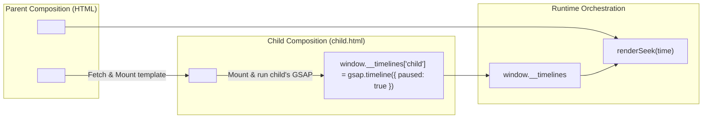
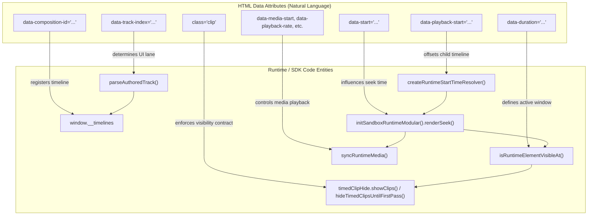

<!-- source: DeepWiki mcp.deepwiki.com · repo heygen-com/hyperframes · extra page Compositions and Data Attributes · fetched 2026-11-02 -->

# Compositions and Data Attributes

<details>
<summary>Relevant source files</summary>

The following files were used as context for generating this wiki page:

- [docs/concepts/compositions.mdx](docs/concepts/compositions.mdx)
- [docs/concepts/data-attributes.mdx](docs/concepts/data-attributes.mdx)
- [docs/concepts/determinism.mdx](docs/concepts/determinism.mdx)
- [docs/concepts/variables.mdx](docs/concepts/variables.mdx)
- [docs/deploy/aws-lambda.mdx](docs/deploy/aws-lambda.mdx)
- [docs/deploy/migrating-to-hyperframes-lambda.mdx](docs/deploy/migrating-to-hyperframes-lambda.mdx)
- [docs/introduction.mdx](docs/introduction.mdx)
- [docs/packages/aws-lambda.mdx](docs/packages/aws-lambda.mdx)
- [docs/packages/core.mdx](docs/packages/core.mdx)
- [docs/packages/gcp-cloud-run.mdx](docs/packages/gcp-cloud-run.mdx)
- [docs/packages/shader-transitions.mdx](docs/packages/shader-transitions.mdx)
- [docs/packages/studio.mdx](docs/packages/studio.mdx)
- [docs/studio/canvas.mdx](docs/studio/canvas.mdx)
- [packages/cli/src/docs/compositions.md](packages/cli/src/docs/compositions.md)
- [packages/core/package-subpaths.json](packages/core/package-subpaths.json)
- [packages/core/src/runtime/audioFx.test.ts](packages/core/src/runtime/audioFx.test.ts)
- [packages/core/src/runtime/audioFx.ts](packages/core/src/runtime/audioFx.ts)
- [packages/core/src/runtime/init.test.ts](packages/core/src/runtime/init.test.ts)
- [packages/core/src/runtime/init.ts](packages/core/src/runtime/init.ts)
- [packages/core/src/runtime/init.videoPreseek.test.ts](packages/core/src/runtime/init.videoPreseek.test.ts)
- [packages/core/src/runtime/media.preseek.test.ts](packages/core/src/runtime/media.preseek.test.ts)
- [packages/core/src/runtime/media.test.ts](packages/core/src/runtime/media.test.ts)
- [packages/core/src/runtime/media.ts](packages/core/src/runtime/media.ts)
- [packages/core/src/runtime/mediaSteer.test.ts](packages/core/src/runtime/mediaSteer.test.ts)
- [packages/core/src/runtime/startResolver.test.ts](packages/core/src/runtime/startResolver.test.ts)
- [packages/core/src/runtime/startResolver.ts](packages/core/src/runtime/startResolver.ts)
- [packages/core/src/runtime/timeline.test.ts](packages/core/src/runtime/timeline.test.ts)
- [packages/core/src/runtime/timeline.ts](packages/core/src/runtime/timeline.ts)
- [packages/core/src/runtime/webAudioTransport.test.ts](packages/core/src/runtime/webAudioTransport.test.ts)
- [packages/core/src/runtime/webAudioTransport.ts](packages/core/src/runtime/webAudioTransport.ts)
- [packages/parsers/src/referenceResolver.test.ts](packages/parsers/src/referenceResolver.test.ts)
- [packages/parsers/src/referenceResolver.ts](packages/parsers/src/referenceResolver.ts)
- [packages/producer/src/services/render/wrappedMountTiming.integration.test.ts](packages/producer/src/services/render/wrappedMountTiming.integration.test.ts)

</details>


This page details the core HTML composition model used by HyperFrames to represent video timelines declaratively. It explains how compositions and clips are structured in the DOM, the key data attributes that define timing and nesting relationships, and the runtime contract driven by `class="clip"`. The page also covers the purpose and usage of `data-composition-id`, clip types, timing semantics including relative timings, and how sub-compositions integrate into a parent timeline via playback offsets.

---

## The Composition Model

In HyperFrames, a **composition** is an HTML document (or subtree) that declares a video structure. Each composition is identified by a root element bearing a `data-composition-id` attribute, which acts as a unique namespace for timeline registration and animation. Nested compositions appear as child elements with their own `data-composition-id`. The runtime manages timing, visibility, and media playback deterministically through a rich declarative attribute set [docs/concepts/compositions.mdx:6-11]().

### Root Element Required Attributes

Every composition root (top-level or sub-composition) must specify:

| Attribute | Description |
|---|---|
| `data-composition-id` | Unique string ID for the composition’s timeline and registered animation. This ID is how the runtime and SDK identify the composition in the global `window.__timelines` object. |
| `data-width` / `data-height` | Author’s declared frame dimensions in pixels (e.g. 1920x1080). |
| `data-duration` | Duration in seconds of the composition timeline, used for playback length and visibility calculations. |
| `data-no-timeline` | Optional boolean flag to mark a composition that does not use a timeline (e.g. pure CSS/Three.js). It signals the runtime not to wait on GSAP timeline registration. |

The root element establishes the coordinate and timing boundaries for the contained clips [docs/concepts/compositions.mdx:18-27]().

### Clip Types

Clips—units rendered on the timeline—must be marked with `class="clip"` and fall into these categories:

| Clip Type | HTML Tag / Selector | Notes |
|---|---|---|
| Video clip | `<video class="clip">` | Requires `muted` and `playsinline` for deterministic playback. Supports trimming with `data-media-start`. |
| Audio clip | `<audio class="clip">` | Audio-only media intended for mixing. |
| Image clip | `` | Static still images on the timeline. |
| Nested composition | `<div class="clip" data-composition-id>` | Embeds another composition inline or via `data-composition-src`. |

Each clip’s playback and screen visibility derive from their timing attributes, and the runtime enforces that `class="clip"` elements are automatically hidden outside their active intervals [docs/concepts/compositions.mdx:48-53, 27-29]().

Sources:
- [docs/concepts/compositions.mdx:6-11]()
- [docs/concepts/compositions.mdx:18-27]()
- [docs/concepts/compositions.mdx:48-53]()
- [docs/concepts/compositions.mdx:27-29]()

---

## Data Attribute Timing Model

HyperFrames uses declarative `data-*` attributes to specify clip timing relative to composition boundaries. Timing is computed and enforced by the runtime.

### Core Timing Attributes

| Attribute | Type/Format | Meaning / Effect |
|---|---|---|
| `data-start` | Number or relative string | Start time in seconds relative to the composition’s start.<br>Can be numeric (e.g. `"0.5"`) or relative (e.g. `"intro + 0.5"` referencing another clip). |
| `data-duration` | Number | How long the clip remains active (seconds). |
| `data-end` | Number or calculated | Optional explicit end time; if absent calculated as `start + duration`. |
| `data-track-index` | Integer | The track/lane index to position the clip vertically on the timeline, used to avoid temporal overlap in the UI but not affecting layer rendering order. |
| `data-playback-start` | Number | For nested compositions: the offset into the child timeline to begin playback at (local offset inside the nested comp). Default is 0. |
| `data-playback-rate` | Number | Playback speed multiplier (e.g. 1 = normal speed). |

These attributes map one-to-one to runtime timeline entries that drive clip visibility, media seek, and composition nesting with offset adjustment [packages/core/src/runtime/timeline.ts:36-91]().

### Relative Timing Syntax

`data-start` can be relative to another clip's end or start using syntax like:

```html
data-start="intro + 0.5"
```

Meaning this clip begins 0.5 seconds after the clip with id `intro` ends. The compiler and runtime resolve such references in the timeline registration phase [docs/reference/html-schema.mdx:173-190](). The `createRuntimeStartTimeResolver` function is responsible for parsing and resolving these expressions [packages/core/src/runtime/startResolver.ts:138-155]().

### The `class="clip"` Contract

All clips must have `class="clip"` to opt into:

- The runtime automatically hiding the clip outside its active `[start, start + duration)` window.
- Consistent driver of clip visibility independent of any imperative script.
- A contract that prevents direct script manipulation of `.style.display` or media playback controls for clips, ensuring deterministic seek-driven playback.

This contract enables deterministic frame-by-frame rendering. See the detailed runtime visibility function that checks clip window inclusion [packages/core/src/runtime/timeline.ts:36-91]().

Sources:
- [packages/core/src/runtime/timeline.ts:36-91]()
- [docs/reference/html-schema.mdx:173-190]()
- [packages/core/src/runtime/startResolver.ts:138-155]()
- [docs/concepts/compositions.mdx:27-29]()

---

## Nested Compositions

HyperFrames supports complex video hierarchies by nesting compositions inside others.

### Ways to Nest Compositions

1.  **External Composition Source**

    A container element uses both:

    -   `data-composition-id="unique-id"` (runtime registration key)
    -   `data-composition-src="path/to/composition.html"` (reference to external file)

    At runtime, the external file is fetched and its `<template>` content mounted inside the referencing element. The child composition's timeline is registered under its `data-composition-id` inside the global timeline registry (`window.__timelines`).

    Example:

    ```html
    <div
      data-composition-id="intro-anim"
      data-composition-src="compositions/intro-anim.html"
      data-start="0"
      data-duration="4"
      data-playback-start="0"
      data-track-index="3"
    ></div>
    ```

    The nested timeline plays starting at `data-playback-start` seconds into the child timeline. The parent timeline offsets the child playback by its own `data-start` timing. The nested composition timings are local to itself; the parent is responsible for global offsetting [docs/concepts/compositions.mdx:63-115]().

2.  **Inline Composition**

    A nested composition may appear inline, as a subtree inside the parent HTML without the `data-composition-src`. This comp is still identified by `data-composition-id`, and its timeline is registered normally.

    Example:

    ```html
    <div id="root" data-composition-id="root" data-start="0" data-width="1920" data-height="1080">
      <div id="el-5" data-composition-id="intro-anim" data-start="0" data-track-index="3" data-width="1920" data-height="1080">
        <div class="title">Welcome!</div>
      </div>

      <script>
        const introTl = gsap.timeline({ paused: true });
        window.__timelines["intro-anim"] = introTl;
      </script>
    </div>
    ```

    No `<template>` wrapper needed, and the inline nested timeline registers normally under its ID [docs/concepts/compositions.mdx:118-143]().

### Data Flow Diagram for Nested Compositions


**Diagram: Nested Composition Data Flow**

The parent element's `data-start` defines when the child composition begins playing on the global timeline; `data-playback-start` (if present) defines where inside the child timeline playback begins. The runtime’s `renderSeek` function is responsible for syncing these nested timelines together [docs/concepts/compositions.mdx:64-110]().

Sources:
- [docs/concepts/compositions.mdx:63-115]()
- [docs/concepts/compositions.mdx:118-143]()
- [docs/concepts/compositions.mdx:64-110]()

---

## Media and Playback Attributes

Media clips (`<video>`, `<audio>`) support additional attributes to control playback and rendering:

| Attribute | Role |
|---|---|
| `data-media-start` | Offset in seconds inside the media source to begin playback from (trimming). |
| `data-playback-start` | For nested compositions: local offset inside nested timeline playback. |
| `data-playback-rate` | Playback speed multiplier (0.1 to 5.0). This value is read by `readElementPlaybackRate` [packages/core/src/runtime/media.ts:27-28]() and clamped to a valid range [packages/core/src/runtime/media.test.ts:60-65](). |
| `data-has-audio="true"` | Declares this video clip contributes audio to the final mix. Important for render pipeline audio muxing. |
| `data-color-grading` | JSON object describing LUTs and adjustments to apply color transformations during rendering. |

These media attributes form the basis for deterministic playback, ensuring the timeline controls the exact media position without relying on browser clock time [docs/reference/html-schema.mdx:125-158](), [docs/concepts/determinism.mdx:11-14](). The `refreshRuntimeMediaCache` function collects these attributes to build `RuntimeMediaClip` objects [packages/core/src/runtime/media.ts:113-151]().

Sources:
- [packages/core/src/runtime/media.ts:27-28]()
- [packages/core/src/runtime/media.test.ts:60-65]()
- [docs/reference/html-schema.mdx:125-158]()
- [docs/concepts/determinism.mdx:11-14]()
- [packages/core/src/runtime/media.ts:113-151]()

---

## Deterministic Rendering and Visibility Contract

HyperFrames implements a **pure seek-driven deterministic rendering model**:

-   The runtime determines exactly which clips are visible at each frame by inspecting timing attributes.
-   Elements with `class="clip"` are rendered visible if and only if the current frame’s time lies within their `[data-start, data-start + data-duration)` window.
-   Media playback positions (video/audio currentTime) are set directly from the frame clock.
-   Script-initiated `.play()`, `.pause()`, or `.currentTime` modifications are forbidden to avoid animation drift.

The function `isRuntimeElementVisibleAt` [packages/core/src/runtime/timeline.ts:76-99]() in `packages/core/src/runtime/timeline.ts` encapsulates this visibility logic, reading `data-start`, `data-duration`, and nested composition info from the DOM, with fallback to timeline metadata in `window.__timelines`. This function uses `runtimeElementWindow` to determine the clip's active time span [packages/core/src/runtime/timeline.ts:34-74]().

This makes HyperFrames projects fully frame-reproducible: rendering frame 7 always yields the same DOM and media state regardless of runtime environment.

Sources:
- [packages/core/src/runtime/timeline.ts:76-99]()
- [packages/core/src/runtime/timeline.ts:34-74]()
- [docs/concepts/determinism.mdx:1-55]()

---

## Summary Diagram: Data Attributes to Runtime Control Space


**Diagram: Data Attributes to Runtime Control Flow**

This mapping diagram shows how the declarative composition attributes drive internal timeline registration, deterministic playback timing, and runtime visibility enforcement. Key runtime functions like `initSandboxRuntimeModular` [packages/core/src/runtime/init.ts:5]() orchestrate the overall rendering process, while `syncRuntimeMedia` [packages/core/src/runtime/media.ts:93]() handles media synchronization.

Sources:
- [packages/core/src/runtime/init.ts:5]()
- [packages/core/src/runtime/media.ts:93]()
- [packages/core/src/runtime/timeline.ts:76-99]()
- [packages/core/src/runtime/startResolver.ts:41]()
- [packages/core/src/runtime/timeline.ts:154-159]()
- [packages/core/src/runtime/timedClipHide.ts:38]()
- [packages/core/src/runtime/timedClipHide.ts:7]()

---

# References and Sources

-   HyperFrames composition model, nested composition example, and clip types [docs/concepts/compositions.mdx:6-185]()
-   Runtime timeline visibility checks, media timing resolution, and clip track parsing: `packages/core/src/runtime/timeline.ts:36-91, 93-151`()
-   Data attribute timing compilation principles [packages/core/src/compiler/timingCompiler.ts:1-179]()
-   Visibility and timing enforcement via `class="clip"` contract [docs/concepts/compositions.mdx:27-29]()
-   Nested composition mounting and playback offset [docs/concepts/compositions.mdx:63-115]()
-   Media attributes and color grading contract [docs/reference/html-schema.mdx:125-158]()
-   Runtime deterministic playback and disallowed script control [docs/concepts/determinism.mdx:1-55]()
-   `createRuntimeStartTimeResolver` definition [packages/core/src/runtime/startResolver.ts:41]()
-   `readElementPlaybackRate` definition [packages/core/src/runtime/media.ts:27-28]()
-   `refreshRuntimeMediaCache` definition [packages/core/src/runtime/media.ts:113-151]()
-   `parseAuthoredTrack` definition [packages/core/src/runtime/timeline.ts:154-159]()
-   `initSandboxRuntimeModular` definition [packages/core/src/runtime/init.ts:5]()
-   `syncRuntimeMedia` definition [packages/core/src/runtime/media.ts:93]()
-   `showClips` and `hideTimedClipsUntilFirstPass` definitions [packages/core/src/runtime/timedClipHide.ts:38]() and [packages/core/src/runtime/timedClipHide.ts:7]()

---

This page fully describes the foundational HyperFrames HTML composition and timing attribute scheme, pivotal for understanding rendering orchestration and frame-accurate playback.

---

