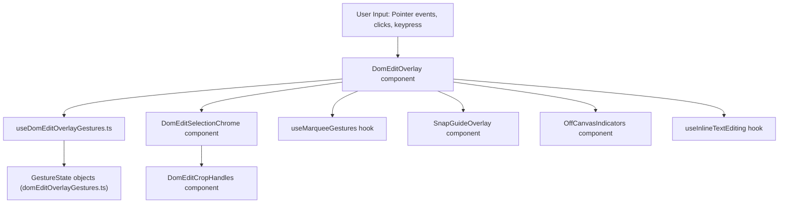
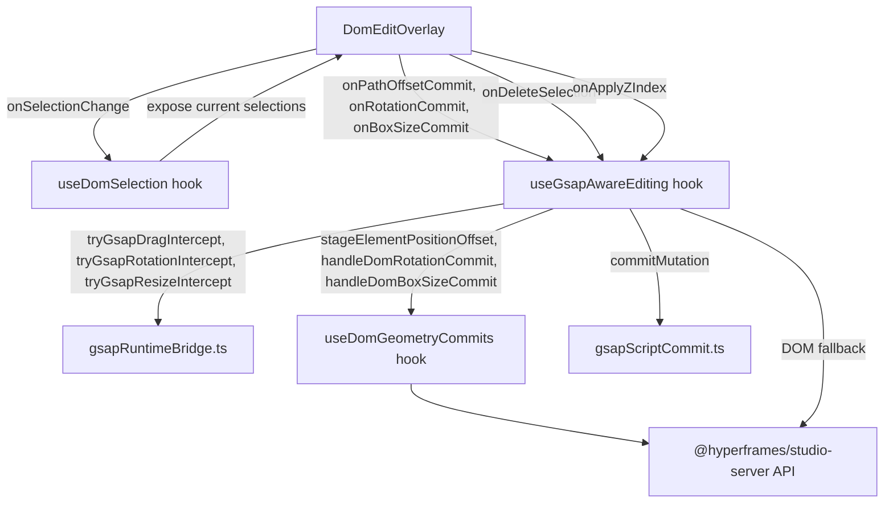

<!-- source: DeepWiki mcp.deepwiki.com · repo heygen-com/hyperframes · extra page DOM Edit Overlay and Selection · fetched 2026-11-02 -->

# DOM Edit Overlay and Selection

Relevant source files

The following files were used as context for generating this wiki page:

- [packages/core/src/runtime/clipReveal.ts](packages/core/src/runtime/clipReveal.ts)
- [packages/core/src/runtime/init.mediaClipIndex.test.ts](packages/core/src/runtime/init.mediaClipIndex.test.ts)
- [packages/core/src/runtime/init.timingResolver.test.ts](packages/core/src/runtime/init.timingResolver.test.ts)
- [packages/core/src/runtime/manualEditGestureWatch.test.ts](packages/core/src/runtime/manualEditGestureWatch.test.ts)
- [packages/core/src/runtime/manualEditGestureWatch.ts](packages/core/src/runtime/manualEditGestureWatch.ts)
- [packages/core/src/runtime/runtimeSeekFixture.test-helpers.ts](packages/core/src/runtime/runtimeSeekFixture.test-helpers.ts)
- [packages/core/src/runtime/timelineRebindPolicy.test.ts](packages/core/src/runtime/timelineRebindPolicy.test.ts)
- [packages/core/src/runtime/timelineRebindPolicy.ts](packages/core/src/runtime/timelineRebindPolicy.ts)
- [packages/core/src/studioPreviewMark.test.ts](packages/core/src/studioPreviewMark.test.ts)
- [packages/core/src/studioPreviewMark.ts](packages/core/src/studioPreviewMark.ts)
- [packages/core/tsconfig.runtime.json](packages/core/tsconfig.runtime.json)
- [packages/studio-server/src/createStudioApi.ts](packages/studio-server/src/createStudioApi.ts)
- [packages/studio-server/src/helpers/previewErrorPage.ts](packages/studio-server/src/helpers/previewErrorPage.ts)
- [packages/studio-server/src/routes/previewErrorDocument.test.ts](packages/studio-server/src/routes/previewErrorDocument.test.ts)
- [packages/studio/src/components/editor/DomEditCropHandles.test.tsx](packages/studio/src/components/editor/DomEditCropHandles.test.tsx)
- [packages/studio/src/components/editor/DomEditCropHandles.tsx](packages/studio/src/components/editor/DomEditCropHandles.tsx)
- [packages/studio/src/components/editor/DomEditOverlay.test.ts](packages/studio/src/components/editor/DomEditOverlay.test.ts)
- [packages/studio/src/components/editor/DomEditOverlay.tsx](packages/studio/src/components/editor/DomEditOverlay.tsx)
- [packages/studio/src/components/editor/DomEditSelectionChrome.test.tsx](packages/studio/src/components/editor/DomEditSelectionChrome.test.tsx)
- [packages/studio/src/components/editor/DomEditSelectionChrome.tsx](packages/studio/src/components/editor/DomEditSelectionChrome.tsx)
- [packages/studio/src/components/editor/domEditLayerWalkCache.test.ts](packages/studio/src/components/editor/domEditLayerWalkCache.test.ts)
- [packages/studio/src/components/editor/domEditLayerWalkCache.ts](packages/studio/src/components/editor/domEditLayerWalkCache.ts)
- [packages/studio/src/components/editor/domEditOverlayBasis.ts](packages/studio/src/components/editor/domEditOverlayBasis.ts)
- [packages/studio/src/components/editor/domEditOverlayCrop.test.ts](packages/studio/src/components/editor/domEditOverlayCrop.test.ts)
- [packages/studio/src/components/editor/domEditOverlayCrop.ts](packages/studio/src/components/editor/domEditOverlayCrop.ts)
- [packages/studio/src/components/editor/domEditOverlayGeometry.ts](packages/studio/src/components/editor/domEditOverlayGeometry.ts)
- [packages/studio/src/components/editor/domEditOverlayGestures.ts](packages/studio/src/components/editor/domEditOverlayGestures.ts)
- [packages/studio/src/components/editor/domEditOverlayMeasurePass.ts](packages/studio/src/components/editor/domEditOverlayMeasurePass.ts)
- [packages/studio/src/components/editor/domEditOverlayShape.ts](packages/studio/src/components/editor/domEditOverlayShape.ts)
- [packages/studio/src/components/editor/domEditOverlayStartGesture.test.ts](packages/studio/src/components/editor/domEditOverlayStartGesture.test.ts)
- [packages/studio/src/components/editor/domEditOverlayStartGesture.ts](packages/studio/src/components/editor/domEditOverlayStartGesture.ts)
- [packages/studio/src/components/editor/domEditOverlayTransform.ts](packages/studio/src/components/editor/domEditOverlayTransform.ts)
- [packages/studio/src/components/editor/domEditing.test.ts](packages/studio/src/components/editor/domEditing.test.ts)
- [packages/studio/src/components/editor/domEditing.ts](packages/studio/src/components/editor/domEditing.ts)
- [packages/studio/src/components/editor/domEditingDom.ts](packages/studio/src/components/editor/domEditingDom.ts)
- [packages/studio/src/components/editor/domEditingElement.ts](packages/studio/src/components/editor/domEditingElement.ts)
- [packages/studio/src/components/editor/domEditingLayers.test.ts](packages/studio/src/components/editor/domEditingLayers.test.ts)
- [packages/studio/src/components/editor/domEditingLayers.ts](packages/studio/src/components/editor/domEditingLayers.ts)
- [packages/studio/src/components/editor/domEditingTypes.ts](packages/studio/src/components/editor/domEditingTypes.ts)
- [packages/studio/src/components/editor/manualOffsetDrag.test.ts](packages/studio/src/components/editor/manualOffsetDrag.test.ts)
- [packages/studio/src/components/editor/manualOffsetDrag.ts](packages/studio/src/components/editor/manualOffsetDrag.ts)
- [packages/studio/src/components/editor/offCanvasIndicatorGeometry.complexity.test.ts](packages/studio/src/components/editor/offCanvasIndicatorGeometry.complexity.test.ts)
- [packages/studio/src/components/editor/offCanvasIndicatorGeometry.ts](packages/studio/src/components/editor/offCanvasIndicatorGeometry.ts)
- [packages/studio/src/components/editor/offCanvasIndicatorRefresh.test.tsx](packages/studio/src/components/editor/offCanvasIndicatorRefresh.test.tsx)
- [packages/studio/src/components/editor/offCanvasIndicatorRefresh.ts](packages/studio/src/components/editor/offCanvasIndicatorRefresh.ts)
- [packages/studio/src/components/editor/plainTranslate.ts](packages/studio/src/components/editor/plainTranslate.ts)
- [packages/studio/src/components/editor/previewGestureStarts.ts](packages/studio/src/components/editor/previewGestureStarts.ts)
- [packages/studio/src/components/editor/propertyPanelTransformCommit.test.ts](packages/studio/src/components/editor/propertyPanelTransformCommit.test.ts)
- [packages/studio/src/components/editor/propertyPanelTransformCommit.ts](packages/studio/src/components/editor/propertyPanelTransformCommit.ts)
- [packages/studio/src/components/editor/useDomEditNudge.test.tsx](packages/studio/src/components/editor/useDomEditNudge.test.tsx)
- [packages/studio/src/components/editor/useDomEditNudge.ts](packages/studio/src/components/editor/useDomEditNudge.ts)
- [packages/studio/src/components/editor/useDomEditOverlayGestures.ts](packages/studio/src/components/editor/useDomEditOverlayGestures.ts)
- [packages/studio/src/components/nle/useCompositionStack.test.tsx](packages/studio/src/components/nle/useCompositionStack.test.tsx)
- [packages/studio/src/components/nle/useCompositionStack.ts](packages/studio/src/components/nle/useCompositionStack.ts)
- [packages/studio/src/hooks/elementOffsetStager.ts](packages/studio/src/hooks/elementOffsetStager.ts)
- [packages/studio/src/hooks/gsapRuntimeKeyframes.ts](packages/studio/src/hooks/gsapRuntimeKeyframes.ts)
- [packages/studio/src/hooks/useCropOverlay.ts](packages/studio/src/hooks/useCropOverlay.ts)
- [packages/studio/src/hooks/useDomGeometryCommit.test.tsx](packages/studio/src/hooks/useDomGeometryCommit.test.tsx)
- [packages/studio/src/hooks/useDomGeometryCommit.ts](packages/studio/src/hooks/useDomGeometryCommit.ts)
- [packages/studio/src/hooks/useDomGeometryCommits.test.tsx](packages/studio/src/hooks/useDomGeometryCommits.test.tsx)
- [packages/studio/src/hooks/useDomGeometryCommits.ts](packages/studio/src/hooks/useDomGeometryCommits.ts)
- [packages/studio/src/hooks/useGsapAwareEditing.test.tsx](packages/studio/src/hooks/useGsapAwareEditing.test.tsx)
- [packages/studio/src/hooks/useGsapAwareEditing.ts](packages/studio/src/hooks/useGsapAwareEditing.ts)
- [packages/studio/src/player/hooks/usePlayerHandle.test.tsx](packages/studio/src/player/hooks/usePlayerHandle.test.tsx)
- [packages/studio/src/player/hooks/usePlayerHandle.ts](packages/studio/src/player/hooks/usePlayerHandle.ts)
- [packages/studio/src/player/hooks/useShadowPreviewReload.ts](packages/studio/src/player/hooks/useShadowPreviewReload.ts)
- [packages/studio/src/player/hooks/useTimelinePlayer.shadowReload.test.ts](packages/studio/src/player/hooks/useTimelinePlayer.shadowReload.test.ts)
- [packages/studio/src/utils/sourceScopedSelectorIndex.test.ts](packages/studio/src/utils/sourceScopedSelectorIndex.test.ts)
- [packages/studio/src/utils/sourceScopedSelectorIndex.ts](packages/studio/src/utils/sourceScopedSelectorIndex.ts)

This section covers the detailed implementation and internal mechanisms of the DOM Edit Overlay and Selection system within the HyperFrames Studio package (`@hyperframes/studio`). It includes user interaction gestures, geometry calculations, selection chrome rendering, marquee selection, snapping mechanics, crop handle support, off-canvas indicators, layers panel integration, inline text editing, element lifecycle operations, and commit hooks. This system is fundamental for enabling WYSIWYG DOM editing capabilities on the canvas overlay in the Studio.

---

## 1. Purpose and Scope

The DOM Edit Overlay and Selection subsystem provides the interactive overlay displayed on top of the preview iframe in the Studio. It enables:

- Selecting single or grouped DOM elements.
- Manipulating the elements with gestures: move (drag), resize, rotate.
- Displaying selection outlines ("chrome"), crop handles, rotation handles.
- Showing marquee (lasso) selection for multi-element grouping.
- Providing snap guides and snap engine integration for precise alignment.
- Supporting inline text editing of editable surfaces.
- Off-canvas indicators for elements partially or fully outside the viewport.
- Layer panel integration to reflect z-order and element hierarchy.
- Lifecycle operations such as element deletion, commit hooks for user edits.
- Coordinating between preview iframe interaction and the editing state.

This page breaks down the major files, classes, hooks, and their data flow for how these features are implemented and composed.

---

## 2. Core Components and Data Flow

The DOM Edit Overlay and Selection system revolves around a React component `DomEditOverlay` which renders the editable selection overlays and handles user gestures to manipulate DOM elements. This component manages the complex state of current selection, hover states, group selections, and gestures using several coordinating hooks and utilities.

### 2.1 `DomEditOverlay` Component

- **Location**: `packages/studio/src/components/editor/DomEditOverlay.tsx`
- **Core responsibilities**:
  - Render the selection framework on top of the iframe preview.
  - Handle mouse and pointer events to initiate drag, resize, rotate gestures.
  - Manage marquee selection gestures for multi-select.
  - Maintain refs to track gesture state, blocked moves, suppression of unwanted clicks.
  - Invoke callbacks to commit style changes, positional offsets, rotations.
  - Coordinate with inline text editing and context menu.
  - Leverages several sub-components to render crop handles, selection outlines, marquee overlays, and off-canvas indicators.

The component receives props like `selection`, `groupSelections`, `hoverSelection`, `iframeRef`, and callbacks for commit events (move, resize, rotate, z-index reorder, style changes) [packages/studio/src/components/editor/DomEditOverlay.tsx:56-128]().

**Gesture State**: It maintains gesture state refs for ongoing user interactions (dragging, resizing, rotation), and blocked move states for threshold detection [packages/studio/src/components/editor/DomEditOverlay.tsx:161-162]().

**Selection Shape Styles**: It computes CSS styles for the selection box highlight based on the current selected elements, including styling for rotated elements [packages/studio/src/components/editor/DomEditOverlay.tsx:31]().

### 2.2 Gesture Handling and Geometry

- Gesture tracking and processing are encapsulated in `domEditOverlayGestures.ts` [packages/studio/src/components/editor/domEditOverlayGestures.ts]() and `useDomEditOverlayGestures.ts` [packages/studio/src/components/editor/useDomEditOverlayGestures.ts]().
- Gesture state includes drag, resize, rotate with tracking of start coordinates, centers, offsets, rotation snapshots, resize handles, etc. [packages/studio/src/components/editor/domEditOverlayGestures.ts:49-97]().
- Functions like `focusDomEditOverlayElement` help focus elements programmatically [packages/studio/src/components/editor/domEditOverlayGestures.ts:145-147]().
- Utility functions decide axis lock during shift key drag [packages/studio/src/components/editor/domEditOverlayGestures.ts:31-36](), handle rotation snapping [packages/studio/src/components/editor/domEditOverlayGestures.ts:40](), and blocked move detection [packages/studio/src/components/editor/domEditOverlayGestures.ts:24]().
- Shift-click selection logic reuses hover cache to optimize multi-select resolution [packages/studio/src/components/editor/domEditOverlayGestures.ts:160-175]().

### 2.3 Selection Chrome and Crop Handles

- `DomEditSelectionChrome.tsx` draws the visible rectangular outlines and resize handles on selected DOM elements [packages/studio/src/components/editor/DomEditSelectionChrome.tsx]().
- Supports rotation handles and integrates crop handles for elements supporting cropping [packages/studio/src/components/editor/DomEditSelectionChrome.tsx:28]().
- Crop handles use precise hit test rectangles positioned just outside the crop edge for user resizing [packages/studio/src/components/editor/DomEditCropHandles.tsx:47-87]().
- Crop edges support dragging with dynamic inset updates, integrated with style commits [packages/studio/src/components/editor/DomEditCropHandles.tsx:104-165]().
- `DomEditCropHandles.tsx` manages the crop handles UI and drag state; it tracks crop edges or moving of the crop window and commits clipped area changes [packages/studio/src/components/editor/DomEditCropHandles.tsx:108-112]().

### 2.4 Marquee Selection

- Marquee gestures enable lasso or rectangle multi-selection by dragging on empty canvas space.
- Implemented in `marqueeCommit.ts` with hooks like `useMarqueeGestures` [packages/studio/src/components/editor/DomEditOverlay.tsx:6]().
- Highlights elements intersecting the marquee and allows combined selection on mouse release.

### 2.5 Snap Engine Integration

- The snap engine, exposed via `SnapGuideOverlay.tsx` [packages/studio/src/components/editor/SnapGuideOverlay.tsx]() and snap-related context and helpers like `snapEngine.ts`, provides guide lines for alignment during drag or resize.
- `DomEditOverlay` connects gesture delta updates with snap guide adjustments [packages/studio/src/components/editor/useDomEditOverlayGestures.ts:181-182]().
- Rotation snaps and axis lock modifications also behave consistently with snap rules.

### 2.6 Off-canvas Indicators and Layers Panel

- Off-canvas indicators render small visual hints near the edges of the viewport when elements are partially or fully outside visible bounds.
- Implemented via `OffCanvasIndicators.tsx` [packages/studio/src/components/editor/OffCanvasIndicators.tsx]() and hooks like `useOffCanvasIndicators` [packages/studio/src/components/editor/DomEditOverlay.tsx:41]().
- The Layers panel integrates with the editing overlay and selection system by reflecting the hierarchy and z-order of selected elements, and allowing element reveal and reorder commits. This is supported by `domEditingLayers.ts` which collects layer items [packages/studio/src/components/editor/domEditingLayers.test.ts:4]().
- Layer reveal commits and rollback mechanics enable temporary reveal animations and fix position updates safely.
- Lifecycle hooks handle z-index reorder commits optimized with undo coalescing for gestures [packages/studio/src/components/editor/DomEditOverlay.tsx:115-128]().

### 2.7 Inline Text Editing

- Text elements can be edited inline within the overlay.
- Hook `useInlineTextEditing` manages the start/end lifecycle of text editing sessions [packages/studio/src/components/editor/DomEditOverlay.tsx:34]().
- The overlay `DomEditSelectionChrome` disables pointer events on the selection box itself while text editing is active to allow smooth caret placement and typing.

### 2.8 Selection Management and Element Lifecycle

- The selection state and group multi-selections are managed, updated, and synchronized with the timeline and preview via the `useDomSelection` hook.
- This hook handles complex cases like additive selection, repeated selection guarding, drilling into group elements, and hover selection previews.
- Lifecycle operations such as element deletion, style commits, and position offset commits funnel through hooks like `useGsapAwareEditing` [packages/studio/src/hooks/useGsapAwareEditing.ts]() that also handle server API calls, SDK integration, and conflict resolution.

---

## 3. Data Flow Overview and Mermaid Diagrams

The following diagrams illustrate the flow from user interactions ("Natural Language Space") to code entities ("Code Entity Space") and the interaction between major modules.

### 3.1 User Interaction to DOM Edit Overlay Components

**Sources:**
- `packages/studio/src/components/editor/DomEditOverlay.tsx:1-163`
- `packages/studio/src/components/editor/useDomEditOverlayGestures.ts:1-103`
- `packages/studio/src/components/editor/domEditOverlayGestures.ts:49-97`
- `packages/studio/src/components/editor/DomEditSelectionChrome.tsx`
- `packages/studio/src/components/editor/DomEditCropHandles.tsx:1-165`
- `packages/studio/src/components/editor/marqueeCommit.ts`
- `packages/studio/src/components/editor/SnapGuideOverlay.tsx`
- `packages/studio/src/components/editor/OffCanvasIndicators.tsx`
- `packages/studio/src/components/editor/useInlineTextEditing.ts`

---

### 3.2 Selection State and Lifecycle Commit Flow

**Sources:**
- `packages/studio/src/components/editor/DomEditOverlay.tsx:56-128`
- `packages/studio/src/hooks/useGsapAwareEditing.ts:1-179`
- `packages/studio/src/hooks/gsapRuntimeBridge.ts`
- `packages/studio/src/hooks/useDomGeometryCommits.ts`
- `packages/studio-server/src/createStudioApi.ts:1-100`

---

## 4. Detailed Technical Breakdown

### 4.1 `DomEditOverlay` Props and Interaction

The overlay component provides a comprehensive API for:

- Receiving the active composition path and selection(s).
- Hover states for preview pointer.
- Allow/disallow canvas movement and body drift.
- Callback hooks for pointer/mouse event handling on canvas to start gestures.
- Commit callbacks for path offset, box size, rotation, style changes.
- Marquee selection start and complete callbacks.
- Deletion notification and z-index reorder hook interface.
- Inline text editing notifications for focus management.

The internal state tracks interaction suppression to avoid click noise, gesture state refs, and selection shape styles [packages/studio/src/components/editor/DomEditOverlay.tsx:56-163]().

### 4.2 Gesture Handling (`useDomEditOverlayGestures.ts`, `domEditOverlayGestures.ts`)

Gestures support:

- Dragging (move) elements [packages/studio/src/components/editor/useDomEditOverlayGestures.ts:177-184]().
- Resizing with anchor pinning and coordinate transforms to maintain element center [packages/studio/src/components/editor/useDomEditOverlayGestures.ts:200-201]().
- Rotation with snapping to defined degree steps and bypass beyond small angles [packages/studio/src/components/editor/useDomEditOverlayGestures.ts:160-173](), [packages/studio/src/components/editor/domEditOverlayGestures.ts:40-47]().
- Group gesture handling for multi-selection manipulation [packages/studio/src/components/editor/useDomEditOverlayGestures.ts:150-152]().
- Blocked move detection when drag is below threshold to prevent accidental moves [packages/studio/src/components/editor/useDomEditOverlayGestures.ts:140-146]().

Utilities include:

- Axis locking when shift is pressed [packages/studio/src/components/editor/domEditOverlayGestures.ts:31-36]().
- Resolving candidates for shift-click multi-selection accurately using cached hover data [packages/studio/src/components/editor/domEditOverlayGestures.ts:160-175]().
- Coordinate scaling based on page layout [packages/studio/src/components/editor/domEditOverlayGeometry.ts:46]().
- Functions to focus overlays and check rotation changes [packages/studio/src/components/editor/domEditOverlayGestures.ts:145-147]().

### 4.3 Selection Chrome (`DomEditSelectionChrome.tsx`)

Visual selection handles utilize:

- Absolute-positioned divs for element boundaries.
- Four corner resize handles with diagonal resize cursors.
- Rotation handle outside the selection box.
- Crop edge handles drawn around the element clip-path inset boundaries.
- Styling to indicate active hover and drag states.
- Disabled pointer interaction while inline text editing is active.

The crop inset data is coordinated with an internal crop state and updated based on drag gestures [packages/studio/src/components/editor/DomEditSelectionChrome.tsx:28](), [packages/studio/src/components/editor/DomEditCropHandles.tsx:104-165]().

### 4.4 Marquee and Multi-Selection

The marquee overlay renders a dashed rectangular outline during drag selection on empty canvas space, triggered through `useMarqueeGestures` and rendered with the `MarqueeOverlay` component [packages/studio/src/components/editor/DomEditOverlay.tsx:6-7](). On completion, the selected elements inside the marquee bounds are passed to the overlay’s selection change logic to update group selections. Multiselection is visually represented with a combined bounding box and individual outlines.

### 4.5 Snap Guides and Snapping Engine

The snap overlay component (`SnapGuideOverlay.tsx`) tracks live snap targets emitted by the snap engine [packages/studio/src/components/editor/DomEditOverlay.tsx:26](). The snap context is created per gesture to collect targets and compute snap deltas [packages/studio/src/components/editor/domEditOverlayStartGesture.ts:107-118](). The snap engine supports snapping to edges, centers, and guides on move, resize, and rotate gestures, integrated tightly with the gesture state in `domEditOverlayGestures.ts` [packages/studio/src/components/editor/useDomEditOverlayGestures.ts:181-182]().

### 4.6 Off-Canvas Indicators

Parts of elements moved outside the iframe viewport bounds trigger rendering of small glyphs along the edges (off-canvas indicators) to visually hint their out-of-view location. This is controlled by `useOffCanvasIndicators` hook and rendered in `OffCanvasIndicators.tsx` with helper outlines for child elements partially off-screen [packages/studio/src/components/editor/DomEditOverlay.tsx:23,41]().

### 4.7 Inline Text Editing

Text editing management is performed by the `useInlineTextEditing` hook, which coordinates focus, open/close states, and keyboard containment during inline text editing on selected text-bearing elements [packages/studio/src/components/editor/DomEditOverlay.tsx:34](). While editing, the overlay layers avoid interfering pointer events to allow normal text caret movement and selection.

### 4.8 Element Lifecycle Operations and Commit Hooks

- Style, position, rotation, and crop changes commit asynchronously via defined callbacks.
- The `useGsapAwareEditing` hook manages these commits, batching edits and writing to the project files or SDK session [packages/studio/src/hooks/useGsapAwareEditing.ts:136-179]().
- Element deletion routes through this hook with optimistic UI updates and handles conflicts, error reporting, and undo.
- Z-index reorder commits employ coalesce keys to ensure undo grouping of reorder gestures [packages/studio/src/components/editor/DomEditOverlay.tsx:115-128]().
- After commits, the preview is reloaded and DOM selection state cleared or updated accordingly. The shadow preview reload mechanism ensures a smooth transition without blank frames [packages/studio/src/player/hooks/useShadowPreviewReload.ts:1-164](), [packages/studio/src/player/hooks/useTimelinePlayer.shadowReload.test.ts:50-103]().

---

## 5. Technical Summary Table of Key Files

| File Path                                           | Responsibilities and Features                                                                                                     |
| ---------------------------------------------------| ----------------------------------------------------------------------------------------------------------------------------------|
| `components/editor/DomEditOverlay.tsx`             | Core overlay component; manages selection, gestures, rendering chrome, marquee, context menu, inline text editing hooks          |
| `components/editor/useDomEditOverlayGestures.ts`   | Gesture event handlers, move, resize, rotate logic, snap integration                                                              |
| `components/editor/domEditOverlayGestures.ts`      | Gesture state types, axis locking, rotation snapping, blocked move detection, focus management                                    |
| `components/editor/DomEditSelectionChrome.tsx`     | Renders selection outlines, corner resize handles, rotation handle, integrates crop handles and crop outline                      |
| `components/editor/DomEditCropHandles.tsx`         | Single element crop edge handle UI, gesture state, crop inset calculations, commit on crop changes                                |
| `hooks/useGsapAwareEditing.ts`                      | Intercepts geometry commits for animated elements, routes through script mutation or CSS patching, handles GSAP-specific edits |
| `hooks/useDomGeometryCommits.ts`                    | DOM fallback commits for position, size, rotation when GSAP is not involved                                                       |
| `components/editor/SnapGuideOverlay.tsx`            | Snap guide lines rendered during snapping phases                                                                                |
| `components/editor/OffCanvasIndicators.tsx`         | Visual hints for off-canvas elements                                                                                            |
| `components/editor/useInlineTextEditing.ts`         | Inline text editing session management                                                                                          |
| `components/editor/domEditingLayers.ts`             | Collects editable text fields, builds layer items, resolves selection capabilities                                                |

---

# Summary

The DOM Edit Overlay and Selection subsystem in HyperFrames Studio provides robust features for rich, direct manipulation of HTML elements inside the preview pane. It combines React-driven overlay rendering with precise gesture state management, snap guides integration, crop handle support, and inline text editing. Commit hooks and lifecycle operations ensure changes are synchronized and persisted properly, with undo support and z-index reorder management. Together, the system offers a rich interactive editing experience that is tightly integrated with Studio’s timeline, preview, and project backend.

---

# References and Sources

- `packages/studio/src/components/editor/DomEditOverlay.tsx:1-163`
- `packages/studio/src/components/editor/useDomEditOverlayGestures.ts:1-103`
- `packages/studio/src/components/editor/domEditOverlayGestures.ts:1-175`
- `packages/studio/src/components/editor/DomEditSelectionChrome.tsx`
- `packages/studio/src/components/editor/DomEditCropHandles.tsx:1-165`
- `packages/studio/src/hooks/useGsapAwareEditing.ts:1-179`
- `packages/studio/src/hooks/useDomGeometryCommits.ts`
- `packages/studio/src/components/editor/domEditingLayers.ts:1-198`
- `packages/studio/src/components/editor/useInlineTextEditing.ts`
- `packages/studio/src/components/editor/snapEngine.ts`
- `packages/studio/src/components/editor/OffCanvasIndicators.tsx`
- `packages/studio/src/player/hooks/useShadowPreviewReload.ts:1-164`
- `packages/studio/src/player/hooks/useTimelinePlayer.shadowReload.test.ts:50-103`

---

