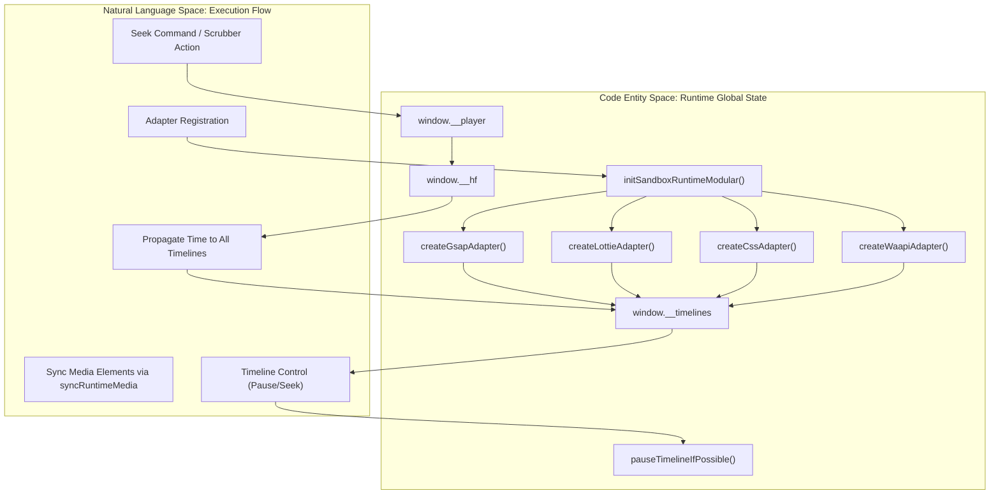
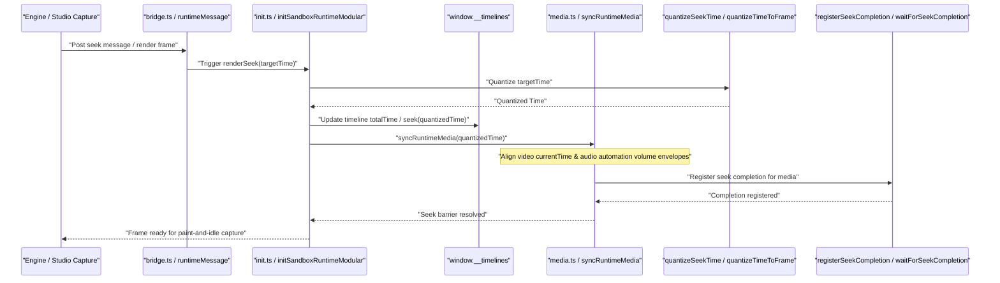

<!-- source: DeepWiki mcp.deepwiki.com · repo heygen-com/hyperframes · extra page Deterministic Rendering and Frame Adapters · fetched 2026-11-02 -->

# Deterministic Rendering and Frame Adapters

Relevant source files

The following files were used as context for generating this wiki page:

- [docs/guides/rendering.mdx](docs/guides/rendering.mdx)
- [docs/packages/engine.mdx](docs/packages/engine.mdx)
- [docs/packages/producer.mdx](docs/packages/producer.mdx)
- [packages/cli/src/commands/render.test.ts](packages/cli/src/commands/render.test.ts)
- [packages/cli/src/commands/render.ts](packages/cli/src/commands/render.ts)
- [packages/cli/src/docs/rendering.md](packages/cli/src/docs/rendering.md)
- [packages/cli/src/telemetry/events.test.ts](packages/cli/src/telemetry/events.test.ts)
- [packages/cli/src/telemetry/events.ts](packages/cli/src/telemetry/events.ts)
- [packages/cli/src/telemetry/renderObservability.test.ts](packages/cli/src/telemetry/renderObservability.test.ts)
- [packages/cli/src/telemetry/renderObservability.ts](packages/cli/src/telemetry/renderObservability.ts)
- [packages/cli/src/utils/dockerRunArgs.test.ts](packages/cli/src/utils/dockerRunArgs.test.ts)
- [packages/cli/src/utils/dockerRunArgs.ts](packages/cli/src/utils/dockerRunArgs.ts)
- [packages/core/scripts/build-audio-fx-runtime.ts](packages/core/scripts/build-audio-fx-runtime.ts)
- [packages/core/scripts/build-position-edits-render.ts](packages/core/scripts/build-position-edits-render.ts)
- [packages/core/src/generated/position-edits-render-inline.test.ts](packages/core/src/generated/position-edits-render-inline.test.ts)
- [packages/core/src/generated/position-edits-render-inline.ts](packages/core/src/generated/position-edits-render-inline.ts)
- [packages/core/src/runtime/adapters/gsap.steps.test.ts](packages/core/src/runtime/adapters/gsap.steps.test.ts)
- [packages/core/src/runtime/adapters/gsap.ts](packages/core/src/runtime/adapters/gsap.ts)
- [packages/core/src/runtime/diagnostics.test.ts](packages/core/src/runtime/diagnostics.test.ts)
- [packages/core/src/runtime/diagnostics.ts](packages/core/src/runtime/diagnostics.ts)
- [packages/core/src/runtime/domRealm.ts](packages/core/src/runtime/domRealm.ts)
- [packages/core/src/runtime/init.positionEdits.test.ts](packages/core/src/runtime/init.positionEdits.test.ts)
- [packages/core/src/runtime/init.sceneCallbackError.test.ts](packages/core/src/runtime/init.sceneCallbackError.test.ts)
- [packages/core/src/runtime/pausedTransportInvariant.test.ts](packages/core/src/runtime/pausedTransportInvariant.test.ts)
- [packages/core/src/runtime/positionEdits.test.ts](packages/core/src/runtime/positionEdits.test.ts)
- [packages/core/src/runtime/positionEdits.ts](packages/core/src/runtime/positionEdits.ts)
- [packages/core/stubs/position-edits-render-entry.ts](packages/core/stubs/position-edits-render-entry.ts)
- [packages/engine/src/config.test.ts](packages/engine/src/config.test.ts)
- [packages/engine/src/config.ts](packages/engine/src/config.ts)
- [packages/engine/src/index.ts](packages/engine/src/index.ts)
- [packages/engine/src/services/browserManager.test.ts](packages/engine/src/services/browserManager.test.ts)
- [packages/engine/src/services/browserManager.ts](packages/engine/src/services/browserManager.ts)
- [packages/engine/src/services/chunkEncoder.relativePaths.test.ts](packages/engine/src/services/chunkEncoder.relativePaths.test.ts)
- [packages/engine/src/services/frameCapture.test.ts](packages/engine/src/services/frameCapture.test.ts)
- [packages/engine/src/services/frameCapture.ts](packages/engine/src/services/frameCapture.ts)
- [packages/engine/src/types.ts](packages/engine/src/types.ts)
- [packages/producer/src/services/render/observability.ts](packages/producer/src/services/render/observability.ts)
- [packages/producer/src/services/render/perfSummary.test.ts](packages/producer/src/services/render/perfSummary.test.ts)
- [packages/producer/src/services/render/perfSummary.ts](packages/producer/src/services/render/perfSummary.ts)
- [packages/producer/src/services/renderOrchestrator.deGateProbe.test.ts](packages/producer/src/services/renderOrchestrator.deGateProbe.test.ts)
- [packages/producer/src/services/renderOrchestrator.test.ts](packages/producer/src/services/renderOrchestrator.test.ts)
- [packages/producer/src/services/renderOrchestrator.ts](packages/producer/src/services/renderOrchestrator.ts)

HyperFrames utilizes a **seek-driven, frame-by-frame rendering model** to ensure that every export is pixel-independent, reproducible, and deterministic across disparate execution environments. This model decouples rendering progress from the browser's native system clock, replacing wall-clock timing with discrete frame indices and precise time offsets.

---

## The Deterministic Model and Forbidden Wall-Clock APIs

In standard browser runtimes, animations execute against `performance.now()` or `requestAnimationFrame`, which depend on hardware timers and system load. This introduces non-determinism during video encoding because frame capture durations vary. HyperFrames eliminates this variance by freezing native time sources and routing all animation progress through deterministic seek operations [packages/core/src/runtime/init.ts:117-159]().

### Virtual Time and Intercepted APIs
To enforce determinism during headful or headless capture, the runtime environment and producer services shim wall-clock APIs:
*   `Date.now()` and `performance.now()` are overridden to reflect the exact virtual timeline offset rather than elapsed wall time.
*   `requestAnimationFrame` callbacks are synchronized with the render scheduler's tick loop rather than hardware vsync [packages/core/src/runtime/init.test.ts:132-155]().
*   Same-origin iframe hierarchies propagate seek updates downward via parent-child communication bridges [packages/core/src/runtime/init.ts:3-3]().

### The BeginFrame API and CDP
At the capture layer, `@hyperframes/engine` interacts with Chromium via the Chrome DevTools Protocol (CDP) using the atomic **BeginFrame** command (`HeadlessExperimental.beginFrame`). This commands the browser browser engine to execute a single, isolated layout-paint-composite cycle for a precise `frameTimeTicks` timestamp, bypassing real-world time elapsed between renders [packages/engine/src/services/screenshotService.ts:166-179](). The `frameCapture` service in `@hyperframes/engine` orchestrates this process [packages/engine/src/services/frameCapture.ts:1-9]().

Sources: [packages/core/src/runtime/init.ts:117-159](), [packages/core/src/runtime/init.test.ts:132-155](), [packages/engine/src/services/screenshotService.ts:166-179](), [packages/engine/src/services/frameCapture.ts:1-9]()

---

## Frame Adapter Pattern

The Frame Adapter pattern bridges the HyperFrames runtime with diverse third-party animation libraries and native browser animation technologies. Each adapter implements a uniform interface that allows the runtime to discover, seek, pause, and step animations without knowing their internal implementation details.

### Supported Adapters and Code Mapping
The runtime instantiates modular adapters during initialization in `initSandboxRuntimeModular` [packages/core/src/runtime/init.ts:10-21]() (`createGsapAdapter`, `createLottieAdapter`, `createCssAdapter`, `createWaapiAdapter`, `createThreeAdapter`, `createTypegpuAdapter`, etc.):

| Adapter Function | Target Technology | Code Entity / Implementation File |
| :--- | :--- | :--- |
| `createGsapAdapter` | GSAP Timelines & Tweens | [packages/core/src/runtime/adapters/gsap.ts]() |
| `createLottieAdapter` | Bodymovin / DotLottie | [packages/core/src/runtime/init.ts:13]() |
| `createCssAdapter` | CSS Keyframe & Transition Animations | [packages/core/src/runtime/init.ts:10]() |
| `createWaapiAdapter` | Web Animations API (WAAPI) | [packages/core/src/runtime/init.ts:31]() |
| `createThreeAdapter` | Three.js Scene Mixers & Clocks | [packages/core/src/runtime/init.ts:14]() |
| `createTypegpuAdapter` | TypeGPU / WebGPU Pipelines | [packages/core/src/runtime/init.ts:20]() |

Sources: [packages/core/src/runtime/init.ts:10-31](), [packages/core/src/runtime/adapters/gsap.ts]()

---

## Global Timelines and State (`window.__timelines`)

Composition runtimes expose global registries on the `window` object to allow cross-frame control, timeline inspection, and seek propagation [packages/core/src/runtime/window.d.ts:37-92]().

### Key Globals
*   `window.__timelines`: A record mapping composition identifiers to their root timeline instances (`RuntimeTimelineLike`) [packages/core/src/runtime/window.d.ts:37]().
*   `window.__hf`: Exposes runtime utilities including `seek`, `duration`, `colorGrading`, and audio level meters [packages/core/src/runtime/window.d.ts:52-87]().
*   `window.__player`: Provides high-level control APIs (`getDuration()`, playback state) for embedding and Studio integration [packages/core/src/runtime/window.d.ts:38]().

When the player or render engine pauses or seeks a timeline, partial timelines lacking standard methods (such as `pause()`) are handled gracefully via `pauseTimelineIfPossible` to prevent runtime crashes [packages/core/src/runtime/init.ts:148-164]().

### Diagram: Runtime Global State and Control Flow

Sources: [packages/core/src/runtime/init.ts:3-164](), [packages/core/src/runtime/window.d.ts:37-92]()

---

## The `renderSeek` Lifecycle

The `renderSeek` routine (managed via runtime bridge and adapter dispatchers) enforces deterministic alignment across HTML elements, audio playback, and visual animations.

### Seek Execution Steps
1.  **Quantization**: Requested time values are quantized to frame boundaries using `quantizeSeekTime` and `quantizeTimeToFrame` [packages/core/src/runtime/init.ts:100-100]().
2.  **Timeline Scrubbing**: Timelines registered in `window.__timelines` are updated to the exact target time via their respective seek methods [packages/core/src/runtime/init.test.ts:41-48]().
3.  **Media Element Alignment**: `syncRuntimeMedia` inspects active video and audio clips (`RuntimeMediaClip`), aligning their `currentTime` and volume envelopes with the target timeline instant [packages/core/src/runtime/media.ts:41-115]().
4.  **Await Seek Barriers**: For video elements or WebGL textures requiring frame decode completion, the runtime registers a seek barrier promise using `registerSeekCompletion` and `waitForSeekCompletion` [packages/core/src/runtime/media.ts:37-50]().

### Diagram: `renderSeek` Data Flow

Sources: [packages/core/src/runtime/init.ts:26-30](), [packages/core/src/runtime/media.ts:37-51](), [packages/core/src/runtime/window.d.ts:55]()

---

