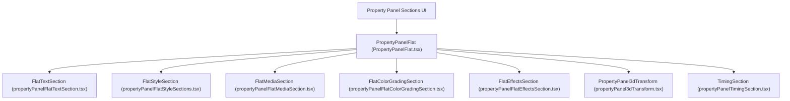
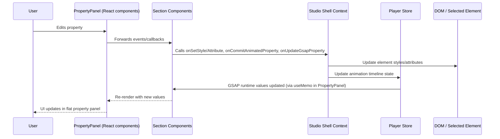

<!-- source: DeepWiki mcp.deepwiki.com · repo heygen-com/hyperframes · extra page Property Panel Sections · fetched 2026-11-02 -->

# Property Panel Sections

<details>
<summary>Relevant source files</summary>

The following files were used as context for generating this wiki page:

- [packages/studio/src/components/StudioToast.tsx](packages/studio/src/components/StudioToast.tsx)
- [packages/studio/src/components/editor/PropertyPanel.test.tsx](packages/studio/src/components/editor/PropertyPanel.test.tsx)
- [packages/studio/src/components/editor/PropertyPanel.tsx](packages/studio/src/components/editor/PropertyPanel.tsx)
- [packages/studio/src/components/editor/PropertyPanelEmptyState.test.tsx](packages/studio/src/components/editor/PropertyPanelEmptyState.test.tsx)
- [packages/studio/src/components/editor/PropertyPanelEmptyState.tsx](packages/studio/src/components/editor/PropertyPanelEmptyState.tsx)
- [packages/studio/src/components/editor/PropertyPanelFlat.tsx](packages/studio/src/components/editor/PropertyPanelFlat.tsx)
- [packages/studio/src/components/editor/PropertyPanelFlatFooter.test.tsx](packages/studio/src/components/editor/PropertyPanelFlatFooter.test.tsx)
- [packages/studio/src/components/editor/PropertyPanelFlatFooter.tsx](packages/studio/src/components/editor/PropertyPanelFlatFooter.tsx)
- [packages/studio/src/components/editor/PropertyPanelFlatHeader.test.tsx](packages/studio/src/components/editor/PropertyPanelFlatHeader.test.tsx)
- [packages/studio/src/components/editor/PropertyPanelFlatHeader.tsx](packages/studio/src/components/editor/PropertyPanelFlatHeader.tsx)
- [packages/studio/src/components/editor/propertyPanelAutomation.test.ts](packages/studio/src/components/editor/propertyPanelAutomation.test.ts)
- [packages/studio/src/components/editor/propertyPanelAutomation.ts](packages/studio/src/components/editor/propertyPanelAutomation.ts)
- [packages/studio/src/components/editor/propertyPanelColorGradingControls.tsx](packages/studio/src/components/editor/propertyPanelColorGradingControls.tsx)
- [packages/studio/src/components/editor/propertyPanelColorGradingSection.tsx](packages/studio/src/components/editor/propertyPanelColorGradingSection.tsx)
- [packages/studio/src/components/editor/propertyPanelColorGradingSlider.tsx](packages/studio/src/components/editor/propertyPanelColorGradingSlider.tsx)
- [packages/studio/src/components/editor/propertyPanelCommitField.tsx](packages/studio/src/components/editor/propertyPanelCommitField.tsx)
- [packages/studio/src/components/editor/propertyPanelFill.tsx](packages/studio/src/components/editor/propertyPanelFill.tsx)
- [packages/studio/src/components/editor/propertyPanelFlatColorGradingSection.test.tsx](packages/studio/src/components/editor/propertyPanelFlatColorGradingSection.test.tsx)
- [packages/studio/src/components/editor/propertyPanelFlatColorGradingSection.tsx](packages/studio/src/components/editor/propertyPanelFlatColorGradingSection.tsx)
- [packages/studio/src/components/editor/propertyPanelFlatMediaSection.test.tsx](packages/studio/src/components/editor/propertyPanelFlatMediaSection.test.tsx)
- [packages/studio/src/components/editor/propertyPanelFlatMediaSection.tsx](packages/studio/src/components/editor/propertyPanelFlatMediaSection.tsx)
- [packages/studio/src/components/editor/propertyPanelFlatMotionSection.test.tsx](packages/studio/src/components/editor/propertyPanelFlatMotionSection.test.tsx)
- [packages/studio/src/components/editor/propertyPanelFlatMotionSection.tsx](packages/studio/src/components/editor/propertyPanelFlatMotionSection.tsx)
- [packages/studio/src/components/editor/propertyPanelFlatPrimitives.test.tsx](packages/studio/src/components/editor/propertyPanelFlatPrimitives.test.tsx)
- [packages/studio/src/components/editor/propertyPanelFlatPrimitives.tsx](packages/studio/src/components/editor/propertyPanelFlatPrimitives.tsx)
- [packages/studio/src/components/editor/propertyPanelFlatSelectRow.tsx](packages/studio/src/components/editor/propertyPanelFlatSelectRow.tsx)
- [packages/studio/src/components/editor/propertyPanelFlatStyleHelpers.ts](packages/studio/src/components/editor/propertyPanelFlatStyleHelpers.ts)
- [packages/studio/src/components/editor/propertyPanelFlatStyleSections.test.tsx](packages/studio/src/components/editor/propertyPanelFlatStyleSections.test.tsx)
- [packages/studio/src/components/editor/propertyPanelFlatStyleSections.tsx](packages/studio/src/components/editor/propertyPanelFlatStyleSections.tsx)
- [packages/studio/src/components/editor/propertyPanelFlatTextSection.test.tsx](packages/studio/src/components/editor/propertyPanelFlatTextSection.test.tsx)
- [packages/studio/src/components/editor/propertyPanelFlatTextSection.tsx](packages/studio/src/components/editor/propertyPanelFlatTextSection.tsx)
- [packages/studio/src/components/editor/propertyPanelHelpers.ts](packages/studio/src/components/editor/propertyPanelHelpers.ts)
- [packages/studio/src/components/editor/propertyPanelImageFill.test.tsx](packages/studio/src/components/editor/propertyPanelImageFill.test.tsx)
- [packages/studio/src/components/editor/propertyPanelInputCoverage.test.tsx](packages/studio/src/components/editor/propertyPanelInputCoverage.test.tsx)
- [packages/studio/src/components/editor/propertyPanelMediaSection.tsx](packages/studio/src/components/editor/propertyPanelMediaSection.tsx)
- [packages/studio/src/components/editor/propertyPanelPrimitives.tsx](packages/studio/src/components/editor/propertyPanelPrimitives.tsx)
- [packages/studio/src/components/editor/propertyPanelSections.test.tsx](packages/studio/src/components/editor/propertyPanelSections.test.tsx)
- [packages/studio/src/components/editor/propertyPanelSections.tsx](packages/studio/src/components/editor/propertyPanelSections.tsx)
- [packages/studio/src/components/editor/propertyPanelStyleSections.tsx](packages/studio/src/components/editor/propertyPanelStyleSections.tsx)
- [packages/studio/src/components/editor/propertyPanelTimingSection.tsx](packages/studio/src/components/editor/propertyPanelTimingSection.tsx)
- [packages/studio/src/components/editor/useColorGradingController.test.ts](packages/studio/src/components/editor/useColorGradingController.test.ts)
- [packages/studio/src/components/editor/useColorGradingController.ts](packages/studio/src/components/editor/useColorGradingController.ts)
- [packages/studio/src/components/editor/useInspectorGestureTransaction.test.tsx](packages/studio/src/components/editor/useInspectorGestureTransaction.test.tsx)
- [packages/studio/src/components/editor/useInspectorGestureTransaction.ts](packages/studio/src/components/editor/useInspectorGestureTransaction.ts)
- [packages/studio/src/components/editor/usePanelHiddenToggle.ts](packages/studio/src/components/editor/usePanelHiddenToggle.ts)
- [packages/studio/src/components/editor/useVolumeAutomation.test.tsx](packages/studio/src/components/editor/useVolumeAutomation.test.tsx)
- [packages/studio/src/components/editor/useVolumeAutomation.ts](packages/studio/src/components/editor/useVolumeAutomation.ts)
- [packages/studio/src/components/icons/InspectorIcon.tsx](packages/studio/src/components/icons/InspectorIcon.tsx)
- [packages/studio/src/components/icons/ReverseGradientIcon.tsx](packages/studio/src/components/icons/ReverseGradientIcon.tsx)
- [packages/studio/src/components/icons/RippleEditIcon.tsx](packages/studio/src/components/icons/RippleEditIcon.tsx)
- [packages/studio/src/components/studioMediaJobs.ts](packages/studio/src/components/studioMediaJobs.ts)
- [packages/studio/src/icons/SystemIcons.tsx](packages/studio/src/icons/SystemIcons.tsx)
- [packages/studio/tests/e2e/design-panel.mjs](packages/studio/tests/e2e/design-panel.mjs)

</details>


This section documents the **property panel sections** subsystem within the `@hyperframes/studio` package, specifically the flat property panel architecture used in the Studio's inspector. The property panel provides editors a structured, expandable flat list of property groups (sections) where users can view and manipulate element properties including primitives, text, motion, media, style, color grading, FX sections, 3D transforms, timing, and volume automation controllers.

---

## Purpose and Scope

The flat property panel architecture provides a unified, extensible, and performant React-based UI surface for editing a wide variety of clip and composition properties in a modular fashion. It replaces the older nested accordion style, enabling:

- Grouping related properties into sections.
- Supporting multiple types of content (text, media, motion, color grading, audio).
- Allowing simultaneous display of multiple expandable groups (with one open at a time behavior).
- Live syncing of values with timeline animations and GSAP runtime state.
- Integration with manual editing overlays, DOM attribute commits, and automation keyframe workflows.

The flat panel is deeply integrated with GSAP animations and Studio's player store for live updates, and supports extensible sections for 3D transforms, FX, timing, and volume automation. This page details the components, their data flow, main user interactions, and sectional architecture.

Sources:
- [packages/studio/src/components/editor/PropertyPanel.tsx:1-166]()
- [packages/studio/src/components/editor/PropertyPanelFlat.tsx:1-175]()

---

## Implementation Overview

### PropertyPanel and PropertyPanelFlat

- `PropertyPanel` [packages/studio/src/components/editor/PropertyPanel.tsx:58-577]() is the legacy mnemonic entry point from `PropertyPanel.tsx`. It handles a broader feature set with some conditional paths for legacy flows but primarily renders the flat panel via `PropertyPanelFlat` when `STUDIO_FLAT_INSPECTOR_ENABLED` [packages/studio/src/components/editor/PropertyPanel.tsx:30]() is true.

- `PropertyPanelFlat` [packages/studio/src/components/editor/PropertyPanelFlat.tsx:52-588]() implements the flat inspector shell, managing the open/close section state and rendering child section components. It controls panel state like open group, clipboard copy state, and coordinates passing callbacks for style, attribute, and animation mutations.

`PropertyPanelFlat` receives props describing the active element (`DomEditSelection`), computed styles, and a `sections` gating object determining which sections to show.

```mermaid
flowchart TD
  A[PropertyPanel.tsx::PropertyPanel]
     -->|conditionally renders based on STUDIO_FLAT_INSPECTOR_ENABLED| B[PropertyPanelFlat.tsx::PropertyPanelFlat]
     --> C[Legacy sections (some fallback)]

  B -- manages "openGroupId" state --> G[Section Groups]
  G -- renders specific components --> S[Section Components (FlatTextSection, FlatStyleSection, etc.)]
```
Sources:
- [packages/studio/src/components/editor/PropertyPanel.tsx:30-31]()
- [packages/studio/src/components/editor/PropertyPanel.tsx:58-577]()
- [packages/studio/src/components/editor/PropertyPanelFlat.tsx:52-588]()
- [packages/studio/src/components/editor/PropertyPanelFlat.tsx:135-149]()

### Group Sections and Layout

The flat panel lays out editable property groups as a vertical list of accordion-style groups:

- Only one group is expanded at a time, controlled by the `openGroupId` React state [packages/studio/src/components/editor/PropertyPanelFlat.tsx:135-149]().
- Headers like `FlatGroupHeader` [packages/studio/src/components/editor/propertyPanelFlatPrimitives.tsx:174-190]() render group titles with toggle buttons.
- The expanded group's content is rendered by `PropertyPanelFlat.tsx` directly, in a dedicated scrollable region, not as children of the header [packages/studio/src/components/editor/propertyPanelFlatPrimitives.tsx:169-171]().

Sections are conditionally rendered depending on element capabilities, GSAP animation presence, and explicitly passed gating props [packages/studio/src/components/editor/PropertyPanelFlat.tsx:200-500]().

Sources:
- [packages/studio/src/components/editor/PropertyPanelFlat.tsx:135-149]()
- [packages/studio/src/components/editor/PropertyPanelFlat.tsx:200-500]()
- [packages/studio/src/components/editor/propertyPanelFlatPrimitives.tsx:174-190]()

---

## Main Property Panel Sections

The architecture is designed around modular "sections," each encapsulating a relevant domain of element properties and editing logic. Primary sections include:

### 1. Primitives, Text, and Style Sections

- **Text Section**: Managed by `FlatTextSection` [packages/studio/src/components/editor/propertyPanelFlatTextSection.tsx]() for editing multi-field text layers. Includes text fields, styles, and controls relevant to text content. It is rendered when `sections.text` is true [packages/studio/src/components/editor/PropertyPanelFlat.tsx:200]().
  
- **Style Sections**: Encapsulated by `FlatStyleSection` [packages/studio/src/components/editor/propertyPanelFlatStyleSections.tsx]() this covers CSS-based style properties such as fill (solid/gradient/image), stroke, border-radius, shadows, and other visual styling. Helpers parse, display, and commit style changes. It is rendered when `sections.style` is true [packages/studio/src/components/editor/PropertyPanelFlat.tsx:220]().

Sources:
- [packages/studio/src/components/editor/PropertyPanelFlat.tsx:200]()
- [packages/studio/src/components/editor/PropertyPanelFlat.tsx:220]()
- [packages/studio/src/components/editor/propertyPanelFlatTextSection.tsx]()
- [packages/studio/src/components/editor/propertyPanelFlatStyleSections.tsx]()

### 2. Motion and Timing Sections

- **Motion Section**: In `propertyPanelFlatMotionSection.tsx`, this controls animation timing, GSAP tweens, keyframe navigation, playback syncing, and interactive animation property commits. It is rendered when `sections.motion` is true [packages/studio/src/components/editor/PropertyPanelFlat.tsx:280]().

- **Timing Section**: `propertyPanelTimingSection.tsx` handles clip time attributes like start, duration, media offsets, and integration into timeline playback.

- The flat panel uses `sections.motion` and `sections.timing` flags to include/exclude these.

Sources:
- [packages/studio/src/components/editor/PropertyPanelFlat.tsx:280]()
- [packages/studio/src/components/editor/propertyPanelFlatMotionSection.tsx]()
- [packages/studio/src/components/editor/propertyPanelTimingSection.tsx]()

### 3. Media Section

- `FlatMediaSection` [packages/studio/src/components/editor/propertyPanelFlatMediaSection.tsx]() manages media-specific properties such as source paths, background removal, volume, playback rate, looping, fade controls (in/out), and video/image specific styling (object-fit/position). It is rendered when `sections.media` is true [packages/studio/src/components/editor/PropertyPanelFlat.tsx:380]().
  
- Supports automation controllers for volume and rate via integration with `useVolumeAutomation` hooks [packages/studio/src/components/editor/useVolumeAutomation.ts]().

Sources:
- [packages/studio/src/components/editor/PropertyPanelFlat.tsx:380]()
- [packages/studio/src/components/editor/propertyPanelFlatMediaSection.tsx]()
- [packages/studio/src/components/editor/useVolumeAutomation.ts]()

### 4. Color Grading Section

- Implemented by `FlatColorGradingSection` [packages/studio/src/components/editor/propertyPanelFlatColorGradingSection.tsx]() this section exposes comprehensive color grading controls:
  - Exposure, contrast, saturation, curves, LUT import, grain, vignette, and presets application [packages/studio/src/components/editor/propertyPanelFlatColorGradingSection.tsx:180-400]().
  - Integration with preview and commit hooks to update grading on the fly [packages/studio/src/components/editor/propertyPanelFlatColorGradingSection.tsx:114-118]().
  - HDR detection/banner display [packages/studio/src/components/editor/propertyPanelFlatColorGradingSection.tsx:59-92]().
  - It is rendered when `sections.colorGrading` is true [packages/studio/src/components/editor/PropertyPanelFlat.tsx:400]().

Sources:
- [packages/studio/src/components/editor/PropertyPanelFlat.tsx:400]()
- [packages/studio/src/components/editor/propertyPanelFlatColorGradingSection.tsx:59-92]()
- [packages/studio/src/components/editor/propertyPanelFlatColorGradingSection.tsx:114-118]()
- [packages/studio/src/components/editor/propertyPanelFlatColorGradingSection.tsx:180-400]()

### 5. Effects (FX) Section

- `FlatEffectsSection` [packages/studio/src/components/editor/propertyPanelFlatEffectsSection.tsx]() handles media effects layered onto the clip, managing effect intensities and toggling. It is rendered when `sections.effects` is true [packages/studio/src/components/editor/PropertyPanelFlat.tsx:420]().

Sources:
- [packages/studio/src/components/editor/PropertyPanelFlat.tsx:420]()
- [packages/studio/src/components/editor/propertyPanelFlatEffectsSection.tsx]()

### 6. 3D Transform Section

- `PropertyPanel3dTransform` [packages/studio/src/components/editor/propertyPanel3dTransform.tsx]() provides controls for 3D transformations including rotations, scale, and translate properties on X/Y/Z axes.
  
- This section is always reachable for any selected element, allowing additional depth/rotation that might not yet be animated [packages/studio/src/components/editor/PropertyPanel.tsx:153-165]().

Sources:
- [packages/studio/src/components/editor/PropertyPanel.tsx:153-165]()
- [packages/studio/src/components/editor/propertyPanel3dTransform.tsx]()

### 7. Volume Automation Controllers

- The audio volume envelope automation is managed by hooks like `useVolumeAutomation` [packages/studio/src/components/editor/useVolumeAutomation.ts]() and exposed in the media section [packages/studio/src/components/editor/propertyPanelFlatMediaSection.tsx:52-56](). The automation lanes in the timeline drive live values, setting the slider and committing keyframes.

Sources:
- [packages/studio/src/components/editor/propertyPanelFlatMediaSection.tsx:52-56]()
- [packages/studio/src/components/editor/useVolumeAutomation.ts]()

---

## Data Flow and Key Interactions

```mermaid
flowchart TD
  E[User Interaction: click, drag, edit property]
    -->|calls| C[Section Component]
    -->|calls| D[onSetStyle/onSetAttribute/onUpdateGsapProperty callbacks]
    --> StudioState[Studio Context & Player Store]
    -->|updates| I[DomEditSelection element properties]
    -->|triggers| R[Player store updates (timeline, animation)]
    -->|affects| C[Section Component live preview]

  subgraph Studio UI
    C
    PropertyPanelFlat
  end

  subgraph Player & Runtime
    R
  end

  subgraph Data & State
    StudioState
    I
  end
```

- Each section component receives the current element selection and its styles/attributes.
- User edits invoke `onSetStyle`, `onSetAttribute`, or animation-specific callbacks like `onUpdateGsapProperty` [packages/studio/src/components/editor/PropertyPanel.tsx:89]().
- Commits propagate to the Studio shell context, mutate the DOM selection, and update player store animation state.
- GSAP runtime values are read and merged to live-update panels (`readGsapRuntimeValuesForPanel` [packages/studio/src/components/editor/PropertyPanel.tsx:14](), [packages/studio/src/components/editor/PropertyPanel.tsx:137-143]()).
- Sections reflect animation keyframes and enable keyframe edits in sync (e.g., `onCommitAnimatedProperty` [packages/studio/src/components/editor/PropertyPanel.tsx:107]()).

Sources:
- [packages/studio/src/components/editor/PropertyPanel.tsx:14]()
- [packages/studio/src/components/editor/PropertyPanel.tsx:89]()
- [packages/studio/src/components/editor/PropertyPanel.tsx:107]()
- [packages/studio/src/components/editor/PropertyPanel.tsx:137-143]()

---

## Key Functions and Classes

### PropertyPanel.tsx

- `PropertyPanel` component [packages/studio/src/components/editor/PropertyPanel.tsx:58-577]() (exported memoized function) conditionally renders either legacy or flat panels.
- Reads GSAP runtime values via `readGsapRuntimeValuesForPanel` [packages/studio/src/components/editor/PropertyPanel.tsx:137-143]() and element styles.
- Sets up callbacks for editing style (`onSetStyle` [packages/studio/src/components/editor/PropertyPanel.tsx:70]()), attributes (`onSetAttribute` [packages/studio/src/components/editor/PropertyPanel.tsx:71]()), GSAP animation mutations (`onUpdateGsapProperty` [packages/studio/src/components/editor/PropertyPanel.tsx:89]()).
- Handles special control flags like element hiding (`onToggleElementHidden` [packages/studio/src/components/editor/PropertyPanel.tsx:81]()), clipboard copying.
- Calls flat panel passing down all relevant props [packages/studio/src/components/editor/PropertyPanel.tsx:569]().

Sources:
- [packages/studio/src/components/editor/PropertyPanel.tsx:58-577]()
- [packages/studio/src/components/editor/PropertyPanel.tsx:70]()
- [packages/studio/src/components/editor/PropertyPanel.tsx:71]()
- [packages/studio/src/components/editor/PropertyPanel.tsx:81]()
- [packages/studio/src/components/editor/PropertyPanel.tsx:89]()
- [packages/studio/src/components/editor/PropertyPanel.tsx:137-143]()
- [packages/studio/src/components/editor/PropertyPanel.tsx:569]()

### PropertyPanelFlat.tsx

- `PropertyPanelFlat` component [packages/studio/src/components/editor/PropertyPanelFlat.tsx:52-588]() manages shared open-group state (`openGroupId` [packages/studio/src/components/editor/PropertyPanelFlat.tsx:135-149]()).
- Renders a vertical list of `FlatGroupHeader` headers and expanded section bodies [packages/studio/src/components/editor/PropertyPanelFlat.tsx:200-500]().
- Dynamically includes sections based on gating props (e.g., `sections.text`, `sections.style`, `sections.motion`) [packages/studio/src/components/editor/PropertyPanelFlat.tsx:200-500]().
- Manages animation live preview and state.

Sources:
- [packages/studio/src/components/editor/PropertyPanelFlat.tsx:52-588]()
- [packages/studio/src/components/editor/PropertyPanelFlat.tsx:135-149]()
- [packages/studio/src/components/editor/PropertyPanelFlat.tsx:200-500]()

### propertyPanelFlatPrimitives.tsx

- Provides reusable single-row controls `FlatRow` [packages/studio/src/components/editor/propertyPanelFlatPrimitives.tsx:18-99](), segmented buttons `FlatSegmentedRow` [packages/studio/src/components/editor/propertyPanelFlatPrimitives.tsx:115-160](), and group headers `FlatGroupHeader` [packages/studio/src/components/editor/propertyPanelFlatPrimitives.tsx:174-190]().
- `FlatRow` is the workhorse for label + text input + reset button UI.
- Handles live commit vs. preview commit flows for fields via `CommitField` [packages/studio/src/components/editor/propertyPanelFlatPrimitives.tsx:58-68]().

Sources:
- [packages/studio/src/components/editor/propertyPanelFlatPrimitives.tsx:18-99]()
- [packages/studio/src/components/editor/propertyPanelFlatPrimitives.tsx:58-68]()
- [packages/studio/src/components/editor/propertyPanelFlatPrimitives.tsx:115-160]()
- [packages/studio/src/components/editor/propertyPanelFlatPrimitives.tsx:174-190]()

### Selected Section Components

| Section                    | Code Location                          | Description |
|----------------------------|--------------------------------------|-------------|
| FlatTextSection            | `packages/studio/src/components/editor/propertyPanelFlatTextSection.tsx`   | Text field editing and multi-field support. |
| FlatStyleSection           | `packages/studio/src/components/editor/propertyPanelFlatStyleSections.tsx` | Style controls: fill, stroke, border-radius, shadows. |
| FlatMediaSection           | `packages/studio/src/components/editor/propertyPanelFlatMediaSection.tsx`  | Media source and playback properties, background removal, volume automation. |
| FlatColorGradingSection    | `packages/studio/src/components/editor/propertyPanelFlatColorGradingSection.tsx` | Full color grading controls, LUT handling. |
| FlatEffectsSection         | `packages/studio/src/components/editor/propertyPanelFlatEffectsSection.tsx` | Media effect toggling and intensities. |
| PropertyPanel3dTransform   | `packages/studio/src/components/editor/propertyPanel3dTransform.tsx`       | 3D transform controls. |
| TimingSection              | `packages/studio/src/components/editor/propertyPanelTimingSection.tsx`     | Clip timing and media offset controls. |

---

## Mermaid Diagram: Mapping Natural Language Sections to Code Components


Sources:
- [packages/studio/src/components/editor/PropertyPanelFlat.tsx:17-24]()
- [packages/studio/src/components/editor/PropertyPanel.tsx:23-28]()

---

## Mermaid Diagram: Data & Event Flow for Property Editing


Sources:
- [packages/studio/src/components/editor/PropertyPanel.tsx:70-72]()
- [packages/studio/src/components/editor/PropertyPanel.tsx:89]()
- [packages/studio/src/components/editor/PropertyPanel.tsx:107]()
- [packages/studio/src/components/editor/PropertyPanel.tsx:137-143]()

---

## Detailed Section Example: FlatMediaSection

- Handles video, audio, image tag properties [packages/studio/src/components/editor/propertyPanelFlatMediaSection.tsx:85-87]().
- Shows source path with copy-to-clipboard button [packages/studio/src/components/editor/propertyPanelFlatMediaSection.tsx:166-167]().
- Implements background removal trigger with progress [packages/studio/src/components/editor/propertyPanelFlatMediaSection.tsx:139-162]().
- Exposes volume slider driven by automation lanes and manual edits [packages/studio/src/components/editor/propertyPanelFlatMediaSection.tsx:169-179]().
- Manages playback rate and fade in/out attributes [packages/studio/src/components/editor/propertyPanelFlatMediaSection.tsx:181-200]().
- Invokes `onSetStyle`, `onSetAttribute`, and background removal callbacks from props [packages/studio/src/components/editor/propertyPanelFlatMediaSection.tsx:47-52]().
- Uses hooks such as `useTrackDesignInput` for analytics [packages/studio/src/components/editor/propertyPanelFlatMediaSection.tsx:84]().
- Supports live volume value reflecting timeline automation [packages/studio/src/components/editor/propertyPanelFlatMediaSection.tsx:91-92]().

Sources:
- [packages/studio/src/components/editor/propertyPanelFlatMediaSection.tsx:47-52]()
- [packages/studio/src/components/editor/propertyPanelFlatMediaSection.tsx:84]()
- [packages/studio/src/components/editor/propertyPanelFlatMediaSection.tsx:85-87]()
- [packages/studio/src/components/editor/propertyPanelFlatMediaSection.tsx:91-92]()
- [packages/studio/src/components/editor/propertyPanelFlatMediaSection.tsx:139-162]()
- [packages/studio/src/components/editor/propertyPanelFlatMediaSection.tsx:166-167]()
- [packages/studio/src/components/editor/propertyPanelFlatMediaSection.tsx:169-179]()
- [packages/studio/src/components/editor/propertyPanelFlatMediaSection.tsx:181-200]()

---

## Section Expand/Collapse and UI Behavior

- `PropertyPanelFlat` tracks a single `openGroupId` string state for the currently expanded property group [packages/studio/src/components/editor/PropertyPanelFlat.tsx:135-149]().
- Clicking a `FlatGroupHeader` toggles the group open or closed [packages/studio/src/components/editor/propertyPanelFlatPrimitives.tsx:177]().
- Entrance animations are scoped using tracked toggle IDs (`justToggledIds` state) [packages/studio/src/components/editor/PropertyPanelFlat.tsx:151-163]().
- When animation ease buttons focus animation segments, the motion group forcibly opens to reveal ease editors [packages/studio/src/components/editor/PropertyPanelFlat.tsx:164-167]().
- Clipboard copy state and tooltip feedback are managed per section.

Sources:
- [packages/studio/src/components/editor/PropertyPanelFlat.tsx:135-149]()
- [packages/studio/src/components/editor/PropertyPanelFlat.tsx:151-163]()
- [packages/studio/src/components/editor/PropertyPanelFlat.tsx:164-167]()
- [packages/studio/src/components/editor/propertyPanelFlatPrimitives.tsx:177]()

---

## Summary Table of Major Files Involved

| File Path                                          | Key Role                                     |
|---------------------------------------------------|----------------------------------------------|
| packages/studio/src/components/editor/PropertyPanel.tsx        | Entry point; renders flat vs legacy panel    |
| packages/studio/src/components/editor/PropertyPanelFlat.tsx    | Flat panel container; manages open groups    |
| packages/studio/src/components/editor/propertyPanelFlatPrimitives.tsx | UI primitives (FlatRow, headers, segmented controls) |
| packages/studio/src/components/editor/propertyPanelFlatTextSection.tsx | Text editing section                          |
| packages/studio/src/components/editor/propertyPanelFlatStyleSections.tsx | Style editing section                         |
| packages/studio/src/components/editor/propertyPanelFlatMediaSection.tsx | Media property section                        |
| packages/studio/src/components/editor/propertyPanelFlatColorGradingSection.tsx | Color grading section                         |
| packages/studio/src/components/editor/propertyPanelFlatEffectsSection.tsx  | FX section                                    |
| packages/studio/src/components/editor/propertyPanel3dTransform.tsx           | 3D transform controls                         |
| packages/studio/src/components/editor/propertyPanelTimingSection.tsx          | Timing section                                |

---

## Summary

The **Property Panel Sections** subsystem provides a modular, extensible flat architecture for editing clip and composition properties within Studio. It harmonizes style, text, media, color grading, effects, motion, 3D transforms, timing, and volume automation into a consistent UI experience, leveraging React state, GSAP runtime integration, and Studio context for synchronized editing and live preview.

---

# References

Sources:
- [packages/studio/src/components/editor/PropertyPanel.tsx:1-166]()
- [packages/studio/src/components/editor/PropertyPanelFlat.tsx:1-175]()
- [packages/studio/src/components/editor/propertyPanelFlatPrimitives.tsx:1-190]()
- [packages/studio/src/components/editor/propertyPanelFlatMediaSection.tsx:1-166]()
- [packages/studio/src/components/editor/propertyPanelFlatStyleSections.tsx:1-191]()
- [packages/studio/src/components/editor/propertyPanelFlatColorGradingSection.tsx:1-189]()
- [packages/studio/src/components/editor/propertyPanel3dTransform.tsx]()
- [packages/studio/src/components/editor/propertyPanelTimingSection.tsx]()
- [packages/studio/src/components/editor/propertyPanelFlatTextSection.tsx]()
- [packages/studio/src/components/editor/propertyPanelFlatMotionSection.tsx]()
- [packages/studio/src/components/editor/propertyPanelFlatEffectsSection.tsx]()
- [packages/studio/src/components/editor/useVolumeAutomation.ts]()

---

