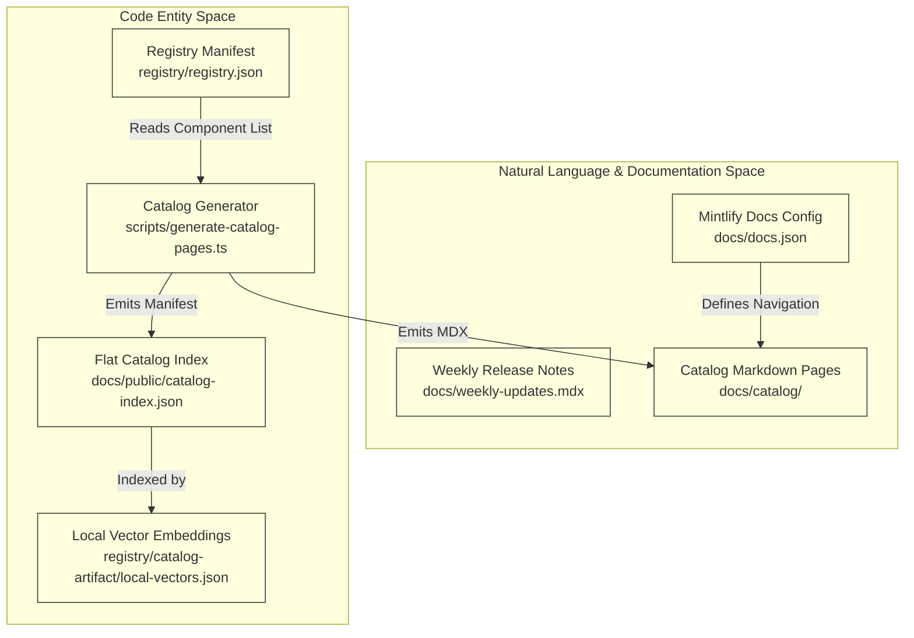
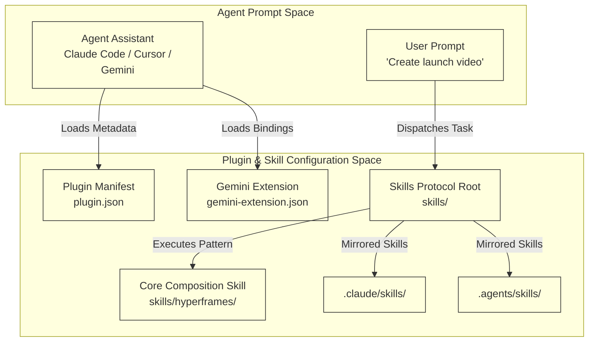

<!-- source: DeepWiki mcp.deepwiki.com · repo heygen-com/hyperframes · extra page Repository Layout and Supporting Directories · fetched 2026-11-02 -->

# Repository Layout and Supporting Directories

Relevant source files

The following files were used as context for generating this wiki page:

- [.gitattributes](.gitattributes)
- [.github/actions/install-ffmpeg-linux/action.yml](.github/actions/install-ffmpeg-linux/action.yml)
- [.gitignore](.gitignore)
- [Dockerfile.test](Dockerfile.test)
- [docs/weekly-updates.mdx](docs/weekly-updates.mdx)
- [examples/k8s-jobs/Dockerfile.example](examples/k8s-jobs/Dockerfile.example)
- [examples/k8s-jobs/Dockerfile.example.dockerignore](examples/k8s-jobs/Dockerfile.example.dockerignore)
- [examples/k8s-jobs/README.md](examples/k8s-jobs/README.md)
- [gemini-extension.json](gemini-extension.json)
- [packages/cli/src/docker/Dockerfile.render](packages/cli/src/docker/Dockerfile.render)
- [packages/engine/src/utils/urlDownloader.test.ts](packages/engine/src/utils/urlDownloader.test.ts)
- [packages/engine/src/utils/urlDownloader.ts](packages/engine/src/utils/urlDownloader.ts)
- [packages/gcp-cloud-run/Dockerfile](packages/gcp-cloud-run/Dockerfile)
- [packages/producer/tests/distributed/mp4-h264-sdr/output/compiled.html](packages/producer/tests/distributed/mp4-h264-sdr/output/compiled.html)
- [packages/producer/tests/distributed/mp4-h264-sdr/output/output.mp4](packages/producer/tests/distributed/mp4-h264-sdr/output/output.mp4)
- [plugin.json](plugin.json)

## Purpose and Scope

The HyperFrames monorepo contains several non-package directories that support documentation generation, catalog management, AI agent plugin mirrors, build automation, release planning, and reference examples. While package logic resides under `packages/`, these supporting directories govern how the codebase is documented, tested, indexed, and consumed by both human developers and AI coding assistants.

Sources: [`docs/docs.json:1-49`](), [`registry/registry.json:1-30`](), [`plugin.json:1-14`]()

---

## Documentation and Catalog Subsystem (`docs/` and `registry/`)

The documentation and registry infrastructure transforms raw HTML/JS components and blocks into structured search indexes, Mintlify MDX pages [scripts/generate-catalog-pages.ts:8-10](), and playable component catalogs [docs/public/catalog-index.json:1-17]().

### Directory Roles and Artifact Flow

The `docs/` directory houses the Mintlify configuration [docs/docs.json:1-49](), changelogs [docs/weekly-updates.mdx:1-11](), community portals [docs/community/adopters.mdx:1-4](), and snippets. The `registry/` directory contains component sources, schemas, and metadata manifests (`registry.json`) [registry/registry.json:1-5]().

Sources: [`docs/docs.json:1-49`](), [`docs/weekly-updates.mdx:1-11`](), [`registry/registry.json:1-5`](), [`scripts/generate-catalog-pages.ts:1-37`](), [`docs/public/catalog-index.json:1-25`]()

---

## Agent Skills and Plugin Mirrors (`skills/`, `.claude/`, `.agents/`)

HyperFrames provides first-class support for AI coding agents via specialized skill definitions and plugin mirrors. These directories teach external assistants (such as Claude Code, Cursor, and Gemini) about composition lifecycles, GSAP AST parsing, and rendering pipelines.

### Plugin Architecture

Root-level manifests configure how IDE extensions and agent protocols load the tool definitions:

- `plugin.json`: Defines the agent plugin metadata, name (`hyperframes`), version, and capabilities [plugin.json:1-14]().
- `gemini-extension.json`: Configures Gemini-specific extension bindings [gemini-extension.json:1-5]().
- `skills/`: Contains modular domain prompts and creation workflows (e.g., caption generation, product launch videos).
- `.claude/` and `.agents/`: These directories serve as mirrors for agent-installed skills. They are typically ignored by Git, except for a few repo-native skills that are explicitly included [`.gitignore:123-144`](). This setup allows agents to auto-discover project skills while keeping user-specific installations separate.

Sources: [`plugin.json:1-14`](), [`gemini-extension.json:1-6`](), [`.gitignore:123-144`]()

---

## Automation, Safety, and Release Scripts (`scripts/`, `plans/`, `releases/`)

The root `scripts/` directory includes build scripts, catalog generators [scripts/generate-catalog-pages.ts:1-14](), and regression safety guards like `check-no-main-deletions.mjs` [scripts/check-no-main-deletions.mjs:1-21]().

### Safety Guards and Change Validation

The script `scripts/check-no-main-deletions.mjs` prevents accidental removal of critical files on protected branches by verifying structural diffs against `origin/main`:

- `ALLOWED_DELETIONS`: A declarative `Map` [scripts/check-no-main-deletions.mjs:45-45]() recording intentional file removals accompanied by justification strings [scripts/check-no-main-deletions.mjs:27-38]().
- `plans/`: Stores architectural design documents and RFC proposals. These are typically working artifacts and are not committed to the repository [`.gitignore:84-86`]().
- `releases/`: Aggregates historical release notes and changelog drafts.

Sources: [`scripts/generate-catalog-pages.ts:1-14`](), [`scripts/check-no-main-deletions.mjs:1-48`](), [`.gitignore:84-86`]()

---

## Reference Examples and Themes (`examples/`, `themes/`)

The `examples/` and `themes/` directories provide production-ready deployment configurations and visual design token libraries.

- `examples/`: Houses standalone deployment templates for infrastructure adapters, including AWS Lambda, GCP Cloud Run, and Kubernetes cron jobs. Specific examples like `examples/aws-lambda`, `examples/k8s-jobs`, and `examples/gcp-cloud-run` are tracked in Git, while other local examples are ignored [`.gitignore:97-107`]().
    - `examples/k8s-jobs/Dockerfile.example`: Provides a reference Dockerfile for non-Lambda runtimes, demonstrating how to build an image with Node, Bun, `chrome-headless-shell`, FFmpeg, and the `@hyperframes/producer/distributed` primitives [examples/k8s-jobs/Dockerfile.example:1-32](). This Dockerfile is built from the monorepo root and includes system dependencies, FFmpeg, and Chrome [examples/k8s-jobs/Dockerfile.example:37-123]().
- `themes/`: Defines base typography, CSS variables, and color grading LUTs utilized across studio previews and rendered output passes.

Sources: [`docs/community/adopters.mdx:1-10`](), [`ADOPTERS.md:1-10`](), [`.gitignore:97-107`](), [`examples/k8s-jobs/Dockerfile.example:1-32`](), [`examples/k8s-jobs/Dockerfile.example:37-123`]()

---

