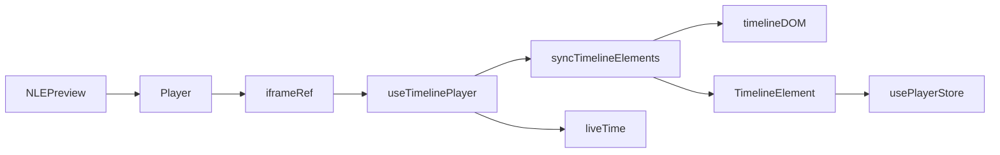
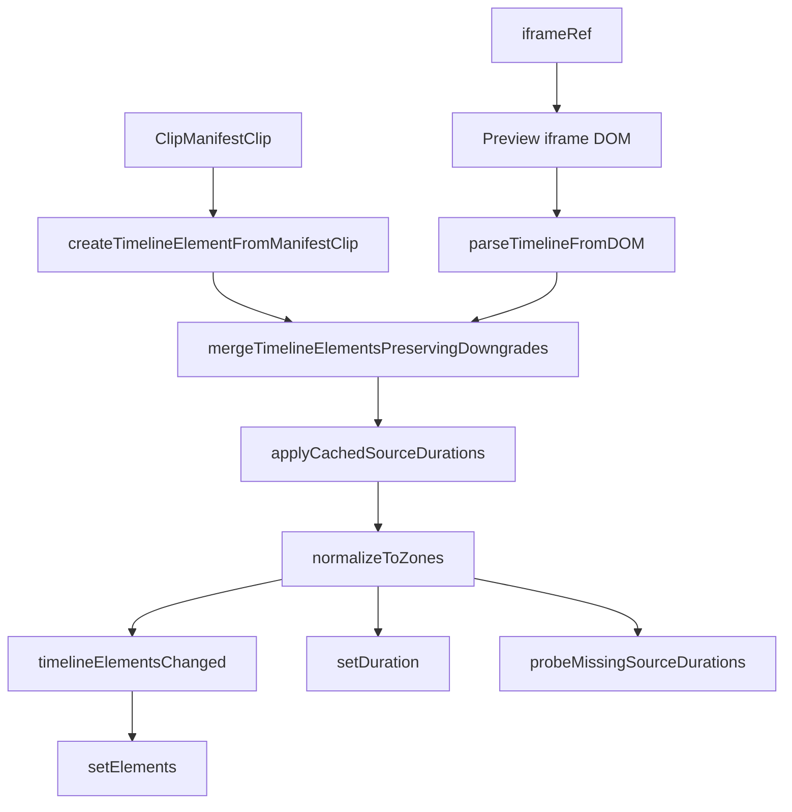
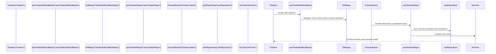

<!-- source: DeepWiki mcp.deepwiki.com · repo heygen-com/hyperframes · extra page Timeline Editing and Playback Sync · fetched 2026-11-02 -->

# Timeline Editing and Playback Sync

Relevant source files

The following files were used as context for generating this wiki page:

- [packages/player/src/iframe-dom.ts](packages/player/src/iframe-dom.ts)
- [packages/studio/src/components/StudioRightPanels.tsx](packages/studio/src/components/StudioRightPanels.tsx)
- [packages/studio/src/components/editor/GsapAddAnimationControl.tsx](packages/studio/src/components/editor/GsapAddAnimationControl.tsx)
- [packages/studio/src/components/editor/gsapAnimationCallbacks.test.ts](packages/studio/src/components/editor/gsapAnimationCallbacks.test.ts)
- [packages/studio/src/components/editor/keyframeRetime.test.ts](packages/studio/src/components/editor/keyframeRetime.test.ts)
- [packages/studio/src/components/editor/keyframeRetime.ts](packages/studio/src/components/editor/keyframeRetime.ts)
- [packages/studio/src/components/nle/NLEContext.tsx](packages/studio/src/components/nle/NLEContext.tsx)
- [packages/studio/src/components/nle/NLEPreview.test.ts](packages/studio/src/components/nle/NLEPreview.test.ts)
- [packages/studio/src/components/nle/NLEPreview.tsx](packages/studio/src/components/nle/NLEPreview.tsx)
- [packages/studio/src/components/nle/PreviewZoomOverlay.tsx](packages/studio/src/components/nle/PreviewZoomOverlay.tsx)
- [packages/studio/src/components/nle/previewZoom.test.ts](packages/studio/src/components/nle/previewZoom.test.ts)
- [packages/studio/src/components/nle/previewZoom.ts](packages/studio/src/components/nle/previewZoom.ts)
- [packages/studio/src/components/nle/useTimelineEditCallbacks.test.ts](packages/studio/src/components/nle/useTimelineEditCallbacks.test.ts)
- [packages/studio/src/components/nle/useTimelineEditCallbacks.test.tsx](packages/studio/src/components/nle/useTimelineEditCallbacks.test.tsx)
- [packages/studio/src/components/nle/useTimelineEditCallbacks.ts](packages/studio/src/components/nle/useTimelineEditCallbacks.ts)
- [packages/studio/src/contexts/PanelLayoutContext.tsx](packages/studio/src/contexts/PanelLayoutContext.tsx)
- [packages/studio/src/contexts/TimelineEditContext.tsx](packages/studio/src/contexts/TimelineEditContext.tsx)
- [packages/studio/src/hooks/useGsapSelectionHandlers.test.tsx](packages/studio/src/hooks/useGsapSelectionHandlers.test.tsx)
- [packages/studio/src/hooks/useGsapSelectionHandlers.ts](packages/studio/src/hooks/useGsapSelectionHandlers.ts)
- [packages/studio/src/hooks/usePanelLayout.test.ts](packages/studio/src/hooks/usePanelLayout.test.ts)
- [packages/studio/src/hooks/usePanelLayout.ts](packages/studio/src/hooks/usePanelLayout.ts)
- [packages/studio/src/player/components/Player.test.ts](packages/studio/src/player/components/Player.test.ts)
- [packages/studio/src/player/components/Player.tsx](packages/studio/src/player/components/Player.tsx)
- [packages/studio/src/player/components/PlayerControls.tsx](packages/studio/src/player/components/PlayerControls.tsx)
- [packages/studio/src/player/components/Timeline.bandEscape.test.tsx](packages/studio/src/player/components/Timeline.bandEscape.test.tsx)
- [packages/studio/src/player/components/timelineCallbacks.ts](packages/studio/src/player/components/timelineCallbacks.ts)
- [packages/studio/src/player/components/timelineMarquee.test.ts](packages/studio/src/player/components/timelineMarquee.test.ts)
- [packages/studio/src/player/components/timelineMarquee.ts](packages/studio/src/player/components/timelineMarquee.ts)
- [packages/studio/src/player/components/useTimelineRangeSelection.test.tsx](packages/studio/src/player/components/useTimelineRangeSelection.test.tsx)
- [packages/studio/src/player/components/useTimelineRangeSelection.ts](packages/studio/src/player/components/useTimelineRangeSelection.ts)
- [packages/studio/src/player/components/useTimelineRangeSelectionScrub.test.tsx](packages/studio/src/player/components/useTimelineRangeSelectionScrub.test.tsx)
- [packages/studio/src/player/hooks/playbackAdapterResolution.ts](packages/studio/src/player/hooks/playbackAdapterResolution.ts)
- [packages/studio/src/player/hooks/timelinePlayerTestHarness.ts](packages/studio/src/player/hooks/timelinePlayerTestHarness.ts)
- [packages/studio/src/player/hooks/usePlaybackKeyboard.test.ts](packages/studio/src/player/hooks/usePlaybackKeyboard.test.ts)
- [packages/studio/src/player/hooks/usePlaybackKeyboard.ts](packages/studio/src/player/hooks/usePlaybackKeyboard.ts)
- [packages/studio/src/player/hooks/useTimelinePlayer.seek.test.ts](packages/studio/src/player/hooks/useTimelinePlayer.seek.test.ts)
- [packages/studio/src/player/hooks/useTimelinePlayer.test.ts](packages/studio/src/player/hooks/useTimelinePlayer.test.ts)
- [packages/studio/src/player/hooks/useTimelinePlayer.ts](packages/studio/src/player/hooks/useTimelinePlayer.ts)
- [packages/studio/src/player/hooks/useTimelineSyncCallbacks.ts](packages/studio/src/player/hooks/useTimelineSyncCallbacks.ts)
- [packages/studio/src/player/lib/automationStoreSync.test.ts](packages/studio/src/player/lib/automationStoreSync.test.ts)
- [packages/studio/src/player/lib/automationStoreSync.ts](packages/studio/src/player/lib/automationStoreSync.ts)
- [packages/studio/src/player/lib/playbackShortcuts.ts](packages/studio/src/player/lib/playbackShortcuts.ts)
- [packages/studio/src/player/lib/playbackTypes.ts](packages/studio/src/player/lib/playbackTypes.ts)
- [packages/studio/src/player/lib/runtimeAudioId.test.ts](packages/studio/src/player/lib/runtimeAudioId.test.ts)
- [packages/studio/src/player/lib/storedVolume.ts](packages/studio/src/player/lib/storedVolume.ts)
- [packages/studio/src/player/lib/time.test.ts](packages/studio/src/player/lib/time.test.ts)
- [packages/studio/src/player/lib/time.ts](packages/studio/src/player/lib/time.ts)
- [packages/studio/src/player/lib/timelineDOM.test.ts](packages/studio/src/player/lib/timelineDOM.test.ts)
- [packages/studio/src/player/lib/timelineDOM.ts](packages/studio/src/player/lib/timelineDOM.ts)
- [packages/studio/src/player/lib/timelineElementHelpers.ts](packages/studio/src/player/lib/timelineElementHelpers.ts)
- [packages/studio/src/player/lib/timelineGroupInfo.ts](packages/studio/src/player/lib/timelineGroupInfo.ts)
- [packages/studio/src/player/lib/timelineIframeHelpers.test.ts](packages/studio/src/player/lib/timelineIframeHelpers.test.ts)
- [packages/studio/src/player/lib/timelineIframeHelpers.ts](packages/studio/src/player/lib/timelineIframeHelpers.ts)
- [packages/studio/src/player/store/playerStore.test.ts](packages/studio/src/player/store/playerStore.test.ts)
- [packages/studio/src/player/store/playerStore.ts](packages/studio/src/player/store/playerStore.ts)
- [packages/studio/src/player/store/timelineElement.ts](packages/studio/src/player/store/timelineElement.ts)
- [packages/studio/src/utils/studioUiPreferences.test.ts](packages/studio/src/utils/studioUiPreferences.test.ts)
- [packages/studio/src/utils/studioUiPreferences.ts](packages/studio/src/utils/studioUiPreferences.ts)
- [packages/studio/src/utils/typingTarget.ts](packages/studio/src/utils/typingTarget.ts)

## Purpose and scope

This page describes how Studio connects preview playback to timeline state and exposes timeline edits through callback interfaces. It covers the visible synchronization boundary, timeline-element data model and DOM conversion, edit callback wiring, and playback controls. Asset-drop and clipboard implementation details are not included here because the provided source excerpts do not show those implementations. [packages/studio/src/player/hooks/useTimelinePlayer.ts:1-143]()

Sources: `packages/studio/src/player/hooks/useTimelinePlayer.ts`; `packages/studio/src/player/store/playerStore.ts`; `packages/studio/src/components/nle/useTimelineEditCallbacks.ts`

---

## 1. System boundary and data flow

The preview is rendered through `Player`, which exposes its inner iframe through a forwarded ref so timeline synchronization code can inspect the preview document. `NLEPreview` owns the preview-facing context and passes the iframe ref to `Player`. [packages/studio/src/player/components/Player.tsx:137-145]() [packages/studio/src/components/nle/NLEPreview.tsx:33-55]()

`useTimelinePlayer` owns the iframe ref and coordinates timeline synchronization with `usePlayerStore`. Its `syncTimelineElements` callback merges discovered elements with existing state, applies cached media durations, normalizes track zones, updates elements and duration when needed, and requests timeline readiness when the store is not ready. [packages/studio/src/player/hooks/useTimelinePlayer.ts:64-78]()[packages/studio/src/player/hooks/useTimelinePlayer.ts:80-127]()

The callback also starts asynchronous probing for missing source durations. Probe results patch the matching element only when it still exists and does not already have a source duration. [packages/studio/src/player/hooks/useTimelinePlayer.ts:129-143]()

### Natural-language-to-code map: preview synchronization

The diagram maps the user-facing concepts—preview, timeline model, and transport—to the names used in the implementation. [packages/studio/src/components/nle/NLEPreview.tsx:33-55]()[packages/studio/src/player/components/Player.tsx:137-145]()[packages/studio/src/player/hooks/useTimelinePlayer.ts:64-127]()[packages/studio/src/player/store/playerStore.ts:69-80]()

**Diagram: Preview-to-store synchronization boundary**

Sources: `packages/studio/src/components/nle/NLEPreview.tsx`; `packages/studio/src/player/components/Player.tsx`; `packages/studio/src/player/hooks/useTimelinePlayer.ts`; `packages/studio/src/player/store/playerStore.ts`

---

## 2. Playback synchronization and seek publication

`useTimelinePlayer` imports `liveTime` and defines `publishSeek(time, options)`. By default it calls `liveTime.notifySeek(time)`; when `follow` is explicitly `false`, it calls `liveTime.notify(time)` instead. This is the hook’s visible boundary for publishing seek-time changes. [packages/studio/src/player/hooks/useTimelinePlayer.ts:1-9]()[packages/studio/src/player/hooks/useTimelinePlayer.ts:56-57]()

The hook also retains refs for animation-frame scheduling, a pending seek, reverse playback scheduling, shuttle direction and speed, and a static-seek cache entry. These refs indicate separate bookkeeping for playback and seek paths; the provided excerpt does not show their downstream loop or adapter call sites. [packages/studio/src/player/hooks/useTimelinePlayer.ts:64-75]()

Playback adapter types and resolution are imported from `playbackTypes`, `playbackAdapterResolution`, and `playbackAdapter`. The excerpt shows the hook exporting `createStaticSeekPlaybackAdapter`, but does not include the adapter implementation or the hook’s later initialization logic. [packages/studio/src/player/hooks/useTimelinePlayer.ts:7-8]()[packages/studio/src/player/hooks/useTimelinePlayer.ts:13-14]()[packages/studio/src/player/hooks/useTimelinePlayer.ts:30-32]()

`useTimelineSyncCallbacks` defines the adapter-facing inputs used for synchronization: a `getAdapter` function, callbacks for setting duration and current time, readiness and playing state, and an optional adapter-ready callback. The default `onAdapterReady` reveals the iframe and invokes the hydration commit. [packages/studio/src/player/hooks/useTimelineSyncCallbacks.ts:37-64]()[packages/studio/src/player/hooks/useTimelineSyncCallbacks.ts:80-94]()[packages/studio/src/player/hooks/useTimelineSyncCallbacks.ts:151-168]()

When restoring a preview, the documented seek priority is: an explicit pending seek, a store-level seek request, then the store’s last known playhead. The accompanying comment states that the store fallback preserves playhead position across reloads, with clamping permitted when content shrinks. [packages/studio/src/player/hooks/useTimelineSyncCallbacks.ts:66-79]()

Sources: `packages/studio/src/player/hooks/useTimelinePlayer.ts`; `packages/studio/src/player/hooks/useTimelineSyncCallbacks.ts`

---

## 3. Timeline state and element identity

`PlayerState` contains transport values (`isPlaying`, `currentTime`, `duration`, `playbackRate`, `audioMuted`, `audioVolume`, and `loopEnabled`), the timeline element array, selection state, and timeline edit settings. The store also defines setters for transport, elements, selection, and element updates. [packages/studio/src/player/store/playerStore.ts:69-89]()[packages/studio/src/player/store/playerStore.ts:131-149]()

Timeline interaction settings include `timelineSnapEnabled` and `rippleEditEnabled`. The store comments distinguish snapping during clip drags, trims, and drops from ripple behavior that keeps the main track gapless after deletion. [packages/studio/src/player/store/playerStore.ts:110-123]()

`createTimelineElementFromManifestClip` converts a manifest clip into a `TimelineElement`. It derives an identity using clip data and, when a host DOM element is available, DOM ID, `data-hf-id`, selector, selector index, and source file. The resulting model includes timing, track, authored-track, stacking-context, playback, and identity fields. [packages/studio/src/player/lib/timelineDOM.ts:69-144]()

When a host DOM element is available, the factory additionally reads media metadata and attributes such as hidden state, timeline role, link, composition scope, sync origin, audio group, FX chain, automation, and z-index. [packages/studio/src/player/lib/timelineDOM.ts:146-178]()

`timelineElementHelpers` provides duration-reading and DOM-classification utilities. For example, timeline duration is read from the root composition when it has an authored duration; otherwise it is derived from the furthest eligible clip end. Elements marked as ignored, including descendants of the configured ignore selectors, are excluded from that furthest-end calculation. [packages/studio/src/player/lib/timelineElementHelpers.ts:81-102]()[packages/studio/src/player/lib/timelineElementHelpers.ts:104-131]()

Sources: `packages/studio/src/player/store/playerStore.ts`; `packages/studio/src/player/lib/timelineDOM.ts`; `packages/studio/src/player/lib/timelineElementHelpers.ts`

---

## 4. DOM discovery and store synchronization

`syncTimelineElements` uses the existing store state as the merge baseline. It merges discovered elements with `mergeTimelineElementsPreservingDowngrades`, applies cached source durations, and normalizes the result with `normalizeToZones`. The merge callback checks whether a composition element can be found in the iframe. [packages/studio/src/player/hooks/useTimelinePlayer.ts:82-109]()

The hook replaces the store element array only when `timelineElementsChanged` reports a difference. It updates duration only when the supplied duration is finite, positive, and different from the current value. If timeline readiness has not yet been reached, it requests readiness using the safe iframe content document. [packages/studio/src/player/hooks/useTimelinePlayer.ts:111-127]()

The timeline sync callback module describes additional discovery and hydration responsibilities: processing clip-manifest messages, enriching compositions that the manifest misses, initializing an adapter after iframe load, and providing a message-based fallback. These responsibilities are documented in that module’s header; the excerpt shows its parameter interface and duration-resolution helper, not the full callback bodies. [packages/studio/src/player/hooks/useTimelineSyncCallbacks.ts:1-9]()[packages/studio/src/player/hooks/useTimelineSyncCallbacks.ts:37-64]()

For manifest duration, `resolveTimelineTotalDuration` takes the maximum of sanitized manifest duration and sanitized authored root duration. This prevents a shorter manifest total from overriding a longer authored root duration while allowing a longer manifest total to extend the timeline. [packages/studio/src/player/hooks/useTimelineSyncCallbacks.ts:128-149]()

### Natural-language-to-code map: DOM data and timeline elements

This diagram maps the preview’s DOM/manifest inputs to the concrete parser, merge, and store entities. [packages/studio/src/player/lib/timelineDOM.ts:69-79]()[packages/studio/src/player/hooks/useTimelinePlayer.ts:82-127]()[packages/studio/src/player/store/playerStore.ts:69-80]()

**Diagram: Timeline discovery and state update**

Sources: `packages/studio/src/player/lib/timelineDOM.ts`; `packages/studio/src/player/hooks/useTimelinePlayer.ts`

---

## 5. Timeline edit callback interface

`useTimelineEditCallbacks` builds the callback object supplied to `<Timeline>` through `TimelineEditProvider`. Its dependency interface makes the edit operations explicit: single- and multi-element moves, single-element resize, group resize, track visibility changes, split and razor operations, blocked-edit handling, and optional freeze-frame, link-edit, delete-only, group-clips, and FX operations. [packages/studio/src/components/nle/useTimelineEditCallbacks.ts:27-78]()[packages/studio/src/components/nle/useTimelineEditCallbacks.ts:122-145]()

The callback builder also reads Studio project/composition context and DOM-edit selection/actions context. Those dependencies provide access to selected GSAP animations and keyframe-edit operations, including moving, resizing, adding, and removing keyframes. [packages/studio/src/components/nle/useTimelineEditCallbacks.ts:146-159]()

For keyframe diamonds, `resolveTimelineKeyframeTarget` looks for a cached keyframe whose percentage is within `0.2` of the requested percentage. If the keyframe carries an animation ID, that identity is used; otherwise, a legacy entry is resolved only when its property group identifies exactly one candidate animation. Ambiguous entries return `null` rather than selecting an arbitrary animation. [packages/studio/src/components/nle/useTimelineEditCallbacks.ts:93-120]()

The store provides selection state used by timeline interactions, including a primary selected element and a `Set` of selected element IDs. It exposes operations for replacing, extending, toggling, and clearing selection. [packages/studio/src/player/store/playerStore.ts:110-114]()[packages/studio/src/player/store/playerStore.ts:131-148]()

Sources: `packages/studio/src/components/nle/useTimelineEditCallbacks.ts`; `packages/studio/src/player/store/playerStore.ts`

---

## 6. Playback controls and persisted preferences

`PlayerControls` accepts `onTogglePlay` and `onSeek` callbacks and reads `isPlaying`, `duration`, `timelineReady`, and `playbackRate` from `usePlayerStore`. Its loop button toggles the store’s loop setting through the supplied setter and records a playback telemetry event. [packages/studio/src/player/components/PlayerControls.tsx:159-185]()[packages/studio/src/player/components/PlayerControls.tsx:62-85]()

Studio UI preferences define persisted timeline and transport options, including playback rate, audio mute/volume, timeline snapping, ripple editing, and time display mode. Preferences are stored under `hf-studio-ui-preferences`, optionally scoped by project ID. The provided excerpt shows the preference shape and read path; it does not show the write implementation. [packages/studio/src/utils/studioUiPreferences.ts:5-52]()[packages/studio/src/utils/studioUiPreferences.ts:54-70]()[packages/studio/src/utils/studioUiPreferences.ts:73-103]()[packages/studio/src/utils/studioUiPreferences.ts:131-143]()

Sources: `packages/studio/src/player/components/PlayerControls.tsx`; `packages/studio/src/utils/studioUiPreferences.ts`

---

## 7. Edit and playback interaction

The interaction boundary is split between timeline callbacks and preview synchronization. Timeline gestures are represented by callbacks such as `handleTimelineElementMove`, `handleTimelineElementResize`, and `handleTimelineElementSplit`; playback synchronization separately manages iframe discovery, store hydration, and seek publication. The supplied sources establish these interfaces but do not show the implementations that persist each edit to files or mutate preview DOM nodes. [packages/studio/src/components/nle/useTimelineEditCallbacks.ts:27-55]()[packages/studio/src/player/hooks/useTimelinePlayer.ts:80-127]()

**Diagram: Edit callbacks and playback-state paths**

Sources: `packages/studio/src/components/nle/useTimelineEditCallbacks.ts`; `packages/studio/src/player/hooks/useTimelinePlayer.ts`; `packages/studio/src/player/store/playerStore.ts`

---

## 8. Key implementation entities

| Entity | Role |
|---|---|
| `useTimelinePlayer` | Owns preview synchronization refs and the `syncTimelineElements` boundary; publishes seek changes through `liveTime`. [packages/studio/src/player/hooks/useTimelinePlayer.ts:56-84]() |
| `syncTimelineElements` | Merges and normalizes discovered elements, conditionally updates store elements/duration, requests readiness, and starts missing-duration probes. [packages/studio/src/player/hooks/useTimelinePlayer.ts:82-143]() |
| `useTimelineSyncCallbacks` | Defines iframe synchronization inputs and documents manifest-message processing, hydration, adapter initialization, and reload seek restoration. [packages/studio/src/player/hooks/useTimelineSyncCallbacks.ts:1-9]()[packages/studio/src/player/hooks/useTimelineSyncCallbacks.ts:37-79]() |
| `PlayerState` | Holds transport, timeline, selection, snap, ripple, and duration state. [packages/studio/src/player/store/playerStore.ts:69-123]() |
| `createTimelineElementFromManifestClip` | Converts a manifest clip and optional host DOM node into a `TimelineElement`. [packages/studio/src/player/lib/timelineDOM.ts:69-79]()[packages/studio/src/player/lib/timelineDOM.ts:91-144]() |
| `useTimelineEditCallbacks` | Builds timeline edit callback wiring from move, resize, split, group, FX, and keyframe dependencies. [packages/studio/src/components/nle/useTimelineEditCallbacks.ts:27-78]()[packages/studio/src/components/nle/useTimelineEditCallbacks.ts:122-159]() |
| `resolveTimelineKeyframeTarget` | Resolves a rendered keyframe diamond to an unambiguous GSAP animation target. [packages/studio/src/components/nle/useTimelineEditCallbacks.ts:93-120]() |
| `PlayerControls` | Connects player controls to store transport state and invokes play/seek callbacks. [packages/studio/src/player/components/PlayerControls.tsx:159-185]() |

Sources: `packages/studio/src/player/hooks/useTimelinePlayer.ts`; `packages/studio/src/player/hooks/useTimelineSyncCallbacks.ts`; `packages/studio/src/player/store/playerStore.ts`; `packages/studio/src/player/lib/timelineDOM.ts`; `packages/studio/src/components/nle/useTimelineEditCallbacks.ts`; `packages/studio/src/player/components/PlayerControls.tsx`

---

## 9. Scope notes

The supplied excerpts do not include the hook’s full seek/playback loop, playback adapter implementation, full provider component, edit persistence handlers, or asset-drop and clipboard implementations. Those behaviors are therefore not expanded here; the descriptions above are limited to the visible interfaces, state fields, and synchronization logic. [packages/studio/src/player/hooks/useTimelinePlayer.ts:1-143]()[packages/studio/src/components/nle/useTimelineEditCallbacks.ts:27-78]()

Sources: `packages/studio/src/player/hooks/useTimelinePlayer.ts`; `packages/studio/src/components/nle/useTimelineEditCallbacks.ts`

---

