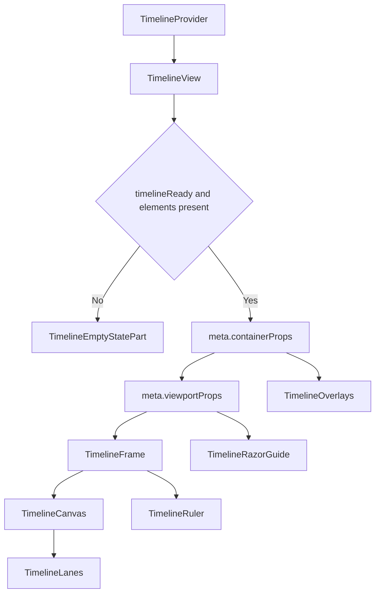
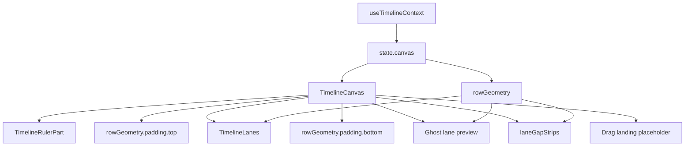
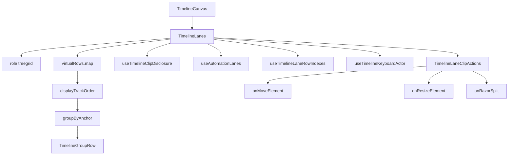
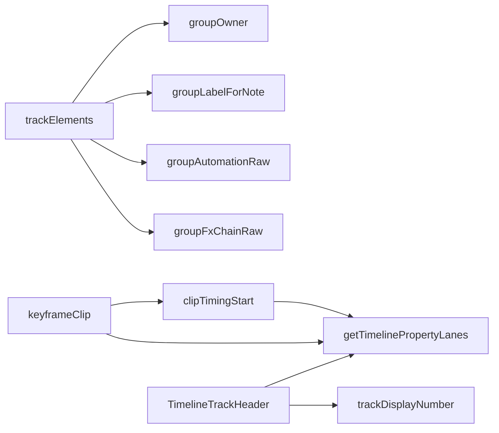
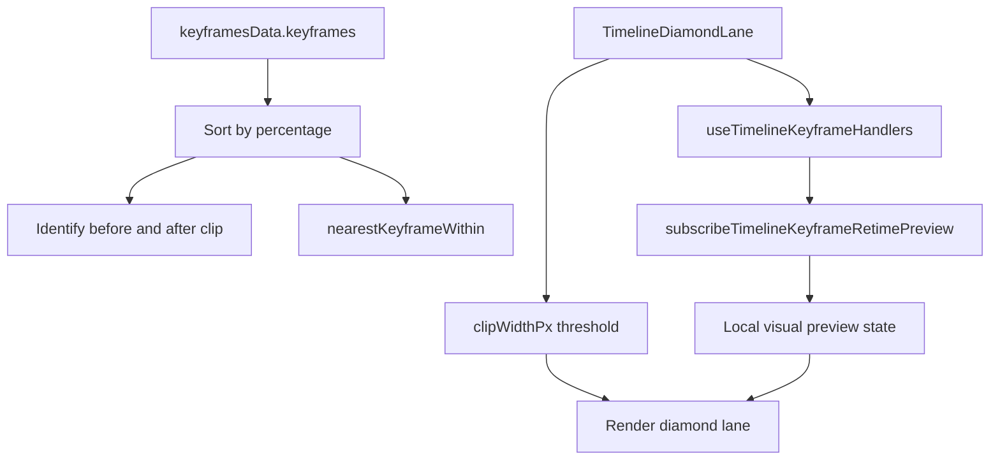
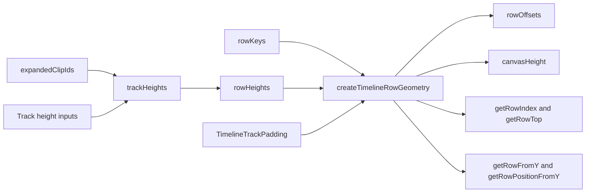
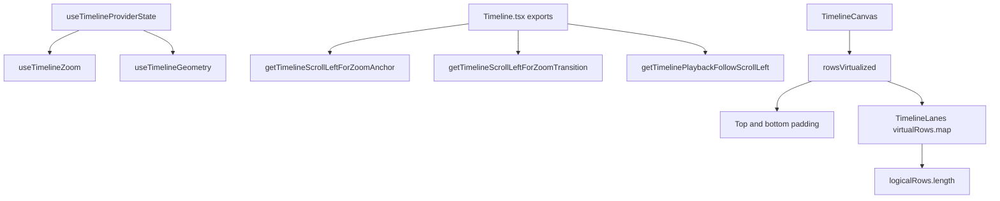
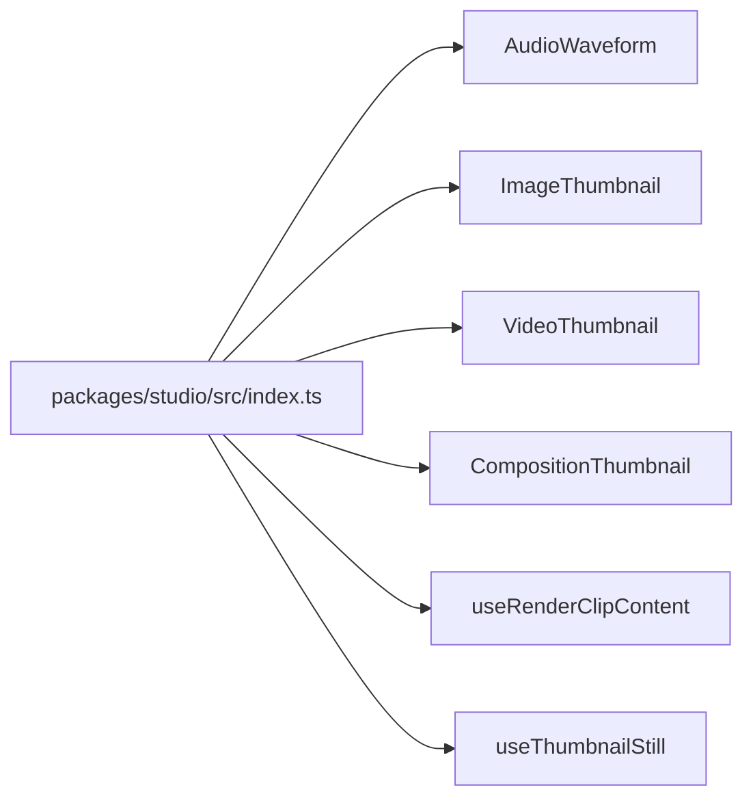

<!-- source: DeepWiki mcp.deepwiki.com · repo heygen-com/hyperframes · extra page Timeline Rendering and Lanes · fetched 2026-11-02 -->

# Timeline Rendering and Lanes

Relevant source files

The following files were used as context for generating this wiki page:

- [packages/studio/src/components/EditorShell.tsx](packages/studio/src/components/EditorShell.tsx)
- [packages/studio/src/components/editor/MotionPathOverlay.tsx](packages/studio/src/components/editor/MotionPathOverlay.tsx)
- [packages/studio/src/components/nle/TimelinePane.tsx](packages/studio/src/components/nle/TimelinePane.tsx)
- [packages/studio/src/hooks/timelineEditingHelpers.test.ts](packages/studio/src/hooks/timelineEditingHelpers.test.ts)
- [packages/studio/src/hooks/timelineEditingHelpers.ts](packages/studio/src/hooks/timelineEditingHelpers.ts)
- [packages/studio/src/hooks/useGsapKeyframeOps.test.tsx](packages/studio/src/hooks/useGsapKeyframeOps.test.tsx)
- [packages/studio/src/hooks/useTimelineEditing.test.tsx](packages/studio/src/hooks/useTimelineEditing.test.tsx)
- [packages/studio/src/hooks/useTimelineEditing.ts](packages/studio/src/hooks/useTimelineEditing.ts)
- [packages/studio/src/hooks/useTimelineEditingTypes.ts](packages/studio/src/hooks/useTimelineEditingTypes.ts)
- [packages/studio/src/hooks/useTimelineGroupEditing.ts](packages/studio/src/hooks/useTimelineGroupEditing.ts)
- [packages/studio/src/index.ts](packages/studio/src/index.ts)
- [packages/studio/src/player/components/ClipContextMenu.test.tsx](packages/studio/src/player/components/ClipContextMenu.test.tsx)
- [packages/studio/src/player/components/ClipContextMenu.tsx](packages/studio/src/player/components/ClipContextMenu.tsx)
- [packages/studio/src/player/components/KeyframeDiamondContextMenu.test.tsx](packages/studio/src/player/components/KeyframeDiamondContextMenu.test.tsx)
- [packages/studio/src/player/components/KeyframeDiamondContextMenu.tsx](packages/studio/src/player/components/KeyframeDiamondContextMenu.tsx)
- [packages/studio/src/player/components/LayerDisclosureRow.tsx](packages/studio/src/player/components/LayerDisclosureRow.tsx)
- [packages/studio/src/player/components/PlayheadIndicator.tsx](packages/studio/src/player/components/PlayheadIndicator.tsx)
- [packages/studio/src/player/components/Timeline.readOnly.test.tsx](packages/studio/src/player/components/Timeline.readOnly.test.tsx)
- [packages/studio/src/player/components/Timeline.rulerSeek.test.tsx](packages/studio/src/player/components/Timeline.rulerSeek.test.tsx)
- [packages/studio/src/player/components/Timeline.showKeyframes.test.tsx](packages/studio/src/player/components/Timeline.showKeyframes.test.tsx)
- [packages/studio/src/player/components/Timeline.test.ts](packages/studio/src/player/components/Timeline.test.ts)
- [packages/studio/src/player/components/Timeline.tsx](packages/studio/src/player/components/Timeline.tsx)
- [packages/studio/src/player/components/TimelineCanvas.tsx](packages/studio/src/player/components/TimelineCanvas.tsx)
- [packages/studio/src/player/components/TimelineClip.tsx](packages/studio/src/player/components/TimelineClip.tsx)
- [packages/studio/src/player/components/TimelineClipDiamonds.test.tsx](packages/studio/src/player/components/TimelineClipDiamonds.test.tsx)
- [packages/studio/src/player/components/TimelineClipDiamonds.tsx](packages/studio/src/player/components/TimelineClipDiamonds.tsx)
- [packages/studio/src/player/components/TimelineLanes.test.tsx](packages/studio/src/player/components/TimelineLanes.test.tsx)
- [packages/studio/src/player/components/TimelineLanes.tsx](packages/studio/src/player/components/TimelineLanes.tsx)
- [packages/studio/src/player/components/TimelineLayerGroupHeader.tsx](packages/studio/src/player/components/TimelineLayerGroupHeader.tsx)
- [packages/studio/src/player/components/TimelineOverlays.test.ts](packages/studio/src/player/components/TimelineOverlays.test.ts)
- [packages/studio/src/player/components/TimelineOverlays.tsx](packages/studio/src/player/components/TimelineOverlays.tsx)
- [packages/studio/src/player/components/TimelinePropertyLanes.test.tsx](packages/studio/src/player/components/TimelinePropertyLanes.test.tsx)
- [packages/studio/src/player/components/TimelinePropertyLanes.tsx](packages/studio/src/player/components/TimelinePropertyLanes.tsx)
- [packages/studio/src/player/components/TimelineProvider.tsx](packages/studio/src/player/components/TimelineProvider.tsx)
- [packages/studio/src/player/components/TimelineRuler.test.tsx](packages/studio/src/player/components/TimelineRuler.test.tsx)
- [packages/studio/src/player/components/TimelineRuler.tsx](packages/studio/src/player/components/TimelineRuler.tsx)
- [packages/studio/src/player/components/TimelineRulerPart.tsx](packages/studio/src/player/components/TimelineRulerPart.tsx)
- [packages/studio/src/player/components/TimelineTrackHeader.test.tsx](packages/studio/src/player/components/TimelineTrackHeader.test.tsx)
- [packages/studio/src/player/components/TimelineTrackHeader.tsx](packages/studio/src/player/components/TimelineTrackHeader.tsx)
- [packages/studio/src/player/components/TimelineTypes.ts](packages/studio/src/player/components/TimelineTypes.ts)
- [packages/studio/src/player/components/timelineClipDragPreview.test.ts](packages/studio/src/player/components/timelineClipDragPreview.test.ts)
- [packages/studio/src/player/components/timelineClipDragPreview.ts](packages/studio/src/player/components/timelineClipDragPreview.ts)
- [packages/studio/src/player/components/timelineClipGestureHandlers.ts](packages/studio/src/player/components/timelineClipGestureHandlers.ts)
- [packages/studio/src/player/components/timelineDiamondTypes.ts](packages/studio/src/player/components/timelineDiamondTypes.ts)
- [packages/studio/src/player/components/timelineEditing.test.ts](packages/studio/src/player/components/timelineEditing.test.ts)
- [packages/studio/src/player/components/timelineEditing.ts](packages/studio/src/player/components/timelineEditing.ts)
- [packages/studio/src/player/components/timelineGroupEditing.ts](packages/studio/src/player/components/timelineGroupEditing.ts)
- [packages/studio/src/player/components/timelineKeyframeIdentity.ts](packages/studio/src/player/components/timelineKeyframeIdentity.ts)
- [packages/studio/src/player/components/timelineLaneProps.ts](packages/studio/src/player/components/timelineLaneProps.ts)
- [packages/studio/src/player/components/timelineLayout.test.ts](packages/studio/src/player/components/timelineLayout.test.ts)
- [packages/studio/src/player/components/timelineLayout.ts](packages/studio/src/player/components/timelineLayout.ts)
- [packages/studio/src/player/components/timelineProviderStateBuilders.test.ts](packages/studio/src/player/components/timelineProviderStateBuilders.test.ts)
- [packages/studio/src/player/components/timelineProviderStateBuilders.ts](packages/studio/src/player/components/timelineProviderStateBuilders.ts)
- [packages/studio/src/player/components/timelineTestViewport.ts](packages/studio/src/player/components/timelineTestViewport.ts)
- [packages/studio/src/player/components/useTimelineClipDrag.ts](packages/studio/src/player/components/useTimelineClipDrag.ts)
- [packages/studio/src/player/components/useTimelineKeyframeData.ts](packages/studio/src/player/components/useTimelineKeyframeData.ts)
- [packages/studio/src/player/components/useTimelineKeyframeHandlers.test.tsx](packages/studio/src/player/components/useTimelineKeyframeHandlers.test.tsx)
- [packages/studio/src/player/components/useTimelineKeyframeHandlers.ts](packages/studio/src/player/components/useTimelineKeyframeHandlers.ts)
- [packages/studio/src/player/components/useTimelineProviderState.tsx](packages/studio/src/player/components/useTimelineProviderState.tsx)
- [packages/studio/src/player/components/useTimelineScrollViewport.ts](packages/studio/src/player/components/useTimelineScrollViewport.ts)
- [packages/studio/src/player/index.ts](packages/studio/src/player/index.ts)

## Overview and Scope

This page covers the Studio timeline’s React composition, canvas and lane rendering, row geometry, track headers, keyframe diamonds, automation and property lanes, virtual-row inputs, zoom-related exports, and media-preview exports. The public Studio entry point exports `Timeline`, its parts, thumbnail components, and `AudioWaveform`. [packages/studio/src/index.ts:22-35]()

Sources: `packages/studio/src/index.ts:22-35`

---

## 1. Timeline Component Structure (`Timeline.tsx`)

`Timeline` is a memoized composition that mounts `TimelineProvider` around `TimelineView`. The view reads `state` and `meta` from `useTimelineContext()`. When the timeline is not ready or has no elements, it renders `TimelineEmptyStatePart`; otherwise, it renders the container and viewport, with `TimelineFrame` and `TimelineRazorGuide` inside the viewport and `TimelineOverlays` alongside it. [packages/studio/src/player/components/Timeline.tsx:37-60]()

`TimelineComposed` also exposes the provider and major visual or interaction parts as properties on `Timeline`, including `Frame`, `Ruler`, `Lanes`, `Playhead`, `RazorGuide`, menus, popovers, and `Overlays`. The module re-exports layout, ruler, and viewport helpers for consumers that need timeline geometry or scrolling behavior. [packages/studio/src/player/components/Timeline.tsx:19-35] [packages/studio/src/player/components/Timeline.tsx:62-76]()

**Diagram: Timeline composition and rendering entities**

Sources: `packages/studio/src/player/components/Timeline.tsx:37-76` [packages/studio/src/player/components/TimelineCanvas.tsx:1-9]

---

## 2. `TimelineCanvas`: Core Clip and Lane Renderer

`TimelineCanvas` reads the canvas model from `state.canvas` in the timeline context. It uses the canvas properties and actions to render the ruler, lane content, padding, and drag/drop visual feedback. It passes layout and interaction properties to `TimelineLanes`, including `renderClipContent`, `renderClipOverlay`, resize and move callbacks, and razor-split callbacks. [packages/studio/src/player/components/TimelineCanvas.tsx:14-17] [packages/studio/src/player/components/TimelineCanvas.tsx:44-71]()

The canvas height is `props.totalH`; its width is `props.contentOrigin + props.trackContentWidth`. Top and bottom breathing-space elements use `rowGeometry.padding`, except when rows are virtualized, when those spacer heights are zero. The bottom padding also provides a scrollable surface for dropping a clip to create a new bottom track. [packages/studio/src/player/components/TimelineCanvas.tsx:44-56] [packages/studio/src/player/components/TimelineCanvas.tsx:73-79]()

Drag feedback is derived from the display track order and row geometry. The canvas computes drag and drop row indexes, determines whether a ghost lane is active, and only shows that lane when the bottom padding is at least one `TRACK_H`. When a clip drag has a committed target row rather than insert mode, it renders a landing placeholder at the preview start and target row. [packages/studio/src/player/components/TimelineCanvas.tsx:18-41] [packages/studio/src/player/components/TimelineCanvas.tsx:81-100] [packages/studio/src/player/components/TimelineCanvas.tsx:134-145]()

Gap strips are positioned from row geometry and time-to-pixel values. In virtualized mode, their intervals are filtered against `renderTimeRange` before rendering. [packages/studio/src/player/components/TimelineCanvas.tsx:102-132]()

**Diagram: Canvas rendering flow**

Sources: `packages/studio/src/player/components/TimelineCanvas.tsx:14-17` [packages/studio/src/player/components/TimelineCanvas.tsx:44-79] [packages/studio/src/player/components/TimelineCanvas.tsx:81-145]

---

## 3. Timeline Lanes (`TimelineLanes.tsx`)

`TimelineLanes` renders a `treegrid` with an accessible label, row count based on `logicalRows.length`, and two columns. It maps `virtualRows` to rendered rows, resolves each row’s track from `displayTrackOrder`, and renders group rows when a track is a group anchor. Its props include track and group data, row geometry, virtual and logical rows, render-time ranges, selection state, keyframe data, and edit callbacks. [packages/studio/src/player/components/TimelineLanes.tsx:48-110] [packages/studio/src/player/components/TimelineLanes.tsx:169-191]()

The component coordinates disclosure, automation, and keyboard behavior through `useTimelineGroupDisclosure`, `useAutomationLanes`, `useAutomationSelectionKeyboard`, `useTimelineLaneRowIndexes`, `useTimelineClipDisclosure`, and `useTimelineKeyboardActor`. It also derives transition seams from preview elements and prepares clip gesture actions, including move, resize, and razor operations. [packages/studio/src/player/components/TimelineLanes.tsx:114-168]()

The row renderer receives `rowsVirtualized`, `virtualRows`, and `renderTimeRange`; the canvas and lane renderer can therefore work with a visible subset rather than requiring the canvas to render every logical row. The supplied code establishes this data flow, but does not include the implementation of the virtual-row selection algorithm. [packages/studio/src/player/components/TimelineCanvas.tsx:14-17] [packages/studio/src/player/components/TimelineLanes.tsx:48-67] [packages/studio/src/player/components/TimelineLanes.tsx:169-191]()

**Diagram: Lane renderer and supporting entities**

Sources: `packages/studio/src/player/components/TimelineCanvas.tsx:58-71` [packages/studio/src/player/components/TimelineLanes.tsx:114-168`]
[packages/studio/src/player/components/TimelineLanes.tsx:169-191]()

---

## 4. Track Header (`TimelineTrackHeader.tsx`)

`TimelineTrackHeader` receives a real `trackNumber` for routing callbacks and a separate, nullable `trackDisplayNumber` for the user-facing label. This distinction prevents a fractional internal track key from being announced or displayed as a track number. The header also receives the track’s clips, the active keyframe clip, expansion and visibility state, audio-track status, and callbacks for disclosure, visibility, keyframe toggles, automation removal, and seeking. [packages/studio/src/player/components/TimelineTrackHeader.tsx:42-84]()

For the active keyframe clip, the header computes the current clip-relative percentage and calls `getTimelinePropertyLanes` using `clipTimingStart(keyframeClip)` and the clip duration. The implementation explicitly uses `clipTimingStart` rather than the raw start for an expanded sub-composition child, because the child’s host-absolute start differs from the local time basis of its tweens. [packages/studio/src/player/components/TimelineTrackHeader.tsx:111-118]()

The header derives audio-group metadata from the track elements, including group identity, label, automation, and FX chain. It uses the track’s elements to establish group automation context, while the active keyframe clip determines the property lanes shown for the keyframe view. [packages/studio/src/player/components/TimelineTrackHeader.tsx:119-151]()

**Diagram: Track header data and lane-label relationship**

Sources: `packages/studio/src/player/components/TimelineTrackHeader.tsx:42-84` [packages/studio/src/player/components/TimelineTrackHeader.tsx:111-151]()

---

## 5. Clip Diamonds: Keyframe Visualization

`TimelineDiamondLane` renders keyframe markers for a clip’s keyframe data. It returns no lane when `clipWidthPx` is less than 20 pixels. Otherwise, it sorts keyframes by percentage and identifies keyframes outside the visible 0–100% clip interval so they can be represented at the boundaries rather than discarded. [packages/studio/src/player/components/TimelineClipDiamonds.tsx:68-89] [packages/studio/src/player/components/TimelineClipDiamonds.tsx:132-154]()

Diamond sizing accounts for beat strips: when beats are active, the marker is sized relative to the clip height and positioned below the beat band; otherwise, it uses `LANE_H` and `DIAMOND_RATIO`. The clickable hit area is treated separately from the visible marker size. [packages/studio/src/player/components/TimelineClipDiamonds.tsx:134-146]()

The lane subscribes to keyframe-retime preview updates and stores a visual preview locally. The retime gesture itself is initiated through the shared timeline keyframe handlers; the lane’s documented responsibility is to arm the interaction and render the published preview. [packages/studio/src/player/components/TimelineClipDiamonds.tsx:90-115]()

`nearestKeyframeWithin` uses binary search over sorted keyframes to find the nearest marker within a tolerance, rather than scanning the entire lane. [packages/studio/src/player/components/TimelineClipDiamonds.tsx:43-66]()

**Diagram: Keyframe marker data and preview path**

Sources: `packages/studio/src/player/components/TimelineClipDiamonds.tsx:43-66` [packages/studio/src/player/components/TimelineClipDiamonds.tsx:68-115] [packages/studio/src/player/components/TimelineClipDiamonds.tsx:132-154]()

---

## 6. Timeline Layout (`timelineLayout.ts`)

`timelineLayout.ts` defines core dimensions including `GUTTER`, `LABEL_COL_W`, `TRACK_H`, `LANE_H`, `RULER_H`, and `CLIP_Y`. It also defines top, bottom, and left padding defaults for the track surface. `AUTOMATION_LANE_H` is imported and contributes to expanded row height. [packages/studio/src/player/components/timelineLayout.ts:1-12] [packages/studio/src/player/components/timelineLayout.ts:54-82]()

`trackHeights()` returns one height per track. It starts with `TRACK_H`; for expanded clips, it uses the maximum property-lane count and automation-lane count among the clips on that track, adding `LANE_H` and `AUTOMATION_LANE_H` contributions respectively. [packages/studio/src/player/components/timelineLayout.ts:84-114]()

`createTimelineRowGeometry()` builds an immutable row snapshot from row keys, row heights, and optional padding. The geometry records row keys, heights, cumulative offsets, padding, and canvas height, and exposes methods for mapping row keys and vertical content positions to row indexes, heights, and positions. [packages/studio/src/player/components/timelineLayout.ts:125-143] [packages/studio/src/player/components/timelineLayout.ts:145-177]()

**Diagram: Row-height inputs and geometry snapshot**

Sources: `packages/studio/src/player/components/timelineLayout.ts:84-114` [packages/studio/src/player/components/timelineLayout.ts:125-177]()

---

## 7. Zoom, Scroll, and Virtual Rows

`Timeline.tsx` re-exports scroll and zoom helpers including `shouldAutoScrollTimeline`, `getTimelineScrollLeftForZoomTransition`, `getTimelineScrollLeftForZoomAnchor`, `getTimelinePlaybackFollowScrollLeft`, and `getTimelinePlayheadLeft`. It also re-exports `getTimelineCanvasHeight` and `getTimelineVisibleTimeRange` for timeline consumers. [packages/studio/src/player/components/Timeline.tsx:19-35]()

The provider-state hook reads zoom state through `useTimelineZoom()` and obtains row, track, and display-layout behavior from timeline geometry and track-layout hooks. It also initializes scroll, container, and playhead refs used by the timeline’s view state. [packages/studio/src/player/components/useTimelineProviderState.tsx:14-29] [packages/studio/src/player/components/useTimelineProviderState.tsx:129-138]()

Virtual-row information flows through `TimelineCanvas` and `TimelineLanes`: the canvas suppresses top and bottom padding when `rowsVirtualized` is true, while the lane renderer maps `virtualRows` and uses `logicalRows.length` for the treegrid row count. The provided excerpts do not show the complete zoom calculation or the virtual-row selection implementation. [packages/studio/src/player/components/TimelineCanvas.tsx:51-79] [packages/studio/src/player/components/TimelineLanes.tsx:48-67] [packages/studio/src/player/components/TimelineLanes.tsx:169-191]()

**Diagram: Zoom and visible-row code entities**

Sources: `packages/studio/src/player/components/Timeline.tsx:19-35` [packages/studio/src/player/components/TimelineCanvas.tsx:51-79] [packages/studio/src/player/components/TimelineLanes.tsx:48-67] [packages/studio/src/player/components/TimelineLanes.tsx:169-191] [packages/studio/src/player/components/useTimelineProviderState.tsx:14-29] [packages/studio/src/player/components/useTimelineProviderState.tsx:129-138]()

---

## 8. Thumbnails and Waveforms Integration

The Studio package’s public entry point exports `AudioWaveform`, `ImageThumbnail`, `VideoThumbnail`, and `CompositionThumbnail`. It also exports `useRenderClipContent` and `useThumbnailStill`, along with their associated types. These exports make the media-preview components and hooks available to Studio consumers, including hosts that render their own timeline lane content. [packages/studio/src/index.ts:83-96]()

The supplied excerpts identify the public exports but do not show the thumbnail or waveform component implementations, their loading behavior, or how a particular clip chooses which preview to display. Those details are therefore outside the scope of the available source lines. [packages/studio/src/index.ts:83-96]()

**Diagram: Public media-preview exports**

Sources: `packages/studio/src/index.ts:83-96`()

---

## Summary of Key Functions and Classes

| Entity | Role |
|---|---|
| `Timeline` | Memoized timeline composition that provides `TimelineProvider` and exposes timeline parts. [packages/studio/src/player/components/Timeline.tsx:54-76]() |
| `TimelineView` | Chooses the empty state or renders the timeline container, viewport, frame, razor guide, and overlays. [packages/studio/src/player/components/Timeline.tsx:37-52]() |
| `TimelineCanvas` | Renders the ruler, lane surface, padding, ghost lane, gap strips, and drag landing preview. [packages/studio/src/player/components/TimelineCanvas.tsx:14-17]() [packages/studio/src/player/components/TimelineCanvas.tsx:44-145]() |
| `TimelineLanes` | Renders the lane treegrid and maps virtual rows to track or group rows while coordinating lane state and actions. [packages/studio/src/player/components/TimelineLanes.tsx:48-67]() [packages/studio/src/player/components/TimelineLanes.tsx:114-191]() |
| `TimelineTrackHeader` | Receives track identity, display numbering, active keyframe clip, track elements, and header actions. [packages/studio/src/player/components/TimelineTrackHeader.tsx:42-84]() |
| `TimelineDiamondLane` | Renders keyframe diamonds and a visual retime preview for a clip. [packages/studio/src/player/components/TimelineClipDiamonds.tsx:68-115]() |
| `trackHeights` | Calculates track height from expanded property and automation lane counts. [packages/studio/src/player/components/timelineLayout.ts:98-114]() |
| `createTimelineRowGeometry` | Creates row keys, heights, offsets, padding, and row-position lookup methods. [packages/studio/src/player/components/timelineLayout.ts:125-177]() |
| Media-preview exports | Makes waveform, image, video, composition thumbnail, and rendering-hook APIs public from the Studio entry point. [packages/studio/src/index.ts:83-96]() |

Sources: `packages/studio/src/player/components/Timeline.tsx:37-76` [packages/studio/src/player/components/TimelineCanvas.tsx:14-17] [packages/studio/src/player/components/TimelineCanvas.tsx:44-145] [packages/studio/src/player/components/TimelineLanes.tsx:48-67] [packages/studio/src/player/components/TimelineLanes.tsx:114-191] [packages/studio/src/player/components/TimelineTrackHeader.tsx:42-84] [packages/studio/src/player/components/TimelineClipDiamonds.tsx:68-115] [packages/studio/src/player/components/timelineLayout.ts:98-114] [packages/studio/src/player/components/timelineLayout.ts:125-177] [packages/studio/src/index.ts:83-96]()

---

## Conclusion

The timeline rendering path is organized around `Timeline` and its provider, with `TimelineCanvas` composing the ruler and lane surface and `TimelineLanes` rendering track-oriented rows. `timelineLayout.ts` supplies shared dimensions and row geometry; headers and keyframe lanes add track controls and animated-property markers. The available public exports also expose media-preview components and hooks for Studio consumers. [packages/studio/src/player/components/Timeline.tsx:37-76] [packages/studio/src/player/components/TimelineCanvas.tsx:44-71] [packages/studio/src/player/components/TimelineLanes.tsx:169-191] [packages/studio/src/player/components/timelineLayout.ts:84-177] [packages/studio/src/index.ts:83-96]()

Sources: `packages/studio/src/player/components/Timeline.tsx:37-76` [packages/studio/src/player/components/TimelineCanvas.tsx:44-71] [packages/studio/src/player/components/TimelineLanes.tsx:169-191] [packages/studio/src/player/components/timelineLayout.ts:84-177] [packages/studio/src/index.ts:83-96]()

---

