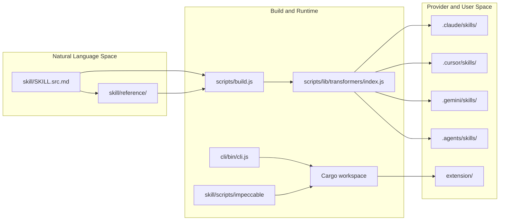
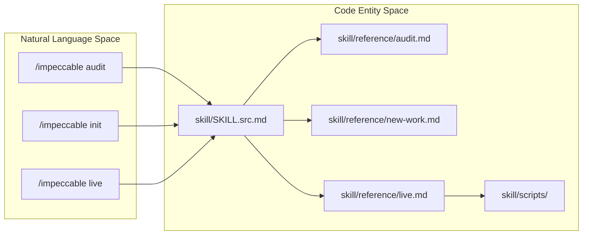
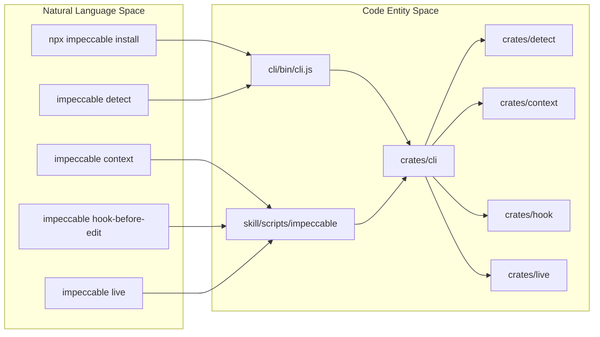

<!-- source: DeepWiki mcp.deepwiki.com · repo pbakaus/impeccable · page 1 Overview · fetched 2026-10-30 -->

# Overview

Relevant source files

The following files were used as context for generating this wiki page:

- [.claude-plugin/marketplace.json](.claude-plugin/marketplace.json)
- [.claude-plugin/plugin.json](.claude-plugin/plugin.json)
- [.github/workflows/ci.yml](.github/workflows/ci.yml)
- [.github/workflows/sync-generated-output.yml](.github/workflows/sync-generated-output.yml)
- [.gitignore](.gitignore)
- [AGENTS.md](AGENTS.md)
- [CLAUDE.md](CLAUDE.md)
- [Cargo.lock](Cargo.lock)
- [Cargo.toml](Cargo.toml)
- [ENGINE_VERSION](ENGINE_VERSION)
- [README.md](README.md)
- [README.npm.md](README.npm.md)
- [bun.lock](bun.lock)
- [crates/context/src/pin.rs](crates/context/src/pin.rs)
- [crates/skills/src/providers.rs](crates/skills/src/providers.rs)
- [docs/HARNESSES.md](docs/HARNESSES.md)
- [package.json](package.json)
- [scripts/build.js](scripts/build.js)
- [scripts/lib/transformers/index.js](scripts/lib/transformers/index.js)
- [scripts/lib/transformers/providers.js](scripts/lib/transformers/providers.js)
- [scripts/lib/utils.js](scripts/lib/utils.js)
- [scripts/lib/zip.js](scripts/lib/zip.js)
- [scripts/test-suites.mjs](scripts/test-suites.mjs)
- [skill/scripts/VERSION](skill/scripts/VERSION)
- [tests/lib/transformers/providers.test.js](tests/lib/transformers/providers.test.js)

## Purpose and Scope

Impeccable is a cross-provider design skill for AI coding agents. It combines agent-facing design guidance with a Rust engine for deterministic detection and runtime operations, distributed through an npm CLI, provider-specific skill trees, plugins, and a browser extension. The skill is organized as one user-invocable skill, `impeccable`, with 24 routed commands. [README.md:1-5](), [CLAUDE.md:5-19](), [package.json:37-50]()

The repository uses a source → build → provider-output model: skill content is authored in `skill/`, transformed by `scripts/build.js`, and emitted in provider-specific formats. The engine is built from the Cargo workspace; the npm CLI and skill launchers invoke that engine. This page introduces those boundaries and links to the detailed child pages. For installation and project setup, see [Getting Started](#1.1). For the repository layout and component boundaries, see [Repository Map and Component Boundaries](#1.2). [AGENTS.md:3-5](), [AGENTS.md:7-24](), [scripts/build.js:3-17](), [CLAUDE.md:13-24]()

**Sources:** [README.md:1-5](), [CLAUDE.md:5-24](), [AGENTS.md:3-24](), [package.json:37-50]()

---

## Architecture Overview

The authored skill and its references are transformed into provider-specific outputs. Separately, Rust workspace crates provide the engine used by the CLI and skill launchers. Generated provider directories are distribution artifacts rather than the primary authoring location. [AGENTS.md:3-5](), [AGENTS.md:26-30](), [CLAUDE.md:13-24](), [scripts/build.js:3-17]()

### Source-to-Provider Architecture

**Sources:** [scripts/build.js:3-17](), [scripts/build.js:19-38](), [AGENTS.md:3-5](), [CLAUDE.md:13-24](), [package.json:37-50]()

---

## Natural-Language Guidance and Code Entities

The agent-facing skill routes commands to shared reference playbooks, while the Rust engine implements runtime verbs and detection. These diagrams connect user-visible names to code paths that can be searched in the repository. [CLAUDE.md:5-19](), [README.md:20-35](), [AGENTS.md:3-5]()

### Skill Commands to Source Files

**Sources:** [CLAUDE.md:5-11](), [README.md:20-35](), [README.md:36-67](), [AGENTS.md:3-5]()

### User Operations to Runtime Components

**Sources:** [README.npm.md:1-5](), [README.npm.md:9-43](), [CLAUDE.md:13-19](), [AGENTS.md:7-17]()

---

## System Components

| Component | Role |
|---|---|
| `skill/` | Authoritative skill source: `SKILL.src.md`, references, agents, scripts, and command metadata. [AGENTS.md:3-5](), [CLAUDE.md:5-11]() |
| `crates/` | Cargo workspace for the engine, including runtime verbs and the detection rule implementation. [CLAUDE.md:13-19]() |
| `cli/` | npm package entry point; the CLI shim runs the platform engine binary. [package.json:37-43](), [README.npm.md:1-5]() |
| `scripts/` | Build and distribution tooling, including provider transforms and packaging. [scripts/build.js:19-38]() |
| Provider trees and `plugin/` | Generated skill outputs for supported agent harnesses; tracked outputs are generated artifacts. [scripts/build.js:3-17](), [AGENTS.md:26-30]() |
| `extension/` | Browser extension surface; its build also refreshes the detector bundle. [package.json:49-50](), [AGENTS.md:22-22](), [.github/workflows/ci.yml:119-141]() |
| `ui/component-review/` | Component-review UI source, included in the repository’s build and test setup. [scripts/test-suites.mjs:29-43]() |

**Sources:** [AGENTS.md:3-5](), [AGENTS.md:26-30](), [CLAUDE.md:13-24](), [scripts/build.js:3-38](), [package.json:37-50](), [.github/workflows/ci.yml:119-141](), [scripts/test-suites.mjs:29-43]()

---

## Build System and Distribution

`scripts/build.js` reads skill source, uses provider transformers, and assembles provider-specific outputs and ZIP packages. The package scripts distinguish a regular build from a release build that synchronizes tracked provider trees. The Rust engine is distributed separately from the skill text: launchers resolve the engine binary, and the npm package provides a platform-specific shim and optional binary packages. [scripts/build.js:3-17](), [scripts/build.js:19-38](), [package.json:37-53](), [CLAUDE.md:13-24]()

For installation, update, and project-level setup, see [Getting Started](#1.1). For generated directories and ownership boundaries, see [Repository Map and Component Boundaries](#1.2).

**Sources:** [scripts/build.js:3-17](), [scripts/build.js:19-38](), [package.json:37-53](), [CLAUDE.md:13-24]()

---

