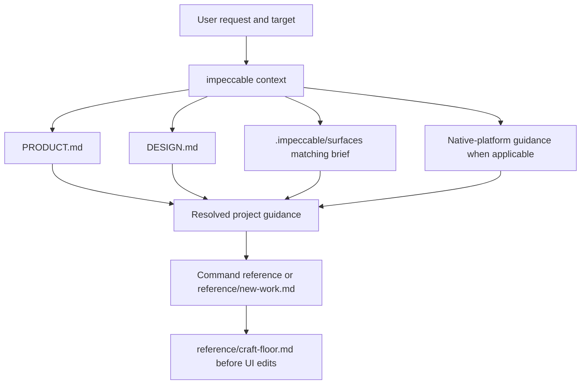
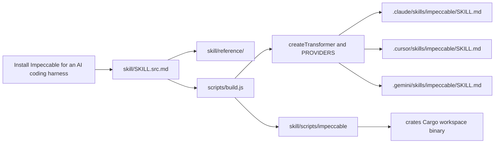

<!-- source: DeepWiki mcp.deepwiki.com · repo pbakaus/impeccable · page 1.1 Getting Started · fetched 2026-10-30 -->

# Getting Started

Relevant source files

The following files were used as context for generating this wiki page:

- [.claude/skills/impeccable/SKILL.md](.claude/skills/impeccable/SKILL.md)
- [.cursor/skills/impeccable/SKILL.md](.cursor/skills/impeccable/SKILL.md)
- [.gemini/skills/impeccable/SKILL.md](.gemini/skills/impeccable/SKILL.md)
- [.github/skills/impeccable/SKILL.md](.github/skills/impeccable/SKILL.md)
- [.github/workflows/ci.yml](.github/workflows/ci.yml)
- [.github/workflows/sync-generated-output.yml](.github/workflows/sync-generated-output.yml)
- [.gitignore](.gitignore)
- [.kiro/skills/impeccable/SKILL.md](.kiro/skills/impeccable/SKILL.md)
- [.opencode/skills/impeccable/SKILL.md](.opencode/skills/impeccable/SKILL.md)
- [.pi/skills/impeccable/SKILL.md](.pi/skills/impeccable/SKILL.md)
- [.qoder/skills/impeccable/SKILL.md](.qoder/skills/impeccable/SKILL.md)
- [.rovodev/skills/impeccable/SKILL.md](.rovodev/skills/impeccable/SKILL.md)
- [.trae-cn/skills/impeccable/SKILL.md](.trae-cn/skills/impeccable/SKILL.md)
- [.trae/skills/impeccable/SKILL.md](.trae/skills/impeccable/SKILL.md)
- [AGENTS.md](AGENTS.md)
- [CLAUDE.md](CLAUDE.md)
- [README.md](README.md)
- [README.npm.md](README.npm.md)
- [crates/context/src/pin.rs](crates/context/src/pin.rs)
- [crates/skills/src/providers.rs](crates/skills/src/providers.rs)
- [docs/HARNESSES.md](docs/HARNESSES.md)
- [plugin/skills/impeccable/SKILL.md](plugin/skills/impeccable/SKILL.md)
- [scripts/build.js](scripts/build.js)
- [scripts/lib/transformers/index.js](scripts/lib/transformers/index.js)
- [scripts/lib/transformers/providers.js](scripts/lib/transformers/providers.js)
- [scripts/lib/utils.js](scripts/lib/utils.js)
- [scripts/test-suites.mjs](scripts/test-suites.mjs)
- [tests/lib/transformers/providers.test.js](tests/lib/transformers/providers.test.js)

## Purpose and scope

This page covers installing Impeccable, starting a session with `/impeccable context`, using `/impeccable init` to capture project context, and understanding the project state the skill reads. It also summarizes the repository areas relevant to this workflow. Impeccable is a design skill for AI coding agents, distributed through an npm installer and provider-specific skill trees; the skill’s runtime commands are handled by a self-contained engine binary. [README.md:1-5](), [README.md:97-109](), [CLAUDE.md:5-17]()

Sources: [README.md:1-5](), [README.md:97-109](), [CLAUDE.md:5-17]()

## Install or update

From the root of the project where the skill should be available, install with `npx impeccable install`. To refresh an existing installation, use `npx impeccable update`. After installing or updating, reload the AI coding harness so it can discover the skill. [README.md:101-117]()

The installer detects available harnesses and presents the detected set for confirmation or customization. You can instead specify providers and installation scope with `--providers=...` and `--scope=project|global`; this is useful for scripted installs. On supported harnesses, installation also sets up the provider-native hook manifest unless hooks are disabled with `--no-hooks`. [README.md:101-117](), [README.npm.md:7-26]()

| Goal | Command or action |
|---|---|
| Install interactively | `npx impeccable install` [README.md:101-109]() |
| Update an existing install | `npx impeccable update` [README.md:111-115]() |
| Install non-interactively | Specify `--providers` and `--scope` [README.md:109](), [README.npm.md:13-14]() |
| Install without hook manifests | Add `--no-hooks` [README.npm.md:22-23]() |
| Refresh harness discovery | Reload the harness after installation [README.md:109]() |

Sources: [README.md:101-117](), [README.npm.md:7-26]()

### Installer and launcher responsibilities

`npx impeccable` is the npm-facing installer and CLI entry point; the package is described as a small launcher for the engine binary. The installed skill has its own launcher at `scripts/impeccable` (and `impeccable.cmd` for Windows). The skill launcher runs the engine binary, which is shipped alongside the launcher or downloaded on first run; the skill itself does not require Node at runtime. Node is involved when using the `npx` installer. [README.npm.md:1-5](), [README.md:97-99]()

At a high level, installation puts a provider-formatted skill tree into the selected harness location. In the repository’s build system, `scripts/build.js` reads skill sources and uses provider transformers to produce trees such as `.cursor/skills/`, `.claude/skills/`, and `.gemini/skills/`; Codex and GitHub Copilot outputs are also represented in that build. [scripts/build.js:3-16](), [scripts/build.js:19-27]()

**Diagram: Installation path from installer to harness skill**

Sources: [README.md:97-115](), [README.npm.md:1-5](), [scripts/build.js:3-16](), [CLAUDE.md:13-17]()

## First-use workflow

Start with `/impeccable init` in the installed harness. It inspects the project, asks about material gaps in durable product truth, writes `PRODUCT.md`, can configure live mode when applicable, and recommends next steps. [README.md:28-34](), [README.md:40-45]()

For each session, the skill’s setup instructions say to run `impeccable context` once, from the user’s project working directory. The command is invoked through the installed skill’s launcher, using the path appropriate to the harness; on Windows shells without `sh`, use the `.cmd` launcher. [CLAUDE.md:13-17](), [.claude/skills/impeccable/SKILL.md:17-23]()

`context` loads `PRODUCT.md`, `DESIGN.md`, the matching surface brief, and native-platform guidance when applicable. Follow the directives it returns; the skill instructions say not to rerun it during the same session. If the launcher refuses or fails, the skill instructs the agent to report that context loading did not run, then read existing `PRODUCT.md` and `DESIGN.md` directly without inventing missing context. [ .claude/skills/impeccable/SKILL.md:17-23]()

| Step | Action | Result |
|---|---|---|
| 1 | Run `/impeccable init` for the project setup flow. [README.md:28-34]() | Captures durable product context in `PRODUCT.md`. [README.md:13-15]() |
| 2 | At the start of a work session, run the installed skill’s `impeccable context` launcher command from the project directory. [.claude/skills/impeccable/SKILL.md:17-20]() | Loads project context and applicable directives. [.claude/skills/impeccable/SKILL.md:19]() |
| 3 | Load the command’s playbook or `reference/new-work.md`, as appropriate. [.claude/skills/impeccable/SKILL.md:20]() | Provides command-specific or new-surface guidance before work. [.claude/skills/impeccable/SKILL.md:20]() |
| 4 | Before a UI edit, read `reference/craft-floor.md`. [.claude/skills/impeccable/SKILL.md:21]() | Applies the skill’s quality floor and design constraints. [.claude/skills/impeccable/SKILL.md:21]() |

Sources: [README.md:13-15](), [README.md:28-34](), [CLAUDE.md:13-17](), [.claude/skills/impeccable/SKILL.md:17-23]()

### Product truth and visual direction

`PRODUCT.md` records durable product truth, including the audience, purpose, operating context, constraints, voice, and evidence. It is distinct from surface-level visual direction. [README.md:13-15]()

`DESIGN.md` records an incumbent or newly built visual system separately. The setup instructions also say that visitor mode and visual direction are chosen for each surface, rather than stored as project-wide product truth. [README.md:28-34](), [CLAUDE.md:30-43]()

The surface brief belongs under `.impeccable/surfaces/`; the mode is selected per surface and persists in that brief. The four modes are `Persuade`, `Operate`, `Read`, and `Experience`. [CLAUDE.md:30-43](), [.claude/skills/impeccable/SKILL.md:32-41]()

| Artifact | Purpose |
|---|---|
| `PRODUCT.md` | Durable product facts used across later commands. [README.md:13-15]() |
| `DESIGN.md` | Incumbent or newly built visual-system guidance, kept distinct from product truth. [README.md:28-34]() |
| `.impeccable/surfaces/` brief | Per-surface direction, including the surface’s mode. [CLAUDE.md:39-43]() |

Sources: [README.md:13-15](), [README.md:28-34](), [CLAUDE.md:30-43](), [.claude/skills/impeccable/SKILL.md:32-41]()

**Diagram: Project context loaded for a skill session**

Sources: [.claude/skills/impeccable/SKILL.md:17-23](), [CLAUDE.md:30-43]()

## Repository layout relevant to setup

The repository separates skill source, build tooling, engine code, and generated provider outputs. `skill/` contains the source skill definition, command references, scripts, and metadata. The provider-specific `SKILL.md` files are generated from the source rather than being the authoring source. [CLAUDE.md:5-10](), [scripts/build.js:3-16]()

The engine is built from the root Cargo workspace in `crates/*`. The root `ENGINE_VERSION` pins its release; the build copies that version into `skill/scripts/VERSION`, which the launcher uses for its download and cache behavior. [CLAUDE.md:13-22]()

| Area | Role in the getting-started flow |
|---|---|
| `skill/` | Authoritative skill source, references, command metadata, and launcher. [CLAUDE.md:5-10]() |
| `scripts/` | Build and distribution tooling, including `scripts/build.js` and provider transformers. [scripts/build.js:19-38]() |
| `crates/` | Rust workspace that produces the engine binary. [CLAUDE.md:13-19]() |
| `.claude/skills/`, `.cursor/skills/`, `.gemini/skills/` | Examples of generated provider skill trees. [scripts/build.js:3-13]() |
| `cli/` | npm CLI package area; the build tooling imports engine-fetch and packaging helpers, while the npm package is described as a launcher. [scripts/build.js:35-38](), [README.npm.md:1-5]() |
| `tests/` | Includes build, launcher, and engine-related tests; test-suite definitions identify these areas. [scripts/test-suites.mjs:29-44](), [scripts/test-suites.mjs:77-94]() |

Sources: [CLAUDE.md:5-22](), [scripts/build.js:3-38](), [README.npm.md:1-5](), [scripts/test-suites.mjs:29-44](), [scripts/test-suites.mjs:77-94]()

### Source-to-provider mapping

In natural-language terms, users install the Impeccable skill into a coding harness. In the repository, that experience maps to source files under `skill/`, transformation through `scripts/build.js` and its provider transformers, and generated provider trees such as `.claude/skills/` and `.cursor/skills/`. [CLAUDE.md:5-10](), [scripts/build.js:3-16](), [scripts/build.js:19-27]()

**Diagram: Skill source and build entities**

Sources: [CLAUDE.md:5-17](), [scripts/build.js:3-16](), [scripts/build.js:19-27]()

## Verification and common install considerations

After installation, reload the harness and invoke `/impeccable` or `/impeccable init` to confirm the skill is available. The documented skill interface uses `/impeccable <command> <target>`, and `/impeccable init` is the recommended starting point for a project. [README.md:22-34]()

The engine binary does not need a runtime of its own. The npm installer does require Node to run `npx`; the npm package documentation specifies Node.js 18.19 or newer. [README.md:97-99](), [README.npm.md:87-93]()

For hook-enabled installs, some harnesses require explicit trust or approval: Codex users should open `/hooks` and approve the project hook when prompted, and Grok Build users need project-folder trust before its hook scripts run. [README.md:117-119]()

Sources: [README.md:22-34](), [README.md:97-99](), [README.md:117-119](), [README.npm.md:87-93]()

---

