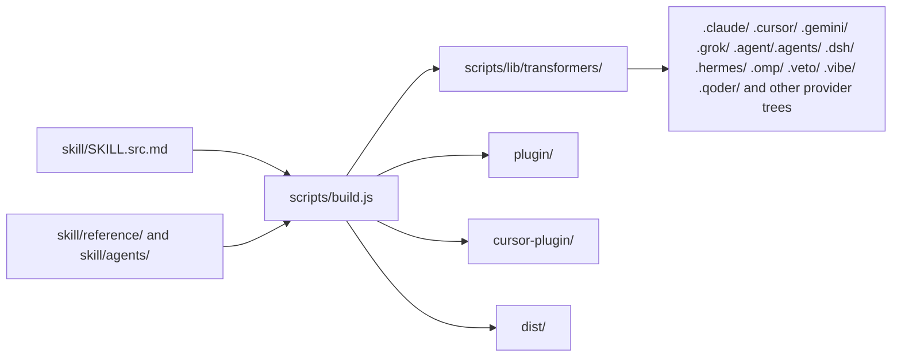
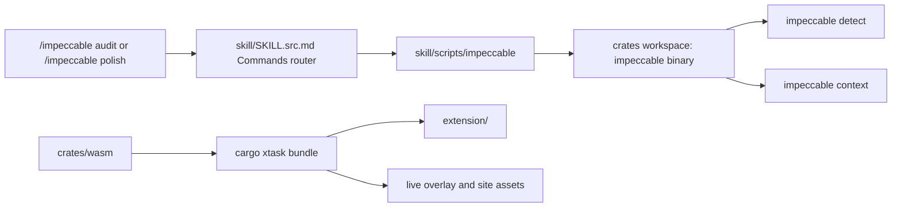
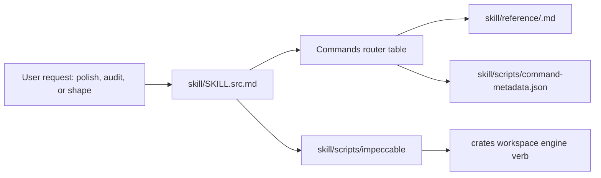
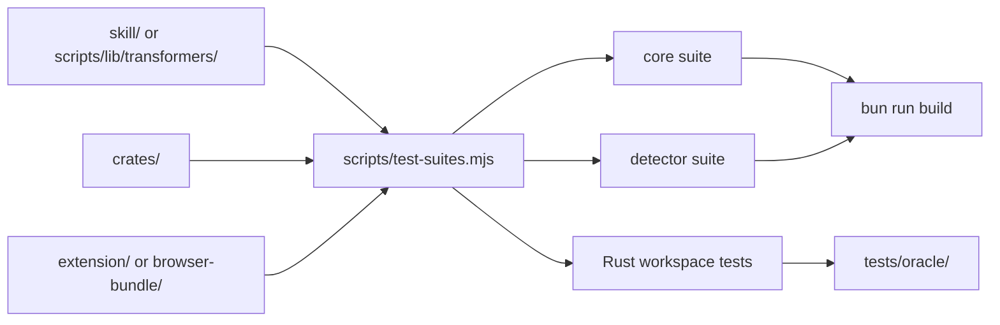

<!-- source: DeepWiki mcp.deepwiki.com · repo pbakaus/impeccable · page 1.2 Repository Map and Component Boundaries · fetched 2026-10-30 -->

# Repository Map and Component Boundaries

Relevant source files

The following files were used as context for generating this wiki page:

- [.claude-plugin/marketplace.json](.claude-plugin/marketplace.json)
- [.claude-plugin/plugin.json](.claude-plugin/plugin.json)
- [.github/workflows/ci.yml](.github/workflows/ci.yml)
- [.github/workflows/sync-generated-output.yml](.github/workflows/sync-generated-output.yml)
- [.gitignore](.gitignore)
- [AGENTS.md](AGENTS.md)
- [CLAUDE.md](CLAUDE.md)
- [Cargo.lock](Cargo.lock)
- [Cargo.toml](Cargo.toml)
- [ENGINE_VERSION](ENGINE_VERSION)
- [README.md](README.md)
- [README.npm.md](README.npm.md)
- [bun.lock](bun.lock)
- [crates/context/src/pin.rs](crates/context/src/pin.rs)
- [crates/skills/src/providers.rs](crates/skills/src/providers.rs)
- [docs/HARNESSES.md](docs/HARNESSES.md)
- [docs/VSCODE-EXTENSION.md](docs/VSCODE-EXTENSION.md)
- [package.json](package.json)
- [scripts/build.js](scripts/build.js)
- [scripts/lib/cursor-plugin.js](scripts/lib/cursor-plugin.js)
- [scripts/lib/plugin-paths.js](scripts/lib/plugin-paths.js)
- [scripts/lib/transformers/index.js](scripts/lib/transformers/index.js)
- [scripts/lib/transformers/providers.js](scripts/lib/transformers/providers.js)
- [scripts/lib/utils.js](scripts/lib/utils.js)
- [scripts/lib/vscode-extension.js](scripts/lib/vscode-extension.js)
- [scripts/lib/zip.js](scripts/lib/zip.js)
- [scripts/test-suites.mjs](scripts/test-suites.mjs)
- [skill/scripts/VERSION](skill/scripts/VERSION)
- [tests/cursor-plugin.test.mjs](tests/cursor-plugin.test.mjs)
- [tests/lib/transformers/providers.test.js](tests/lib/transformers/providers.test.js)
- [tests/plugin-paths.test.js](tests/plugin-paths.test.js)
- [tests/vscode-extension.test.mjs](tests/vscode-extension.test.mjs)
- [vscode/.vscodeignore](vscode/.vscodeignore)
- [vscode/README.md](vscode/README.md)

## Purpose and scope

Impeccable is organized around a source-to-distribution boundary: `skill/` contains the agent-facing skill source, `crates/` contains the Rust engine workspace, and `scripts/` transforms source into provider-specific and packaged outputs. The repository also contains the npm CLI shim, browser extension, component-review UI, demos, documentation, and tests. This page maps those areas and distinguishes maintained source from generated distribution trees. [AGENTS.md:3-5]()

Sources: [AGENTS.md:3-5](), [README.md:1-5]()

## Repository at a glance

| Area | Boundary and role |
|---|---|
| `skill/` | Source of truth for the skill: `SKILL.src.md`, `reference/`, `scripts/`, and `agents/`. Its launcher delegates commands to the engine rather than implementing the runtime itself. [AGENTS.md:3-5](), [CLAUDE.md:5-17]() |
| `crates/` | Cargo workspace that builds the engine binary and contains the Rust implementation. The repository guidance identifies it as the runtime source and directs contributors to `docs/ENGINE.md` before changing runtime code. [AGENTS.md:5-10]() |
| `scripts/` | Build, release, test-selection, and packaging tools. `scripts/build.js` imports provider transformers, ZIP creation, plugin staging, VS Code staging, and engine-fetch logic. [scripts/build.js:19-38](), [package.json:44-83]() |
| Root provider trees | Generated harness folders, tracked to support direct repository installs; they are not hand-authored source. The documented set includes `.agents/`, `.claude/`, `.cursor/`, `.dsh/`, `.gemini/`, `.github/skills/`, `.grok/`, `.hermes/`, `.kiro/`, `.opencode/`, `.pi/`, `.qoder/`, `.rovodev/`, `.trae*/`, and `.vibe/`. [AGENTS.md:26-30]() |
| `plugin/` and `cursor-plugin/` | `plugin/` is identified as generated distribution output; build logic imports dedicated staging functions for the OpenAI and Cursor plugins. [AGENTS.md:5,26-30](), [scripts/build.js:29-37]() |
| `cli/` | npm entry point and shim. The package maps the `impeccable` executable to `cli/bin/cli.js`; documentation describes the npm package as a launcher for the engine binary. [package.json:37-43](), [README.npm.md:1-5]() |
| `extension/` | Browser-extension source area, with a dedicated build script. CI also identifies the extension and browser bundle as detector-related inputs. [package.json:49-50](), [.github/workflows/ci.yml:119-141]() |
| `ui/` | Contains the component-review UI. The test-suite map explicitly includes component-review model, plan-model, and viewport tests under `ui/component-review/`. [scripts/test-suites.mjs:29-54]() |
| `demos/` | The supplied repository guidance does not describe this directory’s implementation or ownership. It is included here as a repository area named in the page scope. |
| `docs/` | Includes runtime and contributor-facing documentation; `docs/ENGINE.md` is the recommended entry point before modifying Rust runtime code. [AGENTS.md:5]() |
| `tests/` | JavaScript/Bun and Node test suites, Rust crate tests, fixtures, oracle goldens, and behavior tests. The repository guidance identifies `tests/fixtures/` and `tests/oracle/` as key regression areas. [AGENTS.md:5,16-21](), [package.json:55-72]() |
| `dist/` and `build/` | Generated build outputs and gitignored directories, rather than source directories. [AGENTS.md:5,12-15]() |

Sources: [AGENTS.md:3-5](), [AGENTS.md:26-30](), [scripts/build.js:19-38](), [package.json:37-83](), [README.npm.md:1-5](), [scripts/test-suites.mjs:29-54](), [.github/workflows/ci.yml:119-141]()

## Source, build, and generated-output boundary

`skill/` is the authoritative skill source. The build reads source files and provider configuration, creates transformers, and stages distribution forms; the root provider trees and `plugin/` are generated outputs retained in Git for installation workflows. `dist/` and `build/` are generated and gitignored. The regular build validates generated distribution without syncing tracked root harness trees; the release build performs that sync. [AGENTS.md:3-5,12-15,24-30](), [package.json:44-54]()

**Diagram: Maintained source to provider distribution**

Sources: [AGENTS.md:3-5,12-15,24-30](), [scripts/build.js:19-38]()

The provider list in the diagram reflects the repository’s documented generated-tree policy where available; the supplied file excerpt specifically names `.agents/`, `.claude/`, `.cursor/`, `.dsh/`, `.gemini/`, `.github/skills/`, `.grok/`, `.hermes/`, `.kiro/`, `.opencode/`, `.pi/`, `.qoder/`, `.rovodev/`, `.trae*/`, and `.vibe/`. [AGENTS.md:26-30]()

Sources: [AGENTS.md:26-30]()

### `scripts/build.js` orchestration

The build entry point imports utilities for reading source and preserving per-project artifacts, the root-command sync helper, provider transformers, hook-manifest helpers, ZIP builders, plugin validation and path rewriting, OpenAI and Cursor plugin staging, VS Code staging, and engine-fetch/version helpers. These imports show the build boundary: source interpretation and provider transformation happen in `scripts/`, while the engine itself remains a separate Cargo-built runtime. [scripts/build.js:19-38](), [AGENTS.md:5-10]()

The package scripts distinguish ordinary skill builds from release builds. `build:skills` passes `--skip-root-sync`; `build:skills:release` runs the build without that flag. The top-level `build` and `build:release` scripts then copy `dist/` into `build/_data/dist`. [package.json:44-54]()

Sources: [scripts/build.js:19-38](), [package.json:44-54](), [AGENTS.md:12-15,24]()

### Generated trees are artifacts, not editing targets

The repository policy says normal development should stage source changes in `crates/`, `browser-bundle/`, `skill/`, `scripts/`, `cli/`, `extension/`, and `tests/`; generated harness changes are generally kept out of feature changes. A synchronization workflow regenerates provider output after source changes land on `main`. [AGENTS.md:26-30]()

CI checks generated tracked outputs for drift, including `.agents`, `.claude`, `.cursor`, `.dsh`, `.gemini`, `.github/skills`, `plugin`, and `extension/detector`. This makes the generated-tree contract testable: a source change that requires output updates must be reflected by the build rather than by hand-editing generated copies. [.github/workflows/ci.yml:143-160]()

Sources: [AGENTS.md:26-30](), [.github/workflows/ci.yml:143-160]()

## Rust workspace and engine boundary

The Cargo workspace under `crates/` builds the `impeccable` engine binary. The same binary serves as the runtime for skill verbs and as the detector executable; repository guidance states that there is no separate detector binary. The root `ENGINE_VERSION` pins the released binary used by installs, while the skill launcher and npm shim resolve or download that runtime. [AGENTS.md:5,9,17](), [CLAUDE.md:13-22]()

The provided repository map names crates including `foundation`, `core`, `wasm`, `live`, `context`, and `xtask` in architecture guidance. In particular, the documented flow builds the Rust rule source to WebAssembly and uses `cargo xtask bundle` to assemble artifacts consumed by the extension, live overlay, and site. [CLAUDE.md:17-20](), [.github/workflows/ci.yml:119-134]()

**Diagram: User commands to Rust and browser-facing entities**

Sources: [CLAUDE.md:5-22](), [AGENTS.md:5,9,17,22](), [.github/workflows/ci.yml:119-134]()

The launcher boundary is explicit: skill commands invoke `{{scripts_path}}/impeccable <verb>`, while `skill/scripts/impeccable` resolves the engine binary. The binary is built from the Cargo workspace; the npm CLI is another entry point to that same engine. [CLAUDE.md:13-22](), [README.npm.md:3-5,87-93]()

Sources: [CLAUDE.md:13-22](), [README.npm.md:3-5,87-93]()

## Skill source and provider trees

The skill source is a single user-invocable skill, `impeccable`, with commands routed beneath it. `skill/SKILL.src.md` contains the source contract and command router; `skill/reference/` contains command playbooks and shared guidance; `skill/scripts/` contains the launcher and live-mode JavaScript; and `skill/agents/` contains agent definitions. [CLAUDE.md:5-10](), [AGENTS.md:3-5]()

Provider `SKILL.md` files are generated from the source. The build system’s stated purpose is to transform source skills into provider-specific formats, with provider implementations selected through `createTransformer` and `PROVIDERS`. The generated provider trees are therefore compatibility outputs for different harness layouts, not separate skill implementations. [CLAUDE.md:5-8](), [scripts/build.js:3-16,22-25]()

Sources: [CLAUDE.md:5-10](), [scripts/build.js:3-16,22-25]()

**Diagram: Natural-language command routing to repository entities**

Sources: [CLAUDE.md:5-17](), [AGENTS.md:3-5]()

The diagram connects user-facing terms with names a contributor can search for in the repository: the router and references live under `skill/`, command metadata is under `skill/scripts/`, and command execution crosses to the launcher and Rust engine. [CLAUDE.md:5-17]()

Sources: [CLAUDE.md:5-17]()

## CLI, plugins, extension, and UI

### npm CLI

The npm package exposes `impeccable` through `cli/bin/cli.js`. Its optional dependencies list platform-specific `@impeccable/cli-*` packages, and the npm README describes the package as a small launcher that runs the matching engine binary or falls back to a cache or download. [package.json:37-43,85-90](), [README.npm.md:1-5,87-93]()

Sources: [package.json:37-43,85-90](), [README.npm.md:1-5,87-93]()

### Plugins and editor packaging

The build imports separate staging helpers for OpenAI and Cursor plugins and a VS Code extension. It also imports plugin-path rewriting and validation helpers, indicating that plugin packaging has its own path and manifest checks rather than being a direct copy of the skill source. The Claude plugin metadata points its skill path at `./.claude/skills/`, while the marketplace manifest identifies `./plugin` as the plugin source. [scripts/build.js:27-38](), [.claude-plugin/plugin.json:1-12](), [.claude-plugin/marketplace.json:11-21]()

Sources: [scripts/build.js:27-38](), [.claude-plugin/plugin.json:1-12](), [.claude-plugin/marketplace.json:11-21]()

### Browser extension and component-review UI

`extension/` has a dedicated `build:extension` package script. CI describes this build as running `cargo xtask bundle`, which compiles the rule core to WASM and includes the page JavaScript from `browser-bundle/`. The test-suite configuration separately maps extension packaging and DevTools report checks to the detector suite. [package.json:49-50](), [.github/workflows/ci.yml:119-141](), [scripts/test-suites.mjs:120-143]()

`ui/component-review/` is a UI test boundary: the core test suite includes tests for its model, plan model, and viewport. The provided material does not expose the UI implementation files, so this map identifies the directory and its test relationship without inferring internal component behavior. [scripts/test-suites.mjs:29-54]()

Sources: [package.json:49-50](), [.github/workflows/ci.yml:119-141](), [scripts/test-suites.mjs:29-54,120-143]()

## Documentation and tests

`docs/ENGINE.md` is the recommended architecture reference before runtime changes, and `docs/CLI-CONTRACT.md` is named as the specification for observable engine behavior. The repository’s test plan separates core build/provider checks, oracle replay, detector packaging, live-mode checks, and framework fixtures into suites selected by changed paths. [AGENTS.md:5](), [CLAUDE.md:17,23](), [scripts/test-suites.mjs:29-43,98-143,145-175]()

The root package exposes corresponding test commands, including `test:core`, `test:oracle`, `test:detector`, `test:framework`, `test:live`, and several opt-in end-to-end and skill-behavior suites. The engine-dependent suites resolve a binary from `IMPECCABLE_BIN` or fetched/build locations and can skip when no binary is available. [package.json:55-72](), [AGENTS.md:16-21](), [CLAUDE.md:22-23]()

Sources: [AGENTS.md:5,16-21](), [CLAUDE.md:17,23](), [scripts/test-suites.mjs:29-43,98-143,145-175](), [package.json:55-72]()

**Diagram: Change-to-test-suite boundary**

Sources: [scripts/test-suites.mjs:29-43,98-143](), [package.json:44-72](), [AGENTS.md:9-18]()

## Practical navigation guide

| If the change concerns… | Start with… | Boundary to preserve |
|---|---|---|
| Skill wording, routing, or command references | `skill/SKILL.src.md`, `skill/reference/`, `skill/scripts/command-metadata.json` [CLAUDE.md:5-10]() | Edit the source skill; provider `SKILL.md` files are generated. [CLAUDE.md:5-8]() |
| Engine behavior or detector implementation | `crates/`, then `docs/ENGINE.md` and `docs/CLI-CONTRACT.md` [AGENTS.md:5,9]() | The Cargo workspace builds the runtime; do not treat generated provider trees as engine source. [AGENTS.md:5,9,26-30]() |
| Provider output or packaging | `scripts/build.js`, `scripts/lib/transformers/` [scripts/build.js:19-38]() | Regenerate outputs through the build; tracked provider directories are generated artifacts. [AGENTS.md:26-30]() |
| npm CLI behavior | `cli/`, `package.json`, `README.npm.md` [package.json:37-43](), [README.npm.md:1-5]() | The npm entry point launches the engine rather than defining a second runtime. [README.npm.md:3-5]() |
| Extension build or detector bundle | `extension/`, `browser-bundle/`, `scripts/build-extension.js`, `crates/` [package.json:49-50](), [.github/workflows/ci.yml:119-141]() | Rebuild the bundle and run detector-related checks. [.github/workflows/ci.yml:119-160]() |
| Component-review UI | `ui/component-review/` and its tests [scripts/test-suites.mjs:29-54]() | Treat its test mapping as the exposed boundary; implementation details are outside the supplied excerpts. |
| Regression coverage | `tests/`, `scripts/test-suites.mjs`, and package test scripts [AGENTS.md:16-21](), [scripts/test-suites.mjs:29-175]() | Select suites based on changed area and ensure generated outputs remain current. [.github/workflows/ci.yml:143-160]() |

Sources: [CLAUDE.md:5-10](), [AGENTS.md:5,9,16-21,26-30](), [scripts/build.js:19-38](), [package.json:37-72](), [README.npm.md:1-5](), [.github/workflows/ci.yml:119-160](), [scripts/test-suites.mjs:29-54,98-175]()

---

