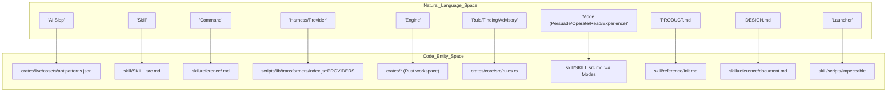
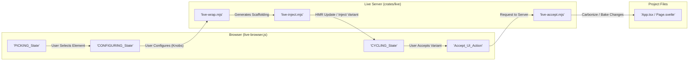

<!-- source: DeepWiki mcp.deepwiki.com · repo pbakaus/impeccable · page 10 Glossary · fetched 2026-10-30 -->

# Glossary

Relevant source files

The following files were used as context for generating this wiki page:

- [.github/workflows/ci.yml](.github/workflows/ci.yml)
- [.github/workflows/sync-generated-output.yml](.github/workflows/sync-generated-output.yml)
- [.gitignore](.gitignore)
- [AGENTS.md](AGENTS.md)
- [CLAUDE.md](CLAUDE.md)
- [README.md](README.md)
- [README.npm.md](README.npm.md)
- [browser-bundle/10-probe.js](browser-bundle/10-probe.js)
- [browser-bundle/15-snapshot.js](browser-bundle/15-snapshot.js)
- [crates/context/src/context_cli.rs](crates/context/src/context_cli.rs)
- [crates/context/src/doctor.rs](crates/context/src/doctor.rs)
- [crates/context/src/pin.rs](crates/context/src/pin.rs)
- [crates/context/src/staleness_deep.rs](crates/context/src/staleness_deep.rs)
- [crates/core/src/browser/painted.rs](crates/core/src/browser/painted.rs)
- [crates/core/src/browser/visual.rs](crates/core/src/browser/visual.rs)
- [crates/foundation/src/browser/dom.rs](crates/foundation/src/browser/dom.rs)
- [crates/foundation/src/browser/fake_dom.rs](crates/foundation/src/browser/fake_dom.rs)
- [crates/foundation/src/browser/snapshot.rs](crates/foundation/src/browser/snapshot.rs)
- [crates/skills/src/providers.rs](crates/skills/src/providers.rs)
- [crates/wasm/src/js_dom.rs](crates/wasm/src/js_dom.rs)
- [docs/CLI-CONTRACT.md](docs/CLI-CONTRACT.md)
- [docs/HARNESSES.md](docs/HARNESSES.md)
- [scripts/build.js](scripts/build.js)
- [scripts/lib/transformers/index.js](scripts/lib/transformers/index.js)
- [scripts/lib/transformers/providers.js](scripts/lib/transformers/providers.js)
- [scripts/lib/utils.js](scripts/lib/utils.js)
- [scripts/test-suites.mjs](scripts/test-suites.mjs)
- [skill/SKILL.src.md](skill/SKILL.src.md)
- [skill/agents/impeccable-asset-producer.md](skill/agents/impeccable-asset-producer.md)
- [skill/agents/impeccable-finish-reviewer.md](skill/agents/impeccable-finish-reviewer.md)
- [skill/agents/impeccable-manual-edit-applier.md](skill/agents/impeccable-manual-edit-applier.md)
- [skill/reference/craft-floor.md](skill/reference/craft-floor.md)
- [skill/reference/doctor.md](skill/reference/doctor.md)
- [skill/reference/init.md](skill/reference/init.md)
- [skill/reference/mode-operate.md](skill/reference/mode-operate.md)
- [skill/reference/mode-persuade.md](skill/reference/mode-persuade.md)
- [skill/reference/mode-read.md](skill/reference/mode-read.md)
- [skill/reference/new-work.md](skill/reference/new-work.md)
- [skill/reference/overdrive.md](skill/reference/overdrive.md)
- [skill/reference/visualize.md](skill/reference/visualize.md)
- [tests/fixtures/mode-rules-skill-partial/reference/mode-operate.md](tests/fixtures/mode-rules-skill-partial/reference/mode-operate.md)
- [tests/lib/transformers/providers.test.js](tests/lib/transformers/providers.test.js)
- [tests/oracle/cases/context.mjs](tests/oracle/cases/context.mjs)
- [tests/oracle/golden/doctor-codex-home-hook-script-missing.json](tests/oracle/golden/doctor-codex-home-hook-script-missing.json)
- [tests/oracle/golden/doctor-codex-user-hook-script-missing.json](tests/oracle/golden/doctor-codex-user-hook-script-missing.json)

This glossary defines technical terms, architectural patterns, and jargon specific to the Impeccable codebase. It serves as a reference for engineers navigating the transformation from natural language design principles to executable AI skills and the v3.0 Live Mode infrastructure.

---

## Core Concepts

### AI Slop
Visual "tells" or artifacts commonly found in AI-generated user interfaces due to training data bias (e.g., overused Inter font, purple-to-blue gradients, cards nested in cards, "side-tab" accent borders, and "dark-glow" effects). Impeccable's primary purpose is to detect and neutralize these patterns [README.md:9-17](), [README.npm.md:50-53]().
*   **Code Pointer:** See the `id` fields in the `ANTIPATTERNS` registry [README.npm.md:50-53]().

### Skill
A structured set of instructions and reference material that grants an AI agent specific capabilities. In Impeccable v3.0, the primary user-invocable skill is `impeccable`, which consolidates all design logic into a single entry point to avoid "/" menu pollution [CLAUDE.md:3-14]().
*   **Code Pointer:** Defined in `skill/SKILL.src.md` (Source) and transformed into `SKILL.md` for various providers [CLAUDE.md:7-7]().

### Command
A sub-instruction (e.g., `/impeccable polish`, `/impeccable audit`) that triggers a specific design transformation or evaluation. Commands are routed via a table in the main skill [CLAUDE.md:13-14]().
*   **Code Pointer:** `skill/reference/` contains the implementation for all 23 commands [README.md:40-64]().

### Harness (or Provider)
The AI tool or IDE environment that executes the skills. Supported harnesses include Cursor, Claude Code, Gemini, Grok, Hermes, Veto, and others [README.md:106-127]().
*   **Code Pointer:** The `PROVIDERS` object in the build system defines specific requirements for each harness [scripts/build.js:23-23]().

---

## Architectural Terms

### Transformer
A logic module in the build pipeline that converts the universal source Markdown into a format compatible with a specific Provider (e.g., adding YAML headers for Claude Code or wrapping in XML for others).
*   **Code Pointer:** `scripts/lib/transformers/index.js` contains the factory and individual transformer implementations [scripts/build.js:23-23]().

### Launcher
A small `sh` script (`skill/scripts/impeccable`) that acts as the entry point for all skill verbs. It resolves and executes the Impeccable engine binary, handling binary discovery, caching, and environment variable setup (`IMPECCABLE_BIN`, `IMPECCABLE_SKILL_DIR`). It ensures the engine binary is available, either by using a local build, a platform-specific package, or downloading a version-pinned binary into a user cache [CLAUDE.md:14-15]().
*   **Code Pointer:** `skill/scripts/impeccable` and `skill/scripts/impeccable.cmd` [CLAUDE.md:14-15]().

### Engine
The self-contained Rust binary that performs the core logic of Impeccable, including anti-pattern detection, context management, and live mode operations. It exposes various verbs (subcommands) that are invoked by the launcher [CLAUDE.md:17-18]().
*   **Code Pointer:** Built from the `crates/*` workspace [CLAUDE.md:17-18](). Its behavior is specified in `docs/CLI-CONTRACT.md` [CLAUDE.md:18-18]().

### Rule / Finding / Advisory
*   **Rule:** A specific check for an anti-pattern or design quality issue. Rules have IDs, severities, and categories (e.g., `type`, `layout`).
*   **Finding:** The result of a rule being triggered on a target. Findings can be `primary` (requiring attention) or `advisory` (suggestions).
*   **Advisory:** A type of finding that provides guidance or suggestions but does not indicate a critical issue.
*   **Code Pointer:** Rules are defined in the `crates/core` and `crates/foundation` crates [CLAUDE.md:19-19](). The rule registry is serialized into `crates/live/assets/antipatterns.json` [scripts/build.js:127-128]().

### Scope
In the context of detection, `scope` refers to the design domain a rule applies to (e.g., `type` for typography, `layout` for spatial arrangement) [README.npm.md:83]().

### Probe
A mechanism used by the browser engine to extract information from the DOM. This involves injecting JavaScript into the browser to collect data about elements, styles, and layout.
*   **Code Pointer:** `browser-bundle/10-probe.js` is part of the browser-bundle scripts.

### Snapshot
A captured representation of the DOM and its computed styles at a specific moment. This is used for offline analysis by the detector engine.
*   **Code Pointer:** `crates/foundation/src/browser/snapshot.rs` defines the snapshot structure.

### Deferred Facts
Information that cannot be immediately gathered during a DOM snapshot but is needed for later analysis. This might include data requiring user interaction or further computation.

### Paint Gate
A mechanism in the browser engine to ensure that the page has finished rendering and painting before a DOM snapshot is taken, preventing incomplete or flickering captures.
*   **Code Pointer:** `crates/core/src/browser/painted.rs` likely contains logic related to this.

### Dom Trait
A Rust trait that defines the interface for interacting with a Document Object Model, abstracting away the underlying implementation (e.g., a real browser DOM or a fake DOM).
*   **Code Pointer:** `crates/foundation/src/browser/dom.rs` defines the `Dom` trait.

### FakeDom
A mock implementation of the `Dom` trait used for testing and static analysis without requiring a full browser environment.
*   **Code Pointer:** `crates/foundation/src/browser/fake_dom.rs` implements `FakeDom`.

### Oracle / Golden / Delta
*   **Oracle:** The system that records and replays expected CLI behavior.
*   **Golden:** A recorded output (stdout, stderr, exit code, files written) for a specific CLI command invocation. These are the "ground truth" for testing.
*   **Delta:** A documented, reviewed difference between a new golden record and an existing one, indicating an intentional change in behavior.
*   **Code Pointer:** `tests/oracle/` directory contains the oracle test cases and golden records [CLAUDE.md:23-23](). `tests/oracle.test.mjs` replays them [CLAUDE.md:23-23]().

### Fixture Sweep
A comprehensive test run against a large corpus of HTML/CSS files (fixtures) to ensure detector rules behave as expected, flagging anti-patterns and passing valid designs.

### Hook Claim
A request by an AI agent to execute a design hook (e.g., `before-edit`). The claim specifies the hook type and any associated data.

### Context Directives
Special instructions or flags managed by the `context` verb to guide the AI's behavior.
*   `RESOLVED_CONTEXT`: Indicates that the project context (PRODUCT.md, DESIGN.md, surface brief) has been successfully loaded and is available.
*   `CONTEXT_STALE`: Indicates that the loaded context is outdated and needs to be refreshed.
*   `MANUAL_DETECTOR_REQUIRED`: A directive indicating that a manual detector run is needed, possibly due to limitations of automated detection or specific project requirements.
*   **Code Pointer:** `crates/context/src/context_cli.rs` handles context resolution. `crates/context/src/staleness_deep.rs` manages staleness.

### Doctor Finding Kinds
Categories of issues identified by the `doctor` command, which diagnoses problems with the Impeccable setup or project configuration. Examples include missing hook scripts or configuration errors.
*   **Code Pointer:** `crates/context/src/doctor.rs` implements the doctor logic. `tests/oracle/golden/doctor-codex-user-hook-script-missing.json` are examples of doctor findings.

### PRODUCT.md
A markdown file generated by `/impeccable init` that captures durable product truth: audience, purpose, operating context, constraints, voice, and evidence. It informs later commands without confusing these facts with visual direction [README.md:30-31]().
*   **Code Pointer:** `skill/reference/init.md` describes its creation.

### DESIGN.md
A markdown file that records durable visual decisions for a project, representing the established visual identity. It can be generated from existing code or written as part of a new visual world creation [skill/SKILL.src.md:22-22]().
*   **Code Pointer:** `skill/reference/document.md` describes its generation.

### Surface Brief
A document that holds strategy specific to a single route or artifact, distinct from the broader `PRODUCT.md` or `DESIGN.md` [skill/reference/new-work.md:3](). It persists the chosen mode for that surface [CLAUDE.md:42-42]().

### Mode (Persuade/Operate/Read/Experience)
Four distinct categories that define the visitor's success on a given surface, guiding the AI's design approach.
*   **Persuade:** Visitor decides and acts (e.g., landing pages, marketing) [skill/SKILL.src.md:38]().
*   **Operate:** Visitor completes a task (e.g., app UI, dashboards) [skill/SKILL.src.md:39]().
*   **Read:** Visitor understands something (e.g., docs, articles) [skill/SKILL.src.md:40]().
*   **Experience:** Visitor is inside the work itself (e.g., portfolios, galleries) [skill/SKILL.src.md:41]().
*   **Code Pointer:** Defined in `skill/SKILL.src.md` under `## Modes` [skill/SKILL.src.md:35-42](). `CLAUDE.md:30-43` explains the modes.

### Direction Contract
A formal agreement on the visual direction for a new surface or visual world, often resulting from a `concept-seed` round. It outlines the chosen aesthetic and compositional principles.
*   **Code Pointer:** `skill/agents/impeccable-finish-reviewer.md` expects a direction contract as input.

### Concept-Seed
A command that generates materially different structural options for a new surface, breaking ranking ruts by dealing a selection to the user [skill/reference/new-work.md:39]().
*   **Code Pointer:** `docs/CLI-CONTRACT.md` lists `concept-seed` as a CLI verb.

### Challenger
In a `concept-seed` round, a structural option that won its place against other candidates [skill/reference/new-work.md:41]().

### Canon
A design option that represents an established, authoritative visual system. In a `concept-seed` round, a canon card is not present at surface scope if the world is settled [skill/reference/new-work.md:41]().

### Raise
In the context of `new-work.md`, to "raise" a concept means to bring it forward for consideration or approval.

### Comp-Led vs Code-Led
Two distinct build paths for new work:
*   **Comp-Led:** The design process starts with high-fidelity visual compositions (comps) that are then translated into code. This path uses `visualize.md` [skill/reference/new-work.md:41]().
*   **Code-Led:** The design process starts directly with code, often from sketches or wireframes, with ambition carried by a direction contract [skill/reference/new-work.md:41]().

### Comp
A high-fidelity visual composition or mockup of a user interface, used to test composition, narrative, hierarchy, and other design elements [skill/reference/visualize.md:5]().

### Plate
A rasterized image of a UI component or region, used for visual diffing and analysis in the comp pipeline.

### Build Phase
Stages in the design and development process, managed by the `impeccable build-phase` command. Examples include `comps` phase for generating compositions.
*   **Code Pointer:** `skill/reference/visualize.md` mentions `impeccable build-phase start`.

### Craft Floor
A set of minimum quality standards, absolute bans, and design reflexes that must be met before any UI edit. It's loaded immediately before any UI edit [skill/SKILL.src.md:23-23]().
*   **Code Pointer:** `skill/reference/craft-floor.md` contains these rules.

### Live Variant
A temporary, browser-rendered version of a DOM element or component, generated by the AI in Live Mode for user review and iteration.

### Agent Target
In Live Mode, the specific DOM element or region that the AI agent is instructed to modify or generate variants for.

### Claim Lease
A mechanism in Live Mode where an agent temporarily "claims" control over a specific element or region in the browser to perform modifications, preventing conflicts.

### Agent Phase
Distinct stages an AI agent goes through during a Live Mode session, such as `PICKING`, `CONFIGURING`, `GENERATING`, `CYCLING`.

### Knob / Bake
*   **Knob:** An interactive control in the Live Mode UI that allows users to adjust parameters for AI generation (e.g., "intensity," "chaos").
*   **Bake:** The act of applying the changes from a Live Variant back into the source code, making them permanent.

### Carbonize
The process of converting a live, browser-rendered variant into durable, production-ready source code (e.g., JSX, HTML, CSS). This often involves replacing temporary styles and structures with their final counterparts.

### Pin / Unpin
*   **Pin:** To create a lightweight redirect shim for an Impeccable command, allowing users to invoke it with a shorter alias (e.g., `/audit` instead of `/impeccable audit`) [README.md:67]().
*   **Unpin:** To remove such an alias.
*   **Code Pointer:** `impeccable pin` is an engine verb [CLAUDE.md:11-11](). `crates/context/src/pin.rs` implements the pinning logic.

---

## System Mapping

### From Natural Language to Code Entities
This diagram bridges the gap between design terminology used in documentation and the actual implementation entities in the codebase.

**Diagram: Design-to-Code Mapping**

**Sources:** [CLAUDE.md:3-14](), [scripts/build.js:23-26](), [README.md:40-64](), [skill/SKILL.src.md:35-42](), [skill/reference/init.md](), [skill/reference/document.md](), [CLAUDE.md:14-15]().

### Data Flow: Live Mode Variant Lifecycle
This diagram tracks the lifecycle of a visual variant from browser selection to source code application.

**Diagram: Live Mode Lifecycle**

**Sources:** [README.md:64-64](), [skill/reference/overdrive.md]().

---

## Technical Jargon Summary

| Term | Context | Definition |
| :--- | :--- | :--- |
| **AI Slop** | Detector | Visual "tells" or artifacts commonly found in AI-generated UIs due to training data bias [README.npm.md:50-53](). |
| **Skill** | Agent Interface | A structured set of instructions and reference material for an AI agent [CLAUDE.md:3-14](). |
| **Command** | Skill Invocation | A sub-instruction (e.g., `/impeccable polish`) that triggers a specific design action [README.md:40-64](). |
| **Harness/Provider** | AI Tool Integration | The AI tool or IDE environment that executes the skills (e.g., Claude Code, Cursor) [README.md:106-127](). |
| **Transformer** | Build System | Converts skill source into provider-specific formats [scripts/build.js:23-23](). |
| **Launcher** | Engine Execution | `sh` script that resolves and executes the Rust engine binary [CLAUDE.md:14-15](). |
| **Engine** | Core Logic | The self-contained Rust binary performing detection, context, and live mode operations [CLAUDE.md:17-18](). |
| **Rule/Finding/Advisory** | Detector Output | A specific check, its triggered result, and a non-critical suggestion, respectively [CLAUDE.md:19-19](). |
| **Scope** | Detector Filtering | Design domain a rule applies to (e.g., `type`, `layout`) [README.npm.md:83](). |
| **Probe** | Browser Engine | Mechanism to extract DOM information in the browser [browser-bundle/10-probe.js](). |
| **Snapshot** | Browser Engine | Captured representation of the DOM and computed styles for analysis [crates/foundation/src/browser/snapshot.rs](). |
| **Deferred Facts** | Browser Engine | Information gathered later due to interaction or computation needs. |
| **Paint Gate** | Browser Engine | Ensures page rendering is complete before DOM capture [crates/core/src/browser/painted.rs](). |
| **Dom Trait** | Rust Abstraction | Interface for interacting with a Document Object Model [crates/foundation/src/browser/dom.rs](). |
| **FakeDom** | Testing | Mock implementation of the `Dom` trait for static analysis [crates/foundation/src/browser/fake_dom.rs](). |
| **Oracle/Golden/Delta** | Testing | System for recording, replaying, and reviewing expected CLI behavior [CLAUDE.md:23-23](). |
| **Fixture Sweep** | Testing | Comprehensive test run against a corpus of files for detector rules. |
| **Hook Claim** | Design Hooks | Agent's request to execute a design hook. |
| **Context Directives** | Context Management | Flags like `RESOLVED_CONTEXT`, `CONTEXT_STALE`, `MANUAL_DETECTOR_REQUIRED` [crates/context/src/context_cli.rs](). |
| **Doctor Finding Kinds** | Diagnostics | Categories of issues identified by the `doctor` command [crates/context/src/doctor.rs](). |
| **PRODUCT.md** | Project Context | File capturing durable product truth [README.md:30-31](). |
| **DESIGN.md** | Visual Decisions | File recording durable visual decisions [skill/SKILL.src.md:22-22](). |
| **Surface Brief** | Project Context | Strategy specific to a single route or artifact [skill/reference/new-work.md:3](). |
| **Mode** | Design Strategy | Defines visitor's success on a surface (Persuade/Operate/Read/Experience) [skill/SKILL.src.md:35-42](). |
| **Direction Contract** | New Work | Formal agreement on visual direction for new surfaces. |
| **Concept-Seed** | New Work | Command to generate structural options for new surfaces [skill/reference/new-work.md:39](). |
| **Challenger** | New Work | A structural option that won its place in a `concept-seed` round [skill/reference/new-work.md:41](). |
| **Canon** | New Work | Established, authoritative visual system. |
| **Raise** | New Work | To bring a concept forward for consideration. |
| **Comp-Led vs Code-Led** | Build Path | Design starting with high-fidelity comps vs. directly with code [skill/reference/new-work.md:41](). |
| **Comp** | Visual Design | High-fidelity visual composition or mockup [skill/reference/visualize.md:5](). |
| **Plate** | Comp Pipeline | Rasterized image of a UI component or region. |
| **Build Phase** | Build Process | Stages in the design and development process [skill/reference/visualize.md:9](). |
| **Craft Floor** | Quality Gate | Minimum quality standards and bans for UI edits [skill/SKILL.src.md:23-23](). |
| **Live Variant** | Live Mode | Temporary, browser-rendered version of a DOM element. |
| **Agent Target** | Live Mode | Specific DOM element the AI agent modifies. |
| **Claim Lease** | Live Mode | Agent temporarily controls an element to prevent conflicts. |
| **Agent Phase** | Live Mode | Stages an AI agent goes through during a Live Mode session. |
| **Knob/Bake** | Live Mode | Interactive parameter control / applying changes to source code. |
| **Carbonize** | Live Mode | Converting live variant into durable source code. |
| **Pin/Unpin** | CLI Utility | Create/remove command aliases (e.g., `/audit`) [README.md:67](). |

**Sources:** [README.md:1-64](), [CLAUDE.md:1-60](), [scripts/build.js:1-112](), [skill/SKILL.src.md:1-90](), [README.npm.md:1-97](), [skill/reference/new-work.md:1-47](), [skill/reference/visualize.md:1-18](), [CLAUDE.md:30-43](), [crates/context/src/pin.rs](), [crates/context/src/doctor.rs](), [crates/context/src/context_cli.rs](), [crates/context/src/staleness_deep.rs](), [crates/foundation/src/browser/dom.rs](), [crates/foundation/src/browser/fake_dom.rs](), [crates/foundation/src/browser/snapshot.rs](), [crates/core/src/browser/painted.rs](), [browser-bundle/10-probe.js](), [tests/oracle/golden/doctor-codex-user-hook-script-missing.json]().