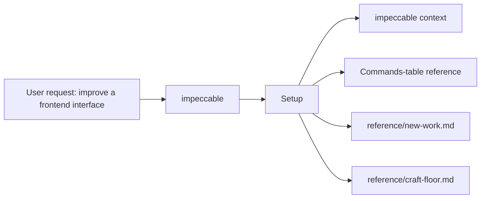

<!-- source: DeepWiki mcp.deepwiki.com · repo pbakaus/impeccable · page 2 Skill and Command System · fetched 2026-10-30 -->

# Skill and Command System

Relevant source files

The following files were used as context for generating this wiki page:

- [.claude/skills/impeccable/SKILL.md](.claude/skills/impeccable/SKILL.md)
- [.cursor/skills/impeccable/SKILL.md](.cursor/skills/impeccable/SKILL.md)
- [.gemini/skills/impeccable/SKILL.md](.gemini/skills/impeccable/SKILL.md)
- [.github/skills/impeccable/SKILL.md](.github/skills/impeccable/SKILL.md)
- [.kiro/skills/impeccable/SKILL.md](.kiro/skills/impeccable/SKILL.md)
- [.opencode/skills/impeccable/SKILL.md](.opencode/skills/impeccable/SKILL.md)
- [.pi/skills/impeccable/SKILL.md](.pi/skills/impeccable/SKILL.md)
- [.qoder/skills/impeccable/SKILL.md](.qoder/skills/impeccable/SKILL.md)
- [.rovodev/skills/impeccable/SKILL.md](.rovodev/skills/impeccable/SKILL.md)
- [.trae-cn/skills/impeccable/SKILL.md](.trae-cn/skills/impeccable/SKILL.md)
- [.trae/skills/impeccable/SKILL.md](.trae/skills/impeccable/SKILL.md)
- [plugin/skills/impeccable/SKILL.md](plugin/skills/impeccable/SKILL.md)
- [skill/SKILL.src.md](skill/SKILL.src.md)
- [skill/agents/impeccable-asset-producer.md](skill/agents/impeccable-asset-producer.md)
- [skill/agents/impeccable-finish-reviewer.md](skill/agents/impeccable-finish-reviewer.md)
- [skill/agents/impeccable-manual-edit-applier.md](skill/agents/impeccable-manual-edit-applier.md)
- [skill/reference/craft-floor.md](skill/reference/craft-floor.md)
- [skill/reference/doctor.md](skill/reference/doctor.md)
- [skill/reference/init.md](skill/reference/init.md)
- [skill/reference/mode-operate.md](skill/reference/mode-operate.md)
- [skill/reference/mode-persuade.md](skill/reference/mode-persuade.md)
- [skill/reference/mode-read.md](skill/reference/mode-read.md)
- [skill/reference/new-work.md](skill/reference/new-work.md)
- [skill/reference/overdrive.md](skill/reference/overdrive.md)
- [skill/reference/visualize.md](skill/reference/visualize.md)
- [tests/fixtures/mode-rules-skill-partial/reference/mode-operate.md](tests/fixtures/mode-rules-skill-partial/reference/mode-operate.md)

## Purpose and Scope

Impeccable is presented to coding agents as one frontend-design skill, with commands that route requests to focused reference playbooks. This page summarizes the agent-facing contract, command families, references, review agents, and design modes. It links to child pages for implementation-level details. [skill/SKILL.src.md:1-23]()

Sources: [skill/SKILL.src.md:1-23]()

## The Skill as an Agent Contract

The skill’s frontmatter identifies it as `impeccable`, describes the frontend tasks it covers, and provides invocation guidance. Its body sets working principles and a setup sequence: load project context once per session, read the playbook for the request, inspect the target and existing visual evidence, and consult the craft floor before UI edits. The generated provider trees contain agent-facing versions of this contract; their paths and runtime-specific metadata can vary. [skill/SKILL.src.md:1-25](), [.claude/skills/impeccable/SKILL.md:1-23]()

**Sources:** [skill/SKILL.src.md:1-25](), [.claude/skills/impeccable/SKILL.md:1-23]()

### From User Request to Skill Files

This diagram connects request language to the skill’s named files and workflow entities.

**Diagram: Request routing into the skill contract**

**Sources:** [skill/SKILL.src.md:1-25]()

## Command Families and References

Commands are organized around common design tasks rather than separate skills. The command interface spans planning and project context, evaluation, refinement, visual enhancement, targeted fixes, and iteration. Each command’s playbook supplies the task-specific guidance; `new-work.md` is the entry point for new surfaces or replacement visual identities. `craft` is documented as a deprecated alias for ordinary new work. [skill/SKILL.src.md:45-54](), [.claude/skills/impeccable/SKILL.md:43-55]()

| Family | Commands |
|---|---|
| Build | `shape`, `craft`, `init`, `document`, `extract` |
| Evaluate | `critique`, `audit` |
| Refine | `polish`, `bolder`, `quieter`, `distill`, `harden`, `onboard` |
| Enhance | `animate`, `colorize`, `typeset`, `layout`, `delight`, `overdrive` |
| Fix | `clarify`, `adapt`, `optimize` |
| Iterate | `live`, `generate` |

The generated skill’s argument hint groups many of these names for agent invocation; the source command table explicitly documents the opening entries. For the full catalog and playbook mapping, see [Command Reference Catalog](#2.2). [skill/SKILL.src.md:45-54](), [.claude/skills/impeccable/SKILL.md:6]()

**Sources:** [skill/SKILL.src.md:45-54](), [.claude/skills/impeccable/SKILL.md:6]()

### From Command Names to Playbooks

The terms on the left represent user-facing tasks; the file paths on the right are the skill’s reference entities. The skill contract directs the agent to load the playbook for an explicit or implied sub-command, or `reference/new-work.md` for new work. [skill/SKILL.src.md:19-23]()

**Diagram: Command vocabulary and reference entities**

```mermaid
flowchart TB
    Build["Build: shape, craft, init, document, extract"]
    Evaluate["Evaluate: critique, audit"]
    Refine["Refine: polish, bolder, quieter, distill"]
    Enhance["Enhance: animate, colorize, typeset, layout"]
    Fix["Fix: clarify, adapt, optimize"]
    Iterate["Iterate: live, generate"]
    ShapeRef["reference/shape.md"]
    InitRef["reference/init.md"]
    DocumentRef["reference/document.md"]
    ExtractRef["reference/extract.md"]
    CritiqueRef["reference/critique.md"]
    AuditRef["reference/audit.md"]
    PolishRef["reference/polish.md"]
    NewWork["reference/new-work.md"]
    Build --> ShapeRef
    Build --> InitRef
    Build --> DocumentRef
    Build --> ExtractRef
    Evaluate --> CritiqueRef
    Evaluate --> AuditRef
    Refine --> PolishRef
    Build --> NewWork
```

**Sources:** [skill/SKILL.src.md:19-23](), [skill/SKILL.src.md:45-54]()

## Project Context, Modes, and New Work

The setup step `impeccable context` loads project-specific context, including `PRODUCT.md`, `DESIGN.md`, a matching surface brief, and native-platform guidance when applicable. The contract distinguishes durable product truth from visual decisions and surface-specific strategy; the new-work playbook uses those distinctions to guide whether a surface inherits, extends, or replaces an existing visual world. [skill/SKILL.src.md:19-25](), [skill/reference/new-work.md:1-16]()

The skill defines four modes by the visitor’s goal on the specific surface: **Persuade** (decide and act), **Operate** (complete a task), **Read** (understand), and **Experience** (engage with the work itself). The mode informs the level and kind of design ambition; it is chosen for the surface, not inferred from the overall product. [skill/SKILL.src.md:34-43]()

For the direction-selection process, modes, decision pages, and comp-led versus code-led paths, see [New Work and Direction Selection](#2.3). For comp generation and build phases, see [Comp Pipeline and Build Phases](#2.4).

**Sources:** [skill/SKILL.src.md:19-25](), [skill/SKILL.src.md:34-43](), [skill/reference/new-work.md:1-16]()

## Review Agents and Quality Boundaries

The skill contract separates planning from implementation: agents load task guidance, inspect project context, and read `reference/craft-floor.md` immediately before UI edits. Review is also separated from implementation: the finish reviewer is instructed to edit nothing and return material fixes for the parent agent to apply. Its review compares the finished artifact with the direction contract and, for comp-led work, the approved comp and build evidence. [skill/SKILL.src.md:19-25](), [skill/agents/impeccable-finish-reviewer.md:15-25]()

Other agent roles include asset production, documentation, and manual-edit application. For their contracts, craft-floor rules, fallback behavior, and quality gates, see [Craft Floor, Review Agents, and Quality Gates](#2.5). [skill/agents/impeccable-finish-reviewer.md:15-25]()

**Sources:** [skill/SKILL.src.md:19-25](), [skill/agents/impeccable-finish-reviewer.md:15-25]()

## Child Pages

- [Skill Source Format and Routing](#2.1) — Source format, frontmatter, placeholders, provider blocks, routing menu, and context-loading setup.
- [Command Reference Catalog](#2.2) — Command families and their reference playbooks, plus hooks and doctor.
- [New Work and Direction Selection](#2.3) — Product truth, design authority, modes, concept selection, direction contracts, and build-path choice.
- [Comp Pipeline and Build Phases](#2.4) — Comp discipline, build phases, fidelity checks, and component review.
- [Craft Floor, Review Agents, and Quality Gates](#2.5) — Craft floor, reviewer and support-agent roles, fallbacks, and review heuristics.

**Sources:** [skill/SKILL.src.md:19-23](), [skill/reference/new-work.md:1-5](), [skill/agents/impeccable-finish-reviewer.md:15-25]()

---

