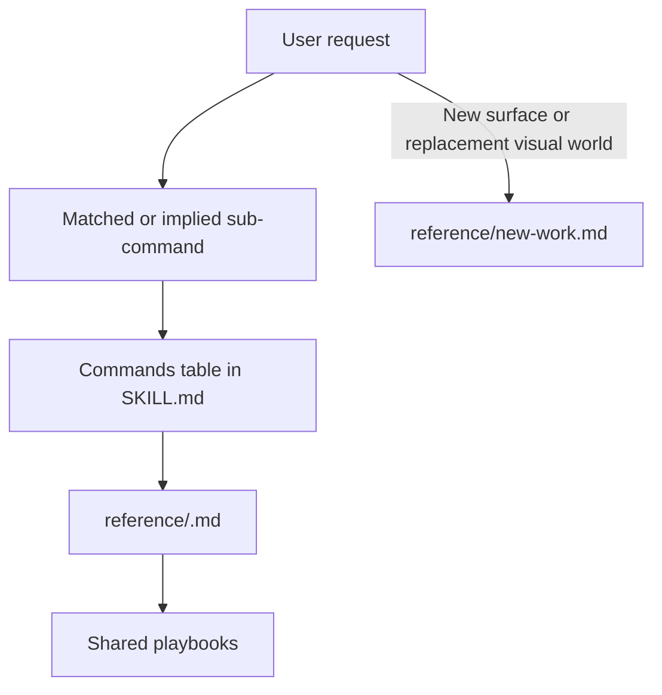
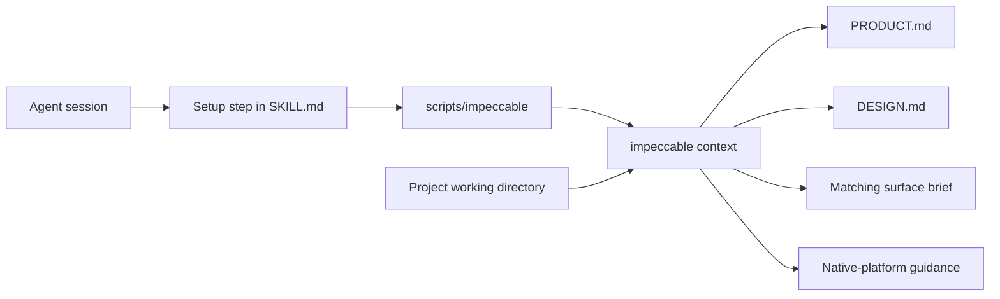

<!-- source: DeepWiki mcp.deepwiki.com · repo pbakaus/impeccable · page 2.1 Skill Source Format and Routing · fetched 2026-10-30 -->

# Skill Source Format and Routing

Relevant source files

The following files were used as context for generating this wiki page:

- [.agents/skills/impeccable/SKILL.md](.agents/skills/impeccable/SKILL.md)
- [.claude/skills/impeccable/SKILL.md](.claude/skills/impeccable/SKILL.md)
- [.cursor/skills/impeccable/SKILL.md](.cursor/skills/impeccable/SKILL.md)
- [.gemini/skills/impeccable/SKILL.md](.gemini/skills/impeccable/SKILL.md)
- [.github/skills/impeccable/SKILL.md](.github/skills/impeccable/SKILL.md)
- [.github/workflows/ci.yml](.github/workflows/ci.yml)
- [.github/workflows/sync-generated-output.yml](.github/workflows/sync-generated-output.yml)
- [.gitignore](.gitignore)
- [.kiro/skills/impeccable/SKILL.md](.kiro/skills/impeccable/SKILL.md)
- [.opencode/skills/impeccable/SKILL.md](.opencode/skills/impeccable/SKILL.md)
- [.pi/skills/impeccable/SKILL.md](.pi/skills/impeccable/SKILL.md)
- [.qoder/skills/impeccable/SKILL.md](.qoder/skills/impeccable/SKILL.md)
- [.rovodev/skills/impeccable/SKILL.md](.rovodev/skills/impeccable/SKILL.md)
- [.trae-cn/skills/impeccable/SKILL.md](.trae-cn/skills/impeccable/SKILL.md)
- [.trae/skills/impeccable/SKILL.md](.trae/skills/impeccable/SKILL.md)
- [AGENTS.md](AGENTS.md)
- [CLAUDE.md](CLAUDE.md)
- [README.md](README.md)
- [README.npm.md](README.npm.md)
- [crates/context/src/pin.rs](crates/context/src/pin.rs)
- [crates/skills/src/providers.rs](crates/skills/src/providers.rs)
- [docs/HARNESSES.md](docs/HARNESSES.md)
- [plugin/skills/impeccable/SKILL.md](plugin/skills/impeccable/SKILL.md)
- [scripts/build.js](scripts/build.js)
- [scripts/lib/transformers/index.js](scripts/lib/transformers/index.js)
- [scripts/lib/transformers/providers.js](scripts/lib/transformers/providers.js)
- [scripts/lib/utils.js](scripts/lib/utils.js)
- [scripts/test-suites.mjs](scripts/test-suites.mjs)
- [tests/lib/transformers/providers.test.js](tests/lib/transformers/providers.test.js)

## Purpose and scope

This page explains how Impeccable’s single skill is described, routed, and built for different agent providers. It covers the skill’s frontmatter and Markdown body, provider-specific transformations, command-reference loading, and the required context-loading setup step. The repository’s documented architecture identifies `skill/SKILL.src.md` as the source and provider `SKILL.md` files as generated outputs. [CLAUDE.md:5-9]()

Sources: [CLAUDE.md:5-9]()

## Source file and generated skill

Impeccable uses one user-invocable skill, `impeccable`, with commands beneath it. The source file is `skill/SKILL.src.md`; provider-specific `SKILL.md` files are generated from it rather than treated as separate authoritative definitions. [CLAUDE.md:5-8]()

The generated skill presents a provider-facing contract: frontmatter identifies the skill and helps the harness decide when and how to expose it, while the Markdown body provides shared instructions and the command router. The checked-in Claude output, for example, declares `name`, `description`, `version`, `user-invocable`, `argument-hint`, and `license` before its setup guidance and Commands table. [`.claude/skills/impeccable/SKILL.md:1-8`]() [`.claude/skills/impeccable/SKILL.md:17-23`]() [`.claude/skills/impeccable/SKILL.md:43-55`]()

Sources: [CLAUDE.md:5-9](), [.claude/skills/impeccable/SKILL.md:1-8](), [.claude/skills/impeccable/SKILL.md:17-23](), [.claude/skills/impeccable/SKILL.md:43-55]()

### Frontmatter and body

The generated Claude skill uses YAML frontmatter delimited by `---`. Its `name` is `impeccable`; its description states the UI-design tasks it covers and excludes backend-only or non-UI work; `user-invocable: true` makes it user-facing; and `argument-hint` summarizes command and target suggestions. The license is `Apache 2.0`. [`.claude/skills/impeccable/SKILL.md:1-8`]()

The body begins with shared design principles and then defines setup, design guidance, modes, and the Commands router table. Provider outputs can carry provider-specific metadata: the supplied OpenCode output, for example, includes an `allowed-tools` list, whereas the supplied Claude output does not. [`.claude/skills/impeccable/SKILL.md:10-23`]() [`.opencode/skills/impeccable/SKILL.md:1-13`]()

| Frontmatter field | Role in the generated skill |
|---|---|
| `name` | Skill identifier: `impeccable`. [`.claude/skills/impeccable/SKILL.md:1-3`]() |
| `description` | Describes the intended UI-design use cases and exclusions. [`.claude/skills/impeccable/SKILL.md:2-3`]() |
| `version` | Skill version metadata. [`.claude/skills/impeccable/SKILL.md:4`]() |
| `user-invocable` | Marks the skill as user-invocable. [`.claude/skills/impeccable/SKILL.md:5`]() |
| `argument-hint` | Shows command groups and a target hint. [`.claude/skills/impeccable/SKILL.md:6`]() |
| `license` | States the license. [`.claude/skills/impeccable/SKILL.md:7`]() |
| `allowed-tools` | Provider-specific tool permissions, present in the supplied OpenCode output. [`.opencode/skills/impeccable/SKILL.md:8-10`]() |

Sources: [.claude/skills/impeccable/SKILL.md:1-8](), [.opencode/skills/impeccable/SKILL.md:8-10]()

## Placeholders and provider-specific output

The source/build workflow uses placeholders to keep shared skill guidance adaptable to provider-specific output. The placeholders in scope are `{{model}}`, `{{config_file}}`, `{{command_prefix}}`, and `{{available_commands}}`. They represent provider or harness context, configuration guidance, the invocation form, and the available-command summary, respectively. This page does not prescribe literal replacement values: those depend on the provider transformer and its build configuration. The build system imports `createTransformer` and `PROVIDERS`, and its stated purpose is to transform source skills into provider-specific formats. [scripts/build.js:4-16]() [scripts/build.js:22-25]()

| Placeholder | Intended content |
|---|---|
| `{{model}}` | Provider/model-facing wording used by the shared instructions. |
| `{{config_file}}` | Provider-specific configuration-file reference where applicable. |
| `{{command_prefix}}` | Provider-appropriate command invocation prefix. |
| `{{available_commands}}` | Provider-facing summary of available commands. |

The provided generated skill demonstrates that provider output can differ in both invocation details and metadata. Its setup step uses a skill-base directory to locate the launcher; the OpenCode output additionally declares allowed shell commands. [`.claude/skills/impeccable/SKILL.md:17-23`]() [`.opencode/skills/impeccable/SKILL.md:8-10`]() The build imports the transformer factory and provider registry, but the implementation details of the individual placeholder substitutions are not included in the supplied source excerpts. [scripts/build.js:22-25]()

Sources: [scripts/build.js:4-16](), [scripts/build.js:22-25](), [.claude/skills/impeccable/SKILL.md:17-23](), [.opencode/skills/impeccable/SKILL.md:8-10]()

### Source-to-provider data flow

**Diagram: Skill source through provider build**

The repository documents `skill/SKILL.src.md` as the source and provider `SKILL.md` files as generated output. `scripts/build.js` imports `createTransformer` and `PROVIDERS` for the transformation pipeline. [CLAUDE.md:5-8]() [scripts/build.js:22-25]()

Sources: [CLAUDE.md:5-8](), [scripts/build.js:22-25]()

## Command routing and reference loading

The generated skill’s Commands table is the routing menu. Each row names a command, describes its purpose, and links to a reference playbook. The documented routing contract is that, when a sub-command matches, the router loads that command’s reference file. The repository also identifies `new-work.md`, `craft-floor.md`, `operate.md`, and `routing.md` as shared playbooks outside the command table. [CLAUDE.md:5-9]()

For example, the supplied Claude output routes `shape` to `reference/shape.md`, `init` to `reference/init.md`, and `audit` to `reference/audit.md`, with an additional native reference for `audit`. [`.claude/skills/impeccable/SKILL.md:43-55`]() The setup instructions also direct the agent to load the command-table reference for an explicit or implied sub-command, or `reference/new-work.md` for a new surface or replacement visual world. [`.claude/skills/impeccable/SKILL.md:20-21`]()

`routing.md` is listed among the shared playbooks, but the supplied excerpts do not include its contents. Therefore, this page can identify it as a shared routing-related reference but cannot specify any additional menu behavior or routing rules beyond the command-table and reference-loading contract documented above. [CLAUDE.md:7-9]()

Sources: [CLAUDE.md:5-9](), [.claude/skills/impeccable/SKILL.md:20-21](), [.claude/skills/impeccable/SKILL.md:43-55]()

### Routing from user request to playbook

**Diagram: Natural-language request mapped to routing entities**

The Commands table maps command names to references, and the setup contract directs the agent to use the matching reference or `new-work.md` for new-surface work. Shared playbooks are separately identified in the repository instructions. [CLAUDE.md:5-9]() [`.claude/skills/impeccable/SKILL.md:20-21`]() [`.claude/skills/impeccable/SKILL.md:43-55`]()

Sources: [CLAUDE.md:5-9](), [.claude/skills/impeccable/SKILL.md:20-21](), [.claude/skills/impeccable/SKILL.md:43-55]()

## Context-loading setup step

The generated skill requires a context-loading command once per session. The agent runs the skill’s `scripts/impeccable context` launcher from the skill directory while keeping the working directory at the user’s project. It may pass a named source file or route as `--target <path>`. The setup instructions say this step loads `PRODUCT.md`, `DESIGN.md`, the matching surface brief, and native-platform guidance when applicable; the agent should follow the resulting directives and not rerun the command. [`.claude/skills/impeccable/SKILL.md:17-20`]()

The setup step is distinct from playbook routing: context loading establishes project and surface context; the next setup step loads the task’s command reference or `new-work.md`. If the launcher refuses or fails, the skill instructs the agent to state that context loading did not run before its next tool call, then read existing `PRODUCT.md` and `DESIGN.md` directly without inventing missing context. [`.claude/skills/impeccable/SKILL.md:20-23`]()

Sources: [.claude/skills/impeccable/SKILL.md:17-23]()

### Context setup mapped to code entities

**Diagram: Setup instruction to launcher and loaded context**

This diagram reflects the generated skill’s setup contract: execute the launcher’s `context` verb from the skill directory with the project as the working directory; the command loads the listed project and platform context when applicable. [`.claude/skills/impeccable/SKILL.md:17-20`]()

Sources: [.claude/skills/impeccable/SKILL.md:17-20]()

## Build and generated-output checks

The build system describes itself as transforming source skills into provider-specific formats and importing a provider registry and transformer factory. [scripts/build.js:4-16]() [scripts/build.js:22-25]() CI runs `bun run build` and checks generated provider outputs, including `.agents`, `.claude`, `.cursor`, `.dsh`, `.gemini`, `.github/skills`, and `plugin`. [`.github/workflows/ci.yml:112-114`]() [`.github/workflows/ci.yml:156-160`]()

The core test suite includes build and provider-transformer tests, as well as skill-reference tests. The suite configuration identifies `skill/SKILL.src.md` and `skill/reference/` as core-suite triggers. [scripts/test-suites.mjs:29-42]() [scripts/test-suites.mjs:44-65]() [scripts/test-suites.mjs:86-94]()

Sources: [scripts/build.js:4-16](), [scripts/build.js:22-25](), [.github/workflows/ci.yml:112-114](), [.github/workflows/ci.yml:156-160](), [scripts/test-suites.mjs:29-65](), [scripts/test-suites.mjs:86-94]()

---

