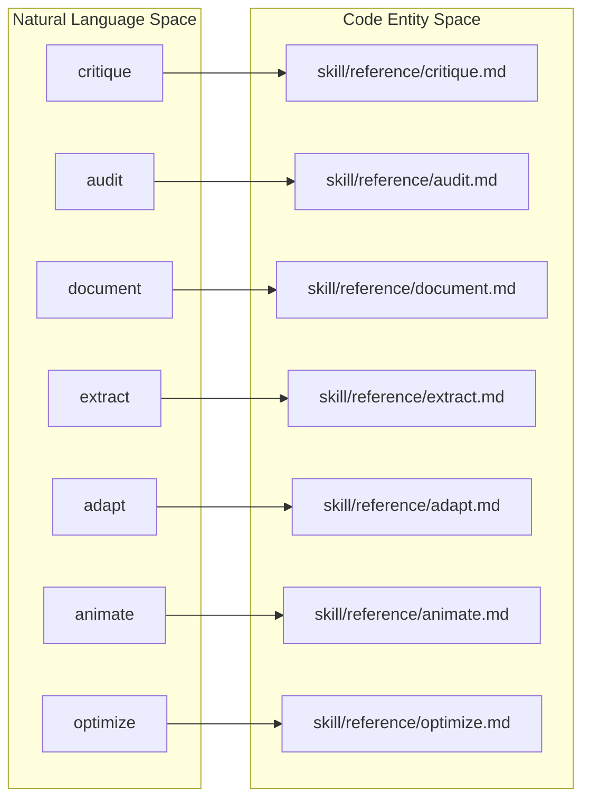
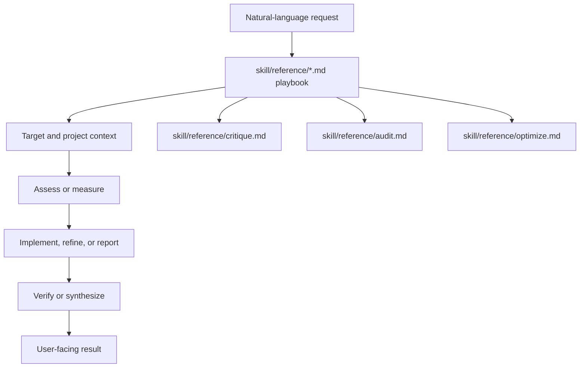
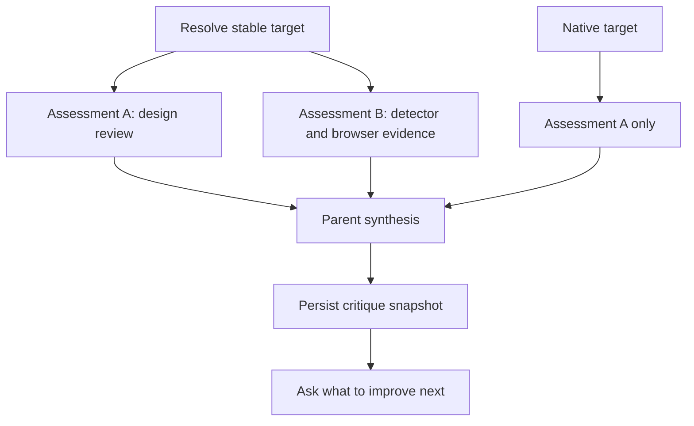

<!-- source: DeepWiki mcp.deepwiki.com · repo pbakaus/impeccable · page 2.2 Command Reference Catalog · fetched 2026-10-30 -->

# Command Reference Catalog

Relevant source files

The following files were used as context for generating this wiki page:

- [.agents/skills/impeccable/reference/polish.md](.agents/skills/impeccable/reference/polish.md)
- [.claude/skills/impeccable/reference/polish.md](.claude/skills/impeccable/reference/polish.md)
- [.cursor/skills/impeccable/reference/polish.md](.cursor/skills/impeccable/reference/polish.md)
- [.gemini/skills/impeccable/reference/polish.md](.gemini/skills/impeccable/reference/polish.md)
- [.github/skills/impeccable/reference/polish.md](.github/skills/impeccable/reference/polish.md)
- [.kiro/skills/impeccable/reference/polish.md](.kiro/skills/impeccable/reference/polish.md)
- [.opencode/skills/impeccable/reference/polish.md](.opencode/skills/impeccable/reference/polish.md)
- [.pi/skills/impeccable/reference/polish.md](.pi/skills/impeccable/reference/polish.md)
- [.rovodev/skills/impeccable/reference/polish.md](.rovodev/skills/impeccable/reference/polish.md)
- [.trae-cn/skills/impeccable/reference/polish.md](.trae-cn/skills/impeccable/reference/polish.md)
- [.trae/skills/impeccable/reference/polish.md](.trae/skills/impeccable/reference/polish.md)
- [skill/reference/adapt.md](skill/reference/adapt.md)
- [skill/reference/adapt.native.md](skill/reference/adapt.native.md)
- [skill/reference/animate.md](skill/reference/animate.md)
- [skill/reference/audit.md](skill/reference/audit.md)
- [skill/reference/audit.native.md](skill/reference/audit.native.md)
- [skill/reference/bolder.md](skill/reference/bolder.md)
- [skill/reference/critique.md](skill/reference/critique.md)
- [skill/reference/distill.md](skill/reference/distill.md)
- [skill/reference/document.md](skill/reference/document.md)
- [skill/reference/extract.md](skill/reference/extract.md)
- [skill/reference/harden.md](skill/reference/harden.md)
- [skill/reference/layout.md](skill/reference/layout.md)
- [skill/reference/optimize.md](skill/reference/optimize.md)
- [skill/reference/quieter.md](skill/reference/quieter.md)
- [skill/reference/shape.md](skill/reference/shape.md)
- [skill/reference/typeset.md](skill/reference/typeset.md)
- [tests/lib/utils.test.js](tests/lib/utils.test.js)
- [tests/skill-reference.test.mjs](tests/skill-reference.test.mjs)

## Purpose and scope

This page catalogs Impeccable’s agent-facing commands and reference playbooks. It groups the commands by task and identifies the source reference for each. The references are guidance for an agent performing work; the descriptions below summarize their documented responsibilities, not a guarantee that a command invokes a particular executable. [skill/reference/critique.md:1-16]() [skill/reference/audit.md:1-5]() [skill/reference/animate.md:1-3]()

Sources: [skill/reference/critique.md:1-16]() [skill/reference/audit.md:1-5]() [skill/reference/animate.md:1-3]()

## Command names and playbook mapping

The catalog spans build, evaluate, refine, enhance, fix, and iterate work, plus `hooks` and `doctor`. The files shown here document a subset of the reference playbooks in full; other playbook names are listed in the repository input but their contents are not included, so their detailed behavior is not inferred here.

| Group | Command | Reference playbook | Documented responsibility |
|---|---|---|---|
| Build | `shape` | `skill/reference/shape.md` | Shape a design direction. |
| Build | `craft` | `skill/reference/craft.md` | Create or implement a design. |
| Build | `init` | `skill/reference/init.md` | Initialize project context. |
| Build | `document` | [`skill/reference/document.md`](#build-document) | Capture the design system in `DESIGN.md`. |
| Build | `extract` | [`skill/reference/extract.md`](#build-extract) | Identify reusable patterns, components, and tokens. |
| Evaluate | `critique` | [`skill/reference/critique.md`](#evaluate-critique) | Run design and detector assessments, synthesize findings, and ask what to improve. |
| Evaluate | `audit` | [`skill/reference/audit.md`](#evaluate-audit) | Run systematic technical quality checks and report findings without fixing them. |
| Refine | `polish` | `skill/reference/polish.md` | Reference listed in the repository input; detailed content is not included here. |
| Refine | `bolder` | [`skill/reference/bolder.md`](#refine-bolder) | Amplify a scoped part of an existing surface using its established design system. |
| Refine | `quieter` | [`skill/reference/quieter.md`](#refine-quieter) | Reduce visual intensity while retaining the design’s point of view. |
| Refine | `distill` | `skill/reference/distill.md` | Reference listed in the repository input; detailed content is not included here. |
| Refine | `harden` | [`skill/reference/harden.md`](#refine-harden) | Improve resilience to difficult inputs, errors, languages, and network conditions. |
| Refine | `onboard` | `skill/reference/onboard.md` | Reference listed in the repository input; detailed content is not included here. |
| Enhance | `animate` | [`skill/reference/animate.md`](#enhance-animate) | Add purposeful motion that communicates state, relationship, hierarchy, or an authored moment. |
| Enhance | `colorize` | `skill/reference/colorize.md` | Reference listed in the repository input; detailed content is not included here. |
| Enhance | `typeset` | `skill/reference/typeset.md` | Reference listed in the repository input; detailed content is not included here. |
| Enhance | `layout` | `skill/reference/layout.md` | Reference listed in the repository input; detailed content is not included here. |
| Enhance | `delight` | `skill/reference/delight.md` | Reference listed in the repository input; detailed content is not included here. |
| Enhance | `overdrive` | `skill/reference/overdrive.md` | Reference listed in the repository input; detailed content is not included here. |
| Fix | `clarify` | `skill/reference/clarify.md` | Reference listed in the repository input; detailed content is not included here. |
| Fix | `adapt` | [`skill/reference/adapt.md`](#fix-adapt) | Rethink an existing design for another web context, rather than merely scaling it. |
| Fix | `optimize` | [`skill/reference/optimize.md`](#fix-optimize) | Measure and address performance bottlenecks. |
| Iterate | `live` | `skill/reference/live.md` | Reference listed in the repository input; detailed content is not included here. |
| Iterate | `generate` | `skill/reference/generate.md` | Reference listed in the repository input; detailed content is not included here. |
| System | `hooks` | `skill/reference/hooks.md` | Reference listed in the repository input; detailed content is not included here. |
| System | `doctor` | `skill/reference/doctor.md` | Reference listed in the repository input; detailed content is not included here. |

Sources: [skill/reference/document.md:1-7]() [skill/reference/extract.md:1-9]() [skill/reference/critique.md:1-16]() [skill/reference/audit.md:1-10]() [skill/reference/bolder.md:1-9]() [skill/reference/quieter.md:1-10]() [skill/reference/harden.md:1-3]() [skill/reference/animate.md:1-11]() [skill/reference/adapt.md:1-5]() [skill/reference/optimize.md:1-20]()

## Natural-language requests and reference playbooks

The command names are the user-facing concepts; the reference files are the corresponding playbook entities available in the source tree. This mapping shows the relationship without asserting implementation details about dispatch that are not established by the supplied files.

**Diagram: User-facing command names mapped to reference playbooks**

Sources: [skill/reference/critique.md:1-3]() [skill/reference/audit.md:1-5]() [skill/reference/document.md:1-3]() [skill/reference/extract.md:1-7]() [skill/reference/adapt.md:1-5]() [skill/reference/animate.md:1-3]() [skill/reference/optimize.md:1-3]()

### Playbook inputs, work, and outputs

The documented playbooks generally direct an agent through a task-specific sequence: establish a target or current state, assess the problem, apply the relevant guidance, and verify or report the result. For example, `critique` resolves a target and produces a synthesized assessment plus a question; `audit` performs checks and generates a report without fixing issues; `optimize` requires measurement before and after changes. [skill/reference/critique.md:1-3]() [skill/reference/audit.md:1-3]() [skill/reference/optimize.md:1-20]()

**Diagram: Playbook guidance translated into agent work**

Sources: [skill/reference/critique.md:1-16]() [skill/reference/audit.md:1-10]() [skill/reference/optimize.md:1-20]()

## Build

### `document`

`document` produces a project-root `DESIGN.md` describing the current visual design system. Its guidance treats YAML frontmatter as the normative, machine-readable token layer and the Markdown body as contextual documentation in a canonical section order. [skill/reference/document.md:1-7]() [skill/reference/document.md:51-62]()

The playbook describes two paths. In scan mode, the agent searches for existing tokens, component files, and rendered output, then extracts a draft and confirms descriptive language. In seed mode, it supports a pre-implementation project after checking that `PRODUCT.md` exists. If a `DESIGN.md` already exists, the instructions say not to overwrite it silently. [skill/reference/document.md:64-78]() [skill/reference/document.md:80-107]()

Sources: [skill/reference/document.md:1-7]() [skill/reference/document.md:51-78]() [skill/reference/document.md:80-107]()

### `extract`

`extract` identifies reusable patterns, components, and design tokens for consolidation into a design system. The playbook asks the agent to discover the existing system and follow its conventions; if none exists, it says to ask before creating one. [skill/reference/extract.md:1-9]()

Extraction candidates include repeated components, hard-coded values, inconsistent implementations, composition patterns, type styles, and animation patterns. The guidance sets a reuse threshold of three or more instances with the same intent, then proceeds through planning, extraction, migration, testing, and documentation. [skill/reference/extract.md:11-22]() [skill/reference/extract.md:24-60]()

Sources: [skill/reference/extract.md:1-9]() [skill/reference/extract.md:11-34]() [skill/reference/extract.md:36-60]()

### `shape`, `craft`, and `init`

The source listing identifies `shape`, `craft`, and `init` as build commands and names their reference paths. The contents of those playbooks were not included in the supplied file contents, so this page does not specify their detailed procedures or outputs. [skill/reference/shape.md:1-1]() [skill/reference/craft.md:1-1]() [skill/reference/init.md:1-1]()

Sources: [skill/reference/shape.md:1-1]() [skill/reference/craft.md:1-1]() [skill/reference/init.md:1-1]()

## Evaluate

### `critique`

`critique` resolves one stable target, runs two independent assessments, synthesizes a design critique, persists a snapshot, and asks what the user wants to improve. The response is the primary deliverable; the snapshot archives the run. [skill/reference/critique.md:1-3]()

Assessment A is a design review that considers product specificity and holistic design concerns. Assessment B gathers detector and browser evidence. When a sub-agent or Task tool is available, the playbook requires isolated assessments; if unavailable, it permits a sequential degraded run and requires a visible degradation banner. [skill/reference/critique.md:5-16]() [skill/reference/critique.md:31-42]() [skill/reference/critique.md:57-66]()

Native platforms are an explicit exception: the playbook says Assessment B does not apply because the detector and browser overlay read web markup. It directs the agent to run Assessment A alone and not to interpret an empty detector result as a clean native assessment. [skill/reference/critique.md:31-34]()

The report has a strict close: the question must be last, and the run is incomplete if it ends without either the targeted questions or a literal `Questions skipped: <reason>` line. [skill/reference/critique.md:13-16]()

**Critique assessment flow**

Sources: [skill/reference/critique.md:1-16]() [skill/reference/critique.md:31-42]() [skill/reference/critique.md:57-66]()

### `audit`

`audit` is a technical quality review, not a design critique. Its instructions say to document issues rather than fix them, and to route native platforms to `audit.native.md`. [skill/reference/audit.md:1-5]()

The web audit evaluates five dimensions: accessibility, performance, theming, responsive design, and implementation integrity. Each dimension receives a 0–4 score; the report includes an overall health score, an implementation-integrity verdict, severity-tagged findings, and recommended next steps. [skill/reference/audit.md:7-10]() [skill/reference/audit.md:66-105]()

Implementation integrity includes running the bundled detector and verifying findings in context. The playbook also distinguishes measurable findings from visual judgment and asks the auditor to identify false positives. [skill/reference/audit.md:58-64]()

Sources: [skill/reference/audit.md:1-10]() [skill/reference/audit.md:58-64]() [skill/reference/audit.md:66-105]()

## Refine

### `bolder`

`bolder` amplifies a scoped part of an already-established surface. The playbook distinguishes it from an open direction decision: when a direction decision is active, “bolder” refers to a separate direction-selection meaning, not this refinement command. [skill/reference/bolder.md:1-5]()

Scope is treated as binding: the agent should change only the named target and should not introduce new system primitives or restyle neighbors without authorization. The proposed change should amplify the system’s existing visual vocabulary, preserve existing claims, and remain legible when evaluated as structure without copy. [skill/reference/bolder.md:7-24]() [skill/reference/bolder.md:26-33]()

Sources: [skill/reference/bolder.md:1-9]() [skill/reference/bolder.md:11-24]() [skill/reference/bolder.md:26-33]()

### `quieter`

`quieter` reduces visual intensity without making the result generic or removing its personality. Its instructions distinguish visitor modes: Persuade and Experience retain drama and point of view, while Operate and Read reduce visual noise so the tool recedes into the task. [skill/reference/quieter.md:1-10]()

The playbook assesses sources of intensity, plans a refinement, and addresses color, visual weight, simplification, motion, and composition. It ends with checks for functionality, distinctiveness, readability, and whether the point of view survives. [skill/reference/quieter.md:13-44]() [skill/reference/quieter.md:46-99]()

Sources: [skill/reference/quieter.md:1-10]() [skill/reference/quieter.md:13-44]() [skill/reference/quieter.md:46-99]()

### `distill`, `polish`, and `onboard`

The supplied repository listing names `distill`, `polish`, and `onboard` as refine commands. Their full playbook contents were not included here, so detailed behavior is not specified on this page. [skill/reference/distill.md:1-1]() [skill/reference/polish.md:1-1]() [skill/reference/onboard.md:1-1]()

Sources: [skill/reference/distill.md:1-1]() [skill/reference/polish.md:1-1]() [skill/reference/onboard.md:1-1]()

### `harden`

`harden` targets resilience against inputs, errors, languages, and network conditions. Its assessment checklist includes extreme text and data sizes, empty states, network and API errors, permissions, rate limiting, concurrent operations, and internationalization. [skill/reference/harden.md:1-29]()

The playbook organizes hardening guidance around text overflow and wrapping, internationalization, error handling, and edge cases. Its verification section includes touch-gesture behavior as well as broader hardening checks; the reference test suite confirms that touch-gesture verification remains present in the harden playbook. [skill/reference/harden.md:33-83]() [skill/reference/harden.md:199-218]() [tests/skill-reference.test.mjs:105-121]()

Sources: [skill/reference/harden.md:1-29]() [skill/reference/harden.md:33-83]() [skill/reference/harden.md:199-218]() [tests/skill-reference.test.mjs:105-121]()

## Enhance

### `animate`

`animate` applies motion to explain state, relationships, or hierarchy, or to create an authored moment that fits the surface. The playbook asks the agent to identify the job for motion and write a short motion thesis covering focal moment, continuity, feedback, and budget before implementation. [skill/reference/animate.md:1-3]() [skill/reference/animate.md:13-34]()

Implementation guidance selects motion material by meaning, recommends runtime-appropriate techniques, and warns against hiding default content or casually animating layout-driving properties. Every web animation must have a `prefers-reduced-motion` path that reduces movement while preserving meaningful state and feedback. [skill/reference/animate.md:36-71]() [skill/reference/animate.md:73-87]()

The skill-reference tests specifically check that reduced-motion guidance remains on the animation build path and that the verification section includes reduced-motion checks. [tests/skill-reference.test.mjs:57-66]()

Sources: [skill/reference/animate.md:1-3]() [skill/reference/animate.md:13-34]() [skill/reference/animate.md:36-87]() [tests/skill-reference.test.mjs:57-66]()

### `colorize`, `typeset`, `layout`, `delight`, and `overdrive`

These enhancement commands and their reference paths are identified in the supplied repository listing. Their full playbooks were not included in the provided contents, so this catalog does not make claims about their detailed procedures. [skill/reference/colorize.md:1-1]() [skill/reference/typeset.md:1-1]() [skill/reference/layout.md:1-1]() [skill/reference/delight.md:1-1]() [skill/reference/overdrive.md:1-1]()

Sources: [skill/reference/colorize.md:1-1]() [skill/reference/typeset.md:1-1]() [skill/reference/layout.md:1-1]() [skill/reference/delight.md:1-1]() [skill/reference/overdrive.md:1-1]()

## Fix

### `adapt`

`adapt` changes an existing design for a different context—such as another screen size, device, platform, or use case—and warns against treating adaptation as simple scaling. The supplied web playbook applies to web, including mobile web; native platforms route to a native reference. [skill/reference/adapt.md:1-5]()

The process identifies the source context, target context, and adaptation challenges, then plans layout, interaction, and content changes. Verification covers devices, orientations, browsers, operating systems, input methods, edge-case sizes, and slow connections. [skill/reference/adapt.md:9-31]() [skill/reference/adapt.md:33-97]() [skill/reference/adapt.md:179-190]()

The reference tests confirm that the adapt playbook retains primary-gesture verification, distinguishes layout verification from gesture evidence, and calls for reporting what produced the evidence and what remained untested. [tests/skill-reference.test.mjs:105-118]()

Sources: [skill/reference/adapt.md:1-5]() [skill/reference/adapt.md:9-31]() [skill/reference/adapt.md:33-97]() [skill/reference/adapt.md:179-190]() [tests/skill-reference.test.mjs:105-118]()

### `clarify`

The supplied repository listing identifies `clarify` and its reference path. The playbook contents were not included here, so its detailed behavior is not described. [skill/reference/clarify.md:1-1]()

Sources: [skill/reference/clarify.md:1-1]()

### `optimize`

`optimize` begins by measuring the current state, identifying the actual bottleneck, and measuring again after changes. Its playbook covers loading, rendering, animation, framework, network, and Core Web Vitals concerns. [skill/reference/optimize.md:1-20]() [skill/reference/optimize.md:22-26]() [skill/reference/optimize.md:87-116]() [skill/reference/optimize.md:153-188]() [skill/reference/optimize.md:190-210]()

The reference explicitly cautions against optimizing without measurement: the target is a bottleneck in the particular interface, not a generic checklist item. [skill/reference/optimize.md:1-20]()

Sources: [skill/reference/optimize.md:1-20]() [skill/reference/optimize.md:22-26]() [skill/reference/optimize.md:87-116]() [skill/reference/optimize.md:153-188]() [skill/reference/optimize.md:190-210]()

## Iterate

The supplied repository listing identifies `live` and `generate` as iteration commands and names their reference paths. Their full playbook contents were not included in the provided files, so this page does not infer their lifecycle, protocol, or implementation details. [skill/reference/live.md:1-1]() [skill/reference/generate.md:1-1]()

Sources: [skill/reference/live.md:1-1]() [skill/reference/generate.md:1-1]()

## Hooks and doctor

`hooks` and `doctor` are included in the requested command catalog, but their reference contents were not supplied. Their implementation, data flow, and specific behavior cannot be established from the available files; consult their respective references in the repository for those details. [skill/reference/hooks.md:1-1]() [skill/reference/doctor.md:1-1]()

Sources: [skill/reference/hooks.md:1-1]() [skill/reference/doctor.md:1-1]()

## Cross-command relationships

The available references support several practical handoffs:

| Situation | Command relationship |
|---|---|
| The visual system is coherent but undocumented | Use `document` to record the existing system; its guidance includes scan mode for projects with code or rendered output. [skill/reference/document.md:64-78]() |
| Repeated patterns should become shared system elements | Use `extract` to identify patterns, plan reuse, migrate instances, and document the result. [skill/reference/extract.md:11-60]() |
| A critique identifies issues to address | `critique` is an assessment workflow; its final response asks what to improve next. [skill/reference/critique.md:1-3]() [skill/reference/critique.md:13-16]() |
| Technical findings need a systematic report | `audit` reports measurable issues and explicitly does not fix them. [skill/reference/audit.md:1-10]() |
| A focused section should express more conviction | Use `bolder` within the named scope and established system. [skill/reference/bolder.md:3-9]() [skill/reference/bolder.md:15-24]() |
| A surface is too intense | Use `quieter` to reduce intensity while preserving personality and function. [skill/reference/quieter.md:1-10]() [skill/reference/quieter.md:90-99]() |
| A design must work in a different context | Use `adapt` to rethink the experience and verify the relevant devices and input methods. [skill/reference/adapt.md:3-5]() [skill/reference/adapt.md:179-190]() |
| A performance concern needs evidence | Use `optimize` to measure, locate the bottleneck, change it, and measure again. [skill/reference/optimize.md:1-20]() |

Sources: [skill/reference/document.md:64-78]() [skill/reference/extract.md:11-60]() [skill/reference/critique.md:1-16]() [skill/reference/audit.md:1-10]() [skill/reference/bolder.md:3-24]() [skill/reference/quieter.md:1-10]() [skill/reference/quieter.md:90-99]() [skill/reference/adapt.md:3-5]() [skill/reference/adapt.md:179-190]() [skill/reference/optimize.md:1-20]()

---

