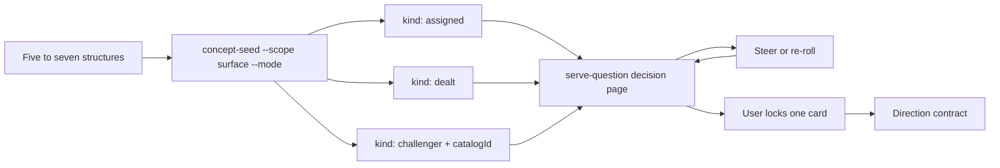
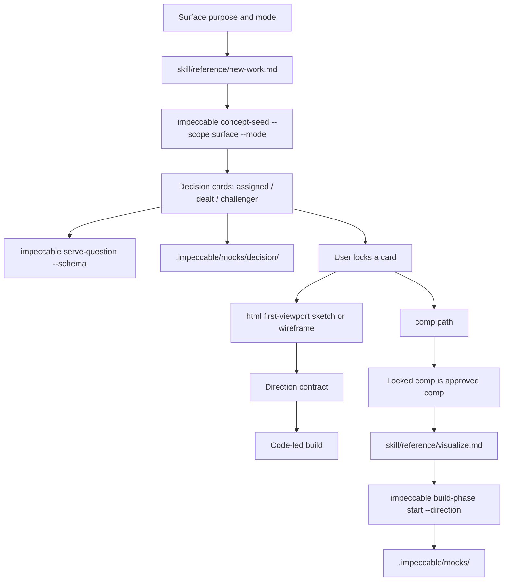

<!-- source: DeepWiki mcp.deepwiki.com · repo pbakaus/impeccable · page 2.3 New Work and Direction Selection · fetched 2026-10-30 -->

# New Work and Direction Selection

<details>
<summary>Relevant source files</summary>

The following files were used as context for generating this wiki page:

- [.agents/skills/impeccable/reference/new-work.md](.agents/skills/impeccable/reference/new-work.md)
- [.claude/skills/impeccable/reference/new-work.md](.claude/skills/impeccable/reference/new-work.md)
- [.cursor/skills/impeccable/reference/new-work.md](.cursor/skills/impeccable/reference/new-work.md)
- [.gemini/skills/impeccable/reference/new-work.md](.gemini/skills/impeccable/reference/new-work.md)
- [.github/skills/impeccable/reference/new-work.md](.github/skills/impeccable/reference/new-work.md)
- [.kiro/skills/impeccable/reference/new-work.md](.kiro/skills/impeccable/reference/new-work.md)
- [.opencode/skills/impeccable/reference/new-work.md](.opencode/skills/impeccable/reference/new-work.md)
- [.pi/skills/impeccable/reference/new-work.md](.pi/skills/impeccable/reference/new-work.md)
- [.qoder/skills/impeccable/reference/new-work.md](.qoder/skills/impeccable/reference/new-work.md)
- [.rovodev/skills/impeccable/reference/new-work.md](.rovodev/skills/impeccable/reference/new-work.md)
- [.trae-cn/skills/impeccable/reference/new-work.md](.trae-cn/skills/impeccable/reference/new-work.md)
- [crates/context/src/concept_seed.rs](crates/context/src/concept_seed.rs)
- [crates/context/src/seed_text.rs](crates/context/src/seed_text.rs)
- [skill/SKILL.src.md](skill/SKILL.src.md)
- [skill/agents/impeccable-asset-producer.md](skill/agents/impeccable-asset-producer.md)
- [skill/agents/impeccable-finish-reviewer.md](skill/agents/impeccable-finish-reviewer.md)
- [skill/agents/impeccable-manual-edit-applier.md](skill/agents/impeccable-manual-edit-applier.md)
- [skill/reference/craft-floor.md](skill/reference/craft-floor.md)
- [skill/reference/doctor.md](skill/reference/doctor.md)
- [skill/reference/init.md](skill/reference/init.md)
- [skill/reference/mode-operate.md](skill/reference/mode-operate.md)
- [skill/reference/mode-persuade.md](skill/reference/mode-persuade.md)
- [skill/reference/mode-read.md](skill/reference/mode-read.md)
- [skill/reference/new-work.md](skill/reference/new-work.md)
- [skill/reference/overdrive.md](skill/reference/overdrive.md)
- [skill/reference/visualize.md](skill/reference/visualize.md)
- [tests/fixtures/mode-rules-skill-partial/reference/mode-operate.md](tests/fixtures/mode-rules-skill-partial/reference/mode-operate.md)
- [tests/oracle/golden/question-start-surface-missing-comps.json](tests/oracle/golden/question-start-surface-missing-comps.json)
- [tests/oracle/golden/question-update-surface-missing-comps.json](tests/oracle/golden/question-update-surface-missing-comps.json)
- [tests/oracle/golden/question-update-surface-shape-after-direction-roll.json](tests/oracle/golden/question-update-surface-shape-after-direction-roll.json)
- [tests/oracle/golden/question-update-world-cards.json](tests/oracle/golden/question-update-world-cards.json)
- [tests/oracle/golden/seed-degraded-bolder.json](tests/oracle/golden/seed-degraded-bolder.json)
- [tests/oracle/golden/seed-degraded-direction.json](tests/oracle/golden/seed-degraded-direction.json)
- [tests/oracle/golden/seed-degraded-surface.json](tests/oracle/golden/seed-degraded-surface.json)
- [tests/oracle/golden/seed-direction-env-key.json](tests/oracle/golden/seed-direction-env-key.json)
- [tests/oracle/golden/seed-direction-local-count-5.json](tests/oracle/golden/seed-direction-local-count-5.json)
- [tests/oracle/golden/seed-direction-local-operate.json](tests/oracle/golden/seed-direction-local-operate.json)
- [tests/oracle/golden/seed-direction-local-reroll-bolder.json](tests/oracle/golden/seed-direction-local-reroll-bolder.json)
- [tests/oracle/golden/seed-direction-local-reroll-safer.json](tests/oracle/golden/seed-direction-local-reroll-safer.json)
- [tests/oracle/golden/seed-direction-local-reroll.json](tests/oracle/golden/seed-direction-local-reroll.json)
- [tests/oracle/golden/seed-direction-local-unscoped.json](tests/oracle/golden/seed-direction-local-unscoped.json)
- [tests/oracle/golden/seed-direction-local.json](tests/oracle/golden/seed-direction-local.json)
- [tests/oracle/golden/seed-mode-rules-experience.json](tests/oracle/golden/seed-mode-rules-experience.json)
- [tests/oracle/golden/seed-mode-rules-missing-file.json](tests/oracle/golden/seed-mode-rules-missing-file.json)
- [tests/oracle/golden/seed-mode-rules-missing-section.json](tests/oracle/golden/seed-mode-rules-missing-section.json)
- [tests/oracle/golden/seed-roll-record-worlds.json](tests/oracle/golden/seed-roll-record-worlds.json)
- [tests/oracle/golden/seed-surface-local-card-base.json](tests/oracle/golden/seed-surface-local-card-base.json)
- [tests/oracle/golden/seed-surface-local-compositions.json](tests/oracle/golden/seed-surface-local-compositions.json)
- [tests/oracle/golden/seed-surface-local-default-scope.json](tests/oracle/golden/seed-surface-local-default-scope.json)
- [tests/oracle/golden/seed-surface-local-grain-flow.json](tests/oracle/golden/seed-surface-local-grain-flow.json)
- [tests/oracle/golden/seed-surface-local.json](tests/oracle/golden/seed-surface-local.json)

</details>


## Purpose and scope

This page describes how Impeccable turns a request for a new UI surface or replacement visual identity into a user-confirmed direction and a build path. The flow distinguishes durable product facts from visual-system decisions and surface-specific strategy, then chooses how much invention is appropriate. It applies to new surfaces and replacement identities; a local addition to an established surface inherits that surface instead of becoming a new identity exercise. [skill/reference/new-work.md:1-16]()

Sources: [skill/reference/new-work.md:1-16]()

## Context ownership: product truth, visual system, and surface brief

The workflow assigns different kinds of context to different artifacts:

| Artifact | Owns | Practical consequence |
|---|---|---|
| `PRODUCT.md` | Product truth | Preserve its facts, content, function, and constraints. If it is missing, complete `init.md` first. |
| `DESIGN.md` | Durable visual decisions | On an established world, inherit the existing visual identity. A missing file alone does not mean the project is greenfield. |
| Surface brief | Strategy for one route or artifact | Record the surface’s purpose and mode here, rather than treating those as settled by `DESIGN.md`. |

These ownership boundaries govern both design reasoning and implementation: a redesign changes the visual world but preserves product truth; a local extension preserves the established world and composition; and durable changes to `DESIGN.md` require user approval when extending an existing surface. [skill/reference/new-work.md:3-16]()

The skill’s setup reinforces this ordering. It directs the agent to load context once per session, then load `reference/new-work.md` for a new surface or replacement visual world, and inspect the target and incumbent visual truth before editing. [skill/SKILL.src.md:19-23]()

Sources: [skill/reference/new-work.md:3-16](), [skill/SKILL.src.md:19-23]()

## Workflow at a glance

New-work decisions move from evidence and user answers to a direction, then to a presentation choice that determines the build path. The flow varies according to whether the task extends an existing surface, creates a new surface inside an established world, or creates or replaces the world itself. [skill/reference/new-work.md:7-20](), [skill/reference/new-work.md:29-47]()

**Diagram: Natural-language decisions mapped to workflow files and commands**

```mermaid
flowchart TD
    Request["New surface or replacement identity"] --> Context["PRODUCT.md: product truth"]
    Request --> Evidence["DESIGN.md + representative code + tokens + components + assets"]
    Context --> Gate["new-work.md: classify existing visual authority"]
    Evidence --> Gate
    Gate -->| "Extend established surface" | Extend["Inherit world and composition"]
    Gate -->| "Whole surface in established world" | Surface["concept-seed --scope surface --mode"]
    Gate -->| "Create or replace visual world" | Direction["Direction-seed path"]
    Surface --> Decision["serve-question decision page"]
    Direction --> Decision
    Decision --> Contract["Direction contract"]
    Contract -->| "Locked comp" | CompLed["visualize.md: comp-led build"]
    Contract -->| "Locked sketch or wireframe" | CodeLed["Code-led build"]
```

Sources: [skill/reference/new-work.md:3-16](), [skill/reference/new-work.md:29-47](), [skill/reference/visualize.md:1-11]()

## 1. Establish what is already true

Before choosing a direction, read `DESIGN.md` alongside representative code, tokens, components, and assets. The decision is based on the visual authority present in the project, not on whether a particular documentation file exists. [skill/reference/new-work.md:7-16]()

| Situation | Treatment |
|---|---|
| Redesign | Keep product truth, content, function, constraints, and explicit brand commitments; replace the old visual world instead of polishing it. |
| Established world | Inherit it. If `DESIGN.md` is absent but the code expresses a coherent identity, document that identity rather than inventing another. |
| Incomplete brand | Preserve confirmed assets and recognizable traits; work with the user to expand the system for the surface. |
| No visual authority | Create a new visual world with the user. |
| Local section, component, feature, or state | Inherit the containing surface. Do not start a new identity exercise. |

The old appearance of a redesign target is evidence about the subject, not authority over the replacement. Conversely, when extending an established surface, the existing world and composition constrain the addition. [skill/reference/new-work.md:11-16]()

Sources: [skill/reference/new-work.md:7-16]()

## 2. Confirm purpose through the surface mode

Before implementation, obtain the user’s answer through the structured question tool when available. Typically ask two or three related questions; a precise request may need only a compact confirmation. Do not skip confirmation just because `DESIGN.md` exists: it settles the visual world, not the new surface’s purpose or concept. Ask about success, what must remain untouched, and what would make a polished result feel wrong. Do not ask for CSS values or prepackaged aesthetic lanes. [skill/reference/new-work.md:18-27]()

Choose mode from the requested **surface**, not the product. Persist it only in that surface’s brief. The skill describes modes as the visitor’s success on the surface: Persuade is about deciding and acting; Operate is about completing a task; Read is about understanding; Experience is about being inside the work. [skill/SKILL.src.md:34-43]()

| Mode | Questions that shape the work |
|---|---|
| **Persuade** | Who must act? What should they believe? Which real proof, content, or assets earn that belief? |
| **Operate** | What task is being completed? What information, important states, frequency, and constraints matter? |
| **Read** | What question does the reader have? What source material, structure, and wayfinding answer it? |
| **Experience** | What leads? How does exploration unfold? Which interaction or transition matters? |

These modes affect ambition, not just terminology: the skill calls for full commitment on Persuade and Experience surfaces, while Operate and Read prioritize precision and restraint. [skill/reference/new-work.md:22-27](), [skill/SKILL.src.md:14-17]()

Sources: [skill/reference/new-work.md:18-27](), [skill/SKILL.src.md:14-17](), [skill/SKILL.src.md:34-43]()

## 3. Choose how much to invent

### Extend an existing surface

Inherit the world and composition. Resolve only the addition’s purpose, content, hierarchy, states, interaction, and fit with the surrounding experience. Do not run a concept tournament. Do not change `DESIGN.md` unless the user approves a durable system change. [skill/reference/new-work.md:29-33]()

### Create a whole surface inside an established world

Keep the visual system fixed. Develop five to seven materially different structures from the content, task, and user behavior, ordered by resonance. For a genuinely open whole page, screen, or flow, the playbook specifies:

`{{scripts_path}}/impeccable concept-seed --scope surface --mode <mode>` [skill/reference/new-work.md:35-41]()

This is a composition decision, not an identity decision: surface-scope cards have no canon or pick card because the visual world is already settled. Three structures are dealt to the user as equally salient cards. The dealt lead uses the kicker `THE ROLL`; the page offers steering and re-roll, and the user locks one card. Cards identify their provenance with `kind`: `assigned` for the dealt lead, `dealt` for the other dealt structures, and `challenger` with its `catalogId` for a challenger that earned a place. [skill/reference/new-work.md:37-41]()

Do not run `concept-seed` for a local extension or a precisely specified narrow request; shape those directly. [skill/reference/new-work.md:41]()

Sources: [skill/reference/new-work.md:29-41]()

### Create or replace the visual world

For a new or replacement world, the playbook starts by naming the product’s unique mechanism, the audience’s real scene and cultural home, and what the first surface must prove. It excludes predictable category patterns from the candidate set; if the brief, product name, titled artifact, or governing metaphor already suggests an obvious direction, that literal reading can consume at most one candidate. [skill/reference/new-work.md:43-47]()

The candidate list should draw from concrete visual systems, artifacts, places, or rituals familiar to the audience. Each candidate needs a resonance rationale and a description of its visual character. The list should span material families rather than repeatedly deriving from the most obvious artifact. For Operate and Read surfaces, the audience’s world may include graphic traditions, places, rituals, and artifacts, but not the instruments the audience operates as a costume for the interface. [skill/reference/new-work.md:45-47]()

Sources: [skill/reference/new-work.md:43-47]()

## 4. Decision-page cards: deal, challenge, and lock

For a whole surface in an established world, the playbook describes a bounded choice: prepare five to seven structures, deal three, present them at equal salience, and let the user lock one. It explicitly identifies a `challenger` card and its `catalogId` when a challenger has won its place. [skill/reference/new-work.md:37-41]()

The supplied excerpt does not specify the full command interface or data schema for `canon`, `raise`, or `serve-question` decision-page actions. What it does establish is that **surface-scope** cards have no canon or pick card: the world is settled, and the choice concerns composition. The challenger card is an identified exception to the dealt structures, not a reason to reopen the established visual identity. [skill/reference/new-work.md:37-41]()

**Diagram: Natural-language selection terms mapped to card fields and decision-page behavior**



Sources: [skill/reference/new-work.md:35-41]()

## 5. The locked card determines the build path

For an established-world surface, the card presentation depends on image-generation availability and the planned build path:

| Card content | What the decision page presents | Build path after lock |
|---|---|---|
| `comp` | A generated comp under `.impeccable/mocks/decision/` | Comp-led; the locked comp is the approved comp. |
| `html` | An HTML sketch of the first viewport, rendered as a skeleton | Code-led; the locked sketch is the composition to match. |
| Neither `comp` nor `html` | A `wireframe` schematic, using `impeccable serve-question --schema` | Code-led; the direction contract carries the ambition. |

For comp cards, the images are generated after serving the decision page and in reading order. On an established world, anchor each comp on a representative existing-page screenshot passed as an image reference. The playbook explicitly warns that prose paraphrases of a visual system drift more readily than pixel references. For a locked comp, the decision card’s approval discharges the later three-option approval round; do not create a second approval point. [skill/reference/new-work.md:37-41]()

The code-led route is not a failed comp-led route. A locked sketch or wireframe chooses code-led implementation, with the direction contract carrying the intended ambition; a locked sketch also specifies the composition the implementation should match. [skill/reference/new-work.md:41]()

Sources: [skill/reference/new-work.md:37-41]()

### Comp-led path

`visualize.md` is loaded from `new-work.md` for a comp-led build when image generation is available. It states that a code-led contract skips that file by design. The comp process uses an already-open `comps` build phase, generates three distinct high-fidelity options under `.impeccable/mocks/`, and sends them to the approval point together—except when a decision comp already supplies the first option, in which case two more are generated. [skill/reference/visualize.md:1-11]()

A comp is a composition and hierarchy probe within an already chosen world, not a second identity workshop. On an established world, the reference screenshot anchors the visual identity while the prompt addresses the new surface; the reference page’s content should not be copied. The image must communicate the visitor’s job and include the subject, rather than functioning as atmosphere or poster art. [skill/reference/visualize.md:5-17]()

### Code-led path

The supplied text defines code-led selection through the locked sketch or wireframe and says the direction contract carries the ambition. It does not describe the direction contract’s complete schema or the subsequent implementation stages. It does state that a code-led contract deliberately skips `visualize.md`; the build should therefore be understood as a distinct selected path, not as a comp round omitted accidentally. [skill/reference/new-work.md:41](), [skill/reference/visualize.md:1-3]()

Sources: [skill/reference/new-work.md:37-41](), [skill/reference/visualize.md:1-17]()

## 6. Build-path and code-entity map

The following diagram connects the workflow’s user-facing language to named files, commands, and artifacts. It distinguishes facts explicit in the supplied excerpts from broader implementation detail: the provided source shows the `concept-seed` command invocation, `serve-question --schema` fallback, decision-comp paths, and `visualize.md` build-phase command, but does not include the definitions of the Rust command handlers. [skill/reference/new-work.md:37-41](), [skill/reference/visualize.md:7-11]()

**Diagram: Natural-language direction selection mapped to named code and artifact entities**



Sources: [skill/reference/new-work.md:35-41](), [skill/reference/visualize.md:1-11]()

## 7. Session setup and downstream quality boundary

The skill says to run `impeccable context` once per session, from the project’s working directory, before loading the request’s playbook. The context command loads `PRODUCT.md`, `DESIGN.md`, the matching surface brief, and native-platform guidance when applicable; it also instructs the agent to follow its directives rather than rerunning context. [skill/SKILL.src.md:19-22]()

After analysis and direction are resolved, the skill requires loading `reference/craft-floor.md` immediately before a UI edit, including a small refinement. It is not required for planning-only work. This places the quality-floor check at the transition from selected direction to implementation. [skill/SKILL.src.md:22-23]()

Sources: [skill/SKILL.src.md:19-23]()

## Operational summary

- Determine visual authority from `DESIGN.md` **and** the existing code, tokens, components, and assets. [skill/reference/new-work.md:7-16]()
- Preserve `PRODUCT.md` truth; do not confuse a surface’s purpose with the established visual system. [skill/reference/new-work.md:3-3](), [skill/reference/new-work.md:18-27]()
- Select Persuade, Operate, Read, or Experience from the surface’s visitor goal, and record that mode in the surface brief. [skill/SKILL.src.md:34-43]()
- Extend locally without a concept tournament; use a concept round only for a genuinely open whole surface, screen, or flow. [skill/reference/new-work.md:29-41]()
- Treat a locked comp as approval for comp-led work; treat a locked sketch or wireframe as a code-led decision. [skill/reference/new-work.md:37-41]()
- Load `visualize.md` for comp-led work; its own guidance says code-led work skips it. [skill/reference/visualize.md:1-3]()
- Load `craft-floor.md` immediately before UI edits, not for planning-only work. [skill/SKILL.src.md:22-23]()

Sources: [skill/reference/new-work.md:3-41](), [skill/reference/visualize.md:1-11](), [skill/SKILL.src.md:19-23](), [skill/SKILL.src.md:34-43]()

---

