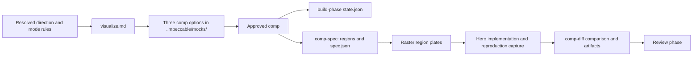
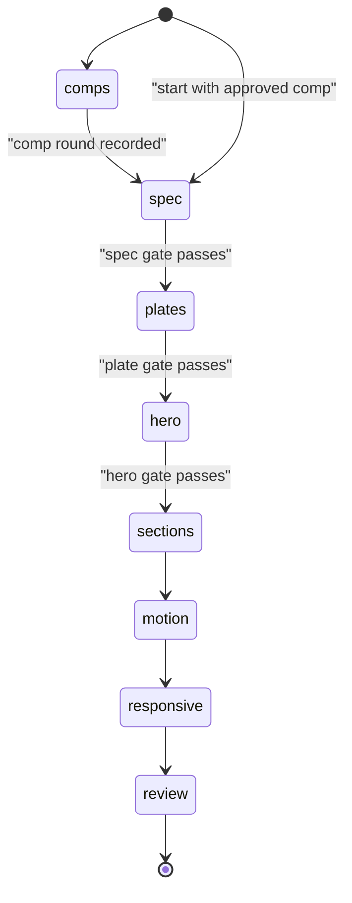

<!-- source: DeepWiki mcp.deepwiki.com · repo pbakaus/impeccable · page 2.4 Comp Pipeline and Build Phases · fetched 2026-10-30 -->

# Comp Pipeline and Build Phases

Relevant source files

The following files were used as context for generating this wiki page:

- [.agents/skills/impeccable/reference/degraded/asset-producer.md](.agents/skills/impeccable/reference/degraded/asset-producer.md)
- [.agents/skills/impeccable/reference/visualize.md](.agents/skills/impeccable/reference/visualize.md)
- [.claude/agents/impeccable-asset-producer.md](.claude/agents/impeccable-asset-producer.md)
- [.claude/skills/impeccable/reference/degraded/asset-producer.md](.claude/skills/impeccable/reference/degraded/asset-producer.md)
- [.claude/skills/impeccable/reference/visualize.md](.claude/skills/impeccable/reference/visualize.md)
- [.cursor/skills/impeccable/reference/degraded/asset-producer.md](.cursor/skills/impeccable/reference/degraded/asset-producer.md)
- [.cursor/skills/impeccable/reference/visualize.md](.cursor/skills/impeccable/reference/visualize.md)
- [.gemini/skills/impeccable/reference/degraded/asset-producer.md](.gemini/skills/impeccable/reference/degraded/asset-producer.md)
- [.gemini/skills/impeccable/reference/visualize.md](.gemini/skills/impeccable/reference/visualize.md)
- [.github/skills/impeccable/reference/degraded/asset-producer.md](.github/skills/impeccable/reference/degraded/asset-producer.md)
- [.github/skills/impeccable/reference/visualize.md](.github/skills/impeccable/reference/visualize.md)
- [.grok/agents/impeccable-asset-producer.md](.grok/agents/impeccable-asset-producer.md)
- [.grok/skills/impeccable/reference/degraded/asset-producer.md](.grok/skills/impeccable/reference/degraded/asset-producer.md)
- [.grok/skills/impeccable/reference/visualize.md](.grok/skills/impeccable/reference/visualize.md)
- [.kiro/skills/impeccable/reference/degraded/asset-producer.md](.kiro/skills/impeccable/reference/degraded/asset-producer.md)
- [.kiro/skills/impeccable/reference/visualize.md](.kiro/skills/impeccable/reference/visualize.md)
- [.opencode/skills/impeccable/reference/degraded/asset-producer.md](.opencode/skills/impeccable/reference/degraded/asset-producer.md)
- [.opencode/skills/impeccable/reference/visualize.md](.opencode/skills/impeccable/reference/visualize.md)
- [.pi/skills/impeccable/reference/degraded/asset-producer.md](.pi/skills/impeccable/reference/degraded/asset-producer.md)
- [.pi/skills/impeccable/reference/visualize.md](.pi/skills/impeccable/reference/visualize.md)
- [.qoder/skills/impeccable/reference/visualize.md](.qoder/skills/impeccable/reference/visualize.md)
- [.rovodev/skills/impeccable/reference/visualize.md](.rovodev/skills/impeccable/reference/visualize.md)
- [crates/common/src/launcher.rs](crates/common/src/launcher.rs)
- [crates/common/src/lib.rs](crates/common/src/lib.rs)
- [crates/comp-verbs/Cargo.toml](crates/comp-verbs/Cargo.toml)
- [crates/comp-verbs/src/approved_comp.rs](crates/comp-verbs/src/approved_comp.rs)
- [crates/comp-verbs/src/build_phase.rs](crates/comp-verbs/src/build_phase.rs)
- [crates/comp-verbs/src/build_phase/integrity_tests.rs](crates/comp-verbs/src/build_phase/integrity_tests.rs)
- [crates/comp-verbs/src/comp_diff.rs](crates/comp-verbs/src/comp_diff.rs)
- [crates/comp-verbs/src/comp_spec.rs](crates/comp-verbs/src/comp_spec.rs)
- [crates/comp-verbs/src/font_match.rs](crates/comp-verbs/src/font_match.rs)
- [crates/comp-verbs/src/lib.rs](crates/comp-verbs/src/lib.rs)
- [crates/comp/src/png_io.rs](crates/comp/src/png_io.rs)
- [crates/context/src/component_review/mod.rs](crates/context/src/component_review/mod.rs)
- [crates/context/src/provider.rs](crates/context/src/provider.rs)
- [docs/COMP-FIDELITY.md](docs/COMP-FIDELITY.md)
- [docs/RUNTIME-ENV.md](docs/RUNTIME-ENV.md)
- [plugin/agents/impeccable-asset-producer.md](plugin/agents/impeccable-asset-producer.md)
- [plugin/skills/impeccable/reference/degraded/asset-producer.md](plugin/skills/impeccable/reference/degraded/asset-producer.md)
- [skill/reference/component-review.md](skill/reference/component-review.md)
- [tests/oracle/cases/comp.mjs](tests/oracle/cases/comp.mjs)
- [tests/oracle/golden/build-phase-decision-comp-option-one.json](tests/oracle/golden/build-phase-decision-comp-option-one.json)
- [tests/oracle/golden/build-phase-usage.json](tests/oracle/golden/build-phase-usage.json)

## Purpose and scope

This page describes Impeccable’s comp-led path from visual direction to a measured implementation: how `visualize.md` frames comp creation, how a comp becomes a region-based specification with raster plates, how `build-phase` records and gates implementation phases, and how comp-diff artifacts support review. It also distinguishes the comp pipeline from code-led work, which skips visualization by design. [.claude/skills/impeccable/reference/visualize.md:1-18](); [docs/COMP-FIDELITY.md:16-49]()

The pipeline’s central constraint is that the approved comp is a target, not a loose style reference. The spec makes its regions explicit; raster assets are checked against their corresponding comp crops; and the hero reproduction is compared to the comp before the build advances. [.claude/skills/impeccable/reference/visualize.md:5-18](); [docs/COMP-FIDELITY.md:20-45]()

Sources: `.claude/skills/impeccable/reference/visualize.md`, `docs/COMP-FIDELITY.md`

## Pipeline at a glance

A comp-led build starts with direction already resolved. `visualize.md` does not reopen the visual world: it directs the comp round to test composition, narrative, hierarchy, density, focal point, signature use, and image requirements while keeping established visual identity or the chosen direction fixed. The build-phase state machine records the comp round and subsequent build steps. [`.claude/skills/impeccable/reference/visualize.md:1-9]()`; [`crates/comp-verbs/src/build_phase.rs:28-43]()

### Comp pipeline from intent to review

Sources: `.claude/skills/impeccable/reference/visualize.md`, `docs/COMP-FIDELITY.md`, `crates/comp-verbs/src/build_phase.rs`

### Natural Language Space to Code Entity Space: comp creation

| Natural-language concept | Code or project entity |
|---|---|
| Resolved direction and mode-specific comp rules | `new-work.md` handoff and the `COMPS` mode-rules block |
| Visualize the surface without reopening its identity | `visualize.md` |
| Approved decision comp, when one exists | Path under `.impeccable/mocks/decision/`, passed through `--decision-comp` |
| Saved comp options | `.impeccable/mocks/` |
| Build state containing the comp round | `impeccable build-phase start --direction ...` and `.impeccable/build/state.json` |
| Raster-region inventory and measurements | `.impeccable/build/spec.json` |
| Human-readable next action for the current gate | `build-phase status` and its `NEXT` line |

The comp round is intended to produce three distinct options at the target surface’s viewport. If a decision comp already exists, it is option one and is not regenerated; the other two options explore alternatives. A previously completed surface-scope structure round can also count as the comp round, in which case the locked card’s comp is approved and visualization should not generate another set. [`.claude/skills/impeccable/reference/visualize.md:1-11]()`; [`docs/COMP-FIDELITY.md:36-45]()`; [`crates/comp-verbs/src/build_phase.rs:28-43]()

Sources: `.claude/skills/impeccable/reference/visualize.md`, `docs/COMP-FIDELITY.md`, `crates/comp-verbs/src/build_phase.rs`

## `visualize.md`: creating the reference target

`visualize.md` is the skill reference for direction comps and asset production. It is loaded for a comp-led build when image generation is available; a code-led contract skips it intentionally. `PRODUCT.md` is required before this work. `DESIGN.md` is required only for an established world, because a new or replacement world writes it at the finish. The direction has already been resolved before this reference is used. [`.claude/skills/impeccable/reference/visualize.md:1-5]()`; [`.claude/skills/impeccable/reference/visualize.md:7-11]() 

A comp is a probe of a proposed surface, not a second identity workshop. The options should use real product content, express the visitor’s job clearly, and show a finished screen rather than a poster-like fragment. For an established world, a screenshot reference carries palette, type, and component character; its content should not be copied into the new surface. [`.claude/skills/impeccable/reference/visualize.md:5-17]()

The reference gives the comp prompt practical constraints:

- Describe the screen, product, visitor’s job, real content, lead concept, reading order, and screen frame. [`.claude/skills/impeccable/reference/visualize.md:12-13]()
- Keep the prompt short enough to leave visual decisions open; pin only what the model cannot know or what the user has specified. [`.claude/skills/impeccable/reference/visualize.md:12-14]()
- Make the subject and the surface’s mode legible in the render itself. [`.claude/skills/impeccable/reference/visualize.md:15-16]()
- Give the screen a dominant move supported by its material, type, and spacing, rather than competing focal elements. [`.claude/skills/impeccable/reference/visualize.md:17-18]()

A previously approved decision comp remains at its path under `.impeccable/mocks/decision/` and is counted through `--decision-comp`. The build state must be started before comp generation: the reference says that generating before `impeccable build-phase start` places the comp outside the state-tracked phase sequence. [`.claude/skills/impeccable/reference/visualize.md:9-11]()`; [`crates/comp-verbs/src/build_phase.rs:28-43]()

Sources: `.claude/skills/impeccable/reference/visualize.md`, `crates/comp-verbs/src/build_phase.rs`

## From comp to measured spec: regions and raster plates

The comp becomes a specification through `comp-spec`. The documented workflow is to put a labeled 10×10 grid over the comp, identify regions by grid spans such as `E0:J4`, assign each a kind, and measure the resulting regions. The compact spec is then the source the implementation codes against: the intended constraint is that anything absent from the spec is not part of the page. [`docs/COMP-FIDELITY.md:32-35]()` 

The documented region kinds are `plate`, `image`, `texture`, `text`, `control`, and `chrome`. Region measurements include normalized and pixel boxes, sampled palette, detail energy, and aspect. Raster regions receive a plate path under `assets/plates/`. The `comp-spec` workflow also provides crop extraction, plate-prompt output, and compact spec printing. [`docs/COMP-FIDELITY.md:32-35]()` 

### Natural Language Space to Code Entity Space: measured regions

| Natural-language instruction or object | Comp-pipeline entity |
|---|---|
| “This is the focal illustration/material region” | Region kind `plate`, with a raster plate path under `assets/plates/` |
| “This is a photographic or image region” | Region kind `image` |
| “This surface carries material texture” | Region kind `texture` |
| “This area is readable copy” | Region kind `text` |
| “This is an interactive element” | Region kind `control` |
| “This is the page frame or navigation chrome” | Region kind `chrome` |
| “Measure the area represented by this grid span” | A region identifier such as `E0:J4` |
| “Persist the build’s visual contract” | `.impeccable/build/spec.json` |
| “Extract the reference pixels for inspection or generation” | `comp-spec --crop <id>` and `comp-spec --plate-prompt <id>` |

These names connect the visual review vocabulary to the files and commands the build uses. The spec is also the inventory for asset production: the asset producer’s task is to produce the spec’s plates, rather than maintaining a separate asset inventory. [`docs/COMP-FIDELITY.md:32-35]()`; [`docs/COMP-FIDELITY.md:47-51]()

Sources: `docs/COMP-FIDELITY.md`

## Raster plates and asset production

A plate is a raster asset for a raster region in the spec. The plate workflow begins with the comp crop, uses the spec’s plate prompt, and targets the closest supported generation size for the region’s aspect ratio. The resulting image is written to the plate path, compared with the reference crop, and warned on if its score is below 50%; a caller-supplied `--min` can make the workflow refuse a low-scoring result. [`docs/COMP-FIDELITY.md:47-51]()` 

The documented prompt instruction for a plate is to remove UI text and chrome while preserving the rest of the crop. In offline workflows, `IMPECCABLE_IMAGE_GEN_FAKE=1` returns the crop at 2× size so the plate gate can be exercised without an image-generation service. Harness-native image tools are expected to use the same crop and prompt. [`docs/COMP-FIDELITY.md:47-49]()` 

The distinction between the plate and the page implementation matters: the plate represents raster content, while the surrounding layout, semantics, controls, responsive logic, and motion remain implementation work. The fidelity document describes the intended division as mechanical translation for pixels and model judgment for structure, semantics, controls, motion, and responsive behavior. [`docs/COMP-FIDELITY.md:16-19]()` 

Sources: `docs/COMP-FIDELITY.md`

## Build-phase state machine and gates

`build-phase` stores a phase state on disk at `.impeccable/build/state.json`. The Rust implementation declares these phases: `comps`, `spec`, `plates`, `hero`, `sections`, `motion`, `responsive`, and `review`. Starting with an approved comp skips the `comps` phase and opens `spec`; without one, `comps` is the first open phase. [`crates/comp-verbs/src/build_phase.rs:28-43]()`; [`crates/comp-verbs/src/build_phase.rs:140-158]()` 

The documented gate sequence checks that required artifacts and comparisons exist before progressing:

| Phase | Documented gate or role |
|---|---|
| `comps` | The comp round is recorded in the phase state; the visualization reference requires `build-phase start` before comp generation. |
| `spec` | `spec.json` exists, measures the comp, and contains regions. |
| `plates` | Every raster region has a decodable plate at least 1.5× the region’s pixel width; the plate is compared with its comp crop using cover alignment and a kind-weighted minimum score. |
| `hero` | `.impeccable/review/hero-repro.png` exists and meets the hero comparison threshold, with limits on missing and contradicted regions. |
| `sections` | Later build phase; the supplied fidelity description identifies it as a subsequent phase, without detailing an independent gate here. |
| `motion` | Later build phase; the supplied fidelity description identifies it as a subsequent phase, without detailing an independent gate here. |
| `responsive` | Later build phase; the supplied fidelity description identifies it as a subsequent phase, without detailing an independent gate here. |
| `review` | Final named phase in the sequence; it is the point for reviewing the completed build. |

The detailed gate thresholds and checks above are specified in the fidelity document: the plate gate uses a minimum score of `0.5`, and the hero gate requires at least `0.72`, no region marked `missing`, and no more than one third of regions marked `contradicted`. [`docs/COMP-FIDELITY.md:36-45]()` The Rust source confirms the phase names and declares `HERO_MIN` as `0.72`; it also defines other threshold constants, including `RESPONSIVE_MIN`, `PLATE_MIN`, and `PLATE_STRUCTURE_MIN`. [`crates/comp-verbs/src/build_phase.rs:28-36]()` 

### Phase progression

The diagram shows the phase order and the documented `spec`, `plates`, and `hero` gates. The supplied fidelity excerpt does not describe specific gate predicates for `sections` and `motion`; the Rust source establishes those phases as part of the sequence. [`crates/comp-verbs/src/build_phase.rs:28-36]()`; [`docs/COMP-FIDELITY.md:36-45]()` 

Phase state is persisted as runtime state, and the Rust implementation ensures that `state.json` is ignored by Git while leaving the rest of `.impeccable/build/` available to the project. The source also records the phase’s status, timestamps, attempts, notes, gate data, and forced status in the newly created state. [`crates/comp-verbs/src/build_phase.rs:111-121]()`; [`crates/comp-verbs/src/build_phase.rs:140-163]()` 

Sources: `crates/comp-verbs/src/build_phase.rs`, `docs/COMP-FIDELITY.md`, `.claude/skills/impeccable/reference/visualize.md`

## Comp fidelity and `comp-diff`

The fidelity problem is that a page may preserve the comp’s section order while losing its specific visual decisions: illustrations can be replaced with crude geometry, material textures can go unused or be covered by opaque washes, and new chrome can appear despite not being present in the comp. The build-phase checks are intended to replace self-assessment from memory with measurable comparisons. [`docs/COMP-FIDELITY.md:5-18]()` 

`comp-diff` compares a comp with a build capture. The documented comparison process aligns the build to the comp width, compares first-viewport rows by default, and offers `--align stretch|cover` for other alignment needs. It scores structure, color, detail, and horizontal section bands. When a spec is available, region-level comparison uses the region kind to weight the judgment: for example, plate regions emphasize detail while text regions emphasize structure. [`docs/COMP-FIDELITY.md:20-28]()` 

The command writes a side-by-side image, a heatmap, paired region crops, and `report.json`. Its per-region verdicts are `match`, `drift`, `missing`, and `contradicted`. `--threshold` exits with status 3 when the overall score falls below the requested bar. [`docs/COMP-FIDELITY.md:20-29]()` 

### Natural Language Space to Code Entity Space: fidelity review

| Review question | Code or artifact |
|---|---|
| “Does the implementation preserve the overall composition?” | Structure score in `comp-diff` |
| “Does the palette remain close to the reference?” | Quantized histogram intersection and Lab dominant-palette comparison |
| “Did the material or illustration survive?” | Detail score using high-frequency energy by cell; region kind can weight the comparison |
| “Do the page’s major horizontal boundaries align?” | Band score |
| “Which specific part is missing or contradicted?” | Region verdict in `report.json` |
| “Can a reviewer inspect the differences quickly?” | `side-by-side.png`, `heatmap.png`, and `regions/<id>.png` |
| “Does the hero pass its build gate?” | `.impeccable/review/hero-repro.png` compared against the comp |
| “What happens when the configured threshold fails?” | `comp-diff --threshold` exits 3 |

The documented calibration examples illustrate why the report is region-aware: an erased illustration can leave a relatively high overall score while the plate region is still reported as missing; a recolored comp scores much lower; and a real build can be contradicted overall while also missing its plate region. [`docs/COMP-FIDELITY.md:20-30]()` 

Sources: `docs/COMP-FIDELITY.md`

## Rust implementation boundary

The Rust phase implementation lives in `crates/comp-verbs/src/build_phase.rs`. Its module documentation identifies the implementation as the Rust counterpart to `skill/scripts/build-phase.mjs`; in this port, comp comparison calls `crate::comp_diff::compare` in-process rather than spawning the JavaScript comparator. The organic-clip-path CSS scanner is injected, keeping the crate independent of the closed rule core. [`crates/comp-verbs/src/build_phase.rs:1-8]()` 

The phase module imports comp and verb components for image loading, region and hero checks, spec loading, diff reports, entry capture, displacement, font-match stamping, and utility functions. The declared `PHASES`, threshold constants, hero reproduction path, and `state_path()` function make the phase sequence and key gate inputs explicit in the implementation. [`crates/comp-verbs/src/build_phase.rs:10-39]()` 

The common verb interface supports testable execution: verbs receive arguments and an `Io` handle, write through its streams, and return an exit code. The CLI is the layer that calls `std::process::exit`. [`crates/common/src/lib.rs:1-7]()` This boundary allows build-phase behavior to be exercised against controlled I/O and project workspaces rather than requiring direct process access for every test. [`crates/common/src/lib.rs:49-58]()`; [`crates/common/src/lib.rs:141-193]()` 

Sources: `crates/comp-verbs/src/build_phase.rs`, `crates/common/src/lib.rs`

## Component review

The comp pipeline’s review scope is established by the measured spec and the comparison artifacts: review can identify a mismatch at the page level and locate it in a named region, with the region’s kind affecting how fidelity is interpreted. The review artifacts documented for this pipeline are `side-by-side.png`, `heatmap.png`, `regions/<id>.png`, and `report.json`. [`docs/COMP-FIDELITY.md:20-28]()` 

The `review` phase is the final phase in the Rust phase list. The supplied build-phase description lists it after `responsive`; the available fidelity excerpt does not specify additional component-review UI behavior or a separate component-review algorithm. [`crates/comp-verbs/src/build_phase.rs:28-29]()`; [`docs/COMP-FIDELITY.md:36-45]()` 

A practical review should use the report to distinguish three different kinds of work: repair structural layout when structure drifts, restore or regenerate raster content when a plate is missing, and correct visual treatment where a region is contradicted. This follows the comparison’s documented region verdict vocabulary and region-kind weighting. [`docs/COMP-FIDELITY.md:25-28]()` 

Sources: `docs/COMP-FIDELITY.md`, `crates/comp-verbs/src/build_phase.rs`

## Operational interpretation

The pipeline is designed to make the comp actionable rather than merely inspirational:

1. Resolve direction before visualization; the comp round tests surface composition without reopening the visual identity. [`.claude/skills/impeccable/reference/visualize.md:1-5]()` 
2. Start build-phase state before generating comps, and retain the approved comp in the project’s mock area. [`.claude/skills/impeccable/reference/visualize.md:9-11]()` 
3. Convert the comp into named, measured regions in `spec.json`; use that region inventory to identify raster plates. [`docs/COMP-FIDELITY.md:32-35]()` 
4. Validate plates against their corresponding reference crops, then produce a hero reproduction capture for the hero gate. [`docs/COMP-FIDELITY.md:36-49]()` 
5. Use `comp-diff` output to locate fidelity issues by region and carry the build through the remaining recorded phases. [`docs/COMP-FIDELITY.md:20-28]()`; [`crates/comp-verbs/src/build_phase.rs:28-36]()` 

Sources: `.claude/skills/impeccable/reference/visualize.md`, `docs/COMP-FIDELITY.md`, `crates/comp-verbs/src/build_phase.rs`

---

