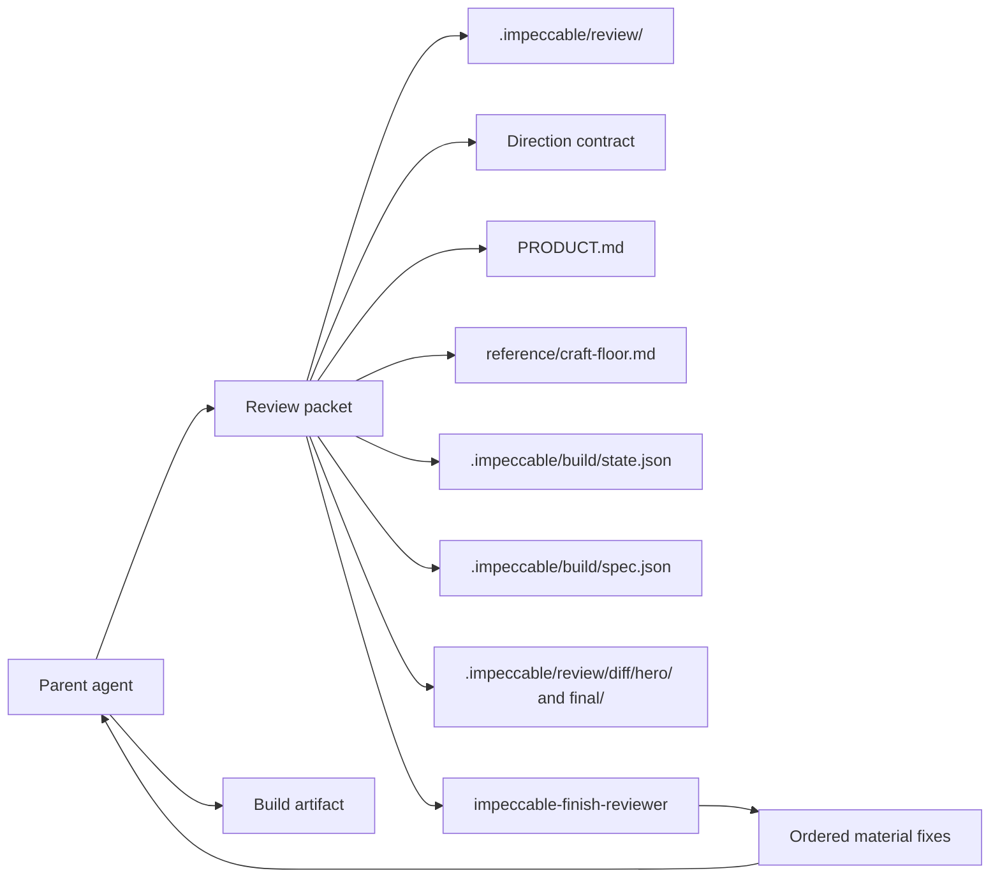
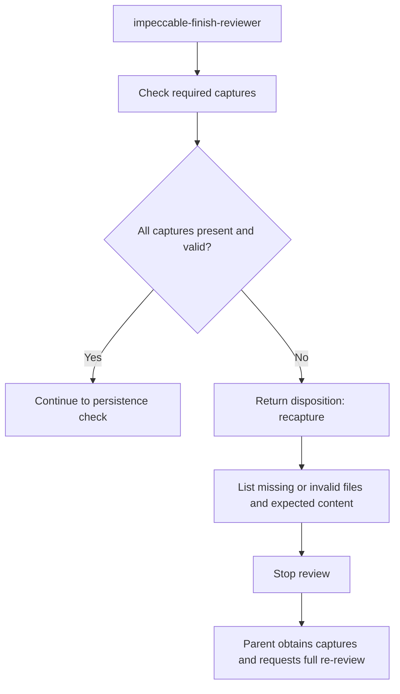
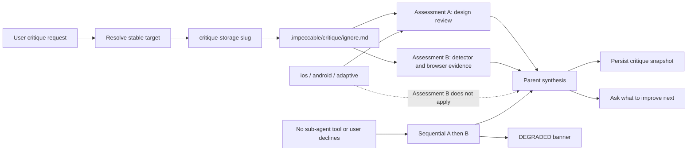

<!-- source: DeepWiki mcp.deepwiki.com · repo pbakaus/impeccable · page 2.5 Craft Floor, Review Agents, and Quality Gates · fetched 2026-10-30 -->

# Craft Floor, Review Agents, and Quality Gates

Relevant source files

The following files were used as context for generating this wiki page:

- [.agents/skills/impeccable/agents/impeccable_finish_reviewer.toml](.agents/skills/impeccable/agents/impeccable_finish_reviewer.toml)
- [.agents/skills/impeccable/reference/craft.md](.agents/skills/impeccable/reference/craft.md)
- [.agents/skills/impeccable/reference/critique.md](.agents/skills/impeccable/reference/critique.md)
- [.agents/skills/impeccable/reference/degraded/finish-reviewer.md](.agents/skills/impeccable/reference/degraded/finish-reviewer.md)
- [.claude/agents/impeccable-finish-reviewer.md](.claude/agents/impeccable-finish-reviewer.md)
- [.claude/skills/impeccable/reference/craft.md](.claude/skills/impeccable/reference/craft.md)
- [.claude/skills/impeccable/reference/critique.md](.claude/skills/impeccable/reference/critique.md)
- [.claude/skills/impeccable/reference/degraded/finish-reviewer.md](.claude/skills/impeccable/reference/degraded/finish-reviewer.md)
- [.cursor/skills/impeccable/reference/craft.md](.cursor/skills/impeccable/reference/craft.md)
- [.cursor/skills/impeccable/reference/critique.md](.cursor/skills/impeccable/reference/critique.md)
- [.cursor/skills/impeccable/reference/degraded/finish-reviewer.md](.cursor/skills/impeccable/reference/degraded/finish-reviewer.md)
- [.gemini/skills/impeccable/reference/craft.md](.gemini/skills/impeccable/reference/craft.md)
- [.gemini/skills/impeccable/reference/critique.md](.gemini/skills/impeccable/reference/critique.md)
- [.gemini/skills/impeccable/reference/degraded/finish-reviewer.md](.gemini/skills/impeccable/reference/degraded/finish-reviewer.md)
- [.github/skills/impeccable/reference/craft.md](.github/skills/impeccable/reference/craft.md)
- [.github/skills/impeccable/reference/critique.md](.github/skills/impeccable/reference/critique.md)
- [.github/skills/impeccable/reference/degraded/finish-reviewer.md](.github/skills/impeccable/reference/degraded/finish-reviewer.md)
- [.grok/agents/impeccable-finish-reviewer.md](.grok/agents/impeccable-finish-reviewer.md)
- [.grok/skills/impeccable/reference/degraded/finish-reviewer.md](.grok/skills/impeccable/reference/degraded/finish-reviewer.md)
- [.kiro/skills/impeccable/reference/craft.md](.kiro/skills/impeccable/reference/craft.md)
- [.kiro/skills/impeccable/reference/critique.md](.kiro/skills/impeccable/reference/critique.md)
- [.kiro/skills/impeccable/reference/degraded/finish-reviewer.md](.kiro/skills/impeccable/reference/degraded/finish-reviewer.md)
- [.opencode/skills/impeccable/reference/craft.md](.opencode/skills/impeccable/reference/craft.md)
- [.opencode/skills/impeccable/reference/critique.md](.opencode/skills/impeccable/reference/critique.md)
- [.opencode/skills/impeccable/reference/degraded/finish-reviewer.md](.opencode/skills/impeccable/reference/degraded/finish-reviewer.md)
- [.pi/skills/impeccable/reference/craft.md](.pi/skills/impeccable/reference/craft.md)
- [.pi/skills/impeccable/reference/critique.md](.pi/skills/impeccable/reference/critique.md)
- [.rovodev/skills/impeccable/reference/craft.md](.rovodev/skills/impeccable/reference/craft.md)
- [.rovodev/skills/impeccable/reference/critique.md](.rovodev/skills/impeccable/reference/critique.md)
- [.trae-cn/skills/impeccable/reference/craft.md](.trae-cn/skills/impeccable/reference/craft.md)
- [.trae-cn/skills/impeccable/reference/critique.md](.trae-cn/skills/impeccable/reference/critique.md)
- [.trae/skills/impeccable/reference/craft.md](.trae/skills/impeccable/reference/craft.md)
- [.trae/skills/impeccable/reference/critique.md](.trae/skills/impeccable/reference/critique.md)
- [plugin/agents/impeccable-finish-reviewer.md](plugin/agents/impeccable-finish-reviewer.md)

## Purpose and scope

This page documents the quality-review behavior visible in the supplied skill references and finish-reviewer agent definition: how `/critique` separates design judgment from detector evidence, what the finish reviewer checks first, and how the workflow handles missing evidence and degraded execution. The supplied material identifies `reference/craft-floor.md` as a required review input, but does not include its contents; therefore its specific bans and quality-floor criteria cannot be enumerated here. [.claude/agents/impeccable-finish-reviewer.md:17-23]() [.claude/skills/impeccable/reference/critique.md:1-16]()

Sources: [.claude/agents/impeccable-finish-reviewer.md:17-23](), [.claude/skills/impeccable/reference/critique.md:1-16]()

## Finish-reviewer contract

The `impeccable-finish-reviewer` agent is a read-only reviewer for a completed build. It returns material fixes for the parent agent to apply; it does not edit the artifact. The agent has `Read`, `Bash`, `Glob`, and `Grep` tools, uses the inherited model, and is configured for high effort with a 30-turn ceiling. [.claude/agents/impeccable-finish-reviewer.md:1-11]()

The reviewer must not use a browser, render the page, start a server, or take screenshots. It reviews the supplied files. Missing expected inputs other than captures are disclosed in one line before the review, after which the reviewer assesses what remains reviewable. Missing or invalid captures are different: they trigger the evidence failure path and prohibit a partial review. [.claude/agents/impeccable-finish-reviewer.md:11-15]()

The input packet may include the original request and confirmed answers, artifact paths, screenshots, the direction contract, `PRODUCT.md`, existing hook or detector findings, and the chosen world’s quality-bar cards. Comp-led reviews additionally receive the approved comp, `.impeccable/build/state.json`, `.impeccable/build/spec.json`, and hero/final diff directories; code-led reviews do not treat a decision comp as an approved comp. Native reviews add platform references and an explicit note that no detector ran. [.claude/agents/impeccable-finish-reviewer.md:17-19]()

| Review input | Role in the review |
|---|---|
| Screenshots | Evidence for required viewports and any user-requested viewport. [.claude/agents/impeccable-finish-reviewer.md:19-23]() |
| Direction contract | Carries `THESIS`, `OWN-WORLD`, `STORY`, `FIRST VIEWPORT`, and `FORM`. [.claude/agents/impeccable-finish-reviewer.md:19]() |
| `PRODUCT.md` | Required by the persistence check. [.claude/agents/impeccable-finish-reviewer.md:24]() |
| Approved comp and comp state | Inputs for comp-led review; code-led builds have no approved comp under this contract. [.claude/agents/impeccable-finish-reviewer.md:19]() |
| `reference/craft-floor.md` | Required review input, but its detailed criteria are not present in the supplied excerpts. [.claude/agents/impeccable-finish-reviewer.md:19]() |
| Platform reference | Added for `ios`, `android`, or `adaptive` review; the reviewer applies the platform’s conventions. [.claude/agents/impeccable-finish-reviewer.md:19]() |

Sources: [.claude/agents/impeccable-finish-reviewer.md:1-19]()

### Finish-review data flow

The reviewer is intentionally separated from the build thread: the parent supplies the review packet, the reviewer produces an ordered report, and the parent applies fixes. When image viewing is available, the reviewer inspects captures, comp, and quality-bar card before reading the direction contract or builder-authored summary, to avoid inheriting omissions from the builder’s framing. [.claude/agents/impeccable-finish-reviewer.md:11-15] [.claude/agents/impeccable-finish-reviewer.md:19]()

**Diagram: finish-review packet mapped to named review entities**

Sources: [.claude/agents/impeccable-finish-reviewer.md:11-19]()

Sources: [.claude/agents/impeccable-finish-reviewer.md:11-19]()

## Finish-review quality gates

### 0. Evidence gate

Evidence is checked before all other review criteria. For web builds, the required viewport set is `desktop.png` and `mobile.png`; native builds require one capture per shipped device class. Captures named by the calling brief are also required, including a reported user viewport such as `user-<width>.png`. [.claude/agents/impeccable-finish-reviewer.md:21-23]()

A capture is invalid if it contains black or blank regions, shows content inconsistent with its filename, omits the document top when claiming to be a full-page capture, or has dimensions inconsistent with the named viewport. A missing required capture fails in the same way as a malformed one. [.claude/agents/impeccable-finish-reviewer.md:23]()

If any required capture is missing or invalid, the reviewer returns `disposition: recapture`, lists the files and what valid captures must show, then stops. It must not produce a scoring review from malformed evidence; after recapture, the parent must request a full review. [.claude/agents/impeccable-finish-reviewer.md:23]()

**Diagram: evidence gate and recapture path**

Sources: [.claude/agents/impeccable-finish-reviewer.md:21-23]()

Sources: [.claude/agents/impeccable-finish-reviewer.md:21-23]()

### 1. Persistence and build-state gate

The reviewer requires `PRODUCT.md`. For comp-led builds, `.impeccable/build/state.json` must exist, and every phase before `review` must be `closed` or explicitly `skipped`; open or failed phases are material findings. [.claude/agents/impeccable-finish-reviewer.md:24]()

A comp-led build whose `comps` phase was not closed or skipped has skipped the comp round, which is a material finding ranked above craft concerns. A phase closed with a `forced` record is also disclosed unless the packet quotes the user explicitly downgrading the comp. Comp-round comps under `.impeccable/mocks/` require an approval record: either the surface brief names the approved comp or its sidecar contains an `approved` flag. `.impeccable/mocks/decision/` is exempt because those files represent the earlier direction round, not an approved comp round. [.claude/agents/impeccable-finish-reviewer.md:24]()

For reproduction evidence, a missing state file or a `hero.gate.score` below `0.72` means reproduction is unproven and is a material finding; `.impeccable/review/hero-repro.png` must exist either way. If `DESIGN.md` predates the build, it should match the built world. For a new world, its absence during finish review is not a finding because the documenter writes it after review. [.claude/agents/impeccable-finish-reviewer.md:24]()

| Condition | Review consequence |
|---|---|
| Missing `PRODUCT.md` | Persistence requirement is not met. [.claude/agents/impeccable-finish-reviewer.md:24]() |
| Earlier comp-led phase is open or failed | Material finding. [.claude/agents/impeccable-finish-reviewer.md:24]() |
| Comp round skipped | Material finding that outranks craft. [.claude/agents/impeccable-finish-reviewer.md:24]() |
| Forced comp phase | Disclose as a material finding unless user downgrade is quoted. [.claude/agents/impeccable-finish-reviewer.md:24]() |
| Comp-round mocks have no approval record | Material finding. [.claude/agents/impeccable-finish-reviewer.md:24]() |
| Hero score is below `0.72`, or state file is missing | Reproduction is unproven; require `hero-repro.png`. [.claude/agents/impeccable-finish-reviewer.md:24]() |
| New-world `DESIGN.md` absent before review | Not a finding; it is written afterward by the documenter. [.claude/agents/impeccable-finish-reviewer.md:24]() |

Sources: [.claude/agents/impeccable-finish-reviewer.md:24]()

## Critique assessment and degraded fallbacks

`critique` resolves one stable target, runs independent design and detector/browser assessments, synthesizes a critique, persists a snapshot, and asks what to improve next. The chat response is the primary deliverable; the snapshot archives the run. [.claude/skills/impeccable/reference/critique.md:1-3]()

On web targets, Assessment A is the design review and Assessment B is detector plus browser evidence. If sub-agent/Task support exists, the assessments must run in isolated sub-agents; Assessment A must finish before detector findings enter the parent synthesis context. They must not see each other’s output. On desktop apps, the two agents run sequentially to avoid competing for the same window, while remaining isolated. [.claude/skills/impeccable/reference/critique.md:5-13] [.claude/skills/impeccable/reference/critique.md:31-44]()

If sub-agents are unavailable—or the user declines where the harness asks—the assessments run sequentially and the report must begin with a `⚠️ DEGRADED: single-context (<reason>)` banner. Skipping the detector is a failed critique unless the detector is missing or crashes after a real attempt, or the target is native. Native platforms run Assessment A only because the detector and browser overlay read web markup; this is the complete native method and does not require a degraded banner. [.claude/skills/impeccable/reference/critique.md:7-16] [.claude/skills/impeccable/reference/critique.md:31-42]()

**Diagram: critique language and code-entity flow**

Sources: [.claude/skills/impeccable/reference/critique.md:1-16](), [.claude/skills/impeccable/reference/critique.md:18-44]()

Sources: [.claude/skills/impeccable/reference/critique.md:1-16](), [.claude/skills/impeccable/reference/critique.md:18-44]()

## Critique and audit heuristics

Assessment A evaluates design specificity before detector results are available, then considers holistic design, cognitive load, emotional journey, and Nielsen heuristics. It returns a specificity verdict, heuristic scores, cognitive-load findings, emotional-journey notes, strengths, priority issues, persona red flags, minor observations, and provocative questions. The supplied excerpt says all ten Nielsen heuristics are scored from 0–4, with `n/a` allowed under the mode-applicability rule. [.claude/skills/impeccable/reference/critique.md:46-57]()

Assessment B runs the bundled detector for markup files or directories and uses browser visualization for viewable targets when browser automation is available. CSS-only files should not be passed to the CLI scan; URL targets skip the CLI scan and use browser visualization. For trees with 500 or more scannable files, narrow the scope or ask. Detector exit code `0` means clean and `2` means findings; if the entrypoint is missing or fails to load, report deterministic scanning as unavailable and continue with browser/manual review. [.claude/skills/impeccable/reference/critique.md:59-77]()

The critique’s report must disclose degraded orchestration. The complete report must precede the final question; alternatively, if questions are skipped, the report must include a literal `Questions skipped: <reason>` line. A run without either close is incomplete. Any critique-only server must run in the background, have a recorded stop method, and be stopped before final reporting unless the user asks to keep it. [.claude/skills/impeccable/reference/critique.md:13-16]()

| Heuristic | Operational rule |
|---|---|
| Design specificity | Judge whether the visual language and interaction are grounded in this product before seeing detector output. [.claude/skills/impeccable/reference/critique.md:48-52]() |
| Holistic design | Consider hierarchy, information architecture, emotional fit, discoverability, composition, typography, color, accessibility, states, copy, and edge cases. [.claude/skills/impeccable/reference/critique.md:51-55]() |
| Cognitive load | Report checklist failures and decision points with more than four visible options. [.claude/skills/impeccable/reference/critique.md:53]() |
| Emotional journey | Consider the peak-end rule, emotional valleys, and reassurance at high-stakes moments. [.claude/skills/impeccable/reference/critique.md:54]() |
| Nielsen heuristics | Score all ten from 0–4, using `n/a` where mode applicability permits. [.claude/skills/impeccable/reference/critique.md:55]() |
| Detector/browser evidence | Run the detector and browser visualization where applicable; do not silently skip the detector. [.claude/skills/impeccable/reference/critique.md:7-14] [.claude/skills/impeccable/reference/critique.md:59-77]() |

Sources: [.claude/skills/impeccable/reference/critique.md:7-16](), [.claude/skills/impeccable/reference/critique.md:46-77]()

### Degraded-review boundaries

A degraded critique is not a silent substitution: the banner identifies single-context execution and its reason. Native-only Assessment A is explicitly not degraded because Assessment B does not apply. If detector execution is unavailable after a real attempt, the report identifies deterministic scanning as unavailable and continues with browser/manual evidence where possible. [.claude/skills/impeccable/reference/critique.md:7-14] [.claude/skills/impeccable/reference/critique.md:31-42] [.claude/skills/impeccable/reference/critique.md:59-77]()

The finish reviewer has a separate fallback boundary: missing non-capture inputs are disclosed while review proceeds on available material, but any missing or malformed required capture stops the review and requires recapture. The finish reviewer also has a hard turn ceiling; if it ends before its contracted sections are written, it returns nothing. [.claude/agents/impeccable-finish-reviewer.md:13-15] [.claude/agents/impeccable-finish-reviewer.md:23]()

Sources: [.claude/skills/impeccable/reference/critique.md:7-14](), [.claude/skills/impeccable/reference/critique.md:31-42](), [.claude/skills/impeccable/reference/critique.md:59-77](), [.claude/agents/impeccable-finish-reviewer.md:13-15](), [.claude/agents/impeccable-finish-reviewer.md:23]()

## Agent coverage and documented limits

The supplied finish-reviewer definition identifies the documenter as responsible for writing `DESIGN.md` after review for a new world. It also names `reference/craft-floor.md` and platform-specific references as review inputs. [.claude/agents/impeccable-finish-reviewer.md:19-24]()

The supplied files do not include the contents of `reference/craft-floor.md`, the asset producer or manual-edit-applier agent definitions, or the degraded finish-reviewer references. Consequently, this page cannot state their specific bans, quality-floor thresholds, asset-production behavior, manual-edit application rules, or degraded-agent procedures without inventing details. The available finish-reviewer excerpt establishes only the reviewer’s input contract, evidence behavior, and first persistence check; later finish-review checks are not included in that excerpt. [.claude/agents/impeccable-finish-reviewer.md:1-24]()

Sources: [.claude/agents/impeccable-finish-reviewer.md:1-24]()

---

