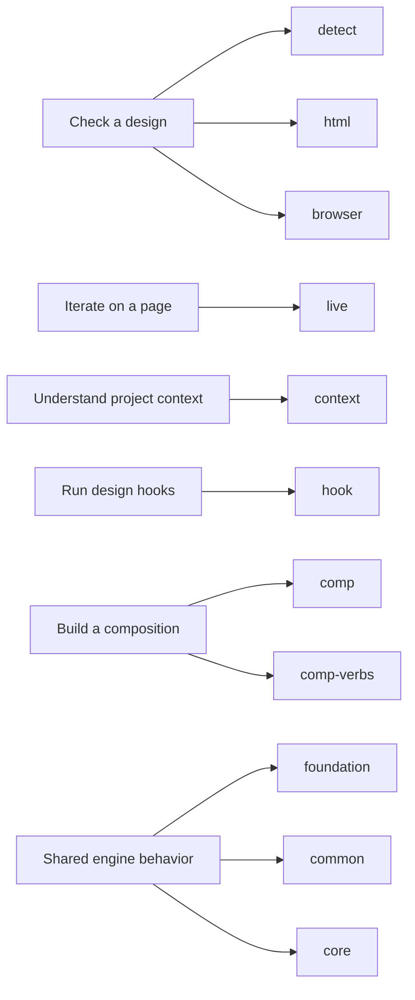
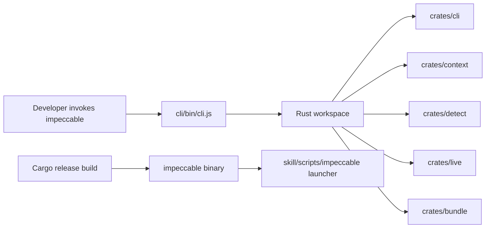

<!-- source: DeepWiki mcp.deepwiki.com · repo pbakaus/impeccable · page 3 Rust Engine Architecture · fetched 2026-10-30 -->

# Rust Engine Architecture

Relevant source files

The following files were used as context for generating this wiki page:

- [.claude-plugin/marketplace.json](.claude-plugin/marketplace.json)
- [.claude-plugin/plugin.json](.claude-plugin/plugin.json)
- [Cargo.lock](Cargo.lock)
- [Cargo.toml](Cargo.toml)
- [ENGINE_VERSION](ENGINE_VERSION)
- [bun.lock](bun.lock)
- [crates/cli/src/lib.rs](crates/cli/src/lib.rs)
- [crates/cli/src/main.rs](crates/cli/src/main.rs)
- [crates/cli/src/reviewed_entry.rs](crates/cli/src/reviewed_entry.rs)
- [crates/cli/tests/text_only_entry.rs](crates/cli/tests/text_only_entry.rs)
- [crates/context/src/telemetry.rs](crates/context/src/telemetry.rs)
- [crates/live/src/bake.rs](crates/live/src/bake.rs)
- [crates/live/src/browser_assets.rs](crates/live/src/browser_assets.rs)
- [crates/live/src/browser_open.rs](crates/live/src/browser_open.rs)
- [crates/live/src/instructions.rs](crates/live/src/instructions.rs)
- [crates/live/src/live_accept.rs](crates/live/src/live_accept.rs)
- [crates/live/src/live_poll.rs](crates/live/src/live_poll.rs)
- [docs/PLAN-REVIEW.md](docs/PLAN-REVIEW.md)
- [package.json](package.json)
- [scripts/lib/zip.js](scripts/lib/zip.js)
- [skill/scripts/VERSION](skill/scripts/VERSION)
- [skill/scripts/impeccable](skill/scripts/impeccable)
- [skill/scripts/impeccable.cmd](skill/scripts/impeccable.cmd)
- [tests/cli-shim.test.mjs](tests/cli-shim.test.mjs)
- [tests/launcher-download.test.mjs](tests/launcher-download.test.mjs)
- [tests/oracle/cases/live-accept.mjs](tests/oracle/cases/live-accept.mjs)
- [tests/oracle/golden/cli-version.json](tests/oracle/golden/cli-version.json)
- [tests/oracle/golden/live-daemon-server-status-poll-complete.json](tests/oracle/golden/live-daemon-server-status-poll-complete.json)

## Purpose and scope

This page gives a high-level map of the Rust engine workspace and its role in Impeccable. It connects the workspace’s crate names to the system areas they support, and summarizes how the engine is built and reached through the launcher. Detailed CLI, context, and distribution behavior is covered in the child pages. [Cargo.toml:1-26]()

Sources: [Cargo.toml:1-26]()

## Workspace at a glance

The root Cargo manifest defines a Rust 2021 workspace whose members are discovered under `crates/*`. It declares shared path dependencies for `foundation`, `common`, `core`, `detect`, `html`, `browser`, `live`, `context`, `hook`, `comp`, `comp-verbs`, and `bundle`; the workspace membership pattern also includes other crates under `crates/`. [Cargo.toml:4-26]()

| Workspace area | Crates and role at a glance |
|---|---|
| Shared foundations | `foundation`, `common`, `core` |
| Detection and page analysis | `detect`, `html`, `browser` |
| Runtime features | `live`, `context`, `hook` |
| Composition workflow | `comp`, `comp-verbs` |
| Engine interfaces and packaging | `skills`, `wasm`, `cli`, `bundle`, `xtask` |

The crate groupings above are an architectural orientation, not a complete dependency graph. The manifest establishes workspace membership and shared dependencies; consult the relevant child pages for crate-level behavior. [Cargo.toml:4-26]()

Sources: [Cargo.toml:4-26]()

## From design intent to code entities

The following map associates user-facing concepts with workspace names. It is a guide for locating implementation areas, not a claim about the internal call sequence. The workspace manifest identifies the shared crate names; the project’s CLI package exposes the `impeccable` executable through `cli/bin/cli.js`. [Cargo.toml:14-26]()[package.json:37-43]()

**Diagram: Design and analysis concepts mapped to crates**

Sources: [Cargo.toml:14-25]()

**Diagram: User-facing engine entry points mapped to code entities**

The npm manifest maps the `impeccable` command to `cli/bin/cli.js`. The Cargo manifest describes a release build of package `impeccable` as producing the engine binary used by the launcher. [package.json:37-43]()[Cargo.toml:1-6]()

Sources: [package.json:37-43](), [Cargo.toml:1-6]()

## Build and launcher relationship

The Cargo workspace is versioned `0.1.16`, and its release profile enables optimization, link-time optimization, stripping, and abort-on-panic behavior. The root manifest’s comment identifies `cargo build --release -p impeccable` as the engine build and names `skill/scripts/impeccable` as its launcher. [Cargo.toml:1-3]()[Cargo.toml:8-12]()[Cargo.toml:33-38]()

The Windows launcher checks for an explicit `IMPECCABLE_BIN`, then a sibling engine binary, then a validated user binary or version-pinned cache; if those paths do not supply an engine, it attempts a download and verifies it against a SHA-256 sidecar before execution. [skill/scripts/impeccable.cmd:12-19]()[skill/scripts/impeccable.cmd:25-53]()[skill/scripts/impeccable.cmd:64-68]()[skill/scripts/impeccable.cmd:110-145]()

For details on command behavior, see [CLI Contract and Verb Dispatch](#3.1). For project context and state handling, see [Context, Doctor, and Project State](#3.2). For build, launcher, and distribution details, see [Engine Build, Launcher, and Distribution](#3.3).

Sources: [Cargo.toml:1-3](), [Cargo.toml:8-12](), [Cargo.toml:33-38](), [skill/scripts/impeccable.cmd:12-19](), [skill/scripts/impeccable.cmd:25-53](), [skill/scripts/impeccable.cmd:64-68](), [skill/scripts/impeccable.cmd:110-145]()

---

