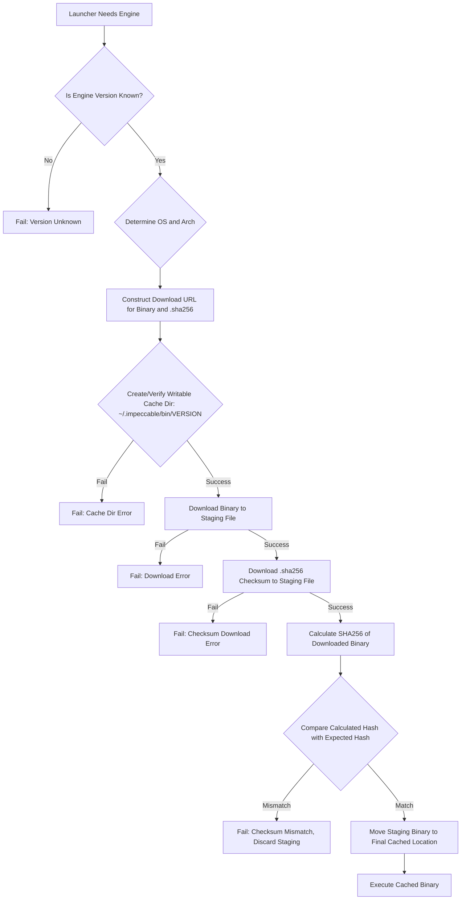

<!-- source: DeepWiki mcp.deepwiki.com · repo pbakaus/impeccable · page 3.3 Engine Build, Launcher, and Distribution · fetched 2026-10-30 -->

# Engine Build, Launcher, and Distribution

<details>
<summary>Relevant source files</summary>

The following files were used as context for generating this wiki page:

- [.agent/skills/impeccable/scripts/VERSION](.agent/skills/impeccable/scripts/VERSION)
- [.agents/skills/impeccable/scripts/VERSION](.agents/skills/impeccable/scripts/VERSION)
- [.claude/skills/impeccable/scripts/VERSION](.claude/skills/impeccable/scripts/VERSION)
- [.cursor/skills/impeccable/scripts/VERSION](.cursor/skills/impeccable/scripts/VERSION)
- [.gemini/skills/impeccable/scripts/VERSION](.gemini/skills/impeccable/scripts/VERSION)
- [.github/skills/impeccable/scripts/VERSION](.github/skills/impeccable/scripts/VERSION)
- [.github/workflows/release-engine.yml](.github/workflows/release-engine.yml)
- [.github/workflows/sheriff.yml](.github/workflows/sheriff.yml)
- [.grok/skills/impeccable/scripts/VERSION](.grok/skills/impeccable/scripts/VERSION)
- [.hermes/skills/impeccable/scripts/VERSION](.hermes/skills/impeccable/scripts/VERSION)
- [.kiro/skills/impeccable/scripts/VERSION](.kiro/skills/impeccable/scripts/VERSION)
- [.opencode/skills/impeccable/scripts/VERSION](.opencode/skills/impeccable/scripts/VERSION)
- [.pi/skills/impeccable/scripts/VERSION](.pi/skills/impeccable/scripts/VERSION)
- [crates/live/src/bake.rs](crates/live/src/bake.rs)
- [crates/live/src/browser_assets.rs](crates/live/src/browser_assets.rs)
- [crates/live/src/browser_open.rs](crates/live/src/browser_open.rs)
- [crates/live/src/instructions.rs](crates/live/src/instructions.rs)
- [crates/live/src/live_accept.rs](crates/live/src/live_accept.rs)
- [crates/live/src/live_poll.rs](crates/live/src/live_poll.rs)
- [crates/skills/Cargo.toml](crates/skills/Cargo.toml)
- [crates/skills/src/bundle_signature.rs](crates/skills/src/bundle_signature.rs)
- [crates/skills/src/lib.rs](crates/skills/src/lib.rs)
- [docs/BUNDLE-SIGNING.md](docs/BUNDLE-SIGNING.md)
- [docs/WINDOWS-SIGNING.md](docs/WINDOWS-SIGNING.md)
- [scripts/bundle-signing-keys.json](scripts/bundle-signing-keys.json)
- [scripts/github/sheriff.mjs](scripts/github/sheriff.mjs)
- [scripts/release.mjs](scripts/release.mjs)
- [skill/scripts/impeccable](skill/scripts/impeccable)
- [skill/scripts/impeccable.cmd](skill/scripts/impeccable.cmd)
- [tests/github-sheriff.test.mjs](tests/github-sheriff.test.mjs)
- [tests/launcher-download.test.mjs](tests/launcher-download.test.mjs)
- [tests/oracle/cases/live-accept.mjs](tests/oracle/cases/live-accept.mjs)
- [tests/oracle/golden/live-daemon-server-status-poll-complete.json](tests/oracle/golden/live-daemon-server-status-poll-complete.json)
- [tests/release-engine-workflow.test.js](tests/release-engine-workflow.test.js)

</details>


This page details the build, distribution, and update mechanisms for the Impeccable engine. It covers how the `ENGINE_VERSION` is managed, the role of launcher scripts (`skill/scripts/impeccable` and `skill/scripts/impeccable.cmd`), the process of downloading and caching engine binaries, the `IMPECCABLE_BIN` environment variable, platform-specific packages, bundle signing, and the overall release workflows.

## Engine Versioning

The core engine's version is defined in the `ENGINE_VERSION` file at the repository root. This version dictates which engine binary the launcher scripts will attempt to download and use. Separately, each skill provider directory (e.g., `.claude/skills/impeccable/scripts/VERSION`, `.cursor/skills/impeccable/scripts/VERSION`) also contains a `VERSION` file. This file specifies the version of the skill itself, which is distinct from the engine version.

The `scripts/release.mjs` script uses `ENGINE_VERSION` for engine releases and the respective manifest files for skill, CLI, and extension releases [scripts/release.mjs:73-79]().

Sources:
* [ENGINE_VERSION]()
* [.claude/skills/impeccable/scripts/VERSION]()
* [.cursor/skills/impeccable/scripts/VERSION]()
* [.gemini/skills/impeccable/scripts/VERSION]()
* [.grok/skills/impeccable/scripts/VERSION]()
* [.hermes/skills/impeccable/scripts/VERSION]()
* [.opencode/skills/impeccable/scripts/VERSION]()
* [.pi/skills/impeccable/scripts/VERSION]()
* [.agent/skills/impeccable/scripts/VERSION]()
* [.agents/skills/impeccable/scripts/VERSION]()
* [.github/skills/impeccable/scripts/VERSION]()
* [.kiro/skills/impeccable/scripts/VERSION]()
* [scripts/release.mjs:73-79]()

## Launcher Scripts

The Impeccable CLI uses platform-specific launcher scripts to locate and execute the engine binary. These scripts are `skill/scripts/impeccable` for Unix-like systems and `skill/scripts/impeccable.cmd` for Windows.

### Launcher Logic

Both launchers follow a specific search order to find the engine binary:

1.  **`IMPECCABLE_BIN` Environment Variable**: If `IMPECCABLE_BIN` is set and points to an executable, it is used directly [skill/scripts/impeccable:41-43](), [skill/scripts/impeccable.cmd:25-28](). This allows developers or advanced users to override the default engine location.
2.  **Sibling Binary**: The launcher checks for a platform-specific binary located next to the script itself (e.g., `skill/scripts/bin/darwin-arm64/impeccable`) [skill/scripts/impeccable:57-66](), [skill/scripts/impeccable.cmd:31-34]().
3.  **User Home Directory Binary**: It looks for an unversioned `impeccable` binary in the user's home directory (`~/.impeccable/bin/impeccable` or `%USERPROFILE%\.impeccable\bin\impeccable.exe`) [skill/scripts/impeccable:72-74](), [skill/scripts/impeccable.cmd:37-43](). This binary is validated using an `engine-probe` handshake to ensure it's a compatible Impeccable engine and not an older CLI version [skill/scripts/impeccable:16-25](), [skill/scripts/impeccable.cmd:38-41]().
4.  **Version-Pinned Cache**: The launcher checks for a version-specific binary in the user's cache directory (`~/.impeccable/bin/<version>/impeccable` or `%USERPROFILE%\.impeccable\bin\<version>\impeccable.exe`) [skill/scripts/impeccable:76-81](), [skill/scripts/impeccable.cmd:46-53](). The version is read from `skill/scripts/VERSION` [skill/scripts/impeccable:77](), [skill/scripts/impeccable.cmd:47]().
5.  **`PATH` Environment Variable**: Finally, it attempts to find `impeccable` in the system's `PATH` [skill/scripts/impeccable:83-85](), [skill/scripts/impeccable.cmd:56-62](). This candidate is also validated with the `engine-probe` handshake.

If none of the above locations yield a valid engine binary, the launcher proceeds to download it.

### Engine Probe Handshake

The `engine-probe` command is a lightweight mechanism to verify if a given executable is a compatible Impeccable engine. When executed with `engine-probe`, a valid engine will print "impeccable-engine <version>" and exit successfully [skill/scripts/impeccable:20-22](). This prevents the launcher from executing older, incompatible versions of the CLI that might share the same binary name.

### Environment Variables for Engine

The launcher sets and exports crucial environment variables for the engine:
*   `IMPECCABLE_SKILL_DIR`: Points to the root directory of the skill, allowing the engine to locate reference documentation and command metadata [skill/scripts/impeccable:37]().
*   `IMPECCABLE_SELF`: The path to the launcher script itself, used for self-referencing in command output [skill/scripts/impeccable:38]().

These variables are exported before any `exec` call to ensure the engine always has access to them [skill/scripts/impeccable:35-39]().

#### Launcher Flow Diagram

```mermaid
graph TD
    A[Start Launcher] --> B{Is IMPECCABLE_BIN set and executable?};
    B -- Yes --> C[Execute IMPECCABLE_BIN];
    B -- No --> D{Is sibling binary present and executable?};
    D -- Yes --> E[Execute sibling binary];
    D -- No --> F{Is ~/.impeccable/bin/impeccable present and passes probe?};
    F -- Yes --> G[Execute ~/.impeccable/bin/impeccable];
    F -- No --> H{Is version-pinned cache binary present and executable?};
    H -- Yes --> I[Execute version-pinned cache binary];
    H -- No --> J{Is 'impeccable' on PATH and passes probe?};
    J -- Yes --> K[Execute 'impeccable' from PATH];
    J -- No --> L[Download Engine Binary];
    C --> M[End];
    E --> M;
    G --> M;
    I --> M;
    K --> M;
    L --> N[Execute Downloaded Binary];
    N --> M;

    subgraph Probe Logic
        P[Candidate Binary] --> Q{Execute "candidate engine-probe"};
        Q -- Output "impeccable-engine*" --> R[Probe OK];
        Q -- Other output/Error --> S[Probe Failed];
    end
```
Sources:
* [skill/scripts/impeccable:16-25]()
* [skill/scripts/impeccable:35-39]()
* [skill/scripts/impeccable:41-43]()
* [skill/scripts/impeccable:57-66]()
* [skill/scripts/impeccable:72-74]()
* [skill/scripts/impeccable:76-81]()
* [skill/scripts/impeccable:83-85]()
* [skill/scripts/impeccable.cmd:25-28]()
* [skill/scripts/impeccable.cmd:31-34]()
* [skill/scripts/impeccable.cmd:37-43]()
* [skill/scripts/impeccable.cmd:38-41]()
* [skill/scripts/impeccable.cmd:46-53]()
* [skill/scripts/impeccable.cmd:47]()
* [skill/scripts/impeccable.cmd:56-62]()

## Binary Download and Caching

If the engine binary is not found through the search order, the launcher attempts to download it from the GitHub releases page.

### Download Process

1.  **Determine Platform**: The launcher identifies the operating system (`os`) and architecture (`arch`) [skill/scripts/impeccable:45-55](), [skill/scripts/impeccable.cmd:22-23]().
2.  **Construct URL**: The download URL is formed using `IMPECCABLE_DOWNLOAD_BASE` (defaulting to `https://github.com/pbakaus/impeccable/releases/download`), the engine version (`engine-v<VERSION>`), and the platform-specific asset name (e.g., `impeccable-darwin-arm64`) [skill/scripts/impeccable:122-125](), [skill/scripts/impeccable.cmd:100-101]().
3.  **Cache Directory Creation**: The launcher ensures the version-specific cache directory (`~/.impeccable/bin/<version>`) exists and is writable [skill/scripts/impeccable:133-144](), [skill/scripts/impeccable.cmd:73-76]().
4.  **Staging Download**: The binary is first downloaded to a temporary staging file (e.g., `.impeccable.part.<PID>`) within the cache directory [skill/scripts/impeccable:126](), [skill/scripts/impeccable.cmd:92-95](). This prevents partial or corrupted files from being used.
5.  **Download Tool**: `curl` or `wget` is used for downloading [skill/scripts/impeccable:95-102](), [skill/scripts/impeccable.cmd:70-71]().
6.  **Windows ARM64 Fallback**: On Windows ARM64, if the `arm64` asset is not found, the launcher attempts to download the `x64` asset, as Windows on ARM can run x64 binaries [skill/scripts/impeccable:148-152](), [skill/scripts/impeccable.cmd:104-107]().

### Integrity Verification

After downloading, the binary's integrity is verified:
1.  **SHA256 Checksum Download**: The corresponding `.sha256` checksum file is downloaded from the same release URL [skill/scripts/impeccable:160-162](), [skill/scripts/impeccable.cmd:117-118]().
2.  **Local Checksum Calculation**: The launcher calculates the SHA256 hash of the downloaded binary [skill/scripts/impeccable:163-166](), [skill/scripts/impeccable.cmd:127-128]().
3.  **Comparison**: The calculated hash is compared against the expected hash from the `.sha256` file. If they don't match, or if the checksum file cannot be obtained, the download is refused [skill/scripts/impeccable:167-170](), [skill/scripts/impeccable.cmd:136-139]().
4.  **Atomicity**: If verification succeeds, the staged file is atomically moved to its final `cached` location [skill/scripts/impeccable:171-172](), [skill/scripts/impeccable.cmd:136]().

### Error Handling

The download process includes robust error handling for network issues, write permissions, empty files, and checksum mismatches [skill/scripts/impeccable:104-116](), [skill/scripts/impeccable:133-144](), [skill/scripts/impeccable.cmd:75-76](), [skill/scripts/impeccable.cmd:155-164]().

#### Download and Cache Flow Diagram


Sources:
* [skill/scripts/impeccable:45-55]()
* [skill/scripts/impeccable:95-102]()
* [skill/scripts/impeccable:104-116]()
* [skill/scripts/impeccable:122-125]()
* [skill/scripts/impeccable:126]()
* [skill/scripts/impeccable:133-144]()
* [skill/scripts/impeccable:148-152]()
* [skill/scripts/impeccable:160-162]()
* [skill/scripts/impeccable:163-166]()
* [skill/scripts/impeccable:167-170]()
* [skill/scripts/impeccable:171-172]()
* [skill/scripts/impeccable.cmd:22-23]()
* [skill/scripts/impeccable.cmd:70-71]()
* [skill/scripts/impeccable.cmd:73-76]()
* [skill/scripts/impeccable.cmd:75-76]()
* [skill/scripts/impeccable.cmd:92-95]()
* [skill/scripts/impeccable.cmd:100-101]()
* [skill/scripts/impeccable.cmd:104-107]()
* [skill/scripts/impeccable.cmd:117-118]()
* [skill/scripts/impeccable.cmd:127-128]()
* [skill/scripts/impeccable.cmd:136]()
* [skill/scripts/impeccable.cmd:136-139]()
* [skill/scripts/impeccable.cmd:155-164]()
* [tests/launcher-download.test.mjs:1-286]()

## Platform Packages under `cli/`

The `cli/` directory contains the `package.json` for the npm CLI package. While the core engine is a Rust binary, the npm package serves as a convenient distribution method. The `package.json` defines dependencies on platform-specific `@impeccable/cli-<os>-<arch>` packages. These packages are essentially empty wrappers whose sole purpose is to trigger the download of the correct engine binary via the `postinstall` script or to provide the launcher scripts.

The `scripts/release.mjs` script handles the release of the `cli` component, which includes publishing to npm [scripts/release.mjs:43-57](). It also enforces a release order, ensuring the engine binaries and their platform packages are published *before* the main CLI package [scripts/release.mjs:48-51](), [scripts/release.mjs:136-154]().

Sources:
* [cli/package.json]()
* [scripts/release.mjs:43-57]()
* [scripts/release.mjs:48-51]()
* [scripts/release.mjs:136-154]()

## Bundle Signing

For security and trust, certain distributed artifacts, particularly the Windows engine binary, are digitally signed.

### Windows Binary Signing

The Windows engine binary (`impeccable.exe`) is signed as part of the release workflow. This process occurs in the `.github/workflows/release-engine.yml` workflow:
1.  **Build**: The `build` job compiles the engine for `x86_64-pc-windows-msvc` [.github/workflows/release-engine.yml:30-31]().
2.  **Sign**: The `sign-windows` job downloads the unsigned Windows binary [.github/workflows/release-engine.yml:71-74](). It then uses Azure Artifact Signing to apply a digital signature [.github/workflows/release-engine.yml:83-99](). This involves OIDC authentication with Azure and specifying the signing account and certificate profile.
3.  **Verification**: After signing, the signature is verified using PowerShell to ensure it's valid, from the expected publisher ("Renaissance Geek, Inc."), and includes a timestamp [.github/workflows/release-engine.yml:101-115]().
4.  **Upload Signed Artifact**: The signed binary is then uploaded as an artifact for the `publish` job [.github/workflows/release-engine.yml:117-120]().

This signing process ensures that users can trust the origin and integrity of the Windows executable.

### Other Bundle Signing

While the primary focus is on Windows binaries, the codebase also includes infrastructure for signing other bundles. The `crates/skills/src/bundle_signature.rs` module likely contains logic for generating and verifying signatures for skill bundles or other distributed assets. The `scripts/bundle-signing-keys.json` file would hold the public keys or metadata required for such verification. The `signReleaseBundle` function in `scripts/release.mjs` is responsible for applying these signatures to release artifacts [scripts/release.mjs:22]().

Sources:
* [.github/workflows/release-engine.yml:30-31]()
* [.github/workflows/release-engine.yml:71-74]()
* [.github/workflows/release-engine.yml:83-99]()
* [.github/workflows/release-engine.yml:101-115]()
* [.github/workflows/release-engine.yml:117-120]()
* [crates/skills/src/bundle_signature.rs]()
* [docs/BUNDLE-SIGNING.md]()
* [docs/WINDOWS-SIGNING.md]()
* [scripts/bundle-signing-keys.json]()
* [scripts/release.mjs:22]()

## Release Workflows

The release process for Impeccable components is orchestrated by the `scripts/release.mjs` script and GitHub Actions workflows.

### `scripts/release.mjs`

This script is the primary tool for tagging and publishing GitHub releases for independently versioned components: `skill`, `cli`, `extension`, and `engine` [scripts/release.mjs:2-3]().

Key features of `release.mjs`:
*   **Component Configuration**: Defines release parameters for each component, including manifest paths, tag prefixes, changelog labels, build commands, and artifacts [scripts/release.mjs:27-79]().
*   **Version Reading**: Extracts the version from the component's manifest file (e.g., `package.json` for CLI, `extension/manifest.json` for extension) [scripts/release.mjs:121-125]().
*   **Pre-release Checks**:
    *   **Dirty Tree**: Refuses to proceed if the Git working tree is dirty [scripts/release.mjs:163-166]().
    *   **Unpushed HEAD**: Checks if the current HEAD has been pushed to the remote [scripts/release.mjs:174-177]().
    *   **Changelog Entry**: Verifies that a corresponding entry exists in `CHANGELOG.md` for the new version [scripts/release.mjs:185-200]().
    *   **Skill Build Drift**: For the `skill` component, it reruns `bun run build:release` and fails if the generated harness directories drift from what is committed [scripts/release.mjs:168-172]().
*   **Engine Gating (Release Order)**: For `skill` and `cli` components, it enforces that the engine release for the pinned `ENGINE_VERSION` is fully published (binaries and npm platform packages) before allowing their release [scripts/release.mjs:136-154](). This prevents users from installing a CLI or skill that cannot find its engine.
*   **Tagging and Pushing**: Creates a Git tag (e.g., `skill-v1.2.3`) and pushes it to the remote [scripts/release.mjs:250-251]().
*   **GitHub Release Creation**: Creates a GitHub Release, attaching artifacts and the changelog entry [scripts/release.mjs:260-261]().
*   **Post-Release Hints**: Provides instructions for subsequent steps, like `npm publish` for the CLI or uploading extension zips [scripts/release.mjs:53-56](), [scripts/release.mjs:68-70]().

### Engine Release Workflow (`.github/workflows/release-engine.yml`)

This GitHub Actions workflow is triggered by a push of a tag matching `engine-v*` [.github/workflows/release-engine.yml:12-13](). This tag is pushed by `scripts/release.mjs` when releasing the `engine` component.

The workflow performs the following steps:
1.  **Tag Verification**: Ensures the pushed tag matches the version specified in `ENGINE_VERSION` [.github/workflows/release-engine.yml:36-40]().
2.  **Matrix Build**: Builds the engine binary for all supported targets (macOS ARM64/x64, Linux MUSL x64/ARM64, Windows x64) using a build matrix [.github/workflows/release-engine.yml:20-31]().
3.  **Toolchain Setup**: Installs the pinned Rust toolchain and target-specific dependencies (e.g., `musl-tools` for Linux MUSL builds) [.github/workflows/release-engine.yml:41-47]().
4.  **Build**: Compiles the `impeccable` crate in release mode for each target [.github/workflows/release-engine.yml:49-50]().
5.  **Smoke Test**: Runs `engine-probe` on non-cross-compiled binaries to ensure they are functional [.github/workflows/release-engine.yml:52-54]().
6.  **Artifact Upload (Unsigned)**: Uploads the built binaries as artifacts. The Windows binary is uploaded as `unsigned-windows-x64` [.github/workflows/release-engine.yml:55-60]().
7.  **Windows Signing**: The `sign-windows` job (detailed in Bundle Signing) signs the Windows executable [.github/workflows/release-engine.yml:62-120]().
8.  **Publish**: The `publish` job downloads all built and signed artifacts [.github/workflows/release-engine.yml:122-131](). It then lays out the release assets with their SHA256 checksums [.github/workflows/release-engine.yml:132-141](). Finally, it publishes these assets to the GitHub Release corresponding to the `engine-v*` tag [.github/workflows/release-engine.yml:143-147]().

### Sheriff Workflow (`.github/workflows/sheriff.yml`)

The `sheriff.yml` workflow is responsible for maintaining the health of pull requests and issues. While not directly part of the release process, it ensures that PRs are reviewed and merged efficiently, which indirectly supports timely releases. It runs on a schedule or can be dispatched manually [.github/workflows/sheriff.yml:7-12]().

Key functions:
*   **Issue Triage**: Marks new or reopened issues with a "needs triage" label [.github/workflows/sheriff.yml:33-45]().
*   **PR Management**: Evaluates pull requests based on age, labels, comments, and commit activity [scripts/github/sheriff.mjs:146-174]().
    *   **Stale Warnings**: Warns contributors about PRs waiting for their action after a configurable number of days [tests/github-sheriff.test.mjs:17-34]().
    *   **Auto-Closing**: Closes inactive PRs after a further period [tests/github-sheriff.test.mjs:38-54]().
    *   **Label Management**: Adds or removes labels like "waiting on contributor", "needs maintainer review", "ready to merge", and various "blocked" states [scripts/github/sheriff.mjs:21-33]().
    *   **Maintainer Commands**: Responds to `/sheriff wait` commands from maintainers to explicitly mark a PR as waiting on contributor [tests/github-sheriff.test.mjs:167-181]().

Sources:
* [.github/workflows/release-engine.yml:12-13]()
* [.github/workflows/release-engine.yml:20-31]()
* [.github/workflows/release-engine.yml:36-40]()
* [.github/workflows/release-engine.yml:41-47]()
* [.github/workflows/release-engine.yml:49-50]()
* [.github/workflows/release-engine.yml:52-54]()
* [.github/workflows/release-engine.yml:55-60]()
* [.github/workflows/release-engine.yml:62-120]()
* [.github/workflows/release-engine.yml:122-131]()
* [.github/workflows/release-engine.yml:132-141]()
* [.github/workflows/release-engine.yml:143-147]()
* [.github/workflows/sheriff.yml:7-12]()
* [.github/workflows/sheriff.yml:33-45]()
* [scripts/github/sheriff.mjs:21-33]()
* [scripts/github/sheriff.mjs:146-174]()
* [scripts/release.mjs:2-3]()
* [scripts/release.mjs:27-79]()
* [scripts/release.mjs:53-56]()
* [scripts/release.mjs:68-70]()
* [scripts/release.mjs:121-125]()
* [scripts/release.mjs:136-154]()
* [scripts/release.mjs:163-166]()
* [scripts/release.mjs:168-172]()
* [scripts/release.mjs:174-177]()
* [scripts/release.mjs:185-200]()
* [scripts/release.mjs:250-251]()
* [scripts/release.mjs:260-261]()
* [tests/github-sheriff.test.mjs:17-34]()
* [tests/github-sheriff.test.mjs:38-54]()
* [tests/github-sheriff.test.mjs:167-181]()
* [tests/release-engine-workflow.test.js]()

---

