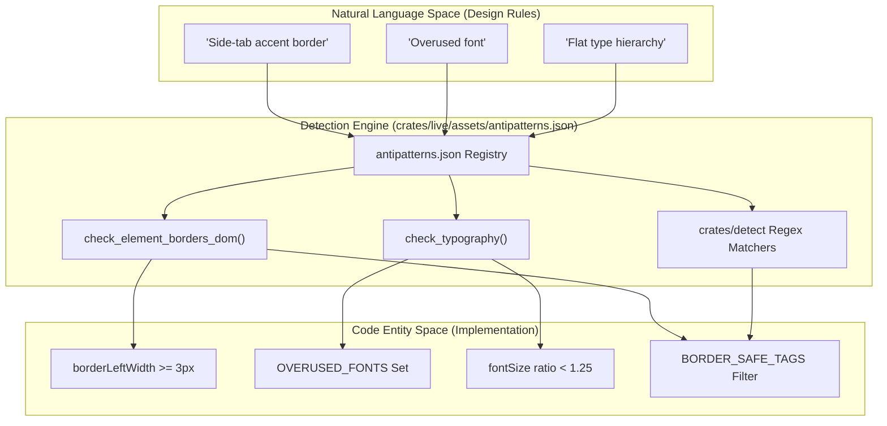
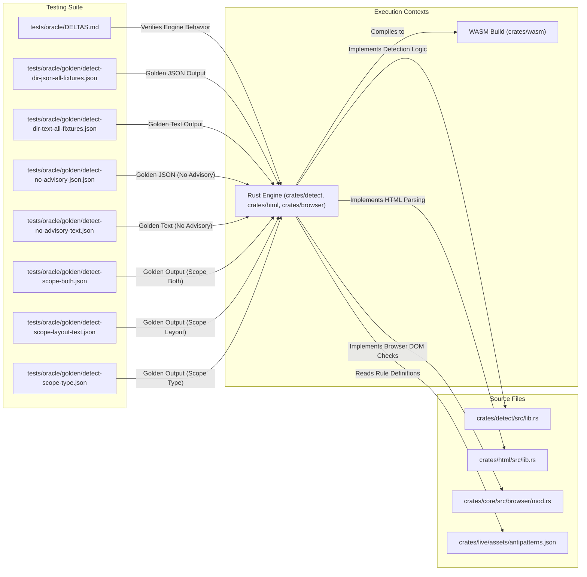

<!-- source: DeepWiki mcp.deepwiki.com · repo pbakaus/impeccable · page 4 Anti-Pattern Detection Engine · fetched 2026-10-30 -->

# Anti-Pattern Detection Engine

Relevant source files

The following files were used as context for generating this wiki page:

- [crates/core/src/browser/element_checks.rs](crates/core/src/browser/element_checks.rs)
- [crates/core/src/browser/page_checks.rs](crates/core/src/browser/page_checks.rs)
- [crates/core/src/browser/quality.rs](crates/core/src/browser/quality.rs)
- [crates/detect/src/list_rules.rs](crates/detect/src/list_rules.rs)
- [crates/detect/tests/list_rules.rs](crates/detect/tests/list_rules.rs)
- [crates/foundation/src/registry.rs](crates/foundation/src/registry.rs)
- [crates/html/src/quality.rs](crates/html/src/quality.rs)
- [crates/live/assets/antipatterns.json](crates/live/assets/antipatterns.json)
- [crates/live/assets/detect-antipatterns-browser.js](crates/live/assets/detect-antipatterns-browser.js)
- [tests/oracle/DELTAS.md](tests/oracle/DELTAS.md)
- [tests/oracle/golden/detect-dir-json-all-fixtures.json](tests/oracle/golden/detect-dir-json-all-fixtures.json)
- [tests/oracle/golden/detect-dir-quiet-all-fixtures.json](tests/oracle/golden/detect-dir-quiet-all-fixtures.json)
- [tests/oracle/golden/detect-dir-text-all-fixtures.json](tests/oracle/golden/detect-dir-text-all-fixtures.json)
- [tests/oracle/golden/detect-list-rules-json.json](tests/oracle/golden/detect-list-rules-json.json)
- [tests/oracle/golden/detect-list-rules-quiet.json](tests/oracle/golden/detect-list-rules-quiet.json)
- [tests/oracle/golden/detect-list-rules.json](tests/oracle/golden/detect-list-rules.json)
- [tests/oracle/golden/detect-no-advisory-json.json](tests/oracle/golden/detect-no-advisory-json.json)
- [tests/oracle/golden/detect-no-advisory-text.json](tests/oracle/golden/detect-no-advisory-text.json)
- [tests/oracle/golden/detect-scope-both.json](tests/oracle/golden/detect-scope-both.json)
- [tests/oracle/golden/detect-scope-layout-text.json](tests/oracle/golden/detect-scope-layout-text.json)
- [tests/oracle/golden/detect-scope-type.json](tests/oracle/golden/detect-scope-type.json)

The Anti-Pattern Detection Engine is a multi-mode automated system designed to identify design "slop" and quality issues in web interfaces. It powers the Impeccable CLI, the Chrome DevTools extension, and the automated audit skills. The engine uses a combination of static analysis (regex), DOM-tree inspection (JSDOM), and full browser rendering (Puppeteer) to detect deterministic anti-patterns ranging from "AI-slop" tells to core accessibility and typography failures [crates/live/assets/antipatterns.json:1-171]().

### System Overview

The engine is built as a universal JavaScript module that adapts its detection strategy based on the environment (Node.js vs. Browser). It is designed to be highly resilient, handling modern CSS features like OKLCH colors, CSS variables, and complex layout properties that typically break standard DOM parsers [crates/live/assets/detect-antipatterns-browser.js:12-15]().

#### Detection Modes

| Mode | Environment | Technology | Capabilities |
| :--- | :--- | :--- | :--- |
| **Regex Text** | Node.js | `crates/detect` | Scans non-HTML source code (CSS, JSX, TSX, Vue, Svelte) for patterns. For details, see [Text and Static HTML Engines](#4.2). |
| **Static HTML/CSS** | Node.js | `crates/html` | Parses HTML and CSS using a custom cascade builder. Resolves linked stylesheets and catches anti-patterns without requiring a full browser. For details, see [Text and Static HTML Engines](#4.2). |
| **Full Browser** | Browser / CDP | `crates/browser` | Measures real layout and computed styles in a live browser context. Essential for rules requiring layout metrics like `getBoundingClientRect`. For details, see [Browser Engine and DOM Measurement](#4.3). |

Sources: [crates/live/assets/detect-antipatterns-browser.js:1-143]()

### Logic and Data Flow

The following diagram illustrates how the engine bridges high-level design "Anti-Patterns" (Natural Language Space) to specific code checks and constants (Code Entity Space).

**Detection Pipeline and Entity Mapping**

Sources: [crates/live/assets/antipatterns.json:1-171](), [crates/core/src/browser/element_checks.rs:117-173](), [crates/core/src/browser/page_checks.rs:115-126](), [crates/core/src/browser/quality.rs:66-70]()

### Core Components

#### Rule Registry and Catalog
The core engine features a centralized rule registry defined in `crates/foundation/src/registry.rs` and exposed via `antipatterns.json` [crates/live/assets/antipatterns.json:1-171](). This registry defines every rule, its category (slop vs. quality), and its metadata. The `impeccable detect --list-rules` command outputs this catalog [crates/detect/src/list_rules.rs:1-10](). For details, see [Rule Registry and Catalog](#4.1).

#### Text and Static HTML Engines
The engine provides two static analysis modes. The text engine (`crates/detect`) uses regex matchers to scan various file types for anti-patterns. The static HTML engine (`crates/html`) builds a cascade of styles and analyzes the DOM without a browser. For details, see [Text and Static HTML Engines](#4.2).

#### Browser Engine and DOM Measurement
For rules requiring precise layout and computed style information, the browser engine (`crates/browser`) is used. This engine leverages the Chrome DevTools Protocol (CDP) to interact with a headless browser, capturing DOM snapshots and performing measurements. The `detect-antipatterns-browser.js` bundle [crates/live/assets/detect-antipatterns-browser.js:1-11]() contains the browser-side logic. For details, see [Browser Engine and DOM Measurement](#4.3).

#### Check Implementations: Typography, Color, Layout
The anti-pattern checks cover a wide range of design issues, including typography (e.g., `flat-type-hierarchy` [crates/core/src/browser/page_checks.rs:26-30]()), color (e.g., contrast, brand palette checks), and layout (e.g., `nested-cards`, `cramped-padding` [crates/core/src/browser/quality.rs:1-2]()). These checks are implemented across `crates/core/src/browser/quality.rs`, `crates/core/src/browser/element_checks.rs`, and `crates/core/src/browser/page_checks.rs`. For details, see [Check Implementations: Typography, Color, Layout](#4.4).

#### Design Hooks
The `crates/hook` module provides mechanisms for integrating the detection engine into development workflows. This includes `before-edit` and `stop` hooks that can trigger scans and provide feedback to developers or AI agents. For details, see [Design Hooks](#4.5).

### Integration with Codebase

The engine is deeply integrated with the testing infrastructure to prevent false positives in complex CSS scenarios, such as ensuring `blockquote` and `nav` tags are exempt from certain side-border warnings [crates/core/src/browser/element_checks.rs:117-121](). The `tests/oracle` directory contains golden records for various detection scenarios, ensuring deterministic behavior across engine versions [tests/oracle/DELTAS.md:37-77]().

**Test and Environment Relationship**

Sources: [tests/oracle/DELTAS.md:37-77](), [tests/oracle/golden/detect-dir-json-all-fixtures.json:1-1](), [tests/oracle/golden/detect-dir-text-all-fixtures.json:1-2](), [tests/oracle/golden/detect-no-advisory-json.json:1-1](), [tests/oracle/golden/detect-no-advisory-text.json:1-2](), [tests/oracle/golden/detect-scope-both.json:1-1](), [crates/detect/src/lib.rs:1-1](), [crates/html/src/lib.rs:1-1](), [crates/core/src/browser/mod.rs:1-1](), [crates/live/assets/antipatterns.json:1-171]()

---

