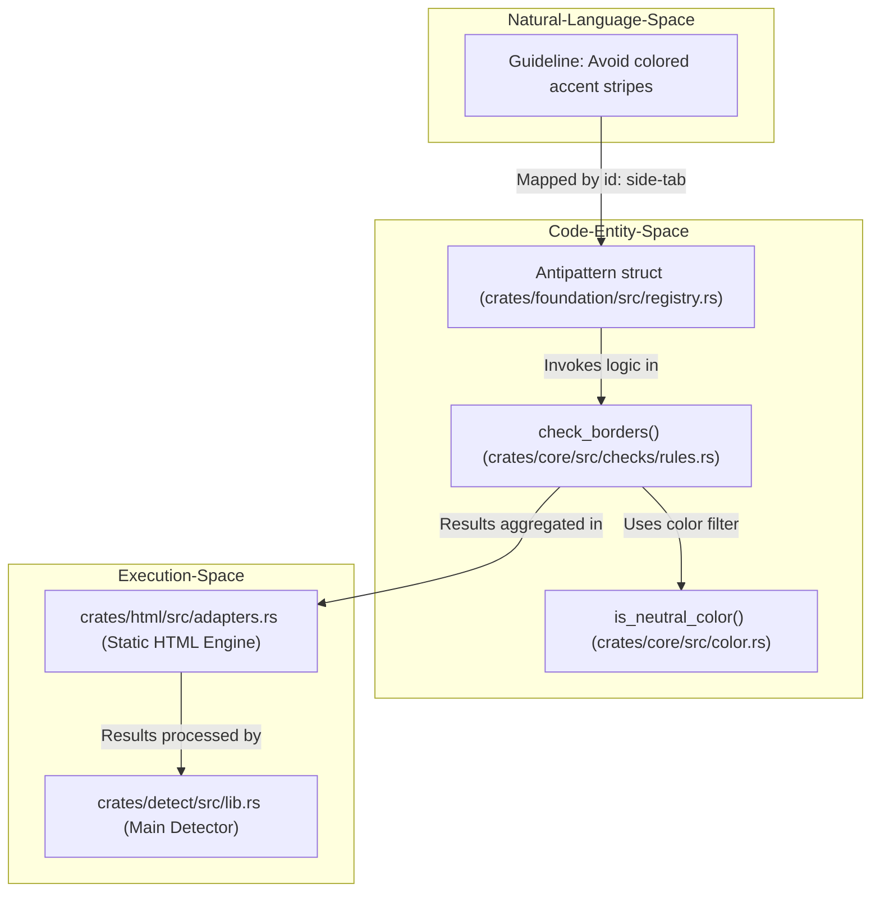
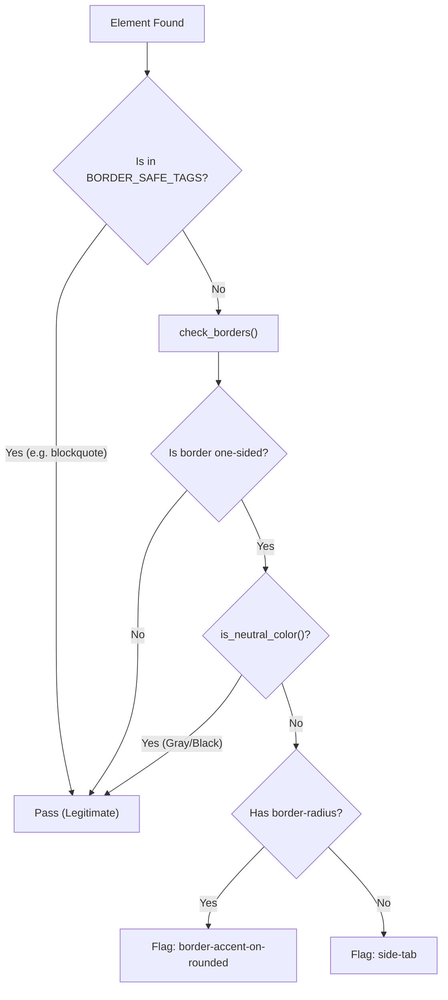

<!-- source: DeepWiki mcp.deepwiki.com · repo pbakaus/impeccable · page 4.1 Rule Registry and Catalog · fetched 2026-10-30 -->

# Rule Registry and Catalog

<details>
<summary>Relevant source files</summary>

The following files were used as context for generating this wiki page:

- [crates/core/src/checks/measures.rs](crates/core/src/checks/measures.rs)
- [crates/core/src/checks/rules.rs](crates/core/src/checks/rules.rs)
- [crates/core/src/checks/vectors_a.rs](crates/core/src/checks/vectors_a.rs)
- [crates/detect/src/list_rules.rs](crates/detect/src/list_rules.rs)
- [crates/detect/tests/list_rules.rs](crates/detect/tests/list_rules.rs)
- [crates/foundation/src/css/measures.rs](crates/foundation/src/css/measures.rs)
- [crates/foundation/src/registry.rs](crates/foundation/src/registry.rs)
- [crates/foundation/src/rules/types.rs](crates/foundation/src/rules/types.rs)
- [crates/html/src/adapters.rs](crates/html/src/adapters.rs)
- [crates/live/assets/antipatterns.json](crates/live/assets/antipatterns.json)
- [tests/oracle/golden/detect-list-rules-json.json](tests/oracle/golden/detect-list-rules-json.json)
- [tests/oracle/golden/detect-list-rules-quiet.json](tests/oracle/golden/detect-list-rules-quiet.json)
- [tests/oracle/golden/detect-list-rules.json](tests/oracle/golden/detect-list-rules.json)

</details>


This page documents the rule registry, which defines the anti-patterns detected by Impeccable. It covers rule IDs, severities, categories, scopes, and how these rules are exposed and managed within the system. The registry is central to how Impeccable identifies design "tells" and quality issues in user interfaces.

## Detection Infrastructure

The catalog is implemented as a static array `ANTIPATTERNS` within the detection engine [crates/foundation/src/registry.rs:32-993](). Each entry maps a visual anti-pattern to a deterministic detection strategy.

### Detection Modes
1.  **Regex (Static Analysis):** Scans raw source code for class names and inline styles.
2.  **Static HTML (Structural):** Simulates a DOM environment to analyze element relationships and computed styles from internal/external stylesheets [crates/html/src/adapters.rs:1-6]().
3.  **Browser (Visual):** Uses a headless browser to perform layout-dependent checks like `getBoundingClientRect()` for spacing and line-length.
4.  **LLM-Only:** Patterns that require semantic understanding (e.g., "Lazy Impact" copy) are flagged via the `/critique` skill rather than the deterministic engine.

### Data Flow: Natural Language to Code Entity
The following diagram illustrates how a design concept (e.g., "Side-tab") moves from a human-readable guideline into a code-executable check.

**Concept-to-Code Mapping**

Sources: [crates/foundation/src/registry.rs:32-42](), [crates/core/src/checks/rules.rs:270-270](), [crates/html/src/adapters.rs:27-36]()

---

## The Catalog

The rule registry is defined by the `Antipattern` struct [crates/foundation/src/registry.rs:14-29]() and the `ANTIPATTERNS` static array [crates/foundation/src/registry.rs:32-993](). Each entry includes an `id`, `category`, optional `scopes`, `severity`, `name`, `description`, and optional `skill_section` and `skill_guideline`.

### Rule IDs, Severities, Categories, and Scopes

Each rule is uniquely identified by an `id` (e.g., "side-tab").
The `category` field groups rules into broader themes, such as "slop" or "quality".
The `scopes` field indicates the design aspects the rule applies to, such as "type" for typography or "layout" for layout issues.
The `severity` field can be "error" (default if `None`) or "advisory". Advisory findings are less critical and might be waived.

**Example Antipattern Entry**
```json
{
  "id": "side-tab",
  "category": "slop",
  "scopes": null,
  "severity": null,
  "name": "Side-tab accent border",
  "description": "Thick colored border on one side of a card — the most recognizable tell of AI-generated UIs. Use a subtler accent or remove it entirely.",
  "skill_section": "Visual Details",
  "skill_guideline": "colored accent stripe"
}
```
Sources: [crates/foundation/src/registry.rs:33-42](), [crates/live/assets/antipatterns.json:3-6]()

### Advisory vs. Primary Findings

Rules can have a `severity` of `advisory` [crates/foundation/src/registry.rs:22-23](). These are typically less severe issues that might be acceptable in certain contexts or require human judgment. Rules without an explicit `severity` are considered primary findings (defaulting to "warning"). The `RuleHit` struct also allows for a per-finding `severity` override [crates/foundation/src/rules/types.rs:45-46]().

### `--list-rules` Output

The `impeccable detect --list-rules` command provides a way to inspect the entire catalog of rules.

-   **Default Output:** Lists rules grouped by category, showing their ID, name, and severity if advisory.
    ```text
    slop
      side-tab
      border-accent-on-rounded
      overused-font
      bounce-easing  (advisory)
    ...
    ```
    Sources: [tests/oracle/golden/detect-list-rules.json:1-7](), [crates/detect/tests/list_rules.rs:24-36]()
-   **`--quiet` Output:** Prints only the rule IDs, one per line.
    ```text
    side-tab
    border-accent-on-rounded
    overused-font
    bounce-easing
    ...
    ```
    Sources: [tests/oracle/golden/detect-list-rules-quiet.json:2-2](), [crates/detect/tests/list_rules.rs:50-63]()
-   **`--json` Output:** Provides the full rule catalog as a JSON array.
    ```json
    [
      {
        "id": "side-tab",
        "category": "slop",
        "name": "Side-tab accent border",
        "description": "Thick colored border on one side of a card — the most recognizable tell of AI-generated UIs. Use a subtler accent or remove it entirely."
      },
      ...
    ]
    ```
    Sources: [tests/oracle/golden/detect-list-rules-json.json:1-7](), [crates/detect/tests/list_rules.rs:39-48]()
-   **Filtering:** The `--scope <scope_name>` and `--no-advisory` flags can filter the output [crates/detect/tests/list_rules.rs:94-111]().

### `antipatterns.json` Asset

The `crates/live/assets/antipatterns.json` file contains a subset of the rule registry, primarily used for client-side display or integration with other tools. It mirrors the core `Antipattern` structure but might omit some fields like `skill_section` or `skill_guideline` [crates/live/assets/antipatterns.json:1-6](). This JSON asset is a direct representation of the `ANTIPATTERNS` data.

## Implementation Details

### Rule Definition and Storage

The `Antipattern` struct [crates/foundation/src/registry.rs:14-29]() defines the schema for each rule. The `ANTIPATTERNS` static array [crates/foundation/src/registry.rs:32-993]() holds all the built-in rules. This array is initialized once and is immutable.

### Rule Extension

The registry supports extension points via the `extend` function, allowing rule packs to register their own rules without shadowing built-in IDs [crates/foundation/src/registry.rs:1-8](). This mechanism ensures that custom rules can be added while maintaining the integrity of the core catalog.

### Rule Evaluation Flow

The detection process involves various checks implemented in `crates/core/src/checks/rules.rs` and `crates/html/src/adapters.rs`. These checks take `StyleMap` implementations (e.g., `StyleRef` for `StyleValues` [crates/html/src/adapters.rs:55-61]()) to read computed styles and determine if a rule is violated.

**Rule Evaluation Process**
```mermaid
graph TD
    A[Input: HTML/CSS/DOM] --> B{Engine Selection: Regex, Static HTML, Browser}
    B -- Static HTML --> C[crates/html/src/adapters.rs]
    C --> D{Call Rule Check Functions (e.g., check_borders)}
    D --> E[crates/core/src/checks/rules.rs]
    E --> F{Evaluate against Antipatterns (crates/foundation/src/registry.rs)}
    F --> G{Generate RuleHit (crates/foundation/src/rules/types.rs)}
    G --> H[Output: List of Findings]

    subgraph "Rule Check Details (Example: check_borders)"
        I[Input: Element, Styles, Options] --> J{is_rounded_away_from_side()}
        J --> K{is_tab_context_element()}
        K --> L{is_status_context_element()}
        L --> M[Return RuleHit if conditions met]
    end

    D --> I
```
Sources: [crates/html/src/adapters.rs:27-36](), [crates/core/src/checks/rules.rs:270-270](), [crates/foundation/src/registry.rs:32-993](), [crates/foundation/src/rules/types.rs:35-47](), [crates/html/src/adapters.rs:105-126](), [crates/html/src/adapters.rs:129-132]()

### The Border Detection Pipeline
The `side-tab` detection must distinguish between a "slop" border (on a card) and a "legitimate" border (on a blockquote or nav item). The engine uses `check_borders` [crates/core/src/checks/rules.rs:270-270]() which considers `BORDER_SAFE_TAGS` [crates/core/src/constants.rs:1-1]() to avoid false positives.

**Detection Logic Flow**

Sources: [crates/core/src/checks/rules.rs:270-270](), [crates/core/src/checks/rules.rs:48-54](), [crates/core/src/color.rs:1-1]()

### Neutral Color and Modern CSS
The `is_neutral_color` utility [crates/core/src/color.rs:1-1]() ensures that structural borders (gray dividers) aren't flagged as AI slop. It handles modern color formats like `oklch`, `lab`, and `lch` by checking chroma. Low-chroma colors are treated as neutral. The engine also attempts to resolve CSS variables for accurate color and length measurements [crates/foundation/src/css/measures.rs:71-71]().
Sources: [crates/core/src/color.rs:1-1](), [crates/foundation/src/css/measures.rs:71-71]()

---

