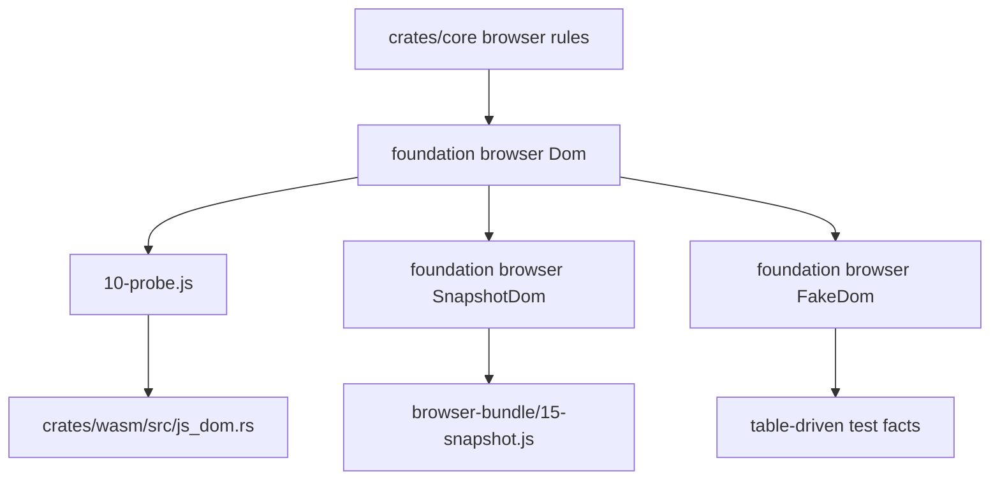

<!-- source: DeepWiki mcp.deepwiki.com · repo pbakaus/impeccable · page 4.3 Browser Engine and DOM Measurement · fetched 2026-10-30 -->

# Browser Engine and DOM Measurement

<details>
<summary>Relevant source files</summary>

The following files were used as context for generating this wiki page:

- [browser-bundle/10-probe.js](browser-bundle/10-probe.js)
- [browser-bundle/15-snapshot.js](browser-bundle/15-snapshot.js)
- [crates/browser/src/cdp.rs](crates/browser/src/cdp.rs)
- [crates/browser/src/consent.rs](crates/browser/src/consent.rs)
- [crates/browser/src/fullpage.rs](crates/browser/src/fullpage.rs)
- [crates/browser/src/lib.rs](crates/browser/src/lib.rs)
- [crates/browser/src/overlays.rs](crates/browser/src/overlays.rs)
- [crates/browser/src/screenshot_contrast.rs](crates/browser/src/screenshot_contrast.rs)
- [crates/browser/src/snapshot_engine.rs](crates/browser/src/snapshot_engine.rs)
- [crates/browser/src/validity.rs](crates/browser/src/validity.rs)
- [crates/browser/tests/consent_hiding.rs](crates/browser/tests/consent_hiding.rs)
- [crates/browser/tests/evidence.rs](crates/browser/tests/evidence.rs)
- [crates/browser/tests/fullpage_screenshot.rs](crates/browser/tests/fullpage_screenshot.rs)
- [crates/browser/tests/overlay_hiding.rs](crates/browser/tests/overlay_hiding.rs)
- [crates/browser/tests/pixel_pass_identity.rs](crates/browser/tests/pixel_pass_identity.rs)
- [crates/browser/tests/recall_and_gates.rs](crates/browser/tests/recall_and_gates.rs)
- [crates/browser/tests/shadow_trees.rs](crates/browser/tests/shadow_trees.rs)
- [crates/cli/src/asset_capture.rs](crates/cli/src/asset_capture.rs)
- [crates/cli/src/capture_service.rs](crates/cli/src/capture_service.rs)
- [crates/cli/src/capture_snapshot.rs](crates/cli/src/capture_snapshot.rs)
- [crates/cli/src/component_capture.rs](crates/cli/src/component_capture.rs)
- [crates/cli/src/entry_capture.rs](crates/cli/src/entry_capture.rs)
- [crates/cli/src/raster_coverage.js](crates/cli/src/raster_coverage.js)
- [crates/cli/tests/entry_capture.rs](crates/cli/tests/entry_capture.rs)
- [crates/core/src/browser/driver.rs](crates/core/src/browser/driver.rs)
- [crates/core/src/browser/painted.rs](crates/core/src/browser/painted.rs)
- [crates/core/src/browser/visual.rs](crates/core/src/browser/visual.rs)
- [crates/detect/src/engines.rs](crates/detect/src/engines.rs)
- [crates/foundation/src/browser/dom.rs](crates/foundation/src/browser/dom.rs)
- [crates/foundation/src/browser/fake_dom.rs](crates/foundation/src/browser/fake_dom.rs)
- [crates/foundation/src/browser/snapshot.rs](crates/foundation/src/browser/snapshot.rs)
- [crates/wasm/src/js_dom.rs](crates/wasm/src/js_dom.rs)
- [docs/NATIVE-CAPTURE.md](docs/NATIVE-CAPTURE.md)
- [tests/fixtures/consent/after-scroll-probe-banner.html](tests/fixtures/consent/after-scroll-probe-banner.html)
- [tests/fixtures/consent/held-fixed-banner.html](tests/fixtures/consent/held-fixed-banner.html)
- [tests/fixtures/consent/hidden-host-wall.html](tests/fixtures/consent/hidden-host-wall.html)
- [tests/fixtures/consent/html-root-banner.html](tests/fixtures/consent/html-root-banner.html)
- [tests/fixtures/consent/late-closed-attr-banner.html](tests/fixtures/consent/late-closed-attr-banner.html)
- [tests/fixtures/consent/late-closed-banner.html](tests/fixtures/consent/late-closed-banner.html)
- [tests/fixtures/consent/late-inline-banner.html](tests/fixtures/consent/late-inline-banner.html)
- [tests/fixtures/consent/shadow-app-page.html](tests/fixtures/consent/shadow-app-page.html)
- [tests/fixtures/consent/shadow-contents-wall.html](tests/fixtures/consent/shadow-contents-wall.html)
- [tests/fixtures/overlays/preloader-locked-modal.html](tests/fixtures/overlays/preloader-locked-modal.html)
- [tests/fixtures/overlays/preloader-locked.html](tests/fixtures/overlays/preloader-locked.html)
- [tests/fixtures/overlays/preloader-pass-through.html](tests/fixtures/overlays/preloader-pass-through.html)
- [tests/fixtures/validity/press-and-hold-faded.html](tests/fixtures/validity/press-and-hold-faded.html)

</details>


## Purpose and scope

This page documents how Impeccable measures browser-rendered pages for detection: the `Dom` interface and its implementations, the live-page probe and serialized snapshots, the browser-bundle capture contract, and the CDP-driven scan lifecycle. It also covers page validity checks, consent and overlay handling, paint gating, and screenshot capture. [crates/foundation/src/browser/dom.rs:1-15](), [crates/browser/src/lib.rs:1-35]()

Sources: [crates/foundation/src/browser/dom.rs:1-15](), [crates/browser/src/lib.rs:1-35]()

## Architecture at a glance

The browser engine separates **measurement** from **rule decisions**. The live probe or snapshot producer supplies facts; the shared Rust core evaluates the rules against a `Dom` implementation. A snapshot can defer hit-test facts that are only knowable after the rules ask for particular points. The browser crate handles page loading or CDP attachment, validity checks, hiding known layers, snapshot evaluation, and evidence capture. [crates/foundation/src/browser/dom.rs:1-15](), [crates/foundation/src/browser/snapshot.rs:1-41](), [crates/browser/src/lib.rs:1-35]()

**Diagram: Browser scan from page input to findings and evidence**

```mermaid
flowchart LR
    Input["URL or existing CDP page"] --> Driver["BrowserEngine"]
    Driver --> Validity["validity"]
    Validity -->| "valid page" | Hide["consent and overlay hiding"]
    Validity -->| "challenge, HTTP error, consent-only wall" | Refuse["scan error"]
    Hide --> Capture["browser-bundle measurement"]
    Capture --> Snapshot["SnapshotDom"]
    Snapshot --> Core["collect_browser_findings"]
    Core --> Needs["SnapshotDom::take_needs"]
    Needs --> Answer["SnapshotDom::add_facts from live page"]
    Answer --> Core
    Core --> Findings["serialized findings"]
    Capture --> Evidence["captures, hit-test answers, rects, screenshot"]
```

Sources: [crates/browser/src/lib.rs:18-35](), [crates/browser/src/lib.rs:53-60](), [crates/foundation/src/browser/snapshot.rs:26-41]()

### Natural-language concepts mapped to code entities

| System concept | Code entity | Role |
|---|---|---|
| “A browser-backed URL scan” | `BrowserEngine::detect_url_scan` | Runs a URL scan using the `networkidle0` lifecycle and zero settle delay. [crates/browser/src/lib.rs:117-124]() |
| “Scan an already-running application” | `BrowserEngine::detect_cdp_scan` → `attach::detect_cdp` | Attaches through a DevTools endpoint rather than navigating a newly launched browser. [crates/browser/src/lib.rs:126-133]() |
| “Measurements the rules consume” | `Dom` | Abstracts document, element, tree, text, and geometry reads. [crates/foundation/src/browser/dom.rs:82-159]() |
| “A live DOM probe” | `10-probe.js` and `crates/wasm/src/js_dom.rs` | The snapshot module identifies these as the in-page probe and its WASM-side `Dom` implementation. [crates/foundation/src/browser/snapshot.rs:1-9]() |
| “Capture facts for a CSP-restricted page” | `15-snapshot.js` → `SnapshotDom` | Captures measurements in the page world, sends JSON to the core, and lets the core answer DOM questions from the snapshot. [crates/foundation/src/browser/snapshot.rs:3-9](), [browser-bundle/15-snapshot.js:1-17]() |
| “Deterministic DOM test data” | `FakeDom` | An in-memory, table-driven implementation for rule tests. [crates/foundation/src/browser/fake_dom.rs:1-7]() |

Sources: [crates/browser/src/lib.rs:117-133](), [crates/foundation/src/browser/dom.rs:82-159](), [crates/foundation/src/browser/snapshot.rs:1-9](), [browser-bundle/15-snapshot.js:1-17](), [crates/foundation/src/browser/fake_dom.rs:1-7]()

## The `Dom` measurement contract

`Dom` is the common measurement surface for browser rules. Element handles are opaque `u32` values, with `0` reserved as an invalid handle. The trait is shaped around the browser APIs the rule code needs: its methods mirror calls such as `getComputedStyle`, `closest`, and document hit testing, while selector operations can return `SelectorError` to preserve invalid-selector behavior. [crates/foundation/src/browser/dom.rs:10-19](), [crates/foundation/src/browser/dom.rs:82-108](), [crates/foundation/src/browser/dom.rs:126-159]()

| Measurement area | Representative `Dom` methods | Use |
|---|---|---|
| Document and viewport | `document_element`, `body`, `inner_width`, `inner_height`, `scroll_x`, `scroll_y`, `hostname` | Establish page roots and window-level context. [crates/foundation/src/browser/dom.rs:82-96]() |
| Selection and hit testing | `query_all`, `query_one`, `matches`, `closest`, `element_from_point`, `elements_from_point` | Find elements, test selectors, and determine what is at a point. [crates/foundation/src/browser/dom.rs:87-100](), [crates/foundation/src/browser/dom.rs:141-144]() |
| Element tree | `tag_name`, `namespace_uri`, `parent`, `children`, sibling accessors, `contains` | Walk structure and relationships. [crates/foundation/src/browser/dom.rs:126-144]() |
| Attributes and text | `attr`, `id_prop`, `class_name_prop`, `text_content`, `inner_text` | Read element identity and textual content. [crates/foundation/src/browser/dom.rs:146-159]() |
| Pattern input and CSS | `document_html_for_patterns`, `linked_stylesheet_text`, `keyframes` | Provide serialized HTML and stylesheet/keyframe facts used by checks. [crates/foundation/src/browser/dom.rs:103-124]() |

`Rect` models a `getBoundingClientRect()` result and stores both origin/size and edge values. `Rect::all_finite` checks the edges and dimensions for finite values. The trait’s `document_html_for_patterns` contract removes `[id^="impeccable-live-"]` nodes from the cloned document HTML, while `linked_stylesheet_text` defaults to an empty string when CSSOM access is unavailable. [crates/foundation/src/browser/dom.rs:21-59](), [crates/foundation/src/browser/dom.rs:116-124]()

Sources: [crates/foundation/src/browser/dom.rs:10-19](), [crates/foundation/src/browser/dom.rs:21-59](), [crates/foundation/src/browser/dom.rs:82-159]()

### Natural-language concepts mapped to code entities: DOM providers

**Diagram: One rule interface, three measurement providers**



Sources: [crates/foundation/src/browser/dom.rs:1-15](), [crates/foundation/src/browser/snapshot.rs:1-9](), [crates/foundation/src/browser/fake_dom.rs:1-7](), [browser-bundle/15-snapshot.js:1-17]()

## Live probing: `JsDom` and `10-probe.js`

The live measurement path keeps browser-specific reads in JavaScript and runs rule logic in Rust. The `Dom` documentation identifies the in-page probe as `10-probe.js` and the WASM implementation as `crates/wasm/src/js_dom.rs`; element handles index a JavaScript-side registry. Rules therefore call the shared trait rather than embedding browser API access in every check. [crates/foundation/src/browser/dom.rs:1-15]()

The snapshot contract describes `10-probe.js` as measuring on demand. This live-probe model is distinct from `15-snapshot.js`, which captures the measurements once and serializes them for use where WASM cannot run alongside the page. [crates/foundation/src/browser/snapshot.rs:1-9](), [browser-bundle/15-snapshot.js:1-8]()

Sources: [crates/foundation/src/browser/dom.rs:1-15](), [crates/foundation/src/browser/snapshot.rs:1-9](), [browser-bundle/15-snapshot.js:1-8]()

## Snapshot capture and deferred facts

`SnapshotDom` implements the `Dom` surface over a serialized page snapshot. This makes it possible to measure in the page’s content-script world, send the captured data as JSON, and run the same rule core elsewhere—for example, in an extension offscreen document when the page’s CSP prevents WebAssembly execution in the page context. The browser crate documents its URL engine as injecting only the plain-JavaScript snapshot producer and running the rule core natively over `SnapshotDom`; this avoids requiring `Page.setBypassCSP`. [crates/foundation/src/browser/snapshot.rs:1-9](), [crates/browser/src/lib.rs:1-11]()

The capture includes the element tree and text nodes; attributes; selected computed styles; pseudo-element styles; placeholder color; bounding rectangles and client/scroll/offset metrics; visibility; direct-text rectangles; viewport, scroll, hostname, and quirks-mode facts; `body.innerText`; keyframes; document HTML; media intrinsics; animation and transition properties; and open shadow trees. The capture’s style-property list is the shared contract represented by `STYLE_PROPS` in Rust and `__SNAP_STYLE_PROPS` in the bundle. [crates/foundation/src/browser/snapshot.rs:11-24](), [crates/foundation/src/browser/snapshot.rs:59-64](), [browser-bundle/15-snapshot.js:19-22]()

Some rule inputs cannot be captured until the rules specify what they need. Hit testing is deferred: a snapshot miss records the point in `SnapshotDom::take_needs`; the live page answers those points; `SnapshotDom::add_facts` adds the returned facts; and the core reruns. The documented process is deterministic and reaches a fixpoint, commonly within a small number of rounds. Selector matching instead runs against the snapshot through the selector implementation. [crates/foundation/src/browser/snapshot.rs:26-36]()

If a rule requests a computed-style property that was not captured, the snapshot returns an empty string and records the property in `unknown_style_props`. This provides a way for parity testing to detect a capture contract that is missing a property. [crates/foundation/src/browser/snapshot.rs:38-41]()

| Snapshot data or operation | Capture/consumer contract |
|---|---|
| Computed styles | `STYLE_PROPS` is the property list read per element; the bundle is expected to keep its corresponding list aligned. [crates/foundation/src/browser/snapshot.rs:59-64](), [browser-bundle/15-snapshot.js:19-22]() |
| Pseudo-elements | `PSEUDO_PROPS` specifies the properties recorded for `::before` and `::after` when their content is set. [crates/foundation/src/browser/snapshot.rs:204-206](), [browser-bundle/15-snapshot.js:53-59]() |
| Pseudo-class state | `__SNAP_STATE_PSEUDOS` records states used by snapshot selector matching, including states such as `:checked` and `:disabled`. [browser-bundle/15-snapshot.js:60-71]() |
| Direct-text geometry | `__snapTextRects` measures nonblank direct text-node client rects; `__snapDirectTextRectOf` unions those rects. [browser-bundle/15-snapshot.js:79-105]() |
| Hit tests | `take_needs` collects requested points; `add_facts` supplies live answers before a rerun. [crates/foundation/src/browser/snapshot.rs:26-33]() |
| Unknown styles | Unknown properties read as `""` and are counted. [crates/foundation/src/browser/snapshot.rs:38-41]() |

Sources: [crates/foundation/src/browser/snapshot.rs:1-41](), [crates/foundation/src/browser/snapshot.rs:59-64](), [crates/foundation/src/browser/snapshot.rs:204-206](), [browser-bundle/15-snapshot.js:19-22](), [browser-bundle/15-snapshot.js:53-71](), [browser-bundle/15-snapshot.js:79-105]()

**Diagram: Snapshot capture, rule evaluation, and deferred hit-test facts**

```mermaid
sequenceDiagram
    participant Page as "Browser page"
    participant Producer as "15-snapshot.js"
    participant Snapshot as "SnapshotDom"
    participant Core as "collect_browser_findings"
    Page->>Producer: "capture page measurements"
    Producer->>Snapshot: "serialized snapshot JSON"
    Core->>Snapshot: "read Dom facts"
    Snapshot-->>Core: "snapshot answers; record hit-test needs"
    Core->>Snapshot: "take_needs"
    Snapshot->>Page: "answer requested hit-test points"
    Page-->>Snapshot: "live hit-test facts"
    Snapshot->>Snapshot: "add_facts"
    Core->>Snapshot: "rerun against completed facts"
    Core-->>Core: "produce findings"
```

Sources: [crates/foundation/src/browser/snapshot.rs:26-41](), [crates/browser/src/lib.rs:53-60](), [browser-bundle/15-snapshot.js:10-17]()

## `FakeDom` for deterministic rule tests

`FakeDom` is a table-driven in-memory `Dom` implementation. Tests declare facts such as tags, attributes, styles, rectangles, text nodes, and selector matches. Its selector behavior uses per-element selector lists plus simple built-in cases (`*`, bare tag names, and comma lists of those); it is explicitly not a browser. The implementation is intended to pin thresholds and snippet formats, while browser-based differential testing establishes byte parity. [crates/foundation/src/browser/fake_dom.rs:1-7]()

`FakeEl` exposes measurement fields for tests, including computed and pseudo styles, rects, child nodes, dimensions, visibility, direct-text rectangles, text-line rectangles, animation state, scroll-reveal state, media measurements, and shadow/slot relationships. `FakeDom::new` reserves element index `0`, defaults the viewport to `1280 × 800`, and `with_page` adds an `html`/`body` pair. [crates/foundation/src/browser/fake_dom.rs:11-90](), [crates/foundation/src/browser/fake_dom.rs:101-153]()

Use `FakeDom` when a test needs controlled inputs for one rule or threshold. Do not treat it as a substitute for browser behavior, selector conformance, or live measurement: its own documentation assigns those parity questions to differential tests against Chrome. [crates/foundation/src/browser/fake_dom.rs:1-7]()

Sources: [crates/foundation/src/browser/fake_dom.rs:1-7](), [crates/foundation/src/browser/fake_dom.rs:11-90](), [crates/foundation/src/browser/fake_dom.rs:101-153]()

## Browser bundle and measurement responsibilities

`browser-bundle/15-snapshot.js` exposes `__impeccableSnapshot` operations for capture, answering deferred needs, resolving an element’s snapshot ID, and visual I/O. Its comments define the boundary: it performs measurement and live-page I/O, but contains no design thresholds, rule names, or finding snippets. The Rust core owns rule decisions. [browser-bundle/15-snapshot.js:1-17]()

The snapshot bundle and Rust `SnapshotDom` share explicit property contracts. `STYLE_PROPS` and `PSEUDO_PROPS` describe styles the rules consume, while `STATE_PSEUDOS` describes pseudo-class states used by snapshot selector matching. The Rust source notes that the build checks the style lists agree. [crates/foundation/src/browser/snapshot.rs:59-64](), [crates/foundation/src/browser/snapshot.rs:204-206](), [browser-bundle/15-snapshot.js:19-22](), [browser-bundle/15-snapshot.js:53-71]()

| Bundle operation | Purpose |
|---|---|
| `capture(options)` | Produces JSON, an element map, and stats, or an error. [browser-bundle/15-snapshot.js:10-17]() |
| `answer(needs, elements)` | Returns facts for the core’s deferred needs, including hit-test answers. [browser-bundle/15-snapshot.js:10-17]() |
| `idOf(el, elements)` | Maps a live element to its snapshot ID, or `0` when absent. [browser-bundle/15-snapshot.js:10-17]() |
| `visualIO(elements)` | Performs live-page I/O for the visual-contrast pass, including image loads and canvas pixel reads, keyed by snapshot ID. [browser-bundle/15-snapshot.js:14-17]() |

Sources: [browser-bundle/15-snapshot.js:1-17](), [crates/foundation/src/browser/snapshot.rs:59-64](), [crates/foundation/src/browser/snapshot.rs:204-206]()

## CDP browser driver and scan lifecycle

`crates/browser` implements the URL engine and its CDP support. `BrowserEngine::launch` discovers a browser and launches it; `detect_url_scan` calls the URL implementation with `networkidle0` and no extra settle delay; `detect_cdp_scan` delegates to `attach::detect_cdp`. For multiple URLs, the engine exposes a shared-browser handle that launches lazily and uses a fresh page per URL. [crates/browser/src/lib.rs:70-115](), [crates/browser/src/lib.rs:117-153]()

The CDP client is synchronous and uses one WebSocket connection. Events that arrive during a command are queued and drained by the page state machine after calls. The implementation describes its deliberately small protocol surface as a hand-written alternative to a higher-level browser abstraction, in order to keep command semantics and parameters visible against the expected Puppeteer behavior. [crates/browser/src/cdp.rs:1-16]()

The browser engine’s documented scan order is significant: classify the loaded page first; reject invalid pages rather than returning a misleading clean scan; hide known consent banners and other known covering overlays; then run the scan. CDP attachment scans a page that is already running and is documented as leaving that page as found. [crates/browser/src/lib.rs:18-28]()

Sources: [crates/browser/src/lib.rs:70-153](), [crates/browser/src/cdp.rs:1-16]()

## Validity gating

Validity is a precondition for rule evaluation, not a rule that adds findings. The browser engine classifies a loaded page before any rule runs and refuses to scan when the page is a bot challenge, an HTTP error page, or a page that consists only of a consent wall. This prevents a blocked or interstitial page from being reported as clean. [crates/browser/src/lib.rs:18-21]()

Consent handling and validity are connected: the consent module states that the validity gate reads the same known consent-manager list used for banner hiding. The consent integration tests also cover the distinction between a consent-only wall, which is refused by default, and a short ordinary page under a banner, which should still be scanned. [crates/browser/src/lib.rs:18-24](), [crates/browser/src/consent.rs:13-16](), [crates/browser/tests/consent_hiding.rs:17-20]()

Sources: [crates/browser/src/lib.rs:18-24](), [crates/browser/src/consent.rs:13-16](), [crates/browser/tests/consent_hiding.rs:17-20]()

## Consent and overlay hiding

Consent banners can obscure the underlying page, distort text-coverage results, and dominate evidence screenshots. Before the reveal sweep, the URL engine hides known consent-manager banners and backdrops with injected styling, hides a site-specific cookie notice with inline styling, and reverses scroll locks or blur effects associated with those layers. It does not click controls, set cookies, or record a consent choice; the intended change is to remove the notice layer from the rendered view without making a consent decision. [crates/browser/src/consent.rs:1-11]()

Known vendor selectors are intentionally specific rather than based on generic words such as “cookie” or “banner.” `ConsentManager` entries carry roots, backdrops, classes used to lock document scrolling, and marks associated with elements that the manager set `aria-hidden`. The source documents that those marks help restore page text to the scan’s view after the banner is hidden. [crates/browser/src/consent.rs:13-16](), [crates/browser/src/consent.rs:78-95]()

Consent hiding is configurable. The browser test’s `KEEP` options set `keep_consent_banners: true`; the test demonstrates that, when the banner is kept, content covered by it is not scored as ordinary visible page content and the banner’s own text can be reported. With default hiding, the covered copy and CTA are evaluated and findings include `consentHidden` metadata and a note explaining which manager was hidden. [crates/browser/tests/consent_hiding.rs:109-119](), [crates/browser/tests/consent_hiding.rs:121-152]()

The browser engine also hides known product tours, builder badges, and preloaders that remain over the page, so scanning and screenshots reflect the page after those layers are dismissed. The browser crate exposes this behavior through its `overlays` module and documents the combined consent/overlay preparation before measurement. [crates/browser/src/lib.rs:18-24](), [crates/browser/src/lib.rs:37-45]()

Sources: [crates/browser/src/consent.rs:1-16](), [crates/browser/src/consent.rs:78-95](), [crates/browser/tests/consent_hiding.rs:109-152](), [crates/browser/src/lib.rs:18-24](), [crates/browser/src/lib.rs:37-45]()

## Paint validity and rule gating

A geometric box does not necessarily represent visible content. `painted.rs` defines the shared `unpainted_at_capture` predicate for rules that measure what a reader can see. It considers computed style, rects, scroll metrics, `checkVisibility`, and ancestor state; the driver applies the gate to the rules it identifies as paint-gated. [crates/core/src/browser/painted.rs:1-15]()

`Unpainted` classifies reasons an element may not be visible at capture, including not rendered, transparent, clipped out, outside the document, visually hidden, without text or area, fallback media content, turned-away faces, and content held at a fading-out state. `PaintGate` distinguishes text, raster, box, and toggle measurements because each rule type treats the element’s own opacity differently. [crates/core/src/browser/painted.rs:49-109](), [crates/core/src/browser/painted.rs:111-124]()

The gate is conservative about missing capture data: if a property or metric was not recorded, it does not remove a finding on that basis. Some rules also perform their own checks for related elements (for example, a covering element or a container) rather than relying only on the reported element’s gate. `content-hidden-at-rest` is deliberately not gated because hidden text is the subject of that finding. [crates/core/src/browser/painted.rs:24-38]()

Sources: [crates/core/src/browser/painted.rs:1-15](), [crates/core/src/browser/painted.rs:24-38](), [crates/core/src/browser/painted.rs:49-124]()

## Full-page screenshots and element evidence

Evidence scans can capture a full-page screenshot and a viewport screenshot for a flagged element that falls outside the full-page image. A single `Page.captureScreenshot` request with `captureBeyondViewport` is insufficient for some pages: the page may scroll inside an element, render virtualized content only after scrolling, or extend beyond viewport width. [crates/browser/src/fullpage.rs:1-24]()

The screenshot implementation measures page geometry and selects a capture approach. It can scroll an identified inner scroller in viewport-sized steps and stitch tiles, recapture a tall uniform band when the first capture suggests content is missing, or capture the document’s scroll width. Screenshots are width- and height-bounded; flagged elements outside the resulting bounds can receive their own `ElementShot`. [crates/browser/src/fullpage.rs:16-24](), [crates/browser/src/fullpage.rs:33-50]()

| Screenshot detail | Behavior |
|---|---|
| Capture method | `BEYOND_VIEWPORT` identifies a single beyond-viewport capture; `STITCHED` identifies viewport tiles pasted into one image. [crates/browser/src/fullpage.rs:33-39]() |
| Width limit | `MAX_SCREENSHOT_WIDTH` caps capture width at 4096 CSS pixels. [crates/browser/src/fullpage.rs:41-43]() |
| Element shots | `ElementShot` carries the selector, JPEG data, viewport dimensions, and the element rect in the image. [crates/browser/src/fullpage.rs:52-63]() |
| Tile and element-shot limits | Stitching is bounded by `MAX_TILES`; element shots are bounded by `MAX_ELEMENT_SHOTS`. [crates/browser/src/fullpage.rs:41-50]() |
| Inner scroller geometry | `Geometry` records viewport/document dimensions, an optional inner scroller, and horizontal scroll origin. [crates/browser/src/fullpage.rs:65-111]() |

The browser crate documents evidence scanning as returning captures, hit-test answers, element rectangles, and a screenshot for reviewers to inspect findings. The full-page capture code complements those measurements by ensuring flagged elements can still be shown when they lie past a screenshot’s height or width cut. [crates/browser/src/lib.rs:30-35](), [crates/browser/src/fullpage.rs:1-24]()

Sources: [crates/browser/src/lib.rs:30-35](), [crates/browser/src/fullpage.rs:1-24](), [crates/browser/src/fullpage.rs:33-63](), [crates/browser/src/fullpage.rs:65-111]()

---

