<!-- source: DeepWiki mcp.deepwiki.com · repo pbakaus/impeccable · page 4.5 Design Hooks · fetched 2026-10-30 -->

# Design Hooks

<details>
<summary>Relevant source files</summary>

The following files were used as context for generating this wiki page:

- [.agents/skills/impeccable/reference/hooks.md](.agents/skills/impeccable/reference/hooks.md)
- [.claude/settings.json](.claude/settings.json)
- [.claude/skills/impeccable/reference/hooks.md](.claude/skills/impeccable/reference/hooks.md)
- [.codex/hooks.json](.codex/hooks.json)
- [.cursor/hooks.json](.cursor/hooks.json)
- [.cursor/skills/impeccable/reference/hooks.md](.cursor/skills/impeccable/reference/hooks.md)
- [.gemini/skills/impeccable/reference/hooks.md](.gemini/skills/impeccable/reference/hooks.md)
- [.github/hooks/impeccable.json](.github/hooks/impeccable.json)
- [.github/skills/impeccable/reference/hooks.md](.github/skills/impeccable/reference/hooks.md)
- [.grok/hooks/impeccable.json](.grok/hooks/impeccable.json)
- [.kiro/skills/impeccable/reference/hooks.md](.kiro/skills/impeccable/reference/hooks.md)
- [.opencode/skills/impeccable/reference/hooks.md](.opencode/skills/impeccable/reference/hooks.md)
- [.pi/skills/impeccable/reference/hooks.md](.pi/skills/impeccable/reference/hooks.md)
- [.qoder/skills/impeccable/reference/hooks.md](.qoder/skills/impeccable/reference/hooks.md)
- [.rovodev/skills/impeccable/reference/hooks.md](.rovodev/skills/impeccable/reference/hooks.md)
- [.trae-cn/skills/impeccable/reference/hooks.md](.trae-cn/skills/impeccable/reference/hooks.md)
- [crates/detect/src/config.rs](crates/detect/src/config.rs)
- [crates/detect/src/file_system.rs](crates/detect/src/file_system.rs)
- [crates/hook/src/before_edit.rs](crates/hook/src/before_edit.rs)
- [crates/hook/src/hook.rs](crates/hook/src/hook.rs)
- [crates/hook/src/hook_claim.rs](crates/hook/src/hook_claim.rs)
- [crates/hook/src/hook_lib.rs](crates/hook/src/hook_lib.rs)
- [crates/hook/src/hook_sessions.rs](crates/hook/src/hook_sessions.rs)
- [crates/hook/src/lib.rs](crates/hook/src/lib.rs)
- [crates/hook/tests/hook_tests.rs](crates/hook/tests/hook_tests.rs)
- [crates/html/src/static_engine.rs](crates/html/src/static_engine.rs)
- [plugin/hooks/hooks.json](plugin/hooks/hooks.json)
- [scripts/lib/transformers/hooks.js](scripts/lib/transformers/hooks.js)
- [skill/reference/hooks.md](skill/reference/hooks.md)
- [tests/hook-build.test.mjs](tests/hook-build.test.mjs)
- [tests/oracle/cases/hooks.mjs](tests/oracle/cases/hooks.mjs)
- [tests/oracle/golden/detect-config-extensions-dir-json.json](tests/oracle/golden/detect-config-extensions-dir-json.json)
- [tests/oracle/golden/detect-config-extensions-file-json.json](tests/oracle/golden/detect-config-extensions-file-json.json)
- [tests/oracle/golden/hook-stop-umbrella-cwd.json](tests/oracle/golden/hook-stop-umbrella-cwd.json)
- [tests/oracle/workspaces/hook-umbrella/app/package.json](tests/oracle/workspaces/hook-umbrella/app/package.json)
- [tests/oracle/workspaces/hook-umbrella/app/src/b.css](tests/oracle/workspaces/hook-umbrella/app/src/b.css)

</details>


This page details the implementation and usage of design hooks within the Impeccable codebase. Design hooks provide a mechanism for integrating the Impeccable design detector into various AI agent workflows, enabling real-time feedback on UI changes and comprehensive design audits. This includes `before-edit` and `stop` hooks, the concepts of hook claims and sessions, administrative commands for managing hooks, provider-specific hook manifests, and the build-time transformation process for these manifests.

## Hook Overview

The Impeccable design hook runs the design detector on file edits relevant to UI design. It provides immediate feedback to AI agents, helping them adhere to design principles and project-specific guidelines. Hooks operate in two tiers: an "immediate tier" for critical, unambiguous issues during per-edit scans, and a "deep pass" for a full rule set audit during `Stop` events [skill/reference/hooks.md:7-7]().

The core hook logic is implemented in the `crates/hook` crate [crates/hook/src/lib.rs:1-3](). This crate contains modules for `admin`, `before_edit`, `hook`, `hook_claim`, `hook_sessions`, `build_completion`, `stop_baseline`, and `util` [crates/hook/src/lib.rs:13-21]().

### Hook Execution Flow

The `impeccable hook` command handles `PostToolUse` (per-edit) and `Stop` (deep pass) events [crates/hook/src/lib.rs:41-45](). The `impeccable hook-before-edit` command handles the retired `preToolUse` gate [crates/hook/src/lib.rs:47-51](). Both commands take stdin as the hook event JSON and output JSON to stdout [crates/hook/src/hook.rs:3-3]().

The `run_hook` function in `crates/hook/src/hook.rs` is the entry point for `PostToolUse` and `Stop` events. It performs several steps:
1.  **Audit Initialization**: Records timestamp and event type [crates/hook/src/hook.rs:82-84]().
2.  **Reentrancy and Disabled Checks**: Skips execution if `IMPECCABLE_HOOK_DEPTH` is set or `IMPECCABLE_HOOK_DISABLED` is true [crates/hook/src/hook.rs:86-102]().
3.  **Event Parsing**: Parses the incoming JSON event from stdin [crates/hook/src/hook.rs:106-126]().
4.  **Harness Resolution**: Determines the AI agent harness (e.g., "claude", "codex", "cursor") from the environment and event [crates/hook/src/hook.rs:128-128]().
5.  **CWD and Target Files**: Resolves the current working directory and identifies the files to be scanned [crates/hook/src/hook.rs:131-141]().
6.  **Configuration Loading**: Reads project-specific configuration from `.impeccable/config.json` [crates/hook/src/hook.rs:162-162]().
7.  **Platform Check**: Skips if the project is a native platform [crates/hook/src/hook.rs:179-189]().
8.  **Claim Check**: Uses `hook_claim::claim_event` to prevent duplicate scans if multiple hooks fire for the same edit [crates/hook/src/hook.rs:193-193]().

```mermaid
graph TD
    A[Agent Action] --> B{Hook Event Triggered?};
    B -- Yes --> C[impeccable hook / hook-before-edit];
    C --> D[Parse Event JSON (stdin)];
    D --> E{IMPECCABLE_HOOK_DISABLED / DEPTH?};
    E -- Yes --> F[Skip, Exit 0];
    E -- No --> G[Resolve Harness & CWD];
    G --> H[Identify Target Files];
    H --> I[Load Project Config (.impeccable/config.json)];
    I --> J{Project Native Platform?};
    J -- Yes --> F;
    J -- No --> K{Claim Event (hook_claim::claim_event)?};
    K -- Duplicate --> F;
    K -- New Claim --> L[Perform Detection Scan];
    L --> M[Generate Findings];
    M --> N[Output JSON to stdout];
    N --> O[Agent Processes Findings];
```
**Title: Hook Execution Flow**
Sources: [crates/hook/src/hook.rs:81-196](), [crates/hook/src/lib.rs:41-51]()

## `before-edit` and `stop` Hooks

### `before-edit` Hook

The `before-edit` hook is a legacy mechanism, primarily used by Cursor's retired `preToolUse` gate [crates/hook/src/lib.rs:47-51](). It was designed to block problematic writes before they landed. The `run_hook_before_edit` function in `crates/hook/src/lib.rs` is responsible for its execution [crates/hook/src/lib.rs:47-51]().

The `before_edit::run` function processes `BeforeTool` events. For `run_shell_command` tools, it can rewrite the command to inject `IMPECCABLE_SESSION_ID` for `build-phase` completion commands [crates/hook/tests/hook_tests.rs:26-48](). This ensures that build processes are correctly associated with the current session. Unrelated shell commands are left untouched [crates/hook/tests/hook_tests.rs:53-66]().

### `stop` Hook

The `stop` hook performs a "deep pass" design audit, scanning every UI file touched in the session with the full rule set [skill/reference/hooks.md:7-7](). This is in contrast to the per-edit hook which only surfaces "immediate tier" issues. The `stop` hook is wired for Claude Code, Codex, and Grok Build, which dispatch a native `Stop` hook event [skill/reference/hooks.md:7-7](). Cursor's `stop` hook can only provide a follow-up user message, and GitHub Copilot's stop-style events do not feed context back to the model [skill/reference/hooks.md:7-7]().

The `run_stop_hook` function (called internally by `hook::run` when the event is `Stop`) handles the deep pass. It leverages `stop_baseline` to compare current findings against a baseline, reporting only new or unresolved issues.

## Hook Claims and Sessions

### Hook Claims

To prevent redundant scans when multiple Impeccable hooks might fire for a single edit (e.g., home and project manifests, or a plugin and a project hook), a claiming mechanism is in place. The `hook_claim::claim_event` function checks if an event has already been processed [crates/hook/src/hook.rs:193-193](). If it's a duplicate, the hook skips the scan [crates/hook/src/hook.rs:194-196]().

The `hook_claim` module manages a cache of active claims. A claim is associated with a session, project, and target files.

### Hook Sessions

Hook sessions are used to track the state and context of an agent's interaction with the Impeccable detector. The `session_id` from the hook event is used as a cache key [crates/hook/src/hook.rs:60-67]().

The `hook_sessions` module records the root directory of a session, which is crucial for `Stop` passes to find the correct cache when launched from a different current working directory [crates/hook/src/hook.rs:73-77](). This ensures that a `Stop` event from an umbrella project can correctly identify and process the relevant sub-project's cache [crates/hook/tests/hook_tests.rs:1101]().

## Admin and Ignores

The `impeccable hooks` command provides administrative functions for managing the design detector hook [skill/reference/hooks.md:3-3](). This command is implemented by `run_hook_admin` in `crates/hook/src/lib.rs` [crates/hook/src/lib.rs:55-59](), which dispatches to `admin::run`.

The `admin` module handles actions like `status`, `on`, `off`, `ignore-rule`, `ignore-file`, `ignore-value`, and `reset` [skill/reference/hooks.md:28-38]().

### Configuration and Ignores

Hook configuration is stored in `.impeccable/config.json` for project-wide settings and `.impeccable/config.local.json` for per-developer overrides [skill/reference/hooks.md:11-11]().

The `hook_lib` module provides functions for managing ignore patterns:
*   `HOOK_LOCAL_IGNORE_PATTERNS`: Specifies files to ignore locally, such as `.impeccable/hook.cache.json` [crates/hook/src/hook_lib.rs:125-128]().
*   `is_sensitive_path` and `is_generated_path`: Regular expressions to identify sensitive or generated files that should be ignored during scans [crates/hook/src/hook_lib.rs:77-83]().
*   `normalize_ignore_rule`, `normalize_ignore_value`, `filter_detection_findings`: Functions from `impeccable_detect::config` used to process and apply ignore rules [crates/hook/src/hook_lib.rs:15-18]().

The `admin` commands allow users to:
*   `ignore-rule <id>`: Suppress a specific rule across the project [skill/reference/hooks.md:32-32]().
*   `ignore-file <glob>`: Suppress all rules for files matching a glob pattern [skill/reference/hooks.md:33-33]().
*   `ignore-value <id> <value>`: Suppress a specific rule for a given value, either shared or local [skill/reference/hooks.md:34-35]().

The `admin_on_and_reset_manage_gemini_without_losing_user_settings` test case demonstrates how `admin on` and `admin reset` manage Gemini hook manifests without overwriting user settings [crates/hook/tests/hook_tests.rs:96-122]().

## Provider Hook Manifests

Impeccable generates provider-specific hook manifests to integrate with various AI agent platforms. These manifests define how and when the Impeccable hook should be invoked. The `scripts/lib/transformers/hooks.js` module is responsible for building these manifests [scripts/lib/transformers/hooks.js:1-3]().

The `IMPECCABLE_HOOK_COMMAND_MARKER` constant defines the path to the `impeccable` launcher script [scripts/lib/transformers/hooks.js:25-25](). The `guardedLauncher` and `windowsLauncherCommand` functions generate platform-specific commands that ensure the launcher exists before execution and preserve its exit code [scripts/lib/transformers/hooks.js:52-65]().

### Manifest Types

The `hooks.js` transformer generates manifests for:
*   **Claude Code**: `.claude/settings.json` (project-local) and `plugin/hooks/hooks.json` (plugin package) [scripts/lib/transformers/hooks.js:7-8, 12-13]().
    *   `buildClaudeSettingsManifest`: Generates project-local settings, including `SessionStart`, `PostToolUse` (for `Edit|Write`), and `Stop` hooks [scripts/lib/transformers/hooks.js:127-131]().
    *   `buildClaudePluginHooksManifest`: Generates plugin-packaged hooks, resolving the script relative to `${CLAUDE_PLUGIN_ROOT}` [scripts/lib/transformers/hooks.js:140-144]().
*   **Codex**: `.codex/hooks.json` (project-local) [scripts/lib/transformers/hooks.js:9-9]().
    *   `buildCodexHooksManifest`: Generates `PostToolUse` (for `Edit|Write|apply_patch`) and `Stop` hooks, with `commandWindows` for Windows compatibility [tests/hook-build.test.mjs:107-134](). The path to the skill payload is derived from the install directory [tests/hook-build.test.mjs:137-147]().
*   **Cursor**: `.cursor/hooks.json` (project-local) [scripts/lib/transformers/hooks.js:10-10]().
    *   `buildCursorHooksManifest`: Generates a `postToolUse` hook for the `Write` tool [tests/hook-build.test.mjs:20-20]().
*   **GitHub Copilot**: `.github/hooks/impeccable.json` (project-local, committed) [scripts/lib/transformers/hooks.js:11-11]().
    *   `buildGitHubHooksManifest`: Generates a `postToolUse` hook for `edit|create|apply_patch` [tests/hook-build.test.mjs:18-18]().
*   **Grok Build**: `.grok/hooks/impeccable.json` (project-local) [scripts/lib/transformers/hooks.js:10-10]().
    *   `buildGrokHooksManifest`: Generates `PostToolUse` and `Stop` hooks [tests/hook-build.test.mjs:19-19]().
*   **Gemini**: `.gemini/settings.json` (project-local) [scripts/lib/transformers/hooks.js:11-11]().
    *   `buildGeminiHooksManifest`: Generates `BeforeTool` and `AfterAgent` hooks with specific timeouts [tests/hook-build.test.mjs:70-81]().

### Example Manifests

Here are examples of generated hook manifests:

**`.codex/hooks.json`**
```json
{
  "hooks": {
    "PostToolUse": [
      {
        "matcher": "Edit|Write|apply_patch",
        "hooks": [
          {
            "type": "command",
            "command": "[ ! -f \".codex/skills/impeccable/scripts/impeccable\" ] || \".codex/skills/impeccable/scripts/impeccable\" hook",
            "commandWindows": "cmd /c if exist \".codex\\skills\\impeccable\\scripts\\impeccable.cmd\" \".codex\\skills\\impeccable\\scripts\\impeccable.cmd\" hook",
            "timeout": 5,
            "statusMessage": "Checking UI changes"
          }
        ]
      }
    ],
    "Stop": [
      {
        "hooks": [
          {
            "type": "command",
            "command": "[ ! -f \".codex/skills/impeccable/scripts/impeccable\" ] || \".codex/skills/impeccable/scripts/impeccable\" hook",
            "commandWindows": "cmd /c if exist \".codex\\skills\\impeccable\\scripts\\impeccable.cmd\" \".codex\\skills\\impeccable\\scripts\\impeccable.cmd\" hook",
            "timeout": 30,
            "statusMessage": "Design deep pass"
          }
        ]
      }
    ]
  }
}
```
Sources: [.codex/hooks.json:1-31]()

**`.cursor/hooks.json`**
```json
{
  "version": 1,
  "hooks": {
    "postToolUse": [
      {
        "command": "[ ! -f \".cursor/skills/impeccable/scripts/impeccable\" ] || \".cursor/skills/impeccable/scripts/impeccable\" hook",
        "matcher": "^Write$",
        "timeout": 5
      }
    ]
  }
}
```
Sources: [.cursor/hooks.json:1-12]()

**`.github/hooks/impeccable.json`**
```json
{
  "version": 1,
  "hooks": {
    "postToolUse": [
      {
        "type": "command",
        "matcher": "edit|create|apply_patch",
        "bash": "[ ! -f \"$(git rev-parse --show-toplevel)/.github/skills/impeccable/scripts/impeccable\" ] || \"$(git rev-parse --show-toplevel)/.github/skills/impeccable/scripts/impeccable\" hook",
        "timeoutSec": 5
      }
    ]
  }
}
```
Sources: [.github/hooks/impeccable.json:1-13]()

**`plugin/hooks/hooks.json`**
```json
{
  "hooks": {
    "SessionStart": [
      {
        "hooks": [
          {
            "type": "command",
            "command": "[ ! -f \"${CLAUDE_PLUGIN_ROOT}/skills/impeccable/scripts/impeccable\" ] || \"${CLAUDE_PLUGIN_ROOT}/skills/impeccable/scripts/impeccable\" hook",
            "timeout": 5,
            "statusMessage": "Preparing build session"
          }
        ]
      }
    ],
    "PostToolUse": [
      {
        "matcher": "Edit|Write",
        "hooks": [
          {
            "type": "command",
            "command": "[ ! -f \"${CLAUDE_PLUGIN_ROOT}/skills/impeccable/scripts/impeccable\" ] || \"${CLAUDE_PLUGIN_ROOT}/skills/impeccable/scripts/impeccable\" hook",
            "timeout": 5,
            "statusMessage": "Checking UI changes"
          }
        ]
      }
    ],
    "Stop": [
      {
        "hooks": [
          {
            "type": "command",
            "command": "[ ! -f \"${CLAUDE_PLUGIN_ROOT}/skills/impeccable/scripts/impeccable\" ] || \"${CLAUDE_PLUGIN_ROOT}/skills/impeccable/scripts/impeccable\" hook",
            "timeout": 30,
            "statusMessage": "Design deep pass"
          }
        ]
      }
    ]
  }
}
```
Sources: [plugin/hooks/hooks.json:1-41]()

## Hooks Build Transformer and Skill Reference

### Hooks Build Transformer

The `scripts/lib/transformers/hooks.js` module acts as the build transformer for hook manifests. It takes the base hook logic and generates provider-specific JSON files that are then deployed to the respective agent environments. This ensures that each provider has a correctly configured hook that points to the `impeccable` launcher script.

The transformer uses constants like `TIMEOUT_SECONDS` and `STOP_TIMEOUT_SECONDS` to configure the execution budget for per-edit and stop passes, respectively [scripts/lib/transformers/hooks.js:27-35](). It also defines `STATUS_MESSAGE` and `STOP_STATUS_MESSAGE` for agent feedback [scripts/lib/transformers/hooks.js:28-36]().

```mermaid
graph TD
    A[skill/scripts/impeccable] --> B[crates/hook/src/lib.rs];
    B --> C[crates/hook/src/hook.rs];
    B --> D[crates/hook/src/before_edit.rs];
    B --> E[crates/hook/src/admin.rs];

    F[scripts/lib/transformers/hooks.js] --> G[buildClaudeSettingsManifest];
    F --> H[buildClaudePluginHooksManifest];
    F --> I[buildCodexHooksManifest];
    F --> J[buildCursorHooksManifest];
    F --> K[buildGitHubHooksManifest];
    F --> L[buildGrokHooksManifest];
    F --> M[buildGeminiHooksManifest];

    G --> N[.claude/settings.json];
    H --> O[plugin/hooks/hooks.json];
    I --> P[.codex/hooks.json];
    J --> Q[.cursor/hooks.json];
    K --> R[.github/hooks/impeccable.json];
    L --> S[.grok/hooks/impeccable.json];
    M --> T[.gemini/settings.json];

    subgraph "Impeccable Hook Core"
        C; D; E;
    end

    subgraph "Hook Manifest Generation"
        F; G; H; I; J; K; L; M;
    end

    subgraph "Provider-Specific Manifests"
        N; O; P; Q; R; S; T;
    end

    style A fill:#ace,stroke:#333,stroke-width:2px
    style B fill:#ace,stroke:#333,stroke-width:2px
    style C fill:#ace,stroke:#333,stroke-width:2px
    style D fill:#ace,stroke:#333,stroke-width:2px
    style E fill:#ace,stroke:#333,stroke-width:2px
    style F fill:#f9f,stroke:#333,stroke-width:2px
    style G fill:#f9f,stroke:#333,stroke-width:2px
    style H fill:#f9f,stroke:#333,stroke-width:2px
    style I fill:#f9f,stroke:#333,stroke-width:2px
    style J fill:#f9f,stroke:#333,stroke-width:2px
    style K fill:#f9f,stroke:#333,stroke-width:2px
    style L fill:#f9f,stroke:#333,stroke-width:2px
    style M fill:#f9f,stroke:#333,stroke-width:2px
    style N fill:#afa,stroke:#333,stroke-width:2px
    style O fill:#afa,stroke:#333,stroke-width:2px
    style P fill:#afa,stroke:#333,stroke-width:2px
    style Q fill:#afa,stroke:#333,stroke-width:2px
    style R fill:#afa,stroke:#333,stroke-width:2px
    style S fill:#afa,stroke:#333,stroke-width:2px
    style T fill:#afa,stroke:#333,stroke-width:2px
```


**Title: Hook Implementation and Manifest Generation**
Sources: [crates/hook/src/lib.rs:13-21](), [scripts/lib/transformers/hooks.js:1-23](), [tests/hook-build.test.mjs:13-22]()

### Skill Reference

The `skill/reference/hooks.md` file serves as the user-facing documentation for the `/impeccable hooks` command [skill/reference/hooks.md:1-3](). It details:
*   The purpose and behavior of the design detector hook.
*   The two tiers of detector rules (immediate and deep pass) [skill/reference/hooks.md:7-7]().
*   How to configure the hook via `.impeccable/config.json` and `.impeccable/config.local.json` [skill/reference/hooks.md:11-11]().
*   How to declare server-side template extensions for scanning [skill/reference/hooks.md:13-13]().
*   The interaction with manual `impeccable detect` scans [skill/reference/hooks.md:15-15]().
*   A list of supported harnesses and their specific integration details (Claude Code, Codex, Cursor, Grok Build, GitHub Copilot, Gemini) [skill/reference/hooks.md:17-21]().
*   A routing table for `hooks` actions (`status`, `on`, `off`, `ignore-rule`, `ignore-file`, `ignore-value`, `reset`) [skill/reference/hooks.md:28-38]().

This reference is crucial for agents and developers to understand how to manage and interact with the Impeccable design hooks.

Sources: [skill/reference/hooks.md:1-47]()

---

