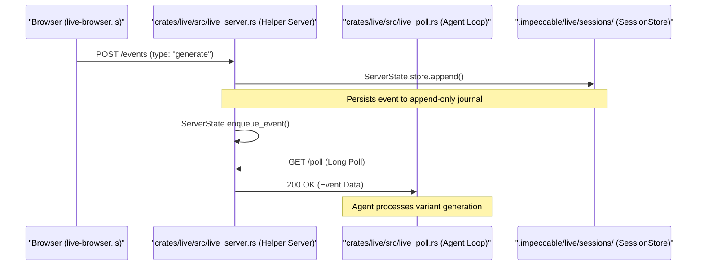
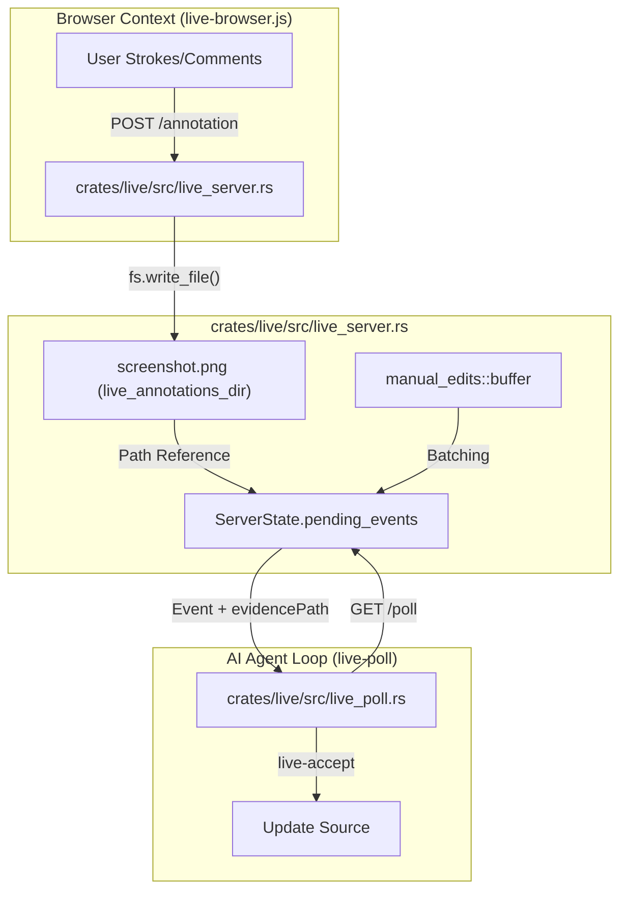

<!-- source: DeepWiki mcp.deepwiki.com · repo pbakaus/impeccable · page 5.2 Live Server and Session Orchestration · fetched 2026-10-30 -->

# Live Server and Session Orchestration

Relevant source files

The following files were used as context for generating this wiki page:

- [crates/cli/tests/agent_target.rs](crates/cli/tests/agent_target.rs)
- [crates/live/src/dev_url.rs](crates/live/src/dev_url.rs)
- [crates/live/src/inject/tag_strategy.rs](crates/live/src/inject/tag_strategy.rs)
- [crates/live/src/lib.rs](crates/live/src/lib.rs)
- [crates/live/src/live_boot.rs](crates/live/src/live_boot.rs)
- [crates/live/src/live_generate.rs](crates/live/src/live_generate.rs)
- [crates/live/src/live_server.rs](crates/live/src/live_server.rs)
- [crates/live/src/server_state.rs](crates/live/src/server_state.rs)
- [skill/reference/generate.md](skill/reference/generate.md)
- [skill/scripts/live-browser.js](skill/scripts/live-browser.js)
- [tests/live-agent-target.test.mjs](tests/live-agent-target.test.mjs)
- [tests/live-boot-fastpath.test.mjs](tests/live-boot-fastpath.test.mjs)
- [tests/live-browser-source.test.mjs](tests/live-browser-source.test.mjs)
- [tests/oracle/cases/live-roots.mjs](tests/oracle/cases/live-roots.mjs)
- [tests/oracle/golden/live-boot-full-cycle.json](tests/oracle/golden/live-boot-full-cycle.json)
- [tests/oracle/golden/live-generate-local-verdicts.json](tests/oracle/golden/live-generate-local-verdicts.json)
- [tests/oracle/golden/live-generate-no-browser-connected.json](tests/oracle/golden/live-generate-no-browser-connected.json)
- [tests/oracle/golden/live-inject-csp-meta-quote-styles-remove.json](tests/oracle/golden/live-inject-csp-meta-quote-styles-remove.json)
- [tests/oracle/golden/live-inject-csp-meta-quote-styles.json](tests/oracle/golden/live-inject-csp-meta-quote-styles.json)
- [tests/oracle/golden/live-inject-next-jsx.json](tests/oracle/golden/live-inject-next-jsx.json)
- [tests/oracle/golden/live-inject-vite-csp-meta.json](tests/oracle/golden/live-inject-vite-csp-meta.json)
- [tests/oracle/golden/live-server-background-static-subdir.json](tests/oracle/golden/live-server-background-static-subdir.json)

This page details the implementation of the live server and its role in orchestrating sessions between the browser, the AI agent, and the local filesystem. It covers the server's routes, Server-Sent Events (SSE) for real-time communication, the `ServerState` management (including events, leases, roll calls, and agent targets), the `live_boot` process, `dev_url` probing, `live_poll` and `live_http` mechanisms, injection and tag strategies, and the handling of browser assets and roots manifests.

## Server Architecture and Communication

The `crates/live` crate implements the live variant mode helper server. It manages communication between the browser, where the `live-browser.js` script is injected, and the AI agent. This server is a zero-dependency HTTP server [crates/live/src/live_server.rs:1-4]().

It utilizes three primary communication channels:

1.  **Server-Sent Events (SSE):** For server-to-browser push notifications, such as signaling when a variant is ready or updating the UI state [crates/live/src/live_server.rs:77]().
2.  **HTTP POST:** For browser-to-server events, including element selection, annotation uploads, and manual edit applications [crates/live/src/live_server.rs:78-80]().
3.  **Long Polling:** The AI agent communicates with the server via the `/poll` endpoint to receive tasks (like `generate` or `manual_edit_apply`) and provide status updates [crates/live/src/live_server.rs:77]().

### Data Flow: Browser to Agent

The following diagram illustrates how a user action in the browser reaches the AI agent through the orchestration layer.

**Orchestration Entity Mapping**

Sources: [crates/live/src/live_server.rs:77](), [crates/live/src/live_server.rs:26-28](), [crates/live/src/server_state.rs:124]()

## Core Orchestration Components

### 1. `crates/live/src/live_boot.rs` (Bootstrapper)
The `live_boot` module is the entry point for Live Mode. It initializes the environment, resolves project roots, checks for `PRODUCT.md` and `DESIGN.md` context, and starts or reuses the helper server [crates/live/src/live_boot.rs:1-3](). It generates a unique security token and identifies an open port for the server [crates/live/src/live_server.rs:159-160]().

The `run` function in `live_boot.rs` handles:
*   Resolving live targets and project roots [crates/live/src/live_boot.rs:57-66]().
*   Checking for missing context files (`PRODUCT.md`, `DESIGN.md`) and handling `--allow-missing-context` [crates/live/src/live_boot.rs:115-143]().
*   Writing the `RootsManifest` [crates/live/src/live_boot.rs:145]().
*   Running an in-process `live-inject --check` to validate the configuration [crates/live/src/live_boot.rs:148-155]().
*   Starting the `live-server` in the background if not already running [crates/live/src/live_boot.rs:170-171]().
*   Injecting the browser script tag into target files [crates/live/src/live_boot.rs:173]().
*   Scanning for config drift [crates/live/src/live_boot.rs:174]().
*   Printing the boot payload [crates/live/src/live_boot.rs:175]().

Sources: [crates/live/src/live_boot.rs:1-3](), [crates/live/src/live_boot.rs:57-175](), [crates/live/src/live_server.rs:159-160]()

### 2. `crates/live/src/live_server.rs` (HTTP Server and Event Dispatcher)
This module implements the HTTP server that handles all incoming requests and outgoing SSE events. It uses `ServerState` to manage the in-memory session state.

Key routes and their functionalities:
*   `/live.js`: Serves the browser script (`live-browser.js`) to be injected into the user's page. This script is assembled dynamically, prepending `window.__IMPECCABLE_TOKEN__`, `window.__IMPECCABLE_PORT__`, `window.__IMPECCABLE_APP_ROOT__`, `window.__IMPECCABLE_VOCAB__`, `window.__IMPECCABLE_LIVE_MOUNT_CONTRACT__`, and `window.__IMPECCABLE_LIVE_UI_SURFACES__` [crates/live/src/live_server.rs:6-7](), [crates/live/src/browser_assets.rs:6-7]().
*   `/detect.js`: Serves the detection overlay script [crates/live/src/live_server.rs:73]().
*   `/modern-screenshot.js`: Serves a vendored UMD build of `modern-screenshot` [crates/live/src/live_server.rs:74]().
*   `/annotation`: Handles `POST` requests for staging variant screenshots [crates/live/src/live_server.rs:75]().
*   `/events`: Manages the SSE stream (server→browser) and `POST` requests (browser→server) for events [crates/live/src/live_server.rs:76]().
*   `/poll`: Handles long-poll requests from the agent CLI [crates/live/src/live_server.rs:77]().
*   `/manual-edit-stash`, `/manual-edit-commit`, `/manual-edit-discard`: Routes for staging, applying, and discarding browser copy edits [crates/live/src/live_server.rs:78-80]().
*   `/source`: Raw source file reader (no-HMR fallback) [crates/live/src/live_server.rs:81]().
*   `/status`: Provides durable recovery status (token-protected) [crates/live/src/live_server.rs:82]().
*   `/health`: Health check endpoint [crates/live/src/live_server.rs:83]().
*   `/stop`: Stops the server and optionally removes the injected `live.js` script tag [crates/live/src/live_server.rs:62-63]().

The server uses `install_signal_handlers` to gracefully shut down on `SIGINT` or `SIGTERM` [crates/live/src/live_server.rs:52-54]().

Sources: [crates/live/src/live_server.rs:1-83](), [crates/live/src/browser_assets.rs:6-7](), [crates/live/src/live_server.rs:52-54]()

### 3. `crates/live/src/server_state.rs` (Session State Management)
The `ServerState` struct holds the in-memory state of the live server. It is wrapped in an `Arc<Mutex<ServerState>>` for shared, thread-safe access [crates/live/src/server_state.rs:162]().

Key fields and their roles:
*   `token`: A unique security token for the session [crates/live/src/server_state.rs:111]().
*   `port`: The port the server is listening on [crates/live/src/server_state.rs:112]().
*   `sse_clients`: A list of connected SSE clients (`SseClient`), each with a sender channel for pushing events [crates/live/src/server_state.rs:116]().
*   `pending_events`: A queue of events (`PendingEntry`) waiting to be processed by agents or the browser [crates/live/src/server_state.rs:117]().
*   `pending_polls`: A list of parked long-poll requests (`ParkedPoll`) from agents [crates/live/src/server_state.rs:118]().
*   `store`: A `SessionStore` for durable journaling of events [crates/live/src/server_state.rs:124]().
*   `pending_agent_targets`: A vector of held-open `POST /agent-target` requests, keyed by `targetId` [crates/live/src/server_state.rs:131](). These are used for agent-initiated element targeting (the `generate` command) [crates/cli/tests/agent_target.rs:1-3]().
    *   Each `AgentTargetPending` entry includes a sender channel (`tx`), the original payload, an `owner` (the client that claimed the lease), `claimed_until` timestamp, `last_holder`, and a list of `reports` from overlays [crates/live/src/server_state.rs:70-85]().
*   `resolved_agent_targets`: A history of answered agent targets, preventing re-opening of requests [crates/live/src/server_state.rs:133-138]().
*   `manual_edit_activity`: Tracks manual copy-edit activity [crates/live/src/server_state.rs:127]().
*   `pending_apply_deferreds`: Deferred promises for in-flight chat-routed Apply events [crates/live/src/server_state.rs:129]().
*   `hide_live_bar`: A flag to control the visibility of the overlay's global bar [crates/live/src/server_state.rs:143]().
*   `source_resolution_cache`: Caches target signature to source file mappings for preflight checks [crates/live/src/server_state.rs:158]().

The `ServerState` also manages various timers for leases, heartbeats, and exit conditions [crates/live/src/server_state.rs:20-24]().

Sources: [crates/live/src/server_state.rs:1-160](), [crates/live/src/server_state.rs:162](), [crates/cli/tests/agent_target.rs:1-3]()

### 4. `crates/live/src/live_poll.rs` (Agent Polling Loop)
The `live_poll` module implements the agent's polling mechanism. It allows the agent to wait for instructions from the browser. It uses a custom polling loop to circumvent typical HTTP timeouts, synthesizing a longer logical poll. It also automatically triggers finalization logic when `accept` or `discard` events are received.

### 5. `crates/live/src/live_generate.rs` (Agent-Initiated Targeting)
This module handles the `impeccable live-generate` command, which enables agent-initiated element targeting for the `generate` command [crates/live/src/live_generate.rs:1-2](). It asks the live overlay to find an element by CSS selector, scroll to it, enter the picked state, and fire the normal Go pipeline with the given action and count [crates/live/src/live_generate.rs:5-7]().

The `run` function in `live_generate.rs` parses flags such as `--selector`, `--action`, `--count`, `--prompt`, `--dry-run`, `--wait-for-browser`, `--no-live-bar`, `--boot`, and `--open` [crates/live/src/live_generate.rs:22-51](). It can optionally boot the live server and open the dev URL in the browser if no page is connected [crates/live/src/live_generate.rs:8-11]().

Sources: [crates/live/src/live_generate.rs:1-11](), [crates/live/src/live_generate.rs:22-51]()

### 6. `crates/live/src/dev_url.rs` (Dev URL Probing)
The `dev_url` module is responsible for finding the development server that is currently serving the application. It probes a list of common ports and `localhost` addresses to find an origin whose document contains the injected `live.js?token=<token>` tag [crates/live/src/dev_url.rs:1-4](), [crates/live/src/dev_url.rs:35-48]().

Key functions:
*   `candidates`: Generates a list of candidate URLs to probe, using `DEFAULT_PORTS` or an `IMPECCABLE_DEV_URL_CANDIDATES` environment override [crates/live/src/dev_url.rs:14-31]().
*   `probe`: Fetches the root document of candidate URLs in parallel and returns the first one containing the `live.js` tag [crates/live/src/dev_url.rs:35-48]().
*   `answers`: Checks if a given URL's host and port accept connections, used for liveness checks [crates/live/src/dev_url.rs:55-56]().

Sources: [crates/live/src/dev_url.rs:1-4](), [crates/live/src/dev_url.rs:14-56](), [crates/live/src/dev_url.rs:35-48]()

### 7. `crates/live/src/inject/tag_strategy.rs` (Injection and Tag Strategies)
This module defines how the `live.js` script is injected into HTML files. It handles various scenarios, including:
*   **CSP patching**: Modifies Content Security Policy (CSP) meta tags to allow the injected script and its resources to load [tests/oracle/golden/live-inject-csp-meta-quote-styles.json:10]().
*   **Insertion points**: Determines where to insert the script tag (e.g., before `</body>`, after `<body>`) [tests/oracle/golden/live-inject-csp-meta-quote-styles.json:8]().
*   **Comment syntax**: Uses appropriate comment syntax for different file types (e.g., HTML, Vue) [tests/oracle/golden/live-inject-csp-meta-quote-styles.json:8]().
*   **Journaling**: Records injection details in `inject-journal.json` for later removal or verification [tests/oracle/golden/live-inject-csp-meta-quote-styles.json:9]().

Sources: [tests/oracle/golden/live-inject-csp-meta-quote-styles.json:8-10](), [crates/live/src/inject/tag_strategy.rs]()

### 8. `crates/live/src/browser_assets.rs` (Browser Assets and Roots Manifests)
This module is responsible for assembling and serving the browser-side assets.
*   `assemble_live_browser_script`: Combines various script parts into the final `live.js` payload served to the browser [crates/live/src/browser_assets.rs:6-7](). This includes `live-browser.js`, `live-browser-session.js`, `live-browser-dom.js`, `live-browser-ignores.js`, `live-browser-picker.js`, `live-browser-ui.js`, `live-browser-debug.js`, and `live-browser-manual-apply.js`.
*   `load_detect_script`: Loads the `detect.js` script [crates/live/src/browser_assets.rs:7]().
*   `MODERN_SCREENSHOT_JS`: Provides the vendored `modern-screenshot` UMD build [crates/live/src/browser_assets.rs:8]().
*   `RootsManifest`: The `crates/live/src/manifests.rs` module defines the `RootsManifest` which stores information about the project's root, repository root, and paths to `PRODUCT.md` and `DESIGN.md` [crates/live/src/manifests.rs](). This manifest is written by `live_boot` [crates/live/src/live_boot.rs:145]() and used by the server to understand the project context.

Sources: [crates/live/src/browser_assets.rs:6-8](), [crates/live/src/manifests.rs](), [crates/live/src/live_boot.rs:145]()

## Annotation and Source Handling

The server provides specialized logic for handling design-specific data and code context:

| Function / Entity | Purpose |
| :--- | :--- |
| `ServerState.session_dir` | Per-session temporary directory for storing annotation screenshots and metadata [crates/live/src/server_state.rs:123](). |
| `MAX_ANNOTATION_BYTES` | Caps per-annotation upload size at 10MB to guard against runaway writes [crates/live/src/live_server.rs:44](). |
| `assemble_live_browser_script` | Combines script parts into the final `/live.js` payload served to the browser [crates/live/src/live_server.rs:6](). |
| `live_annotations_dir` | Resolves the path where visual annotations are persisted [crates/live/src/live_server.rs:20](). |

### Annotation Processing Logic
When a user draws on the browser overlay, the data is sent to the server via `POST /annotation`. The server writes this to the session directory. The resulting file path is then included in the event payload sent to the agent via `/poll`, allowing the LLM to "see" the visual instructions.

**Annotation and Edit Data Flow**

Sources: [crates/live/src/live_server.rs:75](), [crates/live/src/live_server.rs:20](), [crates/live/src/server_state.rs:123]()

## Lifecycle and Cleanup

The orchestration layer follows a strict sequence to ensure synchronization:

1.  **Boot**: The `live_boot` command starts the server, identifies an open port, and generates a session token [crates/live/src/live_boot.rs:1-3](), [crates/live/src/live_server.rs:159-160]().
2.  **Poll**: The agent starts its polling loop and establishes a connection to `/poll` [crates/live/src/live_server.rs:77]().
3.  **Action**: A user triggers an action in the browser; the server journals the event in `ServerState.store` and notifies the agent via `ServerState.enqueue_event` [crates/live/src/server_state.rs:117](), [crates/live/src/server_state.rs:124]().
4.  **Execution**: The agent receives the event, performs the work, and acknowledges via server endpoints.
5.  **Resolution**: The server acknowledges the pending event and updates the browser via SSE [crates/live/src/server_state.rs:116]().
6.  **Stop**: The server receives a stop command (`/stop` route), removes server info via `remove_live_server_info`, and shuts down [crates/live/src/live_server.rs:62-63](), [crates/live/src/live_server.rs:21]().

Sources: [crates/live/src/live_boot.rs:1-3](), [crates/live/src/live_server.rs:21](), [crates/live/src/live_server.rs:62-63](), [crates/live/src/live_server.rs:77](), [crates/live/src/live_server.rs:159-160](), [crates/live/src/server_state.rs:116](), [crates/live/src/server_state.rs:117](), [crates/live/src/server_state.rs:124]()

---

