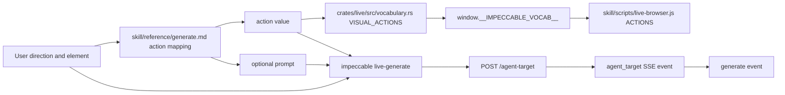
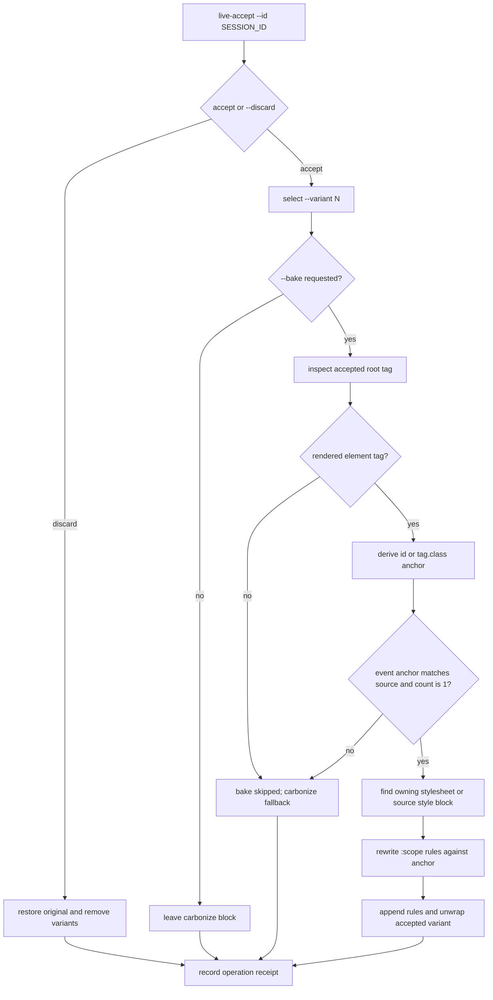
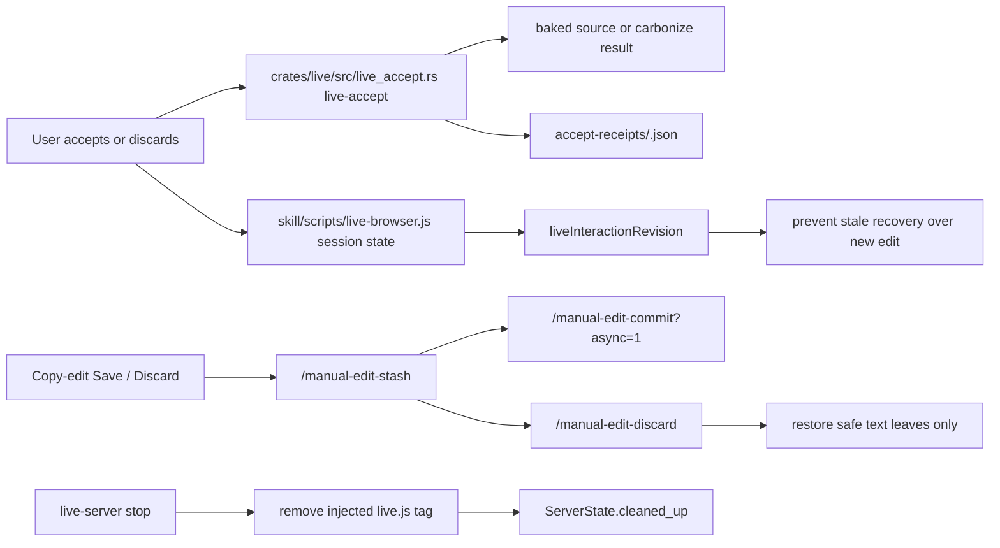

<!-- source: DeepWiki mcp.deepwiki.com · repo pbakaus/impeccable · page 5.3 Variant Lifecycle: Generate, Wrap, Accept · fetched 2026-10-30 -->

# Variant Lifecycle: Generate, Wrap, Accept

<details>
<summary>Relevant source files</summary>

The following files were used as context for generating this wiki page:

- [crates/cli/tests/agent_target.rs](crates/cli/tests/agent_target.rs)
- [crates/live/src/bake.rs](crates/live/src/bake.rs)
- [crates/live/src/browser_assets.rs](crates/live/src/browser_assets.rs)
- [crates/live/src/browser_open.rs](crates/live/src/browser_open.rs)
- [crates/live/src/dev_url.rs](crates/live/src/dev_url.rs)
- [crates/live/src/instructions.rs](crates/live/src/instructions.rs)
- [crates/live/src/lib.rs](crates/live/src/lib.rs)
- [crates/live/src/live_accept.rs](crates/live/src/live_accept.rs)
- [crates/live/src/live_boot.rs](crates/live/src/live_boot.rs)
- [crates/live/src/live_generate.rs](crates/live/src/live_generate.rs)
- [crates/live/src/live_insert.rs](crates/live/src/live_insert.rs)
- [crates/live/src/live_poll.rs](crates/live/src/live_poll.rs)
- [crates/live/src/live_server.rs](crates/live/src/live_server.rs)
- [crates/live/src/live_wrap.rs](crates/live/src/live_wrap.rs)
- [crates/live/src/server_state.rs](crates/live/src/server_state.rs)
- [crates/live/src/wrap_common.rs](crates/live/src/wrap_common.rs)
- [skill/reference/generate.md](skill/reference/generate.md)
- [skill/scripts/impeccable](skill/scripts/impeccable)
- [skill/scripts/impeccable.cmd](skill/scripts/impeccable.cmd)
- [skill/scripts/live-browser.js](skill/scripts/live-browser.js)
- [tests/launcher-download.test.mjs](tests/launcher-download.test.mjs)
- [tests/live-agent-target.test.mjs](tests/live-agent-target.test.mjs)
- [tests/live-boot-fastpath.test.mjs](tests/live-boot-fastpath.test.mjs)
- [tests/live-browser-source.test.mjs](tests/live-browser-source.test.mjs)
- [tests/oracle/cases/live-accept.mjs](tests/oracle/cases/live-accept.mjs)
- [tests/oracle/cases/live-wrap.mjs](tests/oracle/cases/live-wrap.mjs)
- [tests/oracle/golden/live-boot-full-cycle.json](tests/oracle/golden/live-boot-full-cycle.json)
- [tests/oracle/golden/live-daemon-server-status-poll-complete.json](tests/oracle/golden/live-daemon-server-status-poll-complete.json)
- [tests/oracle/golden/live-generate-local-verdicts.json](tests/oracle/golden/live-generate-local-verdicts.json)
- [tests/oracle/golden/live-generate-no-browser-connected.json](tests/oracle/golden/live-generate-no-browser-connected.json)
- [tests/oracle/golden/live-insert-html-unclosed-after.json](tests/oracle/golden/live-insert-html-unclosed-after.json)
- [tests/oracle/golden/live-insert-html-unclosed-before.json](tests/oracle/golden/live-insert-html-unclosed-before.json)
- [tests/oracle/golden/live-wrap-file-element-unclosed.json](tests/oracle/golden/live-wrap-file-element-unclosed.json)
- [tests/oracle/golden/live-wrap-tsx-component-tag-case.json](tests/oracle/golden/live-wrap-tsx-component-tag-case.json)
- [tests/oracle/golden/live-wrap-tsx-multiline-self-closing.json](tests/oracle/golden/live-wrap-tsx-multiline-self-closing.json)

</details>


## Purpose and scope

This page describes how Live Mode turns a requested design direction into browser-selected variants and then into permanent source changes. It covers the generate command and agent-target protocol, source wrapping and insertion, acceptance and discard behavior, optional mechanical baking, agent instructions, and lifecycle cleanup. The implementation is split between the Rust `crates/live` engine and the injected browser script in `skill/scripts/live-browser.js`. [crates/live/src/live_generate.rs:1-11]() [crates/live/src/live_accept.rs:1-10]() [skill/scripts/live-browser.js:1-10]()

Sources: [crates/live/src/live_generate.rs:1-11]() [crates/live/src/live_accept.rs:1-10]() [skill/scripts/live-browser.js:1-10]()

## Lifecycle at a glance

The generate lane connects a natural-language request to the browser’s existing Live overlay. The agent supplies a selector, action, and count; `live-generate` asks the overlay to resolve and select the target, then returns the resulting `generate` event so the agent can edit source. The ordinary Live session then handles variant cycling and the user’s accept/discard choice. Acceptance is performed by `live-accept`; `--bake` opts into a mechanical HTML/JSX bake when it is safe, while the default path leaves a carbonize block for the agent to finish. [crates/live/src/live_generate.rs:1-11]() [crates/live/src/live_generate.rs:22-59]() [crates/live/src/live_accept.rs:24-46]() [crates/live/src/bake.rs:1-10]()

Sources: [crates/live/src/live_generate.rs:1-11]() [crates/live/src/live_generate.rs:22-59]() [crates/live/src/live_accept.rs:24-46]() [crates/live/src/bake.rs:1-10]()

### Natural-language direction to implementation entities

The command reference maps user wording to the canonical Live action vocabulary. Examples include “bolder” → `bolder`, typography → `typeset`, arrangement and spacing → `layout`, and motion → `animate`. Requests that carry intent without matching an action use `impeccable` with the wording passed as a prompt; requests with no direction require a clarification. The browser builds its picker actions from `window.__IMPECCABLE_VOCAB__`, and the engine’s accepted visual action set is defined in `crates/live/src/vocabulary.rs`. [skill/reference/generate.md:15-37]() [skill/scripts/live-browser.js:95-105]() [tests/live-agent-target.test.mjs:28-37]()

**Diagram: Request vocabulary mapped to Live implementation**



Sources: [skill/reference/generate.md:15-37]() [skill/scripts/live-browser.js:95-105]() [crates/live/src/live_generate.rs:1-11]() [crates/live/src/live_generate.rs:22-59]() [crates/live/src/server_state.rs:67-85]() [tests/live-agent-target.test.mjs:28-37]()

### Natural-language target to code and session entities

The selector is resolved in the browser against the rendered page, not inferred by writing a wrapper directly. `live-generate` accepts `--selector`, optional text and index disambiguators, and optional source `--target`; on success it returns the session’s `generate` event for the agent’s next edit. The browser’s `extractContext` also records the chosen element’s anchor and its match count, which the bake path later uses to prevent a lasting selector from unintentionally styling multiple elements. [crates/live/src/live_generate.rs:22-59]() [tests/live-browser-source.test.mjs:20-25]() [crates/live/src/bake.rs:112-141]()

**Diagram: Rendered element descriptor carried into source acceptance**


Sources: [crates/live/src/live_generate.rs:1-11]() [crates/live/src/server_state.rs:67-85]() [tests/live-browser-source.test.mjs:20-25]() [crates/live/src/live_accept.rs:58-72]() [crates/live/src/bake.rs:112-141]()

## Generate command and agent-target flow

`impeccable live-generate` is the agent-facing entry point for targeting a page element. Its inputs include a required CSS selector; optional text filtering and 1-based index selection; an action (default `impeccable`); a variant count (default 3, protocol limit 1–8); and an optional freeform prompt. `--dry-run` resolves and reports without starting a session. `--boot` runs or reuses the lane’s helper boot, while `--open` can open the dev URL when no overlay page is connected, subject to harness/browser configuration. [crates/live/src/live_generate.rs:22-59]()

Sources: [crates/live/src/live_generate.rs:22-59]()

### Request, claim, resolution, and session creation

The command sends an agent-target request to the helper. The server holds `POST /agent-target` open while the browser overlay receives the `agent_target` SSE payload and claims the request. A pending target tracks its owner, lease deadline, last holder, overlay reports, timer generation, and a resolve-grace deadline. The overlay can report a result through `POST /agent-target-result`; a complete busy roll call, timeout, or server shutdown can also resolve the held request. [crates/live/src/server_state.rs:67-85]() [crates/cli/tests/agent_target.rs:1-6]() [tests/live-agent-target.test.mjs:1-6]()

The claim lease ensures that only the eligible overlay acts on a target. The state model retains the last holder because an overlay’s Go action can arrive late; it also records resolved target IDs so that a completed or evicted record does not reopen a request to a rival session. [crates/live/src/server_state.rs:70-85]() [crates/live/src/server_state.rs:133-139]()

Once the overlay resolves the selector, it scrolls to the element, enters the picked state, and runs the normal Go pipeline. That creates a standard generate session. The command returns that session’s `generate` event, already leased and carrying `_instructions`, for the agent’s source edit. [crates/live/src/live_generate.rs:1-11]() [crates/live/src/live_generate.rs:57-59]()

**Diagram: Agent target protocol and ownership**

```mermaid
sequenceDiagram
    participant Agent as "Agent"
    participant Verb as "live-generate"
    participant Server as "live-server"
    participant Overlay as "Live browser overlay"
    Agent->>Verb: "selector, action, count, prompt"
    Verb->>Server: "POST /agent-target"
    Note over Server: "Hold request; track owner, lease, reports, timeout"
    Server-->>Overlay: "agent_target over SSE"
    Overlay->>Server: "POST /agent-target-claim"
    Server-->>Overlay: "claim lease"
    Overlay->>Overlay: "resolve selector, scroll, select, normal Go"
    Overlay->>Server: "POST /events with generate event"
    Server-->>Verb: "leased generate event"
    Verb-->>Agent: "event and _instructions"
    opt "No match, busy roll call, timeout, or shutdown"
        Overlay->>Server: "POST /agent-target-result or roll-call report"
        Server-->>Verb: "verdict"
    end
```

Sources: [crates/live/src/live_generate.rs:1-11]() [crates/live/src/live_generate.rs:57-59]() [crates/live/src/server_state.rs:67-85]() [crates/live/src/server_state.rs:50-64]() [crates/cli/tests/agent_target.rs:1-6]() [tests/live-agent-target.test.mjs:1-6]()

### Action vocabulary and count

The action vocabulary is shared across the UI and engine rather than being invented per request. The browser uses the server-supplied vocabulary to create `ACTIONS`; tests read `VISUAL_ACTIONS` from `crates/live/src/vocabulary.rs` so their protocol matrix stays aligned with what the server accepts. The command’s count defaults to 3 and is constrained to 1–8. [skill/scripts/live-browser.js:95-105]() [tests/live-agent-target.test.mjs:28-37]() [crates/live/src/live_generate.rs:41-46]() [skill/reference/generate.md:17-37]()

Sources: [skill/scripts/live-browser.js:95-105]() [tests/live-agent-target.test.mjs:28-37]() [crates/live/src/live_generate.rs:41-46]() [skill/reference/generate.md:17-37]()

### Dispatch and evidence ordering

The browser dispatches a plain `generate` event before starting screenshot capture. When annotations are present, it captures and uploads the screenshot first, then dispatches the annotated event with `screenshotPath`. In either case, the browser only checkpoints `generate_started` after the event creation has been acknowledged for the still-current session; failed or superseded creation does not checkpoint that start. [tests/live-browser-source.test.mjs:27-57]() [tests/live-browser-source.test.mjs:68-83]()

Sources: [tests/live-browser-source.test.mjs:27-57]() [tests/live-browser-source.test.mjs:68-83]()

## Wrap and insertion scaffolding

Wrapping and insertion provide source scaffolding for the browser-generated variant session. The lifecycle distinguishes this scaffolding from the agent’s design edit: `live-generate` returns the event that anchors the edit, while `live-accept` later locates and resolves the session wrapper. The helper’s CLI describes the session wrapper as the target of accept/discard, and its source implementation documents HTML/JSX wrapper carbonization plus a separate Svelte component inline path. [crates/live/src/live_generate.rs:57-59]() [crates/live/src/live_accept.rs:1-10]() [crates/live/src/live_accept.rs:24-46]()

Sources: [crates/live/src/live_generate.rs:57-59]() [crates/live/src/live_accept.rs:1-10]() [crates/live/src/live_accept.rs:24-46]()

### Framework paths

The acceptance implementation explicitly supports two paths:

| Source shape | Acceptance path | Outcome |
|---|---|---|
| HTML/JSX wrapper | Carbonize by default, or opt into `--bake` when the mechanical rewrite is safe. | Chosen content becomes permanent in source; the wrapper is removed on a successful bake. |
| Svelte component session | Inline the component accept through the Svelte component session path. | The real component source is written immediately; `--defer-source-write` is deprecated compatibility behavior. |

The HTML/JSX path is described by `AcceptOutcome::Carbonized` and `AcceptOutcome::Baked`. The Svelte path is wired through `find_svelte_component_manifest`, `inline_svelte_component_accept`, and session removal helpers. The supplied implementation identifies `live_wrap.rs` and `live_insert.rs` as the wrap and insertion modules, but their function bodies are not included in the provided source excerpts; this page therefore avoids attributing unsupported framework-specific parsing or insertion behavior to those modules. [crates/live/src/live_accept.rs:1-10]() [crates/live/src/live_accept.rs:24-46]() [crates/live/src/live_accept.rs:74-90]() [crates/live/src/live_accept.rs:11-14]()

Sources: [crates/live/src/live_accept.rs:1-10]() [crates/live/src/live_accept.rs:11-14]() [crates/live/src/live_accept.rs:24-46]() [crates/live/src/live_accept.rs:74-90]()

### Session wrapper and generated content

A generated variant session is associated with a session ID; `live-accept` requires `--id SESSION_ID` and accepts a selected variant number with `--variant N`, or removes the variants with `--discard`. For mechanical baking, the accepted variant is extracted from the wrapper, its root element is inspected, and the generated CSS is rewritten from `:scope` to a selector that identifies that element. [crates/live/src/live_accept.rs:24-46]() [crates/live/src/bake.rs:1-10]() [crates/live/src/bake.rs:52-72]()

Sources: [crates/live/src/live_accept.rs:24-46]() [crates/live/src/bake.rs:1-10]() [crates/live/src/bake.rs:52-72]()

## Accept, discard, and bake

`live-accept` is the deterministic terminal operation for a variant session. It can discard all variants and restore the original, or accept variant `N` and discard the rest. It supports `--page-url` for scoping staged copy-edit cleanup, `--bake` to opt into mechanical HTML/JSX baking, and `--no-bake` to force the carbonize path. Baking is explicitly opt-in, not the default. [crates/live/src/live_accept.rs:24-46]()

Sources: [crates/live/src/live_accept.rs:24-46]()

### Carbonize behavior

The default HTML/JSX acceptance path leaves a carbonize block rather than attempting uncertain mechanical rewrites. This fallback is important because bake can refuse when it cannot determine a safe selector, stylesheet destination, or rewrite. The accept result distinguishes carbonized output from a baked result and can include a `bakeSkipped` explanation. [crates/live/src/live_accept.rs:74-90]() [crates/live/src/bake.rs:1-10]()

Sources: [crates/live/src/live_accept.rs:74-90]() [crates/live/src/bake.rs:1-10]()

### Mechanical bake and safety checks

`BakePlan` describes the write: an optional stylesheet file, CSS rewritten against the element’s selector, the selector anchor, restored source lines, and a rule count. If rules belong in the source file’s own `<style>` block, `css_file` is `None`. The bake implementation searches for an owning stylesheet while skipping generated and build-output directories; its search bounds are depth 6 and 4,000 files. [crates/live/src/bake.rs:21-43]()

The root must be a rendered element, not an opaque component tag. `is_element_tag` accepts lowercase element names (including custom elements) and rejects component-style names such as `PricingGrid` or `Card.Root`. `element_anchor` can use a CSS-safe `id`, or a lowercase tag plus static classes; if neither is available, it returns no anchor. [crates/live/src/bake.rs:52-104]()

A lasting selector must match only the accepted element. The browser records the page anchor and `anchorMatches` count in the generate event; the bake compares that descriptor with the source anchor and requires a count of exactly one. Missing descriptors, mismatched anchors, and non-unique matches cause the bake to refuse rather than risk restyling other elements. [tests/live-browser-source.test.mjs:20-25]() [crates/live/src/bake.rs:112-141]()

**Diagram: Accept decision and bake safety gate**



Sources: [crates/live/src/live_accept.rs:24-46]() [crates/live/src/live_accept.rs:74-90]() [crates/live/src/live_accept.rs:137-182]() [crates/live/src/bake.rs:1-10]() [crates/live/src/bake.rs:52-104]() [crates/live/src/bake.rs:112-141]()

### Knobs and limits of mechanical baking

The generate lane’s variants carry no knobs. The bake module states that the chosen variant’s rules can be made permanent without an agent only when the rewrite is mechanically decidable. Knobs, plumbing inside the variant, lack of a stylesheet, or lack of a stable selector cause bake to refuse, leaving the carbonize path for the agent to complete. [crates/live/src/bake.rs:1-10]()

Sources: [crates/live/src/bake.rs:1-10]()

### Receipts, locks, and idempotent completion

`live-accept` writes accept receipts under the Live directory’s `accept-receipts` area. Each receipt records the session ID, operation, selected variant ID when applicable, result, and completion time; writing uses a temporary file followed by rename. The accept implementation also imports source-lock handling and sets a bounded lock wait, and the module describes accept/discard as deterministic session operations. [crates/live/src/live_accept.rs:1-10]() [crates/live/src/live_accept.rs:22-22]() [crates/live/src/live_accept.rs:137-182]()

Sources: [crates/live/src/live_accept.rs:1-10]() [crates/live/src/live_accept.rs:22-22]() [crates/live/src/live_accept.rs:137-182]()

## Instructions and agent handoff

The generate command’s output includes the session `generate` event and `_instructions`; its documented next step is the source edit, followed by `live-poll --reply <id> done --file <path> --then-poll` to receive the accept flow. The command also emits a local follow-up instruction from the verdict rather than trusting instructions supplied over the wire. [crates/live/src/live_generate.rs:57-59]() [crates/live/src/live_generate.rs:173-175]()

The generate reference directs the agent to load the normal context and craft-floor guidance, to reuse the existing dev server and harness tab, and not to hand-write wrappers or invent session IDs. It also states that Live Mode is web-only and that hook findings should not be acted on while live markers remain in the source. [skill/reference/generate.md:1-13]() [skill/reference/generate.md:39-46]()

Sources: [crates/live/src/live_generate.rs:57-59]() [crates/live/src/live_generate.rs:173-175]() [skill/reference/generate.md:1-13]() [skill/reference/generate.md:39-46]()

## Completion and cleanup

Acceptance and discard are explicit session operations, and the helper exposes a `stop` command that removes the injected `live.js` script tag unless `--keep-inject` is used. Server shutdown is guarded by `cleaned_up` state so cleanup can be invoked from both the `/stop` handler and the accept loop without repeating the cleanup work. [crates/live/src/live_accept.rs:24-46]() [crates/live/src/live_server.rs:56-83]() [crates/live/src/server_state.rs:151-153]()

The browser overlay tracks a live interaction revision so deferred recovery from an older accept/discard cannot reload over a replacement configuration. Its initialization guard prevents duplicate setup, and it resets the guard if required token/port or session support is unavailable so a later injection can retry. [skill/scripts/live-browser.js:16-28]() [skill/scripts/live-browser.js:63-80]() [skill/scripts/live-browser.js:128-135]()

For manual copy edits, the browser stages operations through `/manual-edit-stash`, starts `/manual-edit-commit` asynchronously, and uses `/manual-edit-discard` to discard staged edits. On discard, it restores only safe text-leaf elements; it skips unsafe targets rather than overwriting parent markup. These routes are separate from variant-session acceptance but share the helper’s lifecycle and cleanup responsibilities. [tests/live-browser-source.test.mjs:85-125]() [crates/live/src/live_server.rs:71-83]()

**Diagram: Terminal operations and helper cleanup**



Sources: [crates/live/src/live_accept.rs:137-182]() [skill/scripts/live-browser.js:128-135]() [tests/live-browser-source.test.mjs:85-125]() [crates/live/src/live_server.rs:56-83]() [crates/live/src/server_state.rs:151-153]()

## Implementation map

| Lifecycle responsibility | Primary code entity | Role |
|---|---|---|
| Request and selector handoff | `live-generate` in `crates/live/src/live_generate.rs` | Parses request options, coordinates the target request, and returns the generate event for the agent. |
| Agent target ownership | `AgentTargetPending` in `crates/live/src/server_state.rs` | Tracks the held request, claim owner and lease, overlay reports, and resolution grace. |
| Browser action picker | `ACTIONS` in `skill/scripts/live-browser.js` | Derives selectable actions and icons from server-provided vocabulary. |
| Variant acceptance | `live-accept` in `crates/live/src/live_accept.rs` | Accepts a selected variant or discards the session; supports carbonize and optional bake paths. |
| Mechanical CSS bake | `BakePlan` in `crates/live/src/bake.rs` | Represents rewritten CSS, selector anchor, restored lines, and stylesheet destination. |
| Server routes and lifecycle | `live_server.rs` | Serves the browser script and documents the Live helper endpoints, including accept-related neighboring edit routes and stop behavior. |

[crates/live/src/live_generate.rs:1-11]() [crates/live/src/server_state.rs:67-85]() [skill/scripts/live-browser.js:95-105]() [crates/live/src/live_accept.rs:1-10]() [crates/live/src/bake.rs:30-43]() [crates/live/src/live_server.rs:56-83]()

Sources: [crates/live/src/live_generate.rs:1-11]() [crates/live/src/server_state.rs:67-85]() [skill/scripts/live-browser.js:95-105]() [crates/live/src/live_accept.rs:1-10]() [crates/live/src/bake.rs:30-43]() [crates/live/src/live_server.rs:56-83]()

---

