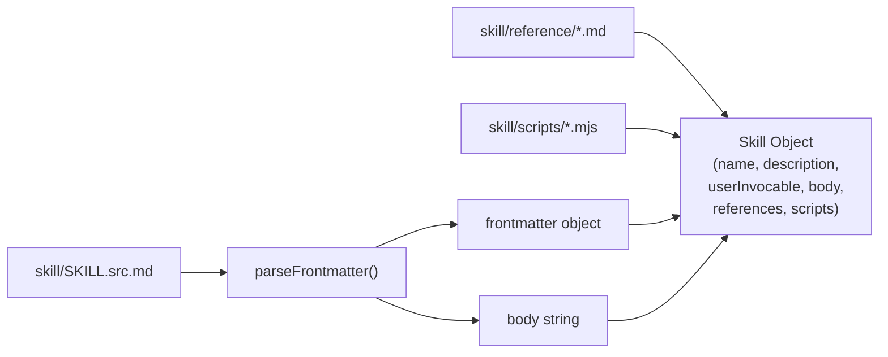

<!-- source: DeepWiki mcp.deepwiki.com · repo pbakaus/impeccable · page 6 Build and Distribution Pipeline · fetched 2026-10-30 -->

# Build and Distribution Pipeline

<details>
<summary>Relevant source files</summary>

The following files were used as context for generating this wiki page:

- [.gitattributes](.gitattributes)
- [.github/workflows/ci.yml](.github/workflows/ci.yml)
- [.github/workflows/sync-generated-output.yml](.github/workflows/sync-generated-output.yml)
- [.gitignore](.gitignore)
- [AGENTS.md](AGENTS.md)
- [CLAUDE.md](CLAUDE.md)
- [README.md](README.md)
- [README.npm.md](README.npm.md)
- [crates/context/src/hook_markers.rs](crates/context/src/hook_markers.rs)
- [crates/context/src/pin.rs](crates/context/src/pin.rs)
- [crates/hook/src/admin.rs](crates/hook/src/admin.rs)
- [crates/skills/src/bundle.rs](crates/skills/src/bundle.rs)
- [crates/skills/src/commands.rs](crates/skills/src/commands.rs)
- [crates/skills/src/hook_manifest.rs](crates/skills/src/hook_manifest.rs)
- [crates/skills/src/providers.rs](crates/skills/src/providers.rs)
- [crates/skills/tests/drift_ports_tests.rs](crates/skills/tests/drift_ports_tests.rs)
- [crates/skills/tests/hook_manifest_tests.rs](crates/skills/tests/hook_manifest_tests.rs)
- [docs/HARNESSES.md](docs/HARNESSES.md)
- [scripts/build.js](scripts/build.js)
- [scripts/lib/transformers/factory.js](scripts/lib/transformers/factory.js)
- [scripts/lib/transformers/index.js](scripts/lib/transformers/index.js)
- [scripts/lib/transformers/providers.js](scripts/lib/transformers/providers.js)
- [scripts/lib/utils.js](scripts/lib/utils.js)
- [scripts/test-suites.mjs](scripts/test-suites.mjs)
- [tests/build.test.js](tests/build.test.js)
- [tests/lib/transformers/providers.test.js](tests/lib/transformers/providers.test.js)

</details>


This page provides an overview of the build and distribution pipeline for the Impeccable codebase. The core of this pipeline is `scripts/build.js`, which compiles the `skill/` source into various provider-specific trees, plugins, ZIP bundles, and editor packages (like VS Code and Cursor). This process ensures that the single source of truth in `skill/` can be adapted and deployed across multiple AI coding environments.

The build system transforms the universal source markdown files in `skill/` into provider-specific distributions in `dist/`, supporting multiple AI coding platforms including Claude Code, Cursor, Gemini, Codex, GitHub Copilot, Kiro, OpenCode, Pi, Trae, and Rovo Dev. The system performs a dual-pass transformation—once unprefixed and once with the `i-` prefix—to support conflict-free installation, then assembles universal bundles and creates ZIP files for distribution.

**Sources:** [scripts/build.js:3-16](), [AGENTS.md:5-5]()

---

## Build Orchestration

The build process is orchestrated by `scripts/build.js` which executes a multi-stage pipeline. It serves as the single source of truth for counts and validates that the engine's `ANTIPATTERNS` match the human-written documentation.

1.  **Count Generation**: `generateCounts()` updates command and rule counts across the codebase, scanning `crates/live/assets/antipatterns.json` and the `impeccable` skill router table in `SKILL.src.md`. [scripts/build.js:45-64]()
2.  **Validation**: `collectPluginVersions()` and `collectPluginManifestFindings()` ensure version synchronization and manifest validity. [scripts/build.js:27-28]()
3.  **Source Parsing**: `readSourceFiles()` reads the canonical skill definition and its references. [scripts/lib/utils.js:215-240]()
4.  **Provider Transformation**: Transforms the skill for all defined providers.
5.  **Plugin and Extension Staging**: Stages files for OpenAI plugins, Cursor plugins, and VS Code extensions. [scripts/build.js:35-37]()
6.  **ZIP Creation**: `createAllZips()` packages bundles into downloadable archives. [scripts/lib/zip.js:25-25]()

**Build Orchestration Flow**

```mermaid
graph TD
    A[scripts/build.js] --> B{Initialize Build Environment};
    B --> C[Read Source Files<br/>skill/SKILL.src.md, skill/reference/, skill/scripts/];
    C --> D[Generate Counts<br/>(commands, detection rules)];
    D --> E[Validate Plugin Versions & Manifests];
    E --> F{Process Providers};
    F --> G[Transform for Cursor (.cursor/skills/)];
    F --> H[Transform for Claude Code (.claude/skills/)];
    F --> I[Transform for Gemini (.gemini/skills/)];
    F --> J[Transform for Codex (.codex/skills/)];
    F --> K[Transform for GitHub Copilot (.github/skills/)];
    F --> L[Transform for Veto (.veto/skills/)];
    F --> M[Transform for Grok Build (.grok/skills/)];
    F --> N[Transform for DeepSeek Harness (.dsh/skills/)];
    F --> O[Transform for Hermes Agent (.hermes/skills/)];
    F --> P[Transform for Kiro (.kiro/skills/)];
    F --> Q[Transform for OpenCode (.opencode/skills/)];
    F --> R[Transform for Pi (.pi/skills/)];
    F --> S[Transform for Oh My Pi (.omp/skills/)];
    F --> T[Transform for Qoder (.qoder/skills/)];
    F --> U[Transform for Trae (.trae/skills/)];
    F --> V[Transform for Rovo Dev (.rovodev/skills/)];
    G & H & I & J & K & L & M & N & O & P & Q & R & S & T & U & V --> W[Stage OpenAI Plugin (.claude-plugin/)];
    W --> X[Stage Cursor Plugin (cursor-plugin/)];
    X --> Y[Stage VS Code Extension (vscode/)];
    Y --> Z[Create ZIP Bundles (dist/)];
    Z --> AA[Finalize Build];

    style G fill:#f9f,stroke:#333,stroke-width:2px
    style H fill:#f9f,stroke:#333,stroke-width:2px
    style I fill:#f9f,stroke:#333,stroke-width:2px
    style J fill:#f9f,stroke:#333,stroke-width:2px
    style K fill:#f9f,stroke:#333,stroke-width:2px
    style L fill:#f9f,stroke:#333,stroke-width:2px
    style M fill:#f9f,stroke:#333,stroke-width:2px
    style N fill:#f9f,stroke:#333,stroke-width:2px
    style O fill:#f9f,stroke:#333,stroke-width:2px
    style P fill:#f9f,stroke:#333,stroke-width:2px
    style Q fill:#f9f,stroke:#333,stroke-width:2px
    style R fill:#f9f,stroke:#333,stroke-width:2px
    style S fill:#f9f,stroke:#333,stroke-width:2px
    style T fill:#f9f,stroke:#333,stroke-width:2px
    style U fill:#f9f,stroke:#333,stroke-width:2px
    style V fill:#f9f,stroke:#333,stroke-width:2px
    style W fill:#ccf,stroke:#333,stroke-width:2px
    style X fill:#ccf,stroke:#333,stroke-width:2px
    style Y fill:#ccf,stroke:#333,stroke-width:2px
    style Z fill:#cfc,stroke:#333,stroke-width:2px
```

**Sources:** [scripts/build.js:35-125](), [scripts/build.js:27-28](), [scripts/lib/utils.js:215-240]()

---

## Source File Parsing

The parsing layer reads skill definitions from `skill/` and extracts structured data using a custom YAML parser.

### `readSourceFiles()`

The `readSourceFiles()` function [scripts/lib/utils.js:215-240]() reads the consolidated `impeccable` skill.
1.  It reads `skill/SKILL.src.md` (the source manifest). [scripts/lib/utils.js:226-231]()
2.  It extracts domain and command references from `skill/reference/`. [scripts/lib/utils.js:234-237]()
3.  It reads runtime scripts from `skill/scripts/` (excluding per-project artifacts like `config.json` via `PER_PROJECT_SCRIPT_ARTIFACTS`). [scripts/lib/utils.js:10-11]()
4.  It calls `parseFrontmatter()` to separate YAML metadata from the markdown body. [scripts/lib/utils.js:232-232]()

### `parseFrontmatter()`

The `parseFrontmatter()` function [scripts/lib/utils.js:128-203]() is a lightweight YAML parser that handles:
-   **Top-level keys**: `name`, `description`, `user-invocable`, `argument-hint`. [scripts/lib/utils.js:180-203]()
-   **Boolean Coercion**: Handles `true`/`false` values for invocation flags. [scripts/lib/utils.js:187-197]()
-   **Array Support**: Parses nested lists like `allowed-tools`. [scripts/lib/utils.js:152-165]()

**Parsing Pipeline Diagram**



**Sources:** [scripts/lib/utils.js:128-157](), [scripts/lib/utils.js:215-240](), [scripts/lib/utils.js:10-11]()

---

## Provider Transformations

Each provider requires a different output format, handled by a factory pattern in `scripts/lib/transformers/`. This process involves selecting specific content blocks, rewriting paths, and generating provider-specific metadata and hook manifests.

For a detailed explanation of how provider-specific transformations are applied, including the `HARNESSES.md` capability matrix, provider placeholders, and the generation of hook manifests, see [Provider Transformers and Harness Matrix](#6.1).

**Sources:** [scripts/lib/transformers/index.js:7-17](), [scripts/lib/transformers/providers.js:12-181]()

---

## Plugins and Editor Extensions Packaging

Beyond generating provider skill trees, the build pipeline is responsible for packaging Impeccable as plugins for various AI coding tools and as extensions for editors like VS Code and Cursor. This involves specific directory structures, manifest generation, and version validation.

For a detailed explanation of how `.claude-plugin/`, `plugin/`, `cursor-plugin/`, and VS Code extensions are packaged, including plugin path helpers, version validation across manifests, and bundle signing, see [Plugins and Editor Extensions Packaging](#6.2).

**Sources:** [scripts/build.js:35-37](), [scripts/lib/openai-plugin.js](), [scripts/lib/cursor-plugin.js](), [scripts/lib/vscode-extension.js]()

---

## Releases and CI Workflows

The final stage of the pipeline involves preparing releases and integrating with Continuous Integration (CI) workflows. This includes defining release targets, publishing platform-specific packages, performing engine release checks, and automating synchronization of generated output.

For a detailed explanation of release targets (skill, CLI, extension, engine), platform package publishing, engine release checks, `sync-generated-output` and sheriff workflows, CI change-based suite selection, and Windows signing, see [Releases and CI Workflows](#6.3).

**Sources:** [.github/workflows/ci.yml](), [.github/workflows/sync-generated-output.yml]()

---

