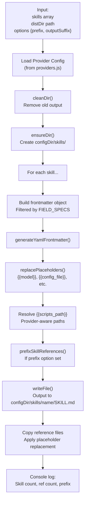
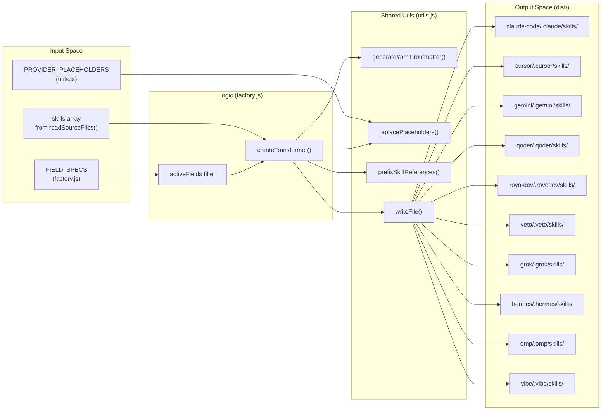

<!-- source: DeepWiki mcp.deepwiki.com · repo pbakaus/impeccable · page 6.1 Provider Transformers and Harness Matrix · fetched 2026-10-30 -->

# Provider Transformers and Harness Matrix

<details>
<summary>Relevant source files</summary>

The following files were used as context for generating this wiki page:

- [.agent/skills/impeccable/SKILL.md](.agent/skills/impeccable/SKILL.md)
- [.gitattributes](.gitattributes)
- [.github/workflows/ci.yml](.github/workflows/ci.yml)
- [.github/workflows/sync-generated-output.yml](.github/workflows/sync-generated-output.yml)
- [.gitignore](.gitignore)
- [.hermes/skills/impeccable/SKILL.md](.hermes/skills/impeccable/SKILL.md)
- [.vibe/skills/impeccable/SKILL.md](.vibe/skills/impeccable/SKILL.md)
- [AGENTS.md](AGENTS.md)
- [CLAUDE.md](CLAUDE.md)
- [README.md](README.md)
- [README.npm.md](README.npm.md)
- [crates/context/src/hook_markers.rs](crates/context/src/hook_markers.rs)
- [crates/context/src/pin.rs](crates/context/src/pin.rs)
- [crates/hook/src/admin.rs](crates/hook/src/admin.rs)
- [crates/skills/src/bundle.rs](crates/skills/src/bundle.rs)
- [crates/skills/src/commands.rs](crates/skills/src/commands.rs)
- [crates/skills/src/hook_manifest.rs](crates/skills/src/hook_manifest.rs)
- [crates/skills/src/providers.rs](crates/skills/src/providers.rs)
- [crates/skills/tests/drift_ports_tests.rs](crates/skills/tests/drift_ports_tests.rs)
- [crates/skills/tests/hook_manifest_tests.rs](crates/skills/tests/hook_manifest_tests.rs)
- [docs/HARNESSES.md](docs/HARNESSES.md)
- [scripts/build.js](scripts/build.js)
- [scripts/lib/transformers/factory.js](scripts/lib/transformers/factory.js)
- [scripts/lib/transformers/index.js](scripts/lib/transformers/index.js)
- [scripts/lib/transformers/providers.js](scripts/lib/transformers/providers.js)
- [scripts/lib/utils.js](scripts/lib/utils.js)
- [scripts/test-suites.mjs](scripts/test-suites.mjs)
- [tests/build.test.js](tests/build.test.js)
- [tests/lib/transformers/providers.test.js](tests/lib/transformers/providers.test.js)

</details>


## Purpose and Scope

Provider transformations convert universal source skills into platform-specific formats for multiple AI coding tools including Claude Code, Cursor, Gemini, Codex, Agents (VS Code Copilot), Kiro, OpenCode, Pi, Trae, Qoder, and Rovo Dev [scripts/build.js:6-13](). Each transformer adapts frontmatter structure, argument syntax, and placeholder values to match the target platform's capabilities and directory conventions as defined in the `HARNESSES.md` capabilities matrix [docs/HARNESSES.md:1-106]().

This page covers the transformation layer of the build pipeline. For the overall build process, see **Build Pipeline Stages (3.1)**. For placeholder replacement details, see **Placeholder System (3.3)**. For prefix handling, see **Prefix Strategy (3.4)**.

**Sources:** [docs/HARNESSES.md:1-106](), [scripts/lib/transformers/providers.js:1-125](), [scripts/build.js:1-16]()

---

## Transformer Architecture

The transformation system uses a factory pattern. A central `createTransformer` function in `factory.js` generates provider-specific transformer functions based on a configuration object defined in `providers.js` [scripts/lib/transformers/factory.js:156-167]().

### Common Workflow

The build system iterates through all configured providers, applying standard and prefixed passes to generate the final distribution artifacts.

Title: Provider Transformation Pipeline


**Sources:** [scripts/lib/transformers/providers.js:12-125](), [scripts/lib/transformers/factory.js:156-240](), [scripts/lib/utils.js:128-200]()

---

## Provider Format Comparison

The following table summarizes how different providers handle frontmatter and directory structures, based on the `HARNESSES.md` reference and `PROVIDERS` configuration.

| Provider | Config Dir | Frontmatter Support | Special Considerations |
|----------|-----------|-------------------|-----------------|
| **Claude Code** | `.claude` | `user-invocable`, `argument-hint`, `allowed-tools` | Supports `claude-md` agent format; uses `settings.json` for hooks [scripts/lib/transformers/providers.js:32]() |
| **Cursor** | `.cursor` | `license`, `compatibility`, `metadata` | Minimal frontmatter; uses `hooks.json` [scripts/lib/transformers/providers.js:21]() |
| **Gemini** | `.gemini` | `name`, `description` only | Validates only name/description [docs/HARNESSES.md:56]() |
| **Codex** | `.codex` | Minimal (sidecar preferred) | Supports `codex-toml` agent format; uses `hooks.json` [scripts/lib/transformers/providers.js:53]() |
| **Agents** | `.agents` | Minimal | Used for Codex Repo Skills [scripts/lib/transformers/providers.js:59]() |
| **GitHub** | `.github` | `user-invocable`, `argument-hint`, `license` | Maps to Copilot; uses `.github/hooks/impeccable.json` [scripts/lib/transformers/providers.js:73]() |
| **Qoder** | `.qoder` | `user-invocable`, `argument-hint`, `allowed-tools` | Full standard support [scripts/lib/transformers/providers.js:101]() |
| **Rovo Dev** | `.rovodev` | `user-invocable`, `argument-hint`, `allowed-tools` | Atlassian specific [scripts/lib/transformers/providers.js:123]() |
| **Veto** | `.veto` | `license`, `compatibility`, `metadata` | No hook support; packaged skill under `~/.veto/skills/` [scripts/lib/transformers/providers.js:175]() |
| **Grok Build** | `.grok` | `user-invocable`, `argument-hint`, `license` | Requires project folder trust for hooks (`.grok/hooks/`) [scripts/lib/transformers/providers.js:180]() |
| **Hermes Agent** | `.hermes` | `user-invocable`, `argument-hint`, `license` | Uses `.hermes/hooks/` for hooks [scripts/lib/transformers/providers.js:190]() |
| **Oh My Pi** | `.omp` | `license`, `compatibility`, `metadata`, `allowed-tools` | Full standard support [scripts/lib/transformers/providers.js:130]() |
| **Mistral Vibe** | `.vibe` | `user-invocable`, `license`, `compatibility`, `metadata`, `allowed-tools` | Full standard support [scripts/lib/transformers/providers.js:168]() |

**Sources:** [docs/HARNESSES.md:34-50](), [docs/HARNESSES.md:69-82](), [scripts/lib/transformers/providers.js:12-125](), [scripts/lib/transformers/providers.js:163-215]()

---

## Transformation Flow with Code Entities

The diagram below maps the transformation process to specific functions and data structures within the `scripts/lib/` directory.

Title: Code Entity Mapping for Transformations


**Sources:** [scripts/lib/transformers/index.js:7-17](), [scripts/lib/transformers/providers.js:12-125](), [scripts/lib/utils.js:128-200](), [scripts/lib/transformers/factory.js:23-51]()

---

## Claude Code Transformer

### Output Format
Claude Code supports the most expansive frontmatter, including the `allowed-tools` field and `user-invocable` flags [docs/HARNESSES.md:34-50](). It is the primary target for the Agent Skills Standard.

```yaml
---
name: impeccable
description: Use when the user wants to design...
version: 3.9.1
user-invocable: true
argument-hint: "[craft|shape · audit|critique · animate|bolder|colorize|delight|layout|overdrive|quieter|typeset · adapt|clarify|distill · harden|onboard|optimize|polish · init|document|extract|live] [target]"
allowed-tools:
  - Bash(npx impeccable *)
---
```

### Implementation Details
The `claude-code` config in `providers.js` enables a wide range of `frontmatterFields` and specifies the `claude-md` agent format [scripts/lib/transformers/providers.js:23-33]().

**Key Features:**
- **Agent Format:** Emits `.claude/agents/` files in Markdown with YAML frontmatter [scripts/lib/transformers/factory.js:118-130]().
- **Tools:** Supports `allowed-tools` metadata for fine-grained tool permissions [docs/HARNESSES.md:45]().
- **Dynamic Hints:** Replaces `{{command_hint}}` in the `argument-hint` field by reading `command-metadata.json` and grouping commands by category using middle dots [scripts/lib/transformers/factory.js:210-222]().
- **Hooks:** Project-local hooks land in `.claude/settings.local.json` during installation via the CLI to avoid conflicts with team-shared `settings.json` [cli/bin/commands/skills.mjs:104]().

**Sources:** [scripts/lib/transformers/providers.js:23-33](), [docs/HARNESSES.md:34-50](), [scripts/lib/transformers/factory.js:210-222](), [cli/bin/commands/skills.mjs:98-105]()

---

## Codex and Agents Transformers

### Output Format
Codex and Agents transformers focus on specific directory structures. Codex uses `.codex` while Agents (Repo Skills) uses `.agents` [scripts/lib/transformers/providers.js:41-65]().

### Implementation Details
- **Agent Format:** Codex auto-discovers subagents bundled inside the skill's `agents/` folder. The `createTransformer` factory handles this via the `CODEX_SKILL_PROVIDERS` set, ensuring TOML agent files are generated for these targets [scripts/lib/transformers/factory.js:57](), [scripts/lib/transformers/factory.js:133-138]().
- **Metadata:** Both have `writeOpenAIMetadata: true`, which triggers the creation of sidecar metadata files containing display names and short descriptions [scripts/lib/transformers/factory.js:73-82](), [scripts/lib/transformers/providers.js:47]().
- **Hooks:** Codex CLI hooks require a `/hooks` trust ceremony and ship under a `.codex/hooks.json` manifest [docs/HARNESSES.md:58-67]().

**Sources:** [scripts/lib/transformers/providers.js:41-65](), [scripts/lib/transformers/factory.js:53-116](), [docs/HARNESSES.md:53-58]()

---

## Gemini Transformer

### Output Format
Gemini CLI validates only `name` and `description`. Other fields are ignored or may cause validation warnings [docs/HARNESSES.md:56]().

### Implementation Details
The Gemini transformer is configured with an empty `frontmatterFields` array, ensuring only the baseline required fields are emitted [scripts/lib/transformers/providers.js:39]().

**Body Processing:**
All specific argument placeholders are handled via the universal `replacePlaceholders` logic, but Gemini is noted for ignoring advanced frontmatter metadata [docs/HARNESSES.md:56]().

**Sources:** [scripts/lib/transformers/providers.js:34-40](), [docs/HARNESSES.md:56]()

---

## Specialized Transformers (Trae, Rovo Dev, Pi, Qoder, Veto, Grok, Hermes, OMP, Vibe)

### Trae (China and International)
Trae is handled as two separate providers (`trae` and `trae-cn`). Both support `user-invocable` and `argument-hint` and output to their respective dot-directories (`.trae` and `.trae-cn`) [scripts/lib/transformers/providers.js:103-117]().

**Sources:** [scripts/lib/transformers/providers.js:103-117]()

### Rovo Dev and Qoder
Rovo Dev (`.rovodev`) and Qoder (`.qoder`) both support the full suite of frontmatter fields including `allowed-tools` [scripts/lib/transformers/providers.js:96-102](), [scripts/lib/transformers/providers.js:118-124]().

**Sources:** [scripts/lib/transformers/providers.js:96-102](), [scripts/lib/transformers/providers.js:118-124]()

### Pi (Project Indigo)
Pi utilizes a specific global directory override: while project-level skills live in `.pi/skills/`, global skills are discovered from `~/.pi/agent/skills/` [cli/bin/commands/skills.mjs:65-67]().

**Sources:** [cli/bin/commands/skills.mjs:65-67](), [scripts/lib/transformers/providers.js:89-95]()

### Veto
Veto (`.veto`) supports `license`, `compatibility`, and `metadata` fields. It does not have native hook support; the packaged skill is installed under `~/.veto/skills/` [scripts/lib/transformers/providers.js:171-176]().

**Sources:** [scripts/lib/transformers/providers.js:171-176]()

### Grok Build
Grok Build (`.grok`) supports `user-invocable`, `argument-hint`, and `license`. It uses `.grok/hooks/` for hooks, which requires project folder trust [scripts/lib/transformers/providers.js:177-182]().

**Sources:** [scripts/lib/transformers/providers.js:177-182]()

### Hermes Agent
Hermes Agent (`.hermes`) supports `user-invocable`, `argument-hint`, and `license`. Hooks are managed under `.hermes/hooks/` [scripts/lib/transformers/providers.js:187-192]().

**Sources:** [scripts/lib/transformers/providers.js:187-192]()

### Oh My Pi
Oh My Pi (`.omp`) supports `license`, `compatibility`, `metadata`, and `allowed-tools` [scripts/lib/transformers/providers.js:128-133]().

**Sources:** [scripts/lib/transformers/providers.js:128-133]()

### Mistral Vibe
Mistral Vibe (`.vibe`) supports `user-invocable`, `license`, `compatibility`, `metadata`, and `allowed-tools` [scripts/lib/transformers/providers.js:166-170]().

**Sources:** [scripts/lib/transformers/providers.js:166-170]()

---

## Common Transformation Logic

### Field Extraction and Parsing
The `parseFrontmatter` utility in `utils.js` handles the initial extraction of YAML from source files, coercing booleans for keys like `user-invocable` and handling nested arrays for tools [scripts/lib/utils.js:128-200]().

**Sources:** [scripts/lib/utils.js:128-200](), [tests/lib/utils.test.js:19-127]()

### Script and Reference Handling
Each transformer automatically handles subdirectories:
- **Reference Files:** Copied from `skill/reference/` to the provider's `skills/{name}/reference/` directory [scripts/lib/transformers/factory.js:242-254]().
- **Scripts:** Copied to a `scripts/` folder, while preserving `PER_PROJECT_SCRIPT_ARTIFACTS` like `config.json` via `stashPerProjectArtifacts` and `restorePerProjectArtifacts` to ensure local state isn't destroyed on rebuilds [scripts/lib/utils.js:10](), [scripts/lib/utils.js:29-45]().
- **Detector Bundle:** The build process bundles the anti-pattern engine into `scripts/detector/` to make skills self-contained [scripts/lib/utils.js:12-23]().

**Sources:** [scripts/lib/utils.js:10-23](), [scripts/lib/utils.js:29-45](), [scripts/lib/transformers/factory.js:242-254]()

---

