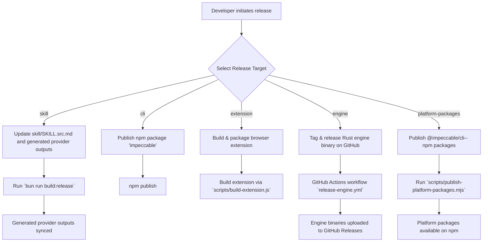
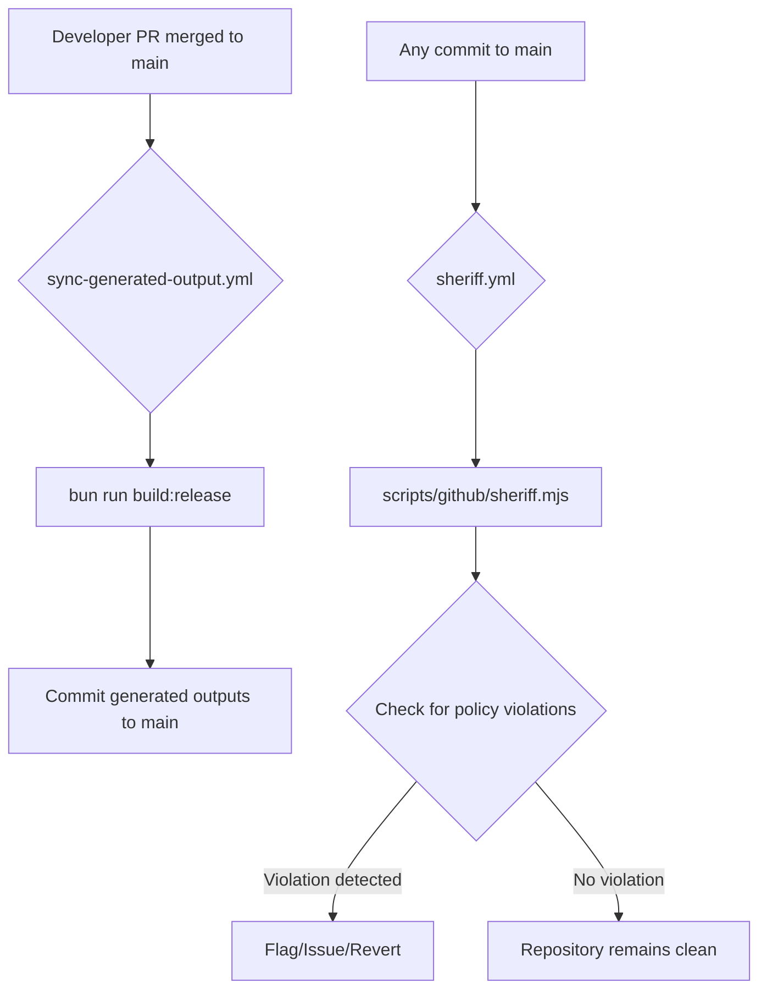
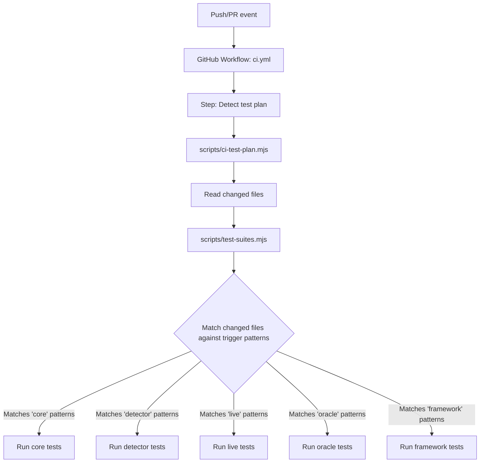

<!-- source: DeepWiki mcp.deepwiki.com · repo pbakaus/impeccable · page 6.3 Releases and CI Workflows · fetched 2026-10-30 -->

# 6.3. Releases and CI Workflows

<details>
<summary>Relevant source files</summary>

The following files were used as context for generating this wiki page:

- [.claude-plugin/marketplace.json](.claude-plugin/marketplace.json)
- [.claude-plugin/plugin.json](.claude-plugin/plugin.json)
- [.github/workflows/ci.yml](.github/workflows/ci.yml)
- [.github/workflows/release-engine.yml](.github/workflows/release-engine.yml)
- [.github/workflows/sheriff.yml](.github/workflows/sheriff.yml)
- [.github/workflows/sync-generated-output.yml](.github/workflows/sync-generated-output.yml)
- [.gitignore](.gitignore)
- [AGENTS.md](AGENTS.md)
- [CLAUDE.md](CLAUDE.md)
- [Cargo.lock](Cargo.lock)
- [Cargo.toml](Cargo.toml)
- [ENGINE_VERSION](ENGINE_VERSION)
- [README.md](README.md)
- [README.npm.md](README.npm.md)
- [bun.lock](bun.lock)
- [crates/context/src/pin.rs](crates/context/src/pin.rs)
- [crates/skills/Cargo.toml](crates/skills/Cargo.toml)
- [crates/skills/src/bundle_signature.rs](crates/skills/src/bundle_signature.rs)
- [crates/skills/src/lib.rs](crates/skills/src/lib.rs)
- [crates/skills/src/providers.rs](crates/skills/src/providers.rs)
- [docs/BUNDLE-SIGNING.md](docs/BUNDLE-SIGNING.md)
- [docs/HARNESSES.md](docs/HARNESSES.md)
- [docs/WINDOWS-SIGNING.md](docs/WINDOWS-SIGNING.md)
- [package.json](package.json)
- [scripts/build.js](scripts/build.js)
- [scripts/bundle-signing-keys.json](scripts/bundle-signing-keys.json)
- [scripts/github/sheriff.mjs](scripts/github/sheriff.mjs)
- [scripts/lib/transformers/index.js](scripts/lib/transformers/index.js)
- [scripts/lib/transformers/providers.js](scripts/lib/transformers/providers.js)
- [scripts/lib/utils.js](scripts/lib/utils.js)
- [scripts/lib/zip.js](scripts/lib/zip.js)
- [scripts/release.mjs](scripts/release.mjs)
- [scripts/test-suites.mjs](scripts/test-suites.mjs)
- [skill/scripts/VERSION](skill/scripts/VERSION)
- [tests/github-sheriff.test.mjs](tests/github-sheriff.test.mjs)
- [tests/lib/transformers/providers.test.js](tests/lib/transformers/providers.test.js)
- [tests/release-engine-workflow.test.js](tests/release-engine-workflow.test.js)

</details>


This page details the release process for the Impeccable project, covering the various targets (`skill`, `cli`, `extension`, `engine`), the publishing of platform-specific packages, checks for engine releases, and the continuous integration (CI) workflows. It also explains how CI selects test suites based on code changes and the Windows signing process.

## Release Targets

The `scripts/release.mjs` script orchestrates the release process for different components of the Impeccable project. Each target corresponds to a distinct part of the distribution.

| Target | Description | `package.json` Script |
| :----- | :---------- | :-------------------- |
| `skill` | Updates the skill source and generated provider outputs. | `release:skill` [package.json:77]() |
| `cli` | Publishes the `impeccable` npm package. | `release:cli` [package.json:78]() |
| `extension` | Builds and packages the browser extension. | `release:ext` [package.json:79]() |
| `engine` | Tags and releases the Rust engine binary. | `release:engine` [package.json:80]() |
| `platform-packages` | Publishes platform-specific engine binaries to npm. | `release:platform-packages` [package.json:81]() |

### Release Workflow Overview



Sources: [package.json:77-81](), [scripts/release.mjs]()

## Platform Package Publishing

The `impeccable` npm package is a small launcher that relies on platform-specific engine binaries. These binaries are published as optional dependencies under the `@impeccable/cli-<os>-<arch>` namespace.

The `scripts/publish-platform-packages.mjs` script is responsible for:
1.  Reading the `ENGINE_VERSION` from the root of the repository [ENGINE_VERSION]().
2.  Fetching the corresponding engine binaries from GitHub Releases.
3.  Creating and publishing platform-specific npm packages (e.g., `@impeccable/cli-darwin-arm64`) [package.json:86-90]().

These optional dependencies allow the `impeccable` CLI to automatically download the correct engine binary for the user's system, or fall back to a cached version or a one-time download if the package is not available [README.npm.md:5-6]().

```mermaid
graph TD
    A[ENGINE_VERSION] --> B{scripts/publish-platform-packages.mjs};
    B --> C[Fetch engine binaries from GitHub Releases];
    C --> D{For each platform (darwin-arm64, linux-x64, etc.)};
    D --> E[Create npm package @impeccable/cli-<os>-<arch>];
    E --> F[Publish to npm registry];
    F --> G[impeccable npm package optionalDependencies];
```

Sources: [package.json:86-90](), [ENGINE_VERSION](), [scripts/publish-platform-packages.mjs](), [README.npm.md:5-6]()

## Engine Release Checks

The `scripts/check-engine-release.mjs` script performs checks to ensure the integrity and correctness of an engine release. This includes verifying the `ENGINE_VERSION` and ensuring that the release process adheres to defined standards.

The `release-engine.yml` GitHub Actions workflow is triggered when a new tag matching `engine-v*` is pushed. This workflow builds the engine for all supported platforms and uploads the binaries to GitHub Releases.

```mermaid
graph TD
    A[Push tag engine-vX.Y.Z] --> B[GitHub Workflow: release-engine.yml];
    B --> C[Build engine for all platforms (Rust)];
    C --> D[Upload binaries to GitHub Releases];
    D --> E[scripts/check-engine-release.mjs];
    E --> F{Verify release integrity};
    F -- "Success" --> G[Engine release validated];
    F -- "Failure" --> H[Release blocked/flagged];
```

Sources: [package.json:82](), [.github/workflows/release-engine.yml](), [scripts/check-engine-release.mjs]()

## `sync-generated-output` and `sheriff` Workflows

The repository maintains a policy where generated artifacts, such as provider-specific skill directories (`.agents/`, `.claude/`, `.cursor/`, etc.) and the `plugin/` directory, are tracked in Git [AGENTS.md:28](). This allows for direct installation from the repository.

To manage these generated files, two GitHub Actions workflows are in place:

1.  **`sync-generated-output.yml`**: This workflow runs on `main` branch merges. It executes `bun run build:release` and commits any changes to the generated provider outputs directly back to `main`. This ensures that the tracked artifacts are always up-to-date with the latest source changes [AGENTS.md:30-31]().

2.  **`sheriff.yml`**: This workflow acts as a guardian for the repository. It monitors for unexpected changes to generated files or other policy violations. If a violation is detected (e.g., a generated file is modified manually and not through the build process), the sheriff workflow can flag it, open an issue, or even revert the change. The `scripts/github/sheriff.mjs` script contains the logic for these checks.



Sources: [AGENTS.md:28-31](), [.github/workflows/sync-generated-output.yml](), [.github/workflows/sheriff.yml](), [scripts/github/sheriff.mjs]()

## CI Change-Based Suite Selection

The main CI workflow (`.github/workflows/ci.yml`) employs a change-based test suite selection mechanism to optimize execution time. Instead of running all tests on every push or pull request, it determines which test suites are relevant based on the files modified in a commit or PR.

The `scripts/ci-test-plan.mjs` script analyzes the changed files against predefined trigger patterns in `scripts/test-suites.mjs`. Each test suite (e.g., `core`, `oracle`, `detector`, `live`, `framework`) has a list of file patterns that, if matched, will trigger that suite to run [scripts/test-suites.mjs:30-175]().

This approach significantly reduces CI duration by only executing necessary tests.



Sources: [.github/workflows/ci.yml:36-65](), [scripts/ci-test-plan.mjs](), [scripts/test-suites.mjs:30-175]()

## Windows Signing

For Windows distributions, the engine binaries and potentially other executables require digital signing to ensure trust and prevent security warnings. The `docs/WINDOWS-SIGNING.md` and `docs/BUNDLE-SIGNING.md` documents outline the procedures and requirements for this process.

The signing process typically involves:
1.  **Code Signing Certificate**: Obtaining a valid code signing certificate from a trusted Certificate Authority.
2.  **Signing Tool**: Using a tool like `signtool.exe` (part of the Windows SDK) to apply the digital signature.
3.  **Timestamping**: Including a timestamp in the signature to ensure its validity even after the certificate expires.

The `scripts/bundle-signing-keys.json` file might contain configuration or metadata related to the signing keys, though the actual private keys are never committed to the repository. The `crates/skills/src/bundle_signature.rs` module likely handles the verification or generation of bundle signatures within the Rust engine itself.

```mermaid
graph TD
    A[Windows Engine Binary] --> B{Code Signing Certificate};
    B --> C[Signing Tool (signtool.exe)];
    C --> D[Timestamp Server];
    D --> E[Signed Windows Binary];
    E --> F[crates/skills/src/bundle_signature.rs (Verification)];
    F --> G[Trusted Impeccable Binary];
```

Sources: [docs/WINDOWS-SIGNING.md](), [docs/BUNDLE-SIGNING.md](), [scripts/bundle-signing-keys.json](), [crates/skills/src/bundle_signature.rs]()

---

