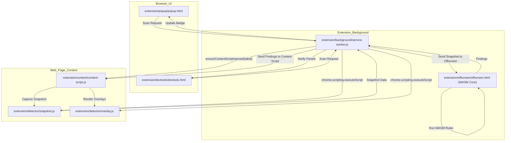
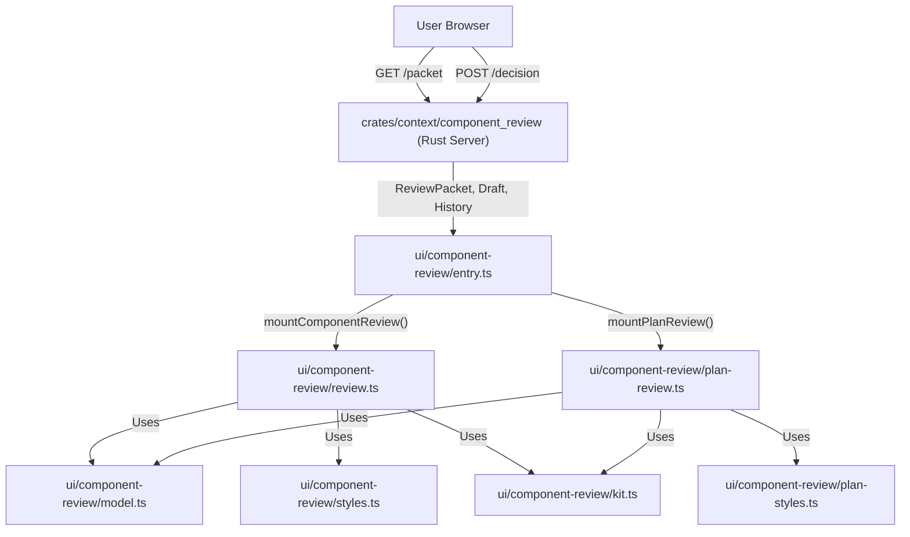

<!-- source: DeepWiki mcp.deepwiki.com · repo pbakaus/impeccable · page 7 Chrome Extension and Review UI · fetched 2026-10-30 -->

# Chrome Extension and Review UI

Relevant source files

The following files were used as context for generating this wiki page:

- [crates/context/assets/component-review.js](crates/context/assets/component-review.js)
- [extension/background/service-worker.js](extension/background/service-worker.js)
- [extension/manifest.json](extension/manifest.json)
- [scripts/build-extension.js](scripts/build-extension.js)
- [tests/extension-build.test.mjs](tests/extension-build.test.mjs)
- [tests/fixtures/extension-scan/README.md](tests/fixtures/extension-scan/README.md)
- [tests/fixtures/extension-scan/clean.html](tests/fixtures/extension-scan/clean.html)
- [tests/fixtures/extension-scan/flagged.html](tests/fixtures/extension-scan/flagged.html)
- [ui/component-review/entry.ts](ui/component-review/entry.ts)
- [ui/component-review/kit.ts](ui/component-review/kit.ts)
- [ui/component-review/plan-review.ts](ui/component-review/plan-review.ts)
- [ui/component-review/plan-styles.ts](ui/component-review/plan-styles.ts)
- [ui/component-review/styles.ts](ui/component-review/styles.ts)

This page provides a high-level overview of the browser-facing components of Impeccable: the Chrome DevTools extension and the standalone Component Review UI application. These surfaces allow users to interact with the anti-pattern detection engine and review design artifacts outside of the agent's direct interaction.

## 7.1. Extension Internals

The Impeccable Chrome Extension integrates directly into the browser to detect and visualize UI anti-patterns on any web page. It leverages Chrome's DevTools API to provide a dedicated panel, a sidebar in the Elements panel, and a browser action popup. The extension is built to be cross-browser compatible, supporting both Chrome and Firefox.

The extension's architecture is based on Manifest V3 (MV3), utilizing a service worker as its central hub for message routing and state management. It dynamically injects content scripts and the WebAssembly-based detection core into the page context to perform its analysis.

For details on the extension's manifest, service worker, content script, offscreen document (for CSP-safe WASM execution), DevTools panel, sidebar, popup, shared styles, and the build process, see [Extension Internals](#7.1).

### Extension Architecture

The extension follows the Manifest V3 (MV3) architecture, utilizing a service worker for message routing and state management, while injecting the detection engine into the page context to access computed styles and DOM structures.

#### Component Communication Flow

The system uses a hub-and-spoke messaging model centered on the Service Worker.

| Component | Role | File Reference |
| :--- | :--- | :--- |
| **Manifest** | Defines permissions (`scripting`, `activeTab`, `storage`, `webNavigation`, `offscreen`) and entry points. | [extension/manifest.json:1-37]() |
| **Service Worker** | Acts as the central message router, maintains per-tab state, and orchestrates the offscreen document. | [extension/background/service-worker.js:1-10]() |
| **Content Script** | Bridges the extension and the page; handles snapshot capture and overlay rendering. | [extension/background/service-worker.js:142-146]() |
| **Offscreen Document** | Hosts the WebAssembly rule core in a CSP-safe environment. | [extension/background/service-worker.js:18-19, 86-98]() |
| **DevTools Page** | Bootstraps the Impeccable panel and sidebar in DevTools. | [extension/manifest.json:22]() |
| **Popup** | Quick-access UI for scanning and toggling overlays from the browser toolbar. | [extension/manifest.json:24]() |

#### Message Routing Diagram

This diagram illustrates how messages flow from the UI components through the `service-worker.js` to the Page Context and the Offscreen Document.

Sources: [extension/background/service-worker.js:1-10](), [extension/background/service-worker.js:18-19](), [extension/background/service-worker.js:51-58](), [extension/background/service-worker.js:86-98](), [extension/background/service-worker.js:138-155](), [extension/manifest.json:20-25]()

### Core Components

#### Service Worker (Background)
The service worker (`extension/background/service-worker.js`) is the central orchestrator. It maintains `tabState` for each active tab, tracking findings, overlay visibility, and content script injection status [extension/background/service-worker.js:12-22](). It is responsible for updating the extension badge with the count of findings [extension/background/service-worker.js:27-49]().

A key responsibility of the service worker is managing the offscreen document (`extension/offscreen/offscreen.html`), which hosts the WebAssembly rule core. This ensures that the WASM execution is compliant with Content Security Policies (CSPs) of the scanned pages [extension/background/service-worker.js:78-130](). For Firefox, which does not support Chrome's `offscreen` API, the service worker dynamically creates a hidden iframe within its own background page to host the WASM core [extension/background/service-worker.js:100-110]().

#### Content Script & Injection
The content script (`extension/content/content-script.js`), along with `detector/snapshot.js` and `detector/overlay.js`, is injected on-demand into the target page by the service worker using `chrome.scripting.executeScript` [extension/background/service-worker.js:138-155](). This on-demand injection minimizes the extension's footprint when not actively used. The `snapshot.js` script captures the DOM and computed styles, while `overlay.js` is responsible for rendering visual feedback on the page.

#### Build Process
The extension is built using `scripts/build-extension.js`. This script performs several critical steps:
1.  **Detector Build**: It runs `cargo xtask bundle` to compile the Rust rule core into WebAssembly (`core_bg.wasm`) and generate associated JavaScript (`core.js`, `snapshot.js`, `overlay.js`, `antipatterns.json`) into `extension/detector/` [scripts/build-extension.js:40-65]().
2.  **File Verification**: It checks that all files referenced in `extension/manifest.json` and `extension/background/service-worker.js` actually exist [scripts/build-extension.js:67-120]().
3.  **Packaging**: It creates `extension.zip` for Chrome and `extension-firefox.zip` for Firefox, deriving a Firefox-compatible manifest from the Chrome source [scripts/build-extension.js:122-157](). The Firefox manifest adjusts the background script declaration and removes the `offscreen` permission [scripts/build-extension.js:147-154]().

Sources: [extension/manifest.json:1-37](), [extension/background/service-worker.js:1-373](), [scripts/build-extension.js:1-188](), [tests/extension-build.test.mjs:1-200]()

## 7.2. Component Review UI

The Component Review UI is a standalone web application designed for reviewing design components and plans. It provides a rich interface for visual inspection, feedback, and decision-making on design artifacts generated or processed by the Impeccable agent. This UI is served by a dedicated server component within the Rust `crates/context/component_review` module.

The UI is built using web components and leverages a vendored design system kit (`ui/component-review/kit.ts`) for consistent styling. It supports different review modes, including detailed component inspection and a plan/asset review stage.

For details on the `ui/component-review` module (kit, entry point, model, plan review, styles, viewport, fonts/vendor) and its server in `crates/context/component_review`, plus associated demos, see [Component Review UI](#7.2).

### Architecture

The Component Review UI is a single-page application served by a Rust backend.

Sources: [ui/component-review/entry.ts:37-56](), [ui/component-review/review.ts]() (not shown), [ui/component-review/plan-review.ts:52-53](), [ui/component-review/model.ts]() (not shown), [ui/component-review/kit.ts:1-7](), [ui/component-review/styles.ts:1-3](), [ui/component-review/plan-styles.ts:1-5]()

### Key Components

*   **Entry Point (`ui/component-review/entry.ts`)**: This script initializes the review application. It fetches the `ReviewPacket` and other state from the `/packet` endpoint, then mounts either the standard component review (`mountComponentReview`) or the plan review (`mountPlanReview`) based on the packet type [ui/component-review/entry.ts:37-56](). It also handles font loading and displays error messages if the review fails to load [ui/component-review/entry.ts:7-11, 15-35, 58-58]().
*   **Review Logic (`ui/component-review/review.ts` / `ui/component-review/plan-review.ts`)**: These modules contain the core logic for rendering the review UI, handling user interactions, and managing the review state. `plan-review.ts` specifically handles the "plan and asset review" stage, which has a distinct UI and workflow [ui/component-review/plan-review.ts:1-5]().
*   **Styling (`ui/component-review/styles.ts`, `ui/component-review/plan-styles.ts`, `ui/component-review/kit.ts`)**:
    *   `kit.ts` imports and processes the core design system tokens and styles from `vendor/kit-css`, ensuring consistency with the Impeccable site [ui/component-review/kit.ts:1-7]().
    *   `styles.ts` provides general styling for the component review UI [ui/component-review/styles.ts:1-19]().
    *   `plan-styles.ts` provides specific styling for the plan and asset review stage, building upon the base kit [ui/component-review/plan-styles.ts:1-80]().
*   **Model (`ui/component-review/model.ts` / `ui/component-review/plan-model.ts`)**: These files define the data structures for review packets, drafts, decisions, and history, ensuring type safety and consistency across the UI and backend.
*   **Server (`crates/context/assets/component-review.js`)**: This JavaScript file, embedded within the Rust context crate, contains helper functions and constants used by the review UI, such as state calculations (`we`, `bn`), draft management (`mi`, `wi`), submission logic (`fi`), and utility functions for component grouping and layout (`zi`, `Ie`) [crates/context/assets/component-review.js:1-8]().

Sources: [ui/component-review/kit.ts:1-9](), [ui/component-review/styles.ts:1-191](), [ui/component-review/plan-styles.ts:1-240](), [crates/context/assets/component-review.js:1-1633](), [ui/component-review/entry.ts:1-58](), [ui/component-review/plan-review.ts:1-631]()

---

