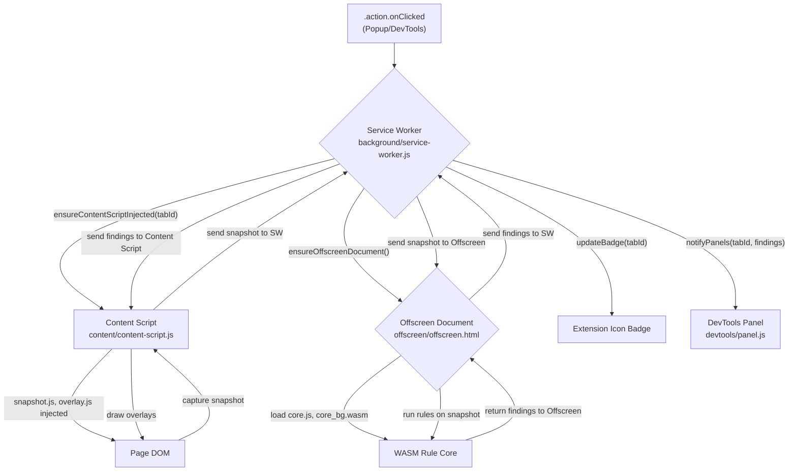

<!-- source: DeepWiki mcp.deepwiki.com · repo pbakaus/impeccable · page 7.1 Extension Internals · fetched 2026-10-30 -->

# Extension Internals

<details>
<summary>Relevant source files</summary>

The following files were used as context for generating this wiki page:

- [extension/background/service-worker.js](extension/background/service-worker.js)
- [extension/content/content-script.js](extension/content/content-script.js)
- [extension/devtools/devtools.js](extension/devtools/devtools.js)
- [extension/devtools/panel.css](extension/devtools/panel.css)
- [extension/devtools/panel.html](extension/devtools/panel.html)
- [extension/devtools/panel.js](extension/devtools/panel.js)
- [extension/devtools/sidebar.css](extension/devtools/sidebar.css)
- [extension/devtools/sidebar.html](extension/devtools/sidebar.html)
- [extension/devtools/sidebar.js](extension/devtools/sidebar.js)
- [extension/manifest.json](extension/manifest.json)
- [extension/popup/popup.css](extension/popup/popup.css)
- [extension/popup/popup.html](extension/popup/popup.html)
- [extension/popup/popup.js](extension/popup/popup.js)
- [extension/shared/kinpaku.css](extension/shared/kinpaku.css)
- [scripts/build-extension.js](scripts/build-extension.js)
- [tests/extension-build.test.mjs](tests/extension-build.test.mjs)
- [tests/fixtures/extension-scan/README.md](tests/fixtures/extension-scan/README.md)
- [tests/fixtures/extension-scan/clean.html](tests/fixtures/extension-scan/clean.html)
- [tests/fixtures/extension-scan/flagged.html](tests/fixtures/extension-scan/flagged.html)

</details>


This page details the internal architecture and components of the Impeccable Chrome Extension. It covers the `manifest.json` configuration, the role of the service worker, content scripts, the offscreen document for WebAssembly execution, DevTools panel and sidebar, popup UI, shared styles, and the `build-extension.js` script responsible for packaging.

## Manifest Configuration

The `extension/manifest.json` file defines the core properties and permissions of the Chrome Extension. It specifies the extension's name, description, version, and crucial permissions required for its operation.

```json
{
  "manifest_version": 3,
  "name": "Impeccable",
  "description": "Detect common UI anti-patterns in any web page",
  "version": "1.4.0",
  "permissions": [
    "activeTab",
    "scripting",
    "storage",
    "webNavigation",
    "offscreen"
  ],
  "host_permissions": [
    "<all_urls>"
  ],
  "content_security_policy": {
    "extension_pages": "script-src 'self' 'wasm-unsafe-eval'; object-src 'self'"
  },
  "background": {
    "service_worker": "background/service-worker.js"
  },
  "devtools_page": "devtools/devtools.html",
  "action": {
    "default_popup": "popup/popup.html",
    "default_icon": {
      "16": "icons/icon-16.png",
      "32": "icons/icon-32.png",
      "48": "icons/icon-48.png",
      "128": "icons/icon-128.png"
    }
  },
  "icons": {
    "16": "icons/icon-16.png",
    "48": "icons/icon-48.png",
    "128": "icons/icon-128.png"
  }
}
```

Key manifest entries include:
*   `manifest_version`: Set to `3` for Manifest V3. [extension/manifest.json:2]()
*   `permissions`:
    *   `activeTab`: Grants temporary access to the currently active tab. [extension/manifest.json:7]()
    *   `scripting`: Allows injecting content scripts. [extension/manifest.json:8]()
    *   `storage`: For storing user settings. [extension/manifest.json:9]()
    *   `webNavigation`: To detect page navigations and trigger rescans. [extension/manifest.json:10]()
    *   `offscreen`: Essential for creating an offscreen document to host WASM. [extension/manifest.json:11]()
*   `host_permissions`: `<all_urls>` allows the extension to interact with any web page. [extension/manifest.json:14]()
*   `content_security_policy`: `extension_pages` is configured to allow `wasm-unsafe-eval` for the WebAssembly module. [extension/manifest.json:16-18]()
*   `background`: Points to `background/service-worker.js` as the service worker. [extension/manifest.json:19-21]()
*   `devtools_page`: Specifies `devtools/devtools.html` as the entry point for the DevTools integration. [extension/manifest.json:22]()
*   `action`: Defines the popup UI (`popup/popup.html`) and default icons. [extension/manifest.json:23-30]()

Sources: [extension/manifest.json:1-37]()

## Service Worker

The service worker (`extension/background/service-worker.js`) acts as the central message router and state manager for the extension. It handles communication between the popup, DevTools panel, and content scripts, and orchestrates the anti-pattern detection process.

### Key Responsibilities

*   **Message Routing:** Routes messages between different parts of the extension (popup, DevTools, content scripts). [extension/background/service-worker.js:4-9]()
*   **Per-Tab State Management:** Maintains `tabState` for each active tab, storing findings, overlay visibility, and injection status. [extension/background/service-worker.js:12-13](), [extension/background/service-worker.js:21-25]()
*   **Badge Updates:** Updates the extension icon badge with the count of anti-pattern findings for the active tab. [extension/background/service-worker.js:27-49]()
*   **Offscreen Document Management:** Manages the lifecycle of the offscreen document (Chrome) or hidden iframe (Firefox) that hosts the WebAssembly rule core. [extension/background/service-worker.js:78-131]()
*   **Content Script Injection:** Injects content scripts (`detector/snapshot.js`, `detector/overlay.js`, `content/content-script.js`) into the active tab on demand. [extension/background/service-worker.js:138-155]()
*   **Scan Orchestration:** Receives scan requests, ensures content scripts and the rule core are ready, and dispatches the scan to the content script. [extension/background/service-worker.js:156-176]()
*   **Settings Retrieval:** Fetches user settings (e.g., disabled rules, line length mode) from `chrome.storage.sync` to configure the scan. [extension/background/service-worker.js:60-76]()

### Offscreen Document (CSP-safe WASM)

The WebAssembly (WASM) rule core, which performs the actual anti-pattern detection, cannot run directly in the content script's isolated world due to Content Security Policy (CSP) restrictions on many web pages. To circumvent this, the service worker utilizes an offscreen document.

*   **Chrome:** Uses `chrome.offscreen.createDocument()` to create a dedicated offscreen document (`offscreen/offscreen.html`). This document runs in its own isolated context, allowing `wasm-unsafe-eval` as specified in the manifest. [extension/background/service-worker.js:86-98]()
*   **Firefox:** Since Firefox does not support `OFFSCREEN_DOCUMENT` context type, the service worker creates a hidden `iframe` within its own background event page to host `offscreen/offscreen.html`. [extension/background/service-worker.js:102-110]()
*   **Purpose:** This ensures the WASM rule core operates under the extension's CSP, not the scanned page's, enabling detection on pages with strict CSPs. [extension/background/service-worker.js:80-81]()
*   **Lifecycle:** The `ensureOffscreenDocument()` function lazily creates and pings the offscreen document to ensure it's ready before any scan. [extension/background/service-worker.js:83-131]()

### Data Flow for a Scan



Sources: [extension/background/service-worker.js:1-373](), [extension/manifest.json:11](), [extension/manifest.json:16-18](), [tests/extension-build.test.mjs:58-65]()

## Content Script

The content script (`extension/content/content-script.js`), along with `detector/snapshot.js` and `detector/overlay.js`, is injected into the web page to interact with its DOM.

*   **Injection:** Injected on demand by the service worker using `chrome.scripting.executeScript()`. [extension/background/service-worker.js:138-146]()
*   **Snapshot Capture:** `detector/snapshot.js` is responsible for capturing a serializable representation of the page's DOM and computed styles.
*   **Overlay Drawing:** `detector/overlay.js` handles drawing visual overlays on the page to highlight detected anti-patterns.
*   **Communication:** Communicates with the service worker to send DOM snapshots for analysis and receive findings for display.

Sources: [extension/background/service-worker.js:144-145]()

## DevTools Panel and Sidebar

The extension integrates with Chrome DevTools, providing a dedicated panel and an Elements sidebar pane for detailed anti-pattern analysis.

### DevTools Page (`devtools/devtools.html`)

This is the entry point for the DevTools integration. It creates the main "Impeccable" panel and the sidebar pane.

*   **Panel Creation:** `chrome.devtools.panels.create()` creates the main panel, loading `devtools/panel.html`. [extension/devtools/devtools.js:9-13]()
*   **Sidebar Pane Creation:** `chrome.devtools.panels.elements.createSidebarPane()` creates a sidebar pane in the Elements panel, loading `devtools/sidebar.html`. [extension/devtools/devtools.js:16-19]()
*   **Lifecycle Port:** Establishes a `lifecyclePort` connection to the service worker to signal DevTools opening/closing and send heartbeat pings to keep the service worker alive. [extension/devtools/devtools.js:23-50]()
*   **Auto-Scan:** Based on user settings (`autoScan`), it can trigger an immediate scan when DevTools opens. [extension/devtools/devtools.js:28-37]()

Sources: [extension/devtools/devtools.js:1-50]()

### DevTools Panel (`devtools/panel.html`, `devtools/panel.js`, `devtools/panel.css`)

The main DevTools panel displays a list of detected anti-patterns and provides controls for scanning and overlay visibility.

*   **UI Elements:** Includes a badge for total findings, a container for findings, rescan and toggle buttons, and a settings section. [extension/devtools/panel.js:36-44]()
*   **Theme Matching:** Adapts to the DevTools theme (light/dark) by adding a `theme-dark` class to the document element. [extension/devtools/panel.js:8-11]()
*   **Port Management:** Uses an auto-reconnecting `port` to communicate with the service worker, handling potential service worker terminations. [extension/devtools/panel.js:18-34]()
*   **Settings:** Loads and renders user settings for disabling rules, line length mode, and spotlight blur. [extension/devtools/panel.js:51-69]()
*   **Finding Presentation:** Organizes findings into categories (AI tells, Quality issues, Advisories) and renders them in a collapsible list. [extension/devtools/panel.js:123-164]()
*   **Interaction:** Allows toggling rules, rescanning the page, and toggling overlays. Clicking a finding inspects the corresponding element in the Elements panel. [extension/devtools/panel.js:153-155](), [extension/devtools/panel.js:167-175]()

Sources: [extension/devtools/panel.js:1-526](), [extension/devtools/panel.html](), [extension/devtools/panel.css:1-653]()

### DevTools Sidebar (`devtools/sidebar.html`, `devtools/sidebar.js`, `devtools/sidebar.css`)

The sidebar pane in the Elements panel shows findings specifically related to the currently selected DOM element.

*   **Element Inspection:** Listens for `chrome.devtools.panels.elements.onSelectionChanged` to update findings based on the inspected element.
*   **Filtered Findings:** Displays only the anti-patterns associated with the selected element.

Sources: [extension/devtools/sidebar.html](), [extension/devtools/sidebar.js](), [extension/devtools/sidebar.css]()

## Popup UI (`popup/popup.html`, `popup/popup.js`, `popup/popup.css`)

The extension's popup provides a quick overview of findings and basic controls.

*   **Count Display:** Shows the total number of anti-patterns found on the current page. [extension/popup/popup.html:19-23]()
*   **Scan Button:** Triggers a manual scan of the active page. [extension/popup/popup.html:25]()
*   **Toggle Overlays Button:** Hides or shows the visual overlays on the page. [extension/popup/popup.html:26]()
*   **Error Display:** Shows messages if a scan fails. [extension/popup/popup.html:29]()
*   **Styling:** Uses `popup.css` for layout and `shared/kinpaku.css` for design tokens. [extension/popup/popup.css:1-175]()

Sources: [extension/popup/popup.html:1-37](), [extension/popup/popup.js](), [extension/popup/popup.css:1-175]()

## Shared Styles (`extension/shared/kinpaku.css`)

The `kinpaku.css` file defines a consistent design system across all extension UI components (popup, DevTools panel, sidebar).

*   **Design Tokens:** Establishes color variables (e.g., `--ks-kinpaku` for gold, `--ks-patina` for verdigris, `--ks-vermilion` for failure), spacing, typography, and shadow effects. [extension/shared/kinpaku.css:48-96]()
*   **Theming:** Implements a single light theme, even within dark DevTools, treating the panel as a "sheet laid on the tool." [extension/shared/kinpaku.css:32-37]()
*   **Severity Language:** Defines visual cues for different finding severities: gold for "AI tells," patina for "Quality issues," and vermilion for scan failures. [extension/shared/kinpaku.css:23-30]()
*   **Typography:** Uses system fonts (`Avenir Next`, `ui-monospace`) as web fonts are not allowed in extensions. [extension/shared/kinpaku.css:102-105]()

Sources: [extension/shared/kinpaku.css:1-217]()

## Build Extension Script (`scripts/build-extension.js`)

The `scripts/build-extension.js` script automates the process of building and packaging the browser extension for Chrome and Firefox.

### Build Steps

1.  **Detector Pieces Build:** Executes `cargo xtask bundle` to compile the Rust anti-pattern rule core into WebAssembly (`core_bg.wasm`) and generate associated JavaScript files (`core.js`, `snapshot.js`, `overlay.js`, `antipatterns.json`). These are placed in `extension/detector/`. [scripts/build-extension.js:40-50]()
    *   The `IMPECCABLE_EXTENSION_SKIP_BUNDLE=1` environment variable can skip this step if the detector pieces already exist. [scripts/build-extension.js:45-46]()
2.  **Referenced File Check:** Verifies that all files referenced in `extension/manifest.json` and `extension/background/service-worker.js` actually exist within the `extension/` directory. [scripts/build-extension.js:67-120]()
3.  **Zip Packaging:**
    *   **Chrome:** Creates `extension.zip` directly from the `extension/` directory. [scripts/build-extension.js:140-142]()
    *   **Firefox:** Derives a Firefox-compatible manifest from the Chrome manifest. This involves:
        *   Changing `background.service_worker` to `background.scripts` (an event page). [scripts/build-extension.js:152-153]()
        *   Removing the `offscreen` permission. [scripts/build-extension.js:154]()
        *   Adding `browser_specific_settings.gecko` for AMO signing. [scripts/build-extension.js:156-157]()
        *   Packages this modified version into `extension-firefox.zip`. [scripts/build-extension.js:144-157]()

### Build Process Diagram

```mermaid
graph TD
    A[Start build-extension.js] --> B{Check IMPECCABLE_EXTENSION_SKIP_BUNDLE};
    B -- No / Missing Pieces --> C[Run `cargo xtask bundle`];
    C --> D[Verify detector pieces in extension/detector/];
    B -- Yes / Pieces Exist --> D;
    D --> E[Read extension/manifest.json];
    E --> F[Read extension/background/service-worker.js];
    F --> G[Collect all referenced paths];
    G --> H{Verify all referenced files exist};
    H -- Fail --> I[Error: Missing files];
    H -- Pass --> J[Create dist/ directory];
    J --> K[Package extension.zip (Chrome)];
    J --> L[Derive Firefox manifest];
    L --> M[Package extension-firefox.zip (Firefox)];
    K --> N[End];
    M --> N;
```

Sources: [scripts/build-extension.js:1-188]()

---

