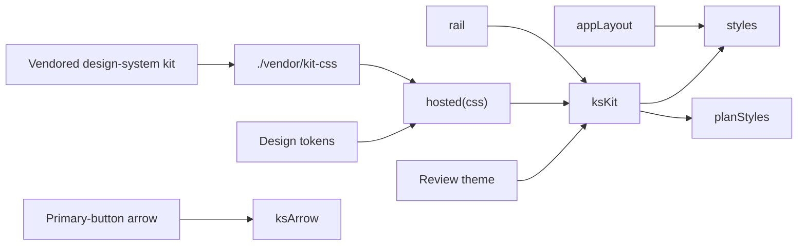
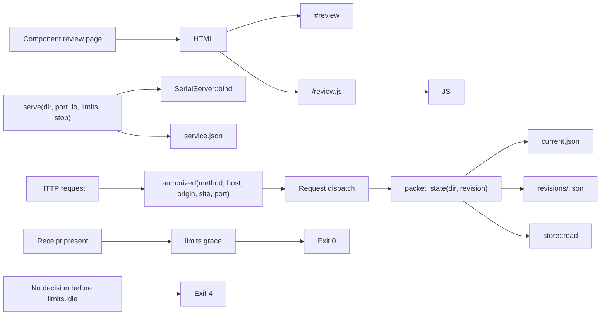
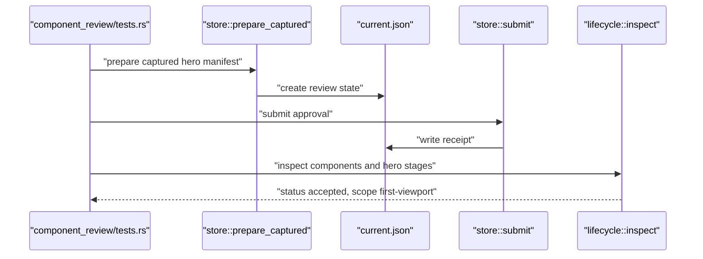

<!-- source: DeepWiki mcp.deepwiki.com · repo pbakaus/impeccable · page 7.2 Component Review UI · fetched 2026-10-30 -->

# Component Review UI

Relevant source files

The following files were used as context for generating this wiki page:

- [crates/common/Cargo.toml](crates/common/Cargo.toml)
- [crates/common/src/http.rs](crates/common/src/http.rs)
- [crates/context/Cargo.toml](crates/context/Cargo.toml)
- [crates/context/assets/component-review.js](crates/context/assets/component-review.js)
- [crates/context/src/component_review/server.rs](crates/context/src/component_review/server.rs)
- [crates/context/src/component_review/tests.rs](crates/context/src/component_review/tests.rs)
- [crates/context/src/generate_image.rs](crates/context/src/generate_image.rs)
- [crates/context/src/http.rs](crates/context/src/http.rs)
- [crates/context/src/lib.rs](crates/context/src/lib.rs)
- [crates/context/src/serve_question.rs](crates/context/src/serve_question.rs)
- [crates/live/src/live_http.rs](crates/live/src/live_http.rs)
- [docs/ENGINE.md](docs/ENGINE.md)
- [ui/component-review/entry.ts](ui/component-review/entry.ts)
- [ui/component-review/kit.ts](ui/component-review/kit.ts)
- [ui/component-review/plan-review.ts](ui/component-review/plan-review.ts)
- [ui/component-review/plan-styles.ts](ui/component-review/plan-styles.ts)
- [ui/component-review/styles.ts](ui/component-review/styles.ts)

## Purpose and scope

Section 7.2 documents the component-review browser interface, its Rust server under `crates/context/src/component_review`, and the demo area. The available implementation details establish how the UI kit and styles are assembled, how the server publishes the review page and serves packet state, and how review decisions are persisted and inspected. The UI modules and demos are identified by their paths, but their implementation details are not expanded here where their contents were not provided. [ui/component-review/kit.ts:1-9](); [ui/component-review/styles.ts:1-19](); [ui/component-review/plan-styles.ts:1-80](); [crates/context/src/component_review/server.rs:1-154](); [crates/context/src/lib.rs:49-53]()

Sources: [ui/component-review/kit.ts:1-9](); [ui/component-review/styles.ts:1-19](); [ui/component-review/plan-styles.ts:1-80](); [crates/context/src/component_review/server.rs:1-154](); [crates/context/src/lib.rs:49-53]()

## Component map

`ui/component-review` contains the browser-facing review UI. The provided files show the kit adapter in `kit.ts`, the component review styles in `styles.ts`, and plan-review styles in `plan-styles.ts`. The cluster also includes `entry.ts`, `model`, `plan-review.ts`, `viewport`, and `fonts/vendor`; their exact functions and data structures are not available in the provided file excerpts. [ui/component-review/kit.ts:1-9](); [ui/component-review/styles.ts:1-19](); [ui/component-review/plan-styles.ts:1-80](); [ui/component-review/entry.ts:1-1](); [ui/component-review/plan-review.ts:1-1]()

The Rust implementation is exposed as the `component_review` module of `impeccable-context`. Its server is `crates/context/src/component_review/server.rs`; the crate also has component-review tests covering captured reviews, lifecycle behavior, approvals, and hosted capture routing. [crates/context/src/lib.rs:49-53](); [crates/context/src/component_review/server.rs:1-19](); [crates/context/src/component_review/tests.rs:1-46]()

| Area | Code entity | Responsibility established by the available source |
|---|---|---|
| Design-system adapter | `ui/component-review/kit.ts` | Imports vendored tokens, kit styles, and rail styles; adapts token selectors for shadow roots; exports the combined `ksKit` string and `ksArrow` markup. [ui/component-review/kit.ts:1-9]() |
| Main review styling | `ui/component-review/styles.ts` | Combines `appLayout` and `ksKit` with styles for review controls, comparison, component inventory, and responsive layout. [ui/component-review/styles.ts:1-19]() |
| Plan review styling | `ui/component-review/plan-styles.ts` | Combines `ksKit` with styles for the plan-and-asset review stage. [ui/component-review/plan-styles.ts:1-80]() |
| Review server | `crates/context/src/component_review/server.rs` | Embeds the review JavaScript, defines the HTML shell and CSS, starts a localhost server, and reads packet state. [crates/context/src/component_review/server.rs:14-19](); [crates/context/src/component_review/server.rs:52-80](); [crates/context/src/component_review/server.rs:91-109]() |
| Review tests | `crates/context/src/component_review/tests.rs` | Exercises review preparation, submission, lifecycle inspection, and hosted-capture behavior. [crates/context/src/component_review/tests.rs:10-46](); [crates/context/src/component_review/tests.rs:94-107]() |
| Demos | `demos/` | Demo files are within the requested scope, but their implementation was not included in the supplied contents. [demos/1-1]() |

Sources: [ui/component-review/kit.ts:1-9](); [ui/component-review/styles.ts:1-19](); [ui/component-review/plan-styles.ts:1-80](); [crates/context/src/component_review/server.rs:14-109](); [crates/context/src/component_review/tests.rs:10-46](); [crates/context/src/component_review/tests.rs:94-107](); [demos/1-1]()

## UI kit, tokens, and styles

### Vendored kit integration

`kit.ts` imports `tokens`, `kit`, and `rail` from `./vendor/kit-css`, and imports `theme.css` as text. The adapter’s `hosted` function rewrites `:root` selectors to `:root, :host`, allowing token blocks to apply inside shadow roots. `ksKit` concatenates the adapted token and kit CSS, rail CSS, and review theme. The module also exports `ksArrow`, the site’s primary-button arrow markup. [ui/component-review/kit.ts:1-9]()

The kit source comment identifies the vendored styles as originating from `impeccable-site`, with `vendor/` and `scripts/sync-kinpaku-kit.mjs` named as the vendoring and synchronization path. The site is described there as the source of truth. [ui/component-review/kit.ts:1-4]()

### Review styling

`styles.ts` imports `appLayout` and `ksKit`, then exports a `styles` template string containing component-review CSS. Its declarations cover review-peer controls, host-level design tokens, form and button defaults, the main review header, comparison workbench, component map and pins, crop and asset presentation, decision controls, coordinates, and component inventory. [ui/component-review/styles.ts:1-15]()

The stylesheet lays out the workbench as two columns on wider screens and switches it to a single column at widths up to 800px. It also adapts header sizing, hides the connector at the narrow breakpoint, and adjusts the footer and inspector presentation. [ui/component-review/styles.ts:13-19]()

### Plan-review styling

`plan-styles.ts` exports `planStyles`, formed by concatenating `ksKit` with plan-review CSS. The provided styles define a viewport-height host, shared typography and focus treatment, stage-level layout, a top bar with per-item status lights, banners, screen containers, and arrival animations. The file’s opening comment describes the plan-and-asset review as using the vendored kit and tokens. [ui/component-review/plan-styles.ts:1-14](); [ui/component-review/plan-styles.ts:28-68]()

### Natural-language concepts mapped to code entities

The diagram maps UI concepts named by the supplied implementation to the code symbols that implement their styling and presentation. [ui/component-review/kit.ts:1-9](); [ui/component-review/styles.ts:1-19](); [ui/component-review/plan-styles.ts:1-80]()

**Diagram: UI design-system concepts to code entities**

Sources: [ui/component-review/kit.ts:1-9](); [ui/component-review/styles.ts:1-3](); [ui/component-review/plan-styles.ts:1-5]()

## Server and review-state flow

### Server setup and page assets

The server embeds `component-review.js` as `JS`, defines an HTML shell whose main mount point is `#review`, and serves `/review.js` as a deferred script. Its CSS constant defines font faces for Albert Sans, Alumni Sans, and JetBrains Mono, then appends `ui/component-review/theme.css`. The decision-body limit is 512 KiB. [crates/context/src/component_review/server.rs:14-19]()

`serve` validates that `current.json` can be read before binding a `SerialServer` to `127.0.0.1`. It records the actual URL and process ID in `service.json`, prints the service record, and removes that registration on drop if it still belongs to the current process. [crates/context/src/component_review/server.rs:91-108]()

The server’s trusted Content Security Policy disables sources by default and allows the review script, styles, images, fonts, same-origin connections, and same-origin frames under the listed directives. Responses include no-store caching, `nosniff`, the CSP, and a no-referrer policy; font responses also receive an allow-origin header. [crates/context/src/component_review/server.rs:20-35](); [crates/context/src/component_review/server.rs:109-109]()

### Request authorization and packet-state selection

`authorized` requires the `Host` header to match `127.0.0.1:<port>`. For `POST`, it additionally requires an `Origin` matching the local server URL and `Sec-Fetch-Site: same-origin`. The request loop checks this before dispatching a request and responds with `403` when authorization fails. [crates/context/src/component_review/server.rs:39-51](); [crates/context/src/component_review/server.rs:131-148]()

`packet_state` reads `current.json` by default. If a requested revision differs from the current packet revision, it validates the revision string as 64 hexadecimal characters, reads `revisions/<revision>.json`, and verifies that the stored packet revision matches. The returned JSON includes `packet`, `draft`, `history`, `receipt`, `sourceStatus`, and `historical`. For a non-historical, open review, it obtains `sourceStatus` from `store::sources_current`; a historical unsubmitted review receives a superseded-capture status. [crates/context/src/component_review/server.rs:52-81]()

### Server lifecycle

`serve` polls requests with a timeout of at most one second. It exits with status `0` after the configured grace period when the current state has a receipt, and exits with status `4` when the idle limit is reached without a decision or when the stop flag is set. The server tracks activity by resetting its quiet-time clock when a request arrives. [crates/context/src/component_review/server.rs:83-90](); [crates/context/src/component_review/server.rs:110-130]()

The request dispatcher shown in the supplied excerpt serves the page at `GET /` and the embedded review script at `GET /review.js`. The remainder of the dispatch table was not included, so other routes are not enumerated here. [crates/context/src/component_review/server.rs:149-154]()

### Natural-language concepts mapped to server entities

This diagram connects the review session’s user-facing lifecycle to the concrete Rust symbols present in the server implementation. [crates/context/src/component_review/server.rs:39-51](); [crates/context/src/component_review/server.rs:52-81](); [crates/context/src/component_review/server.rs:91-154]()

**Diagram: review session concepts to server code entities**

Sources: [crates/context/src/component_review/server.rs:14-19](); [crates/context/src/component_review/server.rs:39-81](); [crates/context/src/component_review/server.rs:83-108](); [crates/context/src/component_review/server.rs:110-154]()

## Review lifecycle and tests

The component-review tests exercise a captured review flow in which a hero-stage manifest is prepared, the current state is approved, a receipt is produced, and lifecycle inspection reports the review as accepted with `first-viewport` scope. The test also verifies that preparing another assembly ID or a kit request does not create a new round or alter the receipt. [crates/context/src/component_review/tests.rs:10-46]()

Other tests verify that a new build does not inherit a terminal review, that “needs work” and unverified receipts do not close a review, and that hosted capture routes to the review tool before browser or store access. [crates/context/src/component_review/tests.rs:48-92](); [crates/context/src/component_review/tests.rs:94-107]()

A hosted-lifecycle test covers when a components review remains owed: absent or unmeasured plan specs keep that stage pending, a spec containing only text can release the kit review while leaving hero review pending, and a raster `plate` region makes the kit review owed again. [crates/context/src/component_review/tests.rs:109-134]()

**Diagram: tested captured-review path**

Sources: [crates/context/src/component_review/tests.rs:10-46]()

## Entry points, models, viewport, fonts, and demos

The supplied file list identifies `entry.ts`, `model`, `plan-review.ts`, and `viewport` as part of the UI cluster, but does not include their source contents. Consequently, their exported symbols, event handling, state model, viewport behavior, and module-to-module calls cannot be described reliably from the available evidence. [ui/component-review/entry.ts:1-1](); [ui/component-review/plan-review.ts:1-1]()

The server’s CSS embeds font-face declarations for Albert Sans, Alumni Sans, and JetBrains Mono, with font URLs under `/fonts/`. The UI styling also references display and monospace font variables. The specific font files and vendor implementation were not included in the supplied contents. [crates/context/src/component_review/server.rs:14-16](); [ui/component-review/styles.ts:12-14](); [ui/component-review/plan-styles.ts:15-15]()

The `demos/` directory is in scope for the page, but no demo file names or contents were provided. No demo behavior is therefore inferred here. [demos/1-1]()

Sources: [ui/component-review/entry.ts:1-1](); [ui/component-review/plan-review.ts:1-1](); [crates/context/src/component_review/server.rs:14-16](); [ui/component-review/styles.ts:12-14](); [ui/component-review/plan-styles.ts:15-15](); [demos/1-1]()

## Implementation notes

- `impeccable-context` declares `component_review` as a public module, alongside the other context modules. [crates/context/src/lib.rs:49-53]()
- The server uses the shared `SerialServer` HTTP implementation and caps decision request bodies at `MAX_DECISION + 1` bytes so that an oversized body can be distinguished from one exactly at the configured limit. [crates/context/src/component_review/server.rs:5-19](); [crates/context/src/component_review/server.rs:91-95]()
- The review UI’s kit CSS is composed at runtime from vendored kit assets, rail styles, and the review theme; plan-review styling reuses the same `ksKit` string. [ui/component-review/kit.ts:4-9](); [ui/component-review/plan-styles.ts:4-5]()
- The server reports whether a packet is historical and exposes source-current status with packet, draft, history, and receipt data. [crates/context/src/component_review/server.rs:52-81]()

Sources: [crates/context/src/lib.rs:49-53](); [crates/context/src/component_review/server.rs:5-19](); [crates/context/src/component_review/server.rs:52-95](); [ui/component-review/kit.ts:4-9](); [ui/component-review/plan-styles.ts:4-5]()

---

