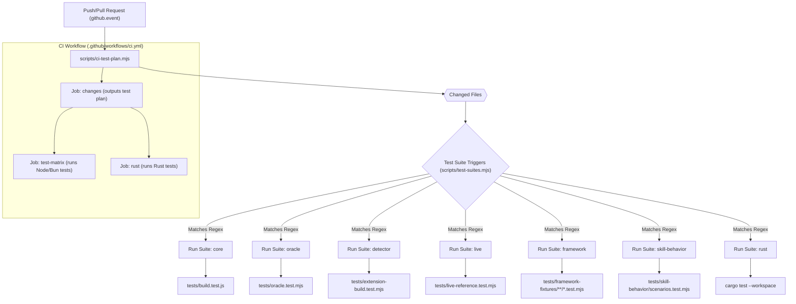

<!-- source: DeepWiki mcp.deepwiki.com · repo pbakaus/impeccable · page 8 Testing and Quality Assurance · fetched 2026-10-30 -->

# Testing and Quality Assurance

Relevant source files

The following files were used as context for generating this wiki page:

- [.github/workflows/ci.yml](.github/workflows/ci.yml)
- [.github/workflows/sync-generated-output.yml](.github/workflows/sync-generated-output.yml)
- [.gitignore](.gitignore)
- [AGENTS.md](AGENTS.md)
- [CLAUDE.md](CLAUDE.md)
- [README.md](README.md)
- [README.npm.md](README.npm.md)
- [crates/context/src/pin.rs](crates/context/src/pin.rs)
- [crates/skills/src/providers.rs](crates/skills/src/providers.rs)
- [docs/HARNESSES.md](docs/HARNESSES.md)
- [scripts/build.js](scripts/build.js)
- [scripts/lib/rust-test-selection.mjs](scripts/lib/rust-test-selection.mjs)
- [scripts/lib/transformers/index.js](scripts/lib/transformers/index.js)
- [scripts/lib/transformers/providers.js](scripts/lib/transformers/providers.js)
- [scripts/lib/utils.js](scripts/lib/utils.js)
- [scripts/test-rust-changed.mjs](scripts/test-rust-changed.mjs)
- [scripts/test-suites.mjs](scripts/test-suites.mjs)
- [tests/lib/transformers/providers.test.js](tests/lib/transformers/providers.test.js)
- [tests/rust-test-selection.test.mjs](tests/rust-test-selection.test.mjs)

This page provides a high-level overview of Impeccable's comprehensive testing strategy, which ensures the quality and reliability of its Rust engine, skill behaviors, and distribution artifacts. The testing approach spans multiple layers, from low-level unit tests to complex end-to-end scenarios involving live browser interactions and AI agent simulations.

## Rust Unit and Integration Tests

The core of Impeccable's anti-pattern detection and live mode functionality is implemented in Rust. The Rust workspace (`crates/`) includes its own suite of unit and integration tests, executed via `cargo test --workspace` [AGENTS.md:10](). These tests validate the correctness of individual components and their interactions within the engine. For focused development, `bun run test:rust-changed` can execute tests only for crates affected by recent changes, including their dependents [AGENTS.md:11]().

Sources: [AGENTS.md:10-11]()

## Oracle Golden Test System

The Oracle Golden Test System is a critical component for ensuring the deterministic behavior of the Impeccable engine. It involves replaying a corpus of "golden records" against the current engine binary and comparing outputs to detect regressions. This system pins the observable behavior of the engine, especially for verbs defined in `docs/CLI-CONTRACT.md` [CLAUDE.md:17](). New test cases are recorded from the binary and manually reviewed [CLAUDE.md:24]().

For details, see [Oracle Golden Test System](#8.1).

Sources: [CLAUDE.md:17](), [CLAUDE.md:23-24]()

## Detector Fixtures and Parity

The anti-pattern detection engine is rigorously tested using a comprehensive set of fixtures. These fixtures are categorized into "should-flag" and "should-pass" corpuses, covering various design anti-patterns, consent flows, overlay handling, and validity checks. The goal is to ensure parity in detection capabilities across different engine types: static HTML analysis, browser-based DOM inspection, and snapshot-based analysis.

For details, see [Detector Fixtures and Parity](#8.2).

Sources: [AGENTS.md:5]()

## Framework Fixtures and Live E2E

Impeccable's live mode and integration with various frontend frameworks are validated through a dedicated set of framework fixtures and live end-to-end (E2E) tests. These tests cover popular frameworks like Vite, Next.js, Nuxt, SvelteKit, Astro, and TanStack, including monorepo setups and different Content Security Policy (CSP) variants. The live E2E harness simulates agent interactions, UI operations, and CLI option suites to ensure seamless functionality in real-world development environments.

For details, see [Framework Fixtures and Live E2E](#8.3).

Sources: [scripts/test-suites.mjs:175]()

## Skill Behavior and Reference Tests

The behavior of the Impeccable skill, particularly its interaction with Large Language Models (LLMs) and AI coding agents, is validated through specific skill behavior and reference tests. These tests cover LLM routing scenarios, ensuring the agent correctly interprets commands and executes workflows. The `skill-reference` lint tests verify the integrity and consistency of the skill's documentation and command definitions. New work E2E tests validate the entire flow of creating new design surfaces, and CI test plan generation ensures that relevant tests are run based on code changes.

For details, see [Skill Behavior and Reference Tests](#8.4).

Sources: [scripts/test-suites.mjs:10-13](), [AGENTS.md:20]()

## Test Suite Overview

The following diagram illustrates the relationship between different test suites and the components they validate.

### Impeccable Test Strategy Overview

```mermaid
graph TD
    A["Codebase Changes"] --> B{{"CI Test Plan (scripts/ci-test-plan.mjs)"}}
    B --> C["Rust Tests (cargo test)"]
    B --> D["Oracle Golden Replay (tests/oracle.test.mjs)"]
    B --> E["Detector Fixtures (tests/fixtures/antipatterns)"]
    B --> F["Framework Fixtures (tests/framework-fixtures)"]
    B --> G["Live E2E (tests/live-e2e)"]
    B --> H["Skill Behavior (tests/skill-behavior)"]

    C --> C1["crates/core"]
    C --> C2["crates/detect"]
    C --> C3["crates/live"]
    C --> C4["crates/comp"]

    D --> D1["Engine Binary (target/release/impeccable)"]
    D --> D2["CLI Contract (docs/CLI-CONTRACT.md)"]

    E --> E1["Static HTML Engine"]
    E --> E2["Browser Engine (CDP)"]
    E --> E3["Snapshot Engine"]

    F --> F1["Vite, Next.js, Nuxt, SvelteKit, Astro"]
    F --> F2["Monorepos, CSP Variants"]

    G --> G1["Live Server (crates/live)"]
    G --> G2["Browser Overlay (skill/scripts/live-browser.js)"]
    G --> G3["Agent-Target Protocol"]

    H --> H1["LLM Routing Scenarios"]
    H --> H2["Skill Reference Lint"]
    H --> H3["New Work E2E"]

    subgraph "Test Runners"
        C["Rust Tests"] -- "Rustup" --> R1["cargo"]
        D["Oracle Golden Replay"] -- "Node.js" --> R2["bun test"]
        E["Detector Fixtures"] -- "Node.js, Puppeteer" --> R2
        F["Framework Fixtures"] -- "Node.js, Playwright" --> R2
        G["Live E2E"] -- "Node.js, Playwright" --> R2
        H["Skill Behavior"] -- "Node.js, LLM APIs" --> R2
    end

    style R1 fill:#fff,stroke:#333,stroke-width:2px
    style R2 fill:#fff,stroke:#333,stroke-width:2px
```

Sources: [scripts/test-suites.mjs:4-14](), [CLAUDE.md:17](), [AGENTS.md:10](), [AGENTS.md:20]()

## Test Execution and CI Integration

Tests are executed using a combination of `bun test` and `node --test` [AGENTS.md:47](). The Continuous Integration (CI) workflow, defined in `.github/workflows/ci.yml`, dynamically selects which test suites to run based on the changes in a pull request [scripts/ci-test-plan.mjs](). This ensures efficient feedback by only running relevant tests. For example, changes to Rust code trigger the `rust` suite, while changes to the extension trigger the `detector` suite [scripts/test-suites.mjs:103-144]().

### CI Test Plan Generation

Sources: [.github/workflows/ci.yml:3-50](), [scripts/ci-test-plan.mjs](), [scripts/test-suites.mjs:29-439]()

---

