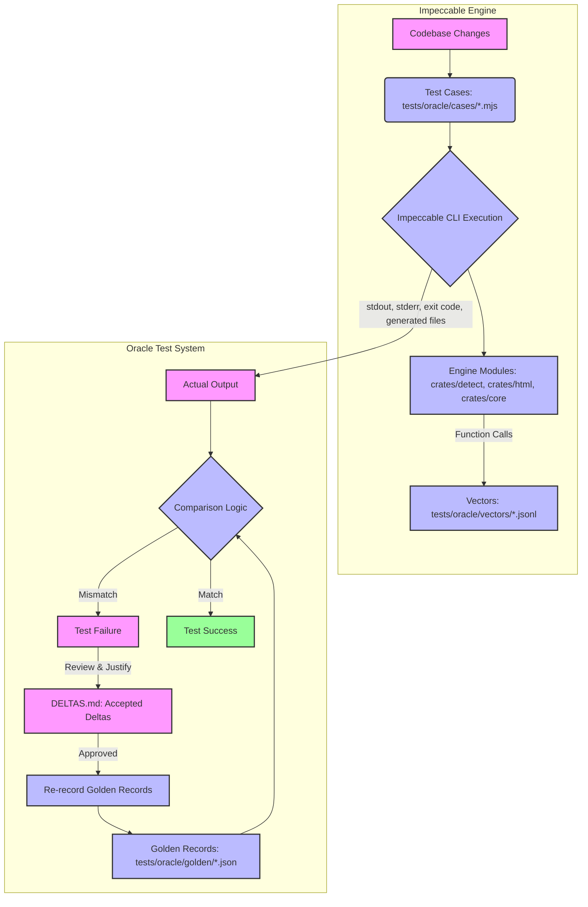
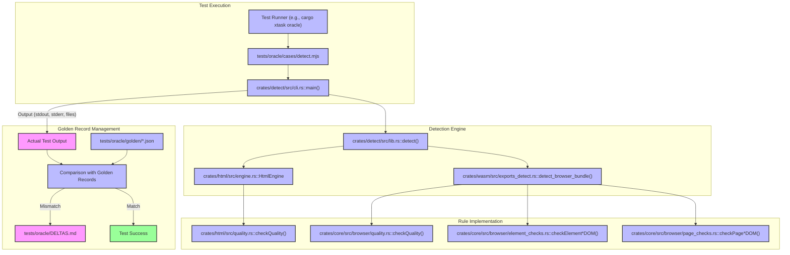

<!-- source: DeepWiki mcp.deepwiki.com · repo pbakaus/impeccable · page 8.1 Oracle Golden Test System · fetched 2026-10-30 -->

# Oracle Golden Test System

<details>
<summary>Relevant source files</summary>

The following files were used as context for generating this wiki page:

- [crates/core/src/browser/element_checks.rs](crates/core/src/browser/element_checks.rs)
- [crates/core/src/browser/page_checks.rs](crates/core/src/browser/page_checks.rs)
- [crates/core/src/browser/quality.rs](crates/core/src/browser/quality.rs)
- [crates/detect/src/cli.rs](crates/detect/src/cli.rs)
- [crates/detect/src/github_annotations.rs](crates/detect/src/github_annotations.rs)
- [crates/detect/src/lib.rs](crates/detect/src/lib.rs)
- [crates/detect/tests/github_annotations.rs](crates/detect/tests/github_annotations.rs)
- [crates/html/src/cascade/build.rs](crates/html/src/cascade/build.rs)
- [crates/html/src/engine.rs](crates/html/src/engine.rs)
- [crates/html/src/quality.rs](crates/html/src/quality.rs)
- [crates/html/tests/ignored_linked_stylesheet.rs](crates/html/tests/ignored_linked_stylesheet.rs)
- [crates/live/assets/detect-antipatterns-browser.js](crates/live/assets/detect-antipatterns-browser.js)
- [crates/wasm/src/exports_detect.rs](crates/wasm/src/exports_detect.rs)
- [tests/oracle/DELTAS.md](tests/oracle/DELTAS.md)
- [tests/oracle/cases/detect.mjs](tests/oracle/cases/detect.mjs)
- [tests/oracle/golden/detect-dir-json-all-fixtures.json](tests/oracle/golden/detect-dir-json-all-fixtures.json)
- [tests/oracle/golden/detect-dir-quiet-all-fixtures.json](tests/oracle/golden/detect-dir-quiet-all-fixtures.json)
- [tests/oracle/golden/detect-dir-text-all-fixtures.json](tests/oracle/golden/detect-dir-text-all-fixtures.json)
- [tests/oracle/golden/detect-fixture-json-not-at-rest-html.json](tests/oracle/golden/detect-fixture-json-not-at-rest-html.json)
- [tests/oracle/golden/detect-fixture-json-painted-at-capture-html.json](tests/oracle/golden/detect-fixture-json-painted-at-capture-html.json)
- [tests/oracle/golden/detect-fixture-text-not-at-rest-html.json](tests/oracle/golden/detect-fixture-text-not-at-rest-html.json)
- [tests/oracle/golden/detect-fixture-text-painted-at-capture-html.json](tests/oracle/golden/detect-fixture-text-painted-at-capture-html.json)
- [tests/oracle/golden/detect-github-clean.json](tests/oracle/golden/detect-github-clean.json)
- [tests/oracle/golden/detect-github-json.json](tests/oracle/golden/detect-github-json.json)
- [tests/oracle/golden/detect-help.json](tests/oracle/golden/detect-help.json)
- [tests/oracle/golden/detect-no-advisory-json.json](tests/oracle/golden/detect-no-advisory-json.json)
- [tests/oracle/golden/detect-no-advisory-text.json](tests/oracle/golden/detect-no-advisory-text.json)
- [tests/oracle/golden/detect-scope-both.json](tests/oracle/golden/detect-scope-both.json)
- [tests/oracle/golden/detect-scope-layout-text.json](tests/oracle/golden/detect-scope-layout-text.json)
- [tests/oracle/golden/detect-scope-type.json](tests/oracle/golden/detect-scope-type.json)

</details>


This page documents the Oracle Golden Test System, located in `tests/oracle/` [tests/oracle/DELTAS.md:1-2](). This system is crucial for ensuring the deterministic behavior and correctness of the Impeccable engine across different environments and versions. It captures the expected output of various commands and detector runs, allowing for precise regression testing and verification of changes.

The system comprises several key components: test cases, workspaces, vectors, golden records, and a formal review process for accepted deltas. It emphasizes deterministic environments to guarantee reproducible results and provides a clear workflow for re-recording golden records when intentional changes occur.

## Test Cases and Workspaces

Test cases are defined as individual scenarios that exercise specific functionalities of the Impeccable engine. These cases are typically JavaScript files (e.g., `tests/oracle/cases/detect.mjs` [tests/oracle/cases/detect.mjs:1-1]()) that invoke the `impeccable` CLI with various arguments and configurations.

Each test case operates within a dedicated workspace, which is a self-contained directory structure that mimics a real project. These workspaces can include HTML files, CSS, JavaScript, and other assets necessary to simulate a particular testing scenario. For instance, detector tests might use HTML files with specific anti-patterns to verify detection logic.

The `tests/oracle/` directory contains these cases and their associated workspaces. When a test runs, it executes the specified command within its workspace, capturing its `stdout`, `stderr`, and `exit` code.

## Vectors and Golden Records

**Vectors** are inputs to specific functions or modules within the Impeccable engine. They are typically JSONL (JSON Lines) files that record the arguments passed to a function and the expected return value. This allows for fine-grained testing of internal logic, especially for complex algorithms like those in the anti-pattern detection engine. For example, `tests/oracle/vectors/calls/rules.checks/checkHtmlPatterns.jsonl` [tests/oracle/DELTAS.md:72-73]() contains frozen call vectors for the `checkHtmlPatterns` function.

**Golden Records** are the expected outputs for each test case. These are JSON files stored in `tests/oracle/golden/` [tests/oracle/golden/detect-dir-text-all-fixtures.json:1-1](). A golden record captures the `stdout`, `stderr`, `exit` code, and any generated files from a test run.

For example, `detect-dir-json-all-fixtures.json` [tests/oracle/golden/detect-dir-json-all-fixtures.json:1-1]() is a golden record for a detector run that outputs JSON, while `detect-dir-text-all-fixtures.json` [tests/oracle/golden/detect-dir-text-all-fixtures.json:1-2]() captures the text output. The test runner compares the actual output of a test run against its corresponding golden record. Any discrepancy indicates a regression or an intentional change that needs to be reviewed.

### Golden Record Structure

A typical golden record JSON file has the following structure:

```json
{
  "stdout": "...",
  "stderr": "...",
  "exit": 0,
  "signal": null,
  "files": {
    "path/to/file1.txt": "content of file1",
    "path/to/file2.json": {
      "key": "value"
    }
  }
}
```

- `stdout`: The standard output of the command.
- `stderr`: The standard error output of the command.
- `exit`: The exit code of the command.
- `signal`: The signal that terminated the process, if any.
- `files`: An object mapping file paths to their expected content. This is used for commands that generate or modify files.

Sources:
- [tests/oracle/golden/detect-dir-text-all-fixtures.json:1-7]()
- [tests/oracle/golden/detect-dir-json-all-fixtures.json:1-1]()
- [tests/oracle/golden/detect-dir-quiet-all-fixtures.json:1-7]()
- [tests/oracle/golden/detect-no-advisory-text.json:1-2]()
- [tests/oracle/golden/detect-no-advisory-json.json:1-1]()
- [tests/oracle/golden/detect-scope-both.json:1-1]()
- [tests/oracle/golden/detect-scope-type.json:1-1]()
- [tests/oracle/golden/detect-help.json:1-1]()
- [tests/oracle/golden/detect-fixture-json-painted-at-capture-html.json:1-1]()
- [tests/oracle/golden/detect-fixture-text-painted-at-capture-html.json:1-2]()
- [tests/oracle/golden/detect-fixture-json-not-at-rest-html.json:1-1]()
- [tests/oracle/golden/detect-fixture-text-not-at-rest-html.json:1-2]()
- [tests/oracle/golden/detect-github-json.json:1-1]()
- [tests/oracle/golden/detect-github-clean.json:1-2]()

## DELTAS.md Review Process

The `tests/oracle/DELTAS.md` [tests/oracle/DELTAS.md:1-2]() file is a critical part of the golden test system. It documents intentional deviations from existing golden records. When a change in the codebase leads to a different output that is deemed correct and desirable, this change is recorded as an "accepted delta."

Each entry in `DELTAS.md` [tests/oracle/DELTAS.md:1-2]() specifies:
- The `case-id` of the test.
- What specifically differs from the previous golden record.
- The reason (`why`) the change is an improvement or expected behavior.

This process ensures that all changes to golden records are explicitly reviewed and approved, preventing accidental regressions from being overlooked. For example, the section "Recorded 2026-08-17: the engine names its own commands" [tests/oracle/DELTAS.md:9-10]() details changes in command output due to the engine printing its own verb names instead of script file names.

Sources:
- [tests/oracle/DELTAS.md:1-89]()

## Deterministic Environments

A core principle of the Oracle Golden Test System is determinism. Tests must produce the exact same output every time they are run, regardless of the execution environment, time, or other external factors. This is achieved through:

1.  **Controlled Inputs**: Test cases use fixed inputs and configurations.
2.  **Mocking External Dependencies**: Any external services or non-deterministic functions are mocked or stubbed to return predictable results.
3.  **Fixed Timestamps/Random Seeds**: Where time or randomness might influence output (e.g., in generated IDs or timestamps), these are fixed during testing.
4.  **Isolated Workspaces**: Each test runs in an isolated environment to prevent interference from other tests or the host system.

The `crates/live/assets/detect-antipatterns-browser.js` [crates/live/assets/detect-antipatterns-browser.js:1-143]() file, for instance, demonstrates efforts to ensure determinism by stashing native JavaScript built-ins (`__impeccableNatives`) to prevent page scripts from replacing them, which could lead to non-deterministic behavior in the browser-based detector.

Sources:
- [crates/live/assets/detect-antipatterns-browser.js:1-143]()

## Re-recording Workflow

When an intentional change to the codebase alters the expected output of a test, the golden record needs to be updated. This is done through a re-recording workflow:

1.  **Implement the Change**: Make the desired code modification.
2.  **Run Tests**: Execute the relevant tests. They will likely fail because their output no longer matches the old golden records.
3.  **Review Differences**: Carefully examine the differences between the actual output and the golden records.
4.  **Update DELTAS.md**: If the new output is correct and intended, add an entry to `DELTAS.md` [tests/oracle/DELTAS.md:1-2]() explaining the change and its justification.
5.  **Re-record Golden Records**: Use a designated command (e.g., `cargo xtask oracle --re-record <case-id>`) to update the golden JSON files with the new, correct output. This command effectively overwrites the old golden records with the current output.
6.  **Commit Changes**: Commit the updated code, `DELTAS.md` [tests/oracle/DELTAS.md:1-2](), and the new golden records.

This workflow ensures that golden records always reflect the current, intended behavior of the system, while `DELTAS.md` [tests/oracle/DELTAS.md:1-2]() provides a historical and auditable log of all accepted changes.

## Oracle Golden Test System Data Flow

The following diagram illustrates the data flow within the Oracle Golden Test System.


Diagram: Oracle Golden Test System Data Flow
Sources:
- [tests/oracle/cases/detect.mjs:1-1]()
- [tests/oracle/DELTAS.md:1-2]()
- [tests/oracle/vectors/calls/rules.checks/checkHtmlPatterns.jsonl]()
- [tests/oracle/golden/detect-dir-json-all-fixtures.json:1-1]()
- [crates/detect/src/cli.rs:1-1]()
- [crates/html/src/engine.rs:1-1]()
- [crates/core/src/browser/quality.rs:1-1]()
- [crates/core/src/browser/element_checks.rs:1-1]()
- [crates/core/src/browser/page_checks.rs:1-1]()

## Key Functions and Classes in Detector Testing

The anti-pattern detection engine is a primary consumer of the Oracle Golden Test System. Here's how some key components interact:


Diagram: Detector Testing Workflow with Oracle Golden System
Sources:
- [crates/detect/src/cli.rs:1-1]()
- [crates/detect/src/lib.rs:1-1]()
- [crates/html/src/engine.rs:1-1]()
- [crates/wasm/src/exports_detect.rs:1-1]()
- [crates/html/src/quality.rs:1-1]()
- [crates/core/src/browser/quality.rs:1-1]()
- [crates/core/src/browser/element_checks.rs:1-1]()
- [crates/core/src/browser/page_checks.rs:1-1]()
- [tests/oracle/cases/detect.mjs:1-1]()
- [tests/oracle/DELTAS.md:1-2]()
- [tests/oracle/golden/detect-dir-json-all-fixtures.json:1-1]()

The `HtmlEngine` [crates/html/src/engine.rs:1-1]() handles static HTML analysis, while the browser engine (exposed via `crates/wasm/src/exports_detect.rs` [crates/wasm/src/exports_detect.rs:1-1]()) performs dynamic DOM measurements. Both rely on various `checkQuality` [crates/html/src/quality.rs:1-1](), `checkElement*DOM` [crates/core/src/browser/element_checks.rs:1-1](), and `checkPage*DOM` [crates/core/src/browser/page_checks.rs:1-1]() functions to identify anti-patterns. The golden test system ensures that the findings from these engines are consistent and correct.

---

